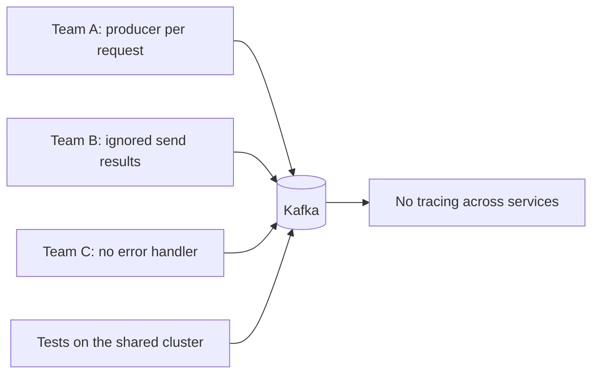
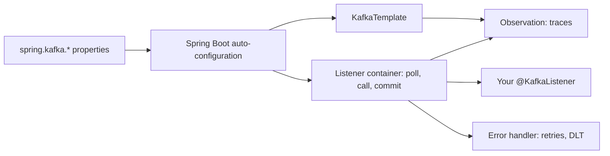

# Kafka with Spring Boot

**Messaging · Kafka · Step 2.2.12 · Intermediate** · Last updated 2026-10-21
**Prerequisites:** [Producers](03-producers-keys-acks-batching.md), [Consumers](04-consumers-consumer-groups.md), [Offset commits](05-offset-commits-delivery-guarantees.md), [Error handling](08-error-handling-retries-dlt.md) (2.2.3 to 2.2.8)

## 1. What it is and why it matters

**What is it?** Spring Boot configures Kafka from `spring.kafka.*` properties, gives you `KafkaTemplate` to send and `@KafkaListener` to receive, and lets you set commit behaviour, error handling, tracing and tests as configuration.

**Why do we need it?** Hand-built Kafka plumbing is repeated in every service and easy to get wrong: lost sends, wrong commits, missing error handling, no tracing.

**When would I meet it?** In almost every Java microservice that uses Kafka.

> [!TIP]
> **Memory hook:** a fully equipped rental kitchen: the appliances are installed; you bring the recipe and adjust the settings.

## 2. Mental model: a rental kitchen

| In the analogy | In Spring Kafka |
|---|---|
| Installed stove and fridge | **Auto-configuration** of producer and consumer factories |
| The oven you cook with | **`KafkaTemplate`** |
| The cook who checks the order rail and cooks each ticket | The **listener container** calling your `@KafkaListener` |
| House rules on the wall | Company defaults in `spring.kafka.*` properties |

**Where the analogy breaks:** the kitchen can't choose your recipe's safety; framework defaults (commit mode, error handling) still need deliberate choices for your business.

## 3. Industry terms

| Term | Simple meaning | Why it matters | Example | Related terms |
|---|---|---|---|---|
| **`KafkaTemplate`** | Spring's helper for sending | One shared, thread-safe producer | `template.send(...)` | Producer |
| **`@KafkaListener`** | Marks a method that receives events | Your business code | `onOrder(OrderPlaced e)` | Listener container |
| **Listener container** | Runs the poll loop, calls the listener, commits, handles errors | Owns delivery behaviour | `ConcurrentMessageListenerContainer` | Ack mode |
| **Ack mode** | When the container commits offsets | At-least-once behaviour | `BATCH` (default), `RECORD`, `MANUAL` | Committed offset |
| **Error handler** | What happens when the listener throws | Retries and dead-letter topics | `DefaultErrorHandler` | DLT |
| **Observation** | Micrometer metrics and tracing | Follow a message across services | Trace from HTTP to consumer | OpenTelemetry |

## 4. In a real system (ShopFlow)

**The business problem.** Every ShopFlow service should produce and consume safely and consistently, and support must be able to follow one order across services.

Each team wired Kafka differently: a producer created per request; ignored send results; no error handler, so a bad message blocked a partition; tests against the shared cluster; no way to trace an order from checkout to email.



**How Spring Boot helps.** One standard setup with company defaults: safe producer settings, a deliberate ack mode, an error handler with a DLT, observation on, and tests against an embedded or containerised broker, packaged as an internal starter.

**What it costs.** Teams must understand what the framework does for them; defaults vary between versions and must be set explicitly where they matter.

**Elsewhere:** platform teams publish an internal Spring Boot starter with company Kafka defaults (safe producer, explicit ack mode, error handler with DLT, tracing), so every team gets them with one dependency; support teams follow one order's trace from the HTTP request through `OrderPlaced` to the payment and email consumers; CI pipelines start a throwaway broker per build, so tests never touch shared environments.

## 5. How it works



1. **What starts it:** you add `spring-kafka` and set `spring.kafka.*` properties.
2. Spring Boot auto-configures `KafkaTemplate`, consumer and producer factories and a listener container factory; `NewTopic` beans are created at startup (existing topics are left alone).
3. Each `@KafkaListener` runs in a container that polls, calls your method (per record or per batch), commits according to the **ack mode**, and passes exceptions to the **error handler**.
4. `concurrency = N` starts N consumers per instance, each a group member.
5. With observation enabled on the template and containers, sends and receives become spans in a distributed trace.
6. Properties Boot doesn't expose by name go through `spring.kafka.properties.*`.

**Who guarantees what**

| Layer | Responsible for |
|---|---|
| Kafka broker and client | Storage, delivery, offsets |
| Spring Kafka | Commit timing (it sets the client's auto-commit to false unless you set it explicitly, and uses `BATCH`), retries, DLT publishing, observation |
| Spring Boot | Wiring beans from properties |
| Application | Idempotent listeners, handling send results, choosing ack mode and error policy |

> [!NOTE]
> Untested sketch to show the shape. Property names differ slightly between Spring Boot versions.

```yaml
spring:
  kafka:
    bootstrap-servers: kafka:9092
    producer:
      acks: all
      properties:
        enable.idempotence: true
    consumer:
      group-id: notification-service
      auto-offset-reset: latest   # a new group must not email last week's customers; groups that need history use earliest
    listener:
      ack-mode: record          # commit after each record (the default is BATCH)
      concurrency: 3            # 3 consumers per instance; keep instances × 3 ≤ partitions
```

```java
@KafkaListener(topics = "orders", groupId = "notification-service")
void onOrder(OrderPlaced e) { email.sendConfirmation(e); }   // exceptions go to the configured error handler
```

## 6. Failure scenarios

### Send results ignored

- **What happened?** A broker outage outlasted the delivery timeout; `send` failures were never checked.
- **What the business sees:** silently missing events.
- **Solutions:** handle the future's result; for critical events use an outbox ([2.2.15](15-kafka-connect-cdc.md)).
- **Trade-offs:** more code or infrastructure.

### Default error handling surprises a team

- **What happened?** A listener threw on a bad record. With no error handler configured, Spring Kafka (3.1 to 4.0, as documented) tried it 10 times with no delay, logged it at `ERROR` and moved on: the event was skipped, with no DLT.
- **Solutions:** configure the error handler explicitly (back-off, non-retryable exceptions, DLT).
- **Trade-offs:** none worth avoiding.

### Too much concurrency

- **What happened?** 4 instances × concurrency 3 = 12 consumers for 6 partitions.
- **What the business sees:** no extra throughput; idle threads.
- **Solutions:** match concurrency × instances to partitions.

## 7. Architectural decisions

| Choice | Option A | Option B |
|---|---|---|
| Test broker | `@EmbeddedKafka`: fast, in-process | Testcontainers: real broker image, closer to production, slower |
| Listener style | Record listener: per-record errors, observation supported | Batch listener: throughput; observation not supported; errors per batch |
| Scaling | More `concurrency` | More instances |
| Abstraction | Spring Kafka: full Kafka features | Higher-level abstractions: portable, hide Kafka specifics |

Package the decisions as an **internal starter**: safe producer, explicit ack mode, error handler with DLT, schema serializers, observation on.

**Common mistakes:** creating producers by hand instead of sharing `KafkaTemplate`; ignoring `send` results; turning client auto-commit back on for business events; no explicit error handler; blocking calls without timeouts in listeners; concurrency × instances above the partition count; integration tests against shared clusters.

## 8. Check your understanding

1. What does the listener container do between two calls to your listener?
2. Spring Kafka's default ack mode is `BATCH`. When are offsets committed, and what does a crash mid-batch cause?
3. Why should instances × concurrency not exceed the partition count?
4. How do you set a Kafka client property that Spring Boot has no named property for?

Answers are at the end of this note.

## 9. Revision

**Remember**
- **Properties in, beans out.**
- **One shared `KafkaTemplate`**; always handle send results.
- **The listener container = poll loop + commits + error handler.**
- Spring Kafka **sets client auto-commit to false unless you set it explicitly** (since 2.3) and commits per ack mode (`BATCH` by default).
- **Concurrency × instances ≤ partitions**; observation on; real brokers in tests.

**Explain in 15 seconds:** "Spring Boot auto-configures Kafka from spring.kafka properties; I send with KafkaTemplate, receive with @KafkaListener, and set ack mode, error handling, tracing and tests as standard configuration."

**Explain in 60 seconds:**
> "Spring Boot configures Kafka through spring.kafka properties and auto-configures the KafkaTemplate and listener container factory. I send with one shared KafkaTemplate and handle the send result. Listeners run in a container that polls, calls my method, commits according to the ack mode, which defaults to BATCH because Spring disables the client's auto-commit, and passes failures to an error handler that I configure with retries and a dead-letter topic. Concurrency times instances stays within partitions, observation puts messages into distributed traces, and tests use an embedded or containerised broker. I'd package these defaults as an internal starter."

**Likely follow-up questions:**
- **How do you scale a Spring Kafka consumer?** Concurrency per instance and more instances, up to the partition count.
- **How do you test Kafka code?** `@EmbeddedKafka` for speed, or Testcontainers with a real broker image for realism.
- **How do you trace a message across services?** Enable observation on the template and listener containers, so trace context travels in the record headers.

**Architect's takeaway:** standardise Kafka usage in a shared starter so every team gets the same durability, error handling and tracing without re-deciding them.

**Next topic:** [Retention, log compaction and tiered storage](13-retention-compaction-tiered-storage.md) (2.2.13)

## 10. Verification and sources

> [!NOTE]
> Checked 2026-10-21 by web search. Re-verify when you revisit this note.

- **Confirmed:** Spring Boot configures Kafka through `spring.kafka.*`, auto-configures `KafkaTemplate`, creates `NewTopic` beans at startup (existing topics left alone), and supports other properties through `spring.kafka.properties`; `@EmbeddedKafka` comes from `spring-kafka-test` (Spring Boot reference). Spring Kafka sets the client's `enable.auto.commit` to false by default (since 2.3) and defaults to ack mode `BATCH`; observation is enabled with `observationEnabled` on the template and container properties, replacing the plain Micrometer timers, and is not supported for batch listeners (Spring for Apache Kafka reference). The Spring Boot reference listed 4.1.x as the latest stable line when checked.
- **Assumptions and illustrations:** the ShopFlow story; configuration and code (not run).
- **Also confirmed:** `DefaultErrorHandler` defaults to `FixedBackOff(0L, 9)` (10 attempts, no delay), then logs the record, in the Spring for Apache Kafka reference for 3.1, 3.2, 3.3 and 4.0.7 (details in [2.2.8](08-error-handling-retries-dlt.md)).
- **To verify:** Spring Boot property names for enabling observation; Testcontainers service connections for Kafka.
- **Decision rule:** a shared starter with safe defaults, record listeners unless throughput demands batches, observation on, real brokers in tests.

**Sources:** Spring Boot reference, "Apache Kafka Support"; Spring for Apache Kafka reference (container properties, error handling, observation).

## Answers

1. It polls the next batch, tracks which records have been processed, commits offsets according to the ack mode, and routes exceptions to the error handler. Heartbeats are sent by the Kafka client's own background thread.
2. After all records returned by a poll have been processed by the listener. A crash in the middle means the batch's uncommitted records are delivered again, so listeners must be idempotent.
3. Each partition is assigned to one consumer per group, so consumers beyond the partition count are idle.
4. Through the `spring.kafka.properties.*` map (or the producer- or consumer-specific `properties` map), which passes the setting directly to the Kafka client.

Back to [the Kafka overview](01-kafka-overview.md) · [Index](../../README.md) · [Roadmap](../../roadmap.md).
