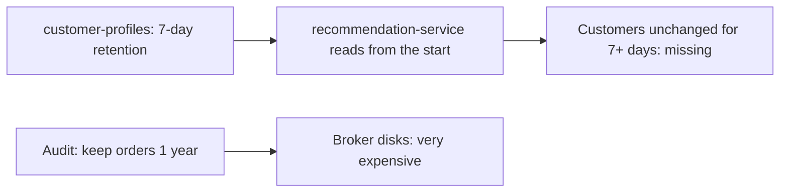
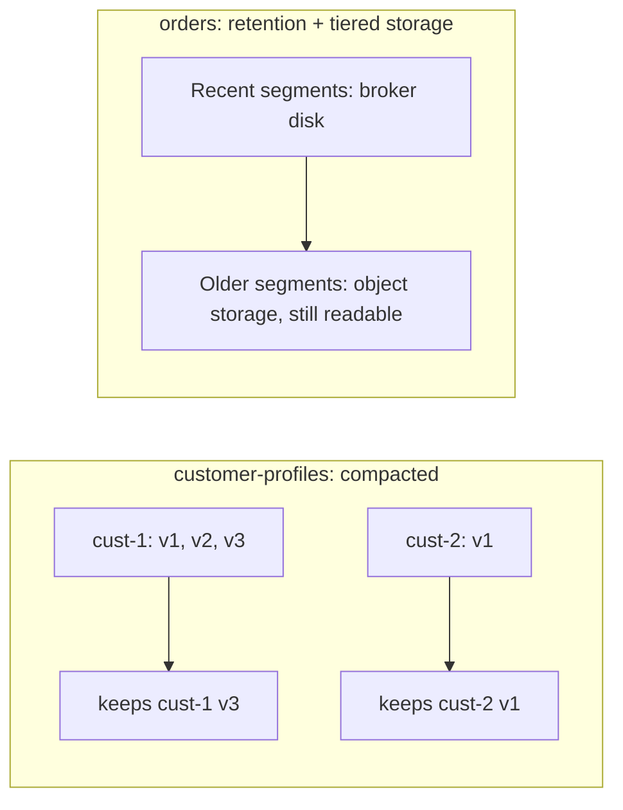

# Retention, Log Compaction and Tiered Storage

**Messaging · Kafka · Step 2.2.13 · Advanced** · Last updated 2026-10-21

> [!TIP]
> **In one sentence:** Kafka can forget old events by age or size (retention), keep only the latest event per key forever (log compaction), or move old data to cheap object storage while keeping it readable (tiered storage).
>
> **Memory hook:** three ways to manage a **paper archive**: shred everything older than a week (retention); keep only the latest version of each customer file (compaction); and move old boxes to a cheap warehouse that you can still fetch from (tiered storage).

## Where it fits

Step 2.2.13, the first advanced note of the [Kafka series](01-kafka-overview.md). It builds on how partitions are stored as segments, from [the log, topics, partitions and offsets](02-log-topics-partitions-offsets.md) (2.2.2). Next: [stream processing basics with Kafka Streams](14-kafka-streams-basics.md) (2.2.14), which uses compacted topics for its state.

## 1. The story

ShopFlow publishes customer profile changes to `customer-profiles`, with the default 7-day retention. A new `recommendation-service` starts and reads the topic from the beginning to build its list of customers. Customers who haven't changed their profile in the last 7 days are simply **missing**. Meanwhile, the compliance team asks to keep a year of `orders` for audits, and keeping that on broker disks would cost a fortune.



## 2. The idea

Choose a storage policy per topic, based on what the topic **means**:

- **Events that happened** (orders, clicks): keep them for a **time window** (retention), as long as consumers need to replay.
- **Current state per key** (customer profiles, product catalogue): use **log compaction**. Kafka keeps at least the **latest event for every key**, forever, so a new reader rebuilds the full current state.
- **Long history** (audits): use **tiered storage**. Recent segments stay on fast broker disks, older ones move to cheap object storage such as S3, and consumers can still read them.



To **delete** a key from a compacted topic, send a **tombstone**: the key with an empty (null) value. Compaction then removes the key, after the tombstone has been kept for a while so slow consumers also see the delete.

## 3. Key terms

| Term | Plain meaning |
|---|---|
| **Retention** | Deleting old segments by age or size |
| **`cleanup.policy`** | `delete` (retention), `compact` (latest per key), or both |
| **Log compaction** | Keeping at least the last value for each key, removing older ones |
| **Tombstone** | A record with a key and a null value: "delete this key" |
| **`delete.retention.ms`** | How long tombstones are kept before removal (default 24 hours) |
| **Segment** | A file of a partition's log; cleanup works segment by segment |
| **Tiered storage** | Older segments moved to remote object storage, still readable |
| **Storage footprint** | Daily volume × days kept × replication factor |

## 4. How it works, step by step

**Retention (`cleanup.policy=delete`):**
1. Events are appended to the active segment.
2. Closed segments older than the retention time (or beyond the size limit) are deleted by a periodic cleanup.

**Compaction (`cleanup.policy=compact`):**
1. A background cleaner reads closed segments.
2. For each key, it keeps the newest value and removes older ones.
3. Tombstones remove a key entirely, after `delete.retention.ms`.
4. Compaction is **eventual**: a reader may still see a few older values for a key, so consumers should simply take the **last value they see** per key.

**Tiered storage:**
1. Recent segments stay on local broker disk.
2. Older segments are copied to remote storage and removed locally.
3. Consumers reading old offsets are served from remote storage transparently (more slowly).

**Sizing storage:** 50 GB per day × 7 days × replication factor 3 ≈ **1 TB** of broker disk for one topic. Retention and replication multiply.

## 5. Real-world examples

- **Reference data:** a product catalogue topic is compacted, so any new service can rebuild the full catalogue by reading it from the start.
- **Audit and replay:** a bank keeps a year of transaction events with tiered storage, so the recent days are fast and the rest is cheap but still replayable.
- **Privacy deletions:** a user's data in a compacted topic is removed with a tombstone. In a retention-only topic you can't delete a single event; it disappears only when its segment expires, which matters for privacy requests.

## 6. Design choices and trade-offs

| Policy | Use for | Watch out for |
|---|---|---|
| **Delete (retention)** | Event streams: orders, clicks, logs | Data is gone after the window; no per-record delete |
| **Compact** | Current state per key: profiles, catalogue, settings | Not a history; consumers must handle older values and tombstones |
| **Compact + delete** | Latest per key, but only for a limited time | Both behaviours at once |
| **Tiered storage** | Long retention at low cost | Older reads are slower; compacted topics not supported yet |

**Retention is a business decision:** how far back must a new consumer or a bug-fix replay go? Longer retention means more disk, or tiered storage.

## 7. Common mistakes

1. **Using retention for "current state" topics**, so unchanged keys vanish (the story).
2. **Treating a compacted topic as a full history.**
3. **Short tombstone retention**, so a slow consumer never sees a delete and keeps stale data.
4. **Forgetting replication in disk sizing** (×3).
5. **Promising per-record deletion** on retention-only topics.
6. **Assuming compaction is instant**; it's background and eventual.

## 8. In code

> [!NOTE]
> Untested sketch to show the shape.

```bash
# Current state per key: compacted
kafka-topics.sh --bootstrap-server localhost:9092 --create --topic customer-profiles \
  --partitions 6 --replication-factor 3 --config cleanup.policy=compact

# Event stream kept 30 days
kafka-configs.sh --bootstrap-server localhost:9092 --alter \
  --entity-type topics --entity-name orders --add-config retention.ms=2592000000
```

```java
// Delete customer 42 from the compacted topic: a tombstone (null value)
kafkaTemplate.send("customer-profiles", "cust-42", null);
```

| Setting | What it controls |
|---|---|
| `cleanup.policy` | `delete`, `compact`, or `compact,delete` |
| `retention.ms` / `retention.bytes` | Age or size limit for retention |
| `delete.retention.ms` | How long tombstones are kept (default 24 hours) |
| `min.compaction.lag.ms` | Minimum age before a record may be compacted |
| `remote.log.storage.system.enable` | Turns on tiered storage on the broker |

## 9. Remember

- **Facts that happened → retention. Current state per key → compaction.**
- **Compaction keeps the latest value per key; tombstones delete keys.**
- **Compaction is eventual**: consumers keep the last value they see.
- **Tiered storage = long retention on cheap storage**, still readable.
- **Disk = daily volume × days × replication factor.**

## 10. Interview corner

**15-second answer:** "Retention deletes old segments by age or size, compaction keeps the latest value per key so a topic can hold current state, and tiered storage moves old segments to cheap object storage."

**60-second answer:**
> "I choose the cleanup policy from what the topic means. Event streams like orders use time-based retention, sized by how far back consumers need to replay, remembering that disk is daily volume times days times the replication factor. Topics that represent current state per key, like customer profiles, are compacted, so Kafka keeps at least the latest value for every key and new services can rebuild the full state; deletions are tombstones, kept long enough for slow consumers to see them. For long retention, like a year of audit data, tiered storage keeps recent segments on brokers and older ones in object storage, cheaper but slower to read."

**Likely follow-up questions:**
- **What is a tombstone?** A record with a key and a null value that tells compaction to remove the key.
- **Is a compacted topic a history?** No. It keeps the latest value per key, not every change.
- **Can you delete one event from a normal topic?** No, only by retention expiry; use compaction and tombstones when deletions are needed.
- **When would you use tiered storage?** Long retention where older data is read rarely.
- **How big will this topic be?** Daily volume × retention days × replication factor.

**Architect angle:** "Retention and cleanup policy are data-lifecycle decisions: I set them per topic from replay needs, privacy obligations and storage cost."

## 11. Industry check

> [!NOTE]
> Checked 2026-10-21 by web search (KIP pages, Conduktor, cleanup-strategy articles). Re-verify when you revisit the note.

- **Confirmed:** `cleanup.policy=compact` keeps messages by key rather than age; tombstones (null values) delete keys; `delete.retention.ms` defaults to 24 hours. Tiered storage (KIP-405, broker setting `remote.log.storage.system.enable`, available from Kafka 3.6) supports append-only delete-retention segments; support for compacted topics in tiered storage (KIP-1272) was still under discussion; with tiering enabled, compaction applies only to local segments.
- **To verify:** the Kafka version in which tiered storage became fully production-ready; the default `min.compaction.lag.ms`; which internal topics use compaction (for example the consumer offsets topic).
- **Decision rule:** retention for events, compaction for current state, tiered storage for long, rarely read history.

## 12. Going further

- Apache Kafka documentation: log compaction and topic configuration
- KIP-405 (tiered storage) and KIP-1272 (compacted topics in tiered storage)
- *Kafka: The Definitive Guide* (compaction)

**Next:** [Stream processing basics (Kafka Streams)](14-kafka-streams-basics.md) (2.2.14).

Back to [the Kafka overview](01-kafka-overview.md) · [Messaging overview](../01-messaging-overview.md) · [Index](../../README.md) · [Roadmap](../../roadmap.md).
