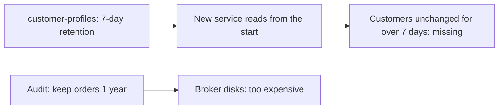
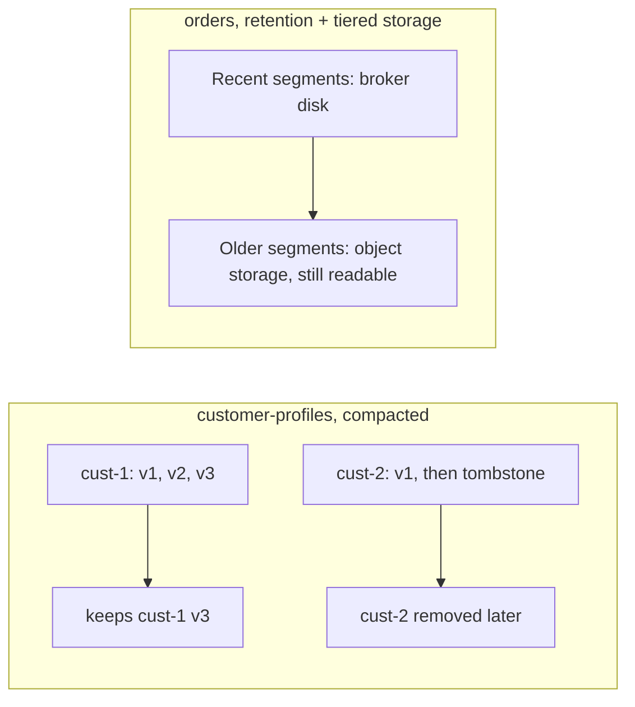

# Retention, Log Compaction and Tiered Storage

**Messaging · Kafka · Step 2.2.13 · Advanced** · Last updated 2026-10-21
**Prerequisites:** [The log, topics, partitions and offsets](02-log-topics-partitions-offsets.md) (2.2.2)

## 1. The concept in simple English

**What is it?** Three ways Kafka manages stored data: **retention** deletes old data by age or size; **log compaction** keeps at least the latest event for every key; **tiered storage** moves older data to cheap object storage while keeping it readable.

**Why do we need it?** Disks aren't infinite, but some topics must keep the current state of every key for as long as the topic exists (compaction) and others must keep long history for audits or replay.

**When would I meet it?** Choosing a topic's cleanup policy, sizing disks, handling privacy deletions, or building a topic that new services bootstrap from.

> [!TIP]
> **Memory hook:** a paper archive: shred boxes older than a week, keep only the latest file per customer, or move old boxes to a cheap warehouse you can still visit.

## 2. Mental model: a paper archive

| In the analogy | In Kafka |
|---|---|
| Shredding old boxes | **Retention** (`cleanup.policy=delete`) |
| Keeping only the latest version of each customer file | **Log compaction** (`cleanup.policy=compact`) |
| A "please destroy this file" note | A **tombstone** |
| A cheap warehouse | **Tiered storage** (object storage) |

**Where the analogy breaks:** compaction isn't instant; for a while a reader can still see older versions of a key. And retention removes whole files (segments), not individual events.

## 3. Industry terms

| Term | Simple meaning | Why it matters | Example | Related terms |
|---|---|---|---|---|
| **Retention** | Deleting old segments by age or size | Sets how far back replay can go | 7 days (default) | Segment |
| **`cleanup.policy`** | `delete`, `compact`, or both | Chooses the storage model per topic | `compact` | Retention |
| **Log compaction** | Keeping at least the latest value per key | Topics that represent current state | Customer profiles | Tombstone |
| **Tombstone** | Key with a null value | Deletes a key in a compacted topic | `cust-42 → null` | `delete.retention.ms` |
| **Tiered storage** | Older segments in object storage, still readable | Long history at lower cost | A year of orders | Retention |
| **Storage footprint** | Daily volume × days × replication factor | Disk planning | 50 GB × 7 × 3 | Capacity planning |

## 4. In a real system (ShopFlow)

**The business problem.** A new Recommendation Service must load every customer's current profile; compliance must keep a year of orders; the disk budget is limited.

`customer-profiles` used the default 7-day retention. When the new service read it from the beginning, customers who hadn't changed their profile in a week were simply **missing**. Keeping a year of `orders` on broker disks would cost far too much.



**How the policies help.** Compact `customer-profiles`, so the latest profile per customer stays; keep `orders` with time-based retention and tiered storage for the long tail.

**What it costs.** Compacted topics aren't histories; tiered reads of old data are slower; deletes take time to take effect.

**Elsewhere:** a compacted product-catalogue topic lets any new service rebuild the full catalogue by reading from the start; a bank keeps a year of transaction events with tiered storage, recent days fast and the rest cheap but replayable; privacy deletions use tombstones in compacted topics, because a retention-only topic can't delete a single event.

## 5. How it works



1. **Retention:** closed segments older than the limit are deleted by periodic cleanup, whether read or not.
2. **Compaction:** a background cleaner rewrites closed segments, keeping the newest value per key; tombstones remove a key after `delete.retention.ms` (24 hours by default), so slow consumers still see the delete.
3. **Compaction is eventual:** consumers should keep "the last value seen" per key and handle older values and tombstones.
4. **Tiered storage:** recent segments stay local; older ones are copied to remote storage and served from there when read. It's off by default and needs a remote-storage plug-in for your object store; Apache Kafka doesn't ship one.

> [!NOTE]
> Untested sketch to show the shape.

```bash
kafka-topics.sh --bootstrap-server localhost:9092 --create --topic customer-profiles \
  --partitions 6 --replication-factor 3 --config cleanup.policy=compact
```

```java
kafkaTemplate.send("customer-profiles", "cust-42", null);   // tombstone: delete customer 42's profile
```

**Sizing example:** 50 GB per day × 30 days × replication factor 3 = 4.5 TB, plus headroom.

## 6. Failure scenarios

### Current-state topic loses old keys

- **What happened?** The story above: retention removed profiles that hadn't changed recently.
- **Solutions:** compaction for current-state topics.
- **Trade-offs:** the topic no longer holds history.

### A delete is missed by a slow consumer

- **What happened?** A consumer was down longer than `delete.retention.ms`; the tombstone was removed before it read it, so it kept stale data.
- **Solutions:** raise tombstone retention above the longest expected consumer outage; rebuild consumers from scratch when needed.
- **Trade-offs:** tombstones occupy space longer.

### Disk fills after a retention change

- **What happened?** Retention was raised from 7 to 30 days without recalculating disk.
- **Solutions:** size with volume × days × replication factor; use tiered storage for long retention; alert on disk trends ([2.2.17](17-monitoring-lag-capacity.md)).

## 7. Architectural decisions

| Policy | Use for | Watch out for |
|---|---|---|
| Delete (retention) | Event streams | Data gone after the window; no per-record delete |
| Compact | Current state per key | Not a history; eventual |
| Compact + delete | Latest per key, for a limited time | Both behaviours |
| Tiered storage | Long retention at low cost | Slower old reads; not for compacted topics yet; a plug-in to operate |

**Privacy:** in a retention-only topic you can't delete one person's events; they disappear when their segment expires. Compaction with tombstones, or keeping personal data out of events, are the usual answers.

**Common mistakes:** retention on current-state topics; treating a compacted topic as a full history; tombstone retention shorter than the longest consumer outage; forgetting replication in disk sizing; promising per-record deletion on retention-only topics; assuming compaction is instant.

## 8. Try it yourself

> [!NOTE]
> Status: run on Apache Kafka 4.3.2 (single-node KRaft broker, official binary, macOS) on 2026-10-21; the results below are from that run. The very short timers are for a demonstration only; never use them in production.

**Predict first:** you send several updates for the same keys, then a tombstone for one key. After compaction runs, which records are left, and do the surviving records keep their offsets?

```bash
kafka-topics.sh --bootstrap-server localhost:9092 --create --topic profiles --partitions 1 --replication-factor 1 \
  --config cleanup.policy=compact --config segment.ms=1000 --config min.cleanable.dirty.ratio=0.01 \
  --config delete.retention.ms=1000 --config min.compaction.lag.ms=0

printf 'c1:v1\nc2:v1\nc1:v2\nc1:v3\nc2:NULL\nc3:v1\nc3:v2\n' | kafka-console-producer.sh --bootstrap-server localhost:9092 \
  --topic profiles --reader-property parse.key=true --reader-property key.separator=: --reader-property null.marker=NULL

# send one more record a few seconds later so the first segment closes and can be compacted, then read the topic:
kafka-console-consumer.sh --bootstrap-server localhost:9092 --topic profiles --from-beginning --timeout-ms 6000 \
  --formatter-property print.key=true --formatter-property print.offset=true --formatter-property print.value=true
```

**Observe:** in the example run, only `c1 v3` and `c3 v2` (plus the later records) remained; `c2` and its tombstone were gone, and the survivors kept their original offsets, so the offsets of removed records simply no longer exist (the run had one extra earlier record, so its offsets were one higher than the commands above would give after that point). The cleaner took under 20 seconds with these settings. **Break it:** read the topic before the cleaner has run, and see every update still there: compaction is eventual, so a consumer can still see older values and the tombstone for a while. **Clean up:** `kafka-topics.sh --bootstrap-server localhost:9092 --delete --topic profiles`.

## 9. Check your understanding

1. Which policy suits `customer-profiles`, and which suits `orders`?
2. How do you delete a key from a compacted topic, and when does it disappear?
3. Can you remove one customer's events from a retention-only topic on request?
4. Estimate disk for 20 GB/day kept 14 days with replication factor 3.

Answers are at the end of this note.

## 10. Revision

**Remember**
- **Facts that happened → retention. Current state per key → compaction.**
- **Tombstones delete keys**, after `delete.retention.ms`.
- **Compaction is eventual.**
- **Tiered storage = long retention on cheap storage.**
- **Disk = volume × days × replication factor.**

**Explain in 15 seconds:** "Retention deletes old segments, compaction keeps the latest value per key for current-state topics, and tiered storage moves old segments to cheap object storage."

**Explain in 60 seconds:**
> "I choose the cleanup policy from what a topic means. Event streams like orders use time-based retention sized by replay needs, remembering disk is volume times days times the replication factor. Current-state topics like customer profiles are compacted, so Kafka keeps at least the latest value per key and new services can rebuild state; deletes are tombstones kept long enough for slow consumers to see them. For long retention, tiered storage keeps recent segments on brokers and older ones in object storage, cheaper but slower to read."

**Likely follow-up questions:**
- **What is a tombstone?** A record with a key and a null value that tells compaction to remove the key.
- **Is a compacted topic a history?** No: it keeps at least the latest value per key, not every change.
- **When would you use tiered storage?** Long retention where older data is read rarely, with a remote-storage plug-in you can operate.

**Architect's takeaway:** retention and cleanup policies are data-lifecycle decisions, set per topic from replay, privacy and cost requirements.

**Next topic:** [Stream processing basics (Kafka Streams)](14-kafka-streams-basics.md) (2.2.14)

## 11. Verification and sources

> [!NOTE]
> Checked 2026-10-21 by web search. Re-verify when you revisit this note.

- **Confirmed:** `cleanup.policy=compact` retains by key rather than age; tombstones (null values) delete keys; `delete.retention.ms` defaults to 24 hours; tiered storage (KIP-405, broker setting `remote.log.storage.system.enable`) was early access from Kafka 3.6 and production-ready from 3.9; it is off by default, Apache Kafka ships no remote-storage plug-in, and it supports delete-retention topics; compacted topics in tiered storage (KIP-1272) were still under discussion; with tiering on, compaction applies to local segments only.
- **Assumptions and illustrations:** the ShopFlow story; sizing figures are arithmetic examples.
- **To verify:** the known limitations in the Kafka 3.9 tiered-storage release notes and your plug-in's documentation; default `min.compaction.lag.ms`; which internal topics use compaction.
- **Decision rule:** retention for events, compaction for current state, tiered storage for long, rarely read history.

**Sources:** Apache Kafka documentation (log compaction, topic configuration); KIP-405; KIP-1272.

## Answers

1. `customer-profiles`: compaction (current state per key). `orders`: time-based retention, with tiered storage if long history is needed.
2. Send a tombstone (the key with a null value). Compaction removes the key after the tombstone has been kept for `delete.retention.ms`; until compaction runs, older values may still be visible.
3. Not individually: retention removes whole segments by age. Use compaction with tombstones, keep personal data out of events, or rely on retention expiry.
4. 20 × 14 × 3 = **840 GB**, plus headroom.

Back to [the Kafka overview](01-kafka-overview.md) · [Index](../../README.md) · [Roadmap](../../roadmap.md).
