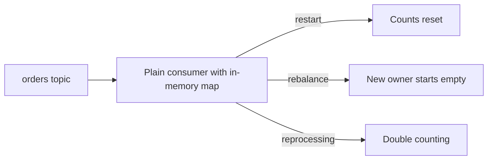
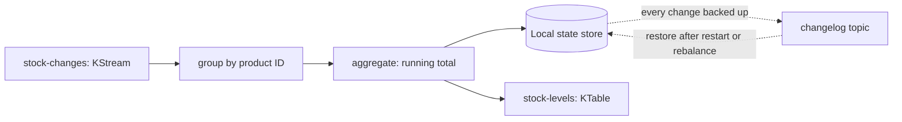

# Stream Processing Basics (Kafka Streams)

**Messaging · Kafka · Step 2.2.14 · Advanced** · Last updated 2026-10-21
**Prerequisites:** [Exactly-once](09-idempotent-producer-transactions.md) (2.2.9), [Log compaction](13-retention-compaction-tiered-storage.md) (2.2.13)

## 1. The concept in simple English

**What is it?** Kafka Streams is a Java library you embed in a service to continuously transform, aggregate and join Kafka topics, with its working state stored locally and backed up to Kafka.

**Why do we need it?** Counting, summing and joining events correctly across restarts and rebalances is hard to build by hand; in-memory state is lost and duplicates distort totals.

**When would I meet it?** Real-time counts (fraud signals), running totals (stock levels), enriching events with reference data.

> [!TIP]
> **Memory hook:** a live scoreboard: goals are the stream, the score is the table, and it can be rebuilt from the list of goals.

## 2. Mental model: a stadium scoreboard

| In the analogy | In Kafka Streams |
|---|---|
| Each goal | An event in a **KStream** |
| The current score per team | A **KTable** (latest value per key) |
| The scoreboard's memory | A local **state store** |
| The official list of goals | The **changelog topic** |

**Where the analogy breaks:** a scoreboard lives in one place; Kafka Streams state is **split across instances by partition**, and moves (and is restored) when partitions move.

## 3. Industry terms

| Term | Simple meaning | Why it matters | Example | Related terms |
|---|---|---|---|---|
| **Topology** | The pipeline from input topics to output topics | The program you describe | Orders → stock levels | Task |
| **KStream** | A stream of independent events | Each order on its own | `orders` | KTable |
| **KTable** | The current value per key | Newer record replaces older | Stock per product | Compaction |
| **State store** | Local storage (RocksDB) for running state | Fast stateful operations | Counts per card | Changelog |
| **Changelog topic** | Compacted topic backing a state store | State survives restarts and moves | `app-store-changelog` | Restore |
| **Co-partitioning** | Two topics keyed and partitioned alike | Required for joins | Clicks and profiles by user ID | Join |

## 4. In a real system (ShopFlow)

**The business problem.** ShopFlow needs a live stock level per product and a fraud signal when one card places too many orders in a few minutes.

A plain consumer with an in-memory map reset to zero on every restart, started empty when it took over partitions in a rebalance, and double-counted after reprocessing.



**How Kafka Streams helps.** State lives in a local store backed by a changelog topic, so it's restored after restarts and moves with partitions; exactly-once processing prevents double counting.

**What it costs.** Restoring large state takes time; joins need co-partitioned topics; it's a JVM library and Kafka is its only source and sink.

**Elsewhere:** fraud detection counts orders per card in short time windows and emits an alert event when a threshold is passed; real-time inventory aggregates order and restock events into a stock-per-product table the website reads; analytics enriches clicks by joining them with a user-profile table keyed the same way.

## 5. How it works



1. **What starts it:** you define a topology and an `application.id` (which is also the consumer group).
2. The library creates one **task** per input partition and spreads tasks across instances.
3. Stateless steps (filter, map) transform each event; stateful steps (count, aggregate, join) use the state store and write every change to the changelog.
4. Results go to output topics, often as a KTable.
5. **On failure or rebalance:** tasks move; new owners **restore state from the changelog** before continuing.
6. With `processing.guarantee=exactly_once_v2`, outputs, state and offsets are committed together.

> [!NOTE]
> Untested sketch to show the shape.

```java
builder.<String, StockChange>stream("stock-changes")          // key = product ID
       .groupByKey()
       .aggregate(() -> 0L, (product, change, total) -> total + change.delta())
       .toStream()
       .to("stock-levels");                                    // latest stock per product
```

## 6. Failure scenarios

### State lost on restart (hand-built consumer)

- **What happened?** The story above.
- **Solutions:** a state store with a changelog (Kafka Streams), or external storage with care.
- **Trade-offs:** restore time; extra topics.

### Join produces missing matches

- **What happened?** Clicks keyed by session were joined with profiles keyed by user ID.
- **Why?** The topics weren't co-partitioned, so matching keys were on different tasks.
- **Solutions:** re-key and repartition so both sides share key and partition count.
- **Trade-offs:** an internal repartition topic.

### Long recovery after a failure

- **What happened?** A large state store had to be rebuilt from its changelog after a node failed.
- **What the business sees:** stale results until restore finishes.
- **Solutions:** keep state lean; run **standby replicas** (`num.standby.replicas`, default 0; the Kafka docs suggest 1), which keep warm copies of state on other instances; plan restore time in the design.

## 7. Architectural decisions

| Option | Fits when | Watch out for |
|---|---|---|
| Plain consumer | Stateless per-event work | You must handle state yourself |
| **Kafka Streams** | JVM services, Kafka in and Kafka out | Restore time; Kafka-only sources and sinks |
| **Apache Flink** | Many sources and sinks, complex event processing, very large state | A separate cluster to operate |

**Library versus framework:** Kafka Streams is code you ship inside your service; Flink is infrastructure you run.

**Common mistakes:** running state in memory in a plain consumer; joining topics that aren't co-partitioned; very large state without planning restore time; not using exactly-once where counts must be exact; forgetting the internal changelog and repartition topics when planning disk and retention; reaching for Flink when a Streams app would do, or the reverse.

## 8. Check your understanding

1. What's the difference between a KStream and a KTable of the same topic?
2. An instance running a stateful app dies. What happens to its state?
3. Why must joined topics be co-partitioned?
4. When would you pick Flink over Kafka Streams?

Answers are at the end of this note.

## 9. Revision

**Remember**
- **KStream = events; KTable = latest value per key.**
- **State is local (RocksDB) and backed by changelog topics.**
- **Tasks per partition**; scales like a consumer group.
- **Joins need co-partitioning.**
- **Library you ship (Streams) versus cluster you run (Flink).**

**Explain in 15 seconds:** "Kafka Streams is a library for continuous processing of Kafka topics: streams and tables, local state backed by changelog topics, scaling by partitions, and optional exactly-once."

**Explain in 60 seconds:**
> "Kafka Streams lets me build stream processing inside a normal Java service. I describe a topology: read topics as KStreams, group and aggregate them into KTables holding the latest value per key, join them, and write results back to topics. Stateful steps keep state in a local RocksDB store backed up to a compacted changelog topic, so state is restored when instances restart or partitions move. Work is split into tasks per partition, and exactly_once_v2 keeps totals exact. I'd choose Flink for many sources and sinks, complex event processing or very large state."

**Likely follow-up questions:**
- **Where does Kafka Streams keep its state?** In a local store (RocksDB by default), backed by a compacted changelog topic.
- **What is a repartition topic?** An internal topic Kafka Streams writes to when you re-key data, so records with the same new key reach the same task.
- **How does Kafka Streams scale?** Like a consumer group: one task per input partition, spread across instances.

**Architect's takeaway:** use Kafka Streams when processing belongs to one service and stays in Kafka; use a platform like Flink when it's shared, large or spans many systems.

**Next topic:** [Kafka Connect and change data capture](15-kafka-connect-cdc.md) (2.2.15)

## 10. Verification and sources

> [!NOTE]
> Checked 2026-10-21 by web search. Re-verify when you revisit this note.

- **Confirmed:** Kafka Streams is a library embedded in your application, Flink a framework running applications on its own cluster; Kafka Streams keeps local RocksDB state with changelog topics for durability; Kafka is its only source and sink; a KStream is a sequence of independent events and a KTable the current state per key; aggregating a KStream gives a KTable and `toStream()` emits its updates; KStream-KTable joins require co-partitioning.
- **Assumptions and illustrations:** the ShopFlow story; code (not run).
- **Also confirmed:** `num.standby.replicas` defaults to 0 and `replication.factor` for internal topics to -1 (the broker default); the Kafka Streams guide suggests 1 standby and replication factor 3 for resilience (Apache Kafka Streams configuration guide).
- **To verify:** window types and semantics.
- **Decision rule:** plain consumer for stateless work, Kafka Streams for stateful Kafka-to-Kafka logic in services, Flink for large or multi-system processing.

**Sources:** Apache Kafka documentation (Kafka Streams); Conduktor, "Kafka Streams vs Apache Flink"; *Designing Data-Intensive Applications*.

## Answers

1. The KStream treats every record as an independent event; the KTable treats each record as an update, so only the latest value per key matters.
2. Its tasks move to other instances, which rebuild the state from the changelog topics before processing again.
3. A join happens locally within a task, so matching keys from both topics must land in the same partition number; that requires the same key and partition count.
4. When you need many non-Kafka sources and sinks, complex event processing, very large state, or batch and streaming together on a dedicated platform.

Back to [the Kafka overview](01-kafka-overview.md) · [Index](../../README.md) · [Roadmap](../../roadmap.md).
