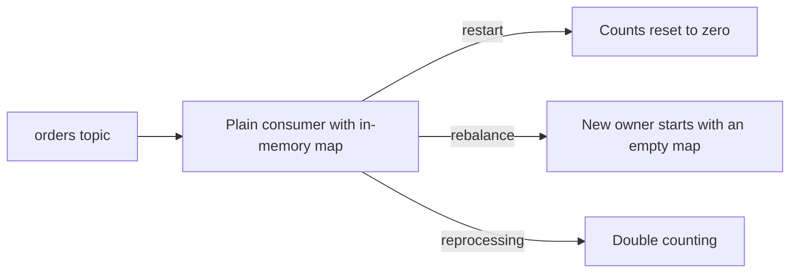
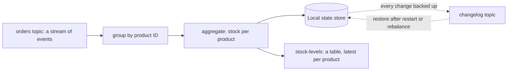

# Stream Processing Basics (Kafka Streams)

**Messaging · Kafka · Step 2.2.14 · Advanced** · Last updated 2026-10-21

> [!TIP]
> **In one sentence:** Kafka Streams is a Java library you embed in your service to continuously transform, aggregate and join Kafka topics, with its state kept locally and backed up to Kafka so it survives restarts.
>
> **Memory hook:** a **live scoreboard at a stadium**. Every goal is an event (a stream); the scoreboard shows the current score per team (a table), updated the moment each goal happens, and if the scoreboard's power fails, it is rebuilt from the official list of goals (the changelog).

## Where it fits

Step 2.2.14 of the [Kafka series](01-kafka-overview.md). It builds on [consumer groups](04-consumers-consumer-groups.md) (2.2.4) for scaling, [compaction](13-retention-compaction-tiered-storage.md) (2.2.13) for its state topics, and [exactly-once](09-idempotent-producer-transactions.md) (2.2.9) for its processing guarantee. Next: [Kafka Connect and change data capture](15-kafka-connect-cdc.md) (2.2.15).

## 1. The story

ShopFlow wants two live numbers: **stock level per product** from order and restock events, and a **fraud flag** when one card places too many orders in a few minutes. A developer builds both in a plain consumer with an in-memory map. On every restart the counts start from zero. On every rebalance, a different instance takes over a partition with an empty map. And when an event is processed twice after a crash, the stock count is off.



## 2. The idea

Use a **stream processing library** that handles the hard parts. With Kafka Streams you describe a pipeline (a **topology**): read a topic as a stream, group by key, aggregate, and write the result to another topic. The library:

- keeps the running state (counts, totals) in a **local state store** (RocksDB) on each instance;
- copies every state change to a compacted **changelog topic** in Kafka, so state can be **restored** after a restart or moved to another instance on a rebalance;
- splits the work by input partition and scales like a consumer group;
- can run with **exactly-once** processing (`exactly_once_v2`).



## 3. Key terms

| Term | Plain meaning |
|---|---|
| **Stream processing** | Continuously computing results as events arrive |
| **Topology** | The pipeline of steps from input topics to output topics |
| **KStream** | A stream of independent events (each order on its own) |
| **KTable** | The current value per key; a newer record for a key replaces the older |
| **State store** | Local storage (RocksDB) holding running state |
| **Changelog topic** | A compacted Kafka topic backing up a state store |
| **Stateless / stateful operation** | Map and filter need no memory; count, aggregate and join do |
| **Windowed aggregation** | Counting or summing over a time window, such as "per 5 minutes" |
| **Co-partitioning** | Two topics keyed and partitioned the same way, needed for joins |

## 4. How it works, step by step

1. You define the topology in code with the Streams DSL and give the app an `application.id` (which is also its consumer group).
2. The library creates one **task** per input partition and spreads tasks across the running instances.
3. **Stateless steps** (filter, map) just transform each event.
4. **Stateful steps** (count, aggregate, join) read and write the local state store; each change is also written to the changelog topic.
5. Results go to output topics, often as a KTable (latest value per key).
6. If an instance stops, its tasks move to others, which **restore state from the changelog** before continuing.
7. Converting between the two views is common: grouping and aggregating a KStream gives a KTable; turning a KTable back into a stream emits its updates.

## 5. Real-world examples

- **Fraud detection:** count orders per card in short time windows and emit an alert event when the count passes a threshold.
- **Real-time inventory:** aggregate order and restock events into a stock-per-product table that the website reads.
- **Enrichment:** join a stream of clicks with a table of user profiles (keyed the same way) to produce clicks with user details for analytics.

## 6. Design choices and trade-offs

| Option | Fits when | Watch out for |
|---|---|---|
| **Plain consumer** | Simple per-event work, no state across events | You must handle state, restarts and duplicates yourself |
| **Kafka Streams** | You already use Kafka and the JVM; the logic is Kafka-in, Kafka-out | Java/JVM only; Kafka is the only source and sink; state restore time grows with state size |
| **Apache Flink** | Complex event processing, many sources and sinks, very large state, batch and stream together | A separate cluster to run and operate |

**Library versus framework:** Kafka Streams is code you ship inside your service, so it deploys like any app. Flink is infrastructure you operate.

## 7. Common mistakes

1. **Keeping running state in memory** in a plain consumer.
2. **Joining topics that aren't co-partitioned** (different keys or partition counts).
3. **Very large state without planning restore time** after failures.
4. **Not using exactly-once** where counts must be exact.
5. **Forgetting the internal topics** (changelogs and repartition topics) when planning replication, retention and disk.
6. **Reaching for Flink** when a Kafka Streams app inside a service would do, or the reverse.

## 8. In code

> [!NOTE]
> Untested sketch to show the shape.

```java
@Bean
KStream<String, StockChange> stockPipeline(StreamsBuilder builder) {
    KStream<String, StockChange> changes = builder.stream("stock-changes");
    changes.groupByKey()                                          // key = product ID
           .aggregate(() -> 0L, (product, change, total) -> total + change.delta())
           .toStream()
           .to("stock-levels");                                   // latest stock per product
    return changes;
}
```

```yaml
spring:
  kafka:
    streams:
      application-id: stock-levels-app
      properties:
        processing.guarantee: exactly_once_v2
```

| Setting | What it controls |
|---|---|
| `application.id` | App identity and consumer group; prefix of internal topics |
| `processing.guarantee` | At-least-once or `exactly_once_v2` |
| State store type | Where state lives (RocksDB by default) |
| Number of instances | Scaling, up to the input partition count |

## 9. Remember

- **KStream = events; KTable = latest value per key.**
- **State lives locally (RocksDB) and is backed up to a changelog topic.**
- **Tasks per partition; scale like a consumer group.**
- **Joins need co-partitioned topics.**
- **Library you ship (Kafka Streams) versus cluster you run (Flink).**

## 10. Interview corner

**15-second answer:** "Kafka Streams is a library for continuous processing of Kafka topics: streams and tables, local state backed by changelog topics, scaling by partitions, and optional exactly-once."

**60-second answer:**
> "Kafka Streams lets me build stream processing inside a normal Java service. I define a topology: read topics as KStreams of events, group and aggregate them into KTables that hold the latest value per key, join them, and write results to topics. Stateful steps keep state in a local RocksDB store that's backed up to a compacted changelog topic, so when an instance restarts or a partition moves, state is restored. Work is split into tasks per partition, so it scales like a consumer group, and exactly_once_v2 makes counts exact. I'd choose Flink instead when I need many sources and sinks, complex event processing or very large state on a dedicated cluster."

**Likely follow-up questions:**
- **KStream versus KTable?** Independent events versus the current value per key.
- **What happens to state when an instance dies?** Its tasks move and state is rebuilt from the changelog topics.
- **Why must joined topics be co-partitioned?** Matching keys must be on the same task to be joined locally.
- **Kafka Streams or Flink?** Streams for Kafka-in, Kafka-out logic inside services; Flink for broader, larger, cluster-based processing.

**Architect angle:** "I pick Kafka Streams when the processing belongs to one service's domain and stays within Kafka, and a platform like Flink when processing is shared, large or spans many systems."

## 11. Industry check

> [!NOTE]
> Checked 2026-10-21 by web search (Conduktor comparisons, Instaclustr, Kafka Javadoc and wiki). Re-verify when you revisit the note.

- **Confirmed:** Kafka Streams is a library embedded in your application, Flink a framework that runs applications on its own cluster; Kafka Streams keeps local RocksDB state with changelog topics for durability, while Flink checkpoints to durable storage; Kafka Streams is Java/JVM-focused and Kafka is its only source and sink, while Flink can use other sources and sinks. A KStream is a sequence of independent events; a KTable is the current state per key (latest record wins); grouping and aggregating a KStream gives a KTable, and `toStream()` emits a KTable's updates; joining a KStream with a KTable requires co-partitioning.
- **To verify:** the window types (tumbling, hopping, sliding, session) and their semantics; standby replicas (`num.standby.replicas`) for faster failover; the default replication factor of Kafka Streams internal topics in your version.
- **Decision rule:** a plain consumer for stateless work, Kafka Streams for stateful Kafka-to-Kafka logic inside services, Flink for large or multi-system processing.

## 12. Going further

- Apache Kafka documentation: Kafka Streams
- Conduktor, "Kafka Streams vs Apache Flink"
- Martin Kleppmann, *Designing Data-Intensive Applications* (stream processing)

**Next:** [Kafka Connect and change data capture](15-kafka-connect-cdc.md) (2.2.15).

Back to [the Kafka overview](01-kafka-overview.md) · [Messaging overview](../01-messaging-overview.md) · [Index](../../README.md) · [Roadmap](../../roadmap.md).
