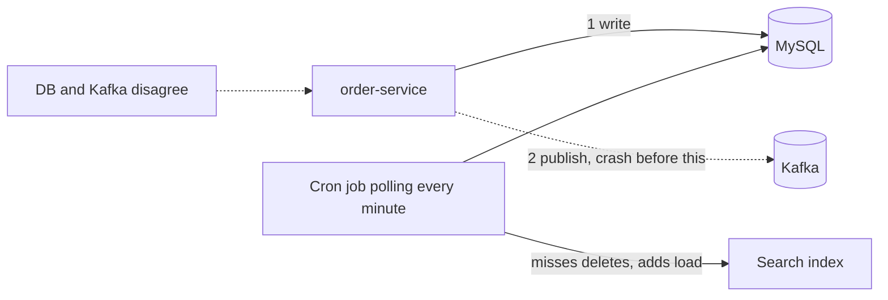
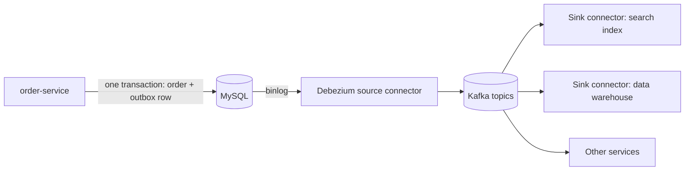

# Kafka Connect and Change Data Capture

**Messaging · Kafka · Step 2.2.15 · Advanced** · Last updated 2026-10-21

> [!TIP]
> **In one sentence:** Kafka Connect moves data between Kafka and other systems using ready-made connectors instead of custom code, and change data capture (CDC) streams every committed database change into Kafka by reading the database's own log.
>
> **Memory hook:** Connect is a set of **standard pipes and adapters** for plumbing: you don't weld a new pipe for every sink. CDC is like **reading the shop's till roll**: instead of asking the cashier "what changed?" every minute, you read the printed record of every sale, in order, as it happens.

## Where it fits

Step 2.2.15 of the [Kafka series](01-kafka-overview.md). It applies [error handling and DLTs](08-error-handling-retries-dlt.md) (2.2.8) to integration pipelines and introduces the outbox pattern (covered fully in the microservices track). Next: [security with TLS, SASL and ACLs](16-security-tls-sasl-acls.md) (2.2.16).

## 1. The story

ShopFlow needs orders in three places besides MySQL: the search index, the data warehouse and Kafka for other services. Each team writes its own glue. A cron job polls MySQL every minute and **misses deleted orders**. Another adds load to the production database at peak time. And `order-service` writes to MySQL and then publishes to Kafka: when it crashes between the two, **the database and Kafka disagree**, an order exists but no event was ever sent.



That last problem is the **dual-write problem**: two writes to two systems can't be made atomic by the application alone.

## 2. The idea

Use **Kafka Connect** and **CDC** instead of custom glue:

- A **source connector** for MySQL, such as **Debezium**, reads the database's **binlog**, its ordered record of committed changes, and publishes every insert, update and delete to Kafka topics. No polling, no missed deletes, little load.
- **Sink connectors** copy topics into the search index and the warehouse.
- For clean business events, `order-service` writes the event to an **outbox table** in the same database transaction as the order, and CDC publishes it. One local transaction, so the database and Kafka can't disagree.



## 3. Key terms

| Term | Plain meaning |
|---|---|
| **Kafka Connect** | A framework and runtime for moving data in and out of Kafka with connectors |
| **Source / sink connector** | Reads from a system into Kafka / writes from Kafka into a system |
| **Worker / task** | A Connect process / a unit of a connector's work |
| **Converter** | Turns records into bytes and back (JSON, Avro, Protobuf) |
| **Single Message Transform (SMT)** | A small per-record change (rename a field, route to a topic) |
| **Change data capture (CDC)** | Streaming committed database changes as events |
| **Binlog** | MySQL's ordered log of committed changes, used for replication |
| **Transactional outbox** | An outbox table written in the same transaction as business data, then published |
| **Dual write** | Writing to two systems separately: they can end up disagreeing |

## 4. How it works, step by step

**A Debezium MySQL source connector:**
1. On first start it takes a **consistent snapshot** of the selected tables (MySQL purges old binlogs, so history isn't available from the log alone).
2. It then reads the **binlog from the snapshot's position**, turning each committed change into an event.
3. Events go to topics (typically one per table), keyed by primary key, so per-row order is kept.
4. Its position is stored, so after a restart it continues where it stopped.

**A sink connector:**
1. Reads topics like a consumer group.
2. Converts records and applies any SMTs.
3. Writes to the target (search index, warehouse, another database).
4. On a bad record, by default the **task stops**; with `errors.tolerance=all` it skips bad records, and a **dead-letter queue topic** can hold them with the failure reason in headers.

## 5. Real-world examples

- **Search sync:** product and order changes flow from the database through CDC into a search index within seconds, including deletes.
- **Data platforms:** CDC streams operational databases into a data lake or warehouse, replacing nightly batch extracts.
- **Legacy integration:** a team streams changes out of an old system's database with CDC, without touching its code, so new services can react to them.

## 6. Design choices and trade-offs

| Approach | Gives | Costs |
|---|---|---|
| Custom consumer or producer code | Full control | Repeated plumbing, retries, offsets, monitoring for every integration |
| **Connect with ready-made connectors** | Configuration instead of code; standard error handling and scaling | Another runtime to operate; connector quality varies |
| Query-based polling | Simple | Misses deletes, adds database load, coarse timing |
| **Log-based CDC (Debezium)** | Every committed change in order, including deletes; low load | Needs binlog access and retention; snapshots on first start |
| CDC on raw business tables | Quick | Exposes the internal table design as a public contract |
| **CDC on an outbox table** | Clean, intentional events; no dual write | An outbox table and routing configuration |

## 7. Common mistakes

1. **Dual writes** (database, then Kafka) and hoping nothing crashes in between.
2. **Publishing raw table changes as the public contract**, so every schema change breaks consumers.
3. **A connector down longer than the binlog is kept**, forcing a fresh snapshot.
4. **`errors.tolerance=all` without a DLQ or alerts**: bad records vanish silently.
5. **Expecting a DLQ on source connectors**; sink connectors have one, source connectors don't.
6. **Not monitoring connector and task status**: a failed task can sit unnoticed.

## 8. In code

> [!NOTE]
> Untested sketch to show the shape. Connector property names change between versions; check the connector's documentation.

```json
{
  "name": "shopflow-orders-cdc",
  "config": {
    "connector.class": "io.debezium.connector.mysql.MySqlConnector",
    "database.hostname": "mysql",
    "database.user": "cdc_user",
    "topic.prefix": "shopflow",
    "table.include.list": "shop.outbox",
    "snapshot.mode": "initial"
  }
}
```

```json
{
  "name": "orders-to-search",
  "config": {
    "connector.class": "<your search sink connector>",
    "topics": "order-events",
    "errors.tolerance": "all",
    "errors.deadletterqueue.topic.name": "order-events-dlq",
    "errors.deadletterqueue.context.headers.enable": "true"
  }
}
```

| Setting | What it controls |
|---|---|
| `snapshot.mode` | Whether and how the source takes an initial snapshot |
| `table.include.list` | Which tables are captured |
| `errors.tolerance` | Stop on errors (default) or skip bad records |
| `errors.deadletterqueue.*` | DLQ topic and failure headers (sink connectors) |

## 9. Remember

- **Connectors instead of custom glue.**
- **CDC reads the database's log**: every committed change, in order, including deletes.
- **Dual writes can disagree; the outbox + CDC fixes it.**
- **Publish clean events (outbox), not raw tables.**
- **Sink DLQ yes, source DLQ no; monitor tasks.**

## 10. Interview corner

**15-second answer:** "Kafka Connect moves data in and out of Kafka with ready-made connectors; CDC with Debezium streams committed database changes from the binlog, and combined with an outbox table it avoids dual writes."

**60-second answer:**
> "For integrations I use Kafka Connect instead of writing custom producers and consumers: source connectors bring data in, sink connectors write it out, with converters, small transforms and standard error handling, including a dead-letter queue for sink connectors. For databases I prefer log-based change data capture: Debezium takes a consistent snapshot, then reads MySQL's binlog, so every committed insert, update and delete arrives in order, without polling. To publish business events without dual writes, the service writes the event to an outbox table in the same transaction as its data, and CDC publishes it. That way the event contract is intentional, not the raw table design."

**Likely follow-up questions:**
- **What is the dual-write problem?** Writing to the database and Kafka separately; a crash in between leaves them inconsistent.
- **Why log-based CDC over polling?** It sees every committed change in order, including deletes, with low load.
- **Why an outbox instead of CDC on business tables?** Clean, versioned events instead of exposing internal tables.
- **What happens when a sink connector meets a bad record?** By default the task stops; with error tolerance it skips and can dead-letter it.
- **What if the CDC connector is down for days?** If the binlog it needs has been purged, it must take a new snapshot.

**Architect angle:** "I use Connect and CDC to keep integrations declarative and consistent, and I make the outbox the standard way to publish domain events from a database-backed service."

## 11. Industry check

> [!NOTE]
> Checked 2026-10-21 by web search (Debezium documentation, connector vendor docs, Kafka Connect error-handling articles). Re-verify when you revisit the note.

- **Confirmed:** by default a Connect task stops on an error such as a converter mismatch; `errors.tolerance=all` skips bad records in converters and SMTs; sink connectors can use `errors.deadletterqueue.topic.name` with optional context headers; Kafka Connect has no DLQ for source connectors. The Debezium MySQL connector performs an initial consistent snapshot (because MySQL purges binlogs) and then reads the binlog from that position; `snapshot.mode` defaults to `initial`; Debezium supports routing events from a transactional outbox table.
- **To verify:** Connect worker modes and REST configuration for your version; the Debezium outbox event router's settings; current property names such as `topic.prefix`.
- **Decision rule:** Connect for integrations, log-based CDC for databases, outbox for domain events, DLQs and task monitoring always.

## 12. Going further

- Debezium documentation: MySQL connector, outbox event router
- Apache Kafka documentation: Kafka Connect
- Chris Richardson, "Transactional outbox" pattern (microservices.io)

**Next:** [Security: TLS, SASL and ACLs](16-security-tls-sasl-acls.md) (2.2.16).

Back to [the Kafka overview](01-kafka-overview.md) · [Messaging overview](../01-messaging-overview.md) · [Index](../../README.md) · [Roadmap](../../roadmap.md).
