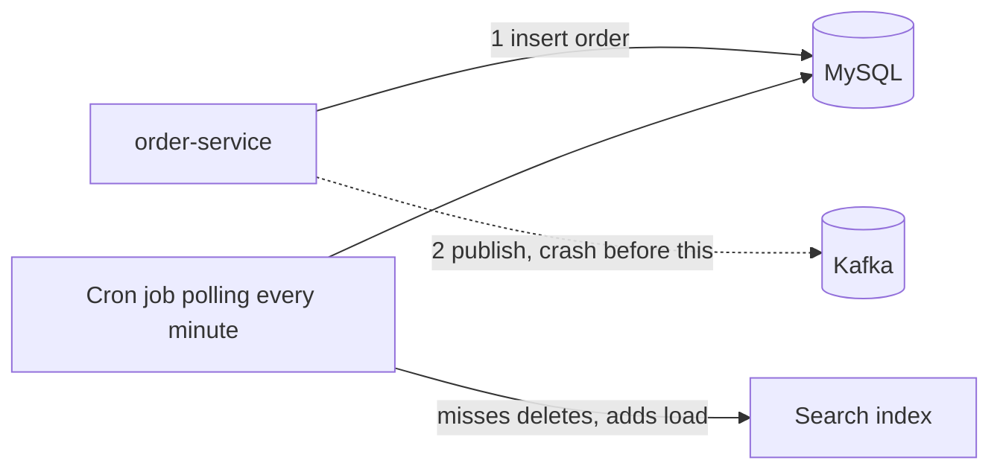
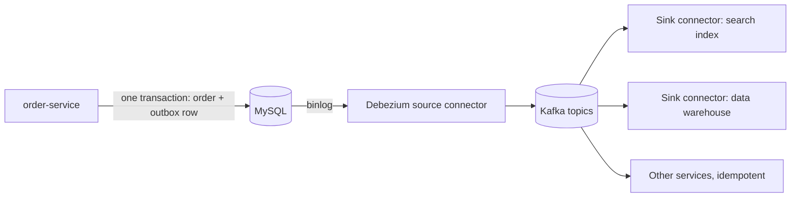

# Kafka Connect and Change Data Capture

**Messaging · Kafka · Step 2.2.15 · Advanced** · Last updated 2026-10-21
**Prerequisites:** [Error handling and DLTs](08-error-handling-retries-dlt.md) (2.2.8), [Offset commits](05-offset-commits-delivery-guarantees.md) (2.2.5)

## 1. The concept in simple English

**What is it?** **Kafka Connect** moves data between Kafka and other systems using ready-made connectors. **Change data capture (CDC)** streams every committed database change into Kafka by reading the database's own change log.

**Why do we need it?** Custom integration code is repeated, fragile and often wrong: polling misses deletes, and writing to a database and then to Kafka can leave the two disagreeing.

**When would I meet it?** Syncing a search index or data warehouse, streaming changes out of a legacy database, or publishing domain events reliably from a database-backed service.

> [!TIP]
> **Memory hook:** CDC reads the till roll instead of asking the cashier every minute what changed.

## 2. Mental model: a shop's till roll

| In the analogy | In the real system |
|---|---|
| The till roll, printed for every sale in order | The database's change log (MySQL **binlog**) |
| Reading the roll | A **CDC source connector** (Debezium) |
| Standard pipes to other branches | **Sink connectors** |
| Asking the cashier "anything new?" every minute | Query-based polling |

**Where the analogy breaks:** after a crash, a CDC connector may re-read part of the roll it had already sent, so downstream consumers can see **duplicates**.

## 3. Industry terms

| Term | Simple meaning | Why it matters | Example | Related terms |
|---|---|---|---|---|
| **Kafka Connect** | Runtime for connectors | Integration as configuration | Connect cluster | Worker, task |
| **Source / sink connector** | Into Kafka / out of Kafka | Standard behaviour and error handling | Debezium MySQL / search sink | Converter |
| **Change data capture (CDC)** | Streaming committed changes | No polling; includes deletes | Debezium reading the binlog | Snapshot |
| **Binlog** | MySQL's ordered log of committed changes | The source CDC reads | MySQL replication log | Snapshot |
| **Dual write** | Writing to two systems separately | They can disagree after a crash | MySQL then Kafka | Outbox |
| **Transactional outbox** | Event written to an outbox table in the same database transaction | One local transaction; no dual write | `outbox` table | CDC |
| **Dead-letter queue (DLQ)** | Connect's name for parking bad records | Keeps sink connectors running | `errors.deadletterqueue.topic.name` | DLT |

## 4. In a real system (ShopFlow)

**The business problem.** Orders must appear in the search index and the data warehouse, and other services must receive `OrderPlaced` reliably, without the database and Kafka ever disagreeing permanently.

The Order Service wrote the order to MySQL and then published to Kafka: after a crash between the two, an order existed with **no event**. A cron job polling MySQL every minute **missed deleted orders** and added load at peak times.



**How Connect and CDC help.** The Order Service writes the order **and** an outbox row in one database transaction. Debezium reads the binlog and publishes the outbox row to Kafka. Sink connectors keep search and the warehouse in sync.

**What it costs.** Events arrive **eventually**, not instantly; CDC is **at-least-once**, so consumers must be idempotent; you operate a Connect cluster and need binlog access.

**Elsewhere:** product and order changes flow through CDC into a search index within seconds, deletes included; data platforms stream operational databases into a lake or warehouse instead of nightly extracts; teams stream changes out of a legacy system's database without touching its code, so new services can react to them.

## 5. How it works



1. **First start:** Debezium takes a **consistent snapshot** of the selected tables (old binlogs are purged, so history isn't available from the log alone).
2. It then reads the binlog from the snapshot position, turning each committed change into an event, keyed by primary key.
3. It stores its position; after a restart it resumes from the last stored position. After a crash, **some events may be sent again**. Kafka 3.3 added optional exactly-once support for source connectors (KIP-618), when the workers enable it and the connector supports it; consumers still need idempotency for their own side effects, so design for at-least-once.
4. **Sink connectors** read topics like consumer groups and write to targets. On a bad record a task **stops by default**; with `errors.tolerance=all` it skips bad records and can send them to a **DLQ** with error headers. Source connectors have no DLQ.

**Who guarantees what**

| Layer | Responsible for |
|---|---|
| Database | Committing the order and the outbox row atomically; keeping the binlog |
| Debezium / Connect | Reading every committed change in order (at-least-once) |
| Kafka | Storing and delivering the events |
| Consumers | Idempotent handling of duplicates |
| Sink targets | Their own write semantics (idempotent upserts are safest) |

> [!NOTE]
> Untested sketch to show the shape. Connector property names change between versions.

```json
{ "name": "shopflow-outbox-cdc",
  "config": {
    "connector.class": "io.debezium.connector.mysql.MySqlConnector",
    "database.hostname": "mysql",
    "topic.prefix": "shopflow",
    "table.include.list": "shop.outbox",
    "snapshot.mode": "initial" } }
```

## 6. Failure scenarios

### Dual write leaves database and Kafka inconsistent

- **What happened?** The story above.
- **Solutions:** transactional outbox + CDC (or a polling relay of the outbox table).
- **Trade-offs:** an outbox table, a relay or connector, and eventual (not immediate) publication.

### Connector restart sends duplicates

- **What happened?** The CDC connector crashed and resumed from its last stored position, re-sending recent changes.
- **What the business sees:** duplicate events downstream.
- **Solutions:** idempotent consumers keyed by event or row ID; idempotent upserts in sinks.
- **Trade-offs:** deduplication state.

### Connector down longer than binlog retention

- **What happened?** The binlog position it needed had been purged.
- **Solutions:** monitor connectors; keep enough binlog retention; re-snapshot.
- **Trade-offs:** re-snapshots take time and load the database.

## 7. Architectural decisions

| Approach | Gives | Costs |
|---|---|---|
| Custom producers and consumers | Full control | Repeated plumbing and error handling |
| **Connect with ready-made connectors** | Configuration instead of code | A runtime to operate; connector quality varies |
| Query-based polling | Simple | Misses deletes; database load; coarse timing |
| **Log-based CDC** | Every committed change, in order, including deletes | Binlog access; snapshots |
| CDC on raw business tables | Quick | Internal schema becomes a public contract |
| **CDC on an outbox table** | Intentional events; no dual write | Outbox table and routing |

**Common mistakes:** dual writes; raw table changes as the public contract; a connector down longer than binlog retention; `errors.tolerance=all` without a DLQ or alerts (silent loss); expecting a DLQ on source connectors; not monitoring connector and task status.

## 8. Check your understanding

1. Why can't "insert into MySQL, then publish to Kafka" be made reliable in application code alone?
2. Does the outbox pattern give exactly-once delivery? Explain.
3. A sink connector stops every few hours on bad records. What are the options?
4. Why is CDC on raw tables risky as a public contract?

Answers are at the end of this note.

## 9. Revision

**Remember**
- **Connectors instead of glue code.**
- **CDC reads the database's log**: committed changes, in order, including deletes.
- **Outbox + CDC avoids dual writes**, but delivery is **eventual and at-least-once**.
- **Publish intentional events (outbox), not raw tables.**
- **Sink DLQ yes, source DLQ no**; monitor connector tasks.

**Explain in 15 seconds:** "Kafka Connect moves data in and out of Kafka with connectors; CDC with Debezium streams committed changes from the binlog, and with an outbox table it removes dual writes, at least once."

**Explain in 60 seconds:**
> "For integrations I use Kafka Connect rather than custom producers and consumers. For databases I prefer log-based CDC: Debezium snapshots, then reads MySQL's binlog, so every committed insert, update and delete arrives in order without polling. To publish domain events without dual writes, the service writes an outbox row in the same transaction as its data, and CDC publishes it. That makes publication reliable but eventual, and CDC is at-least-once, so after a crash some events can repeat and consumers must be idempotent. Sink connectors can dead-letter bad records; source connectors can't."

**Likely follow-up questions:**
- **Why log-based CDC over polling?** It sees every committed change in order, including deletes, with little load on the database.
- **What if the CDC connector is down for days?** If the binlog position it needs has been purged, it must take a new snapshot.
- **Outbox with CDC or with a polling relay?** CDC gives lower latency and no polling load; a relay is simpler to run but adds load and delay. Both are at-least-once.

**Architect's takeaway:** make the outbox the standard way to publish domain events from a database-backed service, and never assume it means exactly-once.

**Next topic:** [Security: TLS, SASL and ACLs](16-security-tls-sasl-acls.md) (2.2.16)

## 10. Verification and sources

> [!NOTE]
> Checked 2026-10-21 by web search. Re-verify when you revisit this note.

- **Confirmed:** by default a Connect task stops on errors such as converter mismatches; `errors.tolerance=all` skips bad records in converters and transforms; sink connectors can use `errors.deadletterqueue.topic.name` with optional context headers; Connect has no DLQ for source connectors. The Debezium MySQL connector takes an initial consistent snapshot and then reads the binlog from that position (`snapshot.mode` defaults to `initial`); Debezium supports routing events from an outbox table. Debezium's default guarantee is at-least-once: after failures or restarts the same change can be delivered more than once (Debezium blog and connector documentation).
- **Assumptions and illustrations:** the ShopFlow story; configuration (not run).
- **To verify:** the outbox event router's settings; Connect worker modes and REST configuration; current Debezium property names; whether your Debezium connector and version support KIP-618 exactly-once delivery.
- **Also confirmed:** Kafka Connect supports exactly-once delivery for source connectors from Kafka 3.3 (KIP-618), writing records and source offsets in one Kafka transaction (KIP-618; Debezium blog, "Towards exactly-once delivery").
- **Decision rule:** Connect for integrations, log-based CDC for databases, outbox for domain events, idempotent consumers and monitored tasks always.

**Sources:** Debezium documentation (MySQL connector, outbox); Apache Kafka documentation (Kafka Connect); microservices.io, "Transactional outbox".

## Answers

1. The two writes go to different systems with no shared transaction; a crash between them leaves one done and the other not, and retrying can duplicate. Only moving the event into the same database transaction (outbox) removes the gap.
2. No. It guarantees the event is eventually published if the order was committed, but CDC (or a relay) can re-send after a crash, so delivery is at-least-once; consumers deduplicate.
3. Fix the data or converter; or set `errors.tolerance=all` with a DLQ topic, context headers and alerts, so bad records are parked and investigated instead of stopping the task.
4. Every internal schema change (rename, split a table) becomes a breaking change for consumers; an outbox lets you publish stable, intentional events.

Back to [the Kafka overview](01-kafka-overview.md) · [Index](../../README.md) · [Roadmap](../../roadmap.md).
