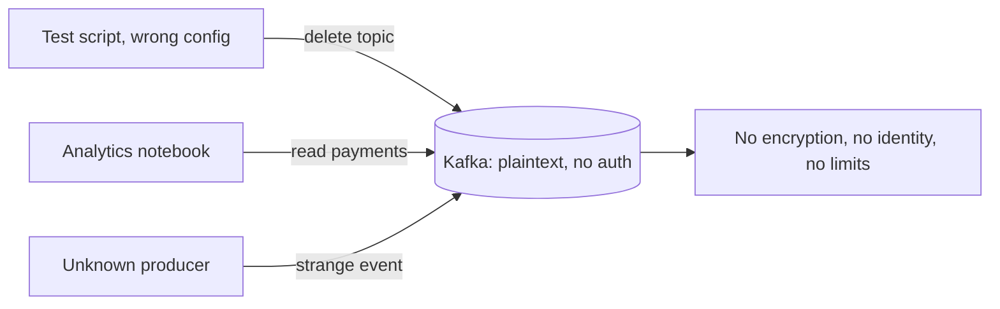
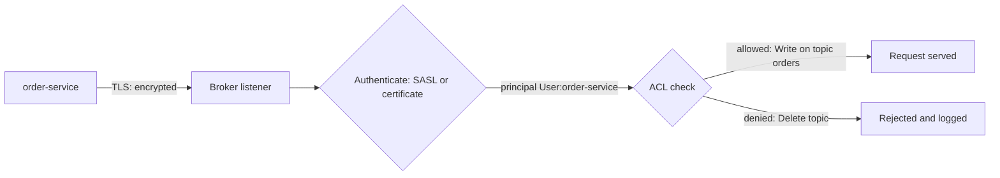

# Security: TLS, SASL and ACLs

**Messaging · Kafka · Step 2.2.16 · Advanced** · Last updated 2026-10-21

> [!TIP]
> **In one sentence:** Kafka security has three layers: TLS encrypts traffic, SASL or client certificates prove who each client is, and ACLs decide what each identity may do with which topics and groups.
>
> **Memory hook:** an **office building**. The tinted windows stop people seeing in (TLS encryption); the badge at reception proves who you are (authentication); and your badge only opens the floors you work on (ACLs).

## Where it fits

Step 2.2.16 of the [Kafka series](01-kafka-overview.md). It protects everything from the earlier notes: the brokers, topics and consumer groups. It connects to the security track (8.x), especially OAuth2/OIDC with Keycloak. Next: [monitoring, consumer lag and capacity planning](17-monitoring-lag-capacity.md) (2.2.17).

## 1. The story

ShopFlow's first Kafka cluster used plaintext connections with no authentication, "because it's inside our network". Then three things happened: a test script pointed at production by mistake **deleted a topic**; an analytics notebook **read the payments topic**, which nobody intended; and when a strange event appeared, nobody could tell **which service had produced it**.



## 2. The idea

Secure Kafka in three layers, each answering one question:

1. **Encryption (TLS):** can anyone on the network read the traffic? With TLS, no.
2. **Authentication:** who is this client? Each service proves its identity with **SASL** (for example SCRAM passwords or OAuth tokens) or a **client certificate** (mutual TLS). Kafka turns that into a **principal** such as `User:order-service`.
3. **Authorisation (ACLs):** what may this principal do? `order-service` may *write* `orders`; `notification-service` may *read* `orders` with its group; nobody else may delete topics.



**Least privilege:** each service gets its own identity and only the permissions it needs.

## 3. Key terms

| Term | Plain meaning |
|---|---|
| **Listener** | A broker network endpoint with its own security protocol |
| **TLS (SSL)** | Encrypts traffic between clients and brokers |
| **Mutual TLS (mTLS)** | Both sides present certificates; the client certificate identifies the client |
| **SASL** | A framework for authentication; Kafka supports several mechanisms |
| **SCRAM** | Username and password, stored as salted hashes in the cluster |
| **OAUTHBEARER** | Authentication with OAuth 2.0 tokens from an identity provider |
| **Principal** | The identity Kafka uses for permission checks (`User:order-service`) |
| **ACL** | A rule: principal, operation (Read, Write, Create, Delete...), resource (topic, group, cluster), allow or deny |

## 4. How it works, step by step

1. The client connects to a listener configured as `SASL_SSL` (or `SSL` for mTLS).
2. **TLS handshake:** the client checks the broker's certificate; the connection is encrypted.
3. **Authentication:** SASL (SCRAM, OAUTHBEARER, Kerberos) or the client certificate identifies the client. With mTLS, the certificate's name is mapped to a principal.
4. **Authorisation:** for every request, the broker's authoriser checks the ACLs for that principal, operation and resource.
5. Allowed requests are served; denied ones are rejected and can be logged for audit.
6. Brokers and controllers secure their own traffic between each other too.

| Mechanism | Fits | Notes |
|---|---|---|
| PLAIN | Development | Plain username and password; never without TLS, not for production |
| **SCRAM** | Most teams | Credentials stored hashed in the cluster; simple to run |
| **mTLS** | Strong machine identity | Needs certificate issuing and rotation |
| **OAUTHBEARER** | Central identity (for example Keycloak) | Short-lived tokens from your identity provider |
| GSSAPI (Kerberos) | Organisations already running Kerberos | Heavier to operate |

## 5. Real-world examples

- **Payments (PCI scope):** payment topics are encrypted in transit, readable only by the payment and fraud services, and card numbers are never put in events in the first place.
- **Multi-tenant platforms:** each tenant's applications get their own principal and access only to topics with that tenant's name prefix.
- **Single sign-on:** a company already using an OAuth 2.0 / OIDC identity provider issues tokens to services, and Kafka accepts them through OAUTHBEARER, so there is one place to manage machine identities.

## 6. Design choices and trade-offs

| Decision | Recommendation | Why |
|---|---|---|
| Encryption | TLS on every listener, including internal | "Inside the network" is not a security boundary |
| Authentication | One identity per service; SCRAM, mTLS or OAuth | Know who produced and consumed what |
| Authorisation | Least-privilege ACLs per service | Limits damage from bugs and leaks |
| Sensitive data | Keep it out of events, or encrypt or tokenise fields | ACLs don't protect data copied downstream |
| Admin actions | Restricted to a few admin principals and tooling | Prevents accidental deletes |

**Cost:** TLS adds some CPU and latency; certificates and credentials need rotation; ACLs need ownership. These are worth it for any shared or production cluster.

## 7. Common mistakes

1. **Plaintext listeners "because it's internal".**
2. **SASL without TLS**: authentication alone doesn't encrypt anything.
3. **PLAIN mechanism in production.**
4. **One shared credential for all services**, so nothing can be traced or limited.
5. **Wildcard ACLs** that give everyone everything.
6. **Sensitive data in events**, relying on ACLs for protection forever.
7. **No rotation plan** for certificates, passwords or token secrets.

## 8. In code

> [!NOTE]
> Untested sketch to show the shape. Check option names for your Kafka and Spring versions.

```yaml
spring:
  kafka:
    bootstrap-servers: kafka:9093
    security:
      protocol: SASL_SSL
    properties:
      sasl.mechanism: SCRAM-SHA-512
      sasl.jaas.config: >
        org.apache.kafka.common.security.scram.ScramLoginModule required
        username="order-service" password="${KAFKA_PASSWORD}";
    ssl:
      trust-store-location: classpath:kafka-truststore.p12
```

```bash
# order-service may write to orders, nothing more
kafka-acls.sh --bootstrap-server kafka:9093 --command-config admin.properties \
  --add --allow-principal User:order-service --operation Write --topic orders
```

| Setting | What it controls |
|---|---|
| `security.protocol` | `SSL` or `SASL_SSL` (avoid plaintext) |
| `sasl.mechanism` | SCRAM, OAUTHBEARER, GSSAPI... |
| Truststore / keystore | Certificates for TLS and mTLS |
| `ssl.principal.mapping.rules` (broker) | How certificate names become principals |
| ACLs | Who may do what on which resource |

## 9. Remember

- **Three layers: encrypt (TLS), identify (SASL or mTLS), authorise (ACLs).**
- **SASL doesn't encrypt; always pair it with TLS.**
- **One identity per service, least privilege.**
- **Keep sensitive data out of events.**
- **"Internal network" is not a security boundary.**

## 10. Interview corner

**15-second answer:** "I secure Kafka with TLS for encryption, SASL or mutual TLS so each service has its own identity, and least-privilege ACLs per topic and group."

**60-second answer:**
> "Kafka security is three layers. TLS encrypts traffic on every listener, internal ones included. Authentication gives every service its own principal: SCRAM is the simple choice, mutual TLS gives strong certificate-based identity, and OAUTHBEARER lets us reuse an OAuth identity provider like Keycloak. Authorisation uses ACLs with least privilege: a service may write only its own topics and read only what it consumes, and only admin tooling can create or delete topics. On top of that, I keep sensitive data like card numbers out of events, plan credential rotation, and log denied requests for audit."

**Likely follow-up questions:**
- **Does SASL encrypt traffic?** No; use it over TLS (`SASL_SSL`).
- **SCRAM, mTLS or OAuth?** SCRAM for simplicity; mTLS for strong machine identity; OAuth to centralise identities in an existing provider.
- **What does an ACL contain?** Principal, operation, resource and allow or deny.
- **How do you stop a test script deleting production topics?** Separate credentials per environment and no delete permission except for admin principals.
- **Is network isolation enough?** No: encrypt and authenticate anyway.

**Architect angle:** "I treat the cluster as shared infrastructure with a security model: identities per service, ACLs owned with each topic, and sensitive data minimised before it ever reaches Kafka."

## 11. Industry check

> [!NOTE]
> Checked 2026-10-21 by web search (Apache Kafka security model in the source tree, AxonOps documentation, vendor articles). Re-verify when you revisit the note.

- **Confirmed:** Kafka supports mutual TLS, mapping certificate names to principals with `ssl.principal.mapping.rules`; SASL mechanisms are enabled per listener (`sasl.enabled.mechanisms`): GSSAPI (Kerberos), SCRAM-SHA-256/512 (credentials in cluster metadata), OAUTHBEARER (OAuth 2.0 tokens from an identity provider) and PLAIN (typically development only); SASL provides authentication but not encryption, so TLS is needed separately.
- **To verify:** the authoriser used with KRaft and its settings (`super.users`, the behaviour when no ACL matches); prefixed (name-prefix) ACLs; your platform's support for OAUTHBEARER with your identity provider.
- **Decision rule:** TLS everywhere, one identity per service, least-privilege ACLs, no sensitive data in events.

## 12. Going further

- Apache Kafka documentation: security (encryption, authentication, authorisation)
- Your identity provider's guide to OAuth 2.0 client credentials (for example Keycloak)
- OWASP guidance on secrets management

**Next:** [Monitoring, consumer lag and capacity planning](17-monitoring-lag-capacity.md) (2.2.17).

Back to [the Kafka overview](01-kafka-overview.md) · [Messaging overview](../01-messaging-overview.md) · [Index](../../README.md) · [Roadmap](../../roadmap.md).
