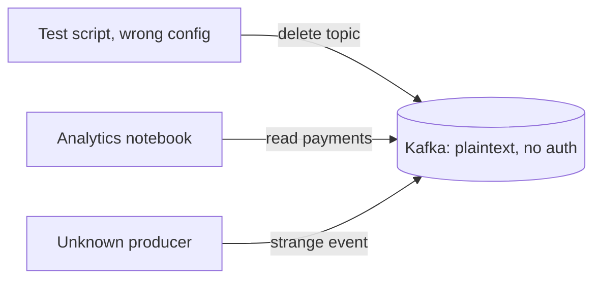
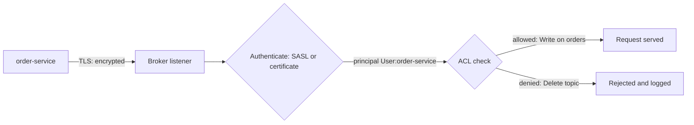

# Security: TLS, SASL and ACLs

**Messaging · Kafka · Step 2.2.16 · Advanced** · Last updated 2026-10-21
**Prerequisites:** [Apache Kafka: the big picture](01-kafka-overview.md) (2.2.1)

## 1. The concept in simple English

**What is it?** Kafka security in three layers: **TLS** encrypts traffic, **authentication** (SASL or client certificates) proves who each client is, and **ACLs** decide what each identity may do.

**Why do we need it?** Without it, anyone on the network can read topics, write fake events or delete data, and nobody can tell who did what.

**When would I meet it?** Any production or shared cluster, compliance reviews (payments, personal data), or connecting services through an identity provider.

> [!TIP]
> **Memory hook:** an office building: tinted windows (TLS), a badge at reception (authentication), and a badge that opens only your floors (ACLs).

## 2. Mental model: an office building

| In the analogy | In Kafka |
|---|---|
| Tinted windows | **TLS** encryption |
| Badge check at reception | **Authentication** (SASL, mTLS) |
| The name on the badge | The **principal** (`User:order-service`) |
| Doors your badge opens | **ACLs** |

**Where the analogy breaks:** checking a badge doesn't tint the windows: SASL authentication on its own does **not** encrypt traffic.

## 3. Industry terms

| Term | Simple meaning | Why it matters | Example | Related terms |
|---|---|---|---|---|
| **TLS** | Encrypts traffic | Nobody on the network can read it | `SSL` listener | mTLS |
| **mTLS** | Both sides present certificates | Strong machine identity | Client certificate per service | Principal |
| **SASL** | Authentication framework | Several mechanisms | `SASL_SSL` | SCRAM, OAUTHBEARER |
| **SCRAM** | Username and password stored as salted hashes | Simple identity per service | `SCRAM-SHA-512` | SASL |
| **OAUTHBEARER** | Authentication with OAuth 2.0 tokens | Reuse an identity provider | Keycloak tokens | OIDC |
| **Principal** | The identity used for permission checks | Ties actions to a service | `User:order-service` | ACL |
| **ACL** (access control list) | Principal + operation + resource + allow/deny | Least privilege | Write on topic `orders` | Authoriser |

## 4. In a real system (ShopFlow)

**The business problem.** Payment and customer data must be protected, every event must be traceable to the service that produced it, and mistakes must not be able to delete production data.

ShopFlow started with plaintext and no authentication "because it's internal". A test script pointed at production **deleted a topic**; an analytics notebook **read the payments topic**; and a strange event appeared with **no way to tell its producer**.



**How the layers help.** TLS on every listener; one identity per service; least-privilege ACLs; delete rights only for admin tooling.

**What it costs.** Some CPU and latency for TLS; certificates and credentials to issue and rotate; ACLs to own per topic.

**Elsewhere:** payment topics in PCI scope are encrypted in transit, readable only by the payment and fraud services, and never contain card numbers in the first place; multi-tenant platforms give each tenant its own principal, with prefixed ACLs on that tenant's topics; companies with an OAuth 2.0 / OIDC provider issue tokens to services and accept them through OAUTHBEARER.

## 5. How it works



1. **What starts it:** the client connects to a `SASL_SSL` (or `SSL`) listener.
2. **TLS handshake:** the client verifies the broker's certificate; traffic is encrypted.
3. **Authentication:** SASL (SCRAM, OAUTHBEARER, Kerberos) or the client certificate identifies the client; certificate names are mapped to principals.
4. **Authorisation:** for each request, the authoriser (in KRaft clusters, `StandardAuthorizer`) checks ACLs for principal, operation and resource. If no ACL matches, access is **denied**, unless `allow.everyone.if.no.acl.found=true`; principals listed in `super.users` (brokers, controllers, admin tooling) bypass ACLs.
5. **On success:** the request is served. **On denial:** it is rejected and can be logged for audit.

| Mechanism | Fits | Notes |
|---|---|---|
| PLAIN | Development | Never without TLS; not for production |
| **SCRAM** | Most teams | Credentials hashed in the cluster |
| **mTLS** | Strong machine identity | Certificate issuing and rotation |
| **OAUTHBEARER** | Central identity provider | Short-lived tokens |
| GSSAPI (Kerberos) | Existing Kerberos estates | Heavier to operate |

> [!NOTE]
> Untested sketch to show the shape.

```bash
# order-service may write to orders, nothing more
kafka-acls.sh --bootstrap-server kafka:9093 --command-config admin.properties \
  --add --allow-principal User:order-service --operation Write --topic orders
```

## 6. Failure scenarios

### Accidental deletion from a test environment

- **What happened?** A script with production credentials deleted a topic.
- **Solutions:** separate credentials per environment; delete permission only for admin principals.
- **Trade-offs:** more credentials to manage.

### Credentials sent in clear text

- **What happened?** SASL PLAIN was used on a plaintext listener.
- **Why?** SASL authenticates; it doesn't encrypt.
- **Solutions:** `SASL_SSL` everywhere; never PLAIN in production.

### Sensitive data leaks downstream

- **What happened?** Card numbers in events were copied by a consumer into a log store.
- **Why?** ACLs control who reads Kafka, not what readers do afterwards.
- **Solutions:** keep sensitive data out of events, or tokenise or encrypt fields.

### Turning on the authoriser locks everyone out

- **What happened?** The authoriser was enabled before any ACLs existed; every service, and the brokers themselves, were refused.
- **Why?** With no matching ACL, Kafka denies access.
- **Solutions:** put broker, controller and admin principals in `super.users`, create the service ACLs, then enable the authoriser; rehearse it in staging.
- **Trade-offs:** super users bypass every check, so keep that list tiny.

## 7. Architectural decisions

| Decision | Recommendation | Why |
|---|---|---|
| Encryption | TLS on every listener | "Internal network" is not a security boundary |
| Authentication | One identity per service | Traceability and limits |
| Authorisation | Least-privilege ACLs per service | Limits damage from bugs and leaks |
| Sensitive data | Keep out of events | ACLs don't protect copies |
| Admin actions | Few admin principals | Prevents accidental deletes |

**Common mistakes:** plaintext listeners "because it's internal"; SASL without TLS; PLAIN in production; one shared credential for all services; wildcard ACLs; sensitive data in events; no rotation plan for certificates, passwords or token secrets.

## 8. Check your understanding

1. Does `SASL_PLAINTEXT` with SCRAM protect data in transit?
2. What does an ACL consist of?
3. How would you stop a test script from deleting production topics?
4. When would you choose OAUTHBEARER over SCRAM?

Answers are at the end of this note.

## 9. Revision

**Remember**
- **Encrypt (TLS), identify (SASL or mTLS), authorise (ACLs).**
- **SASL doesn't encrypt**; pair it with TLS.
- **One identity per service; least privilege.**
- **Keep sensitive data out of events.**

**Explain in 15 seconds:** "TLS for encryption, SASL or mutual TLS so each service has its own identity, and least-privilege ACLs per topic and group."

**Explain in 60 seconds:**
> "Kafka security is three layers. TLS encrypts every listener, internal ones too. Authentication gives each service its own principal: SCRAM is simple, mutual TLS gives strong certificate identity, and OAUTHBEARER reuses an identity provider such as Keycloak. ACLs grant least privilege: a service writes only its own topics and reads only what it consumes, and only admin tooling creates or deletes topics. On top, I keep sensitive data out of events, rotate credentials, and log denied requests."

**Likely follow-up questions:**
- **SCRAM, mTLS or OAuth?** SCRAM for simplicity; mutual TLS for strong machine identity; OAuth to centralise identities in an existing provider.
- **Is network isolation enough?** No: encrypt and authenticate anyway, because internal networks get breached and misconfigured.
- **What happens when no ACL matches?** Access is denied, except for super users, unless the cluster is configured to allow everyone.

**Architect's takeaway:** treat the cluster as shared infrastructure with a security model: identities per service, ACLs owned per topic, sensitive data minimised before it reaches Kafka.

**Next topic:** [Monitoring, consumer lag and capacity planning](17-monitoring-lag-capacity.md) (2.2.17)

## 10. Verification and sources

> [!NOTE]
> Checked 2026-10-21 by web search. Re-verify when you revisit this note.

- **Confirmed:** Kafka supports mutual TLS with certificate names mapped to principals (`ssl.principal.mapping.rules`); SASL mechanisms are enabled per listener: GSSAPI, SCRAM-SHA-256/512 (credentials in cluster metadata), OAUTHBEARER and PLAIN (development only); SASL provides authentication but not encryption (Apache Kafka security model; AxonOps documentation). KRaft clusters use `StandardAuthorizer`, which stores ACLs in the metadata log; with no matching ACL, access is denied except for `super.users`, unless `allow.everyone.if.no.acl.found=true` (Apache Kafka authorisation documentation; KIP-801).
- **Assumptions and illustrations:** the ShopFlow story; commands (not run).
- **To verify:** prefixed ACLs; OAUTHBEARER integration with your identity provider.
- **Decision rule:** TLS everywhere, one identity per service, least-privilege ACLs, no sensitive data in events.

**Sources:** Apache Kafka documentation (security); identity provider guides for OAuth 2.0 client credentials.

## Answers

1. No. It authenticates the client but sends traffic unencrypted; use `SASL_SSL`.
2. A principal, an operation (Read, Write, Create, Delete...), a resource (topic, group, cluster) and allow or deny.
3. Separate credentials per environment, and grant Delete only to admin principals used by controlled tooling.
4. When the organisation already manages service identities in an OAuth 2.0 / OIDC provider and wants short-lived tokens and one place to manage them.

Back to [the Kafka overview](01-kafka-overview.md) · [Index](../../README.md) · [Roadmap](../../roadmap.md).
