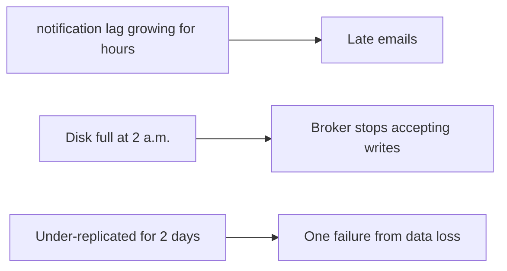
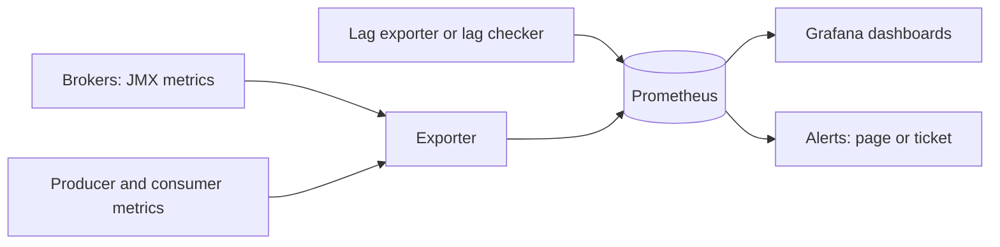

# Monitoring, Consumer Lag and Capacity Planning

**Messaging · Kafka · Step 2.2.17 · Advanced** · Last updated 2026-10-21
**Prerequisites:** [Replication](06-brokers-replication-leader-election.md) (2.2.6), [Partition planning](11-ordering-partition-planning-hot-partitions.md) (2.2.11)

## 1. What it is and why it matters

**What is it?** Watching a few Kafka health signals and each consumer group's **lag**, and sizing the cluster for peaks before they happen.

**Why do we need it?** Kafka problems (falling behind, shrinking safety margins, full disks) are silent until customers notice.

**When would I meet it?** Building dashboards and alerts, preparing for a sale or launch, or investigating "why are emails late?".

> [!TIP]
> **Memory hook:** a car dashboard: warning lights that must never be on, a speedometer, a fuel gauge, and the satnav's "arriving late".

## 2. Mental model: a car dashboard

| In the analogy | In Kafka |
|---|---|
| Engine and oil warning lights | Offline, under-min-ISR, under-replicated partitions; controller count ≠ 1 |
| Speedometer | Request latency (p99) |
| Fuel gauge | Disk usage and its trend |
| "Arriving late" warning | Consumer lag **growing** |

**Where the analogy breaks:** one car has one driver; Kafka has many consumer groups, each with its own acceptable lag.

## 3. Industry terms

| Term | Simple meaning | Why it matters | Example | Related terms |
|---|---|---|---|---|
| **Under-replicated partitions** | Fewer in-sync copies than replicas | Reduced safety | Above 0 after a broker slows | ISR |
| **Under-min-ISR partitions** | Below `min.insync.replicas` | `acks=all` writes failing | Above 0 | Acks |
| **Offline partitions** | No leader | Data unavailable | Above 0 | Leader election |
| **Request latency (p99)** | Slowest 1% of produce or fetch requests | User-visible slowness | Against a baseline | Saturation |
| **Consumer lag** | How far a group is behind | The consumer's health | Notification lag | Lag growth |
| **Headroom** | Spare capacity for peaks and failures | Survive a broker loss at peak | 30% free | Capacity planning |

## 4. In a real system (ShopFlow)

**The business problem.** Customers must not be the first to find out that confirmations are late or that the cluster is one failure from losing data.

Confirmation emails arrived **hours late** because nobody watched the Notification Service's lag; a broker's disk **filled at 2 a.m.** after retention was raised; partitions stayed **under-replicated** for two days unnoticed.



**How monitoring helps.** A few critical alerts page someone; trends create tickets; lag objectives are set per consumer group; capacity is planned and load-tested before peaks.

**What it costs.** Exporters, dashboards and alert tuning; agreed lag objectives per team.

**Elsewhere:** a payments consumer has a lag objective of seconds and pages on growth, while a nightly analytics consumer hours behind is normal; retailers estimate peak-season traffic, load-test at that level and add brokers and partitions weeks ahead; platform teams give every service team a lag dashboard for its own consumer groups.

## 5. How it works



**Monitoring:**
1. Brokers and clients expose metrics through JMX; an exporter publishes them to Prometheus; Grafana shows them.
2. Lag comes from a lag exporter or a lag checker (for example Burrow).
3. **Page** on: offline partitions or under-min-ISR above 0; active controller count not exactly 1; a critical group's lag growing steadily.
4. **Ticket** on: under-replicated partitions that persist; p99 latency well above baseline; disk trending towards full.

**Capacity planning:**
1. Peak throughput: events per second × size, plus recovery bursts (consumers catching up).
2. Storage: daily volume × retention days × replication factor, plus headroom.
3. Partitions: from the formula in [2.2.11](11-ordering-partition-planning-hot-partitions.md).
4. Brokers: enough that losing one still leaves room.
5. Load-test before the peak.

> [!NOTE]
> Untested sketch. Metric names depend on your exporter.

```yaml
- alert: KafkaOfflinePartitions
  expr: kafka_controller_offline_partitions_count > 0
  for: 1m
  labels: { severity: page }
- alert: ConsumerLagGrowing
  expr: deriv(kafka_consumergroup_lag_sum{group="notification-service"}[15m]) > 0
  for: 15m
  labels: { severity: page }
```

## 6. Failure scenarios

### Lag grows unnoticed

- **What happened?** The Notification Service slowed after a dependency change; lag grew for hours.
- **Solutions:** alert on lag growth per group, with group-specific objectives.
- **Trade-offs:** objectives must be agreed per team.

### Disk fills after a configuration change

- **What happened?** Retention was raised without recalculating storage.
- **Solutions:** disk-trend alerts days ahead; storage sizing as part of every retention change.

### Silent loss of safety margin

- **What happened?** A slow broker left partitions under-replicated for days.
- **Solutions:** ticket after a grace period; investigate the slow broker.
- **Trade-offs:** brief under-replication during restarts is normal, so alert on persistence.

## 7. Architectural decisions

| Signal | Alert on | Why |
|---|---|---|
| Offline partitions | Above 0 | Data unavailable |
| Under-min-ISR | Above 0 | `acks=all` writes failing |
| Controller count | Not exactly 1 | Quorum or controller problem |
| Under-replicated | Above 0, persisting | Reduced safety |
| p99 latency | Well above baseline | Slowness |
| Disk | Trend reaching full within days | Brokers stop when disks fill |
| Consumer lag | Growing, per group | Absolute numbers mean different things per group |

**Common mistakes:** no lag monitoring; one absolute lag threshold for every group; disk alerts at 95%, too late to act; ignoring under-replicated partitions; monitoring brokers but not clients; averages instead of p99; planning capacity for normal days instead of peaks and recovery.

## 8. Check your understanding

1. Which single Kafka signal would you page on first, and why?
2. Why is "lag above 10,000" a poor universal alert?
3. Estimate storage for 80 GB/day kept 10 days with replication factor 3.
4. What should you check before a planned sale?

Answers are at the end of this note.

## 9. Revision

**Remember**
- **Page on offline / under-min-ISR partitions and controller count ≠ 1.**
- **Alert on lag growth per group.**
- **p99 against a baseline**, not averages.
- **Storage = volume × days × replication factor**, plus headroom.
- **Plan and load-test before peaks.**

**Explain in 15 seconds:** "I alert on offline and under-min-ISR partitions and the controller count, track p99 latency and disk trends, alert on lag growth per group, and size capacity from throughput, retention and replication."

**Explain in 60 seconds:**
> "For brokers I page on offline partitions, partitions below min ISR, and anything other than exactly one active controller, and ticket persistent under-replicated partitions, high p99 latency against baseline and disk trends. For consumers, lag is the user-facing signal, and I alert on lag growing per group with group-specific objectives. The stack is JMX to Prometheus to Grafana with a lag exporter. Capacity comes from peak throughput, storage as volume times retention times replication, partition counts and enough brokers to lose one, validated with a load test before the peak."

**Likely follow-up questions:**
- **What does under-replicated mean for risk?** Fewer safe copies; another failure could cost availability or data.
- **Why does recovery need extra capacity?** After an outage, consumers catch up and producers retry at the same time, so load exceeds the normal peak.
- **Which tools give consumer lag?** A lag exporter or a lag checker such as Burrow, feeding Prometheus and Grafana.

**Architect's takeaway:** define lag objectives per consumer group with the owning teams, and make capacity planning a routine before every known peak.

**Next topic:** [Multi-cluster and disaster recovery](18-multi-cluster-disaster-recovery.md) (2.2.18)

## 10. Verification and sources

> [!NOTE]
> Checked 2026-10-21 by web search. Re-verify when you revisit this note.

- **Confirmed:** under-replicated partitions above 0 mean reduced fault tolerance; offline partitions are alerted at any non-zero value; the active controller count should be exactly 1; under-min-ISR partitions are alerted above 0; produce and fetch latency should be compared to a baseline, and low request-handler idle percentage signals saturation; alert on lag growth rather than absolute lag; JMX to Prometheus and Grafana is the common stack, with Kafka Exporter and Burrow for lag (Conduktor, AxonOps, monitoring guides).
- **Assumptions and illustrations:** the ShopFlow story; alert rules (metric names vary); sizing figures are arithmetic examples.
- **To verify:** your exporter's metric names; the consumer client's maximum-lag metric (`records-lag-max`); thresholds for your workload.
- **Decision rule:** few critical page alerts, trend tickets, lag objectives per group, capacity load-tested before peaks.

**Sources:** Apache Kafka documentation (monitoring); Burrow and exporter documentation; *Site Reliability Engineering* (monitoring).

## Answers

1. Offline partitions above zero: data is unavailable right now, for producers and consumers.
2. The same lag can be normal for a batch consumer and severe for payments; growth (or time behind) relative to each group's objective is what matters.
3. 80 × 10 × 3 = **2.4 TB**, plus headroom.
4. Expected peak throughput, partition counts versus consumer parallelism, storage at the new volume, broker headroom to lose one broker, and a load test at peak level.

Back to [the Kafka overview](01-kafka-overview.md) · [Index](../../README.md) · [Roadmap](../../roadmap.md).
