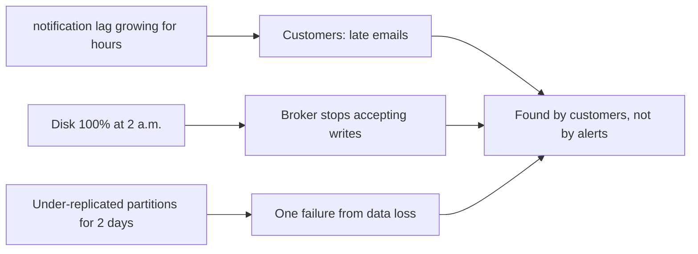
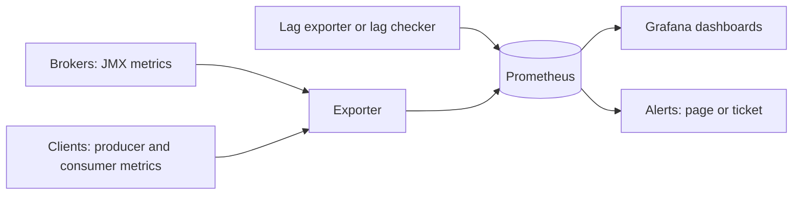

# Monitoring, Consumer Lag and Capacity Planning

**Messaging · Kafka · Step 2.2.17 · Advanced** · Last updated 2026-10-21

> [!TIP]
> **In one sentence:** watch a handful of broker health signals (offline and under-replicated partitions, the controller, latency, disk) and every consumer group's lag trend, and plan capacity from throughput × retention × replication before the busy day arrives.
>
> **Memory hook:** a **car dashboard**. A few warning lights must never be on (engine, oil: offline or under-replicated partitions); the speedometer shows performance (latency); the fuel gauge tells you when you'll run out (disk); and the satnav's "arriving late" warning is consumer lag growing.

## Where it fits

Step 2.2.17 of the [Kafka series](01-kafka-overview.md). It turns the earlier notes into signals: [replication and the ISR](06-brokers-replication-leader-election.md) (2.2.6), [consumer lag](04-consumers-consumer-groups.md) (2.2.4), [retention and storage](13-retention-compaction-tiered-storage.md) (2.2.13) and [partition planning](11-ordering-partition-planning-hot-partitions.md) (2.2.11). It connects to the observability track (10.x). Next: [multi-cluster and disaster recovery](18-multi-cluster-disaster-recovery.md) (2.2.18), the last note of the series.

## 1. The story

ShopFlow found out about Kafka problems from customers. Order-confirmation emails arrived **hours late**, because `notification-service` had fallen behind and nobody was watching its lag. A broker's disk **filled up at 2 a.m.** after retention was raised. And for two days a slow broker left several partitions **under-replicated**, one more failure away from losing data, without anyone noticing.



## 2. The idea

Monitor **few signals, well**, and alert on what needs action:

- **Never-should-happen lights:** offline partitions, partitions below the minimum in-sync replicas, under-replicated partitions, and anything other than exactly one active controller.
- **Performance:** request latency (p99, against a baseline) and how busy the broker's request threads are.
- **Resources:** disk usage and its growth, network.
- **Consumers:** each group's lag, alerting on **lag growing**, not on a fixed number.

Then **plan capacity** before peaks: throughput, storage and partitions, with headroom.



## 3. Key terms

| Term | Plain meaning |
|---|---|
| **Under-replicated partitions** | Partitions with fewer in-sync copies than replicas; above 0 = reduced safety |
| **Under-min-ISR partitions** | Below `min.insync.replicas`; `acks=all` writes fail |
| **Offline partitions** | No leader: data unavailable |
| **Active controller count** | Should be exactly 1 in the cluster |
| **Request latency (p99)** | How long the slowest 1% of produce or fetch requests take |
| **Request-handler idle %** | How much spare capacity broker threads have |
| **Consumer lag** | How far a group is behind the newest events |
| **Lag growth rate** | Whether lag is shrinking, stable or growing: the real alert signal |
| **Headroom** | Spare capacity kept for peaks and failures |

## 4. How it works, step by step

**Monitoring:**
1. Brokers and clients expose metrics through JMX; an exporter turns them into Prometheus metrics; Grafana shows dashboards.
2. Consumer lag comes from a lag exporter or a dedicated lag checker (for example Burrow, which judges health without fixed thresholds).
3. Alerts are tiered: **page** for offline partitions, under-min-ISR, controller count not 1, or a consumer falling steadily behind on a critical flow; **ticket** for under-replicated partitions that persist, high latency against baseline, disk trending towards full.

**Capacity planning:**
1. **Throughput:** peak events per second × average size, with a margin for sales and recovery after outages (consumers catching up read faster than normal).
2. **Storage:** daily volume × retention days × replication factor, plus headroom.
3. **Partitions:** from the throughput formula in 2.2.11, and within what each broker can comfortably host.
4. **Brokers:** enough that losing one still leaves room for its load, its partitions and replication.
5. **Validate** with a load test before the peak, not during it.

## 5. Real-world examples

- **Payments:** the payment consumer's lag objective is a few seconds, so a steadily growing lag pages someone; a nightly analytics consumer with hours of lag is normal and only checked daily.
- **Retail peak season:** teams estimate the peak (for example three times normal), load-test the cluster at that level and add brokers and partitions weeks ahead.
- **Platform teams:** a shared Kafka dashboard per consumer group lets each service team see its own lag without asking the platform team.

## 6. Design choices and trade-offs

| Signal | Alert on | Why |
|---|---|---|
| Offline partitions | Any value above 0 | Data unavailable now |
| Under-min-ISR partitions | Any value above 0 | `acks=all` writes failing |
| Active controller count | Not exactly 1 | Controller or quorum problem |
| Under-replicated partitions | Above 0 for longer than a short grace period | Safety reduced; brief values during restarts are normal |
| Request latency p99 | Well above its baseline | Users and producers slow down |
| Disk usage | Trend reaching full within days | Brokers stop when disks fill |
| Consumer lag | **Growing** steadily, per group, with group-specific objectives | 10,000 messages can be fine for a batch job and terrible for payments |

**Absolute lag versus lag growth:** absolute numbers mean different things per group; growth (or time behind) is comparable and actionable.

## 7. Common mistakes

1. **No lag monitoring**, so customers report delays first.
2. **One absolute lag threshold for every group.**
3. **Disk alerts at 95%**, too late to react.
4. **Ignoring under-replicated partitions** until a second failure.
5. **Monitoring brokers only**, not producers and consumers.
6. **Averages instead of p99 latency.**
7. **Planning capacity for normal days**, not peaks and recovery.

## 8. In code

> [!NOTE]
> Untested sketch to show the shape. Metric names depend on your exporter; adjust them.

```yaml
groups:
  - name: kafka
    rules:
      - alert: KafkaOfflinePartitions
        expr: kafka_controller_offline_partitions_count > 0          # name depends on exporter
        for: 1m
        labels: { severity: page }
      - alert: ConsumerLagGrowing
        expr: deriv(kafka_consumergroup_lag_sum{group="notification-service"}[15m]) > 0
        for: 15m
        labels: { severity: page }
```

**Storage estimate** for `orders`: 50 GB per day × 30 days × replication factor 3 = **4.5 TB**, plus headroom.

| Signal | Typical source |
|---|---|
| Partition health, controller | Broker JMX via an exporter |
| Request latency, handler idle | Broker JMX |
| Consumer lag | Lag exporter or lag checker |
| Client errors and retries | Producer and consumer metrics (for example through Micrometer in Spring Boot) |

## 9. Remember

- **Warning lights: offline, under-min-ISR, controller ≠ 1, persistent under-replicated.**
- **Lag: alert on growth, per group, with group-specific objectives.**
- **p99 latency against a baseline, not averages.**
- **Storage = volume × days × replication factor, plus headroom.**
- **Plan for peaks and recovery; load-test before the big day.**

## 10. Interview corner

**15-second answer:** "I alert on offline, under-min-ISR and under-replicated partitions and controller count, track p99 latency and disk trends, alert on consumer lag growth per group, and size capacity from throughput, retention and replication with headroom."

**60-second answer:**
> "For brokers I watch a few critical signals: offline partitions and partitions below min ISR page immediately, the active controller count must be exactly one, and persistent under-replicated partitions mean reduced safety. I track p99 produce and fetch latency against a baseline, request handler idle time, and disk trends. For consumers, lag is the user-facing signal, and I alert on lag growing per group with group-specific objectives, because the same lag can be fine for a batch job and terrible for payments. The stack is JMX to Prometheus to Grafana with a lag exporter. Capacity comes from peak throughput, storage as volume times retention times replication factor, partition counts, and enough brokers to lose one, validated with a load test before the peak."

**Likely follow-up questions:**
- **Which Kafka metric would you page on first?** Offline partitions above zero.
- **Why not alert on absolute lag?** It means different things per group; growth or time-behind is actionable.
- **How do you size storage?** Daily volume × retention days × replication factor, plus headroom.
- **What does under-replicated mean for risk?** Fewer safe copies; another failure could lose data or availability.
- **How do you prepare for a sale?** Estimate peak, load-test, add brokers and partitions in advance, and check consumers can catch up.

**Architect angle:** "I define lag objectives per consumer group with the owning teams and make capacity planning a routine before every known peak."

## 11. Industry check

> [!NOTE]
> Checked 2026-10-21 by web search (Conduktor, AxonOps, monitoring guides). Re-verify when you revisit the note.

- **Confirmed:** under-replicated partitions above 0 mean reduced fault tolerance; offline partitions are alerted at any non-zero value; the active controller count should be exactly 1; under-min-ISR partitions are alerted above 0; request latency (produce and fetch total time) should be compared to a baseline, and low request-handler idle percentage signals saturation; lag should be alerted on its growth rate rather than an absolute value; the common stack is JMX exported to Prometheus and shown in Grafana, with tools such as Kafka Exporter and Burrow for lag.
- **To verify:** exact metric names in your exporter; the consumer client metric for maximum lag (`records-lag-max`); latency thresholds suitable for your workload.
- **Decision rule:** few critical alerts that page, trend alerts that create tickets, lag objectives per group, capacity planned and load-tested before peaks.

## 12. Going further

- Apache Kafka documentation: monitoring
- Burrow (consumer lag checking) and your exporter's documentation
- Google, *Site Reliability Engineering* (monitoring and alerting)

**Next:** [Multi-cluster and disaster recovery](18-multi-cluster-disaster-recovery.md) (2.2.18).

Back to [the Kafka overview](01-kafka-overview.md) · [Messaging overview](../01-messaging-overview.md) · [Index](../../README.md) · [Roadmap](../../roadmap.md).
