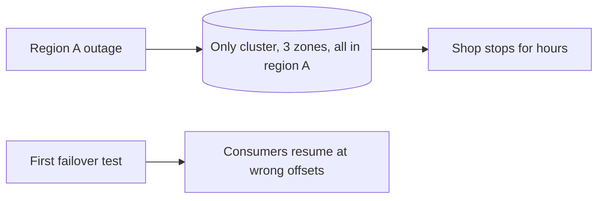

# Multi-Cluster and Disaster Recovery

**Messaging · Kafka · Step 2.2.18 · Advanced** · Last updated 2026-10-21
**Prerequisites:** [Replication](06-brokers-replication-leader-election.md) (2.2.6), [Kafka Connect](15-kafka-connect-cdc.md) (2.2.15)

## 1. What it is and why it matters

**What is it?** Protecting against the loss of a whole region by running a second Kafka cluster elsewhere, keeping it in sync (for example with **MirrorMaker 2**), and having a tested plan to move producers and consumers over.

**Why do we need it?** Replication inside one cluster survives broker and zone failures, not a regional outage.

**When would I meet it?** Business-continuity requirements, regulated industries, or global applications serving several regions.

> [!TIP]
> **Memory hook:** a spare key left with a neighbour in another street, and practising using it before you're locked out.

## 2. Mental model: a spare key

| In the analogy | In Kafka |
|---|---|
| Keys on your keyring | Replicas within one cluster |
| A spare key with a neighbour elsewhere | A second cluster in another region |
| Copying keys regularly | Replication between clusters (MirrorMaker 2) |
| Practising getting in | Failover drills |

**Where the analogy breaks:** a spare key is an exact copy; the second cluster is **slightly behind** (asynchronous copying), so the latest events may be missing at failover.

## 3. Industry terms

| Term | Simple meaning | Why it matters | Example | Related terms |
|---|---|---|---|---|
| **Disaster recovery (DR)** | Restoring service after a large failure | Business continuity | Region outage | Failover |
| **RPO** (recovery point objective) | How much data you can afford to lose | Shapes replication design | 1 minute of events | Replication lag |
| **RTO** (recovery time objective) | How long you can be down | Shapes runbooks and automation | 30 minutes | Failover |
| **Active-passive** | One cluster serves, one stands by | Simpler | Primary and DR region | Active-active |
| **Active-active** | Both serve and copy to each other | Local latency; complex | Two regions writing | Conflicts |
| **MirrorMaker 2** | Connect-based tool copying topics between clusters | Kafka's standard DR tool | Primary → DR | Checkpoints |
| **Offset translation** | Mapping consumer positions to the other cluster | Consumers resume near where they were | Checkpoint records | At-least-once |

## 4. In a real system (ShopFlow)

**The business problem.** Orders must keep flowing during a regional cloud outage, within agreed limits on data loss and downtime.

ShopFlow's cluster spanned three availability zones in one region, so the team felt safe, until the **whole region** went down for hours. A hastily built second cluster then failed its first test: consumers resumed from the **wrong positions**, some replaying a week, others skipping uncopied events.



**How DR helps.** A standby cluster in region B is kept in sync by MirrorMaker 2, which also writes **checkpoints** for consumer offsets; a rehearsed runbook moves traffic.

**What it costs.** A second cluster, cross-region traffic, operational practice, and an RPO above zero.

**Elsewhere:** regulated banks mirror payment topics to a second region and rehearse failover against tested recovery times; global consumer apps run a cluster per region for local writes (active-active) and copy only the events needed everywhere; stores or factories run small edge clusters that copy their topics into one central cluster for analytics.

## 5. How it works


1. **Normal operation:** producers and consumers use the primary; MirrorMaker 2 (usually run near the standby) copies chosen topics and writes checkpoints; schemas, ACLs and configs are kept in step. With the default replication policy, the copy of `orders` on the standby is named `primary.orders` (the source cluster's alias is the prefix), so consumers and configuration must use that name after failover; the identity policy keeps the original names but can break offset translation and isn't suited to active-active.
2. **Planned failover:** stop producers, wait for replication to catch up, start consumers on the standby from translated offsets, move producers.
3. **Emergency failover:** redirect traffic at once and accept that uncopied events may be lost (your real RPO); consumers resume from translated offsets and may see duplicates.

**Who guarantees what**

| Layer | Responsible for |
|---|---|
| Each cluster | Its own replication and durability |
| MirrorMaker 2 | Asynchronous topic copying; offset checkpoints (approximate) |
| Application | Idempotent consumers; switching bootstrap servers |
| Operations | Runbooks, drills, keeping schemas and ACLs in step |

> [!NOTE]
> Untested sketch. Check the replication policy and property names for your version.

```properties
clusters = primary, dr
primary.bootstrap.servers = kafka-a:9093
dr.bootstrap.servers = kafka-b:9093
primary->dr.enabled = true
primary->dr.topics = orders, payments, customer-profiles
sync.group.offsets.enabled = true
```

## 6. Failure scenarios

### Region outage with no second cluster

- **What happened?** The story above.
- **Solutions:** a standby cluster in another region with mirrored topics.
- **Trade-offs:** cost and practice.

### Consumers resume at the wrong position

- **What happened?** No offset translation during failover.
- **Solutions:** MirrorMaker 2 checkpoints and synchronised group offsets; idempotent consumers for the approximate overlap.
- **Trade-offs:** some duplicates after failover.

### Standby missing schemas or ACLs

- **What happened?** Topics were mirrored, but the schema registry and ACLs weren't.
- **What the business sees:** services fail to start or deserialize after failover.
- **Solutions:** treat schemas, ACLs and configs as part of DR; test them in drills.

## 7. Architectural decisions

| Setup | Protects against | RPO / RTO | Complexity |
|---|---|---|---|
| One cluster across zones | Broker and zone failures | No loss, quick recovery, within the region | Lowest |
| **Active-passive with MirrorMaker 2** | Region failure | Small loss (replication lag); minutes to hours | Medium |
| Active-active | Region failure, plus local latency | Lower RTO | Highest: conflicts, ordering across regions |

Asynchronous copying means RPO is never zero. Agree RPO and RTO with the business first; replicate only the topics needed for recovery.

**Common mistakes:** treating multiple zones as regional DR; no offset translation; never testing failover; forgetting schemas, ACLs and configs on the standby; consumers that aren't idempotent; active-active without a plan for conflicting writes; replicating every topic.

## 8. Check your understanding

1. Is a three-zone cluster a disaster-recovery solution? Against what?
2. Why must consumers be idempotent after a failover?
3. What is the difference between planned and emergency failover?
4. What besides topics must be ready on the standby cluster?

Answers are at the end of this note.

## 9. Revision

**Remember**
- **Replicas cover brokers and zones; a second cluster covers regions.**
- **MirrorMaker 2 copies topics and checkpoints consumer positions.**
- **Asynchronous copying: RPO above zero; duplicates possible.**
- **Planned: stop, drain, switch. Emergency: switch now, accept a gap.**
- **Rehearse failover; mirror schemas and ACLs too.**

**Explain in 15 seconds:** "Within a region, replicas across zones protect Kafka; for a region outage I run a second cluster kept in sync with MirrorMaker 2, with offset checkpoints and a rehearsed failover runbook."

**Explain in 60 seconds:**
> "I match protection to the failure: replication factor 3 across zones covers broker and zone failures; a region failure needs a second cluster, usually active-passive, with MirrorMaker 2 copying the important topics and writing checkpoints so consumers resume from translated offsets. Copying is asynchronous, so RPO is the replication lag and consumers must be idempotent. Planned failover drains replication first; emergency failover switches immediately and accepts a small gap. Schemas, ACLs and configs are part of the plan, and we rehearse it."

**Likely follow-up questions:**
- **RPO versus RTO?** How much data you can lose versus how long you can be down.
- **When would you choose active-active?** When both regions must serve local traffic and recovery must be fast, accepting conflict handling and more complexity.
- **Why run MirrorMaker 2 near the target cluster?** Consuming across the region boundary and producing locally is the recommended, more robust setup.

**Architect's takeaway:** agree RPO and RTO first, choose the cheapest topology that meets them, and treat failover as a rehearsed procedure.

**Next topic:** this completes the Kafka series. Revise with the [messaging cheat sheet](../99-messaging-cheat-sheet.md), then continue with the RabbitMQ series (2.3) in the [roadmap](../../roadmap.md).

## 10. Verification and sources

> [!NOTE]
> Checked 2026-10-21 by web search. Re-verify when you revisit this note.

- **Confirmed:** MirrorMaker 2 is commonly used for DR; offset replication (`sync.group.offsets.enabled`) differs from offset translation via checkpoint records; translated offsets can leave small gaps or duplicates, so consumers should handle at-least-once; running MirrorMaker 2 near the standby is recommended; planned failover drains replication first, emergency failover accepts losing unreplicated messages; an identity replication policy can break offset translation (Red Hat Developer, Lenses, BigData Boutique).
- **Assumptions and illustrations:** the ShopFlow story; configuration (not run); RPO and RTO examples.
- **Also confirmed:** `DefaultReplicationPolicy` prefixes remote topics with the source cluster alias and a dot; `IdentityReplicationPolicy` keeps names and doesn't support active-active (Apache Kafka MirrorMaker 2 Javadoc; Aiven documentation).
- **To verify:** vendor alternatives (cluster linking, managed replicators); stretched clusters across regions.
- **Decision rule:** zones for availability, a second cluster for regional DR, agreed RPO and RTO, idempotent consumers, rehearsed failover.

**Sources:** Apache Kafka documentation (geo-replication); Red Hat Developer, "Demystifying Kafka MirrorMaker 2"; AWS Well-Architected Reliability pillar.

## Answers

1. It protects against broker and zone failures inside one region, not against losing the whole region.
2. Offset translation is approximate and copying is asynchronous, so some events are processed again after failover.
3. Planned: stop producers, let replication catch up, then switch, with no data loss. Emergency: switch immediately, accepting loss of events not yet copied.
4. Schemas (and the schema registry), ACLs and credentials, topic configurations, consumer offsets, and client configuration to point at the standby.

Back to [the Kafka overview](01-kafka-overview.md) · [Index](../../README.md) · [Roadmap](../../roadmap.md).
