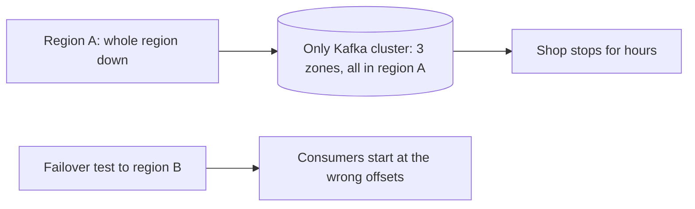
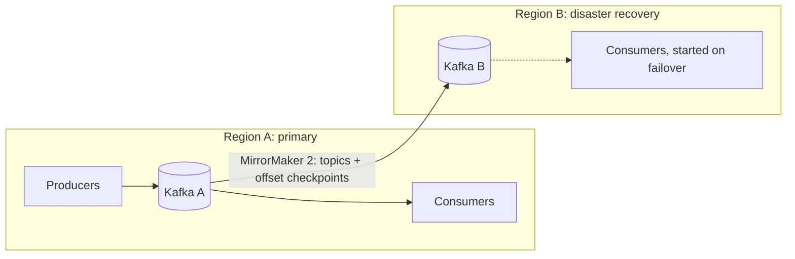

# Multi-Cluster and Disaster Recovery

**Messaging · Kafka · Step 2.2.18 · Advanced** · Last updated 2026-10-21

> [!TIP]
> **In one sentence:** replication inside one cluster survives broker and zone failures, but surviving the loss of a whole region needs a second cluster, kept in sync with a tool like MirrorMaker 2, plus a tested plan for moving producers and consumers over.
>
> **Memory hook:** a **spare house key**. A copy on your keyring (replicas in the same cluster) doesn't help if you lose the whole bag. Leave one with a trusted neighbour in another street (a second cluster in another region), and practise using it before the day you're locked out.

## Where it fits

Step 2.2.18, the last note of the [Kafka series](01-kafka-overview.md). It extends [replication](06-brokers-replication-leader-election.md) (2.2.6) beyond one cluster, uses [Kafka Connect](15-kafka-connect-cdc.md) (2.2.15), on which MirrorMaker 2 is built, and relies on consumers being [idempotent](05-offset-commits-delivery-guarantees.md) (2.2.5). It links to [testing resilience](../../01-resilience/10-testing-resilience.md) for failover drills.

## 1. The story

ShopFlow's Kafka cluster ran in one cloud region across three availability zones, so the team felt safe. Then the **whole region** had a long outage, and with it every topic: no orders, no payments, for hours. Afterwards they quickly copied topics to a second region, but on the first failover test, consumers in the new region **started from the wrong place**: some reprocessed a week of events, others skipped what hadn't been copied yet.



## 2. The idea

Match the protection to the failure:

- **Broker failure:** replication factor 3 (2.2.6).
- **Zone failure:** replicas spread across zones in one cluster (2.2.6).
- **Region failure:** a **second cluster in another region**, continuously copied.

**MirrorMaker 2** (MM2), built on Kafka Connect, copies topics from one cluster to another and records **checkpoints** that map consumer positions on the source to positions on the target. On failover, consumers use the checkpoints to **resume close to where they were**. Because copying is asynchronous, the very latest events may not have arrived, and some may be read twice, so consumers must handle **at-least-once** delivery.



## 3. Key terms

| Term | Plain meaning |
|---|---|
| **Disaster recovery (DR)** | Restoring service after a large failure, such as a region outage |
| **RPO** (recovery point objective) | How much data you can afford to lose, as time |
| **RTO** (recovery time objective) | How long you can afford to be down |
| **Active-passive** | One cluster serves traffic; the other is a standby copy |
| **Active-active** | Both clusters serve traffic and copy to each other |
| **MirrorMaker 2** | Kafka's Connect-based tool for copying topics between clusters |
| **Offset translation** | Mapping a consumer's position on the source cluster to the matching position on the target |
| **Failover / failback** | Moving to the standby / moving back afterwards |

## 4. How it works, step by step

**Normal operation (active-passive):**
1. Producers and consumers use the primary cluster.
2. MM2, usually running near the standby cluster, copies the chosen topics and writes checkpoints for consumer groups.
3. Schemas, ACLs and topic settings are kept in step on the standby too.

**Planned failover:**
1. Stop producers on the primary.
2. Wait until replication has caught up.
3. Start consumers on the standby from their translated positions.
4. Point producers at the standby.

**Emergency failover:**
1. Redirect producers and consumers to the standby immediately.
2. Accept that events not yet copied may be lost (that gap is your real RPO).
3. Consumers resume from translated positions and may see some duplicates.

## 5. Real-world examples

- **Banks:** regulators expect regional disaster recovery with tested recovery times, so payment topics are mirrored to a second region and failover is rehearsed regularly.
- **Global consumer apps:** each region runs its own cluster for local writes and low latency (active-active), and events needed everywhere are copied between regions.
- **Edge to centre:** many small clusters in stores or factories copy their topics into one central cluster for analytics (aggregation).

## 6. Design choices and trade-offs

| Setup | Protects against | RPO / RTO | Cost and complexity |
|---|---|---|---|
| One cluster, replicas across zones | Broker and zone failures | No loss, quick recovery, within the region only | Lowest |
| **Active-passive with MM2** | Region failure | Small data loss (replication lag); minutes to hours, depending on the runbook | Second cluster, mostly idle; failover practice |
| **Active-active** | Region failure, plus local latency | Lower RTO | Highest: two-way copying, conflicts, per-key ordering across regions |

**Asynchronous copying means RPO is never zero.** If the business needs zero loss across regions, that is a different, much more expensive design, and worth questioning.

**Replicate selectively:** copy the topics that matter for recovery, not everything.

## 7. Common mistakes

1. **Treating multiple zones as disaster recovery** for a regional outage.
2. **No offset translation**, so consumers restart at the beginning or the end.
3. **Never testing failover**: the runbook fails on the real day.
4. **Forgetting schemas, ACLs and configs** on the standby cluster.
5. **Consumers that aren't idempotent**, so duplicates after failover cause damage.
6. **Active-active without a plan** for conflicting writes to the same key.
7. **Replicating every topic**, paying for data nobody needs in a disaster.

## 8. In code

> [!NOTE]
> Untested sketch to show the shape. Check the replication policy and property names for your version.

```properties
# mm2.properties: copy selected topics and consumer positions from primary to dr
clusters = primary, dr
primary.bootstrap.servers = kafka-a:9093
dr.bootstrap.servers = kafka-b:9093

primary->dr.enabled = true
primary->dr.topics = orders, payments, customer-profiles
primary->dr.groups = .*
sync.group.offsets.enabled = true
replication.factor = 3
```

| Setting | What it controls |
|---|---|
| `clusters` and `*.bootstrap.servers` | Which clusters are connected |
| `primary->dr.enabled` / `.topics` | Direction and which topics are copied |
| `sync.group.offsets.enabled` | Copying translated consumer positions to the target |
| Replication policy | How replicated topics are named on the target |

## 9. Remember

- **Replicas cover brokers and zones; a second cluster covers regions.**
- **MM2 copies topics and checkpoints consumer positions.**
- **Asynchronous copying: RPO above zero; consumers must handle duplicates.**
- **Planned failover: stop, drain, switch. Emergency: switch now, accept a gap.**
- **Practise failover; replicate schemas and ACLs too.**

## 10. Interview corner

**15-second answer:** "Within a region, replicas across zones protect Kafka; for a region outage I run a second cluster kept in sync with MirrorMaker 2, with offset checkpoints and a rehearsed failover runbook."

**60-second answer:**
> "I match protection to the failure. Replication factor 3 across availability zones covers broker and zone failures. For a region failure I run a second cluster, usually active-passive, with MirrorMaker 2 copying the important topics and writing checkpoints so consumers can resume from translated offsets. Copying is asynchronous, so RPO is the replication lag rather than zero, and consumers must be idempotent because they may reprocess some events after failover. The runbook covers planned failover, where we stop producers and let replication catch up, and emergency failover, where we switch immediately and accept a small gap. Schemas, ACLs and configs are kept in step, and the failover is rehearsed regularly."

**Likely follow-up questions:**
- **RPO versus RTO?** How much data you can lose versus how long you can be down.
- **Is a multi-zone cluster a DR solution?** Not for a regional outage; it protects against zone failure only.
- **How do consumers know where to resume?** MirrorMaker 2 checkpoints translate their offsets to the target cluster.
- **Why must consumers be idempotent?** Translated offsets are approximate, so some events are read again.
- **When would you choose active-active?** When both regions must serve local traffic and recovery must be fast, accepting conflict handling and more complexity.

**Architect angle:** "I agree RPO and RTO with the business first, choose the topology that meets them at a sensible cost, and treat failover as a rehearsed procedure, not a diagram."

## 11. Industry check

> [!NOTE]
> Checked 2026-10-21 by web search (Red Hat developer article, Lenses, BigData Boutique and replication guides). Re-verify when you revisit the note.

- **Confirmed:** MirrorMaker 2 is commonly used for disaster recovery; offset *replication* (`sync.group.offsets.enabled`) differs from offset *translation* through checkpoint records written by the checkpoint connector; translated offsets can leave small gaps or duplicates, so consumers should handle at-least-once; running MM2 on or near the standby cluster is recommended; planned failover stops producers, lets replication catch up, then moves consumers, while emergency failover redirects traffic and accepts losing unreplicated messages; one source warns that a replication policy keeping identical topic names can break offset translation.
- **To verify:** how replicated topics are named under the default replication policy; vendor alternatives (for example cluster-linking or managed replicator features) and their offset behaviour; stretched clusters across regions.
- **Decision rule:** zones for availability, a second cluster for regional DR, RPO and RTO agreed with the business, idempotent consumers, rehearsed failover.

## 12. Going further

- Apache Kafka documentation: geo-replication (MirrorMaker 2)
- Red Hat Developer, "Demystifying Kafka MirrorMaker 2"
- AWS Well-Architected Reliability pillar: disaster recovery objectives

**This completes the Kafka series.** Revise with the [messaging cheat sheet](../99-messaging-cheat-sheet.md).

Back to [the Kafka overview](01-kafka-overview.md) · [Messaging overview](../01-messaging-overview.md) · [Index](../../README.md) · [Roadmap](../../roadmap.md).
