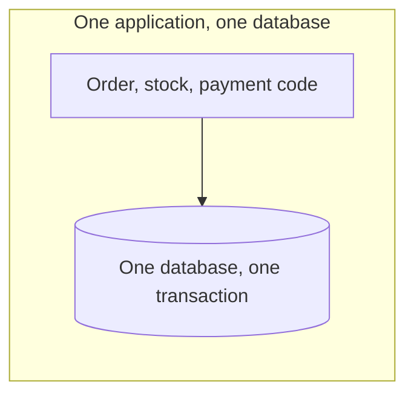
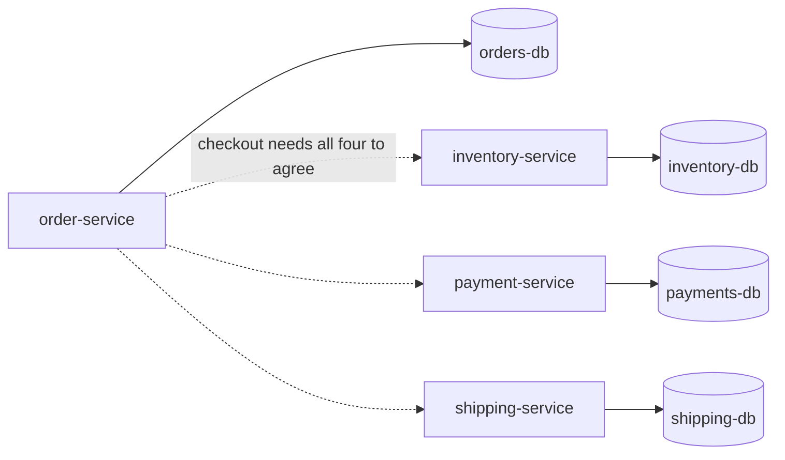
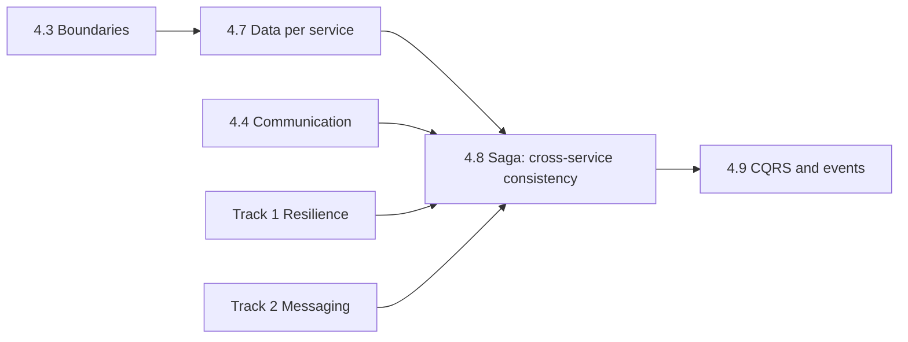

# Microservices: The Big Picture

**Microservices · Step 4.1 · Overview** · Last updated 2026-10-23
**Prerequisites:** [Resilience: the big picture](../01-resilience/01-resilience-overview.md) (1.1) and [Messaging and event-driven design](../02-messaging/01-messaging-overview.md) (2.1); helpful: [Choosing a database](../14-system-design/07-choosing-a-database.md) (14.7)

Read this first. It is the map of the Microservices area: what the style is, the problem it creates for data, what each topic is for, and the learning order. This overview is deliberately short: the area is written in the order you ask for topics, and the first one is the **Saga pattern** (step 4.8), which is where the hardest consequence of the style is solved.

## 1. What it is and why it matters

**What is it?** A **microservice architecture** builds one application as a set of small services. Martin Fowler and James Lewis describe the style as "an approach to developing a single application as a suite of small services, each running in its own process and communicating with lightweight mechanisms, often an HTTP resource API. These services are built around business capabilities and independently deployable by fully automated deployment machinery."

**Why do we need it?** It solves *organisational and scaling* problems: many teams can change and release their own part without coordinating a big release, a busy part can be scaled alone, and a failure can be contained. It does not make code simpler: it turns calls inside one process into calls over a network, and **it splits one database into many**.

**When would I meet it?** When a system is big enough that teams block each other, when you read "service" in any architecture diagram, and, sooner than you expect, the first time a business operation must change data in two services at once.

> [!TIP]
> **Memory hook:** *a mall of independent shops instead of one department store: each shop runs itself and keeps its own books, which is why no single cash register can balance all of them.*

## 2. Mental model: a department store and a mall

In a department store, one finance office and one stock system see every sale, so a sale either happens everywhere or nowhere. In a mall, every shop has its own till, stock room and opening hours. Shops are independent and can be refurbished or closed alone, but a purchase that spans two shops (a bundle of a phone and a case) needs the shops to agree, and if the second shop refuses, the first must give the money back.

| In the analogy | In the real system |
|---|---|
| A shop | A service that owns a business capability and its data |
| The till and stock room | The service's own database |
| The mall's agreed counters | APIs and events between services |
| A bundle sale across two shops | A business transaction that spans services |
| Giving the money back | A compensating action: the heart of the Saga pattern |

**Where the analogy breaks:** shopkeepers talk to each other face to face and notice mistakes quickly. Services talk over a network that can lose, delay or repeat messages, so the "give the money back" step itself can fail or arrive twice.

## 3. Industry terms

| Term | Simple meaning | Why it matters | Example | Related terms |
|---|---|---|---|---|
| **Microservice** | A small, independently deployable service built around one business capability | The unit of ownership, release and scaling | `payment-service` | Modular monolith |
| **Bounded context** | The area of the domain where one model and vocabulary apply | Where to draw service boundaries | "Inventory" versus "Catalogue" | Domain-driven design |
| **Database per service** | Each service owns its data; others use its API or events | Independence; but no shared transaction | `inventory-db` | Shared database (an anti-pattern here) |
| **Distributed transaction** | One atomic change across several databases or services | What a monolith gets for free and microservices cannot rely on | Two-phase commit | Saga |
| **Eventual consistency** | Data in different services agrees after a short delay, not at every instant | The price of independence | An order shows "pending" for a second | CAP, [14.10](../14-system-design/10-consistency-cap-pacelc-quorums.md) |
| **Saga** | A business transaction made of local transactions with compensations | The standard answer to cross-service consistency | Checkout across three services | Compensating transaction |
| **Domain event** | A fact that a service publishes after it changes state | How services react without calling each other | `OrderPlaced` | Outbox |
| **API gateway / BFF** | A front door that routes and shapes requests for clients | One entry for many services | Web and mobile gateways | Ingress |

## 4. In a real system (ShopFlow)

**The business problem.** ShopFlow started as one application with one MySQL database. Placing an order is one database transaction: insert the order, decrement stock, record the payment, all committed together or rolled back together. As the company grows, the checkout team, the inventory team and the payments team keep blocking each other's releases, and the Black Friday load needs inventory scaled ten times while payments needs none. ShopFlow splits into `order-service`, `inventory-service`, `payment-service` and `shipping-service`, each with its own database.

**How the style helps.** Teams release independently, inventory scales alone, and a failing shipping service no longer takes the whole shop down if the others are designed for it ([resilience](../01-resilience/01-resilience-overview.md)).

**What it costs.** Everything between services is now a network call that can fail ([timeouts](../01-resilience/02-timeouts.md), [retries](../01-resilience/03-retries-backoff-jitter.md)); operating many services needs automation and observability; and the single transaction is gone. Placing an order now changes data in four databases, and **no database can roll the others back**. Fowler and Lewis put it directly: distributed transactions "are notoriously difficult to implement and as a consequence microservice architectures emphasize transactionless coordination between services, with explicit recognition that consistency may only be eventual consistency and problems are dealt with by compensating operations."

**Elsewhere:** a travel site books a flight, a hotel and a car from three companies' systems and must cancel the rest if one refuses; a bank moves money between two systems that cannot share a transaction; a marketplace splits an order across several sellers.

## 5. How it works: the family, one question each

| Step | Topic | The question it answers |
|---|---|---|
| 4.2 | When to use them, and when not (modular monolith) | Do we need this at all? |
| 4.3 | Decomposition and bounded contexts | Where do the boundaries go? |
| 4.4 | Service communication: synchronous and asynchronous | How do services talk? |
| 4.5 | API gateway and BFF | How do clients reach many services? |
| 4.6 | Service discovery and configuration | How do services find each other and their settings? |
| 4.7 | Data per service and consistency | Who owns which data, and how do others read it? |
| **4.8** | **Saga and the outbox pattern** | **How does one business operation change several services consistently?** |
| 4.9 | CQRS and event sourcing | How do we read across services, and keep history? |
| 4.10 | Resilience between services | How do we survive each other's failures? |
| 4.11 | Testing microservices | How do we know it works together? |
| 4.12 | Versioning, deployment and ownership | How do we change it safely over time? |

The Saga series depends on the resilience track (timeouts, retries, idempotency) and the messaging track (events, delivery guarantees, the outbox), and it leads into CQRS and event sourcing.

## 6. Architectural decisions

| Decision | Choose | Because |
|---|---|---|
| Start with microservices? | Not by default: a well-structured **modular monolith** first, services when team or scaling pressure is real | You pay the distributed-systems cost from day one, and benefit only later (step 4.2, planned) |
| Where to cut | Along business capabilities and data ownership, not technical layers | A boundary that cuts through a transaction is expensive (step 4.3, planned) |
| Data | One owner per piece of data; others use APIs or events | Shared databases recreate the monolith's coupling |
| Cross-service consistency | Design for eventual consistency with sagas, and avoid cross-service business transactions where the model allows | See the Saga series |
| Communication | Prefer asynchronous events for reactions, synchronous calls for answers the user needs now | Resilience and decoupling versus simplicity |

## 7. Notes in this area, in learning order

The area is written in the order you choose topics; the first two, now complete, are the Saga series and the CQRS and event sourcing series.

| Step | Topic | Status |
|---|---|---|
| 4.1 | This overview | Done |
| 4.2 to 4.7 | When to use them; decomposition; communication; gateway; discovery; data per service | Planned |
| 4.8.1 to 4.8.8 | The [Saga series](08-saga/01-saga-overview.md), plus the [Saga cheat sheet](08-saga/99-saga-cheat-sheet.md) | Done |
| 4.9.1 to 4.9.7 | The [CQRS and event sourcing series](09-cqrs-event-sourcing/01-cqrs-es-overview.md), plus the [cheat sheet](09-cqrs-event-sourcing/99-cqrs-es-cheat-sheet.md) | Done |
| 4.10 to 4.12 | Resilience between services; testing; versioning and ownership | Planned |

Revision: the [Saga cheat sheet](08-saga/99-saga-cheat-sheet.md); an area cheat sheet follows later.

## 8. Check your understanding

1. What does a monolith get from its single database that microservices lose?
2. Why can't ShopFlow keep one shared database for all services and just split the code?
3. Fowler and Lewis say consistency "may only be eventual". What does that mean for what a customer sees right after placing an order?

Answers are at the end of this note.

## 9. Revision

**Remember**
- Microservices = small, independently deployable services around **business capabilities**, each with its **own data**.
- They solve **organisation and scaling**; they add **network failure, operations cost and split data**.
- No shared transaction across services: use **sagas** and design for **eventual consistency**.
- Start with a modular monolith unless real team or scaling pressure exists.

**Explain in 15 seconds:** "Microservices split an application into independently deployable services that each own their data; that gives team and scaling independence, but you lose the single database transaction, so cross-service changes use sagas and eventual consistency."

**Explain in 60 seconds:**
> "A microservice architecture is a suite of small services, each in its own process, built around a business capability and independently deployable. The benefit is organisational and operational: teams release and scale their own part. The cost is that calls become network calls that can fail, and data is split across databases. A business operation such as checkout then touches several services, and no database transaction spans them, because distributed transactions couple the services in time and are hard to run. The answer is to accept eventual consistency and coordinate with sagas: a sequence of local transactions with compensating actions if a later step fails, made reliable with messaging patterns like the outbox. Because of the costs, I start with a well-structured monolith unless the team or scaling pressure justifies services."

**Architect's takeaway:** the real decision is where consistency boundaries are. Draw service boundaries so that most business rules stay inside one service, and treat every cross-service rule as a saga you must design, operate and test.

**Next topic:** [Saga: the big picture and learning order](08-saga/01-saga-overview.md) (4.8.1).

## 10. Verification and sources

> [!NOTE]
> Checked 2026-10-23 against the sources below. Re-verify when you revisit this note.

- **Confirmed (documentation, read 2026-10-23):** the definition of the microservice style, and the statements that distributed transactions "are notoriously difficult to implement", that such architectures "emphasize transactionless coordination between services, with explicit recognition that consistency may only be eventual consistency and problems are dealt with by compensating operations", and that transactions across services impose "significant temporal coupling" (Martin Fowler and James Lewis, "Microservices").
- **Assumptions and illustrations:** the ShopFlow split and the Black Friday story are illustrative. The topic list for steps 4.2 to 4.12 is a proposal from the roadmap.
- **To verify:** how your organisation defines "service" and who owns each database; whether any services still share a database.
- **Decision rule:** services follow business capabilities and data ownership; use sagas for cross-service consistency; start with a modular monolith unless pressure is real.

**Sources:** Martin Fowler and James Lewis, "Microservices" (martinfowler.com/articles/microservices.html).

## Answers

1. A single ACID transaction across everything: either the order, the stock change and the payment all commit, or none do, and concurrent users never see half of it. With separate databases there is no such guarantee across services.
2. A shared database couples every service to the same schema and the same release timing, which removes the independence that was the reason to split; it also makes one team's migration a risk for all the others.
3. Right after placing an order, some services may not have processed it yet: the order might show "pending", stock might still look unchanged, and a confirmation email might arrive a few seconds later. The data agrees eventually, and the design must make the in-between states acceptable and safe.

Back to [the index](../README.md) · [Roadmap](../roadmap.md).
