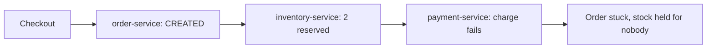
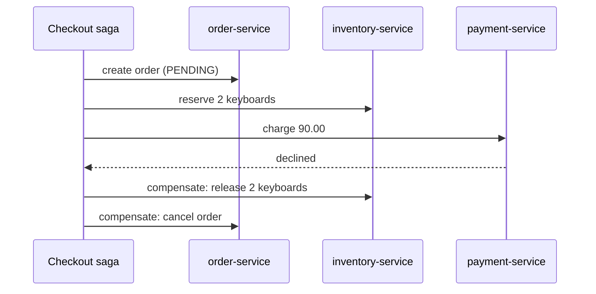
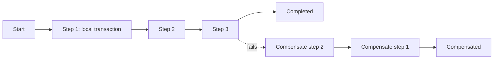

# Saga: The Big Picture and Learning Order

**Microservices · Saga · Step 4.8.1 · Overview** · Last updated 2026-10-23
**Prerequisites:** [Microservices: the big picture](../01-microservices-overview.md) (4.1); helpful: [Idempotency](../../01-resilience/04-idempotency.md) (1.4) and [Messaging and event-driven design](../../02-messaging/01-messaging-overview.md) (2.1)

Read this first. It is the map of the Saga series: the problem, the idea, the two ways to coordinate a saga, what each lesson teaches and in what order. The examples are small Java 21 programs; how to run them is in [the Java overview](../../13-java/01-java-overview.md), section 5.

**Version note**

| Item | Version |
|---|---|
| Baseline | The saga idea (1987); the microservice formulation popularised from the 2010s onward |
| Hands-on baseline | Java 21 (OpenJDK 21.0.8), plain JDK with no libraries; the programs simulate services in memory and inject failures |
| Compatibility note | The names of saga frameworks and their APIs change between versions; this series teaches the pattern first and names tools only in the "Alternatives in the industry" tables |

## 1. What it is and why it matters

**What is it?** A **saga** is a business transaction made of a **sequence of local transactions**, each committed in one service's own database. If a step fails, the steps that already completed are undone by **compensating transactions**. In the words of the microservices.io pattern description: "A saga is a reliably coordinated sequence of local transactions. The coordination mechanism ... ensures that the saga finishes: either all steps complete successfully or, if a local transaction fails because it violates a business rule, the changes made by the completed steps are undone by compensating transactions."

**Why do we need it?** Once each service owns its database ([4.1](../01-microservices-overview.md)), no single database transaction can cover "reserve stock, charge the card, create the shipment". Without a plan, a failure in the middle leaves the business in a half-done state. A saga is that plan: every step has a defined undo, and something makes sure the sequence either completes or is fully compensated.

**When would I meet it?** Whenever one business operation changes data in more than one service: checkout, booking, onboarding, refunds, order cancellation, any "process" that takes several steps.

> [!TIP]
> **Memory hook:** *a saga is a chain of small commits with an "undo" for each link, instead of one big rollback.*

## 2. Mental model: booking a holiday through three agencies

You book a flight, a hotel and a car, each at a different agency, each charging your card straight away. If the hotel turns out to be full, there is no master "rollback" button. You phone the airline and cancel the flight (maybe with a fee), and you do not book the car. The holiday as a whole either happens or is cancelled step by step.

| In the analogy | In the real system |
|---|---|
| Each agency's booking | A local transaction in one service |
| Cancelling the flight | A compensating transaction |
| You, remembering what is booked | The saga's coordination state (an orchestrator, or events) |
| "Hotel full" | A business failure that triggers compensation |
| The airline's cancellation fee | A compensation that is not a perfect undo |

**Where the analogy breaks:** while you were still booking, other people could see the flight as "taken" and be refused, even though you later cancelled it (no isolation), and a postcard you already sent cannot be taken back (some steps cannot be compensated). Both points get their own lessons.

## 3. Industry terms

| Term | Simple meaning | Why it matters | Example | Related terms |
|---|---|---|---|---|
| **Saga** | A business transaction made of local transactions plus compensations | Consistency across services without a distributed transaction | The checkout saga | Process manager, long-running transaction |
| **Local transaction** | An ordinary ACID transaction inside one service | The only real transaction available | `INSERT INTO reservations ...` | ACID |
| **Compensating transaction** | A new transaction that semantically undoes an earlier one | Replaces rollback | Release reserved stock | Semantic undo |
| **Choreography** | Each service reacts to events and publishes its own; no central coordinator | Loose coupling, but the flow is implicit | `PaymentFailed` triggers a release | [4.8.3](03-choreography.md) |
| **Orchestration** | A coordinator tells each participant what to do and tracks state | The flow is explicit and visible | `CheckoutSagaOrchestrator` | [4.8.4](04-orchestration.md) |
| **Pivot transaction** | The step after which the saga will complete rather than compensate | Defines the point of no return | Capturing the payment | Retriable transaction |
| **Retriable transaction** | A step after the pivot that must eventually succeed, so it is retried | Guarantees completion | Sending the confirmation | Idempotency |
| **Semantic lock** | An application-level flag that marks data as "in the middle of a saga" | A countermeasure for missing isolation | Order status `APPROVAL_PENDING` | [4.8.6](06-isolation-and-countermeasures.md) |
| **Two-phase commit (2PC)** | A protocol that makes several databases commit or abort together | What sagas replace | XA transactions | Distributed transaction |
| **Eventual consistency** | The services agree after the saga finishes, not at every moment | The honest guarantee of a saga | Order `PENDING`, then `CONFIRMED` | CAP |

## 4. In a real system (ShopFlow)

**The business problem.** A customer checks out two keyboards for 90.00. The `order-service` must create the order, the `inventory-service` must reserve two keyboards, and the `payment-service` must charge the card. Each service has its own database. The card has only 50.00. Here is the straightforward implementation, run as it is, with no saga:

```java
// File: CheckoutWithoutSaga.java (runnable, Java 21)
import java.util.Locale;

public class CheckoutWithoutSaga {

    // Three services, each with its own private data. In a real system each has its own database.
    static class OrderService {
        String status = "NONE";
    }

    static class InventoryService {
        int stock = 10;
        int reserved = 0;

        void reserve(int quantity) {
            stock -= quantity;
            reserved += quantity;
        }
    }

    static class PaymentService {
        double cardBalance = 50.00;
        double charged = 0.00;

        boolean charge(double amount) {
            if (amount > cardBalance) {
                return false;
            }
            cardBalance -= amount;
            charged += amount;
            return true;
        }
    }

    public static void main(String[] args) {
        OrderService orders = new OrderService();
        InventoryService inventory = new InventoryService();
        PaymentService payments = new PaymentService();

        int quantity = 2;
        double total = 90.00;
        System.out.println(String.format(Locale.ROOT, "checkout O-1001: %d x keyboard, total %.2f, card holds %.2f", quantity, total, payments.cardBalance));

        // Each step commits in its own service. There is no transaction around all three.
        orders.status = "CREATED";
        System.out.println("order-service:     O-1001 " + orders.status);

        inventory.reserve(quantity);
        System.out.println("inventory-service: reserved " + quantity + " keyboards (stock now " + inventory.stock + ")");

        boolean paid = payments.charge(total);
        System.out.println("payment-service:   charge of " + String.format(Locale.ROOT, "%.2f", total) + (paid ? " succeeded" : " failed: insufficient funds"));

        // The payment failed, and the checkout code simply stops.
        System.out.println();
        System.out.println(String.format(Locale.ROOT, "final state: order=%s stock=%d reserved=%d charged=%.2f",
                orders.status, inventory.stock, inventory.reserved, payments.charged));
        System.out.println("=> the order is stuck in CREATED, and " + inventory.reserved + " keyboards are reserved for nobody");
    }
}
```

**Expected output**:

```text
checkout O-1001: 2 x keyboard, total 90.00, card holds 50.00
order-service:     O-1001 CREATED
inventory-service: reserved 2 keyboards (stock now 8)
payment-service:   charge of 90.00 failed: insufficient funds

final state: order=CREATED stock=8 reserved=2 charged=0.00
=> the order is stuck in CREATED, and 2 keyboards are reserved for nobody
```



**Walkthrough.** Each step committed in its own service. When the payment failed, the code stopped, and nothing undid the first two steps: the order is stuck in `CREATED` and two keyboards are held for nobody. Multiply by thousands of orders, and the shop shows "out of stock" for items that are actually available, and support has to clean up by hand.

**How a saga helps.** The same three steps, but each completed step registers how to undo it, and a failure runs those undos in reverse order:

```java
// File: CheckoutAsSaga.java (runnable, Java 21)
import java.util.ArrayDeque;
import java.util.Deque;
import java.util.Locale;

public class CheckoutAsSaga {

    static class OrderService {
        String status = "NONE";
    }

    static class InventoryService {
        int stock = 10;
        int reserved = 0;

        void reserve(int quantity) {
            stock -= quantity;
            reserved += quantity;
        }

        void release(int quantity) {          // the compensation of reserve
            stock += quantity;
            reserved -= quantity;
        }
    }

    static class PaymentService {
        double cardBalance = 50.00;
        double charged = 0.00;

        boolean charge(double amount) {
            if (amount > cardBalance) {
                return false;
            }
            cardBalance -= amount;
            charged += amount;
            return true;
        }
    }

    public static void main(String[] args) {
        OrderService orders = new OrderService();
        InventoryService inventory = new InventoryService();
        PaymentService payments = new PaymentService();
        int quantity = 2;
        double total = 90.00;

        // The saga remembers how to undo each step that completed, and runs those undos in reverse order if a later step fails.
        Deque<Runnable> undo = new ArrayDeque<>();

        orders.status = "PENDING";
        undo.push(() -> {
            orders.status = "CANCELLED";
            System.out.println("compensate: order-service cancelled the order");
        });
        System.out.println("step 1 done: order PENDING");

        inventory.reserve(quantity);
        undo.push(() -> {
            inventory.release(quantity);
            System.out.println("compensate: inventory-service released " + quantity + " keyboards");
        });
        System.out.println("step 2 done: reserved " + quantity + " keyboards");

        if (payments.charge(total)) {
            orders.status = "CONFIRMED";
            System.out.println("step 3 done: payment charged, order CONFIRMED");
        } else {
            System.out.println("step 3 failed: payment declined, so run the compensations");
            while (!undo.isEmpty()) {
                undo.pop().run();
            }
        }

        System.out.println();
        System.out.println(String.format(Locale.ROOT, "final state: order=%s stock=%d reserved=%d charged=%.2f",
                orders.status, inventory.stock, inventory.reserved, payments.charged));
        if (orders.status.equals("CONFIRMED")) {
            System.out.println("=> the order is confirmed, and the stock is reserved for it");
        } else {
            System.out.println("=> no keyboards are held for nobody, and the order says what happened");
        }
    }
}
```

**Expected output**:

```text
step 1 done: order PENDING
step 2 done: reserved 2 keyboards
step 3 failed: payment declined, so run the compensations
compensate: inventory-service released 2 keyboards
compensate: order-service cancelled the order

final state: order=CANCELLED stock=10 reserved=0 charged=0.00
=> no keyboards are held for nobody, and the order says what happened
```



**Walkthrough.** The payment is declined, so the saga compensates the completed steps in reverse order (release the stock, cancel the order). The final state is consistent: stock is back to 10, nothing is reserved, and the order says `CANCELLED`. This tiny version runs inside one program; the rest of the series is about doing it across real services with real failures.

**What it costs.** You write and test compensations for every step; consistency is *eventual* (for a moment the order exists and the stock is held); other users can see intermediate states; and you must make the whole thing survive crashes, duplicate messages and slow services. That is the content of the series.

**Elsewhere:** travel booking (flight, hotel, car) is the textbook case; a marketplace paying out to several sellers; a bank opening an account across KYC, ledger and card-issuing systems; a food-delivery app matching a restaurant, a courier and a payment.

## 5. How it works: why not a distributed transaction, and the shape of a saga

**Why not two-phase commit?** 2PC makes several databases commit together: a coordinator asks all to *prepare*, then tells all to *commit*. Wikipedia states its main weakness: "it is a blocking protocol. If the coordinator fails permanently, some participants will never resolve their transactions". More practically: participants hold locks while waiting, one slow or unavailable service stalls everyone ([availability multiplies down](../../14-system-design/03-back-of-the-envelope-estimation.md)), and many components a checkout needs cannot take part at all (an external payment provider's HTTP API, a message broker, many NoSQL stores). Fowler and Lewis call such transactions a source of "significant temporal coupling". That is why microservice architectures use sagas instead.

**The shape of a saga.**
1. A client request starts a saga instance for one business operation (one order).
2. The first participant runs its **local transaction** and records the result.
3. Each following participant runs its own local transaction, triggered by an event or a command.
4. If all steps succeed, the saga is **completed**.
5. If a step fails for a business reason, the saga runs **compensating transactions** for the completed steps, in reverse order, and ends **compensated**.
6. Every step and every compensation must be **retriable and idempotent**, because messages and calls can be repeated.



**What a saga guarantees.** The classic ACID properties become what is sometimes called "ACD" (this lesson's shorthand, not a standard term): **A**tomicity (all steps or compensated, *eventually*), **C**onsistency (business rules hold when it ends), **D**urability (each step is durable). **Isolation is missing**: other transactions can see and act on the intermediate data. The microservices.io pattern page lists "lack of isolation" and "lack of automatic rollback" among the drawbacks. Handling that is a design task ([4.8.6](06-isolation-and-countermeasures.md)).

**Two ways to coordinate.**

| | Choreography | Orchestration |
|---|---|---|
| Who knows the flow | Nobody fully: each service reacts to events | The orchestrator, in one place |
| Coupling | Services know events, not each other | Services know the orchestrator's commands |
| Visibility | Hard: the flow is spread over services | Easy: one state machine per saga |
| Best for | Short sagas with few steps | Longer sagas with branches and compensation |
| Lessons | [4.8.3](03-choreography.md) | [4.8.4](04-orchestration.md) |

**Who guarantees what.** Mixing these layers up is the most common saga bug:

| Layer | What it gives you | What it does not give you |
|---|---|---|
| Each service's database | ACID for one local transaction | Anything across services |
| Message broker | Delivery, often at least once ([2.1](../../02-messaging/01-messaging-overview.md)) | Exactly-once effects; ordering across topics |
| Outbox and inbox | A step and its message happen together; duplicates are ignored | A global transaction |
| Saga logic (orchestrator or events) | The sequence, the compensations, the end state | Isolation between concurrent sagas |
| Business design | Compensations that make business sense; countermeasures | Anything automatic |
| External systems (payment provider, email) | Their own API rules | Rollback, unless they offer a cancel or refund |

## 6. Failure scenarios

### The checkout that stops half-way

1. **What happened?** The payment failed after the order was created and stock reserved (the first program).
2. **Why?** No coordination: each step committed alone, and nobody owned "finish or undo".
3. **What did users and the business see?** A customer with no order and no charge; stock missing from the shop; support tickets.
4. **Solutions:** a saga with compensations, run by the code that started the operation or by a coordinator that survives crashes.
5. **What they cost:** compensations to design and test, plus the reliability work in the rest of the series.

### The undo that never arrives

1. **What happened?** The checkout process crashed after the payment was declined and before it released the stock.
2. **Why?** The compensation lived only in the memory of a process that died. The in-memory version above has this flaw.
3. **What did users see?** The same stuck stock as in the first program, but only sometimes, which is harder to find.
4. **Solutions:** persist the saga's state and recover unfinished sagas on restart; make the messages that trigger steps and compensations durable (4.8.5, planned; [4.8.7](07-failures-timeouts-operations.md)).
5. **What they cost:** a saga log, an outbox, and recovery logic to run and test.

## 7. Architectural decisions

| Use it when | Avoid it when | Alternatives |
|---|---|---|
| One business operation spans services, and each step has a sensible compensation | The steps are tightly coupled and need strong isolation | Keep the data in one service (a modular monolith, 4.2, planned) |
| Eventual consistency is acceptable for a short time | Users must never see an intermediate state, and cannot be shown a pending status | Distributed transaction (2PC / XA) among a few controlled databases |
| The services cannot or should not join a distributed transaction | A step cannot be undone and cannot be moved to the end | Try-Confirm-Cancel (reserve first, confirm or cancel later), or reservation with expiry |
| You can make steps idempotent and messaging reliable | The team cannot operate the reliability machinery | Do the work asynchronously with reconciliation jobs that repair differences |

Microsoft's guidance notes that the pattern "might not be suitable when: Transactions are tightly coupled. Compensating transactions occur in earlier participants. There are cyclic dependencies." Rule of thumb: first try to avoid the cross-service transaction by moving the data that must change together into one service; use a saga for what remains.

## 8. Notes in this series, in learning order

| Step | Topic | Level | Status |
|---|---|---|---|
| 4.8.1 | This overview | Fundamentals | Done |
| 4.8.2 | [Steps and compensating transactions: pivot, retriable, ordering](02-saga-steps-and-compensation.md) | Fundamentals | Done |
| 4.8.3 | [Choreography: coordinating with events](03-choreography.md) | Intermediate | Done |
| 4.8.4 | [Orchestration: a coordinator with state](04-orchestration.md) | Intermediate | Done |
| 4.8.5 | [Reliable messaging for sagas: outbox, inbox, idempotent consumers](05-reliable-messaging-outbox-inbox.md) | Intermediate | Done |
| 4.8.6 | [Isolation anomalies and countermeasures](06-isolation-and-countermeasures.md) | Advanced | Done |
| 4.8.7 | [Failures, timeouts and operating sagas](07-failures-timeouts-operations.md) | Advanced | Done |
| 4.8.8 | [Case study: the ShopFlow checkout saga](08-case-checkout-saga.md) | Advanced | Done |

The order follows what you must decide: first what a step and its undo are (step 4.8.2), then who coordinates (steps 4.8.3 and 4.8.4), then how to make it reliable (step 4.8.5), correct under concurrency (step 4.8.6) and operable (step 4.8.7), and finally everything together (step 4.8.8). Revision: the [Saga cheat sheet](99-saga-cheat-sheet.md).

## 9. Try it yourself

Try each exercise first; the real results are in the Answers section.

1. **Make the payment succeed.** In `CheckoutAsSaga`, give the card 100.00 instead of 50.00. Predict the output.
2. **Reorder.** Suppose the saga charged the card first, then reserved stock, and the stock reservation failed. Which compensation is now needed, and what could go wrong with it that did not go wrong with a stock release?
3. **A missing undo.** What would the final state be if the `release` compensation were forgotten, but the order cancellation was kept?

## 10. Check your understanding

1. What is the difference between a rollback and a compensating transaction?
2. Why can't ShopFlow wrap the checkout in a two-phase commit across the four services?
3. Which of A, C, I and D does a saga not give you, and what does that mean for other users?
4. Why must compensations be idempotent?

Answers are at the end of this note.

## 11. Revision

**Remember**
- **Saga** = local transactions + compensations; no distributed transaction.
- Failure runs the compensations of **completed** steps in **reverse order**.
- **Choreography** (events, implicit flow) versus **orchestration** (coordinator, explicit flow).
- Guarantees: atomicity *eventually*, consistency, durability; **no isolation**.
- Needs idempotent steps, reliable messaging, persisted state.

**Explain in 15 seconds:** "A saga does a cross-service business transaction as a series of local transactions, and if one fails, it runs compensating transactions for the earlier ones, so the system ends consistent without a distributed transaction."

**Explain in 60 seconds:**
> "In a microservice system each service owns its database, so one business operation like checkout can't be a single transaction. A saga splits it into local transactions, one per service, and gives each step a compensating transaction that semantically undoes it. If a later step fails, the saga runs the compensations for the completed steps in reverse order. The sequence is coordinated either by choreography, where services publish and react to events, or by orchestration, where a coordinator tells each participant what to do and keeps the state. Sagas give atomicity eventually, consistency and durability but no isolation, so I design countermeasures such as semantic locks, and I make every step and compensation idempotent and every message reliable, with an outbox and persisted saga state, so a crash doesn't leave things half done."

**Likely follow-up questions:**
- **Is a saga the same as eventual consistency?** A saga is a way to reach a consistent end state; eventual consistency is the property you accept while it runs.
- **Where did the idea come from?** From a 1987 paper on long-lived database transactions by Hector Garcia-Molina and Kenneth Salem; the microservices use is a later application of the same idea.
- **Orchestration or choreography?** Orchestration for anything beyond a few steps; choreography for short, stable flows ([4.8.4](04-orchestration.md)).
- **Can a compensation fail?** Yes: retry it, and if it cannot succeed, raise it for manual handling ([4.8.7](07-failures-timeouts-operations.md)).

**Architect's takeaway:** a saga trades the comfort of rollback for independence, and the bill arrives as compensations, reliability work and weaker isolation. Keep sagas short, put the hardest-to-undo step as late as possible, and avoid cross-service transactions where the model allows.

**Next topic:** [Steps and compensating transactions](02-saga-steps-and-compensation.md) (4.8.2)

## 12. Verification and sources

> [!NOTE]
> Checked 2026-10-23 against the sources below, and by compiling and running every Java example on OpenJDK 21.0.8. Re-verify when you revisit this note.

- **Confirmed (documentation, read 2026-10-23):** the definition "A saga is a reliably coordinated sequence of local transactions ... undone by compensating transactions", the two coordination styles, and the drawbacks "Lack of automatic rollback" and "Lack of isolation (the 'I' in ACID)" (Chris Richardson, microservices.io, "Pattern: Saga"); the saga definition, the compensable, pivot and retryable transaction types, the two approaches, and that the pattern might not suit tightly coupled transactions, compensations in earlier participants or cyclic dependencies (Microsoft Learn, Azure Architecture Center, "Saga distributed transactions pattern"); two-phase commit "is a blocking protocol" (Wikipedia, "Two-phase commit protocol"); "significant temporal coupling" and "transactionless coordination between services" (Fowler and Lewis, "Microservices"); the 1987 origin: Hector Garcia-Molina and Kenneth Salem, "Sagas", Princeton University, 1987 (cited in Wikipedia, "Long-running transaction"; the paper itself was not read for this note).
- **Observed (this machine):** the output of the two Java programs and of the exercise variant.
- **Assumptions and illustrations:** ShopFlow amounts, the card balance and the service names are illustrative. The programs simulate services as objects in one JVM; there is no network, so they show the logic, not the failure modes of a distributed system (those come in later lessons).
- **To verify:** the saga framework or workflow engine your organisation uses (if any), and which of your cross-service operations are really sagas today.
- **Decision rule:** keep consistency inside one service where possible; otherwise a short saga with idempotent steps, compensations for compensable steps, and the riskiest step last.

**Sources:** Chris Richardson, microservices.io, "Pattern: Saga"; Microsoft Learn, "Saga distributed transactions pattern"; Martin Fowler and James Lewis, "Microservices"; Wikipedia, "Two-phase commit protocol" and "Long-running transaction"; H. Garcia-Molina and K. Salem, "Sagas" (1987).

## Answers

**Experiment (exercises)**

1. **Make the payment succeed:** with a balance of 100.00 the third step succeeds and no compensation runs. Change `double cardBalance = 50.00;` to `100.00` and the output is:

```text
step 1 done: order PENDING
step 2 done: reserved 2 keyboards
step 3 done: payment charged, order CONFIRMED

final state: order=CONFIRMED stock=8 reserved=2 charged=90.00
=> the order is confirmed, and the stock is reserved for it
```

2. **Reorder:** the compensation of a charge is a **refund**. Unlike releasing stock, a refund is visible to the customer (it shows on a statement, may take days, may incur a fee), can be partly refused by the provider, and is not always possible. That is why you put steps that are hard to undo **late**: reserve stock first (cheap to undo), charge the card last.
3. **A missing undo:** the order would be `CANCELLED`, but the two keyboards would stay reserved: `stock=8 reserved=2`. The system would be consistent in the order record and wrong in inventory, which is exactly the half-done state a saga exists to prevent.

**Check your understanding**

1. A rollback is performed by one database for one transaction, automatically, and leaves no trace: the changes never became visible. A compensating transaction is a **new, separate business transaction** written by you, that semantically undoes an earlier committed one; the earlier effects were visible in between, and the undo may not restore the exact previous state (a refund is not "never charged").
2. Two-phase commit needs every participant to hold locks and wait for a coordinator, so one slow or down service blocks all, and it is a blocking protocol if the coordinator fails. It also requires every participant (including the external payment provider and the broker) to support the protocol, which most do not. And it couples the services' availability and release timing, which defeats the point of splitting them.
3. Isolation. Other transactions and sagas can read and act on the intermediate data: for example, another customer sees the stock as reserved and is refused although the first customer's order will fail and release it. The design must expect and handle that (countermeasures, [4.8.6](06-isolation-and-countermeasures.md)).
4. Because messages and calls are repeated: a retry after a timeout, a redelivered message, a recovered saga resuming. A compensation that runs twice must have the same effect as once (release the reservation once, refund once); otherwise recovery itself creates new inconsistencies.

Back to [the Microservices overview](../01-microservices-overview.md) · [the index](../../README.md) · [Roadmap](../../roadmap.md).
