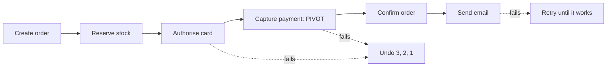

# Saga Steps and Compensating Transactions

**Microservices · Saga · Step 4.8.2 · Fundamentals** · Last updated 2026-10-23
**Prerequisites:** [Saga: the big picture and learning order](01-saga-overview.md) (4.8.1), [Idempotency](../../01-resilience/04-idempotency.md) (1.4)

**Version note**

| Item | Version |
|---|---|
| Baseline | The step types (compensable, pivot, retriable) as described in the saga pattern literature and the Azure Architecture Center |
| Hands-on baseline | Java 21 (OpenJDK 21.0.8), plain JDK; the programs are complete single files, run on 2026-10-23 |
| Compatibility note | Frameworks name these ideas differently (activities, tasks, undo handlers); the design rules here do not depend on a framework |

## 1. What it is and why it matters

**What is it?** Designing a saga starts with its **steps**. Each step is a **local transaction** in one service. For most steps you also write a **compensating transaction** that semantically undoes it. Steps fall into three kinds: **compensable** (can be undone), the **pivot** (the go/no-go point: after it succeeds the saga will complete), and **retriable** (come after the pivot and must eventually succeed, so they are retried, never compensated).

**Why do we need it?** The order and kind of steps decide what a failure costs. Put a hard-to-undo step early and every later failure becomes a messy undo; put an easy-to-undo step first and most failures are cheap. Get the compensations wrong (not idempotent, or arriving out of order) and recovery creates new inconsistencies.

**When would I meet it?** At the whiteboard, before any code: whenever someone says "and then if it fails we just roll it back".

> [!TIP]
> **Memory hook:** *undoable steps first, the point of no return in the middle, the must-succeed steps last; and every undo can run twice, or early, without harm.*

## 2. Industry terms

| Term | Simple meaning | Why it matters | Example | Related terms |
|---|---|---|---|---|
| **Compensable transaction** | A step that can be undone by another transaction | Failure after it is cheap | Reserve stock (undo: release) | Compensating transaction |
| **Compensating transaction** | A new transaction that semantically reverses an earlier one | Replaces rollback; must be written and tested | Release stock; refund | Semantic undo |
| **Pivot transaction** | The go/no-go step: if it succeeds, the saga runs to completion; if it fails, the saga compensates | Marks the point of no return | Capturing the payment | Last compensable, or first retriable |
| **Retriable transaction** | A step after the pivot that is retried until it succeeds | Guarantees completion | Mark order confirmed; send email | Idempotent command |
| **Backward recovery** | After a failure, undo what was done (compensate) | The default when failure happens before the pivot | Cancel the order | Forward recovery |
| **Forward recovery** | After a failure, keep retrying until the saga completes | Used after the pivot | Retry the email | Retry with backoff |
| **Idempotent command** | An operation that has the same effect if repeated | Steps and compensations can be delivered twice | Refund keyed by order id | [Idempotency](../../01-resilience/04-idempotency.md) |
| **Tombstone** | A record that "this saga was already cancelled", kept to handle late messages | Handles a compensation that arrives before its action | `cancelled` set | Out-of-order delivery |

## 3. In a real system (ShopFlow)

**The business problem.** The checkout saga must create the order, hold stock, authorise and capture the card, and confirm to the customer. Each step can fail, and each undo has a different cost. Releasing stock is free and instant; voiding a card authorisation is cheap; refunding a captured payment is visible to the customer and may take days; an email cannot be un-sent.

| Order | Step (service) | Kind | Compensation | Cost of undoing |
|---|---|---|---|---|
| 1 | Create the order as `PENDING` (order-service) | Compensable | Mark it `CANCELLED` | None |
| 2 | Reserve stock (inventory-service) | Compensable | Release the reservation | None |
| 3 | Authorise the card (payment-service) | Compensable | Void the authorisation | Small |
| 4 | Capture the payment (payment-service) | **Pivot** | (none planned: we decide to complete) | A refund, visible to the customer |
| 5 | Mark the order `CONFIRMED` (order-service) | Retriable | not needed: retried | None |
| 6 | Send the confirmation email (notification-service) | Retriable | not possible: retried | Cannot be undone |



**How the design helps.** Everything that can fail for a business reason (stock, card) happens *before* the pivot, where undoing is cheap. The only steps after the pivot (confirm, email) can only fail for technical reasons, so they are retried. The expensive, visible refund is reserved for the rare case where we cannot complete.

**What it costs.** Every compensation is code to write, test and operate; the order is a constraint on the design (you cannot always reorder steps freely); and the "point of no return" must be a deliberate business decision, not an accident.

**Elsewhere:** in travel booking the pivot is often "issue the ticket"; in a bank transfer it is "release the funds to the other bank"; in hiring, it is the signed offer.

## 4. How it works: designing the steps

1. **List the business steps** in order, with the service that performs each.
2. **Write the compensation** for each step, in business words ("release the reservation"), and ask "what would the customer or the business see if this ran?" Some steps have no real undo (an email).
3. **Classify:** compensable if a reasonable undo exists; the **pivot** is the step after which you commit to completing; **retriable** are the steps after it.
4. **Order:** compensable steps first, the ones most likely to fail earliest; then the pivot; then retriable steps. Move steps that cannot be undone to after the pivot, where they will only be retried.
5. **Make every step and every compensation idempotent**, and tolerate a compensation that arrives before its step.
6. **Decide what "undo" means** semantically: usually a status change (`CANCELLED`), not a delete, so the record of what happened survives.

### Worked example 1: running a saga with compensation and retries

**Concept.** A tiny saga runner executes steps in order. Before the pivot, a failure triggers the compensations of the completed compensable steps in reverse order. After the pivot, a failing step is retried until it succeeds. Five scenarios inject different failures.

```java
// File: SagaRunner.java (runnable, Java 21)
import java.util.ArrayList;
import java.util.List;
import java.util.Set;

public class SagaRunner {

    enum Kind { COMPENSABLE, PIVOT, RETRIABLE }

    interface Action {
        boolean run(int attempt);              // true means the local transaction committed
    }

    record Step(String name, Kind kind, Action forward, Runnable compensation) {}

    // A step "fails" when its name is in the failing set. The email step fails twice before it works.
    static List<Step> checkoutSteps(Set<String> failing) {
        List<Step> steps = new ArrayList<>();
        steps.add(new Step("create order", Kind.COMPENSABLE, a -> !failing.contains("create order"),
                () -> System.out.println("      undo: cancel order")));
        steps.add(new Step("reserve stock", Kind.COMPENSABLE, a -> !failing.contains("reserve stock"),
                () -> System.out.println("      undo: release stock")));
        steps.add(new Step("authorise card", Kind.COMPENSABLE, a -> !failing.contains("authorise card"),
                () -> System.out.println("      undo: void authorisation")));
        steps.add(new Step("capture payment", Kind.PIVOT, a -> !failing.contains("capture payment"), null));
        steps.add(new Step("confirm order", Kind.RETRIABLE, a -> true, null));
        steps.add(new Step("send email", Kind.RETRIABLE, a -> !failing.contains("send email") || a > 2, null));
        return steps;
    }

    static String run(String scenario, Set<String> failing) {
        System.out.println("scenario: " + scenario);
        List<Step> steps = checkoutSteps(failing);
        List<Step> done = new ArrayList<>();
        for (Step step : steps) {
            if (step.kind() == Kind.RETRIABLE) {
                int attempt = 1;
                while (!step.forward().run(attempt)) {
                    System.out.println("   retry  " + step.name() + " (attempt " + attempt + " failed)");
                    attempt++;
                }
                System.out.println("   done   " + step.name() + " [" + step.kind() + "]" + (attempt > 1 ? " after " + attempt + " attempts" : ""));
                continue;
            }
            if (step.forward().run(1)) {
                System.out.println("   done   " + step.name() + " [" + step.kind() + "]");
                done.add(step);
            } else {
                System.out.println("   FAILED " + step.name() + ": compensate the completed steps in reverse order");
                for (int i = done.size() - 1; i >= 0; i--) {
                    Step completed = done.get(i);
                    if (completed.kind() == Kind.COMPENSABLE) {
                        System.out.println("   compensate " + completed.name());
                        completed.compensation().run();
                    }
                }
                return "COMPENSATED";
            }
        }
        return "COMPLETED";
    }

    public static void main(String[] args) {
        String[][] scenarios = {
                {"everything works"},
                {"stock is out", "reserve stock"},
                {"card is declined", "authorise card"},
                {"capture fails at the pivot", "capture payment"},
                {"email service is down at first", "send email"},
        };
        List<String> summary = new ArrayList<>();
        for (String[] scenario : scenarios) {
            Set<String> failing = scenario.length > 1 ? Set.of(scenario[1]) : Set.of();
            String result = run(scenario[0], failing);
            summary.add(String.format("%-34s -> %s", scenario[0], result));
            System.out.println();
        }
        System.out.println("summary");
        summary.forEach(line -> System.out.println("   " + line));
    }
}
```

**Expected output**:

```text
scenario: everything works
   done   create order [COMPENSABLE]
   done   reserve stock [COMPENSABLE]
   done   authorise card [COMPENSABLE]
   done   capture payment [PIVOT]
   done   confirm order [RETRIABLE]
   done   send email [RETRIABLE]

scenario: stock is out
   done   create order [COMPENSABLE]
   FAILED reserve stock: compensate the completed steps in reverse order
   compensate create order
      undo: cancel order

scenario: card is declined
   done   create order [COMPENSABLE]
   done   reserve stock [COMPENSABLE]
   FAILED authorise card: compensate the completed steps in reverse order
   compensate reserve stock
      undo: release stock
   compensate create order
      undo: cancel order

scenario: capture fails at the pivot
   done   create order [COMPENSABLE]
   done   reserve stock [COMPENSABLE]
   done   authorise card [COMPENSABLE]
   FAILED capture payment: compensate the completed steps in reverse order
   compensate authorise card
      undo: void authorisation
   compensate reserve stock
      undo: release stock
   compensate create order
      undo: cancel order

scenario: email service is down at first
   done   create order [COMPENSABLE]
   done   reserve stock [COMPENSABLE]
   done   authorise card [COMPENSABLE]
   done   capture payment [PIVOT]
   done   confirm order [RETRIABLE]
   retry  send email (attempt 1 failed)
   retry  send email (attempt 2 failed)
   done   send email [RETRIABLE] after 3 attempts

summary
   everything works                   -> COMPLETED
   stock is out                       -> COMPENSATED
   card is declined                   -> COMPENSATED
   capture fails at the pivot         -> COMPENSATED
   email service is down at first     -> COMPLETED
```

**Walkthrough.**

| Scenario | What failed | What the runner did | Result |
|---|---|---|---|
| Everything works | nothing | six steps in order | Completed |
| Stock is out | step 2 | compensated step 1 only | Compensated |
| Card is declined | step 3 | compensated 2, then 1 | Compensated |
| Capture fails at the pivot | step 4 | compensated 3, 2, 1 (the pivot itself did not complete) | Compensated |
| Email is down at first | step 6, twice | retried, then succeeded on the third attempt; **no compensation** | Completed |

Note the two directions: before the pivot the saga recovers *backward* (undo), after it *forward* (retry). A failure at step 6 never undoes the payment.

**Experiment.** Add a compensable step "award loyalty points" between "reserve stock" and "authorise card" (with the undo "remove loyalty points") and run only the scenario "card is declined". Predict which undos run and in which order. The result is in Answers.

**Real-world example.** The `payment-service` and `inventory-service` of ShopFlow expose exactly these pairs of operations: `authorise`/`void`, `reserve`/`release`. The saga is a list of such pairs with a kind each.

### Worked example 2: a compensation delivered twice (mistake and fix)

**Concept.** Messages and calls are repeated: the first reply was lost, so the saga sent the refund again. A compensation must have the same effect once or twice.

```java
// File: IdempotentCompensation.java (runnable, Java 21)
import java.util.HashSet;
import java.util.Locale;
import java.util.Set;

public class IdempotentCompensation {

    // The payment service's wallet. Compensation: refund the captured amount.
    static class NaivePayments {
        double balance = 10.00;

        void refund(String orderId, double amount) {
            balance += amount;
        }
    }

    static class SafePayments {
        double balance = 10.00;
        final Set<String> refundedOrders = new HashSet<>();

        void refund(String orderId, double amount) {
            if (!refundedOrders.add(orderId)) {      // already refunded for this order: do nothing
                return;
            }
            balance += amount;
        }
    }

    public static void main(String[] args) {
        // The refund command is delivered twice: the first reply was lost, so the saga sent it again.
        NaivePayments naive = new NaivePayments();
        naive.refund("O-1001", 90.00);
        naive.refund("O-1001", 90.00);
        System.out.println(String.format(Locale.ROOT, "naive refund, delivered twice: balance %.2f (should be 100.00)", naive.balance));

        SafePayments safe = new SafePayments();
        safe.refund("O-1001", 90.00);
        safe.refund("O-1001", 90.00);
        System.out.println(String.format(Locale.ROOT, "idempotent refund, delivered twice: balance %.2f", safe.balance));
    }
}
```

**Expected output**:

```text
naive refund, delivered twice: balance 190.00 (should be 100.00)
idempotent refund, delivered twice: balance 100.00
```

**Walkthrough.** The naive refund adds the amount every time it is called, so the customer is refunded 180.00 for a 90.00 order: the wallet shows 190.00 where it should show 100.00. The fix records which orders have been refunded (in a real service, a unique key in the same database transaction as the balance change) and ignores repeats. The same applies to every step: "reserve stock" twice for the same order id must reserve once ([1.4](../../01-resilience/04-idempotency.md)).

### Worked example 3: the undo that arrives before the action (mistake and fix)

**Concept.** Two messages sent in order can arrive in the other order, for example after a retry or when they travel on different paths. The saga sent "reserve" and then "release" (because a later step failed), but the inventory service got "release" first.

```java
// File: CompensationBeforeAction.java (runnable, Java 21)
import java.util.ArrayList;
import java.util.HashSet;
import java.util.List;
import java.util.Set;

public class CompensationBeforeAction {

    // The inventory service receives "reserve" and "release" messages. Messages can overtake each other.
    static class NaiveInventory {
        int available = 10;
        final Set<String> held = new HashSet<>();

        void reserve(String orderId, int quantity) {
            held.add(orderId);
            available -= quantity;
        }

        void release(String orderId, int quantity) {
            if (held.remove(orderId)) {                // nothing to release yet: the message is ignored
                available += quantity;
            }
        }
    }

    static class SafeInventory {
        int available = 10;
        final Set<String> held = new HashSet<>();
        final Set<String> cancelled = new HashSet<>();   // remembers releases that arrived first

        void reserve(String orderId, int quantity) {
            if (cancelled.contains(orderId)) {          // the saga already compensated this order
                return;
            }
            held.add(orderId);
            available -= quantity;
        }

        void release(String orderId, int quantity) {
            cancelled.add(orderId);
            if (held.remove(orderId)) {
                available += quantity;
            }
        }
    }

    public static void main(String[] args) {
        // The saga sent reserve and then release, but the network delivered release first.
        List<String> arrivalOrder = new ArrayList<>(List.of("release", "reserve"));

        NaiveInventory naive = new NaiveInventory();
        SafeInventory safe = new SafeInventory();
        for (String message : arrivalOrder) {
            if (message.equals("reserve")) {
                naive.reserve("O-1001", 2);
                safe.reserve("O-1001", 2);
            } else {
                naive.release("O-1001", 2);
                safe.release("O-1001", 2);
            }
        }
        System.out.println("arrival order: " + arrivalOrder);
        System.out.println("naive inventory: available " + naive.available + ", held " + naive.held + "   (2 units leaked)");
        System.out.println("safe inventory:  available " + safe.available + ", held " + safe.held);
    }
}
```

**Expected output**:

```text
arrival order: [release, reserve]
naive inventory: available 8, held [O-1001]   (2 units leaked)
safe inventory:  available 10, held []
```

**Walkthrough.** The naive service releases nothing (it holds nothing yet), then processes the late "reserve" and holds the stock forever: 2 units leaked for an order that was already cancelled. The safe service records a **tombstone** when it sees a release, so the later reserve is ignored. The same trick applies to any compensation: remember that "this saga is already cancelled", and refuse the action that arrives late.

### Common mistakes

1. Treating a compensation as a perfect undo (a refund is not "never charged").
2. Deleting data instead of changing its status, losing the audit trail.
3. A compensation that cannot be repeated or can fail silently.
4. Putting a step that cannot be undone (an email, a physical shipment) before the pivot.
5. Forgetting the case where the compensation arrives before the action.
6. Using the same saga logic for steps with very different undo costs.

## 5. Failure scenarios

### The refund that paid twice

1. **What happened?** A retried refund command credited the customer twice (example 2).
2. **Why?** The compensation was not idempotent and the saga retried after a lost reply.
3. **What did users and the business see?** Money paid out that should not have been; reconciliation differences at month end.
4. **Solutions:** idempotency keys or "already done" records in the same transaction as the effect; send the same key on every retry.
5. **What they cost:** a key column and a unique constraint per participant; discipline in every handler.

### The reservation that leaked

1. **What happened?** A cancel overtook its reserve, and the stock stayed held for a dead order (example 3).
2. **Why?** The participant assumed messages arrive in the order they were sent.
3. **What did users see?** "Out of stock" for an item that was actually available.
4. **Solutions:** tombstones for cancelled sagas; or hold with an expiry that releases itself; or ordering guarantees per saga where the broker offers them (the same partition key, [2.2.3](../../02-messaging/02-kafka/03-producers-keys-acks-batching.md)).
5. **What they cost:** extra state per saga in the participant; periodic clean-up of old tombstones.

### The email that could not be unsent

1. **What happened?** A confirmation email went out before the payment capture failed; the customer was told "order confirmed" and then "order cancelled".
2. **Why?** A step with no undo was placed before the pivot.
3. **What did users see?** A confusing and trust-damaging pair of emails.
4. **Solutions:** move such steps after the pivot (retriable); or send an "order received" message first, and the confirmation only at the end.
5. **What they cost:** a status model with clear in-between states ("received", "confirmed").

## 6. Architectural decisions

| Decision | Choose | Because |
|---|---|---|
| Step order | Compensable steps first, risky ones earliest; pivot; then retriable | Failures are cheap and recovery is simple |
| What the pivot is | A deliberate business decision (usually the step that commits money or an irreversible effect) | After it you only go forward |
| Undo style | A status change or a counter-entry (`CANCELLED`, a refund record), never a delete | Audit, and a compensation that can be repeated |
| Idempotency | Every step and compensation keyed by saga id (and step), recorded in the same local transaction | Retries and duplicates are normal |
| Late or early messages | Tombstones, or a hold with an expiry | Ordering is not guaranteed across a network |
| Steps with no undo | Move after the pivot, or replace with a two-step "tentative then confirmed" message | Do not promise what you may need to retract |
| Reserve-then-confirm (Try-Confirm-Cancel) | Consider for scarce resources: hold (try), then confirm or cancel | Holds that expire cannot leak |

## 7. Try it yourself

Try each exercise first; the real results are in the Answers section.

1. **Add a step.** Add "award loyalty points" (compensable) between "reserve stock" and "authorise card" and run only "card is declined". Which undos run, and in which order?
2. **Place the email.** In the checkout above, what would happen on a payment-capture failure if the email were step 3?
3. **Make it idempotent.** In `IdempotentCompensation`, what exactly would you store, and where, in a real payment service?

## 8. Check your understanding

1. Why do the retriable steps come after the pivot and not before?
2. A step has no sensible undo. Where should it go in the saga, and why?
3. What is the difference between backward and forward recovery, and which one applies after the pivot?
4. Why record a tombstone instead of just ignoring a release that finds nothing to release?

Answers are at the end of this note.

## 9. Revision

**Remember**
- **Compensable** (undoable) → **pivot** (go/no-go) → **retriable** (retried, idempotent).
- **Backward recovery** (compensate in reverse order) before the pivot; **forward recovery** (retry) after it.
- Compensations are **new transactions**, usually status changes, and not perfect undos.
- Every step and compensation: **idempotent**; compensation may arrive **early** (tombstone) or **twice**.
- Put the **hardest-to-undo** steps **late**, the **likeliest-to-fail** early.

**Explain in 15 seconds:** "I order saga steps so the undoable ones come first and the likeliest to fail earliest, with a deliberate point of no return after which the remaining steps are retried; and every step and undo is idempotent and tolerant of arriving early or twice."

**Explain in 60 seconds:**
> "A saga step is a local transaction with, if possible, a compensating transaction. I classify steps as compensable, the pivot, or retriable. Before the pivot, a failure triggers compensations of the completed steps in reverse order; after it, the saga only moves forward, retrying idempotent steps until they succeed. So I put the steps that can fail for business reasons, like stock and card checks, early, the irreversible money movement as the pivot, and the steps that can only fail technically, like confirming and emailing, after it. Compensations are not rollbacks: they are new business transactions, usually a status change or a counter-entry such as a refund, so they must be idempotent because the saga will retry them, and they must tolerate arriving before the action they undo, which I handle with a tombstone or an expiring hold."

**Architect's takeaway:** the cost of a saga is set by its step order. Spend design time on what can be undone, what cannot, and where the point of no return belongs, before choosing any framework.

**Next topic:** [Choreography: coordinating with events](03-choreography.md) (4.8.3)

## 10. Verification and sources

> [!NOTE]
> Checked 2026-10-23 against the sources below, and by compiling and running every Java example on OpenJDK 21.0.8. Re-verify when you revisit this note.

- **Confirmed (documentation, read 2026-10-23):** compensable transactions "can be undone or compensated for by other transactions with the opposite effect"; the pivot transaction as the go/no-go point, which "can be the last undoable, or compensable, transaction" or "the first retryable operation in the saga"; retryable transactions "follow the pivot transaction", "are idempotent" and "help ensure that the saga can reach its final state"; compensating transactions "might not always succeed" and must be repeatable: "Define the steps in a compensating transaction as idempotent commands so that you can repeat them if the compensating transaction itself fails" (Microsoft Learn, "Saga distributed transactions pattern" and "Compensating Transaction pattern").
- **Observed (this machine):** the output of every program and the exercise variant.
- **Assumptions and illustrations:** the ShopFlow steps, amounts and the decision that capture is the pivot are illustrative design choices (some businesses make a different step the pivot). The programs run in one JVM, so "messages overtaking each other" is simulated by sending them in the wrong order, not observed on a network.
- **To verify:** with your payment provider, what a void and a refund actually do, how long they take, and what they cost; whether your broker preserves order per key.
- **Decision rule:** compensable first, pivot as a conscious decision, retriable last; idempotent and order-tolerant handlers; status changes instead of deletes.

**Sources:** Microsoft Learn, "Saga distributed transactions pattern" and "Compensating Transaction pattern"; Chris Richardson, microservices.io, "Pattern: Saga".

## Answers

**Experiment (exercises)**

1. **Add a step:** the declined card is step 4 of 7 now, so three steps completed and three undos run in reverse: remove loyalty points, release stock, cancel the order. The change is one `steps.add(new Step("award loyalty points", Kind.COMPENSABLE, ...))` line with its undo, and running only that scenario prints:

```text
scenario: card is declined
   done   create order [COMPENSABLE]
   done   reserve stock [COMPENSABLE]
   done   award loyalty points [COMPENSABLE]
   FAILED authorise card: compensate the completed steps in reverse order
   compensate award loyalty points
      undo: remove loyalty points
   compensate reserve stock
      undo: release stock
   compensate create order
      undo: cancel order

summary
   card is declined                   -> COMPENSATED
```

2. **Place the email:** the customer would receive "order confirmed" and then the saga would fail at the capture and cancel the order: an email that cannot be unsent, and a confused customer. Steps without an undo belong after the pivot; here that is step 6, or a neutral "we received your order" message earlier.
3. **Make it idempotent:** store, in the payment database, a row keyed by `(order id, "refund")` with a unique constraint, inserted in the *same local transaction* that changes the balance. A repeated refund hits the constraint, changes nothing, and returns success so the saga can move on. In memory (as in the program) a `Set` plays this role, but it would be lost in a restart.

**Check your understanding**

1. Because their failure must not undo the earlier steps: after the pivot the saga has committed to completing, so these steps can only fail for technical reasons (a service is down) and are retried. If a retriable step came before the pivot, a failure would force compensations of work that was fine.
2. After the pivot, as a retriable step (or replaced by two messages: a neutral one early, the real one late). A step that cannot be compensated must never be followed by a step that might still fail for a business reason.
3. Backward recovery undoes the completed steps (compensation) and ends in the "compensated" state; forward recovery keeps retrying until the saga completes. Before the pivot the saga recovers backward; after the pivot, forward.
4. Because the release might have overtaken its reserve: if you only ignore the empty release, the late reserve then runs and holds stock for a cancelled saga forever. The tombstone ("this saga was cancelled") lets the late reserve be recognised and refused.

Back to [the Saga overview](01-saga-overview.md) · [the Microservices overview](../01-microservices-overview.md) · [the index](../../README.md) · [Roadmap](../../roadmap.md).
