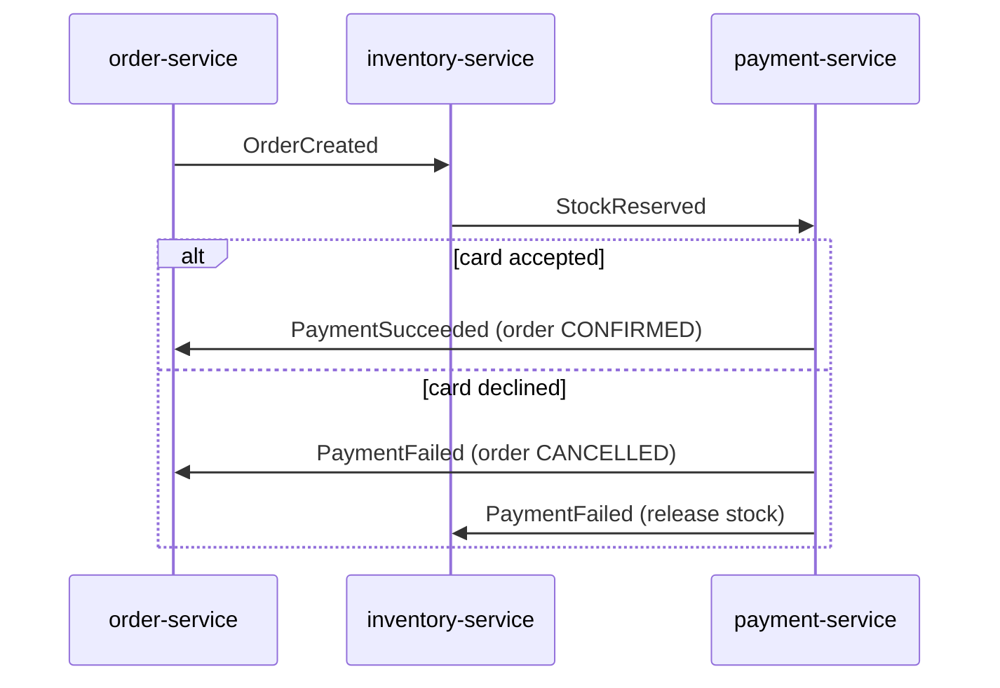

# Choreography: Coordinating a Saga with Events

**Microservices · Saga · Step 4.8.3 · Intermediate** · Last updated 2026-10-23
**Prerequisites:** [Steps and compensating transactions](02-saga-steps-and-compensation.md) (4.8.2), [Messaging and event-driven design](../../02-messaging/01-messaging-overview.md) (2.1)

**Version note**

| Item | Version |
|---|---|
| Baseline | The choreography style of saga coordination, as described by the pattern literature and the Azure Architecture Center |
| Hands-on baseline | Java 21 (OpenJDK 21.0.8), plain JDK; a tiny in-memory event bus stands in for a broker, run on 2026-10-23 |
| Compatibility note | A real broker adds duplicates, delays and reordering; this lesson shows the logic, ([4.8.5](05-reliable-messaging-outbox-inbox.md)) and ([4.8.7](07-failures-timeouts-operations.md)) deal with the rest |

## 1. What it is and why it matters

**What is it?** In a **choreographed saga** there is no central coordinator. Each service does its local transaction and **publishes a domain event** ("stock reserved"). Other services subscribe to the events they care about, do their own local transaction, and publish their own events. A failure is also an event ("payment failed"), and services that already did work react by compensating.

**Why do we need it?** It is the simplest way to coordinate a short saga: no extra component, services only know *events*, not each other, and there is no single point of failure for the flow. Adding a service that merely *reacts* (analytics, loyalty) does not touch existing services.

**When would I meet it?** In event-driven systems built on Kafka, RabbitMQ, SNS/SQS or similar; whenever a flow is described as "service A emits X, service B reacts and emits Y".

> [!TIP]
> **Memory hook:** *a relay race with no coach: each runner knows only whose baton they take and whom they hand it to, so nobody can see the whole race.*

## 2. Mental model: dancers without a conductor

A group of dancers performs a routine with no conductor. Each dancer watches one or two others and moves when they see a particular step. The dance looks coordinated, and nobody leaves a gap when a new dancer joins who only watches. But if you ask "what is the whole routine?", the answer exists only in the heads of all the dancers together, and a change of one move can make another dancer miss their cue.

| In the analogy | In the real system |
|---|---|
| A dancer | A service |
| A move others watch for | A published domain event |
| Reacting to a cue | An event handler running a local transaction |
| Nobody knows the whole routine | The flow is implicit in the subscriptions |
| A dancer missing their cue | A service that forgot to subscribe, so a compensation never happens |

**Where the analogy breaks:** dancers see each other directly; services get events through a broker that can delay, repeat or reorder them, and a "missed cue" leaves data inconsistent rather than a visible stumble.

## 3. Industry terms

| Term | Simple meaning | Why it matters | Example | Related terms |
|---|---|---|---|---|
| **Choreography** | Services coordinate through events, with no central controller | The decentralised way to run a saga | `StockReserved` triggers payment | Orchestration |
| **Domain event** | A fact, in the past tense, published after a state change | The only coupling between services | `PaymentFailed` | Command |
| **Subscription** | A service's declaration that it reacts to an event type | The "wiring" of the saga | payment-service reads `StockReserved` | Consumer group |
| **Compensation event** | An event whose handlers undo earlier work | How failures propagate backward | `PaymentFailed` makes inventory release | Compensating transaction |
| **Correlation id** | An identifier carried by all events of one saga instance | The only way to follow one order across services | `orderId` | Trace id |
| **Cyclic dependency** | Services that end up consuming each other's events in a loop | Makes the flow hard to reason about and change | A consumes B, B consumes A | Event storm |
| **Participant** | A service that takes part in the saga | Owns its local transaction and compensation | inventory-service | Orchestrator |

## 4. In a real system (ShopFlow)

**The business problem.** Checkout touches `order-service`, `inventory-service` and `payment-service`. The team wants no central component and wants other services (analytics, loyalty) to join later without changing checkout.

| Event | Published by | Read by | Meaning |
|---|---|---|---|
| `OrderCreated` | order-service | inventory-service | A pending order exists |
| `StockReserved` | inventory-service | payment-service | The goods are held |
| `StockRejected` | inventory-service | order-service | Not enough stock: cancel |
| `PaymentSucceeded` | payment-service | order-service | The card was charged: confirm |
| `PaymentFailed` | payment-service | order-service, inventory-service | The card was declined: cancel and release stock |



**How choreography helps.** No service calls another; each only publishes and subscribes. An analytics service can read `PaymentSucceeded` tomorrow without anyone changing checkout. There is no orchestrator to build, deploy or keep available.

**What it costs.** The flow exists nowhere as one piece of code: to understand checkout you read the subscriptions of every service. Adding a step touches several services (shown below). A forgotten subscription silently loses a compensation. Tracking "where is order 1001?" needs the events and a correlation id. And testing the saga end to end needs all participants running.

**Elsewhere:** a ride-hailing app where "ride requested" triggers matching, pricing and notification services independently; a retailer where "goods dispatched" triggers invoicing and customer email; an IoT platform where a "device registered" event provisions several backends.

## 5. How it works

1. The client asks `order-service` to place an order; it commits a `PENDING` order in its own database and **publishes `OrderCreated`** (with the order id as correlation id).
2. `inventory-service` reads it, runs its local transaction (reserve stock) and publishes `StockReserved`, or `StockRejected` if it cannot.
3. `payment-service` reads `StockReserved`, tries to charge the card, and publishes `PaymentSucceeded` or `PaymentFailed`.
4. `order-service` reads the outcome events: `PaymentSucceeded` confirms the order; `PaymentFailed` or `StockRejected` cancels it.
5. **Compensation travels as events:** `inventory-service` also reads `PaymentFailed` and releases the reservation.
6. Every handler is idempotent, and every step publishes its event reliably (the outbox, [4.8.5](05-reliable-messaging-outbox-inbox.md)).

### Worked example 1: the checkout, choreographed

**Concept.** The program wires the services to a small event bus (events are delivered one at a time, in order) and prints which service receives each event. It runs four scenarios, the last with a deliberate bug.

```java
// File: ChoreographedCheckout.java (runnable, Java 21)
import java.util.ArrayDeque;
import java.util.ArrayList;
import java.util.LinkedHashMap;
import java.util.List;
import java.util.Locale;
import java.util.Map;
import java.util.Queue;
import java.util.function.Consumer;

public class ChoreographedCheckout {

    record Event(String type, String orderId) {}

    // A very small in-memory event bus: events are delivered one at a time, in the order they were published.
    static class EventBus {
        private final Map<String, List<Map.Entry<String, Consumer<Event>>>> subscribers = new LinkedHashMap<>();
        private final Queue<Event> queue = new ArrayDeque<>();

        void subscribe(String service, String eventType, Consumer<Event> handler) {
            subscribers.computeIfAbsent(eventType, k -> new ArrayList<>()).add(Map.entry(service, handler));
        }

        void publish(Event event) {
            queue.add(event);
        }

        void deliverAll() {
            while (!queue.isEmpty()) {
                Event event = queue.poll();
                List<Map.Entry<String, Consumer<Event>>> handlers = subscribers.getOrDefault(event.type(), List.of());
                String receivers = handlers.isEmpty() ? "nobody" : String.join(", ", handlers.stream().map(Map.Entry::getKey).toList());
                System.out.println("   " + event.type() + " -> " + receivers);
                handlers.forEach(h -> h.getValue().accept(event));
            }
        }

        void printSubscriptions() {
            subscribers.forEach((type, list) -> System.out.println("   " + String.format("%-16s", type) + " is read by " + list.stream().map(Map.Entry::getKey).toList()));
        }
    }

    static class Shop {
        // The state of the three services. Each only changes its own part.
        String orderStatus = "NONE";
        int stock;
        int reserved = 0;
        double cardBalance;
        double charged = 0;

        Shop(int stock, double cardBalance) {
            this.stock = stock;
            this.cardBalance = cardBalance;
        }
    }

    static void run(String scenario, int stock, double cardBalance, boolean inventoryListensForPaymentFailed) {
        System.out.println("scenario: " + scenario);
        EventBus bus = new EventBus();
        Shop shop = new Shop(stock, cardBalance);
        int quantity = 2;
        double total = 90.00;

        // order-service
        bus.subscribe("order-service", "PaymentSucceeded", e -> {
            shop.orderStatus = "CONFIRMED";
        });
        bus.subscribe("order-service", "PaymentFailed", e -> {
            shop.orderStatus = "CANCELLED";
        });
        bus.subscribe("order-service", "StockRejected", e -> {
            shop.orderStatus = "CANCELLED";
        });
        // inventory-service
        bus.subscribe("inventory-service", "OrderCreated", e -> {
            if (shop.stock >= quantity) {
                shop.stock -= quantity;
                shop.reserved += quantity;
                bus.publish(new Event("StockReserved", e.orderId()));
            } else {
                bus.publish(new Event("StockRejected", e.orderId()));
            }
        });
        if (inventoryListensForPaymentFailed) {
            bus.subscribe("inventory-service", "PaymentFailed", e -> {      // the compensation
                shop.stock += quantity;
                shop.reserved -= quantity;
            });
        }
        // payment-service
        bus.subscribe("payment-service", "StockReserved", e -> {
            if (shop.cardBalance >= total) {
                shop.cardBalance -= total;
                shop.charged += total;
                bus.publish(new Event("PaymentSucceeded", e.orderId()));
            } else {
                bus.publish(new Event("PaymentFailed", e.orderId()));
            }
        });

        // The client places the order: the order service creates it and publishes the first event.
        shop.orderStatus = "PENDING";
        bus.publish(new Event("OrderCreated", "O-1001"));
        bus.deliverAll();
        System.out.println(String.format(Locale.ROOT, "   final: order=%s stock=%d reserved=%d charged=%.2f", shop.orderStatus, shop.stock, shop.reserved, shop.charged));
        System.out.println();
    }

    public static void main(String[] args) {
        System.out.println("who reads which event (nobody has the whole flow in one place):");
        EventBus map = new EventBus();
        map.subscribe("inventory-service", "OrderCreated", e -> { });
        map.subscribe("payment-service", "StockReserved", e -> { });
        map.subscribe("order-service", "PaymentSucceeded", e -> { });
        map.subscribe("order-service", "StockRejected", e -> { });
        map.subscribe("order-service", "PaymentFailed", e -> { });
        map.subscribe("inventory-service", "PaymentFailed", e -> { });
        map.printSubscriptions();
        System.out.println();

        run("everything works", 10, 100.00, true);
        run("out of stock", 1, 100.00, true);
        run("card declined", 10, 50.00, true);
        run("card declined, but inventory-service forgot to listen for PaymentFailed", 10, 50.00, false);
    }
}
```

**Expected output**:

```text
who reads which event (nobody has the whole flow in one place):
   OrderCreated     is read by [inventory-service]
   StockReserved    is read by [payment-service]
   PaymentSucceeded is read by [order-service]
   StockRejected    is read by [order-service]
   PaymentFailed    is read by [order-service, inventory-service]

scenario: everything works
   OrderCreated -> inventory-service
   StockReserved -> payment-service
   PaymentSucceeded -> order-service
   final: order=CONFIRMED stock=8 reserved=2 charged=90.00

scenario: out of stock
   OrderCreated -> inventory-service
   StockRejected -> order-service
   final: order=CANCELLED stock=1 reserved=0 charged=0.00

scenario: card declined
   OrderCreated -> inventory-service
   StockReserved -> payment-service
   PaymentFailed -> order-service, inventory-service
   final: order=CANCELLED stock=10 reserved=0 charged=0.00

scenario: card declined, but inventory-service forgot to listen for PaymentFailed
   OrderCreated -> inventory-service
   StockReserved -> payment-service
   PaymentFailed -> order-service
   final: order=CANCELLED stock=8 reserved=2 charged=0.00
```

**Walkthrough.** The first block is the "map" that, in a real system, exists only as scattered subscriptions. Then, per scenario:

| Scenario | Events | Final state |
|---|---|---|
| Everything works | `OrderCreated` → `StockReserved` → `PaymentSucceeded` | Order confirmed, 2 reserved, 90.00 charged |
| Out of stock | `OrderCreated` → `StockRejected` | Order cancelled, nothing reserved |
| Card declined | `OrderCreated` → `StockReserved` → `PaymentFailed` (read by order and inventory) | Order cancelled, stock released |
| Card declined, inventory forgot to listen | the same, but `PaymentFailed` reaches only `order-service` | Order cancelled **and 2 keyboards stay reserved** |

**Experiment.** Add a `shipping-service` that reacts to `PaymentSucceeded`, so that the order is confirmed only after `ShipmentCreated`. List which services must change, predict the events when shipping fails, then compare with Answers.

**Real-world example.** In ShopFlow, `notification-service` and `analytics-service` subscribe to `PaymentSucceeded` with no change to checkout: this is the strength of choreography.

### Worked example 2: the mistake that loses a compensation

**Concept.** In the last scenario nothing crashed and no error was logged: one subscription was missing. The saga ended "successfully" with an inconsistent system.

**Walkthrough.** `PaymentFailed` was delivered only to `order-service`, so the order was cancelled but the stock reservation, a step with a compensation, was never undone. The fix is not in the code of the saga but in discipline and tests: a **saga test** that runs each failure scenario end to end and asserts the final state of every service (as this program does), and a checklist that for every step the compensation event has a subscriber.

### Worked example 3: how the flow grows

Adding the shipping step changes more than one service. With the shipping variant, the order service stops reading `PaymentSucceeded` and reads `ShipmentCreated`; the inventory and payment services must read the new `ShipmentFailed` to compensate; and the shipping service is added. The difference between the two flows is in Answers. The point to remember: the **flow is the sum of the subscriptions**, so changing the flow means changing several services and their tests, in a coordinated release.

### Common mistakes

1. Missing subscriptions for compensation events (above).
2. Events that carry commands ("reserve stock") rather than facts ("order created"), which re-creates tight coupling.
3. No correlation id, so one order cannot be traced across services.
4. Handlers that are not idempotent, so duplicate events reserve or charge twice ([4.8.2](02-saga-steps-and-compensation.md)).
5. Letting services consume each other's events in a loop.
6. Using choreography for long flows with many branches.

## 6. Failure scenarios

### The flow nobody can explain

1. **What happened?** A product owner asks "what happens after payment fails?" and nobody can answer without reading five services.
2. **Why?** The flow exists only as subscriptions spread over the code of the participants.
3. **What did the business see?** Slow changes, bugs found in production, and incident calls that start with "who consumes this event?".
4. **Solutions:** document the flow in one place (an event catalogue or a diagram kept in the repository), name events consistently, trace by correlation id, and consider orchestration once the flow has more than a few steps ([4.8.4](04-orchestration.md)).
5. **What they cost:** documentation that must be kept true; tooling for tracing and event catalogues.

### The cycle

1. **What happened?** A new `loyalty-service` publishes `PointsAwarded`, which `order-service` reads and re-publishes `OrderUpdated`, which loyalty reads again.
2. **Why?** Participants consume each other's events; there is no coordinator to stop a loop. Microsoft's guidance lists the "risk of cyclic dependency between saga participants" as a drawback of choreography.
3. **What did users see?** Duplicate points, a flood of events, a busy broker.
4. **Solutions:** keep the event graph acyclic (draw it); give events a clear owner; deduplicate by saga id and step.
5. **What they cost:** design reviews of every new subscription.

### The duplicate event

1. **What happened?** The broker redelivered `StockReserved`, and the payment service charged the card twice.
2. **Why?** Handlers assumed exactly-once delivery.
3. **What did users see?** Double charges.
4. **Solutions:** idempotent handlers and an inbox of processed event ids ([4.8.5](05-reliable-messaging-outbox-inbox.md)); idempotency keys on the payment provider call.
5. **What they cost:** a table of processed ids per service and a key on every external call.

## 7. Architectural decisions

| Use choreography when | Avoid it when | Alternatives |
|---|---|---|
| The saga has few steps (about two to four) and few branches | Many steps, branches, deadlines or human tasks | Orchestration ([4.8.4](04-orchestration.md)) |
| Services are owned by different teams that prefer loose coupling | You need one place to see and change the flow | A workflow engine (Temporal, Camunda, Step Functions; see the tables in the next lessons) |
| New reacting services (analytics, notifications) should join without changes | The flow needs timeouts and "what if nobody answers" logic | An orchestrator with timers |
| Events are already the integration style | The team cannot trace and test event flows | Request/response with an orchestrator |

Microsoft's summary of the trade-off: choreography is "good for simple workflows that have few services and don't need a coordination logic" and "doesn't introduce a single point of failure", but "workflow can be confusing when you add new steps", it is "difficult to track which commands each saga participant responds to", and "integration testing is difficult because all services must run to simulate a transaction". Mitigations: one correlation id per saga, an event catalogue, saga-level tests (like the program above), and tracing.

### Alternatives in the industry

A map of the landscape, not a comparison. None of these were run in this lesson; check each project's documentation before adopting one.

| Area | Tool or product | What it is | When you meet it |
|---|---|---|---|
| Event backbone | **Apache Kafka**, **RabbitMQ**, **AWS SNS with SQS or EventBridge**, **Google Pub/Sub**, **Azure Service Bus / Event Grid**, **NATS** | Brokers and event buses that carry the events | Every choreographed system ([2.2.1](../../02-messaging/02-kafka/01-kafka-overview.md)) |
| Frameworks for event-driven sagas | **Spring Cloud Stream**, **Axon Framework**, **Eventuate Tram**, **MassTransit** and **NServiceBus** (.NET), **Dapr pub/sub** | Libraries that wire handlers, serialisation and delivery | Teams that do not want to code against the broker API |
| Documenting flows | **AsyncAPI**, **EventCatalog**, schema registries | Describe events and who reads them | The antidote to the "flow nobody can explain" |
| Seeing a saga | **OpenTelemetry** tracing, **Jaeger**, **Tempo**, log search by correlation id | Follow one order across services | Debugging choreographed flows |

## 8. Try it yourself

Try each exercise first; the real results are in the Answers section.

1. **Add shipping.** Add a `shipping-service` that reads `PaymentSucceeded` and publishes `ShipmentCreated` or `ShipmentFailed`. Make `order-service` confirm only after `ShipmentCreated`. List the services you had to change.
2. **Spot the leak.** In the last scenario of the program, which single line would you add to fix it, and where?
3. **Reorder the events.** What would happen in the "card declined" scenario if `PaymentFailed` reached `inventory-service` twice?

## 9. Check your understanding

1. Why do the events in the table above contain only facts ("OrderCreated"), not commands?
2. Where is the saga's "state" in a choreographed saga?
3. Name two reasons to move from choreography to orchestration.
4. What is the minimum a participant must do to make compensations safe when events can be repeated?

Answers are at the end of this note.

## 10. Revision

**Remember**
- **Choreography** = services coordinate with **events**; no coordinator; **failures are events** too.
- Strengths: simple for short sagas, loose coupling, no central point of failure.
- Weaknesses: **implicit flow**, hard to track, **cyclic dependencies**, changes touch several services, hard to test end to end.
- Needs: **correlation id**, **idempotent handlers**, a **saga-level test** for every failure path, documentation of who reads what.

**Explain in 15 seconds:** "In a choreographed saga each service reacts to events and publishes its own, including failure events that trigger compensations, so there is no coordinator but also no single place that shows the flow."

**Explain in 60 seconds:**
> "In choreography, each participant commits its local transaction and publishes a domain event; the next participant subscribes to it. Success flows forward as events like StockReserved and PaymentSucceeded, and failure flows backward as events like PaymentFailed that make earlier participants compensate. It needs no extra component and adds new reacting services without changing the producer, so it suits short sagas of two to four steps. Its weakness is that the flow exists only as scattered subscriptions: it is hard to see, to change and to test end to end, and the service graph can develop cycles. A forgotten subscription silently loses a compensation. So I keep events as facts with a correlation id, make handlers idempotent, test every failure path of the saga as a whole, document the event map, and switch to orchestration when the flow grows or needs timeouts."

**Likely follow-up questions:**
- **Is choreography event sourcing?** No: sagas can use events only as messages; event sourcing stores state as events (4.9, planned).
- **How do I see where an order is?** Search by correlation id in logs and traces, or keep a read model fed by the events.
- **Can I mix both?** Yes: orchestrate the core checkout and let other services react to its events by choreography.

**Architect's takeaway:** choreography is an excellent default for small, stable flows and a poor one for important, changing ones. If you cannot draw the whole flow on one page from the code, it has outgrown choreography.

**Next topic:** [Orchestration: a coordinator with state](04-orchestration.md) (4.8.4)

## 11. Verification and sources

> [!NOTE]
> Checked 2026-10-23 against the sources below, and by compiling and running every Java example on OpenJDK 21.0.8. Re-verify when you revisit this note.

- **Confirmed (documentation, read 2026-10-23):** "In the choreography approach, services exchange events without a centralized controller. With choreography, each local transaction publishes domain events that trigger local transactions in other services"; the benefits (good for simple workflows with few services, no coordination service, no single point of failure) and drawbacks (confusing when steps are added, hard to track what each participant responds to, risk of cyclic dependency, difficult integration testing) (Microsoft Learn, "Saga distributed transactions pattern"); the definition of choreography-based sagas and the e-commerce example (Chris Richardson, microservices.io, "Pattern: Saga").
- **Observed (this machine):** the output of the programs and of the exercise variant.
- **Assumptions and illustrations:** event names, the service split and the amounts are illustrative; the in-memory bus delivers in order and exactly once, which real brokers do not guarantee.
- **To verify:** your broker's ordering and duplicate behaviour; who owns each event contract in your organisation; whether you can trace one order across services today.
- **Decision rule:** choreography for short, stable sagas with an acyclic event graph; otherwise orchestration.

**Sources:** Microsoft Learn, "Saga distributed transactions pattern"; Chris Richardson, microservices.io, "Pattern: Saga".

## Answers

**Experiment (exercises)**

1. **Add shipping:** the services to change are four: `shipping-service` (new, reads `PaymentSucceeded`), `order-service` (now reads `ShipmentCreated` and `ShipmentFailed`, not `PaymentSucceeded`), `payment-service` (reads `ShipmentFailed` to refund) and `inventory-service` (reads `ShipmentFailed` to release). The events for success and for shipping failure:

```text
scenario: everything works
   OrderCreated -> inventory-service
   StockReserved -> payment-service
   PaymentSucceeded -> shipping-service
   ShipmentCreated -> order-service
   final: order=CONFIRMED stock=8 reserved=2 charged=90.00

scenario: shipping fails after the payment succeeded
   OrderCreated -> inventory-service
   StockReserved -> payment-service
   PaymentSucceeded -> shipping-service
   ShipmentFailed -> order-service, inventory-service, payment-service
   final: order=CANCELLED stock=10 reserved=0 charged=0.00
```

2. **Spot the leak:** one `bus.subscribe("inventory-service", "PaymentFailed", ...)` that releases the stock, in the inventory service's wiring (the `if (inventoryListensForPaymentFailed)` branch in the program). Better still, a test per failure path that asserts `reserved=0`.
3. **Twice:** the naive release in the program would run twice and, by reading the code, leave `stock=12 reserved=-2`: a duplicate compensation corrupts the inventory. The handler needs the idempotency rule of [4.8.2](02-saga-steps-and-compensation.md): release only if this order currently holds a reservation.

**Check your understanding**

1. Because an event that says what *happened* leaves each receiver free to decide what to do; an event that says what to *do* ("reserve stock") makes the sender responsible for knowing the receiver, which brings back the coupling and makes it an orchestration without an orchestrator.
2. There is no single place: the state is spread over the participants' own data (the order's status, the reservation, the payment) and the events in flight. That is why correlation ids and read models or tracing are needed to see a saga.
3. Any of: the flow has more than a few steps or branches; steps need timeouts or deadlines; you need one place to see and change the flow; new steps keep forcing changes in several services; cycles appeared; operations need to know where each saga stands.
4. Keep an idempotency record (an inbox of processed event ids, or a natural key such as the order id) in the same local transaction as the effect, so a repeated event does nothing, and make compensation tolerate "nothing to undo".

Back to [the Saga overview](01-saga-overview.md) · [the Microservices overview](../01-microservices-overview.md) · [the index](../../README.md) · [Roadmap](../../roadmap.md).
