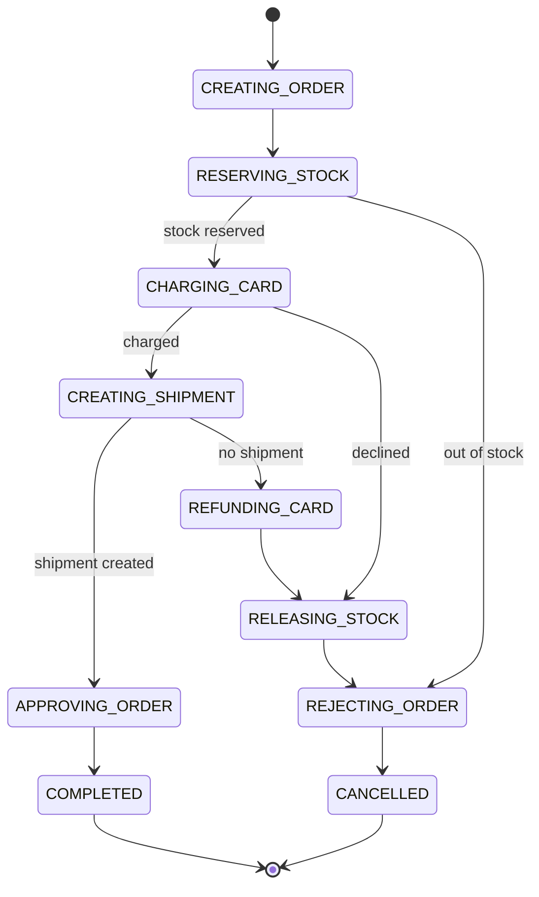
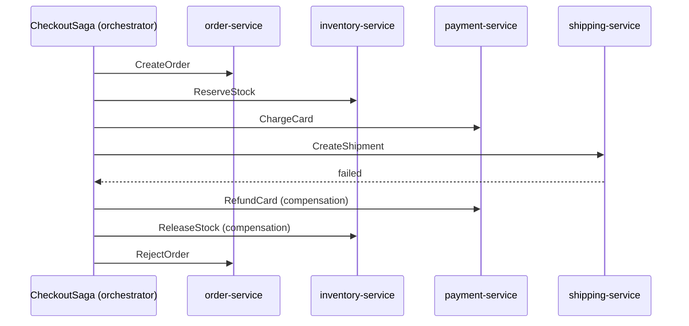

# Orchestration: A Saga Coordinator with State

**Microservices · Saga · Step 4.8.4 · Intermediate** · Last updated 2026-10-23
**Prerequisites:** [Steps and compensating transactions](02-saga-steps-and-compensation.md) (4.8.2) and [Choreography](03-choreography.md) (4.8.3)

**Version note**

| Item | Version |
|---|---|
| Baseline | The orchestration style of saga coordination (a process manager with state) |
| Hands-on baseline | Java 21 (OpenJDK 21.0.8), plain JDK; participants are objects and the "network" is a queue in one JVM, run on 2026-10-23 |
| Compatibility note | Workflow engines and saga libraries change quickly; the state machine here is the idea underneath all of them |

## 1. What it is and why it matters

**What is it?** In an **orchestrated saga** one component, the **orchestrator**, owns the flow. It sends a **command** to a participant ("reserve stock"), waits for the **reply**, records the new **state**, and decides what to send next, including the compensating commands when a step fails. Participants do their local transaction and reply; they do not need to know about each other or about the saga.

**Why do we need it?** The flow is written down in one place and can be read, tested and changed there. The orchestrator knows where every saga instance stands, so "where is order 1001?" has a direct answer. Compensation, timeouts and retries have an obvious home. Microsoft's guidance says orchestration is "better suited for complex workflows or when you add new services" and "avoids cyclic dependencies because the orchestrator manages the flow".

**When would I meet it?** In any checkout, booking or onboarding flow with more than a few steps, in workflow engines (Temporal, Camunda, Step Functions) and in libraries that offer "saga" support.

> [!TIP]
> **Memory hook:** *a conductor with the score: the score is a state machine, and the conductor writes down where the piece stands after every bar.*

## 2. Mental model: the conductor and the score

An orchestra plays a piece with a conductor. The conductor holds the score (the flow), points to each section when it must play, listens, and if something goes wrong in the middle (a string breaks), decides what to do and where to restart. The musicians do not need the whole score; they only need to play their part when pointed at.

| In the analogy | In the real system |
|---|---|
| The conductor | The saga orchestrator |
| The score | The saga definition: states and transitions |
| A bar the orchestra is on | The saga's current state |
| Pointing at a section | Sending a command to a participant |
| A section playing | A participant's local transaction |
| The conductor's notes | The saga log, kept in a database |

**Where the analogy breaks:** if a conductor collapses, the musicians stop. If the orchestrator crashes, its saga instances must resume from the saga log when it restarts, or when another instance takes over, so the state must be durable and every command must be safe to send again.

## 3. Industry terms

| Term | Simple meaning | Why it matters | Example | Related terms |
|---|---|---|---|---|
| **Orchestrator** | The component that runs the saga: sends commands, reads replies, tracks state | Owns the flow and the compensation logic | `CheckoutSagaOrchestrator` | Process manager |
| **Command** | A message asking a participant to do something | The orchestrator's way to drive a step | `ReserveStock` | Event |
| **Reply** | The participant's answer (success or failure) | The input that advances the state machine | `StockReserved` / `StockRejected` | Event |
| **Saga definition** | The flow as a set of steps, transitions and compensations | The "score" | The state table | Workflow definition |
| **Saga instance and state** | One running execution (one order) and where it stands | Lets you answer "where is it?" and resume after a crash | `CHARGING_CARD` | Saga log |
| **Saga log** | A durable record of each state change and command | Recovery, audit, support | A table `saga_instance` | Event log |
| **State machine** | States and the transitions between them, triggered by replies | Makes the flow explicit and testable | the `switch` below | Statechart |
| **Workflow engine** | A product that runs durable workflows and sagas for you | Spares you from building the orchestrator | Temporal, Camunda | Durable execution |

## 4. In a real system (ShopFlow)

**The business problem.** Checkout has grown: create the order, reserve stock, charge the card, create the shipment, approve the order. Product wants a fraud check between charging and shipping, and a 15-minute limit for payment. The choreographed version needs changes in five services for every such change, and nobody can say where an order is stuck.

**How orchestration helps.** A `CheckoutSaga` in the order domain owns the flow. It sends one command at a time and moves through named states. Adding the fraud check is one new state and two transitions; the other services only learn a new command.





**What it costs.** One more component to build, run and keep available; the risk of the orchestrator becoming a "god service" full of business rules; participants coupled to the orchestrator's commands; and the need to persist saga state and send commands reliably ([4.8.5](05-reliable-messaging-outbox-inbox.md)).

**Elsewhere:** airline booking engines orchestrate seat, payment and ticket issue; loan-origination systems run long approval workflows with human tasks and deadlines; deployment pipelines are orchestrations of steps with rollbacks.

## 5. How it works

1. A request starts a **saga instance**: the orchestrator creates a record with a unique id (here the order id), state `CREATING_ORDER`, and sends the first command.
2. The target participant runs its **local transaction** and sends a **reply** (success or failure).
3. The orchestrator reads the reply and looks up the **transition** for (current state, reply): it records the new state in the **saga log** and sends the next command.
4. On a **failure**, the transition leads to the compensation path: commands that undo the completed steps in reverse order, then a terminal state (`CANCELLED`).
5. When the last step succeeds, the saga reaches `COMPLETED`.
6. The state change and the outgoing command are saved **together** (outbox), and replies are processed **idempotently** (a duplicate reply must not advance the saga twice).

### Worked example 1: the checkout orchestrator

**Concept.** The whole saga logic is one method, `onReply`: given the current state and the reply, decide the next state and command. A tiny message loop delivers commands to participants and returns their replies. Four scenarios inject a failure into one command each.

```java
// File: OrchestratedCheckout.java (runnable, Java 21)
import java.util.ArrayDeque;
import java.util.ArrayList;
import java.util.List;
import java.util.Queue;
import java.util.Set;

public class OrchestratedCheckout {

    record Command(String target, String name, String orderId) {}

    record Reply(String command, String orderId, boolean success) {}

    // Each state means "I sent this command and am waiting for its reply".
    enum State {
        CREATING_ORDER, RESERVING_STOCK, CHARGING_CARD, CREATING_SHIPMENT, APPROVING_ORDER, COMPLETED,
        REFUNDING_CARD, RELEASING_STOCK, REJECTING_ORDER, CANCELLED
    }

    // A participant executes a command as a local transaction and replies. It "fails" for commands in the failing set.
    static class Participant {
        final String name;
        final Set<String> failing;

        Participant(String name, Set<String> failing) {
            this.name = name;
            this.failing = failing;
        }

        Reply handle(Command command) {
            return new Reply(command.name(), command.orderId(), !failing.contains(command.name()));
        }
    }

    static class Orchestrator {
        final String sagaId;
        State state;
        final List<String> log = new ArrayList<>();      // the saga log: a durable record of every transition
        final Queue<Command> outbox = new ArrayDeque<>();

        Orchestrator(String sagaId) {
            this.sagaId = sagaId;
        }

        void start() {
            moveTo(State.CREATING_ORDER, new Command("order-service", "CreateOrder", sagaId));
        }

        // The whole saga logic lives in this one method: given the current state and a reply, what next?
        void onReply(Reply reply) {
            switch (state) {
                case CREATING_ORDER -> moveTo(State.RESERVING_STOCK, new Command("inventory-service", "ReserveStock", sagaId));
                case RESERVING_STOCK -> {
                    if (reply.success()) moveTo(State.CHARGING_CARD, new Command("payment-service", "ChargeCard", sagaId));
                    else moveTo(State.REJECTING_ORDER, new Command("order-service", "RejectOrder", sagaId));
                }
                case CHARGING_CARD -> {
                    if (reply.success()) moveTo(State.CREATING_SHIPMENT, new Command("shipping-service", "CreateShipment", sagaId));
                    else moveTo(State.RELEASING_STOCK, new Command("inventory-service", "ReleaseStock", sagaId));
                }
                case CREATING_SHIPMENT -> {
                    if (reply.success()) moveTo(State.APPROVING_ORDER, new Command("order-service", "ApproveOrder", sagaId));
                    else moveTo(State.REFUNDING_CARD, new Command("payment-service", "RefundCard", sagaId));
                }
                case APPROVING_ORDER -> finish(State.COMPLETED);
                case REFUNDING_CARD -> moveTo(State.RELEASING_STOCK, new Command("inventory-service", "ReleaseStock", sagaId));
                case RELEASING_STOCK -> moveTo(State.REJECTING_ORDER, new Command("order-service", "RejectOrder", sagaId));
                case REJECTING_ORDER -> finish(State.CANCELLED);
                default -> throw new IllegalStateException("no transition from " + state);
            }
        }

        private void moveTo(State next, Command command) {
            record(String.format("%-18s -> %-18s send %s to %s", state == null ? "(start)" : state.name(), next, command.name(), command.target()));
            state = next;
            outbox.add(command);
        }

        private void record(String line) {
            log.add(line);
            System.out.println("   " + line);
        }

        private void finish(State terminal) {
            record(String.format("%-18s -> %-18s saga finished", state, terminal));
            state = terminal;
        }
    }

    static void run(String scenario, Set<String> failingCommands) {
        System.out.println("scenario: " + scenario);
        List<Participant> participants = List.of(
                new Participant("order-service", failingCommands),
                new Participant("inventory-service", failingCommands),
                new Participant("payment-service", failingCommands),
                new Participant("shipping-service", failingCommands));
        Orchestrator saga = new Orchestrator("O-1001");
        saga.start();
        // The message loop: deliver each command to its participant, then give the reply back to the orchestrator.
        while (!saga.outbox.isEmpty()) {
            Command command = saga.outbox.poll();
            Participant target = participants.stream().filter(p -> p.name.equals(command.target())).findFirst().orElseThrow();
            Reply reply = target.handle(command);
            if (!reply.success()) {
                System.out.println("   (" + command.target() + " replied: " + command.name() + " FAILED)");
            }
            saga.onReply(reply);
        }
        System.out.println("   final state: " + saga.state + " (" + saga.log.size() + " log entries)");
        System.out.println();
    }

    public static void main(String[] args) {
        run("everything works", Set.of());
        run("out of stock", Set.of("ReserveStock"));
        run("card declined", Set.of("ChargeCard"));
        run("shipping unavailable", Set.of("CreateShipment"));
    }
}
```

**Expected output**:

```text
scenario: everything works
   (start)            -> CREATING_ORDER     send CreateOrder to order-service
   CREATING_ORDER     -> RESERVING_STOCK    send ReserveStock to inventory-service
   RESERVING_STOCK    -> CHARGING_CARD      send ChargeCard to payment-service
   CHARGING_CARD      -> CREATING_SHIPMENT  send CreateShipment to shipping-service
   CREATING_SHIPMENT  -> APPROVING_ORDER    send ApproveOrder to order-service
   APPROVING_ORDER    -> COMPLETED          saga finished
   final state: COMPLETED (6 log entries)

scenario: out of stock
   (start)            -> CREATING_ORDER     send CreateOrder to order-service
   CREATING_ORDER     -> RESERVING_STOCK    send ReserveStock to inventory-service
   (inventory-service replied: ReserveStock FAILED)
   RESERVING_STOCK    -> REJECTING_ORDER    send RejectOrder to order-service
   REJECTING_ORDER    -> CANCELLED          saga finished
   final state: CANCELLED (4 log entries)

scenario: card declined
   (start)            -> CREATING_ORDER     send CreateOrder to order-service
   CREATING_ORDER     -> RESERVING_STOCK    send ReserveStock to inventory-service
   RESERVING_STOCK    -> CHARGING_CARD      send ChargeCard to payment-service
   (payment-service replied: ChargeCard FAILED)
   CHARGING_CARD      -> RELEASING_STOCK    send ReleaseStock to inventory-service
   RELEASING_STOCK    -> REJECTING_ORDER    send RejectOrder to order-service
   REJECTING_ORDER    -> CANCELLED          saga finished
   final state: CANCELLED (6 log entries)

scenario: shipping unavailable
   (start)            -> CREATING_ORDER     send CreateOrder to order-service
   CREATING_ORDER     -> RESERVING_STOCK    send ReserveStock to inventory-service
   RESERVING_STOCK    -> CHARGING_CARD      send ChargeCard to payment-service
   CHARGING_CARD      -> CREATING_SHIPMENT  send CreateShipment to shipping-service
   (shipping-service replied: CreateShipment FAILED)
   CREATING_SHIPMENT  -> REFUNDING_CARD     send RefundCard to payment-service
   REFUNDING_CARD     -> RELEASING_STOCK    send ReleaseStock to inventory-service
   RELEASING_STOCK    -> REJECTING_ORDER    send RejectOrder to order-service
   REJECTING_ORDER    -> CANCELLED          saga finished
   final state: CANCELLED (8 log entries)
```

**Walkthrough.** Read one scenario top to bottom as the saga log:

| Scenario | Path through the states | Compensation commands sent |
|---|---|---|
| Everything works | `CREATING_ORDER` → `RESERVING_STOCK` → `CHARGING_CARD` → `CREATING_SHIPMENT` → `APPROVING_ORDER` → `COMPLETED` | none |
| Out of stock | `RESERVING_STOCK` → `REJECTING_ORDER` → `CANCELLED` | none (nothing to undo) |
| Card declined | `CHARGING_CARD` → `RELEASING_STOCK` → `REJECTING_ORDER` → `CANCELLED` | `ReleaseStock` |
| Shipping unavailable | `CREATING_SHIPMENT` → `REFUNDING_CARD` → `RELEASING_STOCK` → `REJECTING_ORDER` → `CANCELLED` | `RefundCard`, `ReleaseStock` |

Every state means "waiting for the reply to the command I just sent". A restart can therefore resume from the stored state and **re-send the last command**, which is why every command must be idempotent ([4.8.2](02-saga-steps-and-compensation.md)).

**Experiment.** Add a fraud check between `CHARGING_CARD` and `CREATING_SHIPMENT`: a `CheckFraud` command to a new participant; if it fails, refund and release. Predict the log of a run where the fraud check fails, then compare with Answers.

**Real-world example.** In ShopFlow the real participants are services reached through the broker; the `CheckoutSaga` would persist a row per order in a `saga_instance` table and write each command to an outbox in the same transaction.

### Worked example 2: a duplicate reply (mistake and fix)

**Concept.** Brokers redeliver. If the orchestrator advances on every reply it receives, a repeated reply moves the saga twice.

```java
// File: DuplicateReply.java (runnable, Java 21)
import java.util.ArrayList;
import java.util.List;

public class DuplicateReply {

    record Reply(String command, boolean success) {}

    enum State { RESERVING_STOCK, CHARGING_CARD, COMPLETED }

    // A tiny orchestrator with two steps. It keeps the list of commands it has sent.
    static class Orchestrator {
        State state = State.RESERVING_STOCK;
        final List<String> sent = new ArrayList<>(List.of("ReserveStock"));
        final boolean checkReply;

        Orchestrator(boolean checkReply) {
            this.checkReply = checkReply;
        }

        String expectedReply() {
            return state == State.RESERVING_STOCK ? "ReserveStock" : "ChargeCard";
        }

        void onReply(Reply reply) {
            if (checkReply && !reply.command().equals(expectedReply())) {
                System.out.println("   ignored a reply to " + reply.command() + " (waiting for " + expectedReply() + ")");
                return;
            }
            switch (state) {
                case RESERVING_STOCK -> {
                    state = State.CHARGING_CARD;
                    sent.add("ChargeCard");
                }
                case CHARGING_CARD -> state = State.COMPLETED;
                default -> { }
            }
        }
    }

    static void run(String label, boolean checkReply) {
        System.out.println(label);
        Orchestrator saga = new Orchestrator(checkReply);
        // The broker delivers the reply to ReserveStock twice (a redelivery), then the reply to ChargeCard.
        for (Reply reply : List.of(new Reply("ReserveStock", true), new Reply("ReserveStock", true), new Reply("ChargeCard", true))) {
            saga.onReply(reply);
            System.out.println("   after the reply to " + reply.command() + ": state " + saga.state);
        }
    }

    public static void main(String[] args) {
        run("without checking which reply the saga is waiting for:", false);
        run("checking the reply against the current state:", true);
    }
}
```

**Expected output**:

```text
without checking which reply the saga is waiting for:
   after the reply to ReserveStock: state CHARGING_CARD
   after the reply to ReserveStock: state COMPLETED
   after the reply to ChargeCard: state COMPLETED
checking the reply against the current state:
   after the reply to ReserveStock: state CHARGING_CARD
   ignored a reply to ReserveStock (waiting for ChargeCard)
   after the reply to ReserveStock: state CHARGING_CARD
   after the reply to ChargeCard: state COMPLETED
```

**Walkthrough.** Without a check, the second `ReserveStock` reply arrives while the saga is in `CHARGING_CARD` and is taken as the answer to the charge: the saga reaches `COMPLETED` before the card has answered, and the real `ChargeCard` reply later finds nothing to do. If the charge had failed, the saga would already be "completed". The fix is to accept a reply only if it is the one the current state is waiting for (here compared by command name; real systems also compare a step id or correlation id). Stale or unexpected replies are ignored and logged.

### Choreography or orchestration?

| Question | Choreography | Orchestration |
|---|---|---|
| Where is the flow written? | Spread over subscriptions | In one orchestrator |
| Adding a step | Change several services | Change the orchestrator (and the new participant) |
| Where is order 1001? | Reconstruct from events | Read its saga instance |
| Timeouts, retries, deadlines | Every participant on its own | The orchestrator, in one place |
| Coupling | To events | To the orchestrator's commands |
| Failure of the coordinator | None, but also no one in charge | A single component to make highly available |
| Risk | Cyclic dependencies, lost compensations | A "god service" with business rules |
| Fits | Few steps, stable flow | Several steps, branches, deadlines, human steps |

Many systems combine both: the core checkout is orchestrated, and peripheral services (analytics, notifications) react to the events it emits.

### Common mistakes

1. Putting **business rules** in the orchestrator: it should sequence steps, not decide prices or stock rules (those stay in the owning services).
2. Keeping saga state **in memory** (lost on restart).
3. Not handling **duplicate or stale replies**.
4. Sending commands **outside** the transaction that records the state (dual write).
5. One giant orchestrator for the whole company instead of one per business process.
6. Calling participants synchronously inside the orchestrator and holding a transaction open.

## 6. Failure scenarios

### The orchestrator that forgot

1. **What happened?** The orchestrator process was restarted during 300 in-flight checkouts. Its state was in memory.
2. **Why?** Saga state was never persisted.
3. **What did users and the business see?** Orders stuck in `PENDING`, stock held, customers charged without a confirmation.
4. **Solutions:** persist the saga instance (state, data, last command) in the same transaction as the outgoing command (outbox); on start, scan for unfinished instances and re-send the last command; make commands idempotent ([4.8.7](07-failures-timeouts-operations.md)).
5. **What they cost:** a table, a recovery job and tests that kill the orchestrator mid-saga.

### The god orchestrator

1. **What happened?** Pricing, tax and stock rules slowly moved into the checkout orchestrator, "because it already has all the data".
2. **Why?** It is convenient to put logic where the flow is.
3. **What did the business see?** Every business change needs a release of the orchestrator, which every team now depends on.
4. **Solutions:** keep the orchestrator thin: it only decides *which step next*; each participant owns the rules for its data; review changes to it like a public API.
5. **What they cost:** discipline and clear command contracts.

### The command sent twice

1. **What happened?** After a crash, the recovered orchestrator re-sent `ChargeCard`, which had actually already been processed.
2. **Why?** The reply was lost, so the orchestrator could not know.
3. **What did users see?** A double charge.
4. **Solutions:** idempotency key per command (saga id and step); the payment service returns the original result for a repeated key ([1.4](../../01-resilience/04-idempotency.md)).
5. **What they cost:** a key column and a unique constraint in the participant.

## 7. Architectural decisions

| Decision | Choose | Because |
|---|---|---|
| Where the orchestrator lives | Inside the service that owns the business process (here the order domain), not as a generic shared "super service" | It owns its data and its flow |
| State storage | A durable table per saga type, updated in the same transaction as the outgoing command | Recovery and the outbox |
| Messages | Commands to participants, replies as events; correlation by saga id and step | Replies can be matched and duplicates ignored |
| Participants | Idempotent commands, a reply for every command, no knowledge of the saga | Replaceable and testable in isolation |
| Build or buy | A library or workflow engine for long, complex or human-in-the-loop sagas; a small hand-written state machine for short ones | The engine solves persistence, timers and retries for you, at the cost of a new platform |
| Testing | A test per path through the state machine, with failure injection (as in the program) | The logic is deterministic and cheap to test |

### Alternatives in the industry

A map of the landscape, not a comparison. None of these were run in this lesson; the descriptions come from each product's own site or from general industry knowledge, so check each project's current documentation before adopting one.

| Area | Tool or product | What it is | When you meet it |
|---|---|---|---|
| Durable workflow engines | **Temporal** (and its predecessor **Cadence**) | "Durable execution": you write the workflow as code and the engine persists its progress and retries | Long-running, code-first workflows and sagas |
| | **Camunda** | A workflow and process-orchestration platform built on the BPMN standard | Business-process-heavy organisations with analysts involved |
| | **Conductor** (originally from Netflix; open source, Apache 2.0) | JSON-defined workflow orchestration of microservices | Service-orchestration platforms |
| | **AWS Step Functions**, **Azure Durable Functions**, **Google Workflows** | Managed state machines or durable workflows on a cloud | Serverless and cloud-native sagas |
| | **Dapr Workflow** | Workflow building block of the Dapr runtime | Dapr-based platforms |
| Saga libraries | **Eventuate Tram Sagas** | A saga framework (Java and Spring) from the author of the Saga pattern page cited here | Java teams that want a library, not a platform |
| | **Axon Framework** | Java framework for event-driven systems; its documentation now describes saga support as "legacy" and points to workflows | Existing Axon estates |
| | **MassTransit** and **NServiceBus** (.NET), **Apache Camel** (Saga EIP), **Spring State Machine** | Saga state machines and routing libraries | Teams on those stacks |
| Do it yourself | A state table plus an outbox, as in this lesson | The smallest orchestrator | Short sagas, few steps |

## 8. Try it yourself

Try each exercise first; the real results are in the Answers section.

1. **Add a fraud check.** Insert a `CheckFraud` step between charging and shipping. What does the log look like when it fails?
2. **Break it on purpose.** Remove the `RELEASING_STOCK` state from the "card declined" path (go straight to `REJECTING_ORDER`). What does the final inventory look like in a real system?
3. **Where would you store it?** Describe the columns of the table that makes the orchestrator survive a restart.

## 9. Check your understanding

1. Why does each state mean "waiting for a reply to a command"?
2. Give two reasons orchestration handles timeouts better than choreography.
3. What stops an orchestrator from becoming a god service?
4. A reply is delivered twice. What must the orchestrator check?

Answers are at the end of this note.

## 10. Revision

**Remember**
- **Orchestrator** = commands out, replies in, **state machine** + **saga log**; participants stay ignorant of the saga.
- Success path and **compensation path** are both transitions; compensation runs in reverse order.
- **Persist state with the outgoing command** (outbox); **accept only the expected reply**; commands are **idempotent**.
- Keep it **thin**: sequencing only; one orchestrator per business process.
- Choose orchestration for more than a few steps, branches, deadlines or visibility.

**Explain in 15 seconds:** "An orchestrated saga has one coordinator that sends commands, reads replies and moves through a persisted state machine, running the compensations itself when a step fails."

**Explain in 60 seconds:**
> "In orchestration, a coordinator owns the saga. It stores a saga instance per order with a state, sends a command to a participant, and waits. When the reply arrives, it looks up the transition for the current state and the reply, saves the new state together with the next command using an outbox, and continues. On a failure the transition leads to compensating commands in reverse order and ends in a cancelled state. Participants just execute idempotent commands and reply, so they don't know about each other. The flow, the compensations and timeouts live in one place that can be read, tested path by path and monitored, and I can answer 'where is this order?' from the saga table. The costs are a component to run and keep available, the temptation to put business rules in it, and the need to persist state and ignore duplicate or stale replies. I use it for anything beyond a few steps, and a workflow engine when the saga is long-running or has human tasks."

**Likely follow-up questions:**
- **Is the orchestrator a single point of failure?** Its state is in a database and any instance can resume it, so it can be run in several copies; the risk is operational, not logical.
- **Should I buy a workflow engine?** For long-running, complex or human-in-the-loop flows, usually yes; for a few steps, a state table plus an outbox is enough.
- **Where does the orchestrator live?** Next to the data it coordinates, in the service that owns the business process.

**Architect's takeaway:** orchestration makes the flow a first-class, testable thing. Keep the orchestrator thin, its state durable and its commands idempotent, and the extra component pays for itself in visibility.

**Next topic:** [Reliable messaging for sagas: outbox, inbox, idempotent consumers](05-reliable-messaging-outbox-inbox.md) (4.8.5)

## 11. Verification and sources

> [!NOTE]
> Checked 2026-10-23 against the sources below, and by compiling and running every Java example on OpenJDK 21.0.8. Re-verify when you revisit this note.

- **Confirmed (documentation, read 2026-10-23):** "In orchestration, a centralized controller, or orchestrator, handles all the transactions and tells the participants which operation to perform based on events. The orchestrator performs saga requests, stores and interprets the states of each task, and handles failure recovery by using compensating transactions"; the benefits ("better suited for complex workflows or when you add new services", "avoids cyclic dependencies", "clear separation of responsibilities") and drawbacks ("requires an implementation of a coordination logic", "introduces a point of failure because the orchestrator manages the complete workflow") (Microsoft Learn, "Saga distributed transactions pattern"); the orchestration-based saga example (Chris Richardson, microservices.io, "Pattern: Saga"); product descriptions: AWS Step Functions "workflows, also called state machines", Camunda built on BPMN, Conductor "originally created at Netflix" and Apache 2.0 licensed, Axon documentation sections "Legacy Saga support" and "Sagas to workflows" (each product's own site).
- **Observed (this machine):** the output of the programs and of the exercise variant.
- **Assumptions and illustrations:** commands, states and amounts are illustrative; the in-memory queue delivers exactly once and in order, and there is no crash. Real orchestrators persist state; this program only shows the logic of the transitions.
- **To verify:** the capabilities, licences and hosting terms of any workflow engine you consider; the current status of Axon's saga support.
- **Decision rule:** orchestrate sagas with more than a few steps or any deadlines; keep the orchestrator thin, durable and idempotent.

**Sources:** Microsoft Learn, "Saga distributed transactions pattern"; Chris Richardson, microservices.io, "Pattern: Saga"; the websites of Temporal, Camunda, Conductor OSS, AWS Step Functions, Axon Framework and Eventuate.

## Answers

**Experiment (exercises)**

1. **Add a fraud check:** add the state `CHECKING_FRAUD`; after `CHARGING_CARD` succeeds, send `CheckFraud` to a new `fraud-service`; if it succeeds go to `CREATING_SHIPMENT`, if it fails go to `REFUNDING_CARD`, then `RELEASING_STOCK`, then `REJECTING_ORDER`. Only the orchestrator and the new participant change; the other participants are untouched, which is the advantage over choreography. The log of a run where the fraud check fails:

```text
scenario: fraud check fails
   (start)            -> CREATING_ORDER     send CreateOrder to order-service
   CREATING_ORDER     -> RESERVING_STOCK    send ReserveStock to inventory-service
   RESERVING_STOCK    -> CHARGING_CARD      send ChargeCard to payment-service
   CHARGING_CARD      -> CHECKING_FRAUD     send CheckFraud to fraud-service
   (fraud-service replied: CheckFraud FAILED)
   CHECKING_FRAUD     -> REFUNDING_CARD     send RefundCard to payment-service
   REFUNDING_CARD     -> RELEASING_STOCK    send ReleaseStock to inventory-service
   RELEASING_STOCK    -> REJECTING_ORDER    send RejectOrder to order-service
   REJECTING_ORDER    -> CANCELLED          saga finished
   final state: CANCELLED (8 log entries)
```

2. **Break it on purpose:** the card is declined, the order is rejected, and the stock reservation is **never released**: the same leak as the missing subscription in [4.8.3](03-choreography.md). Orchestration makes this easier to see (the path is one `switch` branch you can review and test) but not impossible: the path still has to be written and tested.
3. **Where would you store it:** a table such as `saga_instance(saga_id primary key, saga_type, state, payload (json), last_command, version, updated_at)` updated with optimistic locking, plus an `outbox` table in the same database for the commands, written in the same transaction as each state change. A job scans for rows that are not in a terminal state and have not changed for longer than expected.

**Check your understanding**

1. Because the orchestrator sends exactly one command and then has nothing to do until the reply arrives, so the state names the command in flight. This makes recovery simple: after a restart, send the command for the stored state again (it is idempotent) and wait.
2. The orchestrator is one place that knows when each command was sent, so it can set one timer per step and decide what to do (retry, compensate, alert) in a single piece of code; in choreography every participant would have to remember and time out on its own, and nobody would own the decision.
3. Keeping it to sequencing: it decides which step comes next, while each participant owns the business rules for its own data; one orchestrator per business process; changes to command contracts reviewed like a public API; and no shared database access.
4. That the reply matches the command the saga is currently waiting for (by command name, step id and saga id), and ignore replies for steps that are already done: otherwise a duplicate advances the saga prematurely, as in the second program.

Back to [the Saga overview](01-saga-overview.md) · [the Microservices overview](../01-microservices-overview.md) · [the index](../../README.md) · [Roadmap](../../roadmap.md).
