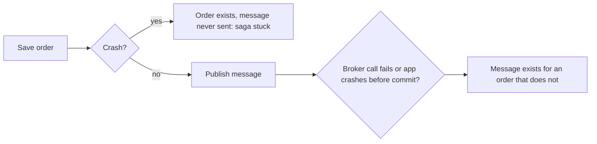
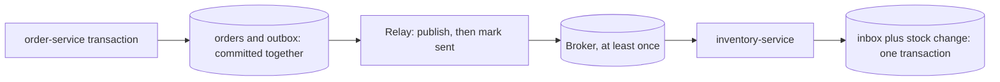

# Reliable Messaging for Sagas: Outbox, Inbox and Idempotent Consumers

**Microservices · Saga · Step 4.8.5 · Intermediate** · Last updated 2026-10-23
**Prerequisites:** [Orchestration](04-orchestration.md) (4.8.4) or [Choreography](03-choreography.md) (4.8.3), [Idempotency](../../01-resilience/04-idempotency.md) (1.4); helpful: [Asynchronous processing](../../14-system-design/11-asynchronous-processing.md) (14.11)

**Version note**

| Item | Version |
|---|---|
| Baseline | The transactional outbox and the idempotent consumer (inbox) patterns |
| Hands-on baseline | Java 21 (OpenJDK 21.0.8) for the simulation; PostgreSQL 16.15 (the `postgres:16-alpine` image) run with `psql` for the SQL examples, on 2026-10-23 |
| Compatibility note | `FOR UPDATE SKIP LOCKED` and `INSERT ... ON CONFLICT DO NOTHING` are PostgreSQL features (other databases have equivalents with different syntax); change data capture tools replace the polling relay but keep the same table |

## 1. What it is and why it matters

**What is it?** A saga is only as reliable as its messages. Two patterns make messaging reliable around a database:
- The **transactional outbox**: a service writes its data change *and* the message to send into the same database transaction (the message goes to an `outbox` table). A separate **relay** reads the outbox and publishes to the broker.
- The **inbox** (idempotent consumer): a receiving service records the ids of messages it has processed, in the same transaction as its own change, so a repeated message does nothing.

**Why do we need it?** A step has two effects: change my data, tell the others. Those are two systems (a database and a broker) and no transaction spans both, so a crash between them either **loses** the message (the saga stalls) or **invents** it (an event for something that never happened). Brokers and retries also deliver messages **at least once**, so duplicates are normal. Outbox plus inbox give the effect people want, "exactly once in effect", out of "at least once" delivery.

**When would I meet it?** At every hop of every saga: orchestrator state and next command, a participant's local change and its reply, an event and its subscribers.

> [!TIP]
> **Memory hook:** *write the letter and the "to send" note in the same drawer; send from the drawer until the note is stamped; and let the receiver keep a ledger so a second copy is recognised.*

## 2. Mental model: the post room

A company's post room has an "outgoing" tray in each office. When a clerk files a customer order, they put the letter in the tray *in the same moment*, in the same drawer, so the order and its letter exist together or not at all. A courier empties the tray, takes the letters to the post office, and stamps each "sent". If the courier is interrupted after posting but before stamping, they will post that letter again tomorrow. The receiving office keeps a ledger of letter numbers it has opened, so a second copy of the same letter is recognised and thrown away.

| In the analogy | In the real system |
|---|---|
| The drawer holding order and letter | One database transaction writing the business row and the outbox row |
| The outgoing tray | The `outbox` table |
| The courier | The relay (polling publisher or change data capture) |
| Stamping "sent" | Setting `published_at` after the broker accepted the message |
| The receiving ledger | The `inbox` table of processed message ids |

**Where the analogy breaks:** couriers rarely duplicate, while real relays and brokers do it on every restart; and letters are read once, but a message may be processed concurrently by two consumers, which the ledger must also handle (a unique key does).

## 3. Industry terms

| Term | Simple meaning | Why it matters | Example | Related terms |
|---|---|---|---|---|
| **Dual write** | Writing to a database and a broker as two separate steps | A crash between them loses or invents messages | Save order, then publish | The problem outbox solves |
| **Transactional outbox** | A message stored in an outbox table in the same transaction as the data | Data and message are saved together or not at all | `orders` and `outbox` rows | Event table |
| **Relay (publisher)** | A process that sends outbox rows to the broker and marks them sent | Delivers eventually; may deliver twice | A polling job or a CDC connector | Message relay |
| **Change data capture (CDC)** | Reading the database's change log to publish changes | A relay without polling | Debezium | [2.2.15](../../02-messaging/02-kafka/15-kafka-connect-cdc.md) |
| **At-least-once delivery** | A message is delivered one or more times, never zero | The honest guarantee of brokers and relays | A retried publish | Exactly-once effect |
| **Inbox / idempotent consumer** | A table of processed message ids checked in the same transaction as the effect | Duplicates become harmless | `inbox(message_id)` | Deduplication |
| **Message id** | A unique, stable id for one logical message, kept on every redelivery | The key for deduplication | saga id + step | Idempotency key |
| **`SKIP LOCKED`** | A PostgreSQL option to skip rows other transactions have locked | Lets several relays work without taking the same row | `FOR UPDATE SKIP LOCKED` | Queue table |
| **Poison message** | A message that fails every time it is processed | Blocks a queue if not set aside | Bad payload | Dead-letter queue |

## 4. In a real system (ShopFlow)

**The business problem.** The checkout saga ([4.8.4](04-orchestration.md)) must reserve stock when an order is created. `order-service` saves the order and then publishes `OrderCreated`. A deploy kills the pod in between: orders exist that nobody ever reserves stock for, and customers wait in `PENDING` forever. In another incident, the broker call succeeded but the database commit failed, and `inventory-service` reserved stock for an order that does not exist.



**How the patterns help.** The order and its `OrderCreated` message are written in one transaction. A relay publishes from the outbox; if it crashes it simply publishes again after a restart. `inventory-service` records each message id in its inbox in the same transaction as the reservation, so a repeated message reserves nothing more.



**What it costs.** Two extra tables and a relay process to run and monitor; a delay between commit and publication (the outbox is asynchronous); the obligation to think about duplicates everywhere; and outbox and inbox rows that must be cleaned up.

**Elsewhere:** a bank posts a ledger entry and a notification event in one transaction so that statements and alerts cannot disagree; a retailer syncs stock changes to a search index through an outbox; a delivery app writes "driver assigned" and the push notification together.

## 5. How it works

1. **Write both together.** In one local transaction: change the business data and insert an outbox row (message id, type, payload, key).
2. **Relay.** A process reads unpublished outbox rows in order, **publishes** each to the broker, and **then** marks it published. Several relays can run in parallel if they claim rows safely (`SKIP LOCKED`).
3. **Delivery is at least once.** If the relay crashes after publishing and before marking, it publishes again after restart. That is the price of never losing a message.
4. **Consume idempotently.** The consumer, in one local transaction, records the message id in its inbox; if the id already exists, it skips the change; otherwise it applies the change. Its reply (the next message in the saga) is written to *its* outbox in the same transaction.
5. **Order.** Messages of one saga must be processed in order; publish them with the same key (the saga or order id) so the broker keeps them in one partition ([2.2.3](../../02-messaging/02-kafka/03-producers-keys-acks-batching.md)).
6. **Clean up.** Delete published outbox rows and old inbox rows after a retention period longer than the longest possible redelivery.

**Who guarantees what**

| Layer | Guarantees | Does not guarantee |
|---|---|---|
| Database | One atomic transaction over the business row and the outbox row | Anything about the broker |
| Outbox plus relay | The message is published eventually, in order per key, at least once | That it is published only once |
| Broker | Durable storage and delivery (for example with acknowledgements and replication) | That the consumer's effect happens once |
| Inbox in the consumer | That a repeated message id changes nothing | That messages arrive in order (use keys) |
| Business design | Natural idempotency (a unique business key), safe compensations | Anything automatic |

### Worked example 1: what goes wrong, and what the outbox changes

**Concept.** The program simulates a database (orders and outbox), a broker and a consumer, and injects a crash at each critical point.

```java
// File: DualWriteAndOutbox.java (runnable, Java 21)
import java.util.ArrayList;
import java.util.HashSet;
import java.util.List;
import java.util.Set;

public class DualWriteAndOutbox {

    // The order-service's database: an orders table and an outbox table. One method call is one atomic transaction.
    static class Database {
        final List<String> orders = new ArrayList<>();
        final List<String[]> outbox = new ArrayList<>();       // {messageId, type, orderId, sent?}

        void saveOrder(String orderId) {
            orders.add(orderId);
        }

        void saveOrderAndOutbox(String orderId) {              // both rows in ONE transaction
            orders.add(orderId);
            outbox.add(new String[] {"msg-" + orderId, "OrderCreated", orderId, "no"});
        }
    }

    static class Broker {
        final List<String> messages = new ArrayList<>();

        void publish(String messageId) {
            messages.add(messageId);
        }
    }

    // The inventory-service reserves 2 units for every message it processes.
    static class Inventory {
        int reserved = 0;
        final Set<String> inbox = new HashSet<>();

        int handleWithoutInbox(String messageId) {
            reserved += 2;
            return reserved;
        }

        int handleWithInbox(String messageId) {
            if (inbox.add(messageId)) {                // first time we see this message id
                reserved += 2;
            }
            return reserved;
        }
    }

    public static void main(String[] args) {
        // 1. Dual write, crash between the two writes: the order is saved, the event never sent.
        Database db1 = new Database();
        Broker broker1 = new Broker();
        db1.saveOrder("O-1");
        // --- crash here, before broker1.publish(...) ---
        System.out.println("1. save order, then publish, crash in between:    orders=" + db1.orders + " messages=" + broker1.messages
                + "   -> the saga never starts");

        // 2. The other order: publish first, crash before saving.
        Database db2 = new Database();
        Broker broker2 = new Broker();
        broker2.publish("msg-O-2");
        // --- crash here, before db2.saveOrder(...) ---
        System.out.println("2. publish, then save order, crash in between:    orders=" + db2.orders + " messages=" + broker2.messages
                + "   -> an event for an order that does not exist");

        // 3. Outbox: the order and its message are written in one transaction. A crash after the commit loses nothing.
        Database db3 = new Database();
        Broker broker3 = new Broker();
        db3.saveOrderAndOutbox("O-3");
        // --- crash here: the process dies before anything is published ---
        System.out.println("3. outbox, crash after the commit:                orders=" + db3.orders + " outbox rows=" + db3.outbox.size() + " messages=" + broker3.messages);
        // After the restart, the relay publishes every outbox row that is not yet marked sent.
        for (String[] row : db3.outbox) {
            if (row[3].equals("no")) {
                broker3.publish(row[0]);
                row[3] = "yes";
            }
        }
        System.out.println("   after the restart, the relay publishes:         messages=" + broker3.messages);

        // 4. The relay can crash between publishing and marking the row as sent. After the restart it publishes again.
        Database db4 = new Database();
        Broker broker4 = new Broker();
        db4.saveOrderAndOutbox("O-4");
        broker4.publish(db4.outbox.get(0)[0]);
        // --- crash here, before the row is marked as sent ---
        for (String[] row : db4.outbox) {
            if (row[3].equals("no")) {
                broker4.publish(row[0]);
                row[3] = "yes";
            }
        }
        System.out.println("4. relay crashed before marking the row as sent:  messages=" + broker4.messages + "   -> delivered twice (at least once)");

        // 5. The consumer must cope with the duplicate.
        Inventory without = new Inventory();
        Inventory with = new Inventory();
        for (String messageId : broker4.messages) {
            without.handleWithoutInbox(messageId);
            with.handleWithInbox(messageId);
        }
        System.out.println("5. inventory reserved, without an inbox: " + without.reserved + " (should be 2)");
        System.out.println("   inventory reserved, with an inbox:    " + with.reserved);
    }
}
```

**Expected output**:

```text
1. save order, then publish, crash in between:    orders=[O-1] messages=[]   -> the saga never starts
2. publish, then save order, crash in between:    orders=[] messages=[msg-O-2]   -> an event for an order that does not exist
3. outbox, crash after the commit:                orders=[O-3] outbox rows=1 messages=[]
   after the restart, the relay publishes:         messages=[msg-O-3]
4. relay crashed before marking the row as sent:  messages=[msg-O-4, msg-O-4]   -> delivered twice (at least once)
5. inventory reserved, without an inbox: 4 (should be 2)
   inventory reserved, with an inbox:    2
```

**Walkthrough.**

| Case | What happened | Outcome |
|---|---|---|
| 1. Save, then publish, crash between | The order is saved; no message | The saga never starts |
| 2. Publish, then save, crash between | The message exists; no order | An event for an order that does not exist |
| 3. Outbox, crash after commit | Order and outbox row are saved together; after a restart the relay publishes | Nothing lost; the message is only delayed |
| 4. Relay crashes after publishing, before marking | After the restart it publishes again | The consumer receives the message **twice** |
| 5. Consumer with and without an inbox | Two deliveries of one message | Without an inbox: reserved 4 instead of 2; with an inbox: 2 |

**Experiment.** In case 4 the relay marks the row *after* publishing. Predict what happens if it marked the row *before* publishing and crashed in between. The result is in Answers.

**Real-world example.** Replace the lists with tables and the printed lines with log entries and you have the production design; the SQL below does exactly that.

### Worked example 2: the outbox in a real database

The tables (PostgreSQL 16.15):

```sql
CREATE TABLE orders (
    id         text PRIMARY KEY,
    status     text NOT NULL
);

CREATE TABLE outbox (
    id           bigserial PRIMARY KEY,
    aggregate_id text        NOT NULL,
    type         text        NOT NULL,
    payload      jsonb       NOT NULL,
    created_at   timestamptz NOT NULL DEFAULT now(),
    published_at timestamptz
);

CREATE TABLE inbox (
    message_id   text PRIMARY KEY,
    processed_at timestamptz NOT NULL DEFAULT now()
);

CREATE TABLE stock (
    sku      text PRIMARY KEY,
    reserved int NOT NULL
);
INSERT INTO stock VALUES ('keyboard', 0);
```

```text
$ docker --context rancher-desktop exec -i sf-learn-pg psql -U postgres -q < schema.sql 2>&1; docker --context rancher-desktop exec sf-learn-pg psql -U postgres -c '\dt'
         List of relations
 Schema |  Name  | Type  |  Owner   
--------+--------+-------+----------
 public | inbox  | table | postgres
 public | orders | table | postgres
 public | outbox | table | postgres
 public | stock  | table | postgres
(4 rows)
```

First, the same business transaction rolled back: nothing of the order and nothing of the message survives, because they are one transaction:

```sql
BEGIN;
INSERT INTO orders (id, status) VALUES ('O-1001', 'PENDING');
INSERT INTO outbox (aggregate_id, type, payload) VALUES ('O-1001', 'OrderCreated', '{"orderId": "O-1001", "quantity": 2}');
ROLLBACK;
SELECT (SELECT count(*) FROM orders) AS orders, (SELECT count(*) FROM outbox) AS outbox_rows;
```

```text
$ docker --context rancher-desktop exec -i sf-learn-pg psql -U postgres < atomic-rollback.sql
BEGIN
INSERT 0 1
INSERT 0 1
ROLLBACK
 orders | outbox_rows 
--------+-------------
      0 |           0
(1 row)
```

Then two committed transactions, one per order:

```sql
BEGIN;
INSERT INTO orders (id, status) VALUES ('O-1001', 'PENDING');
INSERT INTO outbox (aggregate_id, type, payload) VALUES ('O-1001', 'OrderCreated', '{"orderId": "O-1001", "quantity": 2}');
COMMIT;

BEGIN;
INSERT INTO orders (id, status) VALUES ('O-1002', 'PENDING');
INSERT INTO outbox (aggregate_id, type, payload) VALUES ('O-1002', 'OrderCreated', '{"orderId": "O-1002", "quantity": 1}');
COMMIT;

SELECT o.id, o.status, x.id AS outbox_id, x.type, x.published_at IS NOT NULL AS published FROM orders o JOIN outbox x ON x.aggregate_id = o.id ORDER BY x.id;
```

```text
$ docker --context rancher-desktop exec -i sf-learn-pg psql -U postgres < atomic-commit.sql
BEGIN
INSERT 0 1
INSERT 0 1
COMMIT
BEGIN
INSERT 0 1
INSERT 0 1
COMMIT
   id   | status  | outbox_id |     type     | published 
--------+---------+-----------+--------------+-----------
 O-1001 | PENDING |         2 | OrderCreated | f
 O-1002 | PENDING |         3 | OrderCreated | f
(2 rows)
```

**Walkthrough.** After the rollback both tables were empty; after the commits each order has exactly one `OrderCreated` row in the outbox with `published = f`, waiting for the relay. Notice that the outbox ids start at 2, not 1: the rolled-back insert had already taken id 1 from the sequence. **Sequences are not rolled back**, so a relay must never assume that ids are contiguous.

### Worked example 3: several relays, one row each

Running more than one relay avoids a single point of failure, but they must not publish the same row twice at the same time. `FOR UPDATE SKIP LOCKED` lets each relay claim a row that no other transaction holds. The PostgreSQL documentation describes it: rows that cannot be locked immediately "are skipped. Skipping locked rows provides an inconsistent view of the data, so this is not suitable for general purpose work, but can be used to avoid lock contention with multiple consumers accessing a queue-like table."

```sql
-- One relay run: claim the next unpublished row that no other relay holds, "publish" it, mark it published.
BEGIN;
WITH next AS (
    SELECT id FROM outbox
     WHERE published_at IS NULL
     ORDER BY id
     LIMIT 1
     FOR UPDATE SKIP LOCKED
)
UPDATE outbox SET published_at = now()
  FROM next
 WHERE outbox.id = next.id
RETURNING outbox.id, outbox.aggregate_id, outbox.type;
SELECT pg_sleep(3);   -- pretend that sending to the broker takes a while
COMMIT;
```

Relay A starts; relay B starts one second later while A is still working (the `pg_sleep` stands for the time to talk to the broker):

```bash
#!/bin/bash
# Starts relay A, then relay B one second later, then a third run, and shows who claimed which outbox row.
D="docker --context rancher-desktop"
pick() { grep -E '^[0-9]+\|' ; }
$D exec -i sf-learn-pg psql -U postgres -At < relay.sql 2>&1 | pick > relay-a.out &
sleep 1
echo "relay B starts one second later, while relay A still holds its row:"
echo -n "   relay B claimed: "; $D exec -i sf-learn-pg psql -U postgres -At < relay.sql 2>&1 | pick
wait
echo -n "   relay A claimed: "; cat relay-a.out
echo -n "a third run finds: "; $D exec -i sf-learn-pg psql -U postgres -At < relay.sql 2>&1 | pick; echo "(nothing left to claim)"
rm -f relay-a.out
```

```text
$ bash two-relays.sh; docker --context rancher-desktop exec sf-learn-pg psql -U postgres -c 'SELECT id, aggregate_id, published_at IS NOT NULL AS published FROM outbox ORDER BY id'
relay B starts one second later, while relay A still holds its row:
   relay B claimed: 3|O-1002|OrderCreated
   relay A claimed: 2|O-1001|OrderCreated
a third run finds: (nothing left to claim)
 id | aggregate_id | published 
----+--------------+-----------
  2 | O-1001       | t
  3 | O-1002       | t
(2 rows)
```

**Walkthrough.** A claimed row 2. B, starting while A still held it, skipped it and claimed row 3 instead; a third run found nothing left. Neither waited for the other and no row was claimed twice at the same time. Note the limits of this example: it does not publish to a real broker, and with several relays the **order** of publication across rows is no longer guaranteed, so per-saga ordering needs a key (the aggregate id) and either one relay per key range or a broker that orders per key.

### Worked example 4: the inbox

The consumer applies its change only if this message id has not been seen, in one statement (so the inbox row and the stock change are atomic):

```sql
-- With an inbox: the business change is applied only if this message id was not seen before.
-- The inbox insert and the stock update are one statement, so they are one atomic step.
WITH first_time AS (
    INSERT INTO inbox (message_id) VALUES ('msg-O-1001')
    ON CONFLICT DO NOTHING
    RETURNING message_id
)
UPDATE stock SET reserved = reserved + 2
 WHERE sku = 'keyboard' AND EXISTS (SELECT 1 FROM first_time);
```

The same message arrives twice. For comparison, the naive consumer has no inbox:

```sql
-- Without an inbox: every delivery reserves 2 units.
UPDATE stock SET reserved = reserved + 2 WHERE sku = 'monitor';
```

```text
$ for delivery in 1 2; do echo -n "delivery $delivery, without an inbox: "; docker --context rancher-desktop exec -i sf-learn-pg psql -U postgres < consume-naive.sql; echo -n "delivery $delivery, with an inbox:    "; docker --context rancher-desktop exec -i sf-learn-pg psql -U postgres < consume-inbox.sql; done; docker --context rancher-desktop exec sf-learn-pg psql -U postgres -c 'SELECT sku, reserved FROM stock ORDER BY sku' -c 'SELECT message_id FROM inbox'
delivery 1, without an inbox: UPDATE 1
delivery 1, with an inbox:    UPDATE 1
delivery 2, without an inbox: UPDATE 1
delivery 2, with an inbox:    UPDATE 0
   sku    | reserved 
----------+----------
 keyboard |        2
 monitor  |        4
(2 rows)

 message_id 
------------
 msg-O-1001
(1 row)
```

**Walkthrough.** `UPDATE 1` means the change was applied, `UPDATE 0` means nothing changed. The naive consumer reserved 2 units on each delivery (4 in total); the inbox consumer reserved 2 and then reported `UPDATE 0` for the repeat. The unique key on `message_id` does the work, and it also protects against two copies being processed at the same moment (the second insert waits for the first transaction and then conflicts). The PostgreSQL documentation: `ON CONFLICT DO NOTHING` "simply avoids inserting a row as its alternative action".

### Worked example 5: the relay's order of operations (mistake and fix)

```java
// File: MarkBeforePublish.java (runnable, Java 21)
import java.util.ArrayList;
import java.util.List;

public class MarkBeforePublish {

    public static void main(String[] args) {
        // An outbox row {messageId, sent?} and a broker, as in the previous example.
        String[] row = {"msg-O-5", "no"};
        List<String> broker = new ArrayList<>();

        // Wrong order in the relay: mark the row as sent first, publish second.
        row[1] = "yes";
        // --- the relay crashes here, before broker.add(...) ---
        System.out.println("relay marked the row as sent, then crashed:  row sent=" + row[1] + " broker=" + broker);

        // After the restart the relay looks for rows that are not sent. There are none.
        boolean found = row[1].equals("no");
        System.out.println("relay after the restart finds an unsent row: " + found + "   -> the message is lost for good");

        // Right order: publish first, mark second. A crash between them means a duplicate, which the consumer's inbox absorbs.
        String[] row2 = {"msg-O-6", "no"};
        List<String> broker2 = new ArrayList<>();
        broker2.add(row2[0]);
        // --- the relay crashes here, before the row is marked ---
        boolean found2 = row2[1].equals("no");
        System.out.println("relay published, then crashed:              row sent=" + row2[1] + " broker=" + broker2);
        System.out.println("relay after the restart finds an unsent row: " + found2 + "   -> it publishes again: a duplicate, never a loss");
    }
}
```

**Expected output**:

```text
relay marked the row as sent, then crashed:  row sent=yes broker=[]
relay after the restart finds an unsent row: false   -> the message is lost for good
relay published, then crashed:              row sent=no broker=[msg-O-6]
relay after the restart finds an unsent row: true   -> it publishes again: a duplicate, never a loss
```

**Walkthrough.** Marking before publishing turns a crash into a **lost** message (at-most-once): nothing will ever publish it. Publishing before marking turns a crash into a **duplicate** (at-least-once), which the inbox absorbs. A lost message stalls a saga silently; a duplicate is handled by design, so always publish first, mark second.

### Common mistakes

1. Publishing inside the transaction (before commit), so the message can describe a rolled-back change.
2. Marking as sent before publishing.
3. Assuming the broker or the relay delivers exactly once.
4. An inbox check in a separate transaction from the effect (a crash between them re-applies the change).
5. Never deleting outbox and inbox rows.
6. Relying on outbox row ids being contiguous or on publication order across several relays.

## 6. Failure scenarios

### The silent backlog

1. **What happened?** The relay stopped (a bad deploy). Orders were saved normally, but no `OrderCreated` message reached the broker for two hours.
2. **Why?** The outbox decouples saving from publishing, so a stopped relay does not fail checkout; it only delays the saga.
3. **What did users see?** Orders stuck in `PENDING`; no errors.
4. **Solutions:** monitor the **age of the oldest unpublished row** and the outbox size, and alert on them; run more than one relay; keep the relay simple.
5. **What they cost:** a metric, an alert and a runbook.

### The poison message

1. **What happened?** One message could not be processed (an unknown product id) and was retried forever, blocking all messages behind it in that partition.
2. **Why?** Retrying a permanent failure never succeeds.
3. **What did users see?** All orders on that partition stopped progressing.
4. **Solutions:** limited retries with backoff, then move the message to a dead-letter queue and alert; make the saga compensate instead of retrying forever ([4.8.7](07-failures-timeouts-operations.md)).
5. **What they cost:** a dead-letter process with an owner.

### The table that grew

1. **What happened?** The outbox and inbox tables grew to hundreds of millions of rows and slowed every transaction.
2. **Why?** Nobody deleted old rows.
3. **What did users see?** Slower checkout, then timeouts.
4. **Solutions:** delete published outbox rows after a short retention and old inbox rows after the longest possible redelivery window; partition the tables by time and drop old partitions.
5. **What they cost:** a clean-up job and a retention decision.

## 7. Architectural decisions

| Decision | Choose | Because |
|---|---|---|
| How to publish reliably | A transactional outbox | The only simple way to combine a database change and a message |
| Relay style | A polling relay (simple) or change data capture such as Debezium (no polling, lower latency, more infrastructure) | Start simple; move to CDC when volume or latency requires |
| Several relays | `FOR UPDATE SKIP LOCKED` or a partitioned relay (one per key range) | Availability without double claims; ordering per key needs care |
| Consumer deduplication | An inbox table checked in the effect's transaction, or a natural unique business key | Duplicates are certain |
| Message ids | Deterministic: saga id plus step (and attempt where needed) | A retry reuses the same id |
| Ordering | Publish by saga or aggregate id as the key | One partition keeps one saga in order |
| Retention | Short for outbox; longer than the redelivery window for inbox | Bounded size |
| Poison messages | Limited retries, a dead-letter queue, an owner | Do not block the line |
| Broker transactions | Do not rely on them for the database part | They cover the broker only, not your database |

### Alternatives in the industry

A map of the landscape, not a comparison. Only PostgreSQL and the plain SQL above were run; check each project's documentation before adopting one.

| Area | Tool or product | What it is | When you meet it |
|---|---|---|---|
| Outbox via change data capture | **Debezium** (with Kafka Connect), including its outbox event router | Reads the database log and publishes outbox rows as events | Kafka-based platforms that avoid polling ([2.2.15](../../02-messaging/02-kafka/15-kafka-connect-cdc.md)) |
| Libraries with an outbox built in | **Spring Modulith** (event publication registry), **Eventuate Tram**, **MassTransit** and **NServiceBus** (.NET), **Axon** | Store the message with your transaction and publish it afterwards | Teams that want it as a feature, not hand-written SQL |
| Cloud-native | **DynamoDB Streams** or **Aurora** change streams with AWS Lambda, **Azure Cosmos DB change feed**, **Google Datastream** | Change feeds that play the relay role | Teams on those clouds |
| Message brokers | **Kafka**, **RabbitMQ**, **SQS/SNS**, **Pub/Sub**, **Service Bus** | Carry the messages; several offer deduplication windows or FIFO queues | Everywhere ([2.1](../../02-messaging/01-messaging-overview.md)) |
| Workflow engines | **Temporal**, **Camunda**, **Step Functions** | Persist progress and retry steps for you, replacing hand-built outbox and inbox in the orchestrator | Long or complex sagas ([4.8.4](04-orchestration.md)) |
| Other | **PostgreSQL `LISTEN/NOTIFY`** (a hint to wake a relay, not a reliable queue by itself), a **database-as-queue** (`SKIP LOCKED` job tables) | Simple wake-ups and queues in the same database | Small systems |

## 8. Try it yourself

Try each exercise first; the real results are in the Answers section.

1. **Mark first.** Predict what happens if the relay marks the outbox row as sent before publishing and crashes in between.
2. **An inbox for release.** Write the SQL for the consumer of a `ReleaseStock` compensation, so that a repeated message releases once.
3. **Two reservations, one message.** Why must the inbox insert and the stock update be in the same transaction?

## 9. Check your understanding

1. Why can't a service simply publish a message after committing its database change and call that reliable?
2. Why does the outbox lead to duplicates, and why is that acceptable?
3. What must a message id be like to make deduplication work across retries?
4. Where does ordering come from, and what breaks it?

Answers are at the end of this note.

## 10. Revision

**Remember**
- **Dual write is unsafe**: a crash between database and broker loses or invents a message.
- **Outbox** = business row + message in one transaction; **relay** publishes **then** marks; delivery is **at least once**.
- **Inbox** = message id recorded in the same transaction as the effect; duplicates change nothing.
- **Message ids** are stable across retries; **keys** keep a saga's messages in order.
- Watch the **age of the oldest unpublished row**; clean up; dead-letter poison messages.
- Sequences have **gaps**; several relays do not preserve global order.

**Explain in 15 seconds:** "The outbox saves the message with the data in one transaction and a relay sends it later at least once; the consumer's inbox ignores repeats, so a saga survives crashes and duplicates."

**Explain in 60 seconds:**
> "A saga step has to change its own database and tell the next participant, and no transaction covers both. If I publish after committing, a crash loses the message; if I publish first, a crash invents one. So I use a transactional outbox: the business change and the message go into the same local transaction. A relay, a polling job or change data capture, publishes unpublished rows and marks them afterwards, so a crash can only cause a duplicate, never a loss. Several relays can claim rows with SKIP LOCKED. On the receiving side, an inbox table holds processed message ids; the consumer inserts the id and applies its change in the same transaction, so a repeated message does nothing. Message ids are deterministic, such as saga id and step, messages are keyed by saga id for ordering, and I monitor how old the oldest unpublished row is, set poison messages aside in a dead-letter queue and delete old rows."

**Likely follow-up questions:**
- **Outbox or Kafka transactions?** Kafka transactions make writes to Kafka atomic with consumed offsets; they do not include your database, so the outbox is still needed for the database part ([2.2.9](../../02-messaging/02-kafka/09-idempotent-producer-transactions.md)).
- **Polling or CDC?** Polling is simpler; CDC avoids polling load and delay but adds Kafka Connect and Debezium to operate.
- **Is exactly-once possible?** Not in delivery; you get exactly-once *effect* by combining at-least-once delivery with idempotent processing.
- **What if the broker is down?** The outbox fills up; checkout keeps working; the saga resumes when the broker returns.

**Architect's takeaway:** reliability in sagas is local: make each service's "change and tell" atomic, deliver at least once, and make every receiver idempotent. Then the network can lose, repeat and delay messages without corrupting the saga.

**Next topic:** [Isolation anomalies and countermeasures](06-isolation-and-countermeasures.md) (4.8.6)

## 11. Verification and sources

> [!NOTE]
> Checked 2026-10-23 by running every Java example on OpenJDK 21.0.8 and every SQL example in PostgreSQL 16.15 (a throwaway container, removed afterwards), and against the sources below. Re-verify when you revisit this note.

- **Confirmed (documentation, read 2026-10-23):** `SELECT ... FOR UPDATE SKIP LOCKED` skips rows that cannot be locked immediately, gives "an inconsistent view of the data" and "can be used to avoid lock contention with multiple consumers accessing a queue-like table" (PostgreSQL, SELECT, "The Locking Clause"); `ON CONFLICT DO NOTHING` "simply avoids inserting a row as its alternative action" (PostgreSQL, INSERT); the saga documentation's requirements that steps be idempotent and the system "handle transient failures effectively and ensure idempotence" (Microsoft Learn, "Saga distributed transactions pattern").
- **Observed (this machine):** the output of the Java programs; in PostgreSQL, the atomic rollback and commit, the non-contiguous outbox id after the rolled-back insert, the two relays claiming different rows, and the inbox returning `UPDATE 0` on the repeat.
- **Assumptions and illustrations:** the outbox schema is a teaching schema (production ones add a key, headers, a trace id and a status or retry count); the relay here does not talk to a broker; the Java simulation puts the "database" in memory and injects crashes by hand.
- **To verify:** your database's equivalent of `SKIP LOCKED` and `ON CONFLICT`; how your broker deduplicates and orders; the retention you need for the inbox given the broker's redelivery behaviour; whether a CDC connector is already part of your platform.
- **Decision rule:** outbox for every message a saga sends; publish then mark; inbox or a natural key for every consumer; stable message ids; key by saga id; monitor lag.

**Sources:** PostgreSQL documentation, SELECT and INSERT; Microsoft Learn, "Saga distributed transactions pattern"; Chris Richardson, microservices.io, "Pattern: Transactional outbox" and "Pattern: Idempotent Consumer" (cited as further reading; not re-read for this note); the earlier notes [14.11](../../14-system-design/11-asynchronous-processing.md) and [1.4](../../01-resilience/04-idempotency.md).

## Answers

**Experiment (exercises)**

1. **Mark first:** the row says "sent", the broker has nothing, and after the restart the relay finds no unsent row: the message is lost for good and the saga stalls silently. Publishing first and marking second turns the same crash into a duplicate:

```text
relay marked the row as sent, then crashed:  row sent=yes broker=[]
relay after the restart finds an unsent row: false   -> the message is lost for good
relay published, then crashed:              row sent=no broker=[msg-O-6]
relay after the restart finds an unsent row: true   -> it publishes again: a duplicate, never a loss
```

2. **An inbox for release:** the same shape as the reservation, with the message id of the release command, and a guard on the reservation:

```sql
-- Compensation consumer: release 2 reserved keyboards once per message id.
WITH first_time AS (
    INSERT INTO inbox (message_id) VALUES ('msg-O-1001-release')
    ON CONFLICT DO NOTHING
    RETURNING message_id
)
UPDATE stock SET reserved = reserved - 2
 WHERE sku = 'keyboard' AND EXISTS (SELECT 1 FROM first_time);
```

```text
$ for delivery in 1 2; do echo -n "delivery $delivery: "; docker --context rancher-desktop exec -i sf-learn-pg psql -U postgres < release-inbox.sql; done; docker --context rancher-desktop exec sf-learn-pg psql -U postgres -c "SELECT sku, reserved FROM stock WHERE sku = 'keyboard'"
delivery 1: UPDATE 1
delivery 2: UPDATE 0
   sku    | reserved 
----------+----------
 keyboard |        0
(1 row)
```

3. **One transaction:** if the inbox row were inserted in one transaction and the stock updated in another, a crash between them would leave the inbox saying "done" with the stock unchanged (a lost effect), or the stock changed with no inbox row (the retry then applies it again). Within one transaction (or, as here, one statement), both happen or neither does.

**Check your understanding**

1. Because the commit and the publish are two separate operations on two systems; a crash between them (or a broker error after the commit) loses the message, and nothing will retry it, since the service believes it finished. The outbox stores the "to do" with the data so a retry is always possible.
2. The relay can crash after publishing but before marking the row, so it publishes again; and brokers redeliver on timeouts and rebalances. It is acceptable because the alternative is losing messages, and duplicates are handled by an idempotent receiver.
3. Stable: the same logical message keeps the same id on every retry and redelivery (for example saga id plus step name), unique across messages, and generated by the sender before the first attempt, not at publish time.
4. From a key: messages published with the same key (the saga or aggregate id) go to the same partition or queue and are consumed in order. It is broken by publishing the same saga's messages with different keys, by several relays that publish out of order, by consumers that process one partition's messages in parallel, and by retries that re-order messages.

Back to [the Saga overview](01-saga-overview.md) · [the Microservices overview](../01-microservices-overview.md) · [the index](../../README.md) · [Roadmap](../../roadmap.md).
