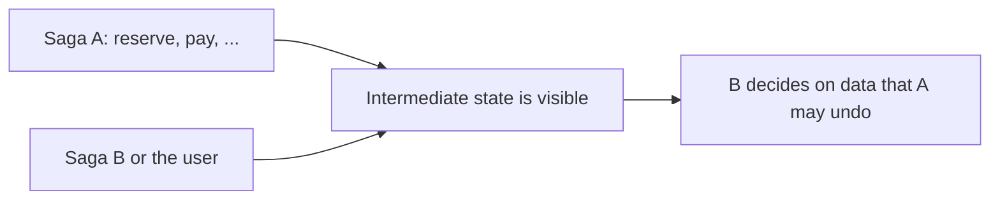

# Saga Isolation Anomalies and Countermeasures

**Microservices · Saga · Step 4.8.6 · Advanced** · Last updated 2026-10-23
**Prerequisites:** [Steps and compensating transactions](02-saga-steps-and-compensation.md) (4.8.2); helpful: [Consistency, CAP, PACELC and quorums](../../14-system-design/10-consistency-cap-pacelc-quorums.md) (14.10)

**Version note**

| Item | Version |
|---|---|
| Baseline | The anomalies and countermeasure names as listed in the saga pattern literature (Richardson's *Microservices Patterns*, and the Azure Architecture Center page) |
| Hands-on baseline | Java 21 (OpenJDK 21.0.8), plain JDK; each program replays one fixed interleaving of two concurrent sagas, so the output is deterministic, run on 2026-10-23 |
| Compatibility note | The names of countermeasures differ slightly between sources; the underlying techniques are stable |

## 1. What it is and why it matters

**What is it?** A saga is "ACD" without the "I": it lacks **isolation** ([4.8.1](01-saga-overview.md)). While one saga is running, its intermediate results are already committed and visible to everyone: other sagas, other requests, the user interface. The resulting inconsistencies are **anomalies**, and the techniques that reduce them are **countermeasures**.

**Why do we need it?** In a single database, a transaction's changes are invisible until it commits, and if it rolls back they never existed. In a saga each step commits at once; if the saga later compensates, other readers may already have acted on data that gets "un-happened". The Azure Architecture Center lists three typical problems:
- **Lost updates:** "one saga modifies data without considering changes made by another saga, [so] it results in overwritten or missing updates."
- **Dirty reads:** "a saga or transaction reads data that another saga has modified, but the modification isn't complete."
- **Fuzzy (non-repeatable) reads:** "different steps in a saga read inconsistent data because updates occur between the reads."

**When would I meet it?** The first time two customers want the last item, the first time a customer cancels an order while it is being processed, or when an auditor asks why a balance is wrong after a refund and a rollback crossed.

> [!TIP]
> **Memory hook:** *half-finished sagas are visible; design so that seeing the middle is harmless: mark it, make changes order-independent, or check before you overwrite.*

## 2. Industry terms

| Term | Simple meaning | Why it matters | Example | Related terms |
|---|---|---|---|---|
| **Anomaly** | A wrong result caused by concurrent sagas seeing each other's intermediate state | The cost of missing isolation | A sale refused for stock that returns | Race condition |
| **Dirty read** | Reading data that a running saga changed and may still compensate | Decisions based on data that will be undone | "Sold out" for a held unit | Uncommitted read |
| **Lost update** | Overwriting another saga's change | Silent wrong data | A refund overwritten by a restore | Write skew |
| **Fuzzy read** | Two reads in one saga see different values | Inconsistent decisions inside one saga | Price changes between steps | Non-repeatable read |
| **Semantic lock** | An application-level flag meaning "a saga is working on this" | Blocks or warns other actions | `APPROVAL_PENDING` | Pessimistic lock |
| **Commutative updates** | Changes that give the same result in any order | Compensation cannot overwrite others | +90 and -90 as deltas | Idempotent, CRDT |
| **Pessimistic view** | Order steps so dirty reads are impossible or harmless | Fewer anomalies by design | Make data visible only after the pivot | Reordering |
| **Reread value** | Check the value is unchanged before overwriting | Optimistic concurrency inside a saga | Version check | Optimistic lock |
| **Version file** | A log of operations on a record, applied in the right order | Reorder out-of-order operations | Operation log per account | Event log |
| **Risk-based concurrency (by value)** | Choose the mechanism by business risk | Not every update needs the same protection | Sagas for small orders, stricter controls for large | Tiered consistency |

## 3. In a real system (ShopFlow)

**The business problem.** Three things go wrong in production, each from missing isolation:
1. The last unit of a limited-edition keyboard is reserved by customer A, whose payment is still running. Customer B sees "sold out" and leaves. A's payment then fails, the reservation is released, and the unit sits unsold.
2. A customer's store credit is debited by an order saga. An unrelated refund arrives. The first saga then fails and its compensation "restores the previous balance", erasing the refund.
3. A customer presses "cancel" while the checkout saga is still approving the order. The cancel succeeds, then the saga finishes and marks the order `APPROVED`: the customer is told the order is cancelled and the parcel arrives.



**How countermeasures help.** Each anomaly gets a design answer: show reservations as *pending* (a better read), make balance changes *deltas* that commute, and use a *semantic lock* (`APPROVAL_PENDING`) so that "cancel" is refused or queued while the saga runs.

**What it costs.** More states to model and show in the UI, some operations are refused or delayed, and the rules must be designed per piece of data. There is no framework switch that gives isolation back; it is a design discipline, and every shared record needs a decision.

**Elsewhere:** airlines show "seat held for 10 minutes" (a semantic lock with expiry); banks show "pending" and "posted" balances (a pessimistic view); shops show "only 1 left, reserved by someone else, check back soon".

## 4. How it works: the countermeasures

| Countermeasure | Idea | ShopFlow use | Trade-off |
|---|---|---|---|
| **Semantic lock** | A compensable step sets a flag (`*_PENDING`); other sagas and requests see it and wait, fail or retry; the saga clears it at its end | Order `APPROVAL_PENDING` blocks cancel and edit | Deadlocks are possible; locks must expire or be cleaned up |
| **Commutative updates** | Design operations to give the same result in any order (add and subtract instead of set) | Credit and stock changes as deltas | Not always possible (set-style rules, "never below zero") |
| **Pessimistic view** | Reorder steps so a step that other readers would act on comes after the pivot, or expose a safer view | Publish "sold" only after payment; show *pending holds* | Constrains the step order ([4.8.2](02-saga-steps-and-compensation.md)) |
| **Reread value** | Before overwriting, read again and abort or retry if the value changed | Compensation checks the version it saw | Extra read and retry logic |
| **Version file** | Record every operation with its sequence, apply in order, ignore stale ones | Account operation log | More storage and complexity |
| **Risk-based concurrency (by value)** | Use cheap saga logic for low-risk changes and stricter controls (approval, reservation limits) for high-risk ones | Orders over a threshold need manual review | Two code paths |

Choosing: list the **shared data** each saga reads or writes, and for each read or write ask "what if another saga sees this half-finished, or changes it in between?". Use the cheapest countermeasure that makes the answer acceptable; for most business data that is a *pending* state plus commutative updates.

### Worked example 1: the dirty read of the last unit

**Concept.** Saga A has reserved the last unit and is waiting for its payment. Saga B asks for the same unit. A naive reader looks only at `available`; a better reader also knows about `pending` holds. The program replays this interleaving exactly.

```java
// File: DirtyReadStock.java (runnable, Java 21)
public class DirtyReadStock {

    // One unit of a limited-edition item. A reservation is part of a saga and may later be compensated.
    static class Inventory {
        int available = 1;
        int pending = 0;        // units held by sagas that have not finished yet

        void reserve() {
            available--;
            pending++;
        }

        void confirm() {
            pending--;
        }

        void release() {          // the compensation
            available++;
            pending--;
        }
    }

    // Naive reader: sees only "available".
    static String naiveAnswer(Inventory inventory) {
        return inventory.available > 0 ? "RESERVED" : "SOLD OUT";
    }

    // Better reader: distinguishes "really gone" from "held by a saga that might still fail".
    static String awareAnswer(Inventory inventory) {
        if (inventory.available > 0) {
            return "RESERVED";
        }
        return inventory.pending > 0 ? "TRY AGAIN SHORTLY (held by another order)" : "SOLD OUT";
    }

    public static void main(String[] args) {
        Inventory inventory = new Inventory();
        System.out.println("last unit in stock; two customers check out at nearly the same time");

        // Saga A reserves the last unit, and its payment step is still running.
        inventory.reserve();
        System.out.println("saga A reserved the unit (payment still running):   available=" + inventory.available + " pending=" + inventory.pending);

        // Saga B asks while saga A is in the middle.
        System.out.println("saga B asks, naive reader:                          " + naiveAnswer(inventory));
        System.out.println("saga B asks, reader that knows about pending holds: " + awareAnswer(inventory));

        // Saga A's payment fails and it compensates.
        inventory.release();
        System.out.println("saga A's payment failed; compensation ran:          available=" + inventory.available + " pending=" + inventory.pending);
        System.out.println("saga B retries:                                     " + awareAnswer(inventory));
        System.out.println("=> the naive answer cost a sale for a unit that was never really gone");
    }
}
```

**Expected output**:

```text
last unit in stock; two customers check out at nearly the same time
saga A reserved the unit (payment still running):   available=0 pending=1
saga B asks, naive reader:                          SOLD OUT
saga B asks, reader that knows about pending holds: TRY AGAIN SHORTLY (held by another order)
saga A's payment failed; compensation ran:          available=1 pending=0
saga B retries:                                     RESERVED
=> the naive answer cost a sale for a unit that was never really gone
```

**Walkthrough.**

| Moment | `available` | `pending` | Naive answer to B | Aware answer to B |
|---|---|---|---|---|
| A has reserved, payment running | 0 | 1 | SOLD OUT (wrong) | TRY AGAIN SHORTLY |
| A's payment failed, compensation ran | 1 | 0 | - | B retries: RESERVED |

The naive reader treats a *held* unit as a *gone* unit. Exposing `pending` (a **pessimistic view**) lets B wait or be told honestly. The cost is a more complex product page, and a decision about what to show when many customers want a held unit (a waiting list, a countdown, a hold with an expiry).

**Experiment.** Add a third customer C who asks while A is still pending. What should C be told, and what must happen when A finally succeeds instead of failing? The reasoning is in Answers.

**Real-world example.** Ticketing sites show "tickets are being held by other customers" with a timer: this is exactly the pending state, with an expiry so that abandoned holds return to the pool.

### Worked example 2: the lost update by compensation

**Concept.** The compensation of "debit 90.00" must undo *its own* debit, not restore a remembered balance. Three variants: restore the old value (wrong), apply the opposite delta (commutative), and reread the version before overwriting.

```java
// File: LostUpdateCompensation.java (runnable, Java 21)
import java.util.Locale;

public class LostUpdateCompensation {

    // A customer's store credit, owned by the payment-service.
    static class Account {
        double balance = 100.00;
        int version = 0;

        void set(double value) {
            balance = value;
            version++;
        }

        void add(double delta) {
            balance += delta;
            version++;
        }
    }

    static String money(double value) {
        return String.format(Locale.ROOT, "%.2f", value);
    }

    public static void main(String[] args) {
        // Saga A debits 90.00 of credit for an order. Later it must be compensated.
        // In between, an unrelated refund of 50.00 arrives for another order.

        // Wrong: the compensation restores the value that saga A saw before it started.
        Account wrong = new Account();
        double seenBeforeDebit = wrong.balance;
        wrong.add(-90.00);                 // saga A debits
        wrong.add(+50.00);                 // an unrelated refund arrives
        wrong.set(seenBeforeDebit);        // compensation: "put it back to 100.00"
        System.out.println("compensation restores the old value:   balance " + money(wrong.balance) + "  (should be 150.00; the 50.00 refund was overwritten)");

        // Right (commutative update): the compensation applies the opposite delta.
        Account delta = new Account();
        delta.add(-90.00);
        delta.add(+50.00);
        delta.add(+90.00);                 // compensation: "give back the 90.00 I took"
        System.out.println("compensation applies the opposite delta: balance " + money(delta.balance));

        // Right (reread the value): the compensation checks the version it saw and does not blindly overwrite.
        Account reread = new Account();
        reread.add(-90.00);
        int versionAfterDebit = reread.version;
        reread.add(+50.00);                // unrelated refund changes the version
        if (reread.version != versionAfterDebit) {
            System.out.println("version changed since the debit, so the compensation uses a delta instead of an overwrite");
            reread.add(+90.00);
        } else {
            reread.set(100.00);
        }
        System.out.println("compensation rereads the version:        balance " + money(reread.balance));
    }
}
```

**Expected output**:

```text
compensation restores the old value:   balance 100.00  (should be 150.00; the 50.00 refund was overwritten)
compensation applies the opposite delta: balance 150.00
version changed since the debit, so the compensation uses a delta instead of an overwrite
compensation rereads the version:        balance 150.00
```

**Walkthrough.**

| Variant | Operations on the balance (start 100.00) | Result |
|---|---|---|
| Restore the old value | `-90`, `+50` (refund), then `set(100)` | **100.00**: the refund is gone |
| Opposite delta | `-90`, `+50`, `+90` | **150.00** |
| Reread the version | `-90`, `+50`, version changed so use `+90` | **150.00** |

Deltas are **commutative**: the result does not depend on the order. That also helps when compensations and other changes arrive in an unexpected order. The limit: rules such as "the balance may never be negative" make the order matter again, so such operations need a check (or a reservation).

**Experiment.** Apply the three changes `-90`, `+50` and `+90` in every possible order and print the balance each time. The result is in Answers.

**Real-world example.** Stock counts, credit balances, loyalty points and rating totals are all naturally expressed as deltas: "add 2 units back" instead of "set stock to 10".

### Worked example 3: the semantic lock

**Concept.** The order's status is also a lock: while the saga is working on it, the status says so, and other actions check it.

```java
// File: SemanticLock.java (runnable, Java 21)
public class SemanticLock {

    // The order's status doubles as an application-level lock while a saga is working on it.
    static class Order {
        String status = "PENDING";
        final boolean useSemanticLock;

        Order(boolean useSemanticLock) {
            this.useSemanticLock = useSemanticLock;
        }

        // Called by the checkout saga when it starts the risky part of the work.
        void sagaStartsProcessing() {
            status = useSemanticLock ? "APPROVAL_PENDING" : "PENDING";
        }

        // Called by a customer who presses "cancel order" while the saga is still running.
        String customerCancels() {
            if (status.equals("APPROVAL_PENDING")) {
                return "REJECTED: order is being processed, try again in a moment";
            }
            status = "CANCELLED";
            return "ACCEPTED: order cancelled";
        }

        // Called by the checkout saga when it finishes successfully.
        void sagaApproves() {
            status = "APPROVED";          // blindly overwrites whatever is there
        }
    }

    static void run(String label, boolean useSemanticLock) {
        System.out.println(label);
        Order order = new Order(useSemanticLock);
        order.sagaStartsProcessing();
        System.out.println("   saga is processing:        status=" + order.status);
        System.out.println("   customer presses cancel:   " + order.customerCancels());
        order.sagaApproves();
        System.out.println("   saga finishes:             status=" + order.status);
    }

    public static void main(String[] args) {
        run("without a semantic lock:", false);
        System.out.println("   => the customer was told the order is cancelled, but it ends APPROVED and will ship");
        System.out.println();
        run("with a semantic lock (APPROVAL_PENDING):", true);
        System.out.println("   => the cancel was refused while the saga ran; the customer can cancel once it is APPROVED");
    }
}
```

**Expected output**:

```text
without a semantic lock:
   saga is processing:        status=PENDING
   customer presses cancel:   ACCEPTED: order cancelled
   saga finishes:             status=APPROVED
   => the customer was told the order is cancelled, but it ends APPROVED and will ship

with a semantic lock (APPROVAL_PENDING):
   saga is processing:        status=APPROVAL_PENDING
   customer presses cancel:   REJECTED: order is being processed, try again in a moment
   saga finishes:             status=APPROVED
   => the cancel was refused while the saga ran; the customer can cancel once it is APPROVED
```

**Walkthrough.** Without the lock, the customer's cancel was accepted while the saga was still running, and then the saga blindly set `APPROVED`: the customer believes the order is cancelled, the warehouse ships it. With `APPROVAL_PENDING` the cancel was refused with a clear message, and the saga finished normally. Two details matter in practice: the saga's final step should *check* the status it expects instead of overwriting (a **reread**), and the lock needs an owner and an expiry so that a crashed saga cannot lock an order forever ([4.8.7](07-failures-timeouts-operations.md)).

**Experiment.** Make the saga fail instead of finish. What status should the order have after the compensation, and can the customer now cancel? The reasoning is in Answers.

**Real-world example.** `APPROVAL_PENDING`, `CANCEL_PENDING`, `PAYMENT_PENDING` are the standard "semantic lock" states in order management systems; a shop's "edit order" button is disabled in these states.

### Common mistakes

1. Compensating by restoring a remembered absolute value.
2. Reading "available" and treating it as the truth while sagas hold units.
3. A status that is both lock and result, without clear rules for who may change it.
4. Locks without owner or expiry, which stay forever after a crash.
5. Applying the same strictness to every piece of data instead of by business risk.
6. Testing sagas one at a time: anomalies only appear with interleavings.

## 5. Failure scenarios

### The unit nobody could buy

1. **What happened?** Customer B was told "sold out" while the last unit was held by a saga that later failed (example 1).
2. **Why?** The product page read `available` only, without pending holds.
3. **What did the business see?** Lost sales that cannot be traced, and "sold out" items that reappear.
4. **Solutions:** show held units as pending; give holds an expiry; offer "notify me"; consider reserving for a short time at the product page.
5. **What they cost:** a richer inventory model and more states in the UI.

### The refund that disappeared

1. **What happened?** A compensation overwrote a refund (example 2).
2. **Why?** The compensation restored a remembered value instead of applying the opposite change.
3. **What did the business see?** A customer short of 50.00; a dispute; a reconciliation gap.
4. **Solutions:** deltas, ledgers (append-only entries), and reread or version checks before any overwrite.
5. **What they cost:** a ledger table instead of a single balance column, and the discipline never to `set` shared values.

### The lock that never opened

1. **What happened?** A saga crashed after setting `APPROVAL_PENDING`; the order stayed locked and the customer could not cancel it.
2. **Why?** The semantic lock had no expiry and no recovery.
3. **What did users see?** A button that says "try again in a moment" forever.
4. **Solutions:** recovery of unfinished sagas, a timeout that moves a stuck saga to a defined state, and an alert for orders locked longer than a threshold ([4.8.7](07-failures-timeouts-operations.md)).
5. **What they cost:** a timer or reaper and an operations runbook.

## 6. Architectural decisions

| Decision | Choose | Because |
|---|---|---|
| Updates to shared numbers | Deltas or ledger entries, never overwrites | Commutative and auditable |
| Visibility of in-progress data | An explicit pending state (`*_PENDING`) with an owner and expiry | Readers can decide knowingly |
| Concurrent user actions on a running saga | A semantic lock that refuses or defers them | The saga finishes in a known state |
| Step order | Anything others might act on happens after the pivot where possible | A pessimistic view by construction |
| Overwrites | Reread or version-check first | Detects the other saga's change |
| High-value operations | Stricter controls (approval, limits, manual review) | Risk-based concurrency |
| Tests | Deterministic interleavings of two sagas, as in the programs | Anomalies only show under concurrency |

## 7. Try it yourself

Try each exercise first; the real results are in the Answers section.

1. **A third customer.** In the last-unit scenario, customer C also asks while A is pending. What should C be told, and what must happen if A's payment succeeds?
2. **Every order.** Apply `-90`, `+50` and `+90` to a balance of 100.00 in all six orders. Predict the results.
3. **Failing saga, locked order.** In the semantic lock example, the saga fails instead of finishing. What status should the order end in, and may the customer cancel then?

## 8. Check your understanding

1. Which letter of ACID does a saga lack, and why does that make a "restore the old value" compensation dangerous?
2. What is the difference between a dirty read and a fuzzy read in a saga?
3. Why does a semantic lock need an expiry?
4. Give an example where commutative updates are not enough.

Answers are at the end of this note.

## 9. Revision

**Remember**
- Sagas have **no isolation**: intermediate state is visible and committed.
- Anomalies: **lost updates**, **dirty reads**, **fuzzy reads**.
- Countermeasures: **semantic lock**, **commutative updates**, **pessimistic view**, **reread value**, **version file**, **risk-based concurrency by value**.
- Compensations **undo their own change** (a delta), never restore an old absolute value.
- Locks need **owner and expiry**; test **interleavings**.

**Explain in 15 seconds:** "Sagas commit each step, so other transactions can see half-finished work; I handle that with pending states and semantic locks, order-independent updates like deltas, and checks before overwriting."

**Explain in 60 seconds:**
> "A saga gives up isolation: each step commits immediately, so other sagas and users can read data that a later compensation will undo, or overwrite changes made in between. That produces dirty reads, lost updates and fuzzy reads. The countermeasures are design techniques. A semantic lock is a status such as approval-pending that makes other actions wait or fail while the saga runs, with an expiry so a crash can't lock it forever. Commutative updates mean I change shared numbers with deltas or ledger entries, so a compensation applies the opposite change instead of restoring an old value. A pessimistic view reorders steps or exposes pending holds so readers don't act on data that may disappear. Reread or version checks detect that something changed before I overwrite. And I match the strictness to business risk. I test these with deterministic interleavings of two sagas, because the anomalies only appear under concurrency."

**Architect's takeaway:** isolation is not lost, it is moved into your domain model. Decide for every shared record what a half-finished state looks like to readers, and design it before the first incident.

**Next topic:** [Failures, timeouts and operating sagas](07-failures-timeouts-operations.md) (4.8.7)

## 10. Verification and sources

> [!NOTE]
> Checked 2026-10-23 against the sources below, and by compiling and running every Java example on OpenJDK 21.0.8. Re-verify when you revisit this note.

- **Confirmed (documentation, read 2026-10-23):** the three typical problems (lost updates, dirty reads, fuzzy or nonrepeatable reads) and the countermeasures "Semantic lock", "Commutative updates", "Pessimistic view", "Reread values", "Version files" and "Risk-based concurrency based on value", with their short descriptions (Microsoft Learn, "Saga distributed transactions pattern"); "Lack of isolation (the 'I' in ACID) ... a saga developer must typically use countermeasures, which are design techniques that implement isolation" (Chris Richardson, microservices.io, "Pattern: Saga", which refers to chapter 4 of *Microservices Patterns* for details; the book was not read for this note).
- **Observed (this machine):** the output of every program and the exercise variants.
- **Assumptions and illustrations:** the interleavings are fixed by hand to make the anomalies deterministic; real ones depend on timing. The ShopFlow stories are illustrative.
- **To verify:** which of your shared records are written by more than one saga or API; what your UI shows for in-progress states; the expiry you need for holds and locks.
- **Decision rule:** pending states and deltas by default; semantic locks where users can act on a running saga; reread before overwrite; stricter controls for high-value operations.

**Sources:** Microsoft Learn, "Saga distributed transactions pattern"; Chris Richardson, microservices.io, "Pattern: Saga".

## Answers

**Experiment (exercises)**

1. **A third customer:** C should get the same honest answer as B, "held by another order, try again shortly" (or a place on a waiting list), not "sold out". If A's payment succeeds, the unit is truly gone: the hold is confirmed (`pending` goes down without `available` going up), and B and C are told "sold out" for real. If A fails, the release makes the unit available again, and whoever retries or is next on the list gets it. In the program, `awareAnswer` already gives C the "try again" text while `pending > 0`.
2. **Every order:** all six orders give 150.00, because addition is commutative:

```text
[-90.0, 50.0, 90.0]      -> balance 150.00
[-90.0, 90.0, 50.0]      -> balance 150.00
[50.0, -90.0, 90.0]      -> balance 150.00
[50.0, 90.0, -90.0]      -> balance 150.00
[90.0, -90.0, 50.0]      -> balance 150.00
[90.0, 50.0, -90.0]      -> balance 150.00
```

   The limit: with a rule "the balance may never go below zero", the order matters again (for example `+90` before `-90` is fine, but `-90` from a balance of 50 is refused), so such operations need a check or a reservation as well as being deltas.
3. **Failing saga:** after its compensations the order should end in a terminal state that says what happened, for example `REJECTED` or back to `PENDING` if it can be retried; the semantic lock (`APPROVAL_PENDING`) must be cleared as part of the compensation. The customer may then cancel (or retry) as the new state allows. If the clear is forgotten, the order is locked forever: that is the "lock that never opened" scenario.

**Check your understanding**

1. Isolation. Without it, other transactions change data between the saga's steps, so a compensation that sets a remembered absolute value overwrites those changes (a lost update). Applying the opposite change preserves them.
2. A dirty read reads data that another saga changed and may still compensate (a decision based on data that may be undone). A fuzzy read is within one saga: two steps read the same item and see different values because something changed in between.
3. Because the saga holding the lock can crash or hang, and without an expiry the data stays blocked forever. The lock needs an owner and an expiry (or a recovery job) so a stuck saga is detected and the state is restored.
4. Any rule that depends on the current value or order: "never below zero", "only the first refund counts", unique limited stock where two additions must not exceed a cap. There the operation needs a check, a lock or a reservation in addition to being a delta.

Back to [the Saga overview](01-saga-overview.md) · [the Microservices overview](../01-microservices-overview.md) · [the index](../../README.md) · [Roadmap](../../roadmap.md).
