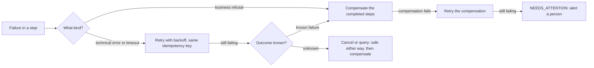

# Saga Failures, Timeouts and Operations

**Microservices · Saga · Step 4.8.7 · Advanced** · Last updated 2026-10-23
**Prerequisites:** [Orchestration](04-orchestration.md) (4.8.4), [Reliable messaging for sagas](05-reliable-messaging-outbox-inbox.md) (4.8.5); helpful: [Timeouts](../../01-resilience/02-timeouts.md) (1.2) and [Retries, backoff and jitter](../../01-resilience/03-retries-backoff-jitter.md) (1.3)

**Version note**

| Item | Version |
|---|---|
| Baseline | Failure handling for sagas as described in the Azure Architecture Center pages on the Saga and Compensating Transaction patterns |
| Hands-on baseline | Java 21 (OpenJDK 21.0.8), plain JDK; a simulated clock makes the timing deterministic, run on 2026-10-23 |
| Compatibility note | Workflow engines provide timers, retries and visibility out of the box with their own APIs; the policies below are the same ones you configure there |

## 1. What it is and why it matters

**What is it?** The happy path of a saga is the small part. This lesson covers everything that makes it run in production: **timeouts** (what to do when no reply comes), **retries** (which failures to retry, how often), **compensation failures** (what to do when the undo itself fails), **stuck sagas** (how to find and recover them), and the **operations** around them: monitoring, manual intervention, versioning and testing.

**Why do we need it?** A saga spans services and time. Anything in between can be slow, down, restarted, or wrong. If failure handling is improvised, the system ends up with orders in limbo, customers charged twice or not at all, and engineers searching logs. The Azure guidance is blunt: "Compensating transactions might not always succeed, which can leave the system in an inconsistent state."

**When would I meet it?** On the first day in production, when a payment provider is slow for ten minutes; in every post-incident review; whenever someone asks "what happens to the orders that were in flight when we deployed?"

> [!TIP]
> **Memory hook:** *a timeout is not a "no": decide in advance what each failure means, retry what is safe, compensate what is not, and have an alarm for what nobody can fix by itself.*

## 2. Industry terms

| Term | Simple meaning | Why it matters | Example | Related terms |
|---|---|---|---|---|
| **Business failure** | A step refuses for a business reason | Retrying will not help; compensate | Card declined | Technical failure |
| **Technical failure** | An error or timeout in the infrastructure or a service | Often temporary; retry | HTTP 503 | Transient failure |
| **Unknown outcome** | No reply: the step may or may not have happened | The most dangerous case; treat it as possibly done | Payment timeout | Idempotency key |
| **Reply timeout** | How long the saga waits for a reply | Bounds the wait | 5 s per call | Deadline |
| **Saga deadline** | A time limit for the whole saga or a business step | Ends sagas that wait forever | Unpaid orders expire after 30 minutes | Expiry |
| **Backoff and jitter** | Growing, randomised delays between retries | Avoids retry storms | 1 s, 2 s, 4 s | [1.3](../../01-resilience/03-retries-backoff-jitter.md) |
| **Needs-attention state** | A terminal-for-automation state meaning "a person must act" | The honest end of an unfixable failure | `NEEDS_ATTENTION` | Dead-letter queue |
| **Stuck saga / reaper** | A saga that has not moved for too long, and the job that finds it | Recovery after crashes and lost messages | Idle for 2 minutes | Watchdog |
| **Saga version** | The version of the saga definition an instance started with | In-flight sagas must finish with the logic they began with | `checkout-v3` | Schema versioning |
| **Fault injection** | Deliberately making a step fail in a test | The only way to test failure paths | A participant that returns errors | Chaos testing |

## 3. In a real system (ShopFlow)

**The business problem.** On a Saturday the payment provider answers slowly for ten minutes, and on Sunday a deploy restarts the orchestrator in the middle of 400 checkouts. Some customers see a spinner for a minute and give up; some are charged but their order shows `PENDING`; some orders hold stock for hours; and one compensation (releasing stock) keeps failing because the inventory service is down.



**How a failure policy helps.** The saga has written rules for each case: refusals compensate, technical errors retry with backoff and the same idempotency key, a timeout is treated as "maybe it happened" and cleaned up with an operation that is safe either way, a compensation that keeps failing ends in `NEEDS_ATTENTION` with an alert, and a reaper finds sagas that stopped moving.

**What it costs.** More states and more code than the happy path; configuration (timeouts, attempt counts, deadlines) that must be tuned; dashboards and runbooks; and a person on call for the cases that cannot be automated.

**Elsewhere:** payment and travel platforms run "stuck transaction" queues staffed by operations teams; banks have exception-handling desks for transfers that did not complete; delivery apps expire an unaccepted order after a few minutes and refund automatically.

## 4. How it works

1. **Classify failures.** Business refusal (compensate), technical error (retry), no reply (unknown outcome).
2. **Retry what is safe:** forward steps and compensations are idempotent and carry the same key on every attempt, with exponential backoff and jitter and a maximum number of attempts ([1.3](../../01-resilience/03-retries-backoff-jitter.md)).
3. **Treat a timeout as "unknown".** After the attempts are used up, do not assume the step failed: run its compensation, which must be safe whether or not the step happened (cancel, void, refund-if-charged).
4. **Never give up silently on a compensation:** retry for a long time, then move the saga to `NEEDS_ATTENTION` with a detailed alert. The Azure guidance: "Sometimes manual intervention is the only way to recover from a failed step. In these situations, the system should raise an alert that includes detailed information about the reason for the failure."
5. **Persist progress** so that the saga can "resume the compensating transaction from the point of failure" (same source), also after a crash.
6. **Watch for sagas that stopped moving** and re-drive them.
7. **Set deadlines** for steps that depend on people or slow partners.

### Worked example 1: timeouts, retries and compensation failures

**Concept.** A small orchestrator with a simulated clock: replies time out after 5 seconds, forward steps are retried up to 3 times and compensations up to 4 times, with backoff of 1, 2 and 4 seconds. Four scenarios.

```java
// File: SagaTimeoutsAndRetries.java (runnable, Java 21)
import java.util.ArrayList;
import java.util.List;

public class SagaTimeoutsAndRetries {

    enum Outcome { OK, BUSINESS_FAILURE, NO_REPLY, ERROR }

    interface Behaviour {
        Outcome call(int attempt);
    }

    record Step(String name, Behaviour forward, String compensationName, Behaviour compensation) {}

    static final int MAX_ATTEMPTS = 3;            // for a forward step
    static final int MAX_COMPENSATION_ATTEMPTS = 4;
    static final int REPLY_TIMEOUT_SECONDS = 5;

    static int clock;                              // a simulated clock, in seconds

    static void log(String text) {
        System.out.println(String.format("   t=%02ds  %s", clock, text));
    }

    // Calls a behaviour with retries and backoff. Returns the last outcome.
    static Outcome callWithRetries(String what, Behaviour behaviour, int maxAttempts) {
        Outcome outcome = Outcome.ERROR;
        for (int attempt = 1; attempt <= maxAttempts; attempt++) {
            outcome = behaviour.call(attempt);
            switch (outcome) {
                case OK -> {
                    clock += 1;
                    log(what + ": ok" + (attempt > 1 ? " (attempt " + attempt + ")" : ""));
                    return outcome;
                }
                case BUSINESS_FAILURE -> {
                    clock += 1;
                    log(what + ": refused for a business reason");
                    return outcome;                          // retrying will not help
                }
                case NO_REPLY -> {
                    clock += REPLY_TIMEOUT_SECONDS;
                    log(what + ": no reply within " + REPLY_TIMEOUT_SECONDS + " s (attempt " + attempt + ")");
                }
                case ERROR -> {
                    clock += 1;
                    log(what + ": technical error (attempt " + attempt + ")");
                }
            }
            if (attempt < maxAttempts) {
                int backoff = 1 << (attempt - 1);            // 1 s, 2 s, 4 s
                clock += backoff;
                log("wait " + backoff + " s, then retry");
            }
        }
        return outcome;
    }

    static String run(String scenario, List<Step> steps) {
        System.out.println("scenario: " + scenario);
        clock = 0;
        List<Step> done = new ArrayList<>();
        boolean needCompensation = false;
        for (Step step : steps) {
            Outcome outcome = callWithRetries(step.name(), step.forward(), MAX_ATTEMPTS);
            if (outcome == Outcome.OK) {
                done.add(step);
                continue;
            }
            if (outcome == Outcome.NO_REPLY) {
                // The outcome is UNKNOWN: the step may have happened. Include it in the compensation (which must be safe either way).
                log(step.name() + ": outcome unknown, so its compensation will run too");
                done.add(step);
            }
            needCompensation = true;
            break;
        }
        if (!needCompensation) {
            log("saga COMPLETED");
            return "COMPLETED";
        }
        for (int i = done.size() - 1; i >= 0; i--) {
            Step step = done.get(i);
            Outcome outcome = callWithRetries(step.compensationName(), step.compensation(), MAX_COMPENSATION_ATTEMPTS);
            if (outcome != Outcome.OK) {
                log("saga NEEDS_ATTENTION: " + step.compensationName() + " could not be completed; an alert is raised for a person");
                return "NEEDS_ATTENTION";
            }
        }
        log("saga COMPENSATED");
        return "COMPENSATED";
    }

    static Behaviour always(Outcome outcome) {
        return attempt -> outcome;
    }

    static Behaviour failTimes(int times, Outcome outcome) {          // fails this many times, then works
        return attempt -> attempt <= times ? outcome : Outcome.OK;
    }

    public static void main(String[] args) {
        List<String> summary = new ArrayList<>();

        summary.add("payment is slow twice, then works -> " + run("payment times out twice, then works", List.of(
                new Step("reserve stock", always(Outcome.OK), "release stock", always(Outcome.OK)),
                new Step("charge card", failTimes(2, Outcome.NO_REPLY), "cancel payment", always(Outcome.OK)))));
        System.out.println();

        summary.add("payment never answers -> " + run("payment never answers", List.of(
                new Step("reserve stock", always(Outcome.OK), "release stock", always(Outcome.OK)),
                new Step("charge card", always(Outcome.NO_REPLY), "cancel payment", always(Outcome.OK)))));
        System.out.println();

        summary.add("release fails twice, then works -> " + run("the compensation itself fails twice, then works", List.of(
                new Step("reserve stock", always(Outcome.OK), "release stock", failTimes(2, Outcome.ERROR)),
                new Step("charge card", always(Outcome.BUSINESS_FAILURE), "cancel payment", always(Outcome.OK)))));
        System.out.println();

        summary.add("release never works -> " + run("the compensation never succeeds", List.of(
                new Step("reserve stock", always(Outcome.OK), "release stock", always(Outcome.ERROR)),
                new Step("charge card", always(Outcome.BUSINESS_FAILURE), "cancel payment", always(Outcome.OK)))));
        System.out.println();

        System.out.println("summary");
        summary.forEach(line -> System.out.println("   " + line));
    }
}
```

**Expected output**:

```text
scenario: payment times out twice, then works
   t=01s  reserve stock: ok
   t=06s  charge card: no reply within 5 s (attempt 1)
   t=07s  wait 1 s, then retry
   t=12s  charge card: no reply within 5 s (attempt 2)
   t=14s  wait 2 s, then retry
   t=15s  charge card: ok (attempt 3)
   t=15s  saga COMPLETED

scenario: payment never answers
   t=01s  reserve stock: ok
   t=06s  charge card: no reply within 5 s (attempt 1)
   t=07s  wait 1 s, then retry
   t=12s  charge card: no reply within 5 s (attempt 2)
   t=14s  wait 2 s, then retry
   t=19s  charge card: no reply within 5 s (attempt 3)
   t=19s  charge card: outcome unknown, so its compensation will run too
   t=20s  cancel payment: ok
   t=21s  release stock: ok
   t=21s  saga COMPENSATED

scenario: the compensation itself fails twice, then works
   t=01s  reserve stock: ok
   t=02s  charge card: refused for a business reason
   t=03s  release stock: technical error (attempt 1)
   t=04s  wait 1 s, then retry
   t=05s  release stock: technical error (attempt 2)
   t=07s  wait 2 s, then retry
   t=08s  release stock: ok (attempt 3)
   t=08s  saga COMPENSATED

scenario: the compensation never succeeds
   t=01s  reserve stock: ok
   t=02s  charge card: refused for a business reason
   t=03s  release stock: technical error (attempt 1)
   t=04s  wait 1 s, then retry
   t=05s  release stock: technical error (attempt 2)
   t=07s  wait 2 s, then retry
   t=08s  release stock: technical error (attempt 3)
   t=12s  wait 4 s, then retry
   t=13s  release stock: technical error (attempt 4)
   t=13s  saga NEEDS_ATTENTION: release stock could not be completed; an alert is raised for a person

summary
   payment is slow twice, then works -> COMPLETED
   payment never answers -> COMPENSATED
   release fails twice, then works -> COMPENSATED
   release never works -> NEEDS_ATTENTION
```

**Walkthrough.**

| Scenario | What happened | Why |
|---|---|---|
| Payment times out twice, then works | Two timeouts (5 s each) with 1 s and 2 s waits, success on attempt 3 at t=15 s: **COMPLETED** | A technical failure is retried; the same idempotency key makes the repeated charge safe |
| Payment never answers | Three timeouts, then "outcome unknown": **cancel payment** runs first, then release stock: **COMPENSATED** | The charge may have happened; the safe cancel covers both cases |
| Compensation fails twice, then works | Release stock fails with technical errors, succeeds on attempt 3: **COMPENSATED** | Compensations are retried like any step |
| Compensation never works | Four attempts fail: **NEEDS_ATTENTION** and an alert | Automation has run out; a person must act, and the saga log says exactly where |

Note the total time in scenario 2: 21 seconds. These numbers must fit the user experience: a customer waiting in the browser is not served by a 21-second retry loop. Usually the checkout returns "we are processing your order" immediately and the saga finishes in the background.

**Experiment.** Raise `REPLY_TIMEOUT_SECONDS` to 10 and run again. Predict the finishing time of the "payment never answers" scenario. The result is in Answers.

**Real-world example.** Payment providers document that a timed-out charge request may still have succeeded and that you should repeat the request with the same idempotency key or query by reference; the saga's "cancel payment" is the same idea.

### Worked example 2: finding stuck sagas

**Concept.** A reaper job scans the saga table for non-terminal sagas that have not changed for longer than an idle limit, re-drives them, and reports numbers.

```java
// File: StuckSagaReaper.java (runnable, Java 21)
import java.util.List;

public class StuckSagaReaper {

    record SagaRow(String id, String state, long lastUpdateSecond) {
        boolean terminal() {
            return state.equals("COMPLETED") || state.equals("CANCELLED");
        }
    }

    static final long NOW = 3600;                       // the current time, in seconds since the system started
    static final long IDLE_LIMIT = 120;                 // a saga that has not moved for 2 minutes needs a look

    public static void main(String[] args) {
        // The saga table of the checkout orchestrator at one moment.
        List<SagaRow> table = List.of(
                new SagaRow("O-1001", "COMPLETED", 3000),
                new SagaRow("O-1002", "CHARGING_CARD", 3590),        // moving normally
                new SagaRow("O-1003", "CHARGING_CARD", 3200),        // waiting for a reply for 400 s
                new SagaRow("O-1004", "RELEASING_STOCK", 2900),      // a compensation that has not finished for 700 s
                new SagaRow("O-1005", "CANCELLED", 3100),
                new SagaRow("O-1006", "CREATING_SHIPMENT", 3300));   // waiting for 300 s

        System.out.println("saga table at t=" + NOW + " s:");
        table.forEach(row -> System.out.println(String.format("   %-7s %-18s idle %4d s", row.id(), row.state(), NOW - row.lastUpdateSecond())));

        System.out.println();
        System.out.println("reaper run (idle limit " + IDLE_LIMIT + " s):");
        long inFlight = table.stream().filter(row -> !row.terminal()).count();
        long stuck = 0;
        for (SagaRow row : table) {
            if (row.terminal() || NOW - row.lastUpdateSecond() <= IDLE_LIMIT) {
                continue;
            }
            stuck++;
            String action = row.state().startsWith("RELEASING") || row.state().startsWith("REFUNDING")
                    ? "compensation stalled: re-send the command, then alert a person if it still fails"
                    : "re-send the last command (it is idempotent) and keep watching";
            System.out.println("   " + row.id() + " in " + row.state() + ": " + action);
        }
        System.out.println();
        System.out.println("metrics: in flight = " + inFlight + ", stuck = " + stuck + ", oldest idle = "
                + table.stream().filter(row -> !row.terminal()).mapToLong(row -> NOW - row.lastUpdateSecond()).max().orElse(0) + " s");
    }
}
```

**Expected output**:

```text
saga table at t=3600 s:
   O-1001  COMPLETED          idle  600 s
   O-1002  CHARGING_CARD      idle   10 s
   O-1003  CHARGING_CARD      idle  400 s
   O-1004  RELEASING_STOCK    idle  700 s
   O-1005  CANCELLED          idle  500 s
   O-1006  CREATING_SHIPMENT  idle  300 s

reaper run (idle limit 120 s):
   O-1003 in CHARGING_CARD: re-send the last command (it is idempotent) and keep watching
   O-1004 in RELEASING_STOCK: compensation stalled: re-send the command, then alert a person if it still fails
   O-1006 in CREATING_SHIPMENT: re-send the last command (it is idempotent) and keep watching

metrics: in flight = 4, stuck = 3, oldest idle = 700 s
```

**Walkthrough.** At t=3600 s the table has six sagas. Two are finished (`COMPLETED`, `CANCELLED`). `O-1002` moved 10 seconds ago and is fine. Three are idle for more than the 120-second limit: two wait for a reply (`CHARGING_CARD` 400 s, `CREATING_SHIPMENT` 300 s), and one compensation (`RELEASING_STOCK`) has stalled for 700 s, which deserves an alert if re-sending does not help. The metrics line is what a dashboard should show continuously: **in flight**, **stuck** and **oldest idle**.

**Real-world example.** A "stuck sagas" panel and an alert on the age of the oldest non-terminal saga are among the first monitoring items of any saga-based system.

### Operating sagas

| Concern | Practice |
|---|---|
| **Visibility** | One saga id in every log line, event and trace; a table or UI where support can look up an order and see its saga state, history and last error |
| **Metrics** | Started, completed, compensated and needs-attention counts; duration percentiles; in-flight count; stuck count and the age of the oldest; retry and timeout counts per step |
| **Alerts** | On `NEEDS_ATTENTION`, on the oldest idle saga beyond a limit, and on compensation rate (a sudden rise means a dependency is failing) |
| **Manual tools** | Safe, audited actions: retry the current step, skip an optional step, force-cancel, mark resolved. Each action is logged with who and why |
| **Dead letters** | A destination for messages that cannot be processed, with an owner and a runbook ([4.8.5](05-reliable-messaging-outbox-inbox.md)) |
| **Deadlines** | Business timers: expire unpaid orders, release holds, escalate approvals |
| **Versioning** | Store the saga definition version in each instance; new instances use the new version; keep the old code until old instances finish; change commands and replies compatibly |
| **Deploys** | Draining is unnecessary if state is persisted and steps are idempotent: a restart simply resumes; test this by killing the orchestrator mid-saga |
| **Testing** | A test per path of the state machine; fault injection (errors, timeouts, duplicates, delays) for each step and compensation; interleaving tests for concurrent sagas ([4.8.6](06-isolation-and-countermeasures.md)); a few end-to-end tests in a staging environment |

### Common mistakes

1. Treating a timeout as a failure and compensating without making the compensation safe if the step did happen.
2. Retrying business refusals.
3. No limit on retries, or no jitter, causing a retry storm against a struggling service.
4. Compensations without retries or alerts.
5. Sagas with no deadline: an abandoned checkout holds stock forever.
6. Changing the saga definition in place while instances are in flight.
7. Logs without the saga id.

## 5. Failure scenarios

### Charged but no order

1. **What happened?** The payment call timed out; the saga treated it as failed and released the stock, but the charge had gone through.
2. **Why?** A timeout was read as "no".
3. **What did users see?** A charge on the card statement and no order.
4. **Solutions:** idempotency key on the charge; on unknown outcome, cancel or query before deciding; a reconciliation job comparing payments with orders.
5. **What they cost:** a status API or cancel operation at the provider, and a daily reconciliation report.

### The compensation that nobody was told about

1. **What happened?** `ReleaseStock` failed for hours because the inventory service was down; the saga retried quietly and then stopped.
2. **Why?** No alert on compensation failure and no needs-attention state.
3. **What did the business see?** Stock held for orders that were already cancelled; "sold out" for items on the shelf.
4. **Solutions:** retry for long enough, then `NEEDS_ATTENTION` plus a page; a dashboard of saga states.
5. **What they cost:** on-call attention and a runbook.

### The in-flight deploy

1. **What happened?** A new version of the orchestrator changed a state name; 400 in-flight sagas could not be resumed.
2. **Why?** Saga state was stored with names the new code did not know.
3. **What did users see?** Stuck orders after the deploy.
4. **Solutions:** version the saga definition; make state and message changes backward compatible; test an upgrade with sagas in every state.
5. **What they cost:** compatibility discipline and an upgrade test.

## 6. Architectural decisions

| Decision | Choose | Because |
|---|---|---|
| Failure classes | Business refusal, technical error, unknown outcome, each with its own rule | Different failures need different actions |
| Retries | Idempotent calls, same key, backoff and jitter, a maximum, and a total time budget | Safe and bounded |
| Timeouts | Per call, and a deadline for the saga; answer the user at once and finish asynchronously | The user is not the saga's clock |
| Compensation failure | Retry long, then `NEEDS_ATTENTION` with an alert and context | Honest and recoverable |
| Recovery | Persist state; a reaper re-drives idle sagas | Crashes and lost messages happen |
| Observability | Saga id everywhere; metrics for stuck, oldest idle and compensation rate | You can see problems before customers do |
| Versioning | Version stored per instance; compatible changes | In-flight sagas survive deploys |
| Tests | Fault injection and interleavings for every path | Failure paths are where bugs live |
| Build or buy | A workflow engine when timers, retries, visibility and versioning are needed beyond what you want to maintain | They give these for free |

### Alternatives in the industry

A map of the landscape, not a comparison. None of these were run in this lesson; check each product's current documentation before adopting one.

| Area | Tool or product | What it is | When you meet it |
|---|---|---|---|
| Timers, retries, visibility built in | **Temporal**, **Camunda**, **Conductor**, **AWS Step Functions** (Retry and Catch), **Azure Durable Functions** | Workflow engines with retry policies, timers, history and UIs for stuck workflows | Long or business-critical sagas |
| Metrics and dashboards | **Prometheus** and **Grafana**, **Datadog**, **CloudWatch** | Collect and show saga counters and ages | Every production system |
| Tracing and logs | **OpenTelemetry**, **Jaeger**, **Tempo**, log search by saga id | Follow one saga across services | Debugging |
| Failure testing | **Toxiproxy**, **Chaos Mesh**, **Gremlin**, **AWS Fault Injection Service**, **Testcontainers** | Inject latency, errors and outages | Resilience testing ([1.10](../../01-resilience/10-testing-resilience.md)) |
| Alerting and on-call | **Alertmanager**, **PagerDuty**, **Opsgenie** | Page the right person with context | On-call rotations |

## 7. Try it yourself

Try each exercise first; the real results are in the Answers section.

1. **Slower timeout.** Set the reply timeout to 10 seconds. How long does the "payment never answers" scenario now take?
2. **Why cancel before release?** In that scenario the saga cancels the payment before it releases the stock. What goes wrong if it only releases the stock?
3. **Design the alert.** What information must the `NEEDS_ATTENTION` alert contain so that a person can fix it without searching?

## 8. Check your understanding

1. Why is a timeout different from a failure, and what does that change in the compensation?
2. Which failures should never be retried?
3. How can a saga survive a restart of the orchestrator in the middle of its execution?
4. Name three metrics you would put on a saga dashboard.

Answers are at the end of this note.

## 9. Revision

**Remember**
- Classify failures: **business refusal** (compensate), **technical error** (retry), **no reply** (**unknown outcome**).
- A timeout is **not** a "no": compensate with an operation that is **safe either way**.
- Retry with the **same key**, **backoff and jitter**, **a maximum**; also retry **compensations**.
- When automation runs out: **`NEEDS_ATTENTION`** and an alert with context.
- **Persist** state, **re-drive** stuck sagas with a reaper, **version** definitions, **test** with fault injection.
- Watch **in flight**, **stuck**, **oldest idle**, **compensation rate**.

**Explain in 15 seconds:** "I classify saga failures, retry the technical ones with idempotency keys and backoff, treat a timeout as an unknown outcome and clean up safely, retry compensations, and escalate to a person with an alert when they keep failing."

**Explain in 60 seconds:**
> "In production most of the saga's code is failure handling. I split failures into three: a business refusal, which means compensate; a technical error, which means retry with backoff, jitter, a limit and the same idempotency key; and no reply, which is an unknown outcome, so I don't assume the step failed: I run its compensation, designed to be safe whether or not it happened, like cancelling a payment. Compensations are retried too, and if they can't be completed the saga moves to a needs-attention state and raises an alert with the saga id, the step and the error, because only a person can fix that. The saga state is persisted, so a restarted orchestrator resumes, a reaper re-drives sagas that stopped moving, and sagas carry a version so deploys don't strand in-flight instances. I monitor in-flight, stuck, oldest idle and compensation rate, give business steps deadlines, and test every path with fault injection."

**Likely follow-up questions:**
- **How long should I retry?** Within a total budget that fits the business: seconds for a user waiting, minutes to hours for background compensation; then escalate.
- **What about human steps?** Model them as states with deadlines and reminders; workflow engines support this natively.
- **Do I need a workflow engine?** For long-running sagas with timers, retries and visibility needs, it saves a lot of work; for short ones, a table and a reaper suffice.

**Architect's takeaway:** a saga is finished when its failure paths are designed, observable and tested. Decide in advance what each failure means, who is paged for the unfixable ones, and how an in-flight order survives a deploy.

**Next topic:** [Case study: the ShopFlow checkout saga](08-case-checkout-saga.md) (4.8.8)

## 10. Verification and sources

> [!NOTE]
> Checked 2026-10-23 against the sources below, and by compiling and running every Java example on OpenJDK 21.0.8. Re-verify when you revisit this note.

- **Confirmed (documentation, read 2026-10-23):** "Compensating transactions might not always succeed, which can leave the system in an inconsistent state"; the saga must "handle transient failures effectively and ensure idempotence"; "Monitoring and tracking the workflow of a saga are essential tasks"; a compensating transaction "should record progress so that it can resume the compensating transaction from the point of failure"; steps may run more than once, so "design each step as an idempotent command"; "Sometimes manual intervention is the only way to recover from a failed step. In these situations, the system should raise an alert that includes detailed information about the reason for the failure"; "Retry logic that treats more errors as transient can help minimize failures that trigger a compensating transaction" (Microsoft Learn, "Saga distributed transactions pattern" and "Compensating Transaction pattern").
- **Observed (this machine):** the output of both programs and the exercise variant.
- **Assumptions and illustrations:** timings, attempt counts and idle limits are illustrative; the simulated clock adds time by hand and the programs have no real network. The payment-provider remark describes common provider behaviour in general terms; check your provider's documentation.
- **To verify:** your payment provider's idempotency and status APIs; the retry and timeout defaults of your HTTP client, broker client and workflow engine; the alerting path for `NEEDS_ATTENTION`.
- **Decision rule:** classify, retry the safe, compensate the rest, escalate what automation cannot fix, and make the state visible.

**Sources:** Microsoft Learn, "Saga distributed transactions pattern" and "Compensating Transaction pattern"; the earlier resilience notes [1.2](../../01-resilience/02-timeouts.md), [1.3](../../01-resilience/03-retries-backoff-jitter.md) and [1.4](../../01-resilience/04-idempotency.md).

## Answers

**Experiment (exercises)**

1. **Slower timeout:** change `REPLY_TIMEOUT_SECONDS` to 10 and run only that scenario. Each of the three timeouts now costs 10 s instead of 5 s, so the saga finishes at t=36 s instead of t=21 s:

```text
scenario: payment never answers, reply timeout 10 s
   t=01s  reserve stock: ok
   t=11s  charge card: no reply within 10 s (attempt 1)
   t=12s  wait 1 s, then retry
   t=22s  charge card: no reply within 10 s (attempt 2)
   t=24s  wait 2 s, then retry
   t=34s  charge card: no reply within 10 s (attempt 3)
   t=34s  charge card: outcome unknown, so its compensation will run too
   t=35s  cancel payment: ok
   t=36s  release stock: ok
   t=36s  saga COMPENSATED
```

   A longer timeout is not "safer": it makes every failure slower, so choose it from the partner's real latency percentiles.
2. **Why cancel before release:** if only the stock were released, a charge that actually succeeded would stay on the customer's card with no order: "charged but no order". Cancelling the payment (an operation that does nothing if there was no charge) makes the cleanup correct in both cases. Order matters too: the compensations run in reverse order of the steps.
3. **The alert:** the saga id and order id, the saga type and version, the step that failed and its compensation, the number of attempts and the last error text, the time of the last change and the age, what has already been undone (the log), and the safe next action (a link to retry or resolve in the admin tool, and the runbook).

**Check your understanding**

1. A failure means "I know it did not happen"; a timeout means "I do not know". The step may have succeeded, so a compensation that assumes it did not (for example just releasing stock) can leave the effect in place. The compensation must be safe both ways: cancel, void or refund-if-charged, and idempotent.
2. Business refusals (a declined card, an out-of-stock reply, a validation error): the same request will give the same answer, so retrying only wastes time. Retry technical errors and timeouts only.
3. By persisting the saga's state (the instance, its current step and last command) in the same transaction as the outgoing message, so that after a restart it re-sends the last command (idempotent) and continues; a reaper finds sagas that stopped moving.
4. For example: sagas in flight, sagas stuck (idle beyond the limit) and the age of the oldest; the rate of compensated and needs-attention sagas; saga duration (p50, p95); retries and timeouts per step; the size and age of the outbox.

Back to [the Saga overview](01-saga-overview.md) · [the Microservices overview](../01-microservices-overview.md) · [the index](../../README.md) · [Roadmap](../../roadmap.md).
