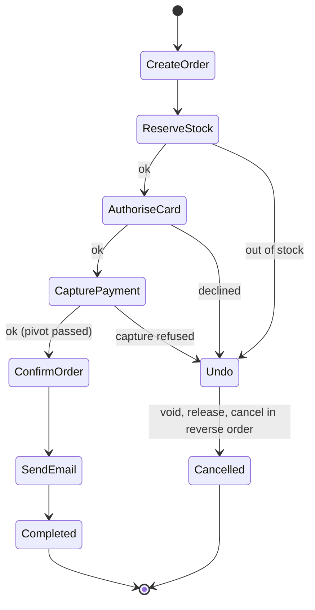
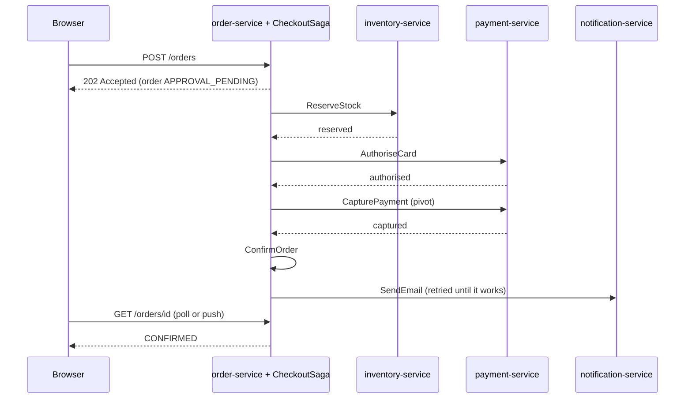

# Case Study: The ShopFlow Checkout Saga

**Microservices · Saga · Step 4.8.8 · Advanced** · Last updated 2026-10-23
**Prerequisites:** the whole Saga series: [steps and compensation](02-saga-steps-and-compensation.md) (4.8.2), [orchestration](04-orchestration.md) (4.8.4), [reliable messaging](05-reliable-messaging-outbox-inbox.md) (4.8.5), [isolation](06-isolation-and-countermeasures.md) (4.8.6), [failures and operations](07-failures-timeouts-operations.md) (4.8.7)

**Version note**

| Item | Version |
|---|---|
| Baseline | Everything taught in steps 4.8.1 to 4.8.7 |
| Hands-on baseline | Java 21 (OpenJDK 21.0.8), plain JDK, for the simulation; PostgreSQL 16.15 (the `postgres:16-alpine` image) for the saga table, run on 2026-10-23 |
| Compatibility note | The simulation keeps every service in one object and persists the saga row in memory; it shows the logic, and the section "What the simulation leaves out" lists what a production system adds |

## 1. What it is and why it matters

**What is it?** A complete design of one saga, from requirements to failure handling: ShopFlow's checkout across four services. It applies the series in one place: step kinds and order, orchestration, idempotent commands, a persisted saga row that survives an orchestrator crash, a semantic lock, and the failure paths.

**Why do we need it?** The earlier lessons each isolate one idea. Real design means making them agree: the step order decides which compensations exist, the persistence decides what a crash costs, idempotency decides what a retry does. Putting the pieces together is where gaps show.

**When would I meet it?** When you design or review a business transaction across services, and in architecture interviews that ask "design the checkout flow and tell me what happens when each step fails".

> [!TIP]
> **Memory hook:** *list the steps, mark the point of no return, give every step an idempotent undo, keep the state durable, and write down what happens for each way it can fail.*

## 2. Industry terms

This lesson introduces no new terms. The map below shows where each idea of the series appears in the design.

| Idea | Lesson | In the checkout design |
|---|---|---|
| Compensable, pivot, retriable steps | [4.8.2](02-saga-steps-and-compensation.md) | `CreateOrder`, `ReserveStock`, `AuthoriseCard` compensable; `CapturePayment` the pivot; `ConfirmOrder`, `SendEmail` retriable |
| Orchestration | [4.8.4](04-orchestration.md) | A `CheckoutSaga` orchestrator in the order domain |
| Outbox and inbox | [4.8.5](05-reliable-messaging-outbox-inbox.md) | State change plus command in one transaction; idempotent participants |
| Semantic lock, deltas | [4.8.6](06-isolation-and-countermeasures.md) | Order status `APPROVAL_PENDING`; stock and payment changes as deltas |
| Timeouts, retries, alerts, reaper | [4.8.7](07-failures-timeouts-operations.md) | Retries with the same command id; `NEEDS_ATTENTION`; stuck-saga job |

## 3. In a real system (ShopFlow)

**The business problem.** A customer clicks "Place order" for two keyboards (90.00). The order must be created, the stock held, the card charged and the customer told, across `order-service`, `inventory-service`, `payment-service` and `notification-service`, each with its own database. Requirements:

- **Functional:** create an order; reserve stock; authorise and then capture the card payment; confirm the order; send a confirmation email.
- **Non-functional:** never charge for an order that does not exist; never hold stock for a cancelled order; the browser gets an answer within two seconds ("we are processing your order"); survive an orchestrator restart and duplicate messages; a person is alerted for anything automation cannot fix.
- **Constraints:** the payment provider supports authorise, capture, void and idempotency keys; email cannot be unsent.

**The design.**

| # | Step | Service | Kind | Compensation | Why this place in the order |
|---|---|---|---|---|---|
| 1 | `CreateOrder` (status `APPROVAL_PENDING`) | order-service | Compensable | `CancelOrder` | First: gives the saga an id and acts as the semantic lock |
| 2 | `ReserveStock` | inventory-service | Compensable | `ReleaseStock` | Most likely to fail for business reasons: early |
| 3 | `AuthoriseCard` | payment-service | Compensable | `VoidAuthorisation` | Checks the card without taking money |
| 4 | `CapturePayment` | payment-service | **Pivot** | none planned | Money moves; after this we complete |
| 5 | `ConfirmOrder` | order-service | Retriable | not needed | Can only fail technically; clears the lock |
| 6 | `SendEmail` | notification-service | Retriable | impossible | Cannot be undone, so it is last |





**How the design helps.** Business failures (stock, card) can only happen before the pivot, where every undo is cheap and invisible; after the pivot only technical failures remain, handled by retries. The order status is the lock and the answer for the customer: `APPROVAL_PENDING`, then `CONFIRMED` or `CANCELLED`.

**What it costs.** An orchestrator and its table, an outbox in each participant, inbox tables or natural idempotency, and monitoring. The customer sees a short "processing" state instead of an instant answer.

**Elsewhere:** the same structure appears in travel booking (hold seat, authorise, issue ticket, send itinerary), loan origination (check, reserve funds, sign, disburse, notify) and food delivery (accept, assign courier, charge, track).

## 4. How it works

1. **Accept.** `order-service` creates the order (`APPROVAL_PENDING`), a `saga_instance` row, and the first command in its outbox, in one transaction, and returns `202 Accepted`.
2. **Drive.** The orchestrator sends each command (through the outbox) with the command id `sagaId:StepName` and waits for the reply. Each reply moves the saga row to the next step, in a transaction that also writes the next command to the outbox.
3. **Execute idempotently.** Each participant deduplicates by command id, applies its local transaction, and replies with the stored outcome if it sees the id again.
4. **Fail.** A business refusal before the pivot switches the saga to compensating: undo the completed compensable steps in reverse order. A technical error is retried with the same id. A failure that cannot be fixed ends in `NEEDS_ATTENTION` with an alert.
5. **Recover.** After a crash a new orchestrator instance reads the saga row and re-sends the current command, which is safe because participants deduplicate. A reaper re-drives sagas that stopped moving.
6. **Finish.** `ConfirmOrder` sets `CONFIRMED` (clearing the lock); `SendEmail` is retried until it works.

### Worked example 1: the whole saga in one simulation

**Concept.** The program implements the design: six steps with kinds and compensations, participants that deduplicate by command id, an orchestrator that keeps its progress in a saga row (which survives a crash), failure injection, and a semantic lock. It runs eight scenarios and prints a table of the final state of every service.

```java
// File: CheckoutSagaCapstone.java (runnable, Java 21)
import java.util.ArrayList;
import java.util.HashMap;
import java.util.HashSet;
import java.util.List;
import java.util.Map;
import java.util.Set;

public class CheckoutSagaCapstone {

    enum Outcome { OK, BUSINESS_FAILURE, ERROR }

    enum Kind { COMPENSABLE, PIVOT, RETRIABLE }

    record Step(String command, Kind kind, String compensation) {}

    static class CrashException extends RuntimeException {}

    // ---- The four services, simplified into one object. Every command is idempotent: it is keyed by a command id. ----
    static class Services {
        String orderStatus = "NONE";
        int stock = 10;
        int reserved = 0;
        double authorised = 0;
        double captured = 0;
        int emailsSent = 0;

        final Map<String, Outcome> processed = new HashMap<>();     // the inbox: command id -> outcome
        final Set<String> refuse = new HashSet<>();                  // commands that fail for a business reason
        final Map<String, Integer> flaky = new HashMap<>();          // commands that fail technically N times
        int duplicatesIgnored = 0;

        Outcome handle(String commandId, String command) {
            Outcome earlier = processed.get(commandId);
            if (earlier != null) {
                duplicatesIgnored++;
                return earlier;                                      // repeat: same answer, no second effect
            }
            if (flaky.getOrDefault(command, 0) > 0) {
                flaky.merge(command, -1, Integer::sum);
                return Outcome.ERROR;                                // not recorded: a retry will run for real
            }
            Outcome outcome = refuse.contains(command) ? Outcome.BUSINESS_FAILURE : apply(command);
            processed.put(commandId, outcome);
            return outcome;
        }

        private Outcome apply(String command) {
            switch (command) {
                case "CreateOrder" -> orderStatus = "APPROVAL_PENDING";             // a semantic lock
                case "CancelOrder" -> orderStatus = "CANCELLED";
                case "ReserveStock" -> {
                    if (stock < 2) return Outcome.BUSINESS_FAILURE;
                    stock -= 2;
                    reserved += 2;
                }
                case "ReleaseStock" -> {
                    stock += 2;
                    reserved -= 2;
                }
                case "AuthoriseCard" -> authorised = 90.00;
                case "VoidAuthorisation" -> authorised = 0;
                case "CapturePayment" -> {
                    captured = authorised;
                    authorised = 0;
                }
                case "ConfirmOrder" -> orderStatus = "CONFIRMED";
                case "SendEmail" -> emailsSent++;
                default -> throw new IllegalArgumentException(command);
            }
            return Outcome.OK;
        }

        String customerCancels() {
            if (orderStatus.equals("APPROVAL_PENDING")) {
                return "REJECTED (the order is being processed)";
            }
            orderStatus = "CANCELLED";
            return "ACCEPTED";
        }
    }

    // ---- The saga's persisted state: the only thing that survives an orchestrator crash. ----
    static class SagaRow {
        int nextStep = 0;
        int undoIndex = -1;             // while compensating: the next completed step to undo
        String phase = "FORWARD";       // FORWARD, COMPENSATING, DONE
        String result = "RUNNING";
    }

    static final List<Step> STEPS = List.of(
            new Step("CreateOrder", Kind.COMPENSABLE, "CancelOrder"),
            new Step("ReserveStock", Kind.COMPENSABLE, "ReleaseStock"),
            new Step("AuthoriseCard", Kind.COMPENSABLE, "VoidAuthorisation"),
            new Step("CapturePayment", Kind.PIVOT, null),
            new Step("ConfirmOrder", Kind.RETRIABLE, null),
            new Step("SendEmail", Kind.RETRIABLE, null));

    static class Options {
        boolean verbose = false;
        boolean duplicateEveryCommand = false;
        int crashAfterCommands = -1;                // crash right after this many commands were delivered
        int cancelAfterStep = -1;                   // the customer presses cancel after this step
        String cancelAnswer = "";
    }

    static class Orchestrator {
        final String sagaId;
        final Services services;
        final SagaRow row;
        final Options options;
        int delivered = 0;

        Orchestrator(String sagaId, Services services, SagaRow row, Options options) {
            this.sagaId = sagaId;
            this.services = services;
            this.row = row;
            this.options = options;
        }

        Outcome send(String commandId, String command) {
            Outcome outcome = Outcome.ERROR;
            for (int attempt = 1; attempt <= 5 && outcome == Outcome.ERROR; attempt++) {
                outcome = services.handle(commandId, command);
                if (options.duplicateEveryCommand) {
                    services.handle(commandId, command);               // the broker delivers it a second time
                }
                delivered++;
                if (options.verbose) {
                    System.out.println("      " + command + " -> " + outcome + (attempt > 1 ? " (attempt " + attempt + ")" : ""));
                }
                if (delivered == options.crashAfterCommands) {
                    throw new CrashException();                          // crash before the reply is recorded
                }
            }
            return outcome;
        }

        void run() {
            while (!row.phase.equals("DONE")) {
                if (row.phase.equals("FORWARD")) {
                    Step step = STEPS.get(row.nextStep);
                    Outcome outcome = send(sagaId + ":" + step.command(), step.command());
                    if (outcome == Outcome.OK) {
                        row.nextStep++;
                        if (row.nextStep - 1 == options.cancelAfterStep) {
                            options.cancelAnswer = services.customerCancels();
                        }
                        if (row.nextStep == STEPS.size()) {
                            row.phase = "DONE";
                            row.result = "COMPLETED";
                        }
                    } else if (outcome == Outcome.BUSINESS_FAILURE) {
                        row.phase = "COMPENSATING";
                        row.undoIndex = row.nextStep - 1;
                    } else {
                        row.phase = "DONE";
                        row.result = "NEEDS_ATTENTION";
                    }
                } else {
                    if (row.undoIndex < 0) {
                        row.phase = "DONE";
                        row.result = "COMPENSATED";
                        continue;
                    }
                    Step done = STEPS.get(row.undoIndex);
                    if (done.kind() == Kind.COMPENSABLE) {
                        if (send(sagaId + ":undo:" + done.compensation(), done.compensation()) != Outcome.OK) {
                            row.phase = "DONE";
                            row.result = "NEEDS_ATTENTION";
                            continue;
                        }
                    }
                    row.undoIndex--;
                }
            }
        }
    }

    static String scenario(String name, Services services, Options options) {
        if (options.verbose) {
            System.out.println("scenario: " + name);
        }
        SagaRow row = new SagaRow();                                    // the saga table row, kept outside the orchestrator
        try {
            new Orchestrator("O-1001", services, row, options).run();
        } catch (CrashException crash) {
            if (options.verbose) {
                System.out.println("      *** orchestrator crashed; a new instance starts and reads the saga row (next step " + row.nextStep + ")");
            }
            options.crashAfterCommands = -1;
            new Orchestrator("O-1001", services, row, options).run();     // recovery: re-send the current command
        }
        if (options.verbose) {
            System.out.println();
        }
        return String.format("%-44s %-16s %-17s %5d %4d %9.2f %9.2f %6d %5d",
                name, row.result, services.orderStatus, services.reserved, services.stock, services.authorised, services.captured,
                services.emailsSent, services.duplicatesIgnored);
    }

    public static void main(String[] args) {
        List<String> table = new ArrayList<>();

        table.add(scenario("1. everything works", new Services(), new Options()));

        Services outOfStock = new Services();
        outOfStock.stock = 1;
        table.add(scenario("2. out of stock", outOfStock, new Options()));

        Services declined = new Services();
        declined.refuse.add("AuthoriseCard");
        table.add(scenario("3. card declined", declined, new Options()));

        Services captureFails = new Services();
        captureFails.refuse.add("CapturePayment");
        Options verbose = new Options();
        verbose.verbose = true;
        table.add(scenario("4. capture fails at the pivot", captureFails, verbose));

        Services emailDown = new Services();
        emailDown.flaky.put("SendEmail", 2);
        table.add(scenario("5. email service fails twice", emailDown, new Options()));

        Options crash = new Options();
        crash.verbose = true;
        crash.crashAfterCommands = 3;                                    // after AuthoriseCard was delivered
        table.add(scenario("6. orchestrator crashes after AuthoriseCard", new Services(), crash));

        Options duplicates = new Options();
        duplicates.duplicateEveryCommand = true;
        table.add(scenario("7. every command is delivered twice", new Services(), duplicates));

        Options cancel = new Options();
        cancel.cancelAfterStep = 2;
        String row8 = scenario("8. customer presses cancel while it runs", new Services(), cancel);
        table.add(row8);

        System.out.println(String.format("%-44s %-16s %-17s %5s %4s %9s %9s %6s %5s",
                "scenario", "saga result", "order", "held", "left", "authorised", "captured", "emails", "dups"));
        table.forEach(System.out::println);
        System.out.println();
        System.out.println("customer's cancel in scenario 8: " + cancel.cancelAnswer);
    }
}
```

**Expected output**:

```text
scenario: 4. capture fails at the pivot
      CreateOrder -> OK
      ReserveStock -> OK
      AuthoriseCard -> OK
      CapturePayment -> BUSINESS_FAILURE
      VoidAuthorisation -> OK
      ReleaseStock -> OK
      CancelOrder -> OK

scenario: 6. orchestrator crashes after AuthoriseCard
      CreateOrder -> OK
      ReserveStock -> OK
      AuthoriseCard -> OK
      *** orchestrator crashed; a new instance starts and reads the saga row (next step 2)
      AuthoriseCard -> OK
      CapturePayment -> OK
      ConfirmOrder -> OK
      SendEmail -> OK

scenario                                     saga result      order              held left authorised  captured emails  dups
1. everything works                          COMPLETED        CONFIRMED             2    8      0.00     90.00      1     0
2. out of stock                              COMPENSATED      CANCELLED             0    1      0.00      0.00      0     0
3. card declined                             COMPENSATED      CANCELLED             0   10      0.00      0.00      0     0
4. capture fails at the pivot                COMPENSATED      CANCELLED             0   10      0.00      0.00      0     0
5. email service fails twice                 COMPLETED        CONFIRMED             2    8      0.00     90.00      1     0
6. orchestrator crashes after AuthoriseCard  COMPLETED        CONFIRMED             2    8      0.00     90.00      1     1
7. every command is delivered twice          COMPLETED        CONFIRMED             2    8      0.00     90.00      1     6
8. customer presses cancel while it runs     COMPLETED        CONFIRMED             2    8      0.00     90.00      1     0

customer's cancel in scenario 8: REJECTED (the order is being processed)
```

**Walkthrough.** Read the table columns as the state after each scenario: `held` is the stock reserved for the order, `left` the stock on hand, `authorised` and `captured` the money, `emails` the confirmation emails, and `dups` the number of repeated commands the participants ignored.

| # | Scenario | What the design did | Result |
|---|---|---|---|
| 1 | Everything works | Six steps in order | Completed; 2 held, 90.00 captured, 1 email |
| 2 | Out of stock | `ReserveStock` refused; only `CancelOrder` ran | Compensated; nothing held, nothing charged |
| 3 | Card declined | `AuthoriseCard` refused; release stock, cancel order | Compensated; stock back to 10 |
| 4 | Capture fails at the pivot | Void authorisation, release stock, cancel order, in reverse order (see the trace) | Compensated; no money taken |
| 5 | Email service fails twice | `SendEmail` retried with the same command id | Completed; **one** email |
| 6 | The orchestrator crashes after `AuthoriseCard` | A new instance read the saga row and re-sent `AuthoriseCard`; the participant ignored the repeat (`dups` = 1) | Completed; authorised and captured once |
| 7 | Every command delivered twice | Six repeats ignored | Same end state as scenario 1 |
| 8 | The customer presses cancel mid-saga | The semantic lock (`APPROVAL_PENDING`) refused the cancel | Completed; the customer is told "being processed" |

Compare scenarios 1, 6 and 7: three different histories, one identical end state. That is what idempotent commands plus a durable saga row buy.

**Experiment.** Two failures that the table does not show: the email service stays down for far longer than five attempts, and the pivot fails while `ReleaseStock` is also down. Predict the saga result and the order status of each, then compare with Answers.

**Real-world example.** In ShopFlow, `payment-service` would pass the command id to the payment provider as its idempotency key, so a re-sent `AuthoriseCard` returns the first authorisation instead of making a second.

### Worked example 2: the saga row in a real database

The orchestrator's persisted state for the checkout saga, in PostgreSQL 16:

```sql
CREATE TABLE saga_instance (
    saga_id      text        PRIMARY KEY,
    saga_type    text        NOT NULL,
    saga_version int         NOT NULL,
    phase        text        NOT NULL CHECK (phase IN ('FORWARD', 'COMPENSATING', 'DONE')),
    next_step    int         NOT NULL DEFAULT 0,
    undo_index   int,
    result       text        NOT NULL DEFAULT 'RUNNING',
    payload      jsonb       NOT NULL,
    version      int         NOT NULL DEFAULT 0,
    started_at   timestamptz NOT NULL DEFAULT now(),
    updated_at   timestamptz NOT NULL DEFAULT now()
);

-- the reaper only ever looks at unfinished sagas
CREATE INDEX saga_instance_active ON saga_instance (updated_at) WHERE phase <> 'DONE';

INSERT INTO saga_instance (saga_id, saga_type, saga_version, phase, next_step, payload, updated_at) VALUES
    ('O-1002', 'checkout', 3, 'FORWARD',      2, '{"quantity": 2}', now() - interval '10 seconds'),
    ('O-1003', 'checkout', 3, 'FORWARD',      2, '{"quantity": 1}', now() - interval '400 seconds'),
    ('O-1004', 'checkout', 3, 'COMPENSATING', 1, '{"quantity": 2}', now() - interval '700 seconds');
UPDATE saga_instance SET undo_index = 1 WHERE saga_id = 'O-1004';
```

```text
$ docker --context rancher-desktop exec -i sf-learn-pg psql -U postgres < saga-schema.sql
CREATE TABLE
CREATE INDEX
INSERT 0 3
UPDATE 1
```

The reaper query and the optimistic-locking update that protects against two orchestrator instances advancing the same saga:

```sql
-- 1. The reaper: unfinished sagas that have not moved for two minutes.
SELECT saga_id, phase, next_step, (now() - updated_at)::interval(0) AS idle
  FROM saga_instance
 WHERE phase <> 'DONE' AND updated_at < now() - interval '2 minutes'
 ORDER BY updated_at;

-- 2. Two orchestrator instances try to advance the same saga from the version they both read (version 0).
UPDATE saga_instance SET next_step = 3, version = version + 1, updated_at = now() WHERE saga_id = 'O-1003' AND version = 0;
UPDATE saga_instance SET next_step = 3, version = version + 1, updated_at = now() WHERE saga_id = 'O-1003' AND version = 0;
```

```text
$ docker --context rancher-desktop exec -i sf-learn-pg psql -U postgres < saga-queries.sql
 saga_id |    phase     | next_step |   idle   
---------+--------------+-----------+----------
 O-1004  | COMPENSATING |         1 | 00:11:40
 O-1003  | FORWARD      |         2 | 00:06:40
(2 rows)

UPDATE 1
UPDATE 0
```

**Walkthrough.** The partial index keeps the reaper cheap: it only covers unfinished sagas. The query lists the two sagas idle for more than two minutes (O-1003 for 6 min 40 s, O-1004, a compensation, for 11 min 40 s), the data behind the "stuck" metric of [4.8.7](07-failures-timeouts-operations.md). In the update test, both instances read version 0; the first got `UPDATE 1` and advanced the saga; the second got `UPDATE 0` and must re-read and decide again. This is how two orchestrator replicas, or a replica and a recovery job, avoid advancing a saga twice. The schema is a teaching schema: production versions add an owner and lease for the recovery job, a deadline column, and the outbox in the same database.

### What the simulation leaves out

| Left out | How production closes the gap | Lesson |
|---|---|---|
| A network between the services | Commands and replies travel through a broker; the orchestrator stores state and the command together (outbox) | [4.8.5](05-reliable-messaging-outbox-inbox.md) |
| Real persistence of the saga row | A `saga_instance` table, updated with optimistic locking | Example 2 |
| Timeouts and unknown outcomes | A reply timeout, "outcome unknown" handled by cancel-safe compensation | [4.8.7](07-failures-timeouts-operations.md) |
| Concurrency between sagas | Semantic locks, deltas, version checks on shared data | [4.8.6](06-isolation-and-countermeasures.md) |
| Deploys and saga versions | A version per instance; compatible changes | [4.8.7](07-failures-timeouts-operations.md) |
| Observability | Saga id in logs and traces; metrics for stuck sagas; a support screen | [4.8.7](07-failures-timeouts-operations.md) |
| Business deadlines | Expiry for unpaid or unconfirmed orders | [4.8.7](07-failures-timeouts-operations.md) |

## 5. Failure scenarios

The matrix below lists each way the checkout can fail and what the design does. Rows 1 to 8 were shown by the simulation or its variants; the rest are production-only and refer to the lessons.

| # | Failure | Automatic outcome | Who is involved |
|---|---|---|---|
| 1 | Out of stock | Compensated, order `CANCELLED`, customer told | nobody |
| 2 | Card declined | Compensated, stock released | nobody |
| 3 | Capture refused at the pivot | Void, release, cancel; no money taken | nobody |
| 4 | Email down for a while | Retried until it works; order already `CONFIRMED` | nobody |
| 5 | Orchestrator crash | Resumes from the saga row | nobody |
| 6 | Duplicate delivery | Ignored by command id | nobody |
| 7 | Customer cancels mid-saga | Refused by the semantic lock | nobody |
| 8 | A compensation keeps failing | `NEEDS_ATTENTION`, order stays locked | **On-call, alerted** |
| 9 | Broker down | Outbox fills; checkout keeps accepting orders; the saga resumes later | Alert on outbox age |
| 10 | Payment provider slow | Retries; unknown outcome handled by void; background finish | Alert on retries |
| 11 | Charged but no order (the old bug) | Prevented: capture happens only after stock is reserved and the order exists; reconciliation catches leaks | Daily reconciliation |

## 6. Architectural decisions

| Decision | Choose | Because |
|---|---|---|
| Coordination | Orchestration for the checkout; events (choreography) for everything that merely reacts (analytics, loyalty) | The flow has branches and a pivot; reacting services must not couple to it |
| Where the orchestrator lives | In the order domain, with its own table | It owns the business process and the order status |
| The pivot | `CapturePayment` | After money is taken, complete; business refusals all come earlier |
| Customer experience | `202 Accepted` with a status the page polls or receives by push | The saga is asynchronous; do not block a browser on it |
| Messaging | Outbox in each participant, inbox or natural keys, command ids `sagaId:Step` | Crashes and duplicates are normal |
| Isolation | `APPROVAL_PENDING` as a semantic lock; deltas for stock and money | Cheap, and covers the realistic anomalies |
| Failure policy | Retry technical errors with the same id, compensate business refusals, `NEEDS_ATTENTION` otherwise | Written rules, not improvisation |
| Build or buy | A hand-written state machine and table for this short saga; a workflow engine if flows grow long or involve people | Fit the tool to the size |
| What to monitor | In-flight, stuck, oldest idle, compensation rate, needs-attention, outbox age | You see problems before customers do |

### Alternatives in the industry

A map of the landscape, not a comparison. None of these were run in this lesson; the earlier lessons ([4.8.3](03-choreography.md), [4.8.4](04-orchestration.md), [4.8.5](05-reliable-messaging-outbox-inbox.md)) list the tools in more detail.

| Area | Tool or product | What it is | When you meet it |
|---|---|---|---|
| Write the saga as code on a durable engine | **Temporal**, **Camunda**, **Conductor**, **AWS Step Functions**, **Azure Durable Functions** | The engine keeps the state, timers and retries | Long-running, complex or human-involved sagas |
| Saga libraries | **Eventuate Tram Sagas**, **MassTransit**, **NServiceBus**, **Axon** (check its current saga status) | Frameworks with saga support | Teams on those stacks |
| Reliable publishing | **Debezium** outbox router, **Spring Modulith** event publication registry | Outbox without hand-written relays | Kafka platforms and Spring applications |

## 7. Try it yourself

Try each exercise first; the real results are in the Answers section.

1. **Two hard failures.** Predict the final saga result and order status when (A) the email service stays down for much longer than five attempts, and (B) the pivot fails while `ReleaseStock` is also down.
2. **Where does fraud go?** The business adds a fraud check. Should it be a compensable step before the pivot, or a retriable step after it? What changes in the design?
3. **Move the pivot.** Suppose the business wants to charge at order time and only ship later. What becomes the pivot, and which step moves?

## 8. Check your understanding

1. Why can scenarios 1, 6 and 7 of the simulation end in the same state?
2. What does `APPROVAL_PENDING` do in this design, and when is it cleared?
3. What happens to a customer who is charged when the email service is down for an hour?
4. List the three things that must be durable for the saga to survive a restart.

Answers are at the end of this note.

## 9. Revision

**Remember**
- Order the steps: **compensable (likeliest to fail first) → pivot → retriable**.
- **Orchestrate** the checkout; let other services **react to events**.
- **Command ids** make every step and undo idempotent; the **saga row** makes the saga durable; the **outbox** makes the messages reliable.
- **Semantic lock** (`APPROVAL_PENDING`) protects the running saga; **deltas** protect shared numbers.
- Failure policy: business refusal → compensate; technical → retry; unfixable → **`NEEDS_ATTENTION`** + alert.
- Write down the failure matrix and test every row.

**Explain in 15 seconds:** "The checkout is an orchestrated saga: reserve stock and authorise the card first, capture the payment as the point of no return, then confirm and email with retries; every step is idempotent, the saga state is durable, and anything automation can't fix goes to a person."

**Explain in 60 seconds:**
> "I'd model checkout as an orchestrated saga in the order service. Steps: create the order as approval-pending, which doubles as a lock; reserve stock; authorise the card; capture the payment as the pivot; then confirm the order and send the email, which are retried because they can only fail technically. Everything that can fail for a business reason happens before the pivot, where the undo is cheap: void the authorisation, release the stock, cancel the order, in reverse order. The orchestrator keeps its state in a table updated with optimistic locking, writes each command to an outbox in the same transaction, and gives every command an id like saga id plus step; participants deduplicate by that id, so a crash and recovery or a duplicate delivery gives the same end state. The browser gets 202 and the order status. Failures are classified: refusals compensate, technical errors retry, and a compensation that keeps failing ends in needs-attention with an alert. A reaper finds idle sagas, and I'd monitor stuck sagas, oldest idle, compensation rate and outbox age."

**Likely follow-up questions:**
- **Why is capture the pivot and not the authorisation?** An authorisation can be voided cheaply and invisibly; capture moves money and a refund is visible, slow and not always possible.
- **What if the business wants to ship before charging?** Then shipping becomes a step before the pivot with a compensation (cancel the shipment), or the pivot moves to a later step; the principle is to put the irreversible step late.
- **Why not one distributed transaction?** The payment provider and the broker can't join one, and it would tie the availability of four services together ([4.8.1](01-saga-overview.md)).

**Architect's takeaway:** a saga is a promise that every business transaction ends in a state you can name, even after crashes and duplicates. Write the steps, the undo of each, the point of no return, the lock, and the failure matrix before writing code, and test each row.

**Next topic:** the Saga cheat sheet (4.8.99, planned) summarises the series for revision.

## 10. Verification and sources

> [!NOTE]
> Checked 2026-10-23 against the sources below, by compiling and running the Java programs on OpenJDK 21.0.8, and by running the SQL in PostgreSQL 16.15 (a throwaway container, removed afterwards). Re-verify when you revisit this note.

- **Confirmed (documentation, read 2026-10-23):** the saga concepts used here (compensable, pivot and retryable transactions, orchestration, idempotent steps, monitoring, manual intervention for failed compensations) as described in Microsoft Learn, "Saga distributed transactions pattern" and "Compensating Transaction pattern"; the pattern and its drawbacks (lack of isolation, lack of automatic rollback) in Chris Richardson, microservices.io, "Pattern: Saga".
- **Observed (this machine):** the simulation's trace and table for all eight scenarios and the two failure variants; in PostgreSQL, the saga table, the partial index, the reaper query result and the optimistic-locking updates (`UPDATE 1`, then `UPDATE 0`).
- **Assumptions and illustrations:** the business rules, amounts, step order and the choice of capture as the pivot are illustrative design decisions. The simulation is one JVM with no network and no timers. The payment provider's capabilities are assumed (authorise, capture, void, idempotency keys); check your provider.
- **To verify:** your payment provider's real semantics for void and capture; how your broker delivers and orders messages; whether your organisation prefers an engine to hand-written state; the legal and business rules for charging before shipping.
- **Decision rule:** orchestrate the core flow; irreversible step late and deliberate; idempotent commands; durable saga row; semantic lock; failure policy written down and tested.

**Sources:** Microsoft Learn, "Saga distributed transactions pattern" and "Compensating Transaction pattern"; Chris Richardson, microservices.io, "Pattern: Saga"; the earlier lessons of this series.

## Answers

**Experiment (exercises)**

1. **Two hard failures:** both end in `NEEDS_ATTENTION`. (A) The email service stays down: all five attempts at `SendEmail` fail; the money is captured and the order is `CONFIRMED`, but the saga cannot finish, so it needs a person (or a longer retry policy: a mail failure should not stay unnoticed). (B) The pivot fails and `ReleaseStock` is down: the authorisation was voided, but the stock is still held and the order is still `APPROVAL_PENDING` (the lock was never released): this is the "lock that never opened" of [4.8.6](06-isolation-and-countermeasures.md). The traces and table:

```text
scenario: A. email service stays down
      CreateOrder -> OK
      ReserveStock -> OK
      AuthoriseCard -> OK
      CapturePayment -> OK
      ConfirmOrder -> OK
      SendEmail -> ERROR
      SendEmail -> ERROR (attempt 2)
      SendEmail -> ERROR (attempt 3)
      SendEmail -> ERROR (attempt 4)
      SendEmail -> ERROR (attempt 5)

scenario: B. capture fails and ReleaseStock stays down
      CreateOrder -> OK
      ReserveStock -> OK
      AuthoriseCard -> OK
      CapturePayment -> BUSINESS_FAILURE
      VoidAuthorisation -> OK
      ReleaseStock -> ERROR
      ReleaseStock -> ERROR (attempt 2)
      ReleaseStock -> ERROR (attempt 3)
      ReleaseStock -> ERROR (attempt 4)
      ReleaseStock -> ERROR (attempt 5)

scenario                                     saga result      order              held left authorised  captured emails  dups
A. email service stays down                  NEEDS_ATTENTION  CONFIRMED             2    8      0.00     90.00      0     0
B. capture fails and ReleaseStock stays down NEEDS_ATTENTION  APPROVAL_PENDING      2    8      0.00      0.00      0     0
```

2. **Where does fraud go?** A fraud check can reject an order, so it is a business-failure step: make it compensable and place it before the pivot, ideally before authorising the card (cheap checks first) with a compensation of `ReleaseFraudHold` or nothing if it has no side effects. After the pivot it could no longer reject the order without a refund. The design change is one new step, its place in the table, its row in the failure matrix and a test.
3. **Move the pivot:** if the card is charged at order time and shipping happens later, capture is not the point of no return in the same sense: the business may ship days later and fail. The pivot then moves to the step the business treats as irreversible, usually "shipment dispatched", and `CapturePayment` becomes a compensable step with `RefundPayment` as its compensation, which is a visible, slower undo. That is why the original order (charge last, as late as possible) is preferable when the business allows it.

**Check your understanding**

1. Because every step is idempotent (keyed by command id) and the saga's progress is stored outside the orchestrator: a crash only repeats a command, and the participant answers with the stored outcome; a duplicate delivery is ignored; the sequence of effects therefore happens once.
2. It is the order's status while the saga runs: a semantic lock that makes a customer's cancel request fail with "being processed" and tells readers the order is not final. `ConfirmOrder` clears it by setting `CONFIRMED`; a compensation clears it with `CancelOrder`. If neither runs, the order stays locked (scenario B).
3. The order is `CONFIRMED` and the money is captured: the pivot has passed. `SendEmail` is retried (with backoff) until the email service is back and sends the email once, because of the command id. If it stays down beyond the policy, the saga goes to `NEEDS_ATTENTION` while the customer can still see the order as confirmed in the app; no money or stock is wrong.
4. The saga row (the progress: phase, next step, undo index, version), the outbox (the commands waiting to be sent, written in the same transaction as the progress), and the participants' record of processed command ids (the inbox or a natural key).

Back to [the Saga overview](01-saga-overview.md) · [the Microservices overview](../01-microservices-overview.md) · [the index](../../README.md) · [Roadmap](../../roadmap.md).
