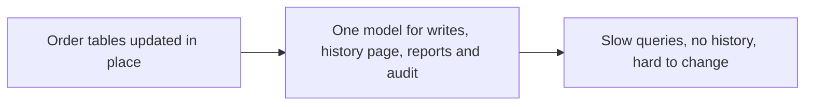
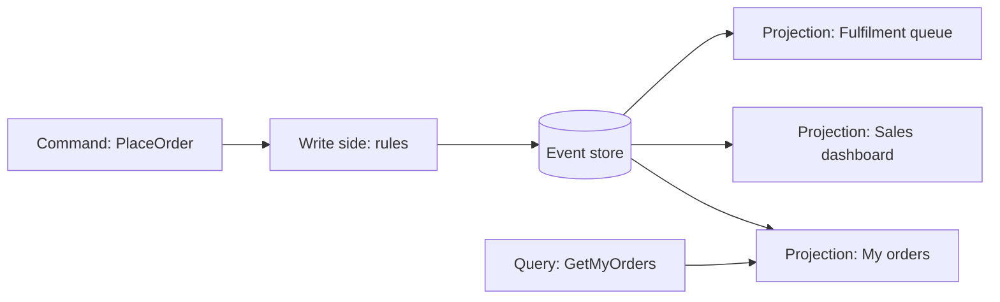

# CQRS and Event Sourcing: The Big Picture and Learning Order

**Microservices · CQRS and event sourcing · Step 4.9.1 · Overview** · Last updated 2026-10-23
**Prerequisites:** [Microservices: the big picture](../01-microservices-overview.md) (4.1) and [Saga: the big picture](../08-saga/01-saga-overview.md) (4.8.1); helpful: [Messaging and event-driven design](../../02-messaging/01-messaging-overview.md) (2.1)

Read this first. It is the map of the series: two ideas that are often mentioned together and are independent, what each is for, when not to use them, and the learning order. The examples are small Java 21 programs; how to run them is in [the Java overview](../../13-java/01-java-overview.md), section 5.

**Version note**

| Item | Version |
|---|---|
| Baseline | CQRS as described by Greg Young and Martin Fowler (2010 to 2011); event sourcing as described by Martin Fowler (2005) |
| Hands-on baseline | Java 21 (OpenJDK 21.0.8), plain JDK, no libraries; PostgreSQL 16 in a later lesson, run on 2026-10-23 |
| Compatibility note | Frameworks and event stores change quickly; the patterns here do not depend on one |

## 1. What it is and why it matters

**What is it?** Two separate ideas:
- **CQRS** (Command Query Responsibility Segregation): "you can use a different model to update information than the model you use to read information" (Martin Fowler). Commands change data; queries read it; each side gets the model that suits it.
- **Event sourcing**: instead of storing the *current state* of something, store the *sequence of events* that happened to it, and derive the state from them. Fowler: "Capture all changes to an application state as a sequence of events."

They work well together: the write side stores events, and the read side builds query-friendly views from them. But each can be used without the other.

**Why do we need them?** A single CRUD model has to serve everyone. The order history page needs data joined from many places; the write path needs strict rules and fast, safe updates; support needs to know *how* an order got into its state; analytics needs different aggregates again. Overwriting rows loses history. These patterns trade simplicity for the ability to optimise each side and to keep the full story.

**When would I meet it?** In domains with complex rules and audit needs (orders, payments, trading, bookings), in systems with very different read and write loads, and whenever an architect says "we could keep events and build read models".

> [!WARNING]
> Fowler's warning about CQRS applies to both ideas: "For some situations, this separation can be valuable, but beware that for most systems CQRS adds risky complexity." Microsoft's guidance lists simple CRUD domains, short-lived systems, reference data and teams without event-driven experience as poor fits. The default for most services is plain CRUD.

> [!TIP]
> **Memory hook:** *a bank keeps a ledger of every transaction (events) and shows you a balance and monthly statements (read models); you never edit the balance, you add a transaction.*

## 2. Mental model: the ledger, the balance and the statement

A bank's **ledger** records every deposit and withdrawal and is never edited; corrections are new entries. The **balance** on your phone is a number calculated from the ledger. The **monthly statement** and the "spending by category" chart are other views built from the same ledger. To change anything you send an **instruction** ("transfer 50"), which the bank may refuse.

| In the analogy | In the real system |
|---|---|
| An instruction ("transfer 50") | A command: intent, may be rejected |
| A ledger entry | An event: a fact that happened, never changed |
| The ledger | The event store |
| The balance, the statement, the chart | Read models, built by projections |
| Recalculating the balance from the ledger | Replaying events |

**Where the analogy breaks:** a bank's views are usually updated at once; in a distributed system the read models lag behind the ledger, which is **eventual consistency** and has to be designed for.

## 3. Industry terms

| Term | Simple meaning | Why it matters | Example | Related terms |
|---|---|---|---|---|
| **Command** | A request to change something; named as an intent; may be rejected | The input of the write side | `PlaceOrder`, `CancelOrder` | Query |
| **Query** | A request to read; changes nothing | The input of the read side | `GetOrderHistory(customer)` | Command |
| **Event** | An immutable fact in the past tense | The record of change | `OrderPlaced` | Message, domain event |
| **Aggregate** | A cluster of objects treated as one unit for changes; the consistency boundary | Where rules are enforced and events are produced | An `Order` | Entity, DDD |
| **Event store** | An append-only store of events, one stream per aggregate | The system of record in event sourcing | Stream `order-O-1001` | Event log |
| **Read model / projection** | A query-friendly view built from events (or from the write model) | Fast, tailored reads | `OrdersByCustomer` | Materialized view |
| **Replay** | Re-applying events to rebuild state or a view | Recovery and new views | Rebuild a dashboard | Rebuild |
| **Eventual consistency** | The read side catches up after a delay | The price of separation | A new order not yet in the list | [14.10](../../14-system-design/10-consistency-cap-pacelc-quorums.md) |
| **Expected version** | The version of a stream a writer believes is current; the write fails if it is not | Optimistic concurrency for event streams | `append(stream, expected=3)` | Optimistic lock |
| **Snapshot** | A saved state at some version, to avoid replaying everything | Performance for long streams | State at event 1000 | [4.9.5](05-snapshots-versioning-privacy.md) |

## 4. In a real system (ShopFlow)

**The business problem.** `order-service` stores each order as rows in six tables. Four problems keep coming back:
1. The "My orders" page joins six tables and slows the checkout database at peak times.
2. Support asks "what exactly happened to order O-1001?" and the answer is "it is RETURNED now", because every change overwrote the last.
3. Finance wants sales per hour and late-shipment reports, which need different shapes of data again.
4. A dispute needs to prove when the payment was captured and who cancelled the order.

The small program shows the core difference: a row keeps only the last value, a history of events can answer questions nobody planned for.

```java
// File: StateVersusHistory.java (runnable, Java 21)
import java.util.ArrayList;
import java.util.List;

public class StateVersusHistory {

    record Event(String type, long second) {}      // something that happened, and when (seconds since the order was placed)

    // The usual way: one row per order, updated in place.
    static class OrderRow {
        String status = "PLACED";
    }

    public static void main(String[] args) {
        OrderRow row = new OrderRow();
        List<Event> events = new ArrayList<>();

        // The life of order O-1001. Each change overwrites the row, and each is also written as an event.
        events.add(new Event("OrderPlaced", 0));
        events.add(new Event("PaymentCaptured", 40));
        row.status = "PAID";
        events.add(new Event("OrderShipped", 3_600));
        row.status = "SHIPPED";
        events.add(new Event("OrderReturned", 604_800));
        row.status = "RETURNED";

        System.out.println("the row says:          status = " + row.status);
        System.out.println();
        System.out.println("questions a row cannot answer, but the event history can:");
        long paid = events.stream().filter(e -> e.type().equals("PaymentCaptured")).findFirst().orElseThrow().second();
        long shipped = events.stream().filter(e -> e.type().equals("OrderShipped")).findFirst().orElseThrow().second();
        System.out.println("   was it ever paid?                  row: unknown    events: " + events.stream().anyMatch(e -> e.type().equals("PaymentCaptured")));
        System.out.println("   how long from payment to shipping? row: unknown    events: " + (shipped - paid) + " seconds");
        System.out.println("   what had happened by second 100?  row: unknown    events: "
                + events.stream().filter(e -> e.second() <= 100).map(Event::type).toList());
        System.out.println();
        System.out.println("the history:");
        events.forEach(e -> System.out.println("   t=" + e.second() + "s  " + e.type()));
    }
}
```

**Expected output**:

```text
the row says:          status = RETURNED

questions a row cannot answer, but the event history can:
   was it ever paid?                  row: unknown    events: true
   how long from payment to shipping? row: unknown    events: 3560 seconds
   what had happened by second 100?  row: unknown    events: [OrderPlaced, PaymentCaptured]

the history:
   t=0s  OrderPlaced
   t=40s  PaymentCaptured
   t=3600s  OrderShipped
   t=604800s  OrderReturned
```



**How the patterns help.** The write side validates commands and appends events (`OrderPlaced`, `PaymentCaptured`, `OrderShipped`, `OrderCancelled`) to an event store. Separate projections build the read models: one per customer for "My orders", one for the sales dashboard, one for the fulfilment queue. Support reads the event stream itself. New questions get new projections, built by replaying history.



**What it costs.** Two models and a way to keep them in step; read models that are slightly behind (eventual consistency); events that must be designed and, once published, kept compatible for years; more moving parts to test and operate; and a team that must learn a different way of thinking. For catalogues and settings that rarely change, none of this pays.

**Elsewhere:** banks and trading systems (the ledger is the truth), version control (a history of changes from which any version can be rebuilt), booking systems (what was reserved when), and collaborative tools (an operation log).

## 5. How it works: four combinations

| | Read model = write model | Separate read models |
|---|---|---|
| **State stored** | Plain CRUD: the default. Simple and enough for most services | **CQRS only**: write to normal tables, build read tables from change events or by dual write |
| **Events stored** | **Event sourcing only**: rebuild the state from events when you read; no separate views | **CQRS + event sourcing**: events are the truth; projections serve reads |

How a request flows in the full combination:
1. A client sends a **command** (`CancelOrder O-1001`). The command handler loads the aggregate by **replaying its events** and checks the rules.
2. If allowed, the aggregate produces **new events** (`OrderCancelled`). They are appended to the stream, with an **expected version** to catch concurrent writers.
3. The events are published to **projections**, which update the **read models**.
4. A client sends a **query**; it reads a read model and never touches the aggregate.
5. A new report needs a **new projection**: it is built by replaying all past events.

**Who guarantees what**

| Layer | Guarantees | Does not guarantee |
|---|---|---|
| Event store | Append-only, ordered events per stream; a conflicting write is rejected (expected version) | That projections are up to date |
| Command handler / aggregate | Business rules hold when events are appended | Anything about reads |
| Projection | Read model equals the result of applying the events it has seen | That it has seen the latest ones yet |
| Messaging between them | At-least-once delivery ([4.8.5](../08-saga/05-reliable-messaging-outbox-inbox.md)) | No duplicates, no reordering across streams |
| Client | Must cope with a slightly stale read | - |

## 6. Failure scenarios

### The stale confirmation page

1. **What happened?** A customer places an order and is sent to "My orders", which does not show it yet.
2. **Why?** The read model is updated asynchronously and was a few hundred milliseconds behind.
3. **What did users see?** "My order disappeared!" and a second order.
4. **Solutions:** return the new order in the command's response and show it directly; wait for the read model to reach the event's version; or show "processing" ([4.9.2](02-cqrs-separate-models.md)).
5. **What they cost:** a version in the response and a small wait or optimistic UI.

### CQRS everywhere

1. **What happened?** A team applied CQRS and event sourcing to every service, including a product catalogue and a settings service.
2. **Why?** The pattern was fashionable and "more scalable".
3. **What did the business see?** Slow delivery, hard onboarding, and no benefit for data that rarely changes and has no audit need.
4. **Solutions:** use it only where history, complex rules or very different read and write shapes justify it; keep the rest plain CRUD.
5. **What they cost:** a decision per service and a mixed architecture.

### Events that are really CRUD

1. **What happened?** The events were `OrderUpdated` with a full copy of the row.
2. **Why?** The old model was translated one-to-one.
3. **What did users and the business see?** No meaning: nobody could tell what changed or why, so the history was useless.
4. **Solutions:** events named for business facts (`PaymentCaptured`, `ItemAdded`); design them with the domain experts ([4.9.3](03-event-sourcing.md)).
5. **What they cost:** upfront modelling work.

## 7. Architectural decisions

| Use it when | Avoid it when | Alternatives |
|---|---|---|
| Rules are complex and history, audit or "how did it get here" matter (event sourcing) | The domain is simple CRUD | Plain CRUD with an **audit table** or change data capture |
| Reads and writes differ in shape or load (CQRS) | Read and write needs are the same and small | One model, with indexes and a read replica |
| Several different views of the same facts are needed | One screen needs one shape | Database views, materialised views |
| You can accept eventual consistency in the views | Users must see their change immediately everywhere and cannot be shown a pending state | Same-transaction updates of a read table |
| The team knows event-driven design | The team is new to it and the deadline is tight | Start with CQRS-lite (separate read tables) and add events later |

Fowler's CQRS warning and Microsoft's "not suitable" lists agree: choose these patterns *per bounded context* where the benefits are real, not as a company standard.

## 8. Notes in this series, in learning order

| Step | Topic | Level | Status |
|---|---|---|---|
| 4.9.1 | This overview | Fundamentals | Done |
| 4.9.2 | [CQRS: separate models for writing and reading](02-cqrs-separate-models.md) | Fundamentals | Done |
| 4.9.3 | [Event sourcing: state as a sequence of events](03-event-sourcing.md) | Intermediate | Done |
| 4.9.4 | [Projections and read models](04-projections-read-models.md) | Intermediate | Done |
| 4.9.5 | [Snapshots, event versioning and privacy](05-snapshots-versioning-privacy.md) | Advanced | Done |
| 4.9.6 | [An event store in a relational database, and integration](06-event-store-postgresql-integration.md) | Advanced | Done |
| 4.9.7 | [Case study: the ShopFlow order history](07-case-order-history.md) | Advanced | Done |

The order: first the read/write split (step 4.9.2), then storing events (step 4.9.3), then building views from them (step 4.9.4), then keeping the system healthy over years (step 4.9.5), then real storage and integration with messaging and sagas (step 4.9.6), and finally everything on one realistic example (step 4.9.7). Revision: the [cheat sheet](99-cqrs-es-cheat-sheet.md).

## 9. Try it yourself

Try each exercise first; the real results are in the Answers section.

1. **Another question.** With the order history in `StateVersusHistory`, how would you find out how long the order was in the customer's hands before the return? Which event pair do you need?
2. **Which combination?** For each ShopFlow area choose among CRUD, CQRS only, event sourcing only, or both: (a) the product catalogue, (b) order history and fulfilment, (c) the payment ledger, (d) user preferences.
3. **Name the events.** Rename `OrderUpdated` into events that carry meaning for an order that is placed, paid, shipped and returned.

## 10. Check your understanding

1. Can you use CQRS without event sourcing? Event sourcing without CQRS?
2. What does a row in a CRUD table lose that an event stream keeps?
3. Why can a read model be "wrong" for a moment, and is that a bug?
4. Give two reasons not to use these patterns for a product catalogue.

Answers are at the end of this note.

## 11. Revision

**Remember**
- **CQRS** = separate models for commands and queries; **event sourcing** = store events, derive state. **Independent**, and often combined.
- Commands are intents and may fail; events are immutable facts; read models are disposable views built by **projections**.
- Gains: history and audit, tailored fast reads, new views by **replay**. Costs: complexity, **eventual consistency**, event design and versioning.
- Default to CRUD; use these **per bounded context** where the benefit is real.

**Explain in 15 seconds:** "CQRS separates the model that changes data from the models that read it, and event sourcing stores the sequence of events instead of the current state; together they give history and fast tailored views at the price of complexity and eventual consistency."

**Explain in 60 seconds:**
> "CQRS means I use one model to handle commands, with the business rules, and separate, query-friendly models to serve reads. Event sourcing means I store every change as an immutable event in an append-only stream and derive the current state by replaying it. They're independent: I can have separate read tables fed from a normal database, or event sourcing with state rebuilt on read. Combined, commands are validated against an aggregate rebuilt from its events, new events are appended with an expected version to catch concurrent writers, and projections turn the events into read models for each screen or report, which lag slightly behind. The benefits are a full audit trail, the ability to answer questions nobody asked at design time by replaying history, and reads tuned separately from writes. The costs are two models, eventual consistency, event design and versioning, and a steeper learning curve, so I use it per bounded context where history or complex rules justify it, and keep CRUD elsewhere."

**Architect's takeaway:** these patterns are tools for specific problems (history, complex rules, divergent reads), not an architecture style. Ask which of those problems you have, in which bounded context, before paying for them.

**Next topic:** [CQRS: separate models for writing and reading](02-cqrs-separate-models.md) (4.9.2)

## 12. Verification and sources

> [!NOTE]
> Checked 2026-10-23 against the sources below, and by compiling and running the Java example on OpenJDK 21.0.8. Re-verify when you revisit this note.

- **Confirmed (documentation, read 2026-10-23):** CQRS: "you can use a different model to update information than the model you use to read information. For some situations, this separation can be valuable, but beware that for most systems CQRS adds risky complexity" (Martin Fowler, "CQRS", 2011); event sourcing: "Event Sourcing ensures that all changes to application state are stored as a sequence of events", enabling "Complete Rebuild" and "Temporal Query" (Martin Fowler, "Event Sourcing", 2005); in a traditional CRUD model read and write needs conflict and "the read and write representations of data often differ"; commands "should represent specific business tasks instead of low-level data updates"; CQRS "might not be suitable when the domain or the business rules are simple"; the read model is eventually consistent (Microsoft Learn, "CQRS pattern"); event sourcing records "each event ... in an append-only store" that "serves as the system of record", and it "might not be suitable" for simple CRUD systems, short-lived systems, static reference data such as catalogues, systems needing real-time consistent views, or teams without event-driven experience (Microsoft Learn, "Event Sourcing pattern").
- **Observed (this machine):** the output of the Java program and its exercise variants.
- **Assumptions and illustrations:** the ShopFlow problems, order ids and timings are illustrative. The term "CQRS-lite" is used informally for separate read tables without event sourcing.
- **To verify:** which parts of your system really need history or divergent reads; how stale a read model your users can tolerate; the licensing and maturity of any framework or event store you consider.
- **Decision rule:** CRUD by default; CQRS where reads and writes diverge; event sourcing where history and rules matter; per bounded context.

**Sources:** Martin Fowler, "CQRS" (martinfowler.com/bliki/CQRS.html) and "Event Sourcing" (martinfowler.com/eaaDev/EventSourcing.html); Microsoft Learn, Azure Architecture Center, "CQRS pattern" and "Event Sourcing pattern".

## Answers

**Experiment (exercises)**

1. **Another question:** the time between `OrderShipped` (t=3600 s) and `OrderReturned` (t=604800 s):

```text
shipped to returned: 601200 seconds = 6 days 23 hours
```

   A row with `status = RETURNED` cannot say when it shipped or when it was returned, let alone the difference; with events you subtract two timestamps.
2. **Which combination?** (a) The product catalogue: plain **CRUD** (static reference data, no audit need, reads dominate: a cache or read replica solves it). (b) Order history and fulfilment: **both** (history matters, many read shapes). (c) The payment ledger: **event sourcing** (append-only entries are the natural model; auditors want the history), with projections for balances. (d) User preferences: **CRUD**. This is a judgement per context, not a rule.
3. **Name the events:** `OrderPlaced`, `PaymentCaptured`, `OrderShipped`, `OrderReturned` (and `OrderCancelled`, `RefundIssued` as needed). Each states a business fact in the past tense, with only the data relevant to that fact, so a reader can tell what happened and why.

**Check your understanding**

1. Yes to both. CQRS without event sourcing: write to normal tables and maintain separate read tables or a search index. Event sourcing without CQRS: store events and rebuild the state when you read (fine for small streams); no separate read models are needed until reads need them.
2. The history: what happened, in which order and when, and the intermediate states. A row keeps only the latest value of each column.
3. Because the read side is updated after the write side (asynchronously), so for a short time it shows older data. It is a designed-for consequence (eventual consistency), not a bug, as long as the application copes with it (show the new data from the command's response, or wait for the version).
4. A catalogue is mostly static reference data that changes rarely and does not need change history; reads far outnumber writes, which a cache or replica solves more simply; and CQRS or event sourcing would add event design, projections and eventual consistency for no benefit. Microsoft's guidance lists such data as unsuitable.

Back to [the Microservices overview](../01-microservices-overview.md) · [the index](../../README.md) · [Roadmap](../../roadmap.md).
