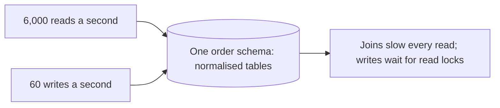
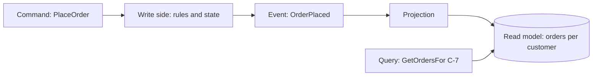

# CQRS: Separate Models for Writing and Reading

**Microservices · CQRS and event sourcing · Step 4.9.2 · Fundamentals** · Last updated 2026-10-23
**Prerequisites:** [CQRS and event sourcing: the big picture](01-cqrs-es-overview.md) (4.9.1); helpful: [Caching](../../14-system-design/06-caching.md) (14.6) and [Consistency, CAP, PACELC and quorums](../../14-system-design/10-consistency-cap-pacelc-quorums.md) (14.10)

**Version note**

| Item | Version |
|---|---|
| Baseline | CQRS as described by Greg Young and Martin Fowler, and in the Azure Architecture Center |
| Hands-on baseline | Java 21 (OpenJDK 21.0.8), plain JDK; pattern matching for `switch` on records, run on 2026-10-23 |
| Compatibility note | The read/write split here uses no event sourcing: the write side keeps current state, and events are only the messages that update the read side |

## 1. What it is and why it matters

**What is it?** CQRS splits an application's model into two:
- the **write side** receives **commands** ("place order", "cancel order"), enforces the business rules and changes state;
- the **read side** answers **queries** from models shaped for the screens and reports that need them.

Commands carry intent and can be rejected. Queries never change data and carry no business rules. The Azure Architecture Center: "Commands update data. Queries retrieve data" and queries "return data transfer objects (DTOs) that present the required data in a convenient format, without any domain logic."

**Why do we need it?** In one model the same tables serve everything: rules that need strict, narrow, normalised writes, and screens that want wide, joined, summarised data. Optimising one hurts the other. Separate models let each be simple and fast, and let the read side scale on its own.

**When would I meet it?** Pages that are much busier than the updates behind them (order history, product pages, dashboards); domains where writes are rule-heavy; teams that want to give a mobile app and a back office different views of the same facts.

> [!TIP]
> **Memory hook:** *write to the system of record through the front office with all its rules; read from the display board that is updated afterwards.*

## 2. Mental model: the kitchen and the order board

In a restaurant, orders go to the **kitchen**, where the chef applies the rules: is it in stock, can this be cooked, can this order be changed now? The kitchen decides. Meanwhile an **order board** shows each table what is cooking, in a form that is easy to read, and is updated when something changes. The board is never asked to decide anything; sometimes it is a few seconds behind the kitchen.

| In the analogy | In the real system |
|---|---|
| Handing in an order | A command |
| The kitchen | The write side (rules, state) |
| The order board | The read model |
| Updating the board | Projecting events to the read side |
| The board a few seconds behind | Eventual consistency |

**Where the analogy breaks:** a board is read by people who know it may lag; software users may take the lagging screen as the truth and act on it, so the design must handle that (examples below).

## 3. Industry terms

| Term | Simple meaning | Why it matters | Example | Related terms |
|---|---|---|---|---|
| **Command** | A named intent to change something; returns success or failure, not data | Carries the business meaning | `CancelOrder O-1001` | Request, task |
| **Query** | A request for data; no side effects | Can be cached, scaled and optimised freely | `GetOrdersFor(C-7)` | Read request |
| **Command-Query Separation (CQS)** | A method either changes state or returns data, never both | The principle CQRS lifts to the model level | A getter that does not modify | Meyer's principle |
| **Write model** | The model used to validate and apply commands | Holds the rules | An `Order` aggregate | Aggregate |
| **Read model** | A denormalised model built for queries | Fast, simple reads | `OrdersByCustomer` | Projection, view |
| **Projection** | The process that updates a read model from events or changes | Keeps the two sides in step | A handler on `OrderPlaced` | Denormaliser |
| **Eventual consistency** | The read side catches up after a delay | The cost of separation | A new order missing for 200 ms | [14.10](../../14-system-design/10-consistency-cap-pacelc-quorums.md) |
| **Read your writes** | A client sees its own change in the next read | Avoids "my order vanished" | Wait for the position | Session consistency |
| **DTO** | A plain data object returned by a query | No logic, just shape | `OrderSummaryDto` | View model |

## 4. In a real system (ShopFlow)

**The business problem.** At peak, `order-service` handles about 60 order changes a second but about 6,000 reads a second (order history, "where is my parcel", the app's home screen). The single model forces every read through the write schema's joins, and the database is the bottleneck for both.



**How CQRS helps.** Commands go to a write side that keeps the rules and the current state. Every change publishes an event; a projection updates a read model with exactly what the screens need ("orders per customer", already joined and formatted). Reads go to the read model, which is scaled separately.



**What it costs.** Two models to keep consistent; code to publish and project changes; messages that can fail, repeat or arrive late; a read side that is briefly stale; and more to test. The sizing arithmetic below shows what you may gain.

**Elsewhere:** a flight-search site writes bookings carefully and serves search from a denormalised index; a news site writes articles to a CMS and serves readers from a cache; a bank writes transfers to the ledger and serves the app's balance from a view.

## 5. How it works: levels of separation

CQRS comes in steps; take only as many as you need.

| Level | What is separate | Consistency | Typical use |
|---|---|---|---|
| 1. Logical | Different classes or services for commands and queries, one database | Immediate | Cleaner code; the simplest start |
| 2. Read tables | Dedicated read tables or views in the same database, updated in the same transaction | Immediate | Faster reads without a second store |
| 3. Separate store | A different database or index for reads, updated by events | **Eventual** | Independent scaling, different technology (search index, cache) |
| 4. Plus event sourcing | The write side stores events too | Eventual | History and rebuildable read models (next lessons) |

The Azure documentation describes the same two main approaches: "Separate models in a single data store" ("the foundational level of CQRS ... distinct logic for their operations") and separate stores kept in sync by events. The flow at level 3:

1. The client sends a **command**; the write side validates it against its rules and current state.
2. If accepted, it **changes state** and **publishes an event** describing the change, reliably (outbox, [4.8.5](../08-saga/05-reliable-messaging-outbox-inbox.md)).
3. The **projection** receives the event, updates the **read model**, and records how far it has got (its position).
4. A **query** reads the read model and returns a DTO.
5. A client that must see its own change **waits for the read model to reach the command's position**, or is shown the new data from the command's response.

### Worked example 1: commands, a lagging view, and read-your-writes

**Concept.** The program has a write side (rules, current state, an outbox of events) and a read side (a list of orders per customer, with the position of the last event applied). Delivery of events to the read side is separate and manual, so the lag is visible.

```java
// File: CqrsOrders.java (runnable, Java 21)
import java.util.ArrayDeque;
import java.util.ArrayList;
import java.util.HashMap;
import java.util.List;
import java.util.Locale;
import java.util.Map;
import java.util.Queue;

public class CqrsOrders {

    // ---- Events: facts published by the write side ----
    record OrderPlaced(long position, String orderId, String customerId, double total) {}

    record OrderShipped(long position, String orderId) {}

    record OrderCancelled(long position, String orderId) {}

    // ---- Write side: owns the rules and the current state of each order ----
    static class WriteSide {
        private final Map<String, String> status = new HashMap<>();
        private long position = 0;
        final Queue<Object> outbox = new ArrayDeque<>();      // events waiting to reach the read side

        long placeOrder(String orderId, String customerId, double total) {
            if (total <= 0) throw new IllegalArgumentException("total must be positive");
            if (status.containsKey(orderId)) throw new IllegalStateException("order " + orderId + " already exists");
            status.put(orderId, "PLACED");
            outbox.add(new OrderPlaced(++position, orderId, customerId, total));
            return position;                                     // the command returns only an acknowledgement
        }

        long shipOrder(String orderId) {
            if (!"PLACED".equals(status.get(orderId))) throw new IllegalStateException("cannot ship order " + orderId + " in status " + status.get(orderId));
            status.put(orderId, "SHIPPED");
            outbox.add(new OrderShipped(++position, orderId));
            return position;
        }

        long cancelOrder(String orderId) {
            if (!"PLACED".equals(status.get(orderId))) throw new IllegalStateException("cannot cancel order " + orderId + " in status " + status.get(orderId));
            status.put(orderId, "CANCELLED");
            outbox.add(new OrderCancelled(++position, orderId));
            return position;
        }
    }

    // ---- Read side: a denormalised list per customer, no business rules ----
    static class ReadSide {
        record Row(String orderId, String status, double total) {}

        private final Map<String, List<Row>> byCustomer = new HashMap<>();
        private final Map<String, String> customerOf = new HashMap<>();
        long position = 0;                                       // the last event this view has applied

        void apply(Object event) {
            switch (event) {
                case OrderPlaced e -> {
                    customerOf.put(e.orderId(), e.customerId());
                    byCustomer.computeIfAbsent(e.customerId(), k -> new ArrayList<>()).add(new Row(e.orderId(), "PLACED", e.total()));
                    position = e.position();
                }
                case OrderShipped e -> {
                    setStatus(e.orderId(), "SHIPPED");
                    position = e.position();
                }
                case OrderCancelled e -> {
                    setStatus(e.orderId(), "CANCELLED");
                    position = e.position();
                }
                default -> throw new IllegalArgumentException("unknown event " + event);
            }
        }

        private void setStatus(String orderId, String status) {
            List<Row> rows = byCustomer.get(customerOf.get(orderId));
            for (int i = 0; i < rows.size(); i++) {
                if (rows.get(i).orderId().equals(orderId)) {
                    rows.set(i, new Row(orderId, status, rows.get(i).total()));
                }
            }
        }

        List<Row> query(String customerId) {
            return byCustomer.getOrDefault(customerId, List.of());
        }
    }

    // Delivers up to n waiting events to the read side (a stand-in for a broker and a projector).
    static void deliver(WriteSide write, ReadSide read, int n) {
        for (int i = 0; i < n && !write.outbox.isEmpty(); i++) {
            read.apply(write.outbox.poll());
        }
    }

    static String show(List<ReadSide.Row> rows) {
        return rows.isEmpty() ? "(nothing)" : rows.stream().map(r -> String.format(Locale.ROOT, "%s %s %.2f", r.orderId(), r.status(), r.total())).toList().toString();
    }

    public static void main(String[] args) {
        WriteSide write = new WriteSide();
        ReadSide read = new ReadSide();

        System.out.println("1. a query right after a command can be stale");
        long p = write.placeOrder("O-1001", "C-7", 90.00);
        System.out.println("   command PlaceOrder acknowledged at position " + p);
        System.out.println("   query before delivery:  " + show(read.query("C-7")));
        deliver(write, read, 10);
        System.out.println("   query after delivery:   " + show(read.query("C-7")));
        System.out.println();

        System.out.println("2. read your own writes: wait until the read side has reached the command's position");
        long p2 = write.placeOrder("O-1002", "C-7", 40.00);
        System.out.println("   view position " + read.position + ", command position " + p2 + ": not ready, wait");
        deliver(write, read, 1);
        System.out.println("   view position " + read.position + ", command position " + p2 + ": ready");
        System.out.println("   query:                  " + show(read.query("C-7")));
        System.out.println();

        System.out.println("3. the rules live on the write side, not in the view");
        write.shipOrder("O-1001");                                 // not delivered to the read side yet
        System.out.println("   stale view still says: " + show(read.query("C-7")) + "  (a 'Cancel' button would still be shown for O-1001)");
        try {
            write.cancelOrder("O-1001");
        } catch (IllegalStateException e) {
            System.out.println("   command CancelOrder O-1001 rejected by the write side: " + e.getMessage());
        }
        deliver(write, read, 10);
        System.out.println("   view after delivery:    " + show(read.query("C-7")));
    }
}
```

**Expected output**:

```text
1. a query right after a command can be stale
   command PlaceOrder acknowledged at position 1
   query before delivery:  (nothing)
   query after delivery:   [O-1001 PLACED 90.00]

2. read your own writes: wait until the read side has reached the command's position
   view position 1, command position 2: not ready, wait
   view position 2, command position 2: ready
   query:                  [O-1001 PLACED 90.00, O-1002 PLACED 40.00]

3. the rules live on the write side, not in the view
   stale view still says: [O-1001 PLACED 90.00, O-1002 PLACED 40.00]  (a 'Cancel' button would still be shown for O-1001)
   command CancelOrder O-1001 rejected by the write side: cannot cancel order O-1001 in status SHIPPED
   view after delivery:    [O-1001 SHIPPED 90.00, O-1002 PLACED 40.00]
```

**Walkthrough.**

| Part | What it shows |
|---|---|
| 1 | After `PlaceOrder` is acknowledged (position 1), a query returns nothing: the view has not received the event. After delivery it shows the order. This gap is eventual consistency |
| 2 | The second command returns position 2. The view is at position 1, so the client waits; after delivering one more event the view is at position 2 and the query includes `O-1002`. **Read your writes** is a comparison of two numbers |
| 3 | The order has been shipped on the write side, but the view has not caught up and still offers the order as `PLACED`. The cancel command is rejected by the **write side**, whose rules are authoritative. The view is only a hint |

Note the roles: commands return only an acknowledgement (here the position); the read side contains no rules; and the only data that crosses from write to read is the events.

**Experiment.** Add a `GetOrdersFor` query for a customer with no orders, and a second customer `C-9` with one order. Predict the results before and after delivery. The result is in Answers.

**Real-world example.** After checkout, ShopFlow's page shows the confirmation from the command's response (the order id and total), and the "My orders" list from the read model, polling or waiting until it includes that order id.

### Worked example 2: why separate the scaling

**Concept.** The two sides have very different loads and costs per request. Separating them lets each be sized for its own load. The numbers are assumed for illustration; measure your own.

```java
// File: ReadWriteScaling.java (runnable, Java 21)
public class ReadWriteScaling {

    static int instances(double requestsPerSecond, double capacityPerInstance, int minimumForAvailability) {
        return Math.max(minimumForAvailability, (int) Math.ceil(requestsPerSecond / capacityPerInstance));
    }

    public static void main(String[] args) {
        // Illustrative numbers for ShopFlow's order service at peak.
        double readsPerSecond = 6_000;        // order history, order status, "where is my parcel"
        double writesPerSecond = 60;          // place, pay, ship, cancel
        double readCapacity = 600;            // one instance serving a denormalised read model from memory or a cache
        double writeCapacity = 100;           // one instance validating rules and appending to a store
        double sharedCapacity = 150;          // one instance that does both with the joins of a single model

        int together = instances(readsPerSecond + writesPerSecond, sharedCapacity, 2);
        int readSide = instances(readsPerSecond, readCapacity, 2);
        int writeSide = instances(writesPerSecond, writeCapacity, 2);

        System.out.println("one model, one deployment:   " + together + " instances (each handles reads and writes)");
        System.out.println("CQRS, scaled separately:     " + readSide + " read instances + " + writeSide + " write instances = " + (readSide + writeSide));
        System.out.println("read to write ratio:         " + (int) (readsPerSecond / writesPerSecond) + " to 1");
    }
}
```

**Expected output**:

```text
one model, one deployment:   41 instances (each handles reads and writes)
CQRS, scaled separately:     10 read instances + 2 write instances = 12
read to write ratio:         100 to 1
```

**Walkthrough.** With 6,000 reads and 60 writes a second, one shared deployment that handles both with joins (assumed 150 requests a second per instance) needs 41 instances. Split, the read side serves from a denormalised model at an assumed 600 a second per instance (10 instances) and the write side needs only 2 for availability: 12 in total. The ratio, 100 reads for each write, is what makes it worthwhile; at a ratio near 1 to 1 the saving would be small and the added complexity not justified.

### Common mistakes

1. **Business rules in the read model** or the UI: a stale view lets a user attempt something the write side then refuses; the write side must always check.
2. **Commands that return data** or queries that change state (including "get next number" calls): it breaks the separation and the caching of queries.
3. **Forgetting read-your-writes**, so users see their change missing.
4. **A shared database user and schema** for both sides, which keeps the coupling.
5. **Updating the read side with a dual write** (save, then publish) instead of an outbox.
6. **CQRS for everything**, including data that is simple CRUD.

## 6. Failure scenarios

### My order disappeared

1. **What happened?** The customer placed an order, was redirected to "My orders", and saw an empty list (part 1 of the program).
2. **Why?** The read side was a few hundred milliseconds behind.
3. **What did users see?** A double order and a support ticket.
4. **Solutions:** return the created order in the command response and show it locally; or carry the command's position and have the query wait for it; or show "processing".
5. **What they cost:** a position in the API and a short wait or an optimistic UI.

### The button that lied

1. **What happened?** The "Cancel" button was shown for an order that had already shipped (part 3).
2. **Why?** The view was stale, and the UI trusted it.
3. **What did users see?** An error after clicking.
4. **Solutions:** keep rules on the write side and show its clear error; refresh the view; optionally include a "version" in the read data and send it with the command so the server can say "this changed, please refresh".
5. **What they cost:** a version field and an error path.

### The lost update to the view

1. **What happened?** The write succeeded, but the event was never published (a crash between the database commit and the broker call). The view was permanently wrong.
2. **Why?** A dual write.
3. **What did users see?** An order that never appeared in their list.
4. **Solutions:** the transactional outbox ([4.8.5](../08-saga/05-reliable-messaging-outbox-inbox.md)); a way to rebuild the view from the source of truth.
5. **What they cost:** an outbox and a rebuild procedure (which event sourcing gives for free: [4.9.3](03-event-sourcing.md)).

## 7. Architectural decisions

| Decision | Choose | Because |
|---|---|---|
| Level of separation | The lowest that solves the problem: logical (1), read tables (2), then a separate store (3) | Each step adds consistency and operations cost |
| Read store technology | Whatever suits the query: a relational table, a search index, a cache | The point of separating is to choose freely |
| Consistency per screen | Immediate where the user just acted (use the response or wait for the position), eventual elsewhere | Matches what users notice |
| Where rules live | Only on the write side; the read side filters and formats | One source of truth |
| How the read side learns of changes | Events through an outbox; idempotent projection | Reliable and repeatable ([4.9.4](04-projections-read-models.md)) |
| When not to | Simple CRUD, low read load, reference data | Fowler: "for most systems CQRS adds risky complexity" |

### Alternatives in the industry

A map of the landscape, not a comparison. None of these were run in this lesson; check each project's documentation before adopting one.

| Area | Tool or product | What it is | When you meet it |
|---|---|---|---|
| Command and query handlers | **MediatR** (.NET), **Axon Framework** (Java), plain Spring services with separate command and query classes | Libraries or conventions that route commands and queries to handlers | Teams that want a structure for the split |
| Feeding the read side | **Debezium** and Kafka Connect (change data capture), the transactional outbox ([4.8.5](../08-saga/05-reliable-messaging-outbox-inbox.md)), database triggers | Move changes from the write store to the read store | Level 3 |
| Read stores | **PostgreSQL** tables and materialised views, **Elasticsearch / OpenSearch**, **Redis**, **MongoDB**, **DynamoDB** | Stores shaped for queries | Search-heavy and high-read systems |
| Simpler alternatives | **Read replicas**, **caching** ([14.6](../../14-system-design/06-caching.md)), **database views** | Scale reads without a second model | When reads are the only problem |

## 8. Try it yourself

Try each exercise first; the real results are in the Answers section.

1. **A second customer.** Add a second customer `C-9` with one order. What does a query for `C-9` return before and after delivery, and what for a customer with no orders?
2. **Wait for the position.** Write the query-side rule in words: when may a client that has just sent a command read the view?
3. **Stale rules.** Why is "hide the Cancel button when the order is shipped" a hint rather than a rule?

## 9. Check your understanding

1. What is the difference between CQS and CQRS?
2. Why does a command not return the updated data?
3. List two ways to make a user see their own change after a command.
4. When is a shared database with separate read tables (level 2) enough?

Answers are at the end of this note.

## 10. Revision

**Remember**
- **Commands** change state, may be rejected, return an acknowledgement; **queries** never change anything and return DTOs.
- Write side = **rules and state**; read side = **shaped data**, no rules.
- Levels: logical → read tables (same transaction) → separate store (**eventual**) → plus event sourcing.
- Handle staleness: use the command's response, or wait for the **position**; the write side is always authoritative.
- Update the read side with an **outbox**, not a dual write; make the projection idempotent.
- Worth it when reads and writes differ in shape or load.

**Explain in 15 seconds:** "CQRS uses one model to validate and apply commands and separate, query-shaped models to serve reads, kept in step with events, so each side can be simple and scale on its own, at the cost of eventual consistency."

**Explain in 60 seconds:**
> "In CQRS, commands go to a write side that owns the business rules and state and rejects invalid requests, while queries go to read models that are denormalised for exactly what the screens need and contain no rules. Every accepted change publishes an event, reliably through an outbox, and a projection updates the read model and remembers its position. That lets me scale the read side, which is often a hundred times busier, separately, and pick the store that suits each query. The read side is briefly behind, so I give users read-your-writes by returning the new data from the command or by waiting until the view reaches the command's position, and I never put rules in the view, because the write side is authoritative. I start at the lowest level of separation that solves the problem and only use it where read and write needs really differ."

**Architect's takeaway:** CQRS moves complexity from "one model that does everything badly" to "two simple models plus a pipeline between them". It is a good trade only if the pipeline's costs (lag, reliability, operations) are smaller than the gain.

**Next topic:** [Event sourcing: state as a sequence of events](03-event-sourcing.md) (4.9.3)

## 11. Verification and sources

> [!NOTE]
> Checked 2026-10-23 against the sources below, and by compiling and running the Java examples on OpenJDK 21.0.8. Re-verify when you revisit this note.

- **Confirmed (documentation, read 2026-10-23):** "Commands update data. Queries retrieve data"; commands "should represent specific business tasks instead of low-level data updates"; "Queries never alter data ... they return data transfer objects (DTOs) ... without any domain logic"; the two approaches "Separate models in a single data store" and separate stores; the read model "is eventually consistent with the write model"; CQRS is "especially beneficial when the number of reads is greater than the number of writes"; and it "might not be suitable when the domain or the business rules are simple" (Microsoft Learn, "CQRS pattern"); "you can use a different model to update information than the model you use to read information ... for most systems CQRS adds risky complexity" (Martin Fowler, "CQRS").
- **Observed (this machine):** the output of the Java programs and exercise variants.
- **Assumptions and illustrations:** the capacities in the scaling example (150, 600 and 100 requests a second per instance) are assumed to show the shape of the argument, not measured; real gains depend on the workload. The in-memory outbox and manual delivery stand in for a broker and a projector.
- **To verify:** the real read to write ratio of your services; how stale a view your screens can tolerate; whether a read replica or a cache would already solve the read load.
- **Decision rule:** the lowest level of separation that solves the problem; rules only on the write side; read-your-writes where users just acted; outbox between the sides.

**Sources:** Microsoft Learn, Azure Architecture Center, "CQRS pattern"; Martin Fowler, "CQRS"; Chris Richardson, microservices.io, "Pattern: CQRS" (cited as further reading; not re-read for this note).

## Answers

**Experiment (exercises)**

1. **A second customer:** a query for `C-9` returns `(nothing)` before delivery and its single order after; a customer with no orders always gets `(nothing)` (an empty list is a normal answer, not an error). Each customer's list is separate because the view is keyed by customer. With the extra lines added to `main` the program prints:

```text
before delivery: C-7 (nothing), C-9 (nothing), C-11 (nothing)
after delivery:  C-7 [O-1001 PLACED 90.00], C-9 [O-2001 PLACED 25.00], C-11 (nothing)
```

2. **Wait for the position:** a client that has just sent a command and received position *p* may read the view when the view's position is at least *p* (otherwise wait briefly, or show the data from the command's response). Clients that did not just write can read at once.
3. **Stale rules:** because the view may be behind the write side, the button can be shown for an order that has already shipped; only the write side knows the current state, so it must check the rule on every command and return a clear refusal, which the UI then explains.

**Check your understanding**

1. CQS is a method-level rule: a method either changes state or returns a value, not both. CQRS applies the idea to the whole model: separate models (and often stores) for commands and for queries.
2. A command's job is to change state and report success or failure; returning data would blur the roles and tempt the client to treat the write model as a query model. The client reads through a query, or uses the acknowledgement (position, id) to find the result.
3. Return the created data in the command's response and show it directly; or wait for the read model to reach the command's position before querying; or show a pending state and refresh.
4. When the read load is not the main problem but the model is awkward: dedicated read tables or views in the same database, updated in the same transaction, give simpler queries with immediate consistency and no second store to operate.

Back to [the series overview](01-cqrs-es-overview.md) · [the Microservices overview](../01-microservices-overview.md) · [the index](../../README.md) · [Roadmap](../../roadmap.md).
