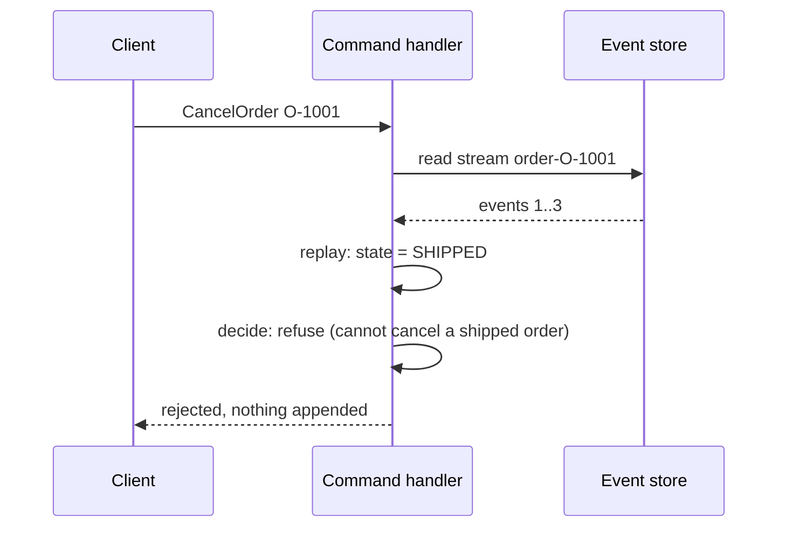
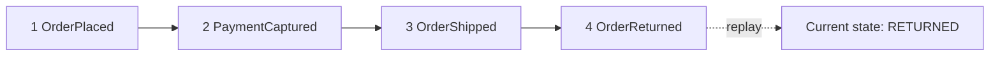

# Event Sourcing: State as a Sequence of Events

**Microservices · CQRS and event sourcing · Step 4.9.3 · Intermediate** · Last updated 2026-10-23
**Prerequisites:** [CQRS: separate models for writing and reading](02-cqrs-separate-models.md) (4.9.2); helpful: [Idempotency](../../01-resilience/04-idempotency.md) (1.4)

**Version note**

| Item | Version |
|---|---|
| Baseline | Event sourcing as described by Martin Fowler (2005) and the Azure Architecture Center |
| Hands-on baseline | Java 21 (OpenJDK 21.0.8), plain JDK: sealed interfaces, records and pattern-matching `switch` (all final in Java 21), run on 2026-10-23 |
| Compatibility note | The exact text format of a record's `toString` is not specified, so the programs print events with their own formatting |

## 1. What it is and why it matters

**What is it?** In **event sourcing** the system of record is the **sequence of events** that happened to each thing (an order, an account), not its current state. The current state is *derived*: start from nothing and apply the events in order. Fowler: "Event Sourcing ensures that all changes to application state are stored as a sequence of events. Not just can we query these events, we can also use the event log to reconstruct past states."

**Why do we need it?** Because "how did we get here?" is often as valuable as "where are we?". You get a complete audit trail for free, you can rebuild the state at any past point, you can build new read models from history, and writes become simple appends with no update contention. The Azure guidance names the CRUD weaknesses it addresses: "write contention" from read-modify-write cycles and "auditability" lost when only the latest state is stored.

**When would I meet it?** Ledgers and payments, order and booking lifecycles, trading, anything with regulation or disputes, and domain-driven designs where the language is about things that happen.

> [!TIP]
> **Memory hook:** *keep the commits, not just the files: the working copy is whatever the commits add up to.*

## 2. Mental model: a Git repository

In Git, you never edit history: you add commits. The files you see are the result of applying all commits. You can check out an earlier commit to see the past, and tools build different views (blame, statistics) from the same history. Fowler uses version control as the standard example of event sourcing.

| In the analogy | In the real system |
|---|---|
| A commit | An event |
| The branch's history | The event stream of one aggregate |
| The files you see | The current state, derived by replay |
| Checking out an old commit | A temporal query: replay up to a version |
| A push rejected because the branch moved | An append rejected because the expected version is wrong |
| Blame, statistics | Projections |

**Where the analogy breaks:** Git can merge divergent histories; an event stream has one linear order per aggregate and conflicts are rejected, not merged.

## 3. Industry terms

| Term | Simple meaning | Why it matters | Example | Related terms |
|---|---|---|---|---|
| **Event** | An immutable fact in the past tense, with only the data of that fact | The unit of storage | `PaymentCaptured(amount 90.00)` | Domain event |
| **Event stream** | The ordered events of one entity | Its complete history | `order-O-1001` | Aggregate |
| **Event store** | An append-only store of streams | The system of record | A table or a dedicated database | Event log |
| **Aggregate** | The unit of consistency whose rules are checked against its own events | Defines stream boundaries | One `Order` | DDD |
| **Evolve / apply** | A pure function that applies one event to a state | Rebuilds state; contains no rules | `evolve(state, event)` | Fold, reducer |
| **Decide** | A function that checks a command against the state and returns new events | Holds the business rules | `decide(state, command)` | Command handler |
| **Rehydration / replay** | Rebuilding the state by applying the stream | Replaces "load the row" | `replay(events)` | Fold |
| **Expected version** | The stream version the writer saw; the append fails if it has moved | Optimistic concurrency | `append(stream, 2, events)` | Optimistic lock |
| **Temporal query** | The state at a past version or time | Audit, debugging, disputes | State at version 2 | Time travel |
| **Event metadata** | Event id, type, time, correlation and causation ids, user | Tracing and ordering | `correlationId` | Envelope |

## 4. In a real system (ShopFlow)

**The business problem.** An order's life has rules: payment must be captured before shipping, a shipped order cannot be cancelled, a returned order cannot be shipped again. Disputes arrive weeks later ("I cancelled it before it shipped") and today nobody can prove the order of events. The current design overwrites one row.

**How event sourcing helps.** Each command is checked against the order rebuilt from its events; accepted commands append new events; the stream is the proof.





**What it costs.** You must think in events and design them well; reading "current state" means replaying or maintaining projections ([4.9.4](04-projections-read-models.md)); events are forever, so their shape must be versioned ([4.9.5](05-snapshots-versioning-privacy.md)); querying across streams ("all unpaid orders") needs read models; and the team needs new skills for testing and operating.

**Elsewhere:** accounting (the ledger is the book of record and the balance is derived), healthcare records (every change kept with who and when), games and collaborative editors (an operation log), and version control.

## 5. How it works

1. **Name the events** from the domain: facts that happened (`OrderPlaced`, `PaymentCaptured`, `OrderShipped`, `OrderCancelled`).
2. **Load:** read the aggregate's stream and **replay** it with `evolve` to get the current state and the **version** (the number of events).
3. **Decide:** `decide(state, command)` checks the business rules. If the command is not allowed, nothing is stored. Otherwise it returns the new events.
4. **Append:** the events are appended with the **expected version** (the version you loaded). If someone else appended meanwhile, the append is rejected; reload and decide again.
5. **Publish:** the stored events are made available to projections and other consumers (reliably: [4.8.5](../08-saga/05-reliable-messaging-outbox-inbox.md)).
6. **Read:** queries use projections; the stream is for the command side, audit and rebuilding.

### Worked example 1: the order as events

**Concept.** The program has the five parts of event sourcing: events (a sealed interface of records), commands, `evolve` (a pure fold of events into state), `decide` (the rules), and an event store with an expected version. Four scenarios.

```java
// File: EventSourcedOrder.java (runnable, Java 21)
import java.util.ArrayList;
import java.util.HashMap;
import java.util.List;
import java.util.Locale;
import java.util.Map;

public class EventSourcedOrder {

    // ---- Events: immutable facts, named in the past tense ----
    sealed interface OrderEvent permits OrderPlaced, PaymentCaptured, OrderShipped, OrderCancelled {}

    record OrderPlaced(String orderId, String customerId, double total) implements OrderEvent {}

    record PaymentCaptured(String orderId, double amount) implements OrderEvent {}

    record OrderShipped(String orderId) implements OrderEvent {}

    record OrderCancelled(String orderId, String reason) implements OrderEvent {}

    // ---- Commands: intents ----
    sealed interface Command permits PlaceOrder, CapturePayment, ShipOrder, CancelOrder {}

    record PlaceOrder(String orderId, String customerId, double total) implements Command {}

    record CapturePayment(String orderId, double amount) implements Command {}

    record ShipOrder(String orderId) implements Command {}

    record CancelOrder(String orderId, String reason) implements Command {}

    // ---- State: never stored, always derived from events ----
    record OrderState(boolean exists, String status, double total, double paid) {
        static final OrderState EMPTY = new OrderState(false, "NONE", 0, 0);
    }

    // evolve: how one event changes the state. A pure function, no rules and no side effects.
    static OrderState evolve(OrderState s, OrderEvent e) {
        return switch (e) {
            case OrderPlaced p -> new OrderState(true, "PLACED", p.total(), 0);
            case PaymentCaptured c -> new OrderState(true, s.status(), s.total(), s.paid() + c.amount());
            case OrderShipped x -> new OrderState(true, "SHIPPED", s.total(), s.paid());
            case OrderCancelled x -> new OrderState(true, "CANCELLED", s.total(), s.paid());
        };
    }

    static OrderState replay(List<OrderEvent> events) {
        OrderState state = OrderState.EMPTY;
        for (OrderEvent e : events) {
            state = evolve(state, e);
        }
        return state;
    }

    // decide: the business rules. Given the current state and a command, return the new events or refuse.
    static List<OrderEvent> decide(OrderState s, Command c) {
        return switch (c) {
            case PlaceOrder p -> {
                if (s.exists()) throw new IllegalStateException("order already exists");
                yield List.of(new OrderPlaced(p.orderId(), p.customerId(), p.total()));
            }
            case CapturePayment p -> {
                if (!s.status().equals("PLACED")) throw new IllegalStateException("cannot capture payment in status " + s.status());
                yield List.of(new PaymentCaptured(p.orderId(), p.amount()));
            }
            case ShipOrder x -> {
                if (!s.status().equals("PLACED") || s.paid() < s.total()) throw new IllegalStateException("cannot ship: status " + s.status() + ", paid " + s.paid() + " of " + s.total());
                yield List.of(new OrderShipped(x.orderId()));
            }
            case CancelOrder x -> {
                if (!s.status().equals("PLACED")) throw new IllegalStateException("cannot cancel an order in status " + s.status());
                yield List.of(new OrderCancelled(x.orderId(), x.reason()));
            }
        };
    }

    // ---- The event store: an append-only list per stream, with optimistic concurrency ----
    static class ConcurrencyException extends RuntimeException {
        ConcurrencyException(String message) {
            super(message);
        }
    }

    static class EventStore {
        private final Map<String, List<OrderEvent>> streams = new HashMap<>();

        List<OrderEvent> read(String streamId) {
            return List.copyOf(streams.getOrDefault(streamId, List.of()));
        }

        void append(String streamId, int expectedVersion, List<OrderEvent> events) {
            List<OrderEvent> stream = streams.computeIfAbsent(streamId, k -> new ArrayList<>());
            if (stream.size() != expectedVersion) {
                throw new ConcurrencyException("expected version " + expectedVersion + " but the stream is at " + stream.size());
            }
            stream.addAll(events);
        }
    }

    // The command handler: load (replay), decide, append with the expected version.
    static void handle(EventStore store, String streamId, Command command) {
        List<OrderEvent> history = store.read(streamId);
        List<OrderEvent> newEvents = decide(replay(history), command);
        store.append(streamId, history.size(), newEvents);
        for (int i = 0; i < newEvents.size(); i++) {
            System.out.println("   appended v" + (history.size() + i + 1) + ": " + show(newEvents.get(i)));
        }
    }

    // Our own text format: the exact format of a record's toString is not specified, so we do not print it.
    static String show(OrderEvent e) {
        return switch (e) {
            case OrderPlaced p -> String.format(Locale.ROOT, "OrderPlaced(customer %s, total %.2f)", p.customerId(), p.total());
            case PaymentCaptured c -> String.format(Locale.ROOT, "PaymentCaptured(amount %.2f)", c.amount());
            case OrderShipped x -> "OrderShipped";
            case OrderCancelled x -> "OrderCancelled(reason \"" + x.reason() + "\")";
        };
    }

    static String describe(OrderState s) {
        return String.format(Locale.ROOT, "status=%s total=%.2f paid=%.2f", s.status(), s.total(), s.paid());
    }

    public static void main(String[] args) {
        EventStore store = new EventStore();
        String stream = "order-O-1001";

        System.out.println("1. commands become events");
        handle(store, stream, new PlaceOrder("O-1001", "C-7", 90.00));
        handle(store, stream, new CapturePayment("O-1001", 90.00));
        handle(store, stream, new ShipOrder("O-1001"));
        System.out.println("   state, derived from " + store.read(stream).size() + " events: " + describe(replay(store.read(stream))));
        System.out.println();

        System.out.println("2. a rule refuses a command: no event is appended");
        try {
            handle(store, stream, new CancelOrder("O-1001", "changed my mind"));
        } catch (IllegalStateException e) {
            System.out.println("   refused: " + e.getMessage() + "; the stream still has " + store.read(stream).size() + " events");
        }
        System.out.println();

        System.out.println("3. the past is available: replay only the first events");
        for (int version = 1; version <= store.read(stream).size(); version++) {
            System.out.println("   at version " + version + ": " + describe(replay(store.read(stream).subList(0, version))));
        }
        System.out.println();

        System.out.println("4. two writers, one stream: the expected version catches the conflict");
        EventStore shared = new EventStore();
        handle(shared, "order-O-2002", new PlaceOrder("O-2002", "C-9", 40.00));
        List<OrderEvent> readByA = shared.read("order-O-2002");        // writer A loads version 1
        List<OrderEvent> readByB = shared.read("order-O-2002");        // writer B loads version 1 too
        shared.append("order-O-2002", readByA.size(), decide(replay(readByA), new CancelOrder("O-2002", "writer A cancels")));
        System.out.println("   writer A appended OrderCancelled at version 2");
        try {
            shared.append("order-O-2002", readByB.size(), decide(replay(readByB), new CapturePayment("O-2002", 40.00)));
        } catch (ConcurrencyException e) {
            System.out.println("   writer B rejected: " + e.getMessage());
        }
        try {
            handle(shared, "order-O-2002", new CapturePayment("O-2002", 40.00));      // B retries: reload, decide again
        } catch (IllegalStateException e) {
            System.out.println("   writer B retried with fresh state and the rule refused: " + e.getMessage());
        }
    }
}
```

**Expected output**:

```text
1. commands become events
   appended v1: OrderPlaced(customer C-7, total 90.00)
   appended v2: PaymentCaptured(amount 90.00)
   appended v3: OrderShipped
   state, derived from 3 events: status=SHIPPED total=90.00 paid=90.00

2. a rule refuses a command: no event is appended
   refused: cannot cancel an order in status SHIPPED; the stream still has 3 events

3. the past is available: replay only the first events
   at version 1: status=PLACED total=90.00 paid=0.00
   at version 2: status=PLACED total=90.00 paid=90.00
   at version 3: status=SHIPPED total=90.00 paid=90.00

4. two writers, one stream: the expected version catches the conflict
   appended v1: OrderPlaced(customer C-9, total 40.00)
   writer A appended OrderCancelled at version 2
   writer B rejected: expected version 1 but the stream is at 2
   writer B retried with fresh state and the rule refused: cannot capture payment in status CANCELLED
```

**Walkthrough.**

| Scenario | What happens | Point |
|---|---|---|
| 1 | Three commands become `OrderPlaced`, `PaymentCaptured`, `OrderShipped` at versions 1 to 3; the state `SHIPPED, paid 90.00` is computed from them, not stored | State is derived |
| 2 | `CancelOrder` on a shipped order is refused by `decide`; the stream still has 3 events | Rules run before anything is stored; rejected commands leave no trace in the store |
| 3 | Replaying 1, 2 and 3 events gives `PLACED/unpaid`, `PLACED/paid`, `SHIPPED/paid` | A temporal query is just a shorter replay |
| 4 | Writers A and B both loaded version 1; A appended `OrderCancelled` at version 2; B's append (expected version 1) was rejected; B retried with fresh state and `decide` then refused its capture | Optimistic concurrency stops two writers deciding on the same stale state |

Note the discipline: `evolve` has no `if` for business rules, because events are facts that already happened and must always be applicable. The rules live only in `decide`.

**Experiment.** Add an `OrderReturned` event, a `ReturnOrder` command that is allowed only after shipping, and the status `RETURNED`. Run: place, pay, return (refused), ship, return, cancel (refused). The result is in Answers.

**Real-world example.** ShopFlow's `payment-service` keeps an event-sourced `Account`: `Deposited`, `Withdrawn`, `FeeCharged`. The balance shown to the customer is a projection; the stream is what the auditor reads.

### Worked example 2: a side effect inside replay (mistake and fix)

**Concept.** Replay happens on every command, in tests, and when rebuilding. If `evolve` does anything but compute state, those effects repeat.

```java
// File: ReplayWithSideEffects.java (runnable, Java 21)
import java.util.List;

public class ReplayWithSideEffects {

    record Event(String type) {}

    static int emailsSent = 0;

    // Wrong: the function that rebuilds state also sends an email when it sees OrderShipped.
    static String evolveWithSideEffect(String status, Event e) {
        if (e.type().equals("OrderShipped")) {
            emailsSent++;                                   // a side effect inside replay
            return "SHIPPED";
        }
        return e.type().equals("OrderPlaced") ? "PLACED" : status;
    }

    // Right: evolve only computes state. Emails are sent by a separate reaction to NEW events.
    static String evolve(String status, Event e) {
        if (e.type().equals("OrderShipped")) {
            return "SHIPPED";
        }
        return e.type().equals("OrderPlaced") ? "PLACED" : status;
    }

    public static void main(String[] args) {
        List<Event> history = List.of(new Event("OrderPlaced"), new Event("OrderShipped"));

        // Every command on this order replays the history. Three commands -> three replays.
        for (int command = 1; command <= 3; command++) {
            String status = "NONE";
            for (Event e : history) {
                status = evolveWithSideEffect(status, e);
            }
        }
        System.out.println("side effect inside replay:  3 commands sent " + emailsSent + " shipping emails (should be 1)");

        emailsSent = 0;
        for (int command = 1; command <= 3; command++) {
            String status = "NONE";
            for (Event e : history) {
                status = evolve(status, e);
            }
        }
        // The one email is sent when OrderShipped was first appended, by a handler that reacts to new events.
        emailsSent++;
        System.out.println("side effect after appending: 3 commands sent " + emailsSent + " shipping email");
    }
}
```

**Expected output**:

```text
side effect inside replay:  3 commands sent 3 shipping emails (should be 1)
side effect after appending: 3 commands sent 1 shipping email
```

**Walkthrough.** With the email sent inside the state function, three commands replay the history three times and send three emails for one shipment. The fix is to keep `evolve` pure and to react to *new* events: a separate handler sends the email when `OrderShipped` is first appended (and, being at-least-once, must itself be idempotent, [4.8.5](../08-saga/05-reliable-messaging-outbox-inbox.md)).

### Designing events

| Good | Poor | Why |
|---|---|---|
| `PaymentCaptured(amount)` | `OrderUpdated(full order)` | A fact with meaning versus a copy of a row |
| `ItemAdded(sku, quantity)` | `OrderChanged(field, old, new)` | Business language versus CRUD in disguise |
| `OrderShipped(carrier, trackingId)` | `StatusSet("SHIPPED")` | Carries what happened, not a state assignment |
| Past tense | Imperative (`ShipOrder`) | A command is a request; an event has happened |
| Small, with ids and the data of the fact | Huge, with everything "just in case" | Events live forever |

### Common mistakes

1. Events that mirror database updates instead of business facts.
2. Business rules or side effects in `evolve`.
3. Streams that grow without bound (model smaller aggregates; use snapshots, [4.9.5](05-snapshots-versioning-privacy.md)).
4. Editing or deleting stored events (corrections are new events).
5. Reading by replay for list screens that need many aggregates (build projections).
6. Skipping the expected version, so concurrent commands overwrite each other's decisions.

## 6. Failure scenarios

### The lost decision

1. **What happened?** Two clerks processed the same order at the same time: one cancelled it, one captured the payment. Both succeeded; the order was cancelled *and* charged.
2. **Why?** The append did not check the expected version, so both decisions used the same stale state.
3. **What did users and the business see?** A charged customer with a cancelled order.
4. **Solutions:** append with the expected version (scenario 4); on conflict reload and decide again, or return a clear error.
5. **What they cost:** a retry path and, for hot aggregates, some contention.

### The history that nobody can use

1. **What happened?** After a year the stream was full of `OrderUpdated` events with a JSON copy of the whole order.
2. **Why?** The old CRUD model was translated into events.
3. **What did the business see?** An audit trail that could not answer "who cancelled?" and projections that had to diff snapshots to guess the change.
4. **Solutions:** design events with domain experts as named facts; include who and why where they matter.
5. **What they cost:** modelling time upfront and a migration for existing data.

### The stream that took ten seconds to load

1. **What happened?** A long-lived `Customer` aggregate with 200,000 events was replayed on every command.
2. **Why?** The aggregate was too large and had no snapshots.
3. **What did users see?** Slow responses for the most active customers.
4. **Solutions:** smaller aggregates (one per order, not one per customer lifetime); snapshots ([4.9.5](05-snapshots-versioning-privacy.md)).
5. **What they cost:** modelling effort and snapshot handling.

## 7. Architectural decisions

| Decision | Choose | Because |
|---|---|---|
| What is an aggregate and a stream | The smallest unit whose rules must be consistent (an order, an account) | Short streams, little contention |
| Events | Named domain facts, past tense, small, with metadata (ids, time, user, correlation id) | Meaning, tracing, longevity |
| State | Derived by a pure `evolve`; rules only in `decide` | Replay always works |
| Concurrency | Expected version on every append | No lost decisions |
| Reads | Projections ([4.9.4](04-projections-read-models.md)), not replay, for lists and reports | Speed and tailored shape |
| Corrections | A new compensating or correcting event | Immutability and a true audit trail |
| When not to | Simple CRUD, short-lived or prototype systems, static reference data, teams new to event-driven design, screens that need immediate consistent views | Microsoft's "might not be suitable" list |

### Alternatives in the industry

A map of the landscape, not a comparison. None of these were run in this lesson; the descriptions of Marten and the Axon documentation were checked on their own sites on 2026-10-23, the rest is general industry knowledge, so check each project before adopting one.

| Area | Tool or product | What it is | When you meet it |
|---|---|---|---|
| Purpose-built event stores | **EventStoreDB** (now developed under the name Kurrent; check the current name), **Axon Server** | Databases designed for streams of events, with subscriptions | Systems where event sourcing is central |
| Event stores on a relational database | **Marten** (".NET Transactional Document DB and Event Store on PostgreSQL"), your own tables ([4.9.6](06-event-store-postgresql-integration.md)) | Event streams in PostgreSQL | Teams that already run PostgreSQL |
| Frameworks | **Axon Framework** (Java), **Akka Persistence** (JVM and .NET), **Eventuous** (.NET) | Aggregates, command handling, event stores and projections | Teams that want conventions and tooling |
| Event logs for integration | **Apache Kafka** and similar logs | Durable, ordered logs per partition. Usually used to publish events rather than as the aggregate's own store (no per-stream optimistic concurrency) | Integration of services |
| Lighter alternatives | An **audit table** or **change data capture**, **temporal tables** | History of changes without making events the source of truth | When you need an audit trail, not event sourcing |

## 8. Try it yourself

Try each exercise first; the real results are in the Answers section.

1. **Add a return.** Add `OrderReturned` as described in the experiment above and run the scenario.
2. **Time travel.** Using the first program, what was the order's `paid` amount at version 1, and why?
3. **Spot the bug.** A teammate writes `evolve` so that `OrderShipped` throws if the order was not paid. What goes wrong?

## 9. Check your understanding

1. Where does an event-sourced system keep the current state of an order?
2. Why must `evolve` never refuse an event?
3. What does the expected version protect against?
4. Why is `OrderUpdated` a poor event?

Answers are at the end of this note.

## 10. Revision

**Remember**
- State = **fold of events**; events are **immutable facts**; corrections are **new events**.
- `decide` holds the **rules**; `evolve` is **pure**.
- Append with the **expected version**; on conflict reload and decide again.
- Streams per **aggregate**, kept short; events named in **business language**.
- Reads come from **projections**; the stream serves commands, audit and rebuilds.

**Explain in 15 seconds:** "Event sourcing stores every change as an immutable event and derives the current state by replaying them, giving a full history and simple, conflict-checked appends at the cost of projections and event design."

**Explain in 60 seconds:**
> "In an event-sourced system the stream of events of each aggregate, such as an order, is the source of truth, and the state is whatever you get by folding the events with a pure apply function. A command handler loads the stream, replays it to the current state, runs the business rules in a decide function that either refuses or returns new events, and appends them with the version it read, so a concurrent writer is rejected and must retry with fresh state. Because events are immutable facts named in the business language, I get an audit trail, temporal queries by replaying fewer events, and the ability to build new read models from history. The costs: reads need projections, events must be versioned for years, streams must be kept small or snapshotted, and the team needs new habits. I avoid it for simple CRUD, reference data and teams new to events."

**Architect's takeaway:** event sourcing makes history the primary data. It repays you when the history itself has value (audit, disputes, rebuilding views), and costs you when it does not, so apply it to the aggregates where it does.

**Next topic:** [Projections and read models](04-projections-read-models.md) (4.9.4)

## 11. Verification and sources

> [!NOTE]
> Checked 2026-10-23 against the sources below, and by compiling and running every Java example on OpenJDK 21.0.8. Re-verify when you revisit this note.

- **Confirmed (documentation, read 2026-10-23):** "Event Sourcing ensures that all changes to application state are stored as a sequence of events", with "Complete Rebuild" and "Temporal Query" among the facilities, and version control as a common example (Martin Fowler, "Event Sourcing"); the pattern records each event "in an append-only store" that "serves as the system of record"; "each entity in an event-sourced system has its own eventstream"; applications derive state "by replaying all the events in its stream. This process is known as rehydration"; materialised views as read-only projections; "an incremental identifier" per event and rejection of an event that "matches an existing entity identifier and event identifier" for concurrent writers; and the list of unsuitable cases (simple CRUD, short-lived systems, static reference data, systems needing real-time consistent views, teams without experience) (Microsoft Learn, "Event Sourcing pattern").
- **Observed (this machine):** the output of the Java programs and exercise variants.
- **Assumptions and illustrations:** the order rules, ids and amounts are illustrative; the event store is an in-memory map, and its optimistic concurrency uses the stream length as the version.
- **To verify:** the current name and licence of any event store you consider; how your chosen store implements expected-version appends and subscriptions; whether your domain really needs history.
- **Decision rule:** event sourcing where the history is valuable or the rules complex; pure evolve, rules in decide, expected version on append; projections for reads.

**Sources:** Martin Fowler, "Event Sourcing"; Microsoft Learn, Azure Architecture Center, "Event Sourcing pattern"; Marten and Axon documentation sites.

## Answers

**Experiment (exercises)**

1. **Add a return:** an `OrderReturned` event, a `ReturnOrder` command allowed only when the status is `SHIPPED`, and `RETURNED` in `evolve`. The early return is refused, and after the return a cancel is refused:

```text
   appended v1: OrderPlaced(customer C-7, total 90.00)
   appended v2: PaymentCaptured(amount 90.00)
   refused: only a shipped order can be returned, not PLACED
   appended v3: OrderShipped
   appended v4: OrderReturned
   state: status=RETURNED total=90.00 paid=90.00
   refused: cannot cancel an order in status RETURNED
```

2. **Time travel:** at version 1 only `OrderPlaced` has happened, so `paid` is 0.00; the payment appears at version 2 (`PaymentCaptured`). A past state is the replay of a prefix of the stream, which is how a dispute ("was it paid when I cancelled?") is settled.
3. **Spot the bug:** `evolve` would throw while replaying a stream that contains the event, so the order could never be loaded again. An event is a fact that already happened and must always be appliable; the check "was it paid?" belongs in `decide`, before the event is created.

**Check your understanding**

1. Nowhere: it is derived each time from the stream (or a snapshot plus later events), and often also kept in projections for reads.
2. Because events are facts that already happened and are stored forever; if `evolve` could refuse one, replaying a valid history could fail. Rules are checked in `decide` before an event exists.
3. Against two writers deciding on the same stale state: the second append, which expects an older version, is rejected; the writer reloads, decides again with the new state, and may then be refused by the rules.
4. It says nothing about what happened or why, so it cannot support audit, business rules, or targeted projections; it just copies the CRUD row. Events should name business facts, such as `PaymentCaptured` or `ItemAdded`.

Back to [the series overview](01-cqrs-es-overview.md) · [the Microservices overview](../01-microservices-overview.md) · [the index](../../README.md) · [Roadmap](../../roadmap.md).
