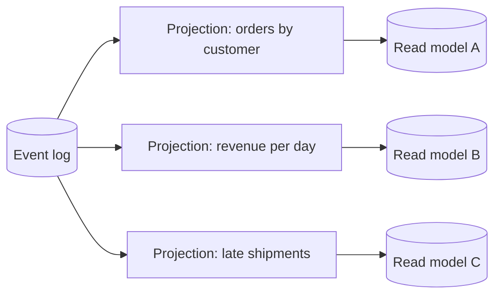

# Projections and Read Models

**Microservices · CQRS and event sourcing · Step 4.9.4 · Intermediate** · Last updated 2026-10-23
**Prerequisites:** [CQRS: separate models for writing and reading](02-cqrs-separate-models.md) (4.9.2) and [Event sourcing](03-event-sourcing.md) (4.9.3); helpful: [Reliable messaging for sagas](../08-saga/05-reliable-messaging-outbox-inbox.md) (4.8.5)

**Version note**

| Item | Version |
|---|---|
| Baseline | Projections (materialised views) over an event log, as described in the Azure Architecture Center |
| Hands-on baseline | Java 21 (OpenJDK 21.0.8), plain JDK, run on 2026-10-23 |
| Compatibility note | Products call projections "event processors", "subscriptions", "async daemons" or "denormalisers"; the mechanism (a checkpoint over an ordered log) is the same |

## 1. What it is and why it matters

**What is it?** A **projection** is a process that reads events and maintains a **read model**: a store shaped for questions ("orders per customer", "revenue per day", "late shipments"). It remembers how far it has read (its **checkpoint**). The Azure documentation: "Materialized views are read-only projections of the event store that are optimized for querying."

**Why do we need it?** Event streams answer one question well, "what happened to this order?", and almost nothing else: they cannot list all of a customer's orders or sum a day's revenue without reading everything. Projections turn the same history into whatever shape a screen or report needs, and because they derive from the events, they can be **thrown away and rebuilt**.

**When would I meet it?** Every event-sourced system, and any CQRS system that feeds its read side from events or change data.

> [!TIP]
> **Memory hook:** *a projection is a bookmark plus a summary: it remembers the last page it read, and keeps its summary up to date; lose the summary and you can read the book again.*

## 2. Mental model: a clerk with a notebook

A clerk reads the company's ledger from the start and keeps a notebook for one question, say "total sales per day". After each page they note the page number. If they fall asleep, they resume at the noted page. If the boss asks a new question ("which orders shipped late?"), another clerk starts a new notebook from page one. If a clerk discovers a mistake in their rules, they throw away the notebook and read again from page one with the corrected rules.

| In the analogy | In the real system |
|---|---|
| The ledger | The event log (store) |
| A clerk with a notebook | A projection |
| The notebook | The read model |
| The noted page number | The checkpoint (last applied position) |
| Starting a new notebook | Building a new projection from history |
| Throwing away and re-reading | Rebuild by replay |

**Where the analogy breaks:** several clerks may read in parallel, pages may be handed over twice or out of order, and reading the whole ledger can take hours when it is large.

## 3. Industry terms

| Term | Simple meaning | Why it matters | Example | Related terms |
|---|---|---|---|---|
| **Projection** | Code that turns events into a read model | The bridge from write to read | `RevenuePerDay` | Denormaliser, event handler |
| **Read model** | The query-friendly data a projection maintains | What queries touch | A table or document per customer | Materialised view |
| **Checkpoint (position)** | The position of the last event the projection applied | Resume after a crash; ignore duplicates | `checkpoint = 5` | Offset, cursor |
| **Catch-up subscription** | A reader that starts at a position, processes history, then follows new events | How projections stay current | "Events after 5" | Tailing |
| **Idempotent projection** | Applying the same event twice has no extra effect | Redelivery is normal | Ignore position <= checkpoint | [4.8.5](../08-saga/05-reliable-messaging-outbox-inbox.md) |
| **Rebuild** | Resetting a projection and replaying from position 0 | Fixing bugs, changing the shape | Corrected revenue | Replay |
| **Inline vs async projection** | Updated in the same transaction as the append, or afterwards by a subscriber | Consistency versus load and coupling | Same transaction (immediate), subscriber (eventual) | Eventual consistency |
| **Projection lag** | The gap between the log's head and the projection's checkpoint | How stale the view is | 800 events behind | Consumer lag |
| **Reactor / process manager** | A handler that reacts to events with side effects or commands | Not the same as a projection: it must not run during rebuild | Send an email, start a saga | [Saga](../08-saga/01-saga-overview.md) |

## 4. In a real system (ShopFlow)

**The business problem.** Three teams want three views of the same order events: the app wants "My orders" per customer, finance wants revenue per day, and operations wants the list of paid orders shipped more than an hour late. A year later someone finds that finance's revenue included cancelled orders.



**How projections help.** Each team owns a projection and a read model of the right shape and store; the log stays unchanged. The finance bug is fixed in the projection and the read model is rebuilt from history; operations' new question is a new projection built from the events already stored.

**What it costs.** More processes to run and watch; read models that lag; a rebuild that can take hours for a long log; events that must be handled idempotently; and a decision for each projection about how to switch to a rebuilt version.

**Elsewhere:** a bank builds balance, statement and fraud-signal views from the same transaction ledger; a video platform builds view counts, recommendations and billing from the same watch events.

## 5. How it works

1. The event store assigns every event a **position** in a global, ever-growing order (and a version within its stream).
2. A projection subscribes **from its checkpoint** (0 for a new one). It receives events in order.
3. For each event it **updates the read model** and then **saves the new checkpoint**, ideally in the same transaction as the read-model change.
4. If an event arrives twice, **the checkpoint check ignores it**; if the process restarts, it resumes after the checkpoint.
5. To **change** a projection (bug fix or new shape), build a new read model beside the old one by replaying from position 0, then switch queries over and delete the old one.
6. To **add** a projection, just start one at position 0.

### Worked example 1: projections over an event log

**Concept.** A log of nine order events, three projections, a checkpoint in each, and five situations: normal feeding, duplicate delivery, a restart, a bug fix by rebuild, and a new question asked later.

```java
// File: Projections.java (runnable, Java 21)
import java.util.ArrayList;
import java.util.LinkedHashMap;
import java.util.List;
import java.util.Locale;
import java.util.Map;
import java.util.TreeMap;

public class Projections {

    // One flat event shape keeps the example short. position = the event's place in the global log.
    record Ev(long position, String type, String orderId, String customerId, double amount, int day, long second) {}

    // A projection keeps its read model AND the position of the last event it applied (its checkpoint).
    abstract static class Projection {
        long checkpoint = 0;

        // Idempotent: an event at or below the checkpoint was already applied and is ignored.
        final boolean deliver(Ev e) {
            if (e.position() <= checkpoint) {
                return false;
            }
            handle(e);
            checkpoint = e.position();
            return true;
        }

        abstract void handle(Ev e);

        abstract String show();
    }

    static class OrdersByCustomer extends Projection {
        final Map<String, Map<String, String>> byCustomer = new LinkedHashMap<>();
        final Map<String, String> customerOf = new LinkedHashMap<>();

        void handle(Ev e) {
            switch (e.type()) {
                case "OrderPlaced" -> {
                    customerOf.put(e.orderId(), e.customerId());
                    byCustomer.computeIfAbsent(e.customerId(), k -> new LinkedHashMap<>()).put(e.orderId(), "PLACED");
                }
                case "OrderShipped" -> byCustomer.get(customerOf.get(e.orderId())).put(e.orderId(), "SHIPPED");
                case "OrderCancelled" -> byCustomer.get(customerOf.get(e.orderId())).put(e.orderId(), "CANCELLED");
                default -> { }
            }
        }

        String show() {
            return byCustomer.toString();
        }
    }

    // Revenue per day = payments captured, minus nothing yet (the first, buggy version).
    static class RevenuePerDay extends Projection {
        final Map<Integer, Double> revenue = new TreeMap<>();
        final boolean subtractCancelled;
        final Map<String, Double> paid = new LinkedHashMap<>();
        final Map<String, Integer> payDay = new LinkedHashMap<>();

        RevenuePerDay(boolean subtractCancelled) {
            this.subtractCancelled = subtractCancelled;
        }

        void handle(Ev e) {
            if (e.type().equals("PaymentCaptured")) {
                revenue.merge(e.day(), e.amount(), Double::sum);
                paid.put(e.orderId(), e.amount());
                payDay.put(e.orderId(), e.day());
            } else if (e.type().equals("OrderCancelled") && subtractCancelled && paid.containsKey(e.orderId())) {
                revenue.merge(payDay.get(e.orderId()), -paid.get(e.orderId()), Double::sum);
            }
        }

        String show() {
            StringBuilder sb = new StringBuilder();
            revenue.forEach((day, amount) -> sb.append(String.format(Locale.ROOT, "day %d: %.2f  ", day, amount)));
            return sb.toString().trim();
        }
    }

    // A NEW question asked later: which paid orders were not shipped within an hour?
    static class LateShipments extends Projection {
        final Map<String, Long> paidAt = new LinkedHashMap<>();
        final List<String> late = new ArrayList<>();

        void handle(Ev e) {
            switch (e.type()) {
                case "PaymentCaptured" -> paidAt.put(e.orderId(), e.second());
                case "OrderShipped" -> {
                    long wait = e.second() - paidAt.getOrDefault(e.orderId(), e.second());
                    if (wait > 3_600) late.add(e.orderId() + " (" + wait / 60 + " min)");
                    paidAt.remove(e.orderId());
                }
                default -> { }
            }
        }

        String show() {
            return late.toString();
        }
    }

    static List<Ev> log() {
        List<Ev> events = new ArrayList<>();
        long p = 0;
        events.add(new Ev(++p, "OrderPlaced", "O-1", "C-7", 90.00, 1, 0));
        events.add(new Ev(++p, "OrderPlaced", "O-2", "C-9", 40.00, 1, 60));
        events.add(new Ev(++p, "PaymentCaptured", "O-1", "C-7", 90.00, 1, 100));
        events.add(new Ev(++p, "PaymentCaptured", "O-2", "C-9", 40.00, 1, 200));
        events.add(new Ev(++p, "OrderShipped", "O-1", "C-7", 0, 1, 1_000));
        events.add(new Ev(++p, "OrderCancelled", "O-2", "C-9", 0, 2, 90_000));
        events.add(new Ev(++p, "OrderPlaced", "O-3", "C-7", 25.00, 2, 90_100));
        events.add(new Ev(++p, "PaymentCaptured", "O-3", "C-7", 25.00, 2, 90_150));
        events.add(new Ev(++p, "OrderShipped", "O-3", "C-7", 0, 2, 100_000));
        return events;
    }

    public static void main(String[] args) {
        List<Ev> log = log();

        System.out.println("1. one pass over the log feeds every projection");
        OrdersByCustomer orders = new OrdersByCustomer();
        RevenuePerDay revenue = new RevenuePerDay(false);
        for (Ev e : log) {
            orders.deliver(e);
            revenue.deliver(e);
        }
        System.out.println("   orders by customer: " + orders.show());
        System.out.println("   revenue per day:    " + revenue.show() + "   (checkpoint " + revenue.checkpoint + ")");
        System.out.println();

        System.out.println("2. the broker delivers event 4 a second time");
        RevenuePerDay naiveCount = new RevenuePerDay(false);
        RevenuePerDay safe = new RevenuePerDay(false);
        for (Ev e : log.subList(0, 4)) {
            naiveCount.handle(e);                 // calls the handler directly: no checkpoint
            safe.deliver(e);
        }
        naiveCount.handle(log.get(3));            // the duplicate
        System.out.println("   without a checkpoint: " + naiveCount.show());
        System.out.println("   with a checkpoint:    " + safe.show() + "   (duplicate ignored: " + !safe.deliver(log.get(3)) + ")");
        System.out.println();

        System.out.println("3. a crash: the projection restarts from its saved checkpoint");
        RevenuePerDay restarted = new RevenuePerDay(false);
        for (Ev e : log.subList(0, 5)) {
            restarted.deliver(e);
        }
        long saved = restarted.checkpoint;
        System.out.println("   saved checkpoint " + saved + "; the process restarts and asks for events after " + saved);
        for (Ev e : log) {
            if (e.position() > saved) restarted.deliver(e);
        }
        System.out.println("   revenue per day:    " + restarted.show() + "   (checkpoint " + restarted.checkpoint + ")");
        System.out.println();

        System.out.println("4. a bug: refunds for cancelled orders were never subtracted; fix and rebuild from position 0");
        System.out.println("   before the fix:     " + revenue.show());
        RevenuePerDay rebuilt = new RevenuePerDay(true);
        for (Ev e : log) {
            rebuilt.deliver(e);
        }
        System.out.println("   after the rebuild:  " + rebuilt.show());
        System.out.println();

        System.out.println("5. a new question asked months later: late shipments");
        LateShipments late = new LateShipments();
        for (Ev e : log) {
            late.deliver(e);
        }
        System.out.println("   paid orders shipped more than an hour after payment: " + late.show());
    }
}
```

**Expected output**:

```text
1. one pass over the log feeds every projection
   orders by customer: {C-7={O-1=SHIPPED, O-3=SHIPPED}, C-9={O-2=CANCELLED}}
   revenue per day:    day 1: 130.00  day 2: 25.00   (checkpoint 9)

2. the broker delivers event 4 a second time
   without a checkpoint: day 1: 170.00
   with a checkpoint:    day 1: 130.00   (duplicate ignored: true)

3. a crash: the projection restarts from its saved checkpoint
   saved checkpoint 5; the process restarts and asks for events after 5
   revenue per day:    day 1: 130.00  day 2: 25.00   (checkpoint 9)

4. a bug: refunds for cancelled orders were never subtracted; fix and rebuild from position 0
   before the fix:     day 1: 130.00  day 2: 25.00
   after the rebuild:  day 1: 90.00  day 2: 25.00

5. a new question asked months later: late shipments
   paid orders shipped more than an hour after payment: [O-3 (164 min)]
```

**Walkthrough.**

| Part | What happened | Lesson |
|---|---|---|
| 1 | One pass produced the customer view and revenue (130.00 on day 1, 25.00 on day 2) | One log, several views |
| 2 | Delivering event 4 twice: the handler alone gave 170.00 (wrong), the checkpoint check kept 130.00 | Idempotency via position |
| 3 | A projection that saved checkpoint 5 and restarted processed only events 6 to 9 and reached the same result | Resume after a crash |
| 4 | The first revenue projection ignored cancellations (order O-2 was paid 40.00 and then cancelled). The fix subtracts it; a rebuild from position 0 gave day 1 = 90.00 | A bug in a read model is fixed by replay |
| 5 | A new projection, built months later from the existing log, found order O-3 shipped 164 minutes after payment | History answers questions nobody planned for |

**Experiment.** Add a projection `OrderCountPerCustomer` that counts `OrderPlaced` events per customer, and feed it the log. Predict the result and its checkpoint. The result is in Answers.

**Real-world example.** ShopFlow's finance revenue view is rebuilt every time the refund rules change; the operations "late shipments" report was added a year after launch without touching the order service.

### Worked example 2: choosing how a projection is updated

| Style | How | Consistency | Good for | Watch out |
|---|---|---|---|---|
| **Inline** (same transaction) | The projection is updated in the same database transaction that appends the events | Immediate for that view | A few critical views in the same database as the store | Couples write latency to every inline projection; cannot use a different store |
| **Asynchronous** (subscription) | A separate process reads events after the commit | Eventual | Most views; different stores; independent scaling | Lag, checkpoints, rebuilds |
| **On demand** | Replay the stream when queried | Immediate | One aggregate's detail page | Slow for large streams |

### Handling lag and staleness

- **Show the lag:** monitor the difference between the log's head position and each checkpoint, and alert when it grows or does not move.
- **Read your writes:** after a command, wait until the read model's checkpoint reaches the new event's position, or show the data from the command's response ([4.9.2](02-cqrs-separate-models.md)).
- **Design the UI** for "processing" states instead of pretending to be instant.

### Rebuilding safely

Rebuild by **creating a new read model beside the old one**, replaying from position 0 until it has caught up, switching the queries to it, and then dropping the old one. Do not rebuild in place while users query it. During a rebuild, **side effects must be off**: a rebuild that triggers emails or commands would repeat them for every historical event. Keep projections (pure data updates) separate from reactors (side effects).

### Common mistakes

1. **Non-idempotent handlers** (counters that increment on every delivery).
2. **Side effects in projections** (emails, payments, calls to other services).
3. **Saving the checkpoint separately from the read-model update**, so a crash between them double-applies or skips an event.
4. **Assuming events arrive in order across streams.**
5. **Rebuilding in place** while users query.
6. **One huge projection** serving every screen.

## 6. Failure scenarios

### The double-counted day

1. **What happened?** After a broker hiccup, one `PaymentCaptured` event was delivered twice and the revenue view was 40.00 too high (part 2).
2. **Why?** The handler had no checkpoint check.
3. **What did the business see?** A revenue report that did not match the bank.
4. **Solutions:** idempotent projections keyed by position; compare reports to the source regularly; rebuild.
5. **What they cost:** a checkpoint column and a rebuild procedure.

### The rebuild that mailed everyone

1. **What happened?** A team rebuilt a view, and customers received 'your order has shipped' emails for orders from three years ago.
2. **Why?** The email logic lived in the same event handler as the view update.
3. **What did users see?** A flood of old emails.
4. **Solutions:** separate reactors from projections; run reactors only on new events and make them idempotent; a flag that disables reactors during replay.
5. **What they cost:** two kinds of subscribers to design and operate.

### The crash between view and checkpoint

1. **What happened?** A projection updated its read model, crashed before saving the checkpoint, restarted, and applied the same event again.
2. **Why?** The two writes were not atomic.
3. **What did users see?** Counts that drifted upward after restarts.
4. **Solutions:** write the read-model change and the checkpoint in one transaction; or make each event's effect idempotent (set a value, not add to it).
5. **What they cost:** the read store must support the transaction, or the logic must be written to be idempotent.

## 7. Architectural decisions

| Decision | Choose | Because |
|---|---|---|
| How many projections | One per question or screen, owned by the team that needs it | Independence; each can be rebuilt alone |
| Update style | Asynchronous by default; inline for the few views that must be immediate | Load and coupling versus consistency |
| Idempotency | A checkpoint check plus a transactional checkpoint update | Redelivery is normal |
| Order | Process events in log order per projection; design handlers not to depend on cross-stream order unless the log is globally ordered | Out-of-order events break joins |
| Rebuild | Build beside, switch over, delete the old | No downtime and no half-built views |
| Side effects | In reactors with their own checkpoint and idempotency; never in projections | Rebuilds must be safe |
| Monitoring | Lag per projection, events per second, errors, time to rebuild | You know when a view is stale or stuck |
| Bad events | Retry limited times, then skip to a dead-letter store and alert | One poison event must not block a view forever |

### Alternatives in the industry

A map of the landscape, not a comparison. None of these were run in this lesson; check each project's documentation before adopting one.

| Area | Tool or product | What it is | When you meet it |
|---|---|---|---|
| Built into event-sourcing tools | **Axon** event processors (tracking), **Marten**'s async projection daemon, **EventStoreDB** subscriptions | Run projections with checkpoints for you | Teams using those stores |
| Over a Kafka log | **Kafka consumers**, **Kafka Streams**, **ksqlDB**, **Apache Flink** | Build read models and aggregates from topics, with offsets as checkpoints | Event streams as the integration backbone ([2.2.4](../../02-messaging/02-kafka/04-consumers-consumer-groups.md)) |
| Change data capture | **Debezium** | Feeds read models from a database's changes | CQRS without event sourcing |
| Read stores | **PostgreSQL**, **Elasticsearch / OpenSearch**, **Redis**, **MongoDB**, **DynamoDB** | Where the read models live | Choose per query |
| Simpler alternatives | **Materialised views** in the database, scheduled batch jobs | Refresh a summary periodically | When minutes of staleness are fine |

## 8. Try it yourself

Try each exercise first; the real results are in the Answers section.

1. **A new projection.** Add `OrderCountPerCustomer` and feed it the log.
2. **Out of order.** Event 5 (`OrderShipped O-1`) arrives before event 3 in `OrdersByCustomer`. What happens, and how would you make the projection robust?
3. **Plan a rebuild.** List the steps to roll out a corrected revenue projection with no downtime.

## 9. Check your understanding

1. What two things does a projection store, and why?
2. Why must a projection ignore an event whose position is at or below its checkpoint?
3. Why are emails not sent from a projection?
4. How do you add a brand-new report over events that are three years old?

Answers are at the end of this note.

## 10. Revision

**Remember**
- **Projection** = log → read model, with a **checkpoint**; **idempotent** on redelivery; **resumable** after a crash.
- **Rebuild** by replay from 0, **beside** the old model, then switch; **new questions = new projections**.
- Update the read model and the checkpoint **atomically** (or make effects idempotent).
- Keep **side effects out** of projections (reactors only on new events).
- Watch **lag**; handle **poison events**.

**Explain in 15 seconds:** "A projection reads the event log from a saved checkpoint and keeps a read model up to date; it ignores duplicates, resumes after crashes, and can be rebuilt from scratch whenever the logic or shape changes."

**Explain in 60 seconds:**
> "A projection subscribes to the event log from its checkpoint, the position of the last event it applied. For each event it updates a read model shaped for one question, and saves the new checkpoint, ideally in the same transaction. If an event is delivered twice, the checkpoint check ignores it, and after a crash it resumes where it stopped. Because the log is the truth, I can fix a bug or change the shape by building a new read model beside the old one from position zero, switching queries over, and deleting the old one; a new report is just a new projection over existing history. I keep side effects like emails out of projections, since a rebuild would repeat them, and put them in reactors that only run on new events. I monitor lag per projection and set poison events aside so one bad event can't block a view."

**Architect's takeaway:** projections make read models disposable. That is only true if they are idempotent, free of side effects and rebuildable in a reasonable time, so design and test the rebuild path before you need it.

**Next topic:** [Snapshots, event versioning and privacy](05-snapshots-versioning-privacy.md) (4.9.5)

## 11. Verification and sources

> [!NOTE]
> Checked 2026-10-23 against the sources below, and by compiling and running every Java example on OpenJDK 21.0.8. Re-verify when you revisit this note.

- **Confirmed (documentation, read 2026-10-23):** materialised views are "read-only projections of the event store that are optimized for querying"; applications "typically implement materialized views because it's costly to read and replay events"; "generating materialized views for the read model can consume significant time and resources"; the read model lags and is eventually consistent; and snapshots are recommended to limit replay (Microsoft Learn, "Event Sourcing pattern" and "CQRS pattern"); event sourcing permits "Complete Rebuild" of application state from the log (Martin Fowler, "Event Sourcing").
- **Observed (this machine):** the output of the Java programs and the exercise variant.
- **Assumptions and illustrations:** event data, positions and thresholds are illustrative; the single in-memory log has a total order, which a multi-partition broker does not give across streams; checkpoints are kept in memory in the example and would be stored with the read model in production.
- **To verify:** how your event store orders events globally and per stream; whether your read store can update data and checkpoint in one transaction; how long a full rebuild takes at your volume.
- **Decision rule:** idempotent, side-effect-free projections with transactional checkpoints; rebuild beside the old and switch; reactors separate.

**Sources:** Microsoft Learn, "Event Sourcing pattern" and "CQRS pattern"; Martin Fowler, "Event Sourcing".

## Answers

**Experiment (exercises)**

1. **A new projection:** counting `OrderPlaced` events per customer gives two orders for `C-7` and one for `C-9`, and a checkpoint of 9 (the last event of the log; events that the projection does not care about still advance the checkpoint):

```text
orders per customer: {C-7=2, C-9=1} (checkpoint 9)
```

2. **Out of order:** `OrdersByCustomer` looks up the customer of the order in a map that the `OrderPlaced` event fills, so `OrderShipped` first would fail (a null lookup). Robust options: process events strictly in log order per stream and rely on the store's per-stream ordering; carry the data needed in the event itself (include `customerId` in every order event); or park events whose prerequisites are missing and retry them. Never silently drop them.
3. **Plan a rebuild:** (1) create a new read model (version 2) and a new projection instance at position 0; (2) let it replay and catch up while the old one keeps serving; (3) compare key figures between old and new; (4) switch queries to version 2 (a flag or a pointer); (5) stop and delete the old projection and model; (6) keep reactors disabled during replay.

**Check your understanding**

1. The read model (the data for queries) and the checkpoint (the position of the last event applied). The checkpoint lets it resume after a restart and ignore duplicates; without it neither would be safe.
2. Because that event has already been applied: delivery is at least once, so duplicates and replays are normal, and applying them again would double-count or corrupt the read model.
3. A projection can be rebuilt by replaying history, which would repeat every email for every old event; side effects belong in reactors that act only on new events and are idempotent.
4. Start a new projection at position 0 and let it replay the existing events; when it has caught up, it serves the report. The old events need no change.

Back to [the series overview](01-cqrs-es-overview.md) · [the Microservices overview](../01-microservices-overview.md) · [the index](../../README.md) · [Roadmap](../../roadmap.md).
