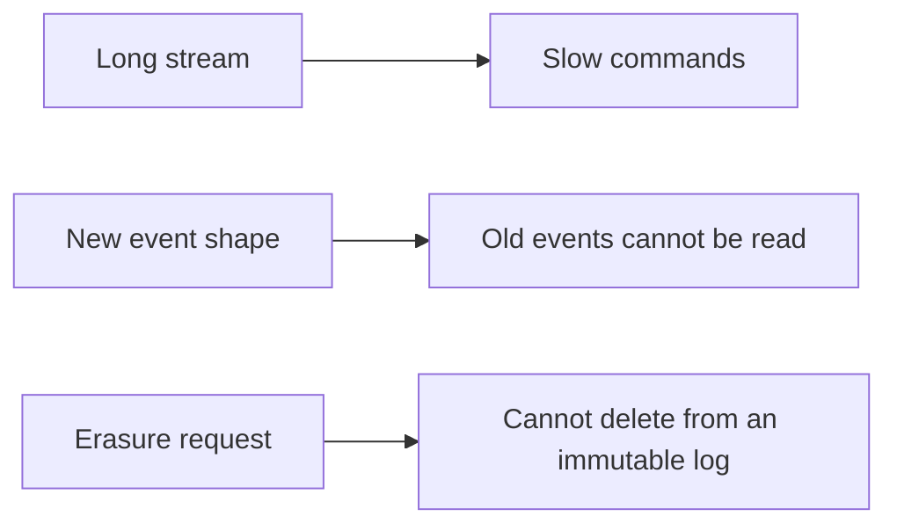

# Snapshots, Event Versioning and Privacy

**Microservices · CQRS and event sourcing · Step 4.9.5 · Advanced** · Last updated 2026-10-23
**Prerequisites:** [Event sourcing](03-event-sourcing.md) (4.9.3) and [Projections and read models](04-projections-read-models.md) (4.9.4)

**Version note**

| Item | Version |
|---|---|
| Baseline | The strategies for snapshots, schema evolution and personal data described in the Azure Architecture Center's Event Sourcing pattern |
| Hands-on baseline | Java 21 (OpenJDK 21.0.8), plain JDK; the crypto example uses the JDK's `javax.crypto` (AES-GCM), run on 2026-10-23 |
| Compatibility note | The cryptography here is a teaching sketch of the idea, not a key-management design; real systems use a managed key service |

## 1. What it is and why it matters

**What is it?** Three problems that appear a year after an event-sourced system goes live:
- **Snapshots:** streams grow, and replaying thousands of events on every command gets slow. A **snapshot** saves the state at some version so replay can start there.
- **Event versioning:** events are immutable and live forever, but the code that understands them changes. Old events must still be readable by new code.
- **Privacy:** an append-only, immutable store conflicts with laws that require deleting personal data.

**Why do we need it?** Without a plan, long streams make hot aggregates slow, a schema change breaks the replay of the whole history, and an erasure request has no legal answer. These are the usual reasons event-sourced systems get a bad reputation.

**When would I meet it?** When a stream passes a few thousand events, the first time an event gains or changes a field, and the first time a customer asks to be forgotten.

> [!TIP]
> **Memory hook:** *snapshots make replay short, upcasters make old events readable, and a destroyed key makes personal data unreadable: none of them edits history.*

## 2. Industry terms

| Term | Simple meaning | Why it matters | Example | Related terms |
|---|---|---|---|---|
| **Snapshot** | The saved state of an aggregate at a version | Replay starts at the snapshot, not at zero | State at event 10,000 | Checkpoint (different: that is for projections) |
| **Snapshot frequency** | How often a snapshot is written | Balances storage and load time | Every 1,000 events | Rehydration cost |
| **Tolerant deserialization** | Readers ignore unknown fields and use defaults for missing ones | Handles additive changes without migration | New optional `channel` | Weak schema |
| **Event version** | A version number in the event envelope or type name | Tells readers which shape they have | `OrderPlaced` v2 | Schema version |
| **Upcasting** | Converting an old event to the current shape when it is read | Old events stay unchanged on disk | v1 `total` → v2 `{amount, currency}` | Event migration |
| **In-place migration** | Rewriting stored events to a new schema | Breaks immutability; a last resort | One-off script | Copy-and-transform |
| **Crypto-shredding** | Encrypting personal data per person and deleting the key to erase it | Erasure without deleting events | Per-customer AES key | Key management |
| **Personal data outside the stream** | Events refer to a person by id; the data lives in a deletable store | The simplest way to honour erasure | `customerId` only | Data minimisation |
| **Right to erasure** | A legal right to have personal data deleted | The conflict with immutability | "Delete my data" request | Data protection law |

## 3. In a real system (ShopFlow)

**The business problem.** Two years in, three things happen. The `Account` stream of a corporate customer has 400,000 events and every command takes seconds. Marketing wants the order currency recorded: `OrderPlaced.total` changes from a number to `{amount, currency}` while 3 million stored events keep the old shape. And a customer invokes the right to erasure; their name and email are in thousands of events.



**How these techniques help.** Snapshots every few thousand events keep the load time short; upcasters convert old events on read so projections and aggregates only see the current shape; personal data is encrypted with a per-customer key, and deleting the key makes it unrecoverable while the business facts (totals, timestamps) remain.

**What they cost.** Snapshot storage and invalidation when the aggregate's logic changes; a chain of upcasters that grows with each schema change; encryption overhead and careful key management; and tests for each of these.

**Elsewhere:** banks snapshot account balances daily; healthcare systems upgrade old record formats on read; subscription platforms encrypt customer data with per-customer keys to meet erasure rules.

## 4. How it works

### Snapshots

A snapshot is an **optimisation**, not the truth: the Azure guidance notes that "snapshots are an optimization, not a replacement for the eventstream. The eventstream remains the source of truth, and you can regenerate snapshots from it at any time." To load an aggregate: read the latest snapshot (state and version), then replay only the events after that version. Write a new snapshot every N events, or by time. When the aggregate's logic changes, old snapshots may be wrong: either version them or delete and regenerate them.

### Versioning events

Strategies, from cheapest to most drastic (Azure guidance):
1. **Tolerant deserialization:** readers "ignore unknown fields and use default values for missing fields" (additive changes).
2. **Event versioning:** a version number in each event, "either as metadata in the event envelope or as part of the event type name".
3. **Upcasting:** "register transformation functions that convert older event schemas to the current schema during deserialization. You can chain upcasters so that the application code only needs to handle the latest version. The stored events remain unchanged."
4. **In-place migration:** rewriting stored events: "breaks immutability and should be a last resort because it undermines the audit trail."

### Personal data

The Azure guidance names the tension and two answers: "A common approach is to store personal data outside the event store and reference it by identifier in events. ... When you can't separate personal data from events, use crypto-shredding. Encrypt personal data in events by using a per-subject key. Delete the key to render the data unrecoverable while leaving the event structure intact." It adds that this "adds encryption overhead on every read and write and requires robust key management".

### Worked example 1: snapshots and upcasting

**Concept.** Part A replays a 10,350-event account stream with and without a snapshot. Part B reads a version 1 event as version 3 through a chain of two upcasters, leaving the stored event unchanged.

```java
// File: SnapshotsAndUpcasting.java (runnable, Java 21)
import java.util.ArrayList;
import java.util.List;
import java.util.Map;
import java.util.TreeMap;
import java.util.function.UnaryOperator;

public class SnapshotsAndUpcasting {

    // ---------- Part A: snapshots ----------
    // An account stream of 10,000 events. Each event is a change of the balance in cents.
    static int delta(int i) {
        return i % 5 == 0 ? -300 : 200;
    }

    record Snapshot(int version, long balance) {}

    public static void main(String[] args) {
        int streamLength = 10_350;
        int snapshotEvery = 1_000;

        // Replay without a snapshot: apply every event.
        long balance = 0;
        int applied = 0;
        for (int i = 1; i <= streamLength; i++) {
            balance += delta(i);
            applied++;
        }
        System.out.println("A. without a snapshot: balance " + balance + " after applying " + applied + " events");

        // Snapshots written as the stream grew: one every 1,000 events.
        List<Snapshot> snapshots = new ArrayList<>();
        long running = 0;
        for (int i = 1; i <= streamLength; i++) {
            running += delta(i);
            if (i % snapshotEvery == 0) {
                snapshots.add(new Snapshot(i, running));
            }
        }
        // Load: start from the newest snapshot, then apply only the events after it.
        Snapshot latest = snapshots.get(snapshots.size() - 1);
        long fromSnapshot = latest.balance();
        int appliedAfter = 0;
        for (int i = latest.version() + 1; i <= streamLength; i++) {
            fromSnapshot += delta(i);
            appliedAfter++;
        }
        System.out.println("   with a snapshot at version " + latest.version() + ": balance " + fromSnapshot + " after applying " + appliedAfter + " events");

        long full = balance;
        System.out.println("   same balance as the full replay: " + (fromSnapshot == full));
        System.out.println("   snapshots stored: " + snapshots.size() + " (the event stream is still the source of truth)");
        System.out.println();

        // ---------- Part B: upcasting old events to the current schema ----------
        // v1: total is a plain number. v2: total became {amount, currency}. v3: a channel was added.
        Map<String, Object> v1 = new TreeMap<>(Map.of("type", "OrderPlaced", "version", 1, "orderId", "O-1001", "total", 90.0));

        UnaryOperator<Map<String, Object>> v1ToV2 = e -> {
            Map<String, Object> out = new TreeMap<>(e);
            out.put("version", 2);
            out.put("total", new TreeMap<>(Map.of("amount", e.get("total"), "currency", "EUR")));     // old orders were all in euro
            return out;
        };
        UnaryOperator<Map<String, Object>> v2ToV3 = e -> {
            Map<String, Object> out = new TreeMap<>(e);
            out.put("version", 3);
            out.put("channel", "web");                                                                   // a default for events that predate the field
            return out;
        };
        Map<Integer, UnaryOperator<Map<String, Object>>> upcasters = Map.of(1, v1ToV2, 2, v2ToV3);
        int currentVersion = 3;

        Map<String, Object> read = v1;
        while ((int) read.get("version") < currentVersion) {
            read = upcasters.get((int) read.get("version")).apply(read);
        }
        System.out.println("B. stored event (never changed): " + v1);
        System.out.println("   as the code reads it (v" + currentVersion + "):  " + read);
        System.out.println("   the stored event is still version " + v1.get("version") + ": upcasting happens on read, history is not rewritten");
    }
}
```

**Expected output**:

```text
A. without a snapshot: balance 1035000 after applying 10350 events
   with a snapshot at version 10000: balance 1035000 after applying 350 events
   same balance as the full replay: true
   snapshots stored: 10 (the event stream is still the source of truth)

B. stored event (never changed): {orderId=O-1001, total=90.0, type=OrderPlaced, version=1}
   as the code reads it (v3):  {channel=web, orderId=O-1001, total={amount=90.0, currency=EUR}, type=OrderPlaced, version=3}
   the stored event is still version 1: upcasting happens on read, history is not rewritten
```

**Walkthrough.**

| Part | What happened | Lesson |
|---|---|---|
| A | The full replay applied 10,350 events; loading from the snapshot at version 10,000 applied 350 and gave the same balance. Ten snapshots exist | Snapshots shorten replay; they do not change the result or replace the events |
| B | The stored event is version 1 with a plain `total`. Two upcasters (v1 to v2 turns `total` into `{amount, currency}` with a default currency; v2 to v3 adds `channel`) produced the version 3 shape the code expects. The stored event is untouched | Old events stay as written; the code handles one shape |

**Experiment.** Add a snapshot frequency of 500 instead of 1,000, run Part A with 10,350 events, and predict how many events the snapshot path applies. The result is in Answers.

**Real-world example.** ShopFlow's order projections and aggregate code only know `OrderPlaced` v3; the upcaster chain sits at the edge where events are read from the store.

### Worked example 2: no upcaster (mistake and fix)

**Concept.** The new code expects the new shape and meets a stored event in the old one.

```java
// File: MissingUpcaster.java (runnable, Java 21)
import java.util.List;
import java.util.Map;

public class MissingUpcaster {

    record Money(double amount, String currency) {}

    // The current code expects "total" to be an object {amount, currency}.
    static Money readTotalCurrent(Map<String, Object> event) {
        @SuppressWarnings("unchecked")
        Map<String, Object> total = (Map<String, Object>) event.get("total");
        return new Money((double) total.get("amount"), (String) total.get("currency"));
    }

    // Reads the old shape (a plain number) and converts it, so the rest of the code sees one shape.
    static Map<String, Object> upcastToCurrent(Map<String, Object> event) {
        if (event.get("total") instanceof Double plain) {
            return Map.of("type", event.get("type"), "total", Map.of("amount", plain, "currency", "EUR"));
        }
        return event;
    }

    public static void main(String[] args) {
        Map<String, Object> oldEvent = Map.of("type", "OrderPlaced", "total", 90.0);                                   // stored last year
        Map<String, Object> newEvent = Map.of("type", "OrderPlaced", "total", Map.of("amount", 40.0, "currency", "EUR")); // stored today

        System.out.println("replaying with code that knows only the new shape:");
        for (Map<String, Object> event : List.of(newEvent, oldEvent)) {
            try {
                Money m = readTotalCurrent(event);
                System.out.println("   ok:     " + m.amount() + " " + m.currency());
            } catch (ClassCastException e) {
                System.out.println("   FAILED: the old event cannot be read (" + e.getClass().getSimpleName() + "), so the whole stream cannot be replayed");
            }
        }

        System.out.println("replaying with an upcaster in front:");
        for (Map<String, Object> event : List.of(newEvent, oldEvent)) {
            Money m = readTotalCurrent(upcastToCurrent(event));
            System.out.println("   ok:     " + m.amount() + " " + m.currency());
        }
    }
}
```

**Expected output**:

```text
replaying with code that knows only the new shape:
   ok:     40.0 EUR
   FAILED: the old event cannot be read (ClassCastException), so the whole stream cannot be replayed
replaying with an upcaster in front:
   ok:     40.0 EUR
   ok:     90.0 EUR
```

**Walkthrough.** The new event reads fine; the old one fails with a `ClassCastException`, and since a replay reads **every** event of the stream, one unreadable event makes the whole aggregate (or projection) unloadable. With an upcaster in front, both read as `Money`. Deploying a schema change without the matching upcaster is one of the most common production failures of event-sourced systems; test the new code against a sample of old events before release.

### Worked example 3: crypto-shredding

**Concept.** Business facts (type, customer id, total) are stored in clear; personal data is encrypted with the customer's own key. Deleting the key erases the personal data but leaves the stream intact.

```java
// File: CryptoShredding.java (runnable, Java 21)
import java.nio.charset.StandardCharsets;
import java.security.SecureRandom;
import java.util.ArrayList;
import java.util.HashMap;
import java.util.List;
import java.util.Locale;
import java.util.Map;
import javax.crypto.Cipher;
import javax.crypto.KeyGenerator;
import javax.crypto.SecretKey;
import javax.crypto.spec.GCMParameterSpec;

public class CryptoShredding {

    // An event as stored: the business facts in clear, the personal data encrypted with the customer's own key.
    record StoredEvent(String type, String customerId, double total, byte[] iv, byte[] encryptedPersonalData) {}

    static final SecureRandom RANDOM = new SecureRandom();

    // The key vault: one key per customer. Deleting a key makes that customer's personal data unreadable.
    static class KeyVault {
        private final Map<String, SecretKey> keys = new HashMap<>();

        SecretKey keyFor(String customerId) throws Exception {
            SecretKey existing = keys.get(customerId);
            if (existing != null) return existing;
            KeyGenerator generator = KeyGenerator.getInstance("AES");
            generator.init(128);
            SecretKey created = generator.generateKey();
            keys.put(customerId, created);
            return created;
        }

        SecretKey find(String customerId) {
            return keys.get(customerId);
        }

        void forget(String customerId) {
            keys.remove(customerId);
        }
    }

    static StoredEvent store(KeyVault vault, String type, String customerId, double total, String personalData) throws Exception {
        byte[] iv = new byte[12];
        RANDOM.nextBytes(iv);
        Cipher cipher = Cipher.getInstance("AES/GCM/NoPadding");
        cipher.init(Cipher.ENCRYPT_MODE, vault.keyFor(customerId), new GCMParameterSpec(128, iv));
        return new StoredEvent(type, customerId, total, iv, cipher.doFinal(personalData.getBytes(StandardCharsets.UTF_8)));
    }

    static String readPersonalData(KeyVault vault, StoredEvent event) throws Exception {
        SecretKey key = vault.find(event.customerId());
        if (key == null) {
            return "[erased]";
        }
        Cipher cipher = Cipher.getInstance("AES/GCM/NoPadding");
        cipher.init(Cipher.DECRYPT_MODE, key, new GCMParameterSpec(128, event.iv()));
        return new String(cipher.doFinal(event.encryptedPersonalData()), StandardCharsets.UTF_8);
    }

    public static void main(String[] args) throws Exception {
        KeyVault vault = new KeyVault();
        List<StoredEvent> log = new ArrayList<>();
        log.add(store(vault, "OrderPlaced", "C-7", 90.00, "Asha Rao <asha@example.com>"));
        log.add(store(vault, "OrderPlaced", "C-9", 40.00, "Ben Ito <ben@example.com>"));
        log.add(store(vault, "OrderPlaced", "C-7", 25.00, "Asha Rao <asha@example.com>"));

        System.out.println("before the erasure request:");
        for (StoredEvent e : log) {
            System.out.println(String.format(Locale.ROOT, "   %s %s total %.2f  customer: %s", e.type(), e.customerId(), e.total(), readPersonalData(vault, e)));
        }

        vault.forget("C-7");                    // the right to be forgotten: destroy the key, not the events
        System.out.println();
        System.out.println("after deleting customer C-7's key:");
        double sales = 0;
        for (StoredEvent e : log) {
            sales += e.total();
            System.out.println(String.format(Locale.ROOT, "   %s %s total %.2f  customer: %s", e.type(), e.customerId(), e.total(), readPersonalData(vault, e)));
        }
        System.out.println(String.format(Locale.ROOT, "the stream still has %d events and total sales %.2f", log.size(), sales));
    }
}
```

**Expected output**:

```text
before the erasure request:
   OrderPlaced C-7 total 90.00  customer: Asha Rao <asha@example.com>
   OrderPlaced C-9 total 40.00  customer: Ben Ito <ben@example.com>
   OrderPlaced C-7 total 25.00  customer: Asha Rao <asha@example.com>

after deleting customer C-7's key:
   OrderPlaced C-7 total 90.00  customer: [erased]
   OrderPlaced C-9 total 40.00  customer: Ben Ito <ben@example.com>
   OrderPlaced C-7 total 25.00  customer: [erased]
the stream still has 3 events and total sales 155.00
```

**Walkthrough.** Before the request all three events show their customer's name and email. After the customer `C-7`'s key was deleted, both of that customer's events show `[erased]` while the other customer's event is still readable, and the stream keeps its three events and the 155.00 total sales. Nothing was deleted from the log; the data became unreadable. In production the keys live in a key management service with access control and backups that also honour deletion, and **everything derived from the personal data (projections, search indexes, caches, backups, logs) must be erased or rebuilt too**.

### Common mistakes

1. No upcaster when an event's shape changes.
2. Changing the meaning of an existing event type instead of adding a new type or version.
3. Treating snapshots as truth, and not regenerating them after logic changes.
4. Personal data in plaintext in events with no erasure plan.
5. Erasing the key but leaving the data in projections, caches or exports.
6. Rewriting history in place to "fix" events.

## 5. Failure scenarios

### The release that could not read last year

1. **What happened?** A release changed `OrderPlaced`; the next morning every aggregate load for old orders threw an error.
2. **Why?** The new code had no upcaster and the old events were still in the old shape (worked example 2).
3. **What did users and the business see?** Orders older than the release could not be changed or shipped.
4. **Solutions:** roll back; add the upcaster; test with samples of historical events before every release that touches an event type.
5. **What they cost:** a library of historical samples and a compatibility test in the pipeline.

### The erasure that missed a copy

1. **What happened?** A customer's key was deleted, but their email stayed in the "My orders" projection, the search index and last month's backup.
2. **Why?** The erasure covered the event store only.
3. **What did the business see?** A failed compliance check.
4. **Solutions:** keep personal data out of projections or encrypt it likewise; run erasure through every derived store; define backup retention and a procedure.
5. **What they cost:** a data map and an erasure runbook.

### The stale snapshot

1. **What happened?** A bug fix changed how fees are applied, but old snapshots held the old balances; accounts loaded from snapshots disagreed with full replays.
2. **Why?** Snapshots were treated as permanent and not versioned.
3. **What did users see?** Different balances depending on when the account was last snapshotted.
4. **Solutions:** store the snapshot schema or logic version and discard mismatches; regenerate after logic changes; compare snapshot and full replay in tests.
5. **What they cost:** a version field and a regeneration job.

## 6. Architectural decisions

| Decision | Choose | Because |
|---|---|---|
| Keeping streams short | Small aggregates first; snapshots (every N events) only if streams still grow | Snapshots add moving parts |
| Snapshot storage | Alongside the stream, with the aggregate's code version | Detect and regenerate stale ones |
| Schema changes | Tolerant readers for additive changes; versioned events and upcasters for the rest; new event types for changes in meaning | Old events stay readable and unchanged |
| In-place migration | Only as a last resort, as a copy-and-transform into a new store | Preserves the original audit trail |
| Personal data | Keep it out of events (store a reference); otherwise per-person encryption with a managed key service | Erasure without breaking the stream |
| Derived data | Include projections, caches, search and backups in the erasure design | A key deletion alone is not erasure |
| Testing | A compatibility test that replays a sample of real historical events with the new code | Catches unreadable events before release |

### Alternatives in the industry

A map of the landscape, not a comparison. None of these were run in this lesson; check each project's documentation before adopting one.

| Area | Tool or product | What it is | When you meet it |
|---|---|---|---|
| Built-in snapshots and upcasters | **Axon Framework** (snapshotters, upcasters), **Marten** (snapshots, upcasting), **EventStoreDB** (stream metadata; app-level snapshots) | Frameworks and stores with helpers for these problems | Teams on those products |
| Schema management | **Avro** or **Protobuf** with a **schema registry** | Compatible schema evolution rules for messages | Event streams with many consumers ([2.2.10](../../02-messaging/02-kafka/10-schemas-evolution.md)) |
| Key management | **AWS KMS**, **Google Cloud KMS**, **Azure Key Vault**, **HashiCorp Vault** | Managed keys and encryption services | Crypto-shredding in production |
| Data protection tooling | **Tokenisation / vault services**, data catalogues | Keep personal data out of events | Regulated environments |

## 7. Try it yourself

Try each exercise first; the real results are in the Answers section.

1. **Snapshot every 500.** With 10,350 events, how many events does the snapshot path apply?
2. **Add v4.** Add a version 4 event that renames `orderId` to `id`. Where does the change go, and what must still work?
3. **Erasure plan.** List every place that could hold a customer's name in ShopFlow's order system, and say what happens to each when the key is deleted.

## 8. Check your understanding

1. Why is a snapshot not the source of truth?
2. What is the difference between upcasting and in-place migration?
3. How does crypto-shredding erase data from an immutable log?
4. Why must new code be tested against old events?

Answers are at the end of this note.

## 9. Revision

**Remember**
- **Snapshots**: state at a version, replay only newer events; an optimisation, regenerate when logic changes.
- **Versioning**: tolerant readers → versioned events → **upcasters** (on read, stored events unchanged) → in-place migration as a last resort.
- **Privacy**: keep personal data out of events, or **per-person encryption + delete the key** (crypto-shredding); erase derived stores too.
- Test new code against **real historical events**.

**Explain in 15 seconds:** "I keep streams short with small aggregates and snapshots, keep old events readable with versioned events and upcasters that convert on read, and handle erasure by keeping personal data out of events or encrypting it with a per-person key I can delete."

**Explain in 60 seconds:**
> "Event streams are immutable and permanent, which creates three long-term problems. Long streams make loads slow, so I keep aggregates small and write snapshots every few thousand events: the snapshot is only a cache of state at a version, the stream stays the truth, and I regenerate snapshots when the logic changes. Events outlive code, so I add version numbers and register upcasters that convert old events to the current shape when they are read, leaving what is stored untouched; in-place rewrites are a last resort because they destroy the audit trail. Finally, the right to erasure conflicts with immutability, so I either keep personal data out of events and reference it by id, or encrypt it with a per-person key and delete the key, which leaves the event structure and business facts intact. I also have to erase derived copies, such as projections, caches and backups, and I run compatibility tests of new code against samples of historical events before every release."

**Architect's takeaway:** immutability is a promise you keep to your auditors and a burden you carry for years. Plan for long streams, changing schemas and erasure on day one, because retrofitting them into a live event store is far harder.

**Next topic:** [An event store in a relational database, and integration](06-event-store-postgresql-integration.md) (4.9.6)

## 10. Verification and sources

> [!NOTE]
> Checked 2026-10-23 against the sources below, and by compiling and running every Java example on OpenJDK 21.0.8. Re-verify when you revisit this note.

- **Confirmed (documentation, read 2026-10-23):** "Snapshots are an optimization, not a replacement for the eventstream. The eventstream remains the source of truth, and you can regenerate snapshots from it at any time", with the advice to "balance the storage cost of snapshots against the time saved during rehydration"; the four schema strategies (tolerant deserialization, event versioning, upcasting with chained upcasters, in-place migration "as a last resort because it undermines the audit trail"); and the personal data guidance (store personal data outside the event store and reference it by identifier; otherwise crypto-shredding with a per-subject key, which "adds encryption overhead on every read and write and requires robust key management") (Microsoft Learn, "Event Sourcing pattern").
- **Observed (this machine):** the output of the Java programs and exercise variants.
- **Assumptions and illustrations:** the snapshot frequency, the account arithmetic and the event shapes are illustrative; the crypto example is a teaching sketch (a real design needs key management, rotation, access control and audit). Whether crypto-shredding satisfies a given law or regulator is a legal question that this note does not answer.
- **To verify:** your data protection obligations and what your legal team accepts as erasure; how your event store supports snapshots and schema evolution; backup retention for derived data.
- **Decision rule:** small aggregates first; snapshots as a cache; upcast on read; no personal data in plain events; test new code against old events.

**Sources:** Microsoft Learn, Azure Architecture Center, "Event Sourcing pattern".

## Answers

**Experiment (exercises)**

1. **Snapshot every 500:** snapshots exist at 500, 1,000, ..., 10,000; the latest is at version 10,000, so the load still applies the 350 events after it (the stream length is 10,350). A shorter interval does not reduce this case: it only bounds the worst case, at most 499 events (and stores twice as many snapshots). Changing `snapshotEvery` to 500 and running prints:

```text
A. without a snapshot: balance 1035000 after applying 10350 events
   with a snapshot at version 10000: balance 1035000 after applying 350 events
   same balance as the full replay: true
   snapshots stored: 20 (the event stream is still the source of truth)

B. stored event (never changed): {orderId=O-1001, total=90.0, type=OrderPlaced, version=1}
   as the code reads it (v3):  {channel=web, orderId=O-1001, total={amount=90.0, currency=EUR}, type=OrderPlaced, version=3}
   the stored event is still version 1: upcasting happens on read, history is not rewritten
```

2. **Add v4:** a new upcaster step `v3ToV4` registered under version 3 that renames `orderId` to `id` and sets `version` to 4, and `currentVersion = 4`. The chain then converts any older event on read (v1 through v3), the stored events stay unchanged, and the code reads only v4. Old events must still be readable: test it with a sample of v1, v2 and v3 events.
3. **Erasure plan:** (a) the event store: personal fields encrypted with the customer's key, so deleting the key makes them unreadable; (b) projections such as "My orders": either never store the name, or rebuild without it; (c) the search index: delete the customer's documents; (d) caches and exports: expire or delete; (e) logs and analytics extracts: avoid personal data, or delete by retention; (f) backups: define how long they live and how erasure is applied on restore; (g) the key vault's own backups: ensure the deleted key does not come back. The key deletion handles only (a).

**Check your understanding**

1. Because it can always be rebuilt from the events; if the two disagree, the stream wins. A snapshot is a cached result of the logic at some version and becomes wrong if the logic changes.
2. Upcasting converts an old event to the current shape when it is read, leaving the stored event unchanged; in-place migration rewrites the stored events, which destroys the original record and the audit trail, and risks mistakes in bulk.
3. The personal data in each event is stored encrypted with a key belonging to that person; deleting the key makes the ciphertext unreadable for good, while the event, its position and its non-personal facts remain in the log.
4. Because replay reads every event of a stream, including the oldest ones; one event the new code cannot read makes the whole aggregate unloadable. Real historical samples are the only way to know that the new code still understands all of them.

Back to [the series overview](01-cqrs-es-overview.md) · [the Microservices overview](../01-microservices-overview.md) · [the index](../../README.md) · [Roadmap](../../roadmap.md).
