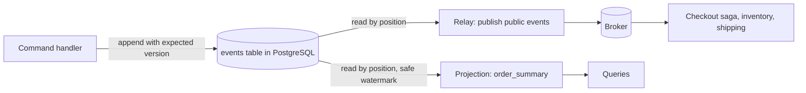

# An Event Store in a Relational Database, and Integration

**Microservices · CQRS and event sourcing · Step 4.9.6 · Advanced** · Last updated 2026-10-23
**Prerequisites:** [Event sourcing](03-event-sourcing.md) (4.9.3), [Projections and read models](04-projections-read-models.md) (4.9.4), [Reliable messaging for sagas](../08-saga/05-reliable-messaging-outbox-inbox.md) (4.8.5)

**Version note**

| Item | Version |
|---|---|
| Baseline | An append-only events table with a unique `(stream_id, version)` constraint; works on any relational database with unique constraints and transactions |
| Hands-on baseline | PostgreSQL 16.15 (the `postgres:16-alpine` image), `psql`, run on 2026-10-23. The snapshot-based safe reading uses `xid8`, `pg_current_xact_id()` and `pg_snapshot_xmin()`, which are PostgreSQL features |
| Compatibility note | Other databases need their own technique for the "late commit" problem in worked example 3; purpose-built event stores solve it for you |

## 1. What it is and why it matters

**What is it?** The simplest event store is a table. Each row is one event, in a **stream** (an aggregate), with a **version** within the stream and a **global position**. A unique constraint on `(stream_id, version)` gives you optimistic concurrency, and a transaction gives you atomic appends. Projections read the table by position.

**Why do we need it?** Many teams already run PostgreSQL and do not want another database for a few aggregates. A table is enough to learn, to start, and often to run. But the details decide whether it is correct: concurrent writers, the order in which readers see events, poison events and rebuilds are all places where a naive version loses data silently.

**When would I meet it?** When you introduce event sourcing into an existing Spring and PostgreSQL service, and when you evaluate "do we need a dedicated event store product?"

> [!TIP]
> **Memory hook:** *a table of events needs three guards: a unique key against concurrent writers, a watermark against late commits, and a checkpoint in the same transaction as the read model.*

## 2. Industry terms

| Term | Simple meaning | Why it matters | Example | Related terms |
|---|---|---|---|---|
| **Stream and version** | The events of one aggregate, numbered 1, 2, 3 ... | Identity and order within the aggregate | `(order-O-1001, 3)` | Aggregate |
| **Global position** | A sequence number across all events | What projections use as their checkpoint | `bigserial` | Offset |
| **Unique `(stream_id, version)`** | The database refuses a second event with the same version | Optimistic concurrency, enforced by the database | `duplicate key value violates unique constraint` | Expected version |
| **Late commit / visibility gap** | A transaction with a lower position commits after one with a higher position | Readers can skip events forever | Positions 6 and 7 | Gaps, ordering |
| **Safe watermark** | Only read events from transactions that can no longer commit "behind" you | Closes the visibility gap | `txid < pg_snapshot_xmin(...)` | Low-water mark |
| **Transactional checkpoint** | Read-model changes and the checkpoint move in one transaction | No double or skipped application | `run_order_summary()` | Atomic update |
| **Poison event** | An event a projection cannot apply | Can block a projection forever | An event with no `total` | Dead letter |
| **Internal vs public events** | Events inside a service's store versus events published for others | Keep internals free to change | `OrderPlaced` v3 vs `OrderPlacedPublic` | Anti-corruption layer |
| **Process manager** | A component that reacts to events by issuing commands | How sagas fit with event sourcing | The checkout saga | [Orchestration](../08-saga/04-orchestration.md) |

## 3. In a real system (ShopFlow)

**The business problem.** `order-service` already uses PostgreSQL. The team wants event sourcing for the order aggregate and read models for the app and for finance, without introducing a new database. They need appends that never lose a concurrent decision, projections that never skip an event, and events that other services (inventory, shipping, the checkout saga) can consume.



**How a table helps.** One technology, one backup, one transaction boundary: the append, an inline projection or an outbox row can be committed together. Unique constraints do the concurrency control. The cost is that you build subscriptions, checkpoints and the visibility handling yourself.

**What it costs.** Careful SQL; a polling or notification mechanism for subscribers; partitioning and archiving as the table grows; and a ceiling on throughput compared with purpose-built stores. Many teams stay on a table for years; others move to a dedicated product when volume or subscriptions demand it.

**Elsewhere:** accounting systems on relational databases keep append-only journal tables; some frameworks (for example Marten on PostgreSQL) implement exactly this design with the hard parts done.

## 4. How it works

### Worked example 1: the table and the append

**Concept.** One table holds all streams. The `UNIQUE (stream_id, version)` constraint is the optimistic concurrency check. A `txid` column records which transaction wrote the event (used in example 3).

```sql
CREATE TABLE events (
    position    bigserial   PRIMARY KEY,                  -- global order of events (gaps are possible)
    stream_id   text        NOT NULL,                     -- one stream per aggregate, e.g. order-O-1001
    version     int         NOT NULL,                     -- 1, 2, 3 ... within the stream
    type        text        NOT NULL,
    data        jsonb       NOT NULL,
    recorded_at timestamptz NOT NULL DEFAULT now(),
    txid        xid8        NOT NULL DEFAULT pg_current_xact_id(),   -- the transaction that wrote it
    UNIQUE (stream_id, version)                           -- optimistic concurrency: one event per version
);

INSERT INTO events (stream_id, version, type, data) VALUES
    ('order-O-1001', 1, 'OrderPlaced',     '{"customerId": "C-7", "total": 90.00}'),
    ('order-O-1001', 2, 'PaymentCaptured', '{"amount": 90.00}'),
    ('order-O-1001', 3, 'OrderShipped',    '{}');

SELECT stream_id, version, type, data FROM events WHERE stream_id = 'order-O-1001' ORDER BY version;
```

```text
$ docker --context rancher-desktop exec -i sf-learn-pg psql -U postgres < event-store.sql
CREATE TABLE
INSERT 0 3
  stream_id   | version |      type       |                 data                  
--------------+---------+-----------------+---------------------------------------
 order-O-1001 |       1 | OrderPlaced     | {"total": 90.00, "customerId": "C-7"}
 order-O-1001 |       2 | PaymentCaptured | {"amount": 90.00}
 order-O-1001 |       3 | OrderShipped    | {}
(3 rows)
```

**Walkthrough.** The three events of order `O-1001` are one stream, versions 1 to 3. Reading an aggregate is `WHERE stream_id = ... ORDER BY version`, which the unique index serves.

### Worked example 2: two writers, one version

Both writers loaded version 3 and each tries to append version 4:

```sql
-- Two writers both read the stream at version 3 and both try to append version 4.
INSERT INTO events (stream_id, version, type, data) VALUES ('order-O-1001', 4, 'OrderReturned', '{}');
INSERT INTO events (stream_id, version, type, data) VALUES ('order-O-1001', 4, 'OrderCancelled', '{"reason": "changed my mind"}');
SELECT stream_id, version, type FROM events WHERE stream_id = 'order-O-1001' ORDER BY version;
```

```text
$ docker --context rancher-desktop exec -i sf-learn-pg psql -U postgres < conflict.sql 2>&1
INSERT 0 1
ERROR:  duplicate key value violates unique constraint "events_stream_id_version_key"
DETAIL:  Key (stream_id, version)=(order-O-1001, 4) already exists.
  stream_id   | version |      type       
--------------+---------+-----------------
 order-O-1001 |       1 | OrderPlaced
 order-O-1001 |       2 | PaymentCaptured
 order-O-1001 |       3 | OrderShipped
 order-O-1001 |       4 | OrderReturned
(4 rows)
```

**Walkthrough.** The first insert won (`OrderReturned` at version 4). The second was refused by the database: `duplicate key value violates unique constraint "events_stream_id_version_key"`. The loser must reload the stream, decide again with the new state, and retry or give up ([4.9.3](03-event-sourcing.md)). Note that the refused insert still consumed a value of the position sequence: **positions have gaps**, so a reader must never assume they are consecutive. A helper makes the check explicit and gives a clearer error (the unique constraint still protects against a true race between two transactions):

```sql
CREATE FUNCTION append_event(p_stream text, p_expected int, p_type text, p_data jsonb) RETURNS int LANGUAGE plpgsql AS $$
DECLARE
    current_version int;
BEGIN
    SELECT coalesce(max(version), 0) INTO current_version FROM events WHERE stream_id = p_stream;
    IF current_version <> p_expected THEN
        RAISE EXCEPTION 'expected version %, but stream % is at version %', p_expected, p_stream, current_version
            USING ERRCODE = '40001';                    -- serialization_failure: the caller should reload and retry
    END IF;
    INSERT INTO events (stream_id, version, type, data) VALUES (p_stream, current_version + 1, p_type, p_data);
    RETURN current_version + 1;                         -- the unique (stream_id, version) constraint still guards a race
END $$;

SELECT append_event('order-O-3001', 2, 'OrderShipped', '{}') AS new_version;
SELECT append_event('order-O-3001', 2, 'OrderCancelled', '{"reason": "too late"}') AS new_version;
SELECT version, type FROM events WHERE stream_id = 'order-O-3001' ORDER BY version;
```

```text
$ docker --context rancher-desktop exec -i sf-learn-pg psql -U postgres < append-function.sql 2>&1
CREATE FUNCTION
 new_version 
-------------
           3
(1 row)

ERROR:  expected version 2, but stream order-O-3001 is at version 3
CONTEXT:  PL/pgSQL function append_event(text,integer,text,jsonb) line 7 at RAISE
 version |      type       
---------+-----------------
       1 | OrderPlaced
       2 | PaymentCaptured
       3 | OrderShipped
(3 rows)
```

### Worked example 3: the late commit that a reader never sees

**Concept.** Positions are assigned when the row is inserted, but rows become visible when their transaction commits. So a transaction that got position 6 can commit *after* one that got position 7. A reader that remembers "I have processed everything up to the highest position I saw" will miss position 6 forever. This is the most dangerous bug of relational event stores.

The experiment: writer A inserts (position 6) and keeps its transaction open for 4 seconds; writer B inserts (position 7) and commits at once. A naive projection reads after position 4; a safe one adds the condition `txid < pg_snapshot_xmin(pg_current_snapshot())`, which only returns events from transactions older than every transaction still in progress. (The two events carry empty data on purpose; the next example shows what that does to a projection.)

```bash
#!/bin/bash
# Two writers append to different streams. Writer A starts first (so it gets the lower position) but commits last.
# Two projections read "everything after my checkpoint": a naive one and one that waits for open transactions.
D="docker --context rancher-desktop"
PSQL="$D exec -i sf-learn-pg psql -U postgres -At"
CHECKPOINT=$($PSQL -c "SELECT max(position) FROM events")

naive()  { $PSQL -c "SELECT position || ' ' || stream_id || ' ' || type FROM events WHERE position > $1 ORDER BY position"; }
safe()   { $PSQL -c "SELECT position || ' ' || stream_id || ' ' || type FROM events WHERE position > $1 AND txid < pg_snapshot_xmin(pg_current_snapshot()) ORDER BY position"; }

# Writer A: inserts, then keeps the transaction open for 4 seconds before it commits.
( echo "BEGIN; INSERT INTO events (stream_id, version, type, data) VALUES ('order-O-2001', 1, 'OrderPlaced', '{}'); SELECT pg_sleep(4); COMMIT;" | $PSQL > /dev/null ) &
sleep 1
# Writer B: inserts and commits at once (it gets the HIGHER position but is visible first).
$PSQL -c "INSERT INTO events (stream_id, version, type, data) VALUES ('order-O-2002', 1, 'OrderPlaced', '{}')" > /dev/null

echo "t=2 s: writer A has not committed yet; writer B has"
echo "   naive projection reads after position $CHECKPOINT and sees:"; naive $CHECKPOINT | sed 's/^/      /'
NAIVE_NEXT=$($PSQL -c "SELECT max(position) FROM events")
echo "   so it moves its checkpoint to $NAIVE_NEXT"
echo "   safe projection reads after position $CHECKPOINT and sees:"; safe $CHECKPOINT | sed 's/^/      /'; echo "      (nothing: it waits for the open transaction)"

wait
echo
echo "t=6 s: writer A has committed"
echo "   naive projection reads after position $NAIVE_NEXT and sees:"; naive $NAIVE_NEXT | sed 's/^/      /'; echo "      (nothing: the event of writer A is skipped forever)"
echo "   safe projection reads after position $CHECKPOINT and sees:"; safe $CHECKPOINT | sed 's/^/      /'
```

```text
$ bash late-commit.sh
t=2 s: writer A has not committed yet; writer B has
   naive projection reads after position 4 and sees:
      7 order-O-2002 OrderPlaced
   so it moves its checkpoint to 7
   safe projection reads after position 4 and sees:
      (nothing: it waits for the open transaction)

t=6 s: writer A has committed
   naive projection reads after position 7 and sees:
      (nothing: the event of writer A is skipped forever)
   safe projection reads after position 4 and sees:
      6 order-O-2001 OrderPlaced
      7 order-O-2002 OrderPlaced
```

**Walkthrough.** At t=2 s the naive projection saw only B's event (position 7) and moved its checkpoint to 7. When A committed, position 6 was behind the checkpoint, so the naive projection **never saw it**: an event is lost to that read model permanently, with no error. The safe projection saw nothing at first (it waits for A's transaction), and after A committed it read 6 and 7 in order. The PostgreSQL documentation describes the function: `pg_snapshot_xmin` "returns the xmin of a snapshot", the lowest transaction id still in progress. Other approaches: write events through a single sequencer or an advisory lock (simple, but it serialises writers), re-read a trailing window below the checkpoint and ignore duplicates, or use a store that guarantees gap-free commit order.

### Worked example 4: a projection in SQL, with a poison event and a rebuild

**Concept.** A read table `order_summary` and a `projection_checkpoint` table. One function advances the projection: it locks the checkpoint row, applies new events in position order (only from the safe watermark), and moves the checkpoint, all in one transaction.

```sql
CREATE TABLE order_summary (
    order_id      text    PRIMARY KEY,
    customer_id   text,
    status        text    NOT NULL,
    total         numeric NOT NULL,
    paid          numeric NOT NULL DEFAULT 0,
    last_position bigint  NOT NULL
);

CREATE TABLE projection_checkpoint (
    name     text   PRIMARY KEY,
    position bigint NOT NULL
);
INSERT INTO projection_checkpoint VALUES ('order_summary', 0);

-- One run of the projection. The read-model changes and the checkpoint move in ONE transaction.
CREATE FUNCTION run_order_summary() RETURNS int LANGUAGE plpgsql AS $$
DECLARE
    cp      bigint;
    e       record;
    applied int := 0;
    oid     text;
BEGIN
    -- lock the checkpoint row: two runners cannot work on the same projection at once
    SELECT position INTO cp FROM projection_checkpoint WHERE name = 'order_summary' FOR UPDATE;
    FOR e IN
        SELECT * FROM events
         WHERE position > cp AND txid < pg_snapshot_xmin(pg_current_snapshot())   -- only events that can no longer appear "late"
         ORDER BY position
    LOOP
        oid := replace(e.stream_id, 'order-', '');
        IF e.type = 'OrderPlaced' THEN
            INSERT INTO order_summary VALUES (oid, e.data->>'customerId', 'PLACED', (e.data->>'total')::numeric, 0, e.position)
            ON CONFLICT (order_id) DO NOTHING;
        ELSIF e.type = 'PaymentCaptured' THEN
            UPDATE order_summary SET paid = paid + (e.data->>'amount')::numeric, last_position = e.position WHERE order_id = oid;
        ELSIF e.type = 'OrderShipped' THEN
            UPDATE order_summary SET status = 'SHIPPED', last_position = e.position WHERE order_id = oid;
        ELSIF e.type = 'OrderReturned' THEN
            UPDATE order_summary SET status = 'RETURNED', last_position = e.position WHERE order_id = oid;
        END IF;
        cp := e.position;
        applied := applied + 1;
    END LOOP;
    UPDATE projection_checkpoint SET position = cp WHERE name = 'order_summary';
    RETURN applied;
END $$;
```

```text
$ docker --context rancher-desktop exec -i sf-learn-pg psql -U postgres < projection.sql
CREATE TABLE
CREATE TABLE
INSERT 0 1
CREATE FUNCTION
```

The first run meets the two `OrderPlaced` events with empty data written by the previous example:

```sql
-- Two OrderPlaced events from the earlier experiment have no "total" in their data. The projection cannot apply them.
SELECT run_order_summary();
SELECT * FROM projection_checkpoint;
SELECT count(*) AS read_model_rows FROM order_summary;
```

```text
$ docker --context rancher-desktop exec -i sf-learn-pg psql -U postgres < poison.sql 2>&1 | cut -c1-200
ERROR:  null value in column "total" of relation "order_summary" violates not-null constraint
DETAIL:  Failing row contains (O-2001, null, PLACED, null, 0, 6).
CONTEXT:  SQL statement "INSERT INTO order_summary VALUES (oid, e.data->>'customerId', 'PLACED', (e.data->>'total')::numeric, 0, e.position)
            ON CONFLICT (order_id) DO NOTHING"
PL/pgSQL function run_order_summary() line 17 at SQL statement
     name      | position 
---------------+----------
 order_summary |        0
(1 row)

 read_model_rows 
-----------------
               0
(1 row)
```

**Walkthrough.** The function failed on a missing `total`. Because everything happened in one transaction, **nothing was applied and the checkpoint stayed at 0**: the read model is consistent but the projection is stuck on the poison event, and will stay stuck on every retry. Events are immutable, so the answer is to change the projection: record the bad event in an error table, skip it, and alert:

```sql
-- The fix: a projection must not stop forever on one bad event. Record it, skip it, keep going, and alert on the error table.
CREATE TABLE projection_errors (
    projection text   NOT NULL,
    position   bigint NOT NULL,
    reason     text   NOT NULL,
    PRIMARY KEY (projection, position)
);

CREATE OR REPLACE FUNCTION run_order_summary() RETURNS int LANGUAGE plpgsql AS $$
DECLARE
    cp      bigint;
    e       record;
    applied int := 0;
    oid     text;
BEGIN
    SELECT position INTO cp FROM projection_checkpoint WHERE name = 'order_summary' FOR UPDATE;
    FOR e IN
        SELECT * FROM events
         WHERE position > cp AND txid < pg_snapshot_xmin(pg_current_snapshot())
         ORDER BY position
    LOOP
        oid := replace(e.stream_id, 'order-', '');
        IF e.type = 'OrderPlaced' AND (e.data->>'total') IS NULL THEN
            INSERT INTO projection_errors VALUES ('order_summary', e.position, 'OrderPlaced without total')
            ON CONFLICT DO NOTHING;
        ELSIF e.type = 'OrderPlaced' THEN
            INSERT INTO order_summary VALUES (oid, e.data->>'customerId', 'PLACED', (e.data->>'total')::numeric, 0, e.position)
            ON CONFLICT (order_id) DO NOTHING;
        ELSIF e.type = 'PaymentCaptured' THEN
            UPDATE order_summary SET paid = paid + (e.data->>'amount')::numeric, last_position = e.position WHERE order_id = oid;
        ELSIF e.type = 'OrderShipped' THEN
            UPDATE order_summary SET status = 'SHIPPED', last_position = e.position WHERE order_id = oid;
        ELSIF e.type = 'OrderReturned' THEN
            UPDATE order_summary SET status = 'RETURNED', last_position = e.position WHERE order_id = oid;
        END IF;
        cp := e.position;
        applied := applied + 1;
    END LOOP;
    UPDATE projection_checkpoint SET position = cp WHERE name = 'order_summary';
    RETURN applied;
END $$;
```

```text
$ docker --context rancher-desktop exec -i sf-learn-pg psql -U postgres < projection-fix.sql
CREATE TABLE
CREATE FUNCTION
```

Then the projection runs, runs again, receives new events, and is rebuilt:

```sql
SELECT run_order_summary() AS events_applied_first_run;
SELECT order_id, customer_id, status, total, paid, last_position FROM order_summary ORDER BY order_id;
SELECT * FROM projection_checkpoint;
SELECT * FROM projection_errors;

SELECT run_order_summary() AS events_applied_second_run;     -- nothing new: idempotent

-- A valid new order arrives and is paid; the next run applies only those events.
INSERT INTO events (stream_id, version, type, data) VALUES ('order-O-3001', 1, 'OrderPlaced', '{"customerId": "C-9", "total": 40.00}');
INSERT INTO events (stream_id, version, type, data) VALUES ('order-O-3001', 2, 'PaymentCaptured', '{"amount": 40.00}');
SELECT run_order_summary() AS events_applied_after_two_new_events;
SELECT order_id, status, total, paid, last_position FROM order_summary WHERE order_id = 'O-3001';

-- Rebuild from scratch: empty the read model, move the checkpoint back to 0, run again.
TRUNCATE order_summary;
DELETE FROM projection_errors;
UPDATE projection_checkpoint SET position = 0 WHERE name = 'order_summary';
SELECT run_order_summary() AS events_applied_by_the_rebuild;
SELECT count(*) AS rows_after_rebuild FROM order_summary;
```

```text
$ docker --context rancher-desktop exec -i sf-learn-pg psql -U postgres < projection-run.sql
 events_applied_first_run 
--------------------------
                        6
(1 row)

 order_id | customer_id |  status  | total | paid  | last_position 
----------+-------------+----------+-------+-------+---------------
 O-1001   | C-7         | RETURNED | 90.00 | 90.00 |             4
(1 row)

     name      | position 
---------------+----------
 order_summary |        7
(1 row)

  projection   | position |          reason           
---------------+----------+---------------------------
 order_summary |        6 | OrderPlaced without total
 order_summary |        7 | OrderPlaced without total
(2 rows)

 events_applied_second_run 
---------------------------
                         0
(1 row)

INSERT 0 1
INSERT 0 1
 events_applied_after_two_new_events 
-------------------------------------
                                   2
(1 row)

 order_id | status | total | paid  | last_position 
----------+--------+-------+-------+---------------
 O-3001   | PLACED | 40.00 | 40.00 |            10
(1 row)

TRUNCATE TABLE
DELETE 2
UPDATE 1
 events_applied_by_the_rebuild 
-------------------------------
                             8
(1 row)

 rows_after_rebuild 
--------------------
                  2
(1 row)
```

**Walkthrough.** The first run applied 6 events; the two bad ones are in `projection_errors` and the checkpoint is at 7. The second run applied 0 events: idempotent. After two new events for `O-3001` the next run applied exactly 2, and the order shows status `PLACED`, paid 40.00. The rebuild emptied the read model, set the checkpoint to 0 and reapplied all 8 stored events (the four events of `O-1001`, the two bad ones, and the two of `O-3001`) to produce the same two rows. The `FOR UPDATE` on the checkpoint row stops two runners from advancing the same projection at the same time.

### Publishing events to other services

Other services should not read your events table. Publish **public events** to a broker, from the same table:

1. A relay reads events after its own checkpoint (with the safe watermark), maps internal events to **public event** contracts (a deliberate, versioned translation, so you can change internals freely), and publishes them keyed by stream id ([4.8.5](../08-saga/05-reliable-messaging-outbox-inbox.md)).
2. Delivery is at least once; consumers are idempotent (inbox or natural keys).
3. A wake-up (PostgreSQL `LISTEN/NOTIFY`) can reduce polling delay, but it is only a hint: the relay must still read by position, because notifications can be lost.
4. Alternatively, change data capture on the events table (Debezium) does the relay's job.

### Sagas and event sourcing

- A saga's orchestrator reacts to events ("`PaymentCaptured` happened, send `CreateShipment`") and issues commands to other aggregates: a **process manager** ([4.8.4](../08-saga/04-orchestration.md)). Its own state can also be event-sourced, giving its history for free.
- The command handler's append and the saga's outgoing command can be committed together, because the event table doubles as the **outbox**.
- Cross-aggregate rules still need a saga or a design that keeps them inside one aggregate: event sourcing does not provide distributed transactions.

### Common mistakes

1. **Reading by "greater than the highest position seen"** with no watermark (worked example 3).
2. **Assuming positions are gap-free.**
3. **Updating the read model and the checkpoint in separate transactions.**
4. **A projection that stops forever on one bad event** with no error handling.
5. **Exposing the events table (internal events) to other services.**
6. **One giant table with no plan for size** (partition by time or stream, archive, snapshot).
7. **Using `UPDATE` or `DELETE` on events** to fix mistakes.

## 5. Failure scenarios

### The silently missing event

1. **What happened?** One order never appeared in the "My orders" projection, though its events were in the table (worked example 3).
2. **Why?** A late commit: the event's position was lower than the projection's checkpoint when it became visible.
3. **What did users see?** An order missing from their list.
4. **Solutions:** the safe watermark; or re-read a window behind the checkpoint; or a single sequencer; reconcile read models with the event table on a schedule.
5. **What they cost:** a more careful read query, or lower write concurrency.

### The stuck projection

1. **What happened?** A projection stopped advancing and its lag grew for days (worked example 4).
2. **Why?** One event violated a constraint; the transaction rolled back on every retry.
3. **What did users see?** Increasingly stale views.
4. **Solutions:** skip and record bad events, alert on lag and on the error table; fix the projection and rebuild if needed.
5. **What they cost:** an error table, alerts and a policy for who reviews skipped events.

### The table that outgrew the server

1. **What happened?** After two years the events table held billions of rows, and rebuilds took days.
2. **Why?** No partitioning, snapshots or archiving.
3. **What did the business see?** Slow projections and risky rebuilds.
4. **Solutions:** partition by time; snapshot long streams ([4.9.5](05-snapshots-versioning-privacy.md)); build new projections in parallel from a restored copy; consider a dedicated event store when volume demands.
5. **What they cost:** operational work and a migration if you change stores.

## 6. Architectural decisions

| Decision | Choose | Because |
|---|---|---|
| Event store | A table in the existing PostgreSQL for modest volumes; a dedicated store when throughput, subscriptions or tooling demand | One less system to run, with a known ceiling |
| Concurrency | Unique `(stream_id, version)` plus an explicit append function | The database enforces it |
| Reading for projections | By position with a safe watermark (or a single sequencer) | No event is skipped |
| Projection state | Read model and checkpoint in one transaction; idempotent handlers | Safe restarts and replays |
| Bad events | Skip, record, alert | One event must not stop a view |
| Publishing | Public event contracts from a relay (or CDC), at-least-once, keyed by stream | Internals can change |
| Sagas | Process managers reacting to events; commit commands with the append | Reliable orchestration |
| Table growth | Partition, snapshot, archive; plan rebuilds | Operability over years |

### Alternatives in the industry

A map of the landscape, not a comparison. Only PostgreSQL and `psql` were run; check each project's documentation before adopting one.

| Area | Tool or product | What it is | When you meet it |
|---|---|---|---|
| Event store libraries on a database | **Marten** (".NET Transactional Document DB and Event Store on PostgreSQL"), **Axon Framework** with a relational store, **Eventuate** | Do the appends, subscriptions and projections for you | Teams that want the design without writing it |
| Dedicated event stores | **EventStoreDB** (Kurrent), **Axon Server** | Built for streams, optimistic concurrency and subscriptions | High volume or many subscribers |
| Logs for distribution | **Apache Kafka** and similar | Durable ordered logs. Good for distributing public events; typically no per-stream optimistic concurrency, so not a replacement for the store | Fan-out to services ([2.2.2](../../02-messaging/02-kafka/02-log-topics-partitions-offsets.md)) |
| Database-native features | **PostgreSQL logical decoding** and **Debezium**, `LISTEN/NOTIFY` | Stream changes out of the table; wake subscribers | Relays and CDC |
| Managed alternatives | **DynamoDB** with streams, **Cosmos DB** change feed | Append-only items and change feeds | Teams on those clouds |

## 7. Try it yourself

Try each exercise first; the real results are in the Answers section.

1. **A tidy append.** Write the call that appends `OrderShipped` to a stream at version 2 only if that is the current version, and show what happens when it is called twice.
2. **Read the stream.** Write a query that returns the events of `order-O-1001` in order and the number of events.
3. **Why the watermark?** Explain in two sentences why a reader may miss an event without it.

## 8. Check your understanding

1. Which database feature implements optimistic concurrency in this design?
2. Why can positions have gaps, and why does that matter for readers?
3. What would happen to the projection if the checkpoint were stored in a separate transaction?
4. Why publish public events rather than let other services read the events table?

Answers are at the end of this note.

## 9. Revision

**Remember**
- Event store table: `stream_id, version, position, type, data` and **`UNIQUE (stream_id, version)`**.
- **Gaps** in positions are normal; **late commits** can hide events from naive readers: use a **safe watermark** or a sequencer.
- **Read model and checkpoint in one transaction**; idempotent runs; **skip and record** poison events; **rebuild** by resetting the checkpoint.
- Publish **public events** through a relay or CDC (at-least-once, keyed); consumers dedupe.
- Process managers (sagas) react to events; the events table can double as the outbox.

**Explain in 15 seconds:** "A relational event store is an append-only table with a unique stream-and-version key for concurrency; projections read by position behind a safe watermark and move their checkpoint in the same transaction as the read model."

**Explain in 60 seconds:**
> "I can build an event store on PostgreSQL with one table: stream id, version, global position, type and JSON data, and a unique constraint on stream and version so two writers can't append the same version; the loser reloads and decides again. Projections read events after their checkpoint, but I have to remember that positions are assigned at insert time and rows become visible at commit time, so a slow transaction can commit after a later one and a naive reader would skip it for ever. I close that gap with a safe watermark, only reading events from transactions older than anything still in progress, or by serialising writers. The projection updates its read model and its checkpoint in one transaction, is idempotent, skips and records events it can't apply, and can be rebuilt by resetting the checkpoint. Other services get public events from a relay or CDC, at least once and keyed by stream, and sagas run as process managers reacting to those events. When volume or subscription needs outgrow a table, I move to a dedicated event store."

**Architect's takeaway:** a table is a perfectly good event store if you respect its three traps: concurrent writers, late commits and stuck projections. Know them before you choose between building and buying.

**Next topic:** [Case study: the ShopFlow order history](07-case-order-history.md) (4.9.7)

## 10. Verification and sources

> [!NOTE]
> Checked 2026-10-23 against the sources below, and by running every SQL script and shell script above in PostgreSQL 16.15 (a throwaway container, removed afterwards). Re-verify when you revisit this note.

- **Confirmed (documentation, read 2026-10-23):** "pg_snapshot_xmin ( pg_snapshot ) → xid8 Returns the xmin of a snapshot" and `pg_current_xact_id()` returns the current transaction's id as `xid8` (PostgreSQL, "System Information Functions"); an event store can be built on "a general-purpose relational or document database with an append-only table", while purpose-built stores provide per-entity stream reads, optimistic concurrency and snapshots built in; and Kafka-style brokers "typically lack per-entity stream queries and optimistic concurrency" and are better as a distribution layer (Microsoft Learn, "Event Sourcing pattern"); `SELECT ... FOR UPDATE` row locking (PostgreSQL, SELECT).
- **Observed (this machine):** the output of every script: the unique-constraint error, the gap in positions, the naive reader skipping position 6, the safe reader returning 6 and 7, the failed first projection run and the unchanged checkpoint, the corrected runs and the rebuild, and the append function's error.
- **Assumptions and illustrations:** the schema is a teaching schema (a production table adds metadata, correlation ids, partitioning and indexes); the "safe watermark" shown is one known technique and its behaviour with long-running or prepared transactions should be understood before relying on it. The two events with empty data were created on purpose to trigger the poison-event case.
- **To verify:** how long-running transactions in your system affect the watermark (a transaction left open holds the watermark back); the volume at which a table stops being enough; your database's equivalents of `xid8` snapshots.
- **Decision rule:** table first for modest volume, with unique key, safe watermark, transactional checkpoints and skip-and-record; a dedicated store or library when the ceiling is reached.

**Sources:** PostgreSQL documentation (system information functions, SELECT, INSERT); Microsoft Learn, Azure Architecture Center, "Event Sourcing pattern"; Marten documentation site.

## Answers

**Experiment (exercises)**

1. **A tidy append:** `SELECT append_event('order-O-3001', 2, 'OrderShipped', '{}');` appends and returns version 3; the second identical call fails because the stream is no longer at version 2, with `ERROR: expected version 2, but stream order-O-3001 is at version 3` and the SQLSTATE `40001`, which tells the caller to reload and retry:

```text
$ docker --context rancher-desktop exec -i sf-learn-pg psql -U postgres < append-function.sql 2>&1
CREATE FUNCTION
 new_version 
-------------
           3
(1 row)

ERROR:  expected version 2, but stream order-O-3001 is at version 3
CONTEXT:  PL/pgSQL function append_event(text,integer,text,jsonb) line 7 at RAISE
 version |      type       
---------+-----------------
       1 | OrderPlaced
       2 | PaymentCaptured
       3 | OrderShipped
(3 rows)
```

2. **Read the stream:** `SELECT version, type, data FROM events WHERE stream_id = 'order-O-1001' ORDER BY version;` and `SELECT count(*) FROM events WHERE stream_id = 'order-O-1001';` (the count is also the current version when versions have no gaps, which the unique, append-only design maintains).
3. **Why the watermark?** Positions are assigned when a row is inserted but a row is only visible after its transaction commits, so a slow transaction can become visible after a faster one that has a higher position. A reader that moves its checkpoint to the highest position it saw will never go back to read the lower position that appeared later.

**Check your understanding**

1. The `UNIQUE (stream_id, version)` constraint (together with the append function that checks the expected version): a second writer for the same version is refused by the database.
2. Because the sequence value is taken at insert time and is not given back when the insert fails or the transaction rolls back (the refused insert consumed one). Readers must therefore use "greater than" comparisons on positions and never assume consecutive numbers; they cannot detect missing events by looking for gaps.
3. A crash between the read-model update and the checkpoint update would leave the read model changed with the old checkpoint (the event is applied twice after restart) or the checkpoint moved with the read model unchanged (the event is lost). One transaction makes both happen or neither.
4. The table is the service's private model: other services would couple to its schema and event shapes, and any change would break them. Public events are a deliberate, versioned contract, and publishing them through a broker gives delivery, fan-out and independent consumer progress.

Back to [the series overview](01-cqrs-es-overview.md) · [the Microservices overview](../01-microservices-overview.md) · [the index](../../README.md) · [Roadmap](../../roadmap.md).
