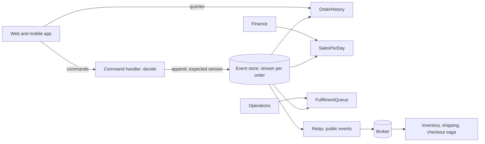

# Case Study: The ShopFlow Order History

**Microservices · CQRS and event sourcing · Step 4.9.7 · Advanced** · Last updated 2026-10-23
**Prerequisites:** the whole series: [CQRS](02-cqrs-separate-models.md) (4.9.2), [event sourcing](03-event-sourcing.md) (4.9.3), [projections](04-projections-read-models.md) (4.9.4), [snapshots, versioning and privacy](05-snapshots-versioning-privacy.md) (4.9.5), [an event store in PostgreSQL](06-event-store-postgresql-integration.md) (4.9.6)

**Version note**

| Item | Version |
|---|---|
| Baseline | Everything taught in steps 4.9.1 to 4.9.6 |
| Hands-on baseline | Java 21 (OpenJDK 21.0.8), plain JDK, run on 2026-10-23 |
| Compatibility note | The simulation keeps the event store and the projections in one JVM with manual delivery to make the lag visible; production uses a database and subscriptions |

## 1. What it is and why it matters

**What is it?** One complete design: ShopFlow's order service built with CQRS and event sourcing, from the decision to use them, through the events, the aggregate, the concurrency rule and three read models, to the operating rules. It also shows where the patterns are **not** used.

**Why do we need it?** The earlier lessons each explain one part. A real design decides *where* the patterns pay for themselves, how the parts agree with each other (consistency, versions, privacy), and what the team must run and test.

**When would I meet it?** When you propose or review an event-sourced service, in architecture interviews ("design the order history so support can see everything that happened"), and when deciding which parts of a system should stay plain CRUD.

> [!TIP]
> **Memory hook:** *events where history matters, CRUD where it does not; one read model per question; the write side decides, the read side only answers.*

## 2. Industry terms

This lesson introduces no new terms. The map shows where each idea of the series appears in the design.

| Idea | Lesson | In the order history design |
|---|---|---|
| Command, query, read model | [4.9.2](02-cqrs-separate-models.md) | `CancelOrder` is a command; `OrderHistory` answers queries |
| Event, stream, `decide`, `evolve`, expected version | [4.9.3](03-event-sourcing.md) | One stream per order; refusals append nothing |
| Projection, checkpoint, rebuild | [4.9.4](04-projections-read-models.md) | Three live projections; `LateShipments` added later |
| Snapshot, upcaster, crypto-shredding | [4.9.5](05-snapshots-versioning-privacy.md) | No snapshots needed; versions and privacy planned |
| Event table, safe watermark, public events | [4.9.6](06-event-store-postgresql-integration.md) | A PostgreSQL table to begin; a relay for public events |
| Eventual consistency, read your writes | [4.9.2](02-cqrs-separate-models.md) | Commands return a position |

## 3. In a real system (ShopFlow)

**The business problem.** ShopFlow wants:
- customers to see their order history quickly, including cancelled and shipped orders;
- support to see exactly what happened to any order, in order, for disputes;
- finance to see revenue per day, **net of refunds**;
- operations to see which paid orders are waiting to be shipped, and later which shipments were late;
- no overselling or double shipping when two staff act on the same order at once.

**Where to use the patterns, and where not.**

| Area | Choice | Why |
|---|---|---|
| Orders (lifecycle with rules and disputes) | **Event sourcing + CQRS** | History matters; many read shapes |
| Payments ledger | **Event sourcing** (append-only) | Auditors want the entries; balances are projections |
| Product catalogue | **Plain CRUD**, cached | Reference data, no audit need ([4.9.1](01-cqrs-es-overview.md)) |
| User preferences | **Plain CRUD** | Simple, no history needed |
| Search | **A projection** into a search index | A different technology for a different query |

**The design.**

| Part | Decision |
|---|---|
| Aggregate and stream | One stream per order: `order-O-1001`, events `OrderPlaced`, `PaymentCaptured`, `OrderShipped`, `OrderCancelled`, `PaymentRefunded` (all small; about 5 to 8 events per order, so no snapshots) |
| Rules | In `decide`, against the order rebuilt from its stream; refused commands append nothing |
| Concurrency | Append with the expected version; the loser reloads and decides again |
| Read models | `OrderHistory` (per customer), `SalesPerDay` (net of refunds), `FulfilmentQueue` (paid, not shipped); later `LateShipments` |
| Consistency | Eventual; commands return the position of their last event; the UI waits for the view to reach it, or shows the response |
| Integration | A relay publishes **public** order events (versioned contracts) to the broker; inventory, shipping and the checkout saga consume them ([4.8](../08-saga/01-saga-overview.md)) |
| Privacy | Events carry the customer id only; names and addresses live in a customer service that can delete them ([4.9.5](05-snapshots-versioning-privacy.md)) |
| Versioning | Version numbers on events; upcasters on read; compatibility tests with old events |
| Operations | Lag per projection, an error table for skipped events, a rebuild runbook |



**What it costs.** Two models, projections to run and watch, an event contract to maintain for years, and a team that knows the patterns. In exchange: a complete audit trail, tailored fast views, no lost concurrent decisions, and new reports from old history.

**Elsewhere:** exchanges and banks keep every order and trade as events; e-commerce platforms keep order histories as event streams to answer disputes; logistics companies replay shipment events to answer new service-level questions.

## 4. How it works

1. **Command arrives** (`CancelOrder O-2`). The handler loads the stream, rebuilds the state, runs the rule (`decide`) and, if allowed, appends the new events with the expected version.
2. **Events are stored** with positions; the command returns the last position.
3. **Projections** consume the log in order from their checkpoints and update their read models; duplicates are ignored.
4. **A query** reads a read model; if the client just sent a command it waits for the view to reach the position.
5. **A new question** gets a new projection built from the existing log.
6. **A bug in a view** is fixed by rebuilding it from position 0 beside the old one.

### Worked example 1: the order history, end to end

**Concept.** The program wires the pieces above: an event-sourced order (events, `evolve`, a cancel rule), an event store with versions and a global position, three live projections with checkpoints, manual delivery (so the lag is visible), and three more things: a race between two staff, a duplicate delivery, and a rebuild with a fixed projection. Six scenarios.

```java
// File: OrderHistoryCapstone.java (runnable, Java 21)
import java.util.ArrayList;
import java.util.HashMap;
import java.util.LinkedHashMap;
import java.util.List;
import java.util.Locale;
import java.util.Map;
import java.util.TreeMap;

public class OrderHistoryCapstone {

    // ---------- Events, commands and the aggregate (event sourcing) ----------
    sealed interface OrderEvent permits OrderPlaced, PaymentCaptured, OrderShipped, OrderCancelled, PaymentRefunded {
        String orderId();
    }

    record OrderPlaced(String orderId, String customerId, double total, int day, long second) implements OrderEvent {}

    record PaymentCaptured(String orderId, double amount, int day, long second) implements OrderEvent {}

    record OrderShipped(String orderId, int day, long second) implements OrderEvent {}

    record OrderCancelled(String orderId, int day, long second) implements OrderEvent {}

    record PaymentRefunded(String orderId, double amount, int day, long second) implements OrderEvent {}

    record OrderState(boolean exists, String status, double total, double paid) {
        static final OrderState EMPTY = new OrderState(false, "NONE", 0, 0);
    }

    static OrderState evolve(OrderState s, OrderEvent e) {
        return switch (e) {
            case OrderPlaced p -> new OrderState(true, "PLACED", p.total(), 0);
            case PaymentCaptured c -> new OrderState(true, s.status(), s.total(), s.paid() + c.amount());
            case OrderShipped x -> new OrderState(true, "SHIPPED", s.total(), s.paid());
            case OrderCancelled x -> new OrderState(true, "CANCELLED", s.total(), s.paid());
            case PaymentRefunded r -> new OrderState(true, s.status(), s.total(), s.paid() - r.amount());
        };
    }

    // The rule for cancelling: only a placed order can be cancelled.
    static List<OrderEvent> decideCancel(String orderId, OrderState s, int day, long second) {
        if (!s.status().equals("PLACED")) {
            throw new IllegalStateException("cannot cancel order " + orderId + " in status " + s.status());
        }
        return List.of(new OrderCancelled(orderId, day, second), new PaymentRefunded(orderId, s.paid(), day, second));
    }

    // ---------- The event store: streams, versions, a global position, optimistic concurrency ----------
    record Stored(long position, String streamId, int version, OrderEvent event) {}

    static class ConcurrencyException extends RuntimeException {
        ConcurrencyException(String m) {
            super(m);
        }
    }

    static class EventStore {
        final List<Stored> log = new ArrayList<>();

        List<OrderEvent> stream(String streamId) {
            return log.stream().filter(s -> s.streamId().equals(streamId)).map(Stored::event).toList();
        }

        void append(String streamId, int expectedVersion, List<OrderEvent> events) {
            int current = stream(streamId).size();
            if (current != expectedVersion) {
                throw new ConcurrencyException("expected version " + expectedVersion + ", stream is at " + current);
            }
            for (OrderEvent e : events) {
                log.add(new Stored(log.size() + 1, streamId, ++current, e));
            }
        }
    }

    // ---------- Projections (CQRS read side): each keeps a checkpoint and ignores positions it has applied ----------
    abstract static class Projection {
        long checkpoint = 0;

        final void deliver(Stored s) {
            if (s.position() <= checkpoint) {
                return;
            }
            handle(s.event());
            checkpoint = s.position();
        }

        abstract void handle(OrderEvent e);
    }

    static class OrderHistory extends Projection {
        final Map<String, Map<String, String>> byCustomer = new LinkedHashMap<>();
        final Map<String, String> customerOf = new HashMap<>();

        void handle(OrderEvent e) {
            switch (e) {
                case OrderPlaced p -> {
                    customerOf.put(p.orderId(), p.customerId());
                    byCustomer.computeIfAbsent(p.customerId(), k -> new LinkedHashMap<>()).put(p.orderId(), "PLACED");
                }
                case OrderShipped x -> byCustomer.get(customerOf.get(x.orderId())).put(x.orderId(), "SHIPPED");
                case OrderCancelled x -> byCustomer.get(customerOf.get(x.orderId())).put(x.orderId(), "CANCELLED");
                default -> { }
            }
        }

        String query(String customerId) {
            return byCustomer.getOrDefault(customerId, Map.of()).toString();
        }
    }

    static class SalesPerDay extends Projection {
        final Map<Integer, Double> revenue = new TreeMap<>();
        final boolean subtractRefunds;

        SalesPerDay(boolean subtractRefunds) {
            this.subtractRefunds = subtractRefunds;
        }

        void handle(OrderEvent e) {
            if (e instanceof PaymentCaptured c) {
                revenue.merge(c.day(), c.amount(), Double::sum);
            } else if (e instanceof PaymentRefunded r && subtractRefunds) {
                revenue.merge(r.day(), -r.amount(), Double::sum);
            }
        }

        String query() {
            StringBuilder sb = new StringBuilder();
            revenue.forEach((day, amount) -> sb.append(String.format(Locale.ROOT, "day %d: %.2f  ", day, amount)));
            return sb.toString().trim();
        }
    }

    static class FulfilmentQueue extends Projection {
        final Map<String, Long> waiting = new LinkedHashMap<>();        // paid, not yet shipped or cancelled

        void handle(OrderEvent e) {
            switch (e) {
                case PaymentCaptured c -> waiting.put(c.orderId(), c.second());
                case OrderShipped x -> waiting.remove(x.orderId());
                case OrderCancelled x -> waiting.remove(x.orderId());
                default -> { }
            }
        }

        String query() {
            return waiting.keySet().toString();
        }
    }

    // Added months later: paid orders that waited more than an hour before shipping.
    static class LateShipments extends Projection {
        final Map<String, Long> paidAt = new HashMap<>();
        final List<String> late = new ArrayList<>();

        void handle(OrderEvent e) {
            if (e instanceof PaymentCaptured c) {
                paidAt.put(c.orderId(), c.second());
            } else if (e instanceof OrderShipped x && paidAt.containsKey(x.orderId())) {
                long waited = x.second() - paidAt.get(x.orderId());
                if (waited > 3_600) late.add(x.orderId() + " waited " + waited / 60 + " min");
            }
        }
    }

    // ---------- The application: command handling (write side) and a lagging projector ----------
    static class Shop {
        final EventStore store = new EventStore();
        final OrderHistory history = new OrderHistory();
        final SalesPerDay sales = new SalesPerDay(false);
        final FulfilmentQueue queue = new FulfilmentQueue();

        // Delivers up to n undelivered events to the three live projections (a stand-in for subscriptions).
        void project(int n) {
            for (Stored s : store.log) {
                if (n == 0) break;
                if (s.position() > history.checkpoint) {
                    history.deliver(s);
                    sales.deliver(s);
                    queue.deliver(s);
                    n--;
                }
            }
        }

        long handle(String orderId, List<OrderEvent> newEvents, int expectedVersion) {
            store.append("order-" + orderId, expectedVersion, newEvents);
            return store.log.size();                                 // the position of the last event: for read-your-writes
        }

        OrderState load(String orderId) {
            OrderState s = OrderState.EMPTY;
            for (OrderEvent e : store.stream("order-" + orderId)) s = evolve(s, e);
            return s;
        }
    }

    public static void main(String[] args) {
        Shop shop = new Shop();

        // ---- 1. commands become events; projections catch up ----
        shop.handle("O-1", List.of(new OrderPlaced("O-1", "C-7", 90.00, 1, 0)), 0);
        shop.handle("O-1", List.of(new PaymentCaptured("O-1", 90.00, 1, 100)), 1);
        shop.handle("O-2", List.of(new OrderPlaced("O-2", "C-9", 40.00, 1, 150)), 0);
        shop.handle("O-2", List.of(new PaymentCaptured("O-2", 40.00, 1, 200)), 1);
        long last = shop.handle("O-1", List.of(new OrderShipped("O-1", 1, 600)), 2);
        System.out.println("1. five events appended, last at position " + last);
        System.out.println("   before projecting: history for C-7 = " + shop.history.query("C-7"));

        // ---- 2. a query waits until the view has reached the command's position (read your writes) ----
        System.out.println("2. read your writes");
        while (shop.history.checkpoint < last) {
            System.out.println("   view at " + shop.history.checkpoint + ", need " + last + ": delivering one more event");
            shop.project(1);
        }
        System.out.println("   history for C-7 = " + shop.history.query("C-7"));
        System.out.println("   fulfilment queue = " + shop.queue.query() + ", sales " + shop.sales.query());

        // ---- 3. two commands race on order O-2: shipping and cancelling ----
        System.out.println("3. concurrent commands on O-2");
        int versionSeenByA = shop.store.stream("order-O-2").size();
        int versionSeenByB = shop.store.stream("order-O-2").size();
        shop.handle("O-2", List.of(new OrderShipped("O-2", 1, 900)), versionSeenByA);
        System.out.println("   A shipped O-2 (appended at version " + (versionSeenByA + 1) + ")");
        try {
            // B decided to cancel and refund, based on the state it read before A's append.
            OrderState staleState = new OrderState(true, "PLACED", 40.00, 40.00);
            shop.handle("O-2", decideCancel("O-2", staleState, 1, 905), versionSeenByB);
        } catch (ConcurrencyException e) {
            System.out.println("   B rejected: " + e.getMessage());
            try {
                decideCancel("O-2", shop.load("O-2"), 1, 905);
            } catch (IllegalStateException refused) {
                System.out.println("   B reloads and decides again: " + refused.getMessage());
            }
        }

        // ---- 4. duplicate delivery to the projections is harmless ----
        System.out.println("4. a duplicate delivery");
        shop.project(100);
        String before = shop.sales.query();
        for (Stored s : shop.store.log) {
            shop.sales.deliver(s);                                   // every event delivered again
            shop.history.deliver(s);
        }
        System.out.println("   sales before: " + before + " | after redelivering the whole log: " + shop.sales.query());

        // ---- 5. a refund happens; the sales projection was built without refunds (a bug) ----
        System.out.println("5. a refund, and a projection with a bug");
        shop.handle("O-3", List.of(new OrderPlaced("O-3", "C-7", 25.00, 2, 89_000)), 0);
        shop.handle("O-3", List.of(new PaymentCaptured("O-3", 25.00, 2, 89_100)), 1);
        shop.handle("O-3", List.of(new OrderShipped("O-3", 2, 99_000)), 2);
        shop.handle("O-1", List.of(new PaymentRefunded("O-1", 30.00, 2, 90_000)), 3);
        shop.project(100);
        System.out.println("   sales (ignores refunds): " + shop.sales.query() + "   <- wrong: 30.00 was refunded on day 2");
        SalesPerDay fixed = new SalesPerDay(true);
        for (Stored s : shop.store.log) fixed.deliver(s);
        System.out.println("   sales rebuilt from position 0 with the fix: " + fixed.query());

        // ---- 6. a new report, from history that already exists ----
        LateShipments late = new LateShipments();
        for (Stored s : shop.store.log) late.deliver(s);
        System.out.println("6. new projection built from the existing log: shipped more than an hour after payment = " + late.late);
        System.out.println("   (events stored: " + shop.store.log.size() + ", streams: " + shop.store.log.stream().map(Stored::streamId).distinct().count() + ")");
    }
}
```

**Expected output**:

```text
1. five events appended, last at position 5
   before projecting: history for C-7 = {}
2. read your writes
   view at 0, need 5: delivering one more event
   view at 1, need 5: delivering one more event
   view at 2, need 5: delivering one more event
   view at 3, need 5: delivering one more event
   view at 4, need 5: delivering one more event
   history for C-7 = {O-1=SHIPPED}
   fulfilment queue = [O-2], sales day 1: 130.00
3. concurrent commands on O-2
   A shipped O-2 (appended at version 3)
   B rejected: expected version 2, stream is at 3
   B reloads and decides again: cannot cancel order O-2 in status SHIPPED
4. a duplicate delivery
   sales before: day 1: 130.00 | after redelivering the whole log: day 1: 130.00
5. a refund, and a projection with a bug
   sales (ignores refunds): day 1: 130.00  day 2: 25.00   <- wrong: 30.00 was refunded on day 2
   sales rebuilt from position 0 with the fix: day 1: 130.00  day 2: -5.00
6. new projection built from the existing log: shipped more than an hour after payment = [O-3 waited 165 min]
   (events stored: 10, streams: 3)
```

**Walkthrough.**

| # | Scenario | What the design did | Point |
|---|---|---|---|
| 1 | Five events appended; the last is at position 5 | The history query returned `{}` before projecting | Writes are visible in the store at once; views lag |
| 2 | Read your writes | The query waited, delivering one event at a time, until the view reached position 5; then `C-7`'s history showed `O-1=SHIPPED`, the fulfilment queue `[O-2]` (paid, not shipped), and sales 130.00 on day 1 | Waiting for a position is a number comparison |
| 3 | Two staff on order O-2: A ships it, B decides to cancel and refund on stale state | A appended at version 3; B's append (expected version 2) was rejected; B reloaded and the rule refused: `cannot cancel order O-2 in status SHIPPED` | Expected version prevents a decision based on stale state |
| 4 | Every event redelivered | Sales stayed `day 1: 130.00` | Checkpoints make projections idempotent |
| 5 | A refund of 30.00 on day 2 (and a new order, O-3) | The sales projection written without refunds showed `day 2: 25.00`; rebuilt from position 0 with the fix: `day 2: -5.00` (25.00 captured minus 30.00 refunded) | A wrong view is fixed by rebuilding; the events were never wrong |
| 6 | A new projection over the stored log | It found `O-3 waited 165 min` between payment and shipping, with no change to the write side | New reports come from history |

**Experiment.** Cancel a paid but unshipped order `O-4` (60.00) through the cancel rule, project it, and look at the customer history, both versions of the sales view and the fulfilment queue. Predict them before running; the result is in Answers.

**Real-world example.** ShopFlow's support tool reads the order's stream directly ("show me everything that happened to O-1001"), finance reads `SalesPerDay`, and operations reads `FulfilmentQueue`: three audiences, one source of truth.

### Worked example 2: specifications as tests

**Concept.** Event-sourced business rules are tested without databases or message brokers: **given** a history of events, **when** a command arrives, **then** expect these new events or this refusal. The tests read like the rules.

```java
// File: GivenWhenThen.java (runnable, Java 21)
import java.util.List;

public class GivenWhenThen {

    // Events and commands, reduced to what the rules need.
    sealed interface Event permits Placed, Paid, Shipped, Cancelled {}

    record Placed(double total) implements Event {}

    record Paid(double amount) implements Event {}

    record Shipped() implements Event {}

    record Cancelled() implements Event {}

    sealed interface Command permits Ship, Cancel {}

    record Ship() implements Command {}

    record Cancel() implements Command {}

    // The code under test: state is derived from the given events, then the command is decided.
    static List<Event> decide(List<Event> history, Command command) {
        String status = "NONE";
        double total = 0;
        double paid = 0;
        for (Event e : history) {
            switch (e) {
                case Placed p -> { status = "PLACED"; total = p.total(); }
                case Paid p -> paid += p.amount();
                case Shipped s -> status = "SHIPPED";
                case Cancelled c -> status = "CANCELLED";
            }
        }
        return switch (command) {
            case Ship s -> {
                if (!status.equals("PLACED")) throw new IllegalStateException("order is " + status);
                if (paid < total) throw new IllegalStateException("not fully paid");
                yield List.of(new Shipped());
            }
            case Cancel c -> {
                if (!status.equals("PLACED")) throw new IllegalStateException("order is " + status);
                yield List.of(new Cancelled());
            }
        };
    }

    static int failures = 0;

    // given(history), when(command), then(expected events) or thenRefused(message)
    static void thenEvents(String name, List<Event> given, Command when, List<Event> expected) {
        List<Event> actual = decide(given, when);
        report(name, actual.equals(expected), "events " + actual.size());
    }

    static void thenRefused(String name, List<Event> given, Command when, String expectedMessage) {
        try {
            decide(given, when);
            report(name, false, "no refusal");
        } catch (IllegalStateException e) {
            report(name, e.getMessage().equals(expectedMessage), "refused: " + e.getMessage());
        }
    }

    static void report(String name, boolean ok, String detail) {
        if (!ok) failures++;
        System.out.println((ok ? "PASS  " : "FAIL  ") + name + "  (" + detail + ")");
    }

    public static void main(String[] args) {
        thenEvents("ship a paid order", List.of(new Placed(90), new Paid(90)), new Ship(), List.of(new Shipped()));
        thenRefused("do not ship an unpaid order", List.of(new Placed(90)), new Ship(), "not fully paid");
        thenRefused("do not ship a shipped order twice", List.of(new Placed(90), new Paid(90), new Shipped()), new Ship(), "order is SHIPPED");
        thenEvents("cancel a placed order", List.of(new Placed(90)), new Cancel(), List.of(new Cancelled()));
        thenRefused("do not cancel a shipped order", List.of(new Placed(90), new Paid(90), new Shipped()), new Cancel(), "order is SHIPPED");
        System.out.println(failures == 0 ? "all specifications pass" : failures + " specification(s) failed");
    }
}
```

**Expected output**:

```text
PASS  ship a paid order  (events 1)
PASS  do not ship an unpaid order  (refused: not fully paid)
PASS  do not ship a shipped order twice  (refused: order is SHIPPED)
PASS  cancel a placed order  (events 1)
PASS  do not cancel a shipped order  (refused: order is SHIPPED)
all specifications pass
```

**Walkthrough.** Each line is one rule from the domain in a form a business person can read: a paid order ships; an unpaid one does not; a shipped order cannot be shipped twice or cancelled. Because `decide` is a pure function of history and command, there is nothing to mock. Production tests add projection tests (feed events, assert the read model), idempotency tests (feed events twice), compatibility tests (replay old events with the new code) and a few integration tests with a real store.

### Operating the design

| Concern | Practice |
|---|---|
| **Lag** | Alert when a projection's checkpoint falls behind the log head by more than a threshold, or does not move |
| **Errors** | An error table for skipped events with an alert; a rule for who reviews them |
| **Rebuild** | A tested runbook: build a new read model beside the old one, compare, switch, delete |
| **Contracts** | Public events are versioned and reviewed like APIs; internal events can change behind upcasters |
| **Privacy** | An erasure procedure that covers the customer service, projections, search indexes and backups |
| **Growth** | Partition the event table by time; archive old streams of closed orders; snapshots only if streams get long |
| **Consistency in the UI** | Use the command's response or wait for the position; design "processing" states |
| **Failure drills** | Kill a projection mid-run, redeliver all events, rebuild a view: all must end in the same state |

### What we would not do

- Event-source the catalogue, preferences or other reference data.
- Let other services read the event table, or publish internal events as the public contract.
- Put personal data in events in plain text.
- Use a projection to send emails or call other services (use a reactor, [4.9.4](04-projections-read-models.md)).
- Share one huge read model between all screens.
- Treat the event store as a message queue or the broker as the event store ([4.9.6](06-event-store-postgresql-integration.md)).

### Common mistakes

1. Choosing the patterns for the whole system instead of per bounded context.
2. Events that are CRUD updates in disguise.
3. No story for lag, rebuilds and skipped events.
4. No compatibility tests with historical events.
5. Forgetting that the write side must be authoritative for every rule.
6. Assuming read-your-writes without implementing it.

## 5. Failure scenarios

| # | Failure | What the design does | Who is involved |
|---|---|---|---|
| 1 | Two staff act on the same order | One append wins; the other reloads and the rule decides again (scenario 3) | nobody |
| 2 | A projection receives events twice | Checkpoint ignores duplicates (scenario 4) | nobody |
| 3 | A projection crashes midway | Resumes from its saved checkpoint, transactional with the read model | nobody |
| 4 | A view has a bug (refunds ignored) | Fix the projection, rebuild from position 0 (scenario 5) | developer |
| 5 | A new report is wanted | A new projection over the existing log (scenario 6) | developer |
| 6 | An event cannot be applied | Skipped, recorded, alerted ([4.9.6](06-event-store-postgresql-integration.md)) | on-call or owner |
| 7 | A customer asks for erasure | Key deletion or deletion in the customer service, plus derived stores ([4.9.5](05-snapshots-versioning-privacy.md)) | data protection owner |
| 8 | An event's shape changes | Upcaster, tested on historical samples ([4.9.5](05-snapshots-versioning-privacy.md)) | developer |
| 9 | The broker is down | Public events wait in the table; the relay catches up later | alert on relay lag |
| 10 | A user does not see their order immediately | Wait for the position or show the command's response | nobody |

## 6. Architectural decisions

| Decision | Choose | Because |
|---|---|---|
| Scope | Orders and the payment ledger event-sourced; the rest CRUD | History matters there only |
| Aggregate | One order per stream | Small streams, little contention, no snapshots needed |
| Rules | Pure `decide` and `evolve`; tested given-when-then | Cheap, readable tests |
| Concurrency | Expected version on every append | No lost decisions |
| Reads | Projections per question; rebuildable; never replay for lists | Speed and independence |
| Integration | Public event contracts through a relay; consumers idempotent | Internals stay private |
| Privacy | Personal data outside the stream or encrypted per person | Erasure is possible |
| Store | A table in PostgreSQL to begin; a dedicated store if volume or subscriptions demand | One less system to run |
| Build or buy | A library or framework for aggregates and projections once more than one team uses the patterns | Avoid re-implementing the hard parts |

### Alternatives in the industry

A map of the landscape, not a comparison. None of these were run in this lesson; the earlier lessons ([4.9.3](03-event-sourcing.md), [4.9.4](04-projections-read-models.md), [4.9.6](06-event-store-postgresql-integration.md)) list the tools in more detail.

| Area | Tool or product | What it is | When you meet it |
|---|---|---|---|
| Frameworks and stores | **Axon Framework and Axon Server**, **EventStoreDB** (Kurrent), **Marten**, **Akka Persistence**, **Eventuous** | Aggregates, event stores, subscriptions and projections | Teams adopting the patterns widely |
| Distribution | **Apache Kafka** and similar | Public events to other services | Integration |
| Read stores | **PostgreSQL**, **Elasticsearch / OpenSearch**, **Redis** | Where read models live | Per query |
| Lighter options | Audit tables, change data capture, temporal tables | History without event sourcing | When only an audit trail is needed |

## 7. Try it yourself

Try each exercise first; the real results are in the Answers section.

1. **Cancel a paid order.** Run the cancel scenario for `O-4` (placed, paid, cancelled) and compare the two sales views.
2. **Snapshots?** Does the order stream need snapshots? What would change your answer?
3. **A public event.** Design the public event `OrderShippedPublic` that the shipping and notification services consume, and say what it must not contain.
4. **Which model?** For each of these, name the read model that answers it: (a) "my orders", (b) "yesterday's net revenue", (c) "orders waiting to ship", (d) "who cancelled O-1001 and when".

## 8. Check your understanding

1. Why is the expected version needed even though `decide` checks the rules?
2. Why does the sales projection need a fix, not the events?
3. Which parts of ShopFlow stay CRUD, and why?
4. What must be true for a rebuild to be safe in production?

Answers are at the end of this note.

## 9. Revision

**Remember**
- Use the patterns **per bounded context**: orders and ledgers yes, catalogue and preferences no.
- **Write side:** pure `decide`/`evolve`, expected version, small streams. **Read side:** one projection per question, checkpointed, idempotent, rebuildable.
- Return a **position** from commands; **wait** for it when the user just acted.
- **Public events** are a contract; **personal data** stays out or encrypted; **versions** need upcasters and compatibility tests.
- Operate **lag**, **skipped events** and **rebuilds**.

**Explain in 15 seconds:** "I event-source the order lifecycle: commands are checked against the order rebuilt from its events and appended with an expected version, and projections build the customer history, finance and operations views, which can be rebuilt or extended at any time."

**Explain in 60 seconds:**
> "For ShopFlow's orders I'd use event sourcing with CQRS, because disputes, finance and operations all need history and different shapes of the same facts, while the catalogue and preferences stay CRUD. Each order is a short stream of events like OrderPlaced, PaymentCaptured and OrderShipped. A command handler rebuilds the order, runs the rules in a pure decide function and appends the new events with the version it read, so a concurrent writer is rejected and decides again against fresh state. Projections consume the log with checkpoints and build the customer history, net revenue per day and the fulfilment queue; they are idempotent, rebuildable beside the old view, and a new report is just another projection over existing events. The command returns the position of its events, so the UI can wait for the view to catch up. Other services get versioned public events through a relay, personal data stays out of the stream or is encrypted per person, and I monitor lag, skipped events and rebuild time. Rules are tested as given events, when command, then events or refusal."

**Architect's takeaway:** the patterns pay off when you can name the questions that need history or different shapes. Write those questions down first, model the events from the domain, and keep everything else simple.

**Next topic:** the CQRS and event sourcing cheat sheet ([4.9.99](99-cqrs-es-cheat-sheet.md)) summarises the series for revision.

## 10. Verification and sources

> [!NOTE]
> Checked 2026-10-23 against the sources below, and by compiling and running every Java example on OpenJDK 21.0.8. Re-verify when you revisit this note.

- **Confirmed (documentation, read 2026-10-23):** the guidance used in the design (event sourcing is a poor fit for simple CRUD, short-lived systems, static reference data such as catalogues and teams without event-driven experience; CQRS suits divergent read and write needs and is eventually consistent; materialised views as projections; optimistic concurrency by event identifiers; upcasting and crypto-shredding; a broker is a distribution layer, not an event store) is quoted in the earlier lessons from Microsoft Learn, "Event Sourcing pattern" and "CQRS pattern", and from Martin Fowler, "CQRS" and "Event Sourcing".
- **Observed (this machine):** the output of the Java programs and exercise variants.
- **Assumptions and illustrations:** ShopFlow's choices, thresholds and sizes (five to eight events per order, an hour as the lateness threshold) are illustrative; the amounts and times in the simulation are made up; delivery to projections is manual and the store is in memory.
- **To verify:** which of your contexts truly have history needs; the volume at which a table stops being enough; your regulator's stance on crypto-shredding; the rebuild time at your event volume.
- **Decision rule:** the patterns per bounded context where history and divergent reads are real; pure rules, expected versions, rebuildable projections, public contracts, privacy by design.

**Sources:** Microsoft Learn, Azure Architecture Center, "Event Sourcing pattern" and "CQRS pattern"; Martin Fowler, "CQRS" and "Event Sourcing"; the earlier lessons of this series.

## Answers

**Experiment (exercises)**

1. **Cancel a paid order:** the cancel rule appends `OrderCancelled` and a `PaymentRefunded` for the amount paid; after projecting, the customer sees `O-4=CANCELLED`, the fulfilment queue is empty, and the sales view that ignores refunds still says 60.00 on day 1, while the one that subtracts refunds says 0.00:

```text
events appended: 4, last position 4
history for C-9:            {O-4=CANCELLED}
sales, ignoring refunds:    day 1: 60.00
sales, subtracting refunds: day 1: 0.00
fulfilment queue:           []
```

2. **Snapshots?** No: an order has about five to eight events, so replay is trivial. Snapshots would matter for long-lived aggregates such as a customer account with years of movements. Re-evaluate if orders gain many line-item events, or if you model something long-lived as one stream.
3. **A public event:** `OrderShippedPublic` v1 with the order id, shipment time, carrier and tracking id, and a version number. It must not contain personal data beyond what the consumer needs (no name or address unless the shipping service owns them), internal field names, or fields only useful to one consumer. It is a contract: changes are additive or versioned, and it is built from the internal events by a translation step.
4. **Which model?** (a) `OrderHistory` (per customer); (b) `SalesPerDay` net of refunds; (c) `FulfilmentQueue`; (d) the order's event stream itself, which holds who and when if the events carry that metadata (user id and time in each event's metadata).

**Check your understanding**

1. `decide` checks the rules against the state that the handler loaded; if another writer appended after the load, that state is stale and the decision may be wrong. The expected version detects that the stream moved, so the handler reloads and decides again.
2. Because the events correctly record what happened (a refund was issued); the projection's logic ignored it. Changing the projection and replaying from position 0 produces the right view without touching history.
3. The product catalogue and user preferences: they are reference or simple state with little need for history, read much more than written, and a cache or a read replica serves them better than events and projections.
4. The rebuild must run beside the live read model (not in place), be idempotent and free of side effects (reactors off), use the same safe reading as live projections, finish in an acceptable time (tested), and be followed by a comparison and a controlled switch of the queries.

Back to [the series overview](01-cqrs-es-overview.md) · [the Microservices overview](../01-microservices-overview.md) · [the index](../../README.md) · [Roadmap](../../roadmap.md).
