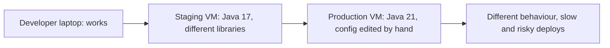
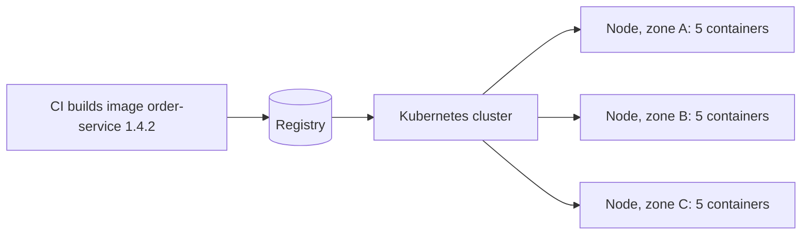
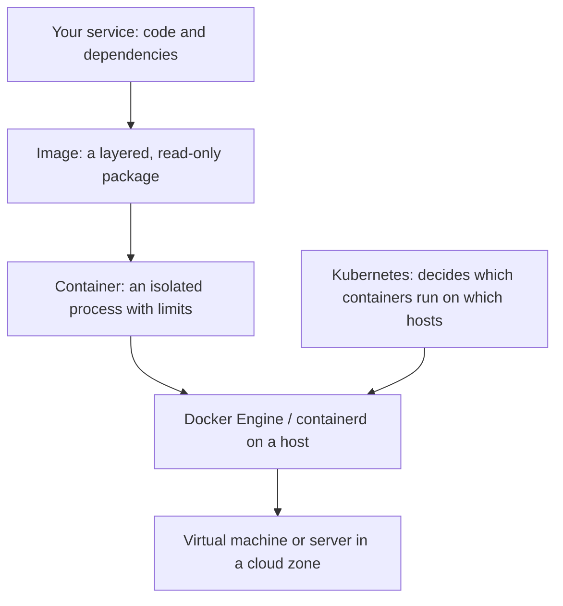

# Cloud and Containers: The Big Picture

**Cloud and containers · Step 9.1 · Overview** · Last updated 2026-10-22
**Prerequisites:** none. Helpful: [Resilience patterns](../01-resilience/01-resilience-overview.md) (1.1) and [System design: the big picture](../14-system-design/01-system-design-overview.md) (14.1), whose building blocks run on what this area teaches.

Read this first. It is the map of the area: where services run, how they are packaged and started, how they are kept running, and the order to learn it in.

## 1. What it is and why it matters

**What is it?** This area is about **where and how your services run**. A service is packaged once as a **container image** (Docker), started as one or more **containers**, and kept running across many machines by an **orchestrator** (Kubernetes), on infrastructure rented from a **cloud** provider.

**Why do we need it?** Everything earlier in this repository assumed services that start, scale, restart and update without trouble: stateless instances ([14.4](../14-system-design/04-scaling-out-stateless-services.md)), load balancing and rolling deploys ([14.5](../14-system-design/05-load-balancing.md)), recovery after failure ([14.14](../14-system-design/14-multi-region-disaster-recovery.md)). Containers and Kubernetes are how most teams make those things true in practice. An architect who doesn't know them can't judge whether a design is cheap or impossible to run.

**When would I meet it?** The first time you deploy a Spring Boot service anywhere other than your laptop; when "it works on my machine" fails in production; when a pod keeps restarting; when the cloud bill arrives; and in every design review that says "we'll run it on Kubernetes".

> [!TIP]
> **Memory hook:** *package once, run anywhere the same way.* An **image** is the package, a **container** is a running copy, and an **orchestrator** keeps the right number of copies running.

## 2. Mental model: shipping containers and a port

Before standard shipping containers, every cargo was loaded by hand, differently at every port. A standard steel box changed that: it is packed once, and every ship, crane and truck handles it the same way, no matter what is inside. A port operator then decides which box goes on which ship and replaces a box that falls overboard.

| In the analogy | In the real system |
|---|---|
| The standard box with the cargo packed inside | A **container image** with the application and everything it needs |
| A box on a ship | A running **container** |
| The cranes and trucks that handle any box | The **container runtime** (Docker Engine, containerd) |
| The shipping line's port operator who plans where boxes go and replaces lost ones | An **orchestrator** (Kubernetes) |
| The ships and the port | The **hosts** (virtual machines) in a cloud **region** |

**Where the analogy breaks:** a steel box is isolated by its walls. A container is isolated only by operating-system features (namespaces and limits), and **all containers on a host share one kernel**, so isolation is weaker than a virtual machine's. You will see this directly, with real output, in the lesson on containers as isolated processes ([9.2.2](02-docker/02-containers-isolated-processes.md)).

## 3. Industry terms

| Term | Simple meaning | Why it matters | Example | Related terms |
|---|---|---|---|---|
| **Cloud computing** | NIST: "a model for enabling ubiquitous, convenient, on-demand network access to a shared pool of configurable computing resources ... that can be rapidly provisioned and released with minimal management effort" | Capacity becomes something you request and release, not buy | Renting 15 servers for the sale week | Elasticity, pay-as-you-go |
| **IaaS, PaaS, SaaS** | NIST's three service models: you rent infrastructure, a platform for your code, or finished software | Decides how much you operate yourself | Virtual machines (IaaS); a managed database or runtime (PaaS-like); email service (SaaS) | Shared responsibility |
| **Region and availability zone** | A geographic area, and separate data centres within it | Where redundancy and disaster recovery come from ([14.14](../14-system-design/14-multi-region-disaster-recovery.md)) | One region, three zones | Blast radius |
| **Virtual machine (VM)** | A whole computer simulated in software, with its own operating system | Strong isolation, heavy to start | An EC2 instance | Hypervisor |
| **Container** | A process (or group) started with its own isolated view of the system and with resource limits, sharing the host's kernel | Light, starts in a second, identical everywhere | `order-service` running in Docker | Namespace, cgroup |
| **Image** | A read-only package with the files and settings a container starts from | The unit you build, store, scan and deploy | `shopflow/order-service:1.4.2` | Layer, tag, digest |
| **Registry** | A server that stores and distributes images | Where CI puts images and clusters pull them | Docker Hub, Amazon ECR | Repository |
| **Orchestrator / Kubernetes** | Software that runs containers across many machines and keeps them in the desired state | Scheduling, restarts, scaling, rolling updates | A Kubernetes cluster | Control plane, node |
| **Declarative configuration** | You describe the state you want; the system works out how to reach it | The core idea of Kubernetes and infrastructure as code | "Run 5 replicas of this image" | Reconciliation, desired state |
| **Immutable infrastructure** | You never patch a running server; you replace it with a new one built from a new image | Predictable, repeatable, easy to roll back | Deploy `1.4.3` instead of editing `1.4.2` | Cattle, not pets |

## 4. In a real system (ShopFlow)

**The business problem.** ShopFlow's services run on a handful of virtual machines set up by hand. Each service needs a particular Java version, libraries and configuration; two services on one machine disturb each other; a deploy means copying a jar and restarting a process, and nobody is sure that production matches the test environment. For the sale, the shop needs ten times the instances within minutes, and a failed instance must be replaced without a person logging in.

**How containers and orchestration help.** CI builds **one image** per version of each service. The same image runs on the laptop, in staging and in production; only configuration differs. Kubernetes starts as many copies as asked, spreads them over machines and zones, replaces failed ones, and rolls out a new version a few instances at a time.

**What it costs.** A new set of concepts and tools to learn and operate; images to build, scan and store; a cluster whose own upgrades, networking and security need attention; and a new class of failures (a container killed for using too much memory, a pod stuck waiting for resources) that this area teaches you to recognise.

**Elsewhere:** a payments company runs the same image in a test region and in each production region, so a regional failover starts known software; a media company scales video-processing containers up for a premiere and back down afterwards; a small team with one service often runs a single container on a managed platform and never needs Kubernetes.

## 5. How it works: the layers and the order to learn them

| Step | Topic | The question it answers |
|---|---|---|
| 9.2.1 | [Docker: the big picture and learning order](02-docker/01-docker-overview.md) | What is Docker, and how do its parts fit together? |
| 9.2.2 to 9.2.4 | Containers, images and a Dockerfile for a Java service | What is a container really, how is an image built, and how do I package a service well? |
| 9.2.5 to 9.2.8 | Networking, data, lifecycle and Compose | How do containers talk to each other, keep data, stop cleanly and run together locally? |
| 9.2.9 | Container security | What can go wrong, and how do I limit it? |
| 9.3.1 to 9.3.3 | Kubernetes basics: pods, deployments, services | How do I run many copies and reach them? |
| 9.3.4 to 9.3.6 | Configuration, probes, rolling updates, resources, autoscaling | How do I configure, update, size and scale them safely? |
| 9.3.7 to 9.3.10 | Storage, packaging, security, operations | How do I run stateful workloads, ship changes and troubleshoot? |
| 9.4 to 9.6 | AWS core services, infrastructure as code, cloud cost | What does the cloud around the cluster provide, and what does it cost? |

**How the topics relate.** Docker comes first, because a Kubernetes pod is a group of containers and everything Kubernetes does with them (limits, health checks, signals, environment variables, volumes) is a Docker idea with an API on top. Kubernetes is not a replacement for Docker's concepts; it is the layer that runs them at scale. The cloud provides the machines and managed services underneath.

**Who guarantees what.**

| Layer | Provides | Does not provide |
|---|---|---|
| Cloud provider | Machines, networks, managed services, zones | Your application's correctness or its configuration |
| Container runtime | Isolation and limits per container | Strong isolation between untrusted workloads (a shared kernel) |
| Kubernetes | Placement, restarts, rolling updates, service discovery | Data safety (that is the storage layer) or good application design |
| Your service | Starting fast, stopping cleanly, health reporting, graceful degradation | Anything the layers above do for you |

## 6. Architectural decisions

| Run the service on | When | Avoid when |
|---|---|---|
| **A virtual machine** | One or few long-lived services; legacy software; strong isolation needed | You need fast scaling or many small services |
| **A single container host** (Docker on a VM, Compose) | A small number of containers, one team, modest availability needs | You need automatic placement, self-healing across machines or rolling updates |
| **Kubernetes** (managed, for example Amazon EKS) | Many services or teams, frequent deploys, scaling and self-healing needed | One or two services: the platform costs more to run than it saves |
| **A managed container or function service** | You want containers or code without operating a cluster | You need control the service doesn't offer |

**A decision rule:** use the least machinery that meets the availability, scaling and deployment needs you actually have, and revisit it when one of them changes. Kubernetes' own documentation says it is "not a traditional, all-inclusive PaaS" and operates at the container level; the teams around it still decide logging, monitoring and delivery.

## 7. Notes in this area, in learning order

| Step | Topic | Prerequisites | Status |
|---|---|---|---|
| 9.1 | This overview | none | Done |
| 9.2.1 | [Docker: the big picture and learning order](02-docker/01-docker-overview.md) | 9.1 | Done |
| 9.2.2 to 9.2.9 | The rest of the Docker series, plus the [Docker cheat sheet](02-docker/99-docker-cheat-sheet.md) | 9.2.1 | Done |
| 9.3.1 to 9.3.10 | The [Kubernetes series](03-kubernetes/01-kubernetes-overview.md), plus the [Kubernetes cheat sheet](03-kubernetes/99-kubernetes-cheat-sheet.md) | 9.2.x | Done |
| 9.4 | AWS core services for architects | 9.3.x | Planned |
| 9.5 | Infrastructure as code (Terraform) | 9.4 | Planned |
| 9.6 | Cloud cost awareness | 9.4 | Planned |

Hands-on setup: the Docker lessons run on any machine with Docker Engine or Docker Desktop. Kubernetes lessons need a cluster; the setup is explained when that series starts.

## 8. Check your understanding

1. Why can a container start in a second while a virtual machine takes much longer, and what do you give up?
2. ShopFlow's staging and production behave differently. Which part of the container approach addresses this, and which part does it not?
3. What is the difference between Docker and Kubernetes?
4. A team with one service and modest traffic asks whether to adopt Kubernetes. What do you ask first?

Answers are at the end of this note.

## 9. Revision

**Remember**
- **Image** = the package; **container** = a running, isolated, resource-limited process; **registry** = where images live.
- Containers **share the host kernel**: light and fast, weaker isolation than a VM.
- **Kubernetes** keeps the **desired state** (how many copies of which image) true across many machines; it is configured declaratively.
- Cloud = **regions and zones** plus rented capacity and managed services.
- Use the **least machinery** that meets the real needs.

**Explain in 15 seconds:** "You package a service once as a container image, run it as isolated containers, and let an orchestrator like Kubernetes keep the right number running across machines in a cloud, so deploys, scaling and recovery become repeatable."

**Explain in 60 seconds:**
> "A container image holds an application and everything it needs. Running it creates a container: an ordinary process on the host, isolated by kernel features and limited in CPU and memory, which is why it starts in a second but shares the host's kernel. CI builds one image per version, and the same image runs everywhere, which removes most 'works on my machine' problems. Kubernetes then runs many containers over many machines: you declare the desired state, such as five replicas of this image, and it schedules them, restarts failures and rolls out new versions gradually. The cloud supplies the machines, zones and managed services underneath. The trade-off is operational complexity, so for a single small service a plain container host or a managed platform is often the better answer."

**Likely follow-up questions:**
- **Container versus VM?** A VM virtualises hardware and runs its own kernel; a container isolates processes on a shared kernel.
- **Is Docker the only container tool?** No: Docker popularised the image format; others (containerd, Podman, nerdctl) run the same images, and Kubernetes talks to a container runtime through a standard interface.
- **What is immutable infrastructure?** Replacing instances with new ones from a new image rather than modifying running ones.
- **When is Kubernetes a bad choice?** When the team is small, the number of services is low, and the operational load outweighs the benefits.

**Architect's takeaway:** containers make a service portable and repeatable, and Kubernetes makes that repeatability scale; both cost operations effort, so adopt them for the problems you have, not the ones you might have.

**Next topic:** AWS core services for architects (9.4, planned). The Docker and Kubernetes series are complete: start with the [series overview](02-docker/01-docker-overview.md) and revise with the [Docker cheat sheet](02-docker/99-docker-cheat-sheet.md)

## 10. Verification and sources

> [!NOTE]
> Checked 2026-10-22 against the sources below. Re-verify when you revisit this note.

- **Confirmed:** NIST's definition of cloud computing, with "five essential characteristics, three service models, and four deployment models" (Mell and Grance, NIST SP 800-145, September 2011, abstract read 2026-10-22). Kubernetes is "a portable, extensible, open source platform for managing containerized workloads and services that facilitate both declarative configuration and automation", and "is not a traditional, all-inclusive PaaS" (Kubernetes documentation, "Overview", read 2026-10-22). Docker uses "a technology called namespaces to provide the isolated workspace called the container" (Docker documentation, "Docker overview", read 2026-10-22). That containers share the host kernel is demonstrated with real output in lesson 9.2.2 (planned).
- **Assumptions and illustrations:** ShopFlow's current setup and the decision table are illustrative; the "Elsewhere" cases describe common patterns, not specific companies. The topic list is a proposal.
- **To verify:** the managed Kubernetes and container services of your cloud provider and their current limits and prices (covered in 9.4, planned).
- **Decision rule:** the least machinery that meets the availability, scaling and deployment needs you actually have.

**Sources:** NIST SP 800-145, "The NIST Definition of Cloud Computing"; Kubernetes documentation, "Overview"; Docker documentation, "Docker overview".

## Answers

1. A container is an ordinary process started with isolation and limits; there is no operating system to boot, because it uses the host's running kernel. A VM boots its own kernel and operating system. What you give up: isolation strength (a kernel bug or misconfiguration can affect all containers on the host) and the ability to run a different kernel or operating system than the host's.
2. The image: the same files, Java version and libraries run in both environments, so differences caused by the installed software disappear. It does not address differences in **configuration** (environment variables, secrets, database addresses), data, or the infrastructure around the container (networking, limits, the number of instances). Those must be managed deliberately, which later lessons cover.
3. Docker packages applications as images and runs them as containers on one machine (build, run, network, store). Kubernetes runs containers across many machines and keeps the desired state true: scheduling, restarts, scaling, rolling updates and service discovery. Kubernetes uses container images and a container runtime; it builds on Docker's ideas rather than replacing them.
4. What problem it would solve that they have now: how many services and teams, how often they deploy, what availability they need, who would operate the cluster, and whether a simpler option (one container host, Compose or a managed container service) meets those needs. If the answers are "one service, modest traffic, no operations capacity", Kubernetes mostly adds cost.

Back to [the index](../README.md) · [Roadmap](../roadmap.md).
