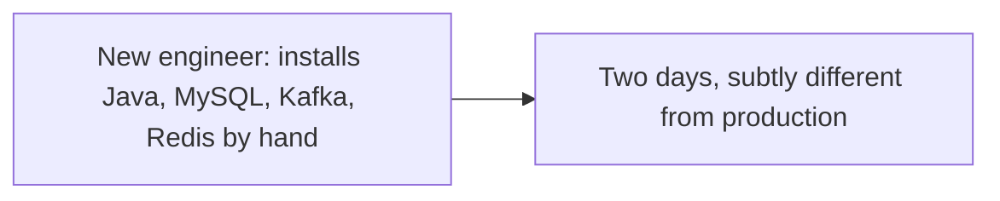
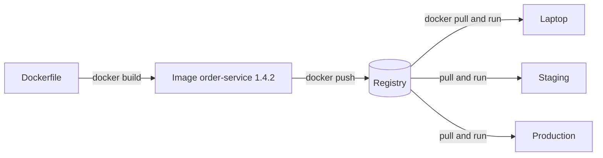
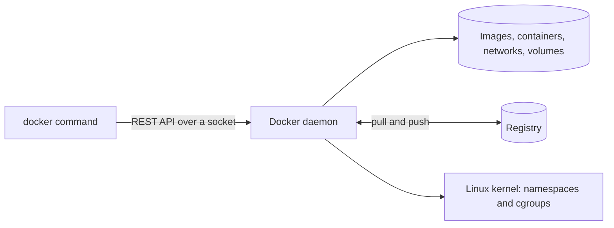

# Docker: The Big Picture and Learning Order

**Cloud and containers · Docker · Step 9.2.1 · Overview** · Last updated 2026-10-22
**Prerequisites:** [Cloud and containers: the big picture](../01-cloud-and-containers-overview.md) (9.1)

Read this first. It is the map of the Docker series: what Docker is, the five things you work with, the commands that matter, how the lessons build on each other, and how to run the examples on your machine.

## 1. What it is and why it matters

**What is it?** Docker is a tool for packaging an application with everything it needs into an **image**, and for running images as **containers**: isolated processes that start in about a second and behave the same on any machine with Docker.

**Why do we need it?** Software depends on its surroundings: the Java version, system libraries, configuration, the exact files. Differences between a laptop, a test server and production cause failures that are hard to reproduce. An image fixes the surroundings: the same bytes run everywhere. Docker also isolates processes from each other and limits what they may use, so several services can share a machine without disturbing one another.

**When would I meet it?** When you build a service for deployment, run a database or broker locally without installing it, reproduce a bug in the exact production environment, or read any Kubernetes manifest (every pod runs images).

> [!TIP]
> **Memory hook:** *build, ship, run.* Build an **image** once, ship it through a **registry**, run it as a **container** anywhere.

## 2. Mental model: a recipe, a meal and a restaurant

An image is like a recipe card with all ingredients measured: it does nothing by itself, but anyone who follows it gets the same dish. A container is one meal made from the card. You can make many meals from one card, they don't affect each other, and throwing one away doesn't change the card. A registry is the recipe library; the Docker daemon is the kitchen that cooks.

| In the analogy | In Docker |
|---|---|
| Recipe card | **Image**: a read-only package |
| One meal made from the card | **Container**: a running (or stopped) instance |
| The recipe library | **Registry**, for example Docker Hub |
| The kitchen | **Docker daemon** (the engine), driven by the `docker` command |
| Writing a new card | `docker build` from a **Dockerfile** |

**Where the analogy breaks:** a meal has no connection to the kitchen after it is cooked, but a container is a **live process** that shares the host's kernel and can be limited, inspected, signalled and attached to networks and storage while it runs. And an image is built in **layers**, so a small change creates a small new card that reuses most of the old one.

## 3. Industry terms

| Term | Simple meaning | Why it matters | Example | Related terms |
|---|---|---|---|---|
| **Image** | "A read-only template with instructions for creating a Docker container" (Docker docs) | The unit you build, store, scan and deploy | `eclipse-temurin:21-jre-alpine` | Layer, tag, digest |
| **Container** | "A runnable instance of an image" (Docker docs) | The running service | `order-service` started from an image | Process, namespace |
| **Dockerfile** | A text file of instructions for building an image | Makes builds repeatable and reviewable | `FROM`, `COPY`, `RUN`, `CMD` | Build context, BuildKit |
| **Registry and repository** | A server that stores images; a named collection of versions of one image | How images travel from CI to servers; "Docker looks for images on Docker Hub by default" | Docker Hub, Amazon ECR | Tag, push, pull |
| **Tag and digest** | A movable label (`21-jre-alpine`) and an immutable content fingerprint (`sha256:...`) | Tags can change; digests can't | `alpine:3.22` versus its digest | Pinning |
| **Docker daemon and client** | "The Docker client talks to the Docker daemon, which does the heavy lifting of building, running, and distributing your Docker containers" | Commands go to a server, possibly remote | `docker run` calls the daemon's API | Docker Desktop, Engine |
| **OCI** | The Open Container Initiative: open specifications for runtime, image and distribution, started in 2015 by Docker, CoreOS and others | Images built by one tool run in others | containerd, Podman, Kubernetes runtimes | Runtime spec, image spec |
| **Volume and network** | Docker-managed storage that outlives a container; virtual networks that connect containers | State and communication live outside the container | A database volume; a `shop` network | Bind mount, bridge |

## 4. In a real system (ShopFlow)

**The business problem.** A new engineer joins the ShopFlow team. Running `order-service` locally needs the right Java version, MySQL, Kafka and Redis, configured the same way as in staging. It takes two days, and still behaves differently from production. In production, a deploy copies a jar to a server and restarts a process, and nobody can say exactly which files are running.



**How Docker helps.** Each service has a Dockerfile, and CI builds an image per version. The engineer runs one command to start the service and its dependencies as containers, with the same images and settings as staging. Production runs the same image that passed the tests. A bad release is rolled back by starting the previous image.



**What it costs.** Images to maintain and keep patched, a registry to run or pay for, new failure modes (a container killed for exceeding its memory limit, data lost because it was written inside a container), and the discipline to keep containers **disposable**: anything worth keeping lives in a volume or an external service.

**Elsewhere:** a data-science team ships the exact library versions of an experiment with its model; a CI system runs every build in a fresh container so builds can't affect each other; a vendor distributes its product as an image so customers need no installation steps.

## 5. How it works: the pieces, the commands and the lessons



**The five objects** you work with: **images**, **containers**, **networks**, **volumes** and the **builds** that make images. **The commands that matter** most are `build`, `run`, `ps`, `logs`, `exec`, `stop`, `inspect`, `pull` and `push`; each lesson introduces the ones it needs and shows their real output.

**On macOS the containers run in a Linux virtual machine.** Containers need a Linux kernel. Docker Desktop (and Rancher Desktop) start a small Linux VM and run the engine inside it; the `docker` command on your Mac talks to that engine. The examples in this series show it directly: the kernel version seen inside a container is the VM's, not macOS's.

| Step | Topic | The question it answers |
|---|---|---|
| 9.2.2 | [Containers: isolated processes with limits](02-containers-isolated-processes.md) | What is a container really, and how are it and its limits made? |
| 9.2.3 | [Images and layers](03-images-and-layers.md) | What is inside an image, and why do builds cache? |
| 9.2.4 | [A Dockerfile for a Java service](04-dockerfile-java-service.md) | How do I package a service small, safe and quick to build? |
| 9.2.5 | [Networking and ports](05-networking-and-ports.md) | How do containers find and reach each other and the outside world? |
| 9.2.6 | [Data and configuration](06-data-and-configuration.md) | Where do data and settings live when containers are disposable? |
| 9.2.7 | [Lifecycle: signals, graceful shutdown, health checks and restarts](07-lifecycle.md) | How does a container stop cleanly and recover? |
| 9.2.8 | [Docker Compose for local development](08-docker-compose.md) | How do I run the service with its dependencies in one command? |
| 9.2.9 | [Container security and supply chain basics](09-container-security.md) | What can go wrong, and how do I limit it? |

**The learning order** follows the life of a service: understand the running thing (step 9.2.2), the package (step 9.2.3), build it well (step 9.2.4), connect it (step 9.2.5), give it data and settings (step 9.2.6), operate it (step 9.2.7), run it with its neighbours (step 9.2.8), and make it safe (step 9.2.9). Kubernetes (series 9.3) then takes the same ideas to many machines.

**Running the examples.** Every example in this series was run on **Docker Engine 28.4.0 (Docker Desktop, linux/arm64)** with the **Docker client 29.6.2-rd** (the command-line tool that ships with Rancher Desktop) on macOS, on 2026-10-22; output blocks are copied from those runs. Image IDs, digests, sizes and timings differ between machines and over time, so treat them as **example output**, not as values to match exactly. Commands name every container with a `sf-learn-` prefix and label it `learning=notes`, so you can find and remove them without touching anything else:

```text
$ docker version --format 'Client: {{.Client.Version}}   Engine: {{.Server.Version}} ({{.Server.Os}}/{{.Server.Arch}})'
Client: 29.6.2-rd   Engine: 28.4.0 (linux/arm64)
```

To check your own installation, run the first container:

```text
$ docker run --rm --label learning=notes hello-world 2>&1 | sed -n '1,5p'

Hello from Docker!
This message shows that your installation appears to be working correctly.

To generate this message, Docker took the following steps:
```

To see what you created and remove it (only containers with this label):

```bash
docker ps -a --filter label=learning=notes          # list
docker rm -f $(docker ps -aq --filter label=learning=notes)   # remove them (add -v to remove their anonymous volumes)
```

> [!WARNING]
> Never run `docker system prune` or `docker volume prune` on a machine that also runs other containers or data you care about: they delete everything that isn't currently in use, not only what these lessons created.

## 6. Architectural decisions

| Decision | Choose | Because |
|---|---|---|
| Base image | A small, maintained, official image with the runtime you need (for Java: Eclipse Temurin on Alpine or a slim Linux) | Smaller attack surface and faster pulls |
| Tags | Pin versions (`21-jre-alpine`, better a digest for releases); avoid `latest` | A moving tag makes builds irreproducible |
| One process per container | Usually one main process, with logs to standard output | Simple lifecycle, restarts and scaling |
| State | Outside the container: volumes or external services | Containers are replaced, not repaired |
| Where to run it | One host with Compose for small systems; Kubernetes for many services ([9.1](../01-cloud-and-containers-overview.md)) | Match the machinery to the need |

### Alternatives in the industry

A map of the landscape, not a comparison. These were not run in this series; descriptions come from the general state of the industry and each project's own site, so check the current status of any you plan to adopt.

| Area | Tool or product | What it is | When you meet it |
|---|---|---|---|
| Desktop app for containers | **Docker Desktop** (used here) | Docker's app: engine in a Linux VM, client and a graphical interface | The default on many developer machines; licence terms depend on company size |
| | **Rancher Desktop**, **Podman Desktop**, **Colima**, **OrbStack** | Alternative desktop setups for containers (and optional Kubernetes) on a Mac | Teams replacing Docker Desktop for licence, speed or resource reasons |
| | **Docker Engine on Linux** | The same engine installed directly on a Linux host, no VM | Servers and CI machines |
| Engine and tools | **Podman** (with **Buildah**) | A daemonless, rootless-first engine with a Docker-compatible command line | Red Hat and security-focused environments |
| | **containerd** with **nerdctl** | The runtime under Docker and most Kubernetes clusters, with a Docker-like client | Kubernetes nodes; some desktop tools |
| Registries | **Docker Hub**, **GitHub Container Registry**, **Amazon ECR**, **Google Artifact Registry**, **Azure Container Registry**, **Harbor**, **Quay** | Places to store and distribute images | Cloud-native companies use their cloud's registry; Harbor is a common self-hosted one |
| Standards | **OCI** image and runtime specifications | What makes images portable between all of the above | Any time a tool says "OCI-compliant" |

## 7. Notes in this series, in learning order

| Step | Topic | Level | Status |
|---|---|---|---|
| 9.2.1 | This overview | Fundamentals | Done |
| 9.2.2 | [Containers: isolated processes with limits](02-containers-isolated-processes.md) | Fundamentals | Done |
| 9.2.3 | [Images and layers](03-images-and-layers.md) | Fundamentals | Done |
| 9.2.4 | [A Dockerfile for a Java service](04-dockerfile-java-service.md) | Fundamentals | Done |
| 9.2.5 | [Networking and ports](05-networking-and-ports.md) | Intermediate | Done |
| 9.2.6 | [Data and configuration: volumes and environment](06-data-and-configuration.md) | Intermediate | Done |
| 9.2.7 | [Lifecycle: signals, graceful shutdown, health checks and restarts](07-lifecycle.md) | Intermediate | Done |
| 9.2.8 | [Docker Compose for local development](08-docker-compose.md) | Intermediate | Done |
| 9.2.9 | [Container security and supply chain basics](09-container-security.md) | Advanced | Done |

Revision: the [Docker cheat sheet](99-docker-cheat-sheet.md).

## 8. Check your understanding

1. What is the difference between an image and a container? Give an everyday analogy.
2. You run `docker run alpine uname -r` on a Mac and the kernel version is not a macOS version. Why?
3. Why does it matter that a tag like `latest` can change, and what is the stable alternative?
4. A teammate stores uploaded files inside a running container's filesystem. What will happen, and what is the usual fix?

Answers are at the end of this note.

## 9. Revision

**Remember**
- **Image** = read-only package; **container** = running instance; **registry** = where images are stored.
- The `docker` **client** talks to the **daemon** over an API; on a Mac the daemon runs in a **Linux VM**.
- Tags **move**; **digests** don't. Pin what you ship.
- Containers are **disposable**: keep state outside, logs on standard output, one main process.
- OCI standards mean images are not tied to Docker alone.

**Explain in 15 seconds:** "Docker packages an application and its environment as an image and runs it as an isolated container, so the same thing runs on a laptop, in CI and in production."

**Explain in 60 seconds:**
> "A Dockerfile describes how to build an image: a layered, read-only package with the application and everything it needs. The docker client sends build, run and pull commands to the Docker daemon, which builds images, starts containers from them and pulls or pushes images to a registry. A container is an isolated process with its own view of the filesystem, network and process list, optionally limited in CPU and memory, sharing the host's kernel, which is why it starts in about a second; on a Mac the daemon runs inside a Linux virtual machine. Because the image is the same everywhere, environment differences mostly disappear. The cost is that containers must be disposable: data goes in volumes or external services, configuration comes from the environment, and images need to be kept patched."

**Likely follow-up questions:**
- **Is Docker the same as a VM?** No: containers share the host kernel; VMs run their own.
- **Do I need Docker to run containers in Kubernetes?** No: Kubernetes uses any runtime that implements its container runtime interface (for example containerd); Docker-built images are OCI images and run there.
- **What is Docker Desktop?** A desktop application that bundles the Docker Engine in a Linux VM, the client, and a graphical interface; Rancher Desktop is an alternative.
- **What is a dangling image?** An untagged image left behind after a tag moved to a newer build.

**Architect's takeaway:** the image is the unit of delivery. Treat it like a release artefact: built once, scanned, versioned, stored in a registry and promoted unchanged from test to production.

**Next topic:** [Containers: isolated processes with limits](02-containers-isolated-processes.md) (9.2.2)

## 10. Verification and sources

> [!NOTE]
> Checked 2026-10-22 against the Docker documentation and by running every command shown. Re-verify when you revisit this note.

- **Confirmed (Docker documentation, "Docker overview", read 2026-10-22):** "An image is a read-only template with instructions for creating a Docker container"; "A container is a runnable instance of an image"; "Docker uses a client-server architecture. The Docker client talks to the Docker daemon, which does the heavy lifting of building, running, and distributing your Docker containers"; client and daemon communicate "using a REST API, over UNIX sockets or a network interface"; "Docker looks for images on Docker Hub by default"; Docker uses "a technology called namespaces to provide the isolated workspace called the container". The Open Container Initiative was launched on 22 June 2015 by Docker, CoreOS and others and maintains runtime, image and distribution specifications (opencontainers.org, "About the OCI", read 2026-10-22).
- **Assumptions and illustrations:** the new-engineer story is illustrative. The versions in the output blocks are those of the machine used on 2026-10-22; yours will differ.
- **To verify:** the exact Docker Desktop and Engine versions you use; the licensing terms of Docker Desktop for your organisation (they differ by company size); alternatives such as Rancher Desktop if those terms matter.
- **Decision rule:** build once, pin what you ship, keep containers disposable and state outside them.

**Sources:** Docker documentation, "Docker overview"; opencontainers.org, "About the Open Container Initiative".

## Answers

1. An image is a read-only package (the recipe card); a container is a running instance made from it (a meal cooked from the card). You can start many containers from one image, each with its own writable layer and process, and deleting a container doesn't change the image.
2. Containers share the kernel of the host that runs the engine, and Docker Desktop runs the engine inside a Linux virtual machine (kernel `6.10.14-linuxkit` in the examples), because macOS has no Linux kernel of its own. The container sees the VM's kernel.
3. A tag is a movable label: pulling `latest` today and next month can give different contents, so builds and deployments are not reproducible. The stable alternative is a version tag you control and, for releases, the image **digest** (`sha256:...`), which identifies exact content.
4. The files live in the container's writable layer, which is deleted with the container: a restart is fine, but replacing the container (a deploy, a crash and recreate) loses them, and a second container can't see them. The usual fix: store files in a volume or, better for scale, in object storage ([14.12](../../14-system-design/12-object-storage-cdn.md)).

Back to [the area overview](../01-cloud-and-containers-overview.md) · [the index](../../README.md) · [Roadmap](../../roadmap.md).
