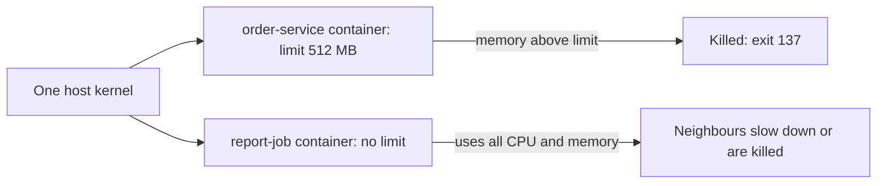

# Containers: Isolated Processes with Limits

**Cloud and containers · Docker · Step 9.2.2 · Fundamentals** · Last updated 2026-10-22
**Prerequisites:** [Docker: the big picture and learning order](01-docker-overview.md) (9.2.1)

**Version note**

| Item | Version |
|---|---|
| Baseline | Linux namespaces and control groups (cgroups), the kernel features containers are built from |
| Hands-on baseline | Docker Engine 28.4.0 on Docker Desktop (Linux kernel `6.10.14-linuxkit`, **cgroup v2**), run on 2026-10-22 |
| Compatibility note | The cgroup file names below (`memory.max`, `cpu.max`) are cgroup v2 names. A host still using cgroup v1 has different files; check yours with the commands in the examples |

## 1. What it is and why it matters

**What is it?** A container is an ordinary Linux **process** (or a few) that the kernel has been told to treat specially: it gets its own **view** of the system (its own process list, hostname, network, filesystem) and a **budget** (limits on memory, CPU and more). There is no separate operating system inside it.

**Why do we need it?** To run many services on one machine without them seeing or disturbing each other, and to know what each is allowed to use. The same two kernel features, **namespaces** (what a process can see) and **cgroups** (what it can use), explain almost everything surprising about containers: why they start instantly, why they share a kernel, and why a service can be killed for using too much memory.

**When would I meet it?** When `order-service` restarts with exit code 137, when a container is slow because its CPU is capped, when a security review asks how isolated containers really are, and when debugging "it works with `docker run` but dies in Kubernetes" (the limits differ).

> [!TIP]
> **Memory hook:** *namespaces limit what it can see; cgroups limit what it can use; the kernel is shared.*

## 2. Industry terms

| Term | Simple meaning | Why it matters | Example | Related terms |
|---|---|---|---|---|
| **Namespace** | "A namespace wraps a global system resource in an abstraction that makes it appear to the processes within the namespace that they have their own isolated instance of the global resource" (Linux man page) | Gives each container its own hostname, process IDs, network, mounts | The container sees itself as PID 1 | PID, mount, network, UTS, IPC, user, cgroup, time namespaces |
| **Control group (cgroup)** | A kernel mechanism that limits and accounts for the resources of a group of processes | Enforces memory and CPU budgets | `--memory=64m` sets `memory.max` | cgroup v1 and v2 |
| **Shared kernel** | All containers on a host run on the host's one kernel | Fast and light; isolation is weaker than a VM's | Alpine and Ubuntu containers report the same kernel | Hypervisor, VM |
| **PID 1** | The first process of a container; the container lives as long as it does | Signals, zombie reaping and shutdown depend on it ([9.2.7](07-lifecycle.md)) | `sleep 300` started as PID 1 | Init process |
| **OOM killer** | The kernel mechanism that kills a process when a memory limit is reached and cannot be met | The cause of "killed" containers | Exit code 137, `OOMKilled=true` | `memory.max`, out of memory |
| **Exit code** | The number a process returns when it ends; by convention 128 + N when killed by signal N | Tells you how a container ended | 137 = 128 + 9 (SIGKILL) | `docker inspect` |
| **Container runtime** | Software that creates namespaces and cgroups and starts the process | What `docker run` ultimately asks for | The Docker Engine | OCI runtime |

## 3. In a real system (ShopFlow)

**The business problem.** During the sale, `order-service` pods restart every few hours with exit code 137, always during the busiest period. Nothing is logged by the application at the time. Meanwhile a new report job, started on the same machine without limits, makes every other service slow.

**What goes wrong without understanding containers.** The team assumes a container is "a small VM" with its own memory and CPU. It is a process with a budget, and the budget was never set sensibly: `order-service` has a limit the JVM's total memory can exceed, so the kernel kills it without warning; the report job has no limit, so it takes whatever the host can give.



**How the knowledge helps.** The team reads `OOMKilled` and the exit code, sets limits on every container (memory sized above the real working set, CPU as a cap), and keeps the report job from taking the neighbours' share. The details for Java (heap versus total memory) come in the Java Dockerfile lesson ([9.2.4](04-dockerfile-java-service.md)).

**What it costs.** Limits must be chosen from measurements: too tight and the service is killed or throttled, too loose and capacity is wasted. And the shared kernel remains a security boundary to think about ([9.2.9](09-container-security.md)).

**Elsewhere:** continuous-integration systems run each build in a fresh container with memory and CPU limits so one runaway build cannot starve the others; shared hosting providers use the same two kernel features to give each customer a slice of a machine.

## 4. How it works

When you run `docker run`, the Docker client asks the daemon to create a container. The daemon prepares the image's filesystem, creates a **set of namespaces** and a **cgroup** with the requested limits, and starts the image's main command **inside them**. From then on, the container is that process and its children. The commands below are real runs (Docker Engine 28.4.0, 2026-10-22); container IDs, timings and the like will differ on your machine.

### Worked example 1: a container is a process with its own view

**Concept.** Inside a container the process sees its own hostname, thinks it is PID 1, and lists only its own processes, while running on the host's kernel.

```text
$ docker run --rm --label learning=notes alpine:3.22 echo 'hello from a container'
hello from a container
```

```text
$ docker run --rm --label learning=notes alpine:3.22 sh -c 'echo hostname: $(hostname); echo pid of this shell: $$; ps; echo kernel: $(uname -r); head -2 /etc/os-release'
hostname: cb1f9ce65875
pid of this shell: 1
PID   USER     TIME  COMMAND
    1 root      0:00 sh -c echo hostname: $(hostname); echo pid of this shell: $$; ps; echo kernel: $(uname -r); head -2 /etc/os-release
    8 root      0:00 ps
kernel: 6.10.14-linuxkit
NAME="Alpine Linux"
ID=alpine
```

```text
$ docker info --format 'engine kernel: {{.KernelVersion}}'
engine kernel: 6.10.14-linuxkit
```

**Walkthrough.**

| What the container prints | What it shows |
|---|---|
| `hostname: cb1f9ce65875` | A private **UTS namespace**: the hostname is the container ID, not the machine's |
| `pid of this shell: 1` and a `ps` listing of two processes | A private **PID namespace**: the main process is PID 1, and nothing outside is visible |
| `Alpine Linux` | A private **filesystem** (mount namespace): the image's files, not the machine's |
| `kernel: 6.10.14-linuxkit`, equal to the engine's kernel | **No kernel of its own**: the kernel is shared with the engine, which on a Mac is the Linux VM that Docker Desktop runs |

**The same process from two sides.** A running container's main process is a normal process of the engine's host, with a different number there:

```text
$ docker run -d --name sf-learn-sleeper --label learning=notes alpine:3.22 sleep 300 >/dev/null; echo '--- from the engine (host) side:'; docker top sf-learn-sleeper -eo pid,ppid,comm,args; echo '--- from inside the container:'; docker exec sf-learn-sleeper ps -o pid,ppid,comm,args
--- from the engine (host) side:
PID                 PPID                COMMAND             COMMAND
36009               35986               sleep               sleep 300
--- from inside the container:
PID   PPID  COMMAND          COMMAND
    1     0 sleep            sleep 300
    7     0 ps               ps -o pid,ppid,comm,args
```

The `sleep` process is PID 36009 from the engine's side and PID 1 from inside. Same process, two views: that is a PID namespace. (The `ps` listing from `docker exec` also shows the `ps` command itself, which joins the container's namespaces for a moment.)

```text
$ docker exec sf-learn-sleeper sh -c 'echo hostname: $(hostname); ip -o -4 addr show eth0 | awk "{print \$2, \$4}"; echo root filesystem:; ls /'; docker rm -f sf-learn-sleeper >/dev/null
hostname: 108d794843d4
eth0 172.17.0.2/16
root filesystem:
bin
dev
etc
home
lib
media
mnt
opt
proc
root
run
sbin
srv
sys
tmp
usr
var
```

The container has its own network interface `eth0` with its own address (`172.17.0.2/16`) and its own root filesystem: a **network namespace** and a **mount namespace**.

**The namespaces a process belongs to** are visible in `/proc`:

```text
$ docker run --rm --label learning=notes alpine:3.22 sh -c 'ls /proc/self/ns'
cgroup
ipc
mnt
net
pid
pid_for_children
time
time_for_children
user
uts
```

The Linux manual lists what each type isolates: **cgroup** (the cgroup root directory), **ipc** (System V IPC and POSIX message queues), **mnt** (mount points), **net** (network devices, stacks and ports), **pid** (process IDs), **time** (boot and monotonic clocks), **user** (user and group IDs) and **uts** (hostname and NIS domain name).

**Experiment.** Predict first: if you run the same command in an `ubuntu:24.04` container instead of Alpine, which of the three lines (distribution name, kernel, hostname) change? The result is in Answers.

### Worked example 2: cgroups are the budget

**Concept.** Docker turns `--memory` and `--cpus` into cgroup settings that the kernel enforces. By default "a container has no resource constraints and can use as much of a given resource as the host's kernel scheduler allows" (Docker docs).

```text
$ docker run --rm --label learning=notes alpine:3.22 sh -c 'echo memory.max: $(cat /sys/fs/cgroup/memory.max); echo cpu.max: $(cat /sys/fs/cgroup/cpu.max)'
memory.max: max
cpu.max: max 100000
```

```text
$ docker run --rm --label learning=notes --memory=64m --cpus=0.5 alpine:3.22 sh -c 'echo memory.max: $(cat /sys/fs/cgroup/memory.max); echo cpu.max: $(cat /sys/fs/cgroup/cpu.max)'
memory.max: 67108864
cpu.max: 50000 100000
```

**Walkthrough.** Without limits both files say `max`. With `--memory=64m`, `memory.max` is 67,108,864 bytes (64 × 1024 × 1024). With `--cpus=0.5`, `cpu.max` is `50000 100000`: the container may use 50,000 microseconds of CPU time in every 100,000-microsecond period, that is half a CPU. Docker's documentation gives the same arithmetic: `--cpus=1.5` is "the equivalent of setting `--cpu-period="100000"` and `--cpu-quota="150000"`".

**The CPU limit is a throttle, not a reservation.** The same loop of 1.5 million shell iterations, run with two CPUs allowed and then half a CPU:

```text
$ for c in 2 0.5; do /usr/bin/time -p docker run --rm --label learning=notes --cpus=$c alpine:3.22 sh -c 'i=0; while [ $i -lt 1500000 ]; do i=$((i+1)); done' 2>&1 | grep real | sed "s/^/--cpus=$c  /"; done
--cpus=2  real 1.42
--cpus=0.5  real 2.95
```

With half a CPU the same work took about twice as long. These timings are an observation on one machine, not a measurement to reuse; the proportion is the point. A service over its CPU cap is not killed; it becomes **slow**, which is harder to notice than a crash.

### Worked example 3: memory limits kill

**Concept.** The memory limit is a hard limit. When a container's memory reaches it and cannot be reduced, the kernel's out-of-memory (OOM) killer chooses a process in the cgroup and kills it. Docker's documentation: "By default, if an out-of-memory (OOM) error occurs, the kernel kills processes in a container." The kernel documentation of `memory.max` says: "If a cgroup's memory usage reaches this limit and can't be reduced, the OOM killer is invoked in the cgroup."

Which process dies decides what you see. First, a case where the memory is held by a **child** process:

```text
$ docker run --name sf-learn-oom1 --label learning=notes --memory=64m --memory-swap=64m alpine:3.22 sh -c 'head -c 200000000 /dev/zero | tr "\0" a | tail -n 1 | wc -c; echo main process still alive' 2>&1; echo exit code: $?; docker inspect -f 'OOMKilled={{.State.OOMKilled}} ExitCode={{.State.ExitCode}}' sf-learn-oom1; docker rm sf-learn-oom1 >/dev/null
0
Killed
main process still alive
exit code: 0
OOMKilled=true ExitCode=0
```

Docker recorded `OOMKilled=true`, but the container's main process survived, finished normally and exited with code 0. A container can be half-broken: one worker killed, the main process still running. Now the case where the main process itself holds the memory:

```text
$ docker run --name sf-learn-oom2 --label learning=notes --memory=64m --memory-swap=64m alpine:3.22 sh -c 'x=$(head -c 200000000 /dev/zero | tr "\0" a); echo not reached' 2>&1; echo exit code: $?; docker inspect -f 'OOMKilled={{.State.OOMKilled}} ExitCode={{.State.ExitCode}}' sf-learn-oom2; docker rm sf-learn-oom2 >/dev/null
Killed
exit code: 137
OOMKilled=true ExitCode=137
```

Here the main process (PID 1) was killed: exit code **137**, with `OOMKilled=true`. The code 137 is the usual shell convention for "killed by signal 9" (128 + 9); you can see it without any memory problem by killing a container yourself:

```text
$ for c in 'exit 0' 'exit 3'; do docker run --name sf-learn-ex --label learning=notes alpine:3.22 sh -c "$c"; echo "[$c] -> $(docker inspect -f 'ExitCode={{.State.ExitCode}} OOMKilled={{.State.OOMKilled}}' sf-learn-ex)"; docker rm sf-learn-ex >/dev/null; done; docker run -d --name sf-learn-ex --label learning=notes alpine:3.22 sleep 300 >/dev/null; docker kill sf-learn-ex >/dev/null; echo "[docker kill] -> $(docker inspect -f 'ExitCode={{.State.ExitCode}} OOMKilled={{.State.OOMKilled}}' sf-learn-ex)"; docker rm sf-learn-ex >/dev/null
[exit 0] -> ExitCode=0 OOMKilled=false
[exit 3] -> ExitCode=3 OOMKilled=false
[docker kill] -> ExitCode=137 OOMKilled=false
```

**Walkthrough.** `docker kill` also gives 137, but with `OOMKilled=false`: the exit code says *how* the process ended, the `OOMKilled` flag says *whether memory was the reason*. Read both with `docker inspect`.

**Experiment.** The shell below holds a 200 MB string. Predict first: will it fit in a container limited to 256 MB, and in 512 MB? (Hint: building the string takes more than its final size.) The results are in Answers.

### Worked example 4: real-world (ShopFlow)

The diagnosis loop for a restarting container:

1. `docker inspect -f '{{.State.ExitCode}} {{.State.OOMKilled}}' <container>`: exit 137 and `OOMKilled=true` means memory; exit 137 and `false` means someone or something sent SIGKILL (a `docker kill`, or an orchestrator that gave up waiting for a graceful stop).
2. Compare the container's **limit** with the process's real **working set**; for Java, the heap is only part of it (see [9.2.4](04-dockerfile-java-service.md)).
3. Raise the limit, reduce the use, or fix the leak. Never remove the limit to hide the problem.

### Common mistake: no limits, or a limit equal to the heap

A container with **no** limit can take the whole host's memory or CPU and hurt every neighbour (Docker: "a container has no resource constraints" by default). A container whose memory limit equals the Java heap setting is at risk of being killed, because a JVM also uses memory outside the heap (the lesson on a Java Dockerfile measures this). Set limits deliberately, above the measured peak, and leave headroom.

## 5. Failure scenarios

### Killed with exit 137 and no log line

1. **What happened?** `order-service` restarts under load, with exit code 137, and the application log ends mid-request.
2. **Why?** The kernel killed the main process when the container reached its memory limit; a SIGKILL cannot be caught, so the application never gets to log anything.
3. **What did users see?** Failed requests during the restart, repeated every few hours at peak.
4. **Solutions:** confirm with `OOMKilled=true`; measure real memory use under load; raise the limit above the peak with headroom; for Java, size the heap as a share of the limit, not equal to it.
5. **What they cost:** more memory reserved per instance, so fewer instances per machine.

### A neighbour took everything

1. **What happened?** A report container with no limits used all CPU on the host; `order-service` on the same host became slow.
2. **Why?** By default a container "can use as much of a given resource as the host's kernel scheduler allows".
3. **What did users see?** Slow checkout, with healthy-looking containers and no errors.
4. **Solutions:** set CPU and memory limits on every container; run batch jobs on separate hosts or with lower priority.
5. **What they cost:** the batch job runs slower within its cap.

### The half-broken container

1. **What happened?** A container kept running and answering health checks, but a background worker process inside it had been killed for memory, and its queue stopped draining.
2. **Why?** The kernel killed the child, not PID 1, so the container never exited (worked example 3, first case).
3. **What did the business see?** Silent backlog growth, found hours later.
4. **Solutions:** one main process per container, so a failure kills the container and it is restarted; health checks that test the work, not just the port; monitor `OOMKilled` events.
5. **What they cost:** more containers where one used to hold several cooperating processes.

## 6. Architectural decisions

| Decision | Choose | Because |
|---|---|---|
| Memory limit | Above the measured peak working set, with headroom; always set | A hard limit kills; no limit endangers neighbours |
| CPU limit | A cap sized from load tests, or none for latency-critical services while limiting batch jobs | A cap throttles (slow), it does not kill |
| Processes per container | One main process | PID 1's exit ends the container; failures become visible |
| Isolation needs | Containers for trusted workloads of one organisation; VMs (or sandboxed runtimes) for untrusted or multi-tenant code | A shared kernel is a shared attack surface |

**Common mistakes:** treating a container as a small VM; no limits; limit equal to heap; ignoring exit codes and `OOMKilled`; several cooperating processes in one container.

## 7. Try it yourself

Try each exercise first; the real results are in the Answers section.

1. **Read the budget.** What are `memory.max` and `cpu.max` in a container started with `--memory=100m --cpus=1.5`? Work them out, then check.
2. **Same kernel, different system.** Show that an Alpine and an Ubuntu container report the same kernel but different distributions.
3. **Three ways to end.** Make a container exit normally, exit with code 3, and be killed, and read the exit codes with `docker inspect`.

## 8. Check your understanding

1. What do namespaces do, and what do cgroups do?
2. Why do containers start faster than virtual machines, and what does that cost in isolation?
3. A container exits with 137 and `OOMKilled=false`. What does that tell you?
4. Why is a CPU limit usually less visible than a memory limit when exceeded?

Answers are at the end of this note.

## 9. Revision

**Remember**
- Container = **process + namespaces (view) + cgroups (budget)** on a **shared kernel**.
- Inside: its own PID 1, hostname, network, filesystem. Outside: just another process.
- `--memory` is a **hard** limit (OOM kill); `--cpus` is a **throttle**.
- Exit **137** = killed by signal 9; **`OOMKilled`** says whether memory caused it. Read both.
- Always set limits; one main process per container.

**Explain in 15 seconds:** "A container is a normal process that the kernel has given its own view of the system with namespaces and its own resource budget with cgroups; it shares the host kernel, which is why it is fast and why isolation is weaker than a VM's."

**Explain in 60 seconds:**
> "When Docker starts a container it creates a set of namespaces and a cgroup and starts the image's main command inside them. Namespaces give the process its own view: its own PID 1, hostname, network interface, mounts and users. The cgroup gives it a budget: `memory.max` is a hard limit enforced by the kernel's out-of-memory killer, so a service above it is killed, usually with exit code 137 and OOMKilled true, while `cpu.max` is a quota that throttles it and makes it slow instead. There is no separate kernel: a container shows the same kernel as its host, which on a Mac is the Linux VM Docker Desktop runs. That is why containers start in about a second, and why they are not as strongly isolated as virtual machines. In practice I always set limits above the measured peak, keep one main process per container, and read the exit code and the OOMKilled flag when something restarts."

**Likely follow-up questions:**
- **Why can't I see my Mac's processes from a container?** The container's PID namespace shows only its own processes, and the engine runs in a Linux VM anyway.
- **Is a container secure by default?** It is isolated, not sandboxed: it shares the kernel, so hardening (non-root users, dropped capabilities, read-only filesystems) matters ([9.2.9](09-container-security.md)).
- **What is the difference between `--memory` and `--memory-swap`?** `--memory` is the RAM limit; `--memory-swap` is RAM plus swap together (equal values disable swap for the container).
- **Does a CPU limit of 0.5 mean the container runs on half a core?** It means it may use half a CPU's worth of time per period, spread over any cores.

**Architect's takeaway:** a container's behaviour under load is set by its limits as much as by its code. Decide the limits from measurements, and treat a restart with 137 as a sizing question before it is a bug question.

**Next topic:** [Images and layers](03-images-and-layers.md) (9.2.3)

## 10. Verification and sources

> [!NOTE]
> Checked 2026-10-22. Every command was run on Docker Engine 28.4.0 (Docker Desktop, linux/arm64, kernel 6.10.14-linuxkit, cgroup v2); output blocks are copied from those runs. Re-verify when you revisit this note.

- **Confirmed (documentation, read 2026-10-22):** the namespace definition and the list of namespace types with what each isolates (Linux man page `namespaces(7)`); `memory.max` as the memory hard limit, "If a cgroup's memory usage reaches this limit and can't be reduced, the OOM killer is invoked in the cgroup", and that the default is `max` (Linux kernel documentation, "Control Group v2"); "By default, a container has no resource constraints", "By default, if an out-of-memory (OOM) error occurs, the kernel kills processes in a container" and `--cpus` as period 100000 with a quota (Docker documentation, "Resource constraints"); "Docker uses a technology called namespaces to provide the isolated workspace called the container" (Docker documentation, "Docker overview").
- **Observed (this machine, not specified guarantees):** which process the OOM killer chose in each run, and the CPU timing ratio.
- **Assumptions and illustrations:** the ShopFlow story is illustrative. Limits and sizes in the exercises are examples, not recommendations.
- **To verify:** your host's cgroup version (`docker info` shows it); the behaviour of `--memory-swap` on your platform; how your orchestrator maps its own limits to cgroups ([9.3.6](../03-kubernetes/06-resources-scheduling-autoscaling.md)).
- **Decision rule:** always set memory and CPU limits from measurements; read the exit code and `OOMKilled`; one main process per container.

**Sources:** Linux man page `namespaces(7)` (man7.org); Linux kernel documentation, "Control Group v2" (docs.kernel.org); Docker documentation, "Resource constraints" and "Docker overview".

## Answers

**Experiments**

- **Ubuntu instead of Alpine** (worked example 1): the distribution name changes (`Ubuntu 24.04.5 LTS` instead of `Alpine Linux v3.22`), the hostname changes (every container gets its own), but the **kernel stays the same** (`6.10.14-linuxkit`), shown in practice exercise 2.
- **256 MB and 512 MB** (worked example 3): with 256 MB the container was **killed (exit code 137)**; with 512 MB it printed `allocated 200000000 bytes` and exited with 0. The string is 200 MB, but building it needs more memory than that (the command's output is collected and then copied into the variable), so the limit must exceed the **peak** use, not only the final size. This is why limits are chosen from measurements.

**Check your understanding**

1. Namespaces control what a process can **see**: its own process list, hostname, network, mounts, users. Cgroups control what it can **use**: memory, CPU and other resources, and account for them.
2. A container is a process started on a kernel that is already running; nothing has to boot. A VM boots its own kernel and operating system. The cost is isolation: all containers share one kernel, so a kernel flaw or a misconfiguration can reach every container on the host.
3. The process was ended by SIGKILL (137 = 128 + 9), but not by the memory limit. Something sent the signal: `docker kill`, or an orchestrator that stopped waiting for a graceful shutdown. Check who or what stopped it, not memory.
4. Exceeding a CPU limit throttles the container: the work still happens, only slower, so there is no crash, no exit code and no log line. Exceeding a memory limit kills a process, which is loud. Watch latency and CPU throttling metrics to see the quiet case.

**Practice exercises**

1. **Read the budget:**

```text
$ docker run --rm --label learning=notes --memory=100m --cpus=1.5 alpine:3.22 sh -c 'echo memory.max: $(cat /sys/fs/cgroup/memory.max); echo cpu.max: $(cat /sys/fs/cgroup/cpu.max)'
memory.max: 104857600
cpu.max: 150000 100000
```

100 MB is 100 × 1,048,576 = 104,857,600 bytes, and 1.5 CPUs is a quota of 150,000 microseconds per 100,000-microsecond period.

2. **Same kernel, different system:**

```text
$ for img in alpine:3.22 ubuntu:24.04; do echo "== $img"; docker run --rm --label learning=notes $img sh -c 'grep ^PRETTY_NAME /etc/os-release; echo kernel: $(uname -r)'; done
== alpine:3.22
PRETTY_NAME="Alpine Linux v3.22"
kernel: 6.10.14-linuxkit
== ubuntu:24.04
PRETTY_NAME="Ubuntu 24.04.5 LTS"
kernel: 6.10.14-linuxkit
```

Two different distributions, one kernel: the kernel belongs to the engine's host, not to the images.

3. **Three ways to end:** the exit codes of the three runs:

```text
$ for c in 'exit 0' 'exit 3'; do docker run --name sf-learn-ex --label learning=notes alpine:3.22 sh -c "$c"; echo "[$c] -> $(docker inspect -f 'ExitCode={{.State.ExitCode}} OOMKilled={{.State.OOMKilled}}' sf-learn-ex)"; docker rm sf-learn-ex >/dev/null; done; docker run -d --name sf-learn-ex --label learning=notes alpine:3.22 sleep 300 >/dev/null; docker kill sf-learn-ex >/dev/null; echo "[docker kill] -> $(docker inspect -f 'ExitCode={{.State.ExitCode}} OOMKilled={{.State.OOMKilled}}' sf-learn-ex)"; docker rm sf-learn-ex >/dev/null
[exit 0] -> ExitCode=0 OOMKilled=false
[exit 3] -> ExitCode=3 OOMKilled=false
[docker kill] -> ExitCode=137 OOMKilled=false
```

A normal end gives 0, an application error gives the code the program chose (3), and `docker kill` gives 137 with `OOMKilled=false`, because no memory limit was involved.

Back to [the series overview](01-docker-overview.md) · [the area overview](../01-cloud-and-containers-overview.md) · [the index](../../README.md) · [Roadmap](../../roadmap.md).
