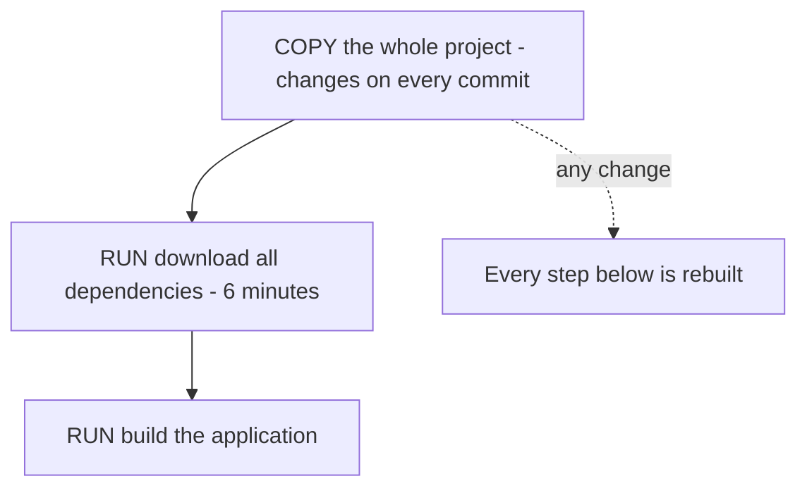

# Images and Layers

**Cloud and containers · Docker · Step 9.2.3 · Fundamentals** · Last updated 2026-10-22
**Prerequisites:** [Containers: isolated processes with limits](02-containers-isolated-processes.md) (9.2.2)

**Version note**

| Item | Version |
|---|---|
| Baseline | Layered images and a build cache, central to Docker since its early versions |
| Hands-on baseline | Docker Engine 28.4.0 with BuildKit on Docker Desktop, run on 2026-10-22 |
| Compatibility note | Docker's storage documentation says Docker Engine 29.0 and later uses the containerd image store by default for fresh installations; the commands in this note work the same, but the columns of `docker image ls` and some sizes can differ between versions |

## 1. What it is and why it matters

**What is it?** An image is a stack of **layers**. Each layer holds a set of file changes (files added, changed or deleted) made by one build step. The layers are read-only; a running container adds one thin **writable layer** on top. Layers are identified by a fingerprint of their content, so identical layers are stored once and shared between images.

**Why do we need it?** Layers explain three everyday facts: why rebuilding an image after a small code change takes seconds (unchanged layers are reused from a cache), why images that share a base don't each take full space, and why **deleting a file in a later step does not make an image smaller**. They also decide how fast CI builds are and how much a registry stores and an engine downloads.

**When would I meet it?** When the CI build for `order-service` takes ten minutes for a one-line change, when an image is 800 MB and nobody knows why, when a secret is found in an old layer, and whenever you read `docker history`.

> [!TIP]
> **Memory hook:** *layers stack and never shrink.* Put what changes **least** first and what changes **most** last, and finish cleaning up **in the same step** that made the mess.

## 2. Industry terms

| Term | Simple meaning | Why it matters | Example | Related terms |
|---|---|---|---|---|
| **Layer** | "Each layer in an image contains a set of filesystem changes - additions, deletions, or modifications"; once created, layers are immutable (Docker docs) | The unit of caching, sharing and download | The `COPY deps.bin` step | Union filesystem |
| **Base image** | The image your `FROM` line starts with | Decides size, tools and patch level | `alpine:3.22`, `eclipse-temurin:21-jre-alpine` | Parent image |
| **Build cache** | Stored results of earlier build steps, reused when a step and its inputs haven't changed | Fast rebuilds | `CACHED` in the build log | `--no-cache` |
| **Cache invalidation** | When a step changes, it and **every step after it** are rebuilt | Why instruction order matters | A changed jar rebuilds all later steps | Layer ordering |
| **Writable (container) layer** | The thin layer a running container writes to; it "doesn't persist after the container is deleted" | Why files written inside a container disappear | `docker diff` shows it | Copy-on-write |
| **Tag** | A human-readable label for an image version; it can be moved to another image | Convenient but not a guarantee | `alpine:3.22`, `latest` | Repository |
| **Digest** | A fingerprint of an image's content (`sha256:...`); it cannot be moved | The exact identity of what you run | `alpine@sha256:d40644...` | Pinning |
| **Image ID** | The identifier of the image configuration on this engine | Two tags can point to the same ID | `sf-learn/layers:1` and `:v1-latest` | Dangling image |

## 3. In a real system (ShopFlow)

**The business problem.** ShopFlow's CI builds the `order-service` image on every commit. A one-line change takes eight minutes, because the Dockerfile copies the whole application first and then downloads all dependencies, so every change invalidates the slow step. Meanwhile the registry has grown to several hundred gigabytes, and a developer discovers that a file deleted in a late build step is still present in an earlier layer.



**How layers help.** Reordering the Dockerfile so that the rarely changing parts come first (dependencies) and the often changing parts last (application code) lets the slow step come from the cache. Cleaning up in the same step that created temporary files keeps layers small. Pinning the base image by digest makes the build reproducible.

**What it costs.** Thinking about Dockerfile order and cleanup, a cache that must be available to CI (a build cache that is lost between runs gives no speed-up), and the discipline never to put secrets in a layer: anything copied into an image stays in that layer's history even if a later step deletes it.

**Elsewhere:** operating-system vendors publish a few base images that thousands of applications build on, so most layers are shared across the industry's registries; mobile-game studios rebuild only the layer with the new game assets; security teams scan layers separately to find which one introduced a vulnerable library.

## 4. How it works

An image is a list of layers plus a configuration (the default command, environment variables and so on). `docker build` runs the Dockerfile's instructions in order. For each instruction it checks whether it already has a result for exactly this instruction and exactly these inputs; if so, it reuses it (`CACHED`), otherwise it runs the step and stores the new layer. Docker's documentation: "If a layer changes, all other layers that come after it are also affected."

For `COPY` and `ADD`, "the builder calculates a cache checksum from file metadata to determine whether cache is valid"; a changed file invalidates the cache, but "the modification time of a file (mtime) is not taken into account". For other instructions such as `RUN`, "cache checking doesn't look at the files in the container": a `RUN` step is reused as long as its command text and the layers before it are the same, even if what it would download has since changed. `--no-cache` forces a full rebuild.

The examples below were run on Docker Engine 28.4.0 (2026-10-22). Image and build IDs, digests and timings differ on your machine. To keep the logs readable, the build output is filtered to each step and its status (`CACHED` or `DONE`), and digests are shortened.

The example image is built from this Dockerfile and two input files in the build folder: `deps.bin` (5 MB of random bytes, standing in for downloaded dependencies) and `app.txt` (a line of text, standing in for application code):

```dockerfile
FROM alpine:3.22
COPY deps.bin /opt/deps.bin
COPY app.txt /opt/app.txt
RUN echo "built by the notes" > /opt/build-info
CMD ["cat", "/opt/app.txt", "/opt/build-info"]
```

### Worked example 1: what is in an image

**Concept.** Each instruction that changes the filesystem created a layer, with its own size; instructions that only set metadata (`CMD`) add no size.

```text
$ docker history --format 'table {{.CreatedBy}}\t{{.Size}}' sf-learn/layers:1 | cut -c1-90
CREATED BY                                      SIZE
CMD ["cat" "/opt/app.txt" "/opt/build-info"]    0B
RUN /bin/sh -c echo "built by the notes" > /…   12.3kB
COPY app.txt /opt/app.txt # buildkit            12.3kB
COPY deps.bin /opt/deps.bin # buildkit          5.01MB
CMD ["/bin/sh"]                                 0B
ADD alpine-minirootfs-3.22.7-aarch64.tar.gz …   9.2MB
```

**Walkthrough.** Reading the history from the bottom up: the 9.2 MB base (Alpine's root filesystem), then `deps.bin` at 5.01 MB, then two tiny layers. The 12.3 kB for the small files is block-size rounding in the layer, not the file size. The image configuration lines (`CMD`) are 0 B.

**Layers are shared.** The base is not copied into our image; it is the same layer:

```text
$ docker image inspect -f '{{len .RootFS.Layers}}' alpine:3.22
1
$ docker image inspect -f '{{len .RootFS.Layers}}' sf-learn/layers:1
4
$ docker image inspect -f '{{index .RootFS.Layers 0}}' alpine:3.22 sf-learn/layers:1
sha256:f27c84aef3509463528cb456fbf5bfa25cdc7dcea6912131a622883b5e005744
sha256:f27c84aef3509463528cb456fbf5bfa25cdc7dcea6912131a622883b5e005744
```

The base image has one layer; ours has four, and the first layer's fingerprint, printed for both images, is the same. Any other image built `FROM alpine:3.22` reuses that layer instead of storing it again.

### Worked example 2: the build cache and instruction order

**Concept.** A step is rebuilt if its inputs changed or if any earlier step was rebuilt. First a build with no cache (forced), then the same build again:

```text
$ docker build --no-cache --progress=plain --label learning=notes -t sf-learn/layers:1 ctx 2>&1 | grep -A1 -E '^#[0-9]+ \[[0-9]/[0-9]\]' | grep -v '^--' | sed -E 's/(sha256:[0-9a-f]{6})[0-9a-f]+/\1.../g'
#4 [1/4] FROM docker.io/library/alpine:3.22@sha256:d40644...
#4 resolve docker.io/library/alpine:3.22@sha256:d40644... done
#6 [2/4] COPY deps.bin /opt/deps.bin
#6 DONE 0.0s
#7 [3/4] COPY app.txt /opt/app.txt
#7 DONE 0.0s
#8 [4/4] RUN echo "built by the notes" > /opt/build-info
#8 DONE 0.1s
```

```text
$ docker build --progress=plain --label learning=notes -t sf-learn/layers:1 ctx 2>&1 | grep -A1 -E '^#[0-9]+ \[[0-9]/[0-9]\]' | grep -v '^--' | sed -E 's/(sha256:[0-9a-f]{6})[0-9a-f]+/\1.../g'
#4 [1/4] FROM docker.io/library/alpine:3.22@sha256:d40644...
#4 resolve docker.io/library/alpine:3.22@sha256:d40644... done
#6 [2/4] COPY deps.bin /opt/deps.bin
#6 CACHED
#7 [3/4] COPY app.txt /opt/app.txt
#7 CACHED
#8 [4/4] RUN echo "built by the notes" > /opt/build-info
#8 CACHED
```

The second build did nothing: every step is `CACHED`. Now change only `app.txt` (the part of the image that changes most), then only `deps.bin`:

```text
$ echo 'order-service v2' > ctx/app.txt; docker build --progress=plain --label learning=notes -t sf-learn/layers:1 ctx 2>&1 | grep -A1 -E '^#[0-9]+ \[[0-9]/[0-9]\]' | grep -v '^--' | sed -E 's/(sha256:[0-9a-f]{6})[0-9a-f]+/\1.../g'
#4 [1/4] FROM docker.io/library/alpine:3.22@sha256:d40644...
#4 resolve docker.io/library/alpine:3.22@sha256:d40644... 0.0s done
#6 [2/4] COPY deps.bin /opt/deps.bin
#6 CACHED
#7 [3/4] COPY app.txt /opt/app.txt
#7 DONE 0.0s
#8 [4/4] RUN echo "built by the notes" > /opt/build-info
#8 DONE 0.1s
```

```text
$ head -c 5000000 /dev/urandom > ctx/deps.bin; docker build --progress=plain --label learning=notes -t sf-learn/layers:1 ctx 2>&1 | grep -A1 -E '^#[0-9]+ \[[0-9]/[0-9]\]' | grep -v '^--' | sed -E 's/(sha256:[0-9a-f]{6})[0-9a-f]+/\1.../g'
#5 [1/4] FROM docker.io/library/alpine:3.22@sha256:d40644...
#5 resolve docker.io/library/alpine:3.22@sha256:d40644... done
#6 [2/4] COPY deps.bin /opt/deps.bin
#6 DONE 0.0s
#7 [3/4] COPY app.txt /opt/app.txt
#7 DONE 0.0s
#8 [4/4] RUN echo "built by the notes" > /opt/build-info
#8 DONE 0.1s
```

**Walkthrough.**

| Change | `COPY deps.bin` | `COPY app.txt` | `RUN echo ...` |
|---|---|---|---|
| Nothing | CACHED | CACHED | CACHED |
| `app.txt` | CACHED | rebuilt | rebuilt (it comes after) |
| `deps.bin` | rebuilt | rebuilt (it comes after) | rebuilt |

A change rebuilds its own step and everything after it, never what comes before. So the slow, stable thing (dependencies) goes first, and the fast-changing thing (application code) last.

**Experiment.** Predict first: a second Dockerfile copies `app.txt` **before** `deps.bin`. After changing `app.txt`, which steps are rebuilt? The result is in Answers.

### Worked example 3: layers never shrink

**Concept.** A layer records changes. Deleting a file in a later step adds a layer that says "this file is gone"; the earlier layer, which contains the file, is still part of the image. Two Dockerfiles create a 20 MB file and remove it, once in separate steps and once in one step:

```dockerfile
FROM alpine:3.22
RUN head -c 20000000 /dev/urandom > /tmp/big.bin
RUN rm /tmp/big.bin
```

```dockerfile
FROM alpine:3.22
RUN head -c 20000000 /dev/urandom > /tmp/big.bin && rm /tmp/big.bin
```

```text
$ docker image ls sf-learn/delete
IMAGE                      ID             DISK USAGE   CONTENT SIZE   EXTRA
sf-learn/delete:combined   16ba848a18b0       13.3MB         4.13MB        
sf-learn/delete:separate   37558269b9ce       53.4MB         24.1MB        
```

```text
$ docker history --format 'table {{.CreatedBy}}\t{{.Size}}' sf-learn/delete:separate | cut -c1-80
CREATED BY                                      SIZE
RUN /bin/sh -c rm /tmp/big.bin # buildkit       8.19kB
RUN /bin/sh -c head -c 20000000 /dev/urandom…   20MB
CMD ["/bin/sh"]                                 0B
ADD alpine-minirootfs-3.22.7-aarch64.tar.gz …   9.2MB
```

```text
$ docker history --format 'table {{.CreatedBy}}\t{{.Size}}' sf-learn/delete:combined | cut -c1-90
CREATED BY                                      SIZE
RUN /bin/sh -c head -c 20000000 /dev/urandom…   4.1kB
CMD ["/bin/sh"]                                 0B
ADD alpine-minirootfs-3.22.7-aarch64.tar.gz …   9.2MB
```

**Walkthrough.** The "separate" image carries the 20 MB layer forever (`DISK USAGE` 53.4 MB, against 13.3 MB for the combined image); the "combined" image never recorded the file in a layer at all. `CONTENT SIZE` (the smaller column) tracks what would be transferred when pulling or pushing the image: 24.1 MB against 4.13 MB. The same rule applies to anything sensitive: **a secret copied in one step and deleted in the next is still in the image's history.**

### Worked example 4: the writable layer

**Concept.** A container starts from the read-only layers and gets a writable layer; everything it changes goes there, and `docker diff` lists the changes (A added, C changed, D deleted, as Docker's reference states). The image is never modified.

```text
$ docker run --name sf-learn-w --label learning=notes sf-learn/layers:1 sh -c 'echo changed >> /opt/app.txt; rm /opt/build-info; echo new > /tmp/new.txt' ; docker diff sf-learn-w; echo '--- the image is unchanged:'; docker run --rm --label learning=notes sf-learn/layers:1; docker rm sf-learn-w >/dev/null
C /opt
C /opt/app.txt
D /opt/build-info
C /tmp
A /tmp/new.txt
--- the image is unchanged:
order-service v2
built by the notes
```

**Walkthrough.** The container appended to `app.txt`, deleted `build-info` and created `/tmp/new.txt`, and `docker diff` shows exactly that. A new container from the same image still prints the original content (`order-service v2` was the file's content when this image was built, and `built by the notes` is back), because the changes lived in the first container's writable layer, which `docker rm` deleted. That is why anything that must survive belongs in a **volume** ([9.2.6](06-data-and-configuration.md)).

### Worked example 5: tags move, digests don't

**Concept.** A tag is a label you can point at another image. Two tags can name one image, and a digest names exactly one.

```text
$ docker tag sf-learn/layers:1 sf-learn/layers:v1-latest; docker image ls --no-trunc --format '{{.Repository}}:{{.Tag}}  {{.ID}}' sf-learn/layers | sed -E 's/(sha256:[0-9a-f]{12})[0-9a-f]+/\1.../'; echo; echo 'alpine digest: '$(docker image inspect -f '{{index .RepoDigests 0}}' alpine:3.22 | sed -E 's/(sha256:[0-9a-f]{12})[0-9a-f]+/\1.../')
sf-learn/layers:1  sha256:2ca2fdd0d3fb...
sf-learn/layers:v1-latest  sha256:2ca2fdd0d3fb...

alpine digest: alpine@sha256:d406446bc05b...
```

Both tags show the same image ID. And running the base image by its digest gives exactly the same image as running it by tag today:

```text
$ docker image inspect -f '{{.Id}}' alpine:3.22 | cut -c1-19; docker run --rm --label learning=notes alpine@sha256:d406446bc05b... echo 'running by digest'; docker image inspect -f '{{.Id}}' alpine@sha256:d406446bc05b... | cut -c1-19
sha256:d406446bc05b
running by digest
sha256:d406446bc05b
```

(The digest is shortened here; in a real command you use all 64 hexadecimal characters.) If someone republishes `alpine:3.22` next month with a security patch, the tag will point at a new image; the digest in this example will still name the old one. That is useful for reproducible releases, and a reason to update pinned digests deliberately.

### Real-world (ShopFlow): the order of the Java Dockerfile

For `order-service`, the stable inputs are the base image and the dependencies; the volatile input is the compiled application. A good Dockerfile copies dependency descriptors and dependency jars first, then the application classes last, and removes temporary files in the same `RUN` step that created them. The next lesson, a Dockerfile for a Java service ([9.2.4](04-dockerfile-java-service.md)), builds exactly that and measures the result.

### Common mistake

Putting `COPY . .` (the whole project) before the expensive step, and "cleaning up" in a separate `RUN rm` step. Both are shown above: the first rebuilds the expensive step on every change, the second leaves the garbage in the image.

## 5. Failure scenarios

### Every commit takes eight minutes

1. **What happened?** CI rebuilt `order-service` from scratch for every change and downloaded all dependencies each time.
2. **Why?** `COPY . .` came before the dependency step, so every code change invalidated it (worked example 2); in addition, CI used a fresh machine with no build cache.
3. **What did the team see?** Slow feedback and long queues in CI.
4. **Solutions:** copy only dependency descriptors before the dependency step; put the application last; keep a build cache between CI runs (a shared or remote cache).
5. **What they cost:** a slightly longer Dockerfile and a cache to manage.

### A secret that was deleted but not gone

1. **What happened?** A private repository token was copied into an image to download a dependency, and removed in the next step. A scan later found it in the image history.
2. **Why?** The earlier layer, which contained the token, is still part of the image (worked example 3).
3. **What did the business see?** A leaked credential in every copy of every image pushed since.
4. **Solutions:** revoke the token; use build secrets that are never written to a layer (BuildKit secret mounts) and multi-stage builds so the final image only receives the result ([9.2.4](04-dockerfile-java-service.md)).
5. **What they cost:** rotating credentials and rebuilding images.

### The image that was different tomorrow

1. **What happened?** The same Dockerfile produced an image with a different behaviour a month later.
2. **Why?** `FROM eclipse-temurin:21-jre-alpine` and the `RUN` steps that install packages resolve to newer content over time; a tag is a moving label, and `RUN` steps are reused from the cache without checking whether what they download has changed.
3. **What did users see?** A regression nobody could trace to a code change.
4. **Solutions:** pin the base image by digest for releases and update it deliberately; rebuild with `--pull` and `--no-cache` on a schedule to pick up patches; record the digest of every image you deploy.
5. **What they cost:** a routine for updating pins and rebuilding.

## 6. Architectural decisions

| Decision | Choose | Because |
|---|---|---|
| Instruction order | Stable first, volatile last | A change rebuilds its step and all later ones |
| Cleanup | In the same `RUN` step that creates the mess | Layers never shrink |
| Base image | A small, maintained official image | Smaller, faster to pull, fewer vulnerabilities |
| Release identity | Immutable version tag plus recorded digest | Reproducible deployments and rollbacks |
| Secrets | Never in a layer; use build secrets | Layers keep everything |
| Build cache in CI | A shared or remote cache | Fresh CI machines otherwise rebuild everything |

**Common mistakes:** `COPY . .` first; separate cleanup steps; `latest` in production; secrets in `ENV`, `ARG` or copied files; assuming `--no-cache` also pulls a fresh base (it doesn't; `--pull` does, as Docker's best-practices page explains).

## 7. Try it yourself

Try each exercise first; the solutions are in the Answers section.

1. **Read the layers.** Using only `docker history`, find which instruction of an image you built contributes the most size, and which contribute none.
2. **Fix the deletion.** Rewrite this Dockerfile so the 20 MB file does not remain in any layer, and compare the image sizes: `RUN head -c 20000000 /dev/urandom > /tmp/big.bin` followed by `RUN rm /tmp/big.bin`.
3. **Pin it.** Find the digest of the base image you use and run the image by digest. What do you need to remember to do afterwards?

## 8. Check your understanding

1. You change one line in the application and rebuild. Which layers are rebuilt, and which come from the cache?
2. Why doesn't `RUN rm bigfile` in a separate step reduce the image size?
3. Two images are built `FROM alpine:3.22`. How many copies of the base layer does the engine store?
4. A teammate says "I pinned the image with the tag `1.4.2`, so the build is reproducible." What is the weakness?

Answers are at the end of this note.

## 9. Revision

**Remember**
- Image = **stack of read-only layers**; container = layers + **one writable layer**.
- A change rebuilds **its step and everything after it**: stable first, volatile last.
- **Layers never shrink**: clean up in the same step; never put secrets in a layer.
- **Tags move, digests don't**; pin what you ship.
- Identical layers are **stored once** and shared.

**Explain in 15 seconds:** "An image is a stack of immutable layers, one per build step; Docker caches each layer, so putting rarely changing steps first makes rebuilds fast, and since layers never shrink, cleanup must happen in the same step."

**Explain in 60 seconds:**
> "An image is a list of read-only layers plus configuration; each instruction that changes the filesystem adds a layer identified by its content, so identical layers are shared between images and stored once. Docker's build cache reuses a step when the instruction and its inputs are unchanged, but when a step changes, every step after it is rebuilt, so I order the Dockerfile from the least to the most frequently changing: base image, dependencies, then application code. Layers are only ever added, so deleting a file in a later step leaves it in the image; I create and remove temporary files in one RUN step, and I never copy secrets into a layer. A container adds a thin writable layer that is deleted with the container, so persistent data lives in volumes. Finally tags are movable labels while a digest is an exact fingerprint, so releases are pinned by digest."

**Likely follow-up questions:**
- **What does `docker build --pull` do?** It checks the registry for a newer version of the base image instead of using the local copy; `--no-cache` ignores cached steps but doesn't pull.
- **Does the layer order affect the running container?** No: only build speed and size; the final filesystem is the same.
- **How do multi-stage builds relate?** They let you build with big tools in one stage and copy only the result into a small final image ([9.2.4](04-dockerfile-java-service.md)).
- **What is a dangling image?** An image whose tag was moved to a newer build; it keeps its layers until removed.

**Architect's takeaway:** an image is built to be cached and shared. Order the Dockerfile by how often things change, clean up where you make the mess, keep secrets out of layers, and identify releases by digest.

**Next topic:** [A Dockerfile for a Java service](04-dockerfile-java-service.md) (9.2.4)

## 10. Verification and sources

> [!NOTE]
> Checked 2026-10-22. Every command was run on Docker Engine 28.4.0 (Docker Desktop, linux/arm64) with BuildKit; output blocks are copied from those runs. Re-verify when you revisit this note.

- **Confirmed (Docker documentation, read 2026-10-22):** layers contain "a set of filesystem changes - additions, deletions, or modifications" and are immutable once created, with layering made possible by "content-addressable storage and union filesystems"; "If a layer changes, all other layers that come after it are also affected"; for `ADD`/`COPY` the cache checksum comes from file metadata and ignores mtime, and other instructions' cache checks do not look at files in the container; `--no-cache` disables the cache but does not pull a fresh base (`--pull` does); a new container adds "a new writable layer on top of the underlying layers" and "the container's writable layer doesn't persist after the container is deleted"; `docker diff` marks A added, D deleted and C changed. Docker Engine 29.0 and later uses the containerd image store by default for fresh installations (Docker documentation, "Storage drivers").
- **Observed (this machine):** the sizes in the examples; that `DISK USAGE` is the larger, unpacked figure and `CONTENT SIZE` the smaller, compressed-looking one (the columns were not defined in the pages read).
- **Assumptions and illustrations:** the 5 MB `deps.bin` stands in for downloaded dependencies; ShopFlow's eight-minute builds are illustrative.
- **To verify:** the exact meaning of the `docker image ls` size columns in your Docker version; how your CI provides a build cache (remote cache, registry cache).
- **Decision rule:** stable steps first, volatile last; cleanup in the same step; no secrets in layers; pin releases by digest.

**Sources:** Docker documentation: "Understanding the image layers", "Docker build cache", "Cache invalidation", "Building best practices", "Storage drivers", and the `docker diff` reference.

## Answers

**Experiment**

- **Copying `app.txt` before `deps.bin`** (worked example 2): after changing `app.txt`, **everything** after the base image is rebuilt: both `COPY` steps and the `RUN` (all `DONE`, none `CACHED`), although `deps.bin` did not change.

```text
$ echo 'order-service v6' > ctx/app.txt; docker build --progress=plain --label learning=notes -f ctx/Dockerfile.reordered -t sf-learn/layers:reordered ctx 2>&1 | grep -A1 -E '^#[0-9]+ \[[0-9]/[0-9]\]' | grep -v '^--' | grep -v resolve | sed -E 's/(sha256:[0-9a-f]{6})[0-9a-f]+/\1.../g'
#5 [1/4] FROM docker.io/library/alpine:3.22@sha256:d40644...
#6 [2/4] COPY app.txt /opt/app.txt
#6 DONE 0.0s
#7 [3/4] COPY deps.bin /opt/deps.bin
#7 DONE 0.0s
#8 [4/4] RUN echo "built by the notes" > /opt/build-info
#8 DONE 0.1s
```

  The changed file sits earlier in the Dockerfile, so the unchanged 5 MB step after it loses its cache. That is the cost of putting the volatile step first.

**Check your understanding**

1. The step that copies the changed file and every step after it are rebuilt; the steps before it come from the cache. With dependencies first and application code last, only the application layers (and anything after them) are rebuilt.
2. Because the earlier layer that contains the file is still part of the image; the `rm` only adds a layer that hides the file. Image size is the sum of all layers. Create and remove the file in one `RUN` step so it never gets recorded.
3. One. Layers are identified by their content and stored once; each image refers to the same base layer.
4. A tag is a movable label: whoever owns the repository can publish a different image under `1.4.2`, and the base image behind the build may also have changed. Reproducibility needs a digest (the content fingerprint), recorded at build time.

**Practice exercises**

1. **Read the layers:** in `docker history` of the example image, the `COPY deps.bin` layer (5.01 MB) and the Alpine base (9.2 MB) contribute the most; the `CMD` and the metadata lines show 0 B; the two small steps are a few kilobytes (rounded up to 12.3 kB).

2. **Fix the deletion:** combine creation and removal in one step: `RUN head -c 20000000 /dev/urandom > /tmp/big.bin && rm /tmp/big.bin`. The sizes above compare the two forms: the combined image is 13.3 MB on disk and 4.13 MB of content, the separate one 53.4 MB and 24.1 MB.

3. **Pin it:** get the digest with `docker image inspect -f '{{index .RepoDigests 0}}' alpine:3.22` and run `alpine@sha256:<digest>`, as in worked example 5. Afterwards, remember to **update the pinned digest on purpose** (for example weekly, through an automated pull request) so you keep receiving security fixes.

Back to [the series overview](01-docker-overview.md) · [the area overview](../01-cloud-and-containers-overview.md) · [the index](../../README.md) · [Roadmap](../../roadmap.md).
