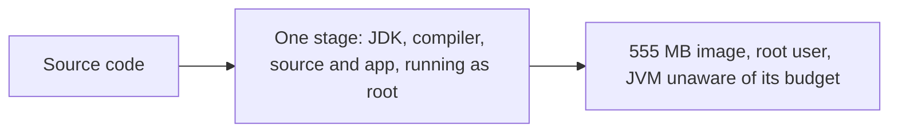
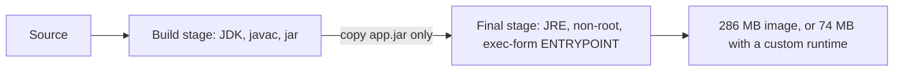

# A Dockerfile for a Java Service

**Cloud and containers · Docker · Step 9.2.4 · Fundamentals** · Last updated 2026-10-22
**Prerequisites:** [Images and layers](03-images-and-layers.md) (9.2.3)

**Version note**

| Item | Version |
|---|---|
| Baseline | Multi-stage builds and the exec form of `ENTRYPOINT` (long established Dockerfile features); JVM container support (the JVM reads the container's CPU and memory limits) |
| Hands-on baseline | Java 21 (Eclipse Temurin 21 on Alpine), Docker Engine 28.4.0 with BuildKit, run on 2026-10-22 |
| Compatibility note | In JDK 21, `jlink --compress` takes `zip-0` to `zip-9` (default `zip-6`); the older numeric values are marked deprecated in its help text. Spring Boot's layered-jar extraction command has changed between versions; check the documentation of your version |

## 1. What it is and why it matters

**What is it?** Packaging a Java service as an image that is small, quick to rebuild, safe to run and well behaved under memory and CPU limits. The Dockerfile is where those qualities are decided: which base image, which build stages, which user, which JVM options, in which order.

**Why do we need it?** A first Dockerfile usually works and is wrong in several ways at once: it ships the whole JDK and the build tools, runs as root, rebuilds everything on each change, and starts a JVM that has not been told how much memory it may use. Each of these costs something in production: pull time, attack surface, CI minutes, and surprise kills.

**When would I meet it?** The day `order-service` first leaves a laptop, and every time an image is reviewed, scanned or shrunk.

> [!TIP]
> **Memory hook:** *build fat, run thin, run as nobody, and tell the JVM its budget.*

## 2. Industry terms

| Term | Simple meaning | Why it matters | Example | Related terms |
|---|---|---|---|---|
| **Multi-stage build** | A Dockerfile with several `FROM` lines: "each of them begins a new stage of the build" and "you can selectively copy artifacts from one stage to another, leaving behind everything you don't want in the final image" (Docker docs) | Build with big tools, ship only the result | JDK stage compiles; JRE stage runs | Builder stage |
| **JDK and JRE** | The JDK compiles and packages; the JRE (or a custom runtime) is enough to run | A smaller, safer final image | `eclipse-temurin:21-jre-alpine` | `jlink`, custom runtime |
| **`jlink`** | A JDK tool that builds a minimal Java runtime with only the modules you name | The smallest runtime, for services with few dependencies | `--add-modules java.base,jdk.httpserver` | Modules, JPMS |
| **Non-root user** | A user other than root inside the container | Limits damage if the process is compromised | `USER app` (uid 10001) | Least privilege |
| **Exec form** | `ENTRYPOINT ["java", "-jar", "app.jar"]`: the command runs directly, not through a shell | The JVM becomes PID 1 and receives stop signals | Docs: the shell form "does not pass signals" | Shell form |
| **Container support (JVM)** | The JVM sizes itself from the container's limits, not the host's | Heap and thread pools match the budget | `availableProcessors()` equals the CPU limit | `UseContainerSupport` |
| **`MaxRAMPercentage`** | The share of available memory the heap may grow to; "the default value is 25 percent" (Java docs) | Controls how much of the container limit is heap | `-XX:MaxRAMPercentage=75` | `MinRAMPercentage`, `-Xmx` |
| **`.dockerignore`** | A file listing paths excluded from the build context | Smaller, faster builds; no accidental secrets | `target/`, `.git/` | Build context |
| **`EXPOSE`** | Documents which port the container listens on; it "doesn't actually publish the port" (Docker docs) | Documentation for the person running the image | `EXPOSE 8080` | `-p`, publish |

## 3. In a real system (ShopFlow)

**The business problem.** `order-service`'s first image is 555 MB, runs as root, is rebuilt from scratch on every commit, and starts a JVM that decides its heap from the host's memory. The first production incident: on a node with plenty of memory the container was killed at its limit, because the JVM sized its heap from the host (worked example 2 shows why). A security review also asks why a build compiler and a root shell are present in production.



**How a good Dockerfile helps.** A build stage compiles the application; the final stage contains only a runtime and the jar, runs as an unprivileged user, and starts the JVM with a heap sized as a share of the container limit. Dependencies come before code so rebuilds are fast. For services with few modules, a `jlink` runtime shrinks the image further.



**What it costs.** A slightly longer Dockerfile; a custom runtime means knowing which Java modules the service needs (a missing module fails at run time); and a minimal image has fewer debugging tools inside it.

**Elsewhere:** teams that ship Go or Rust binaries copy a single static file into an empty image; Python services build wheels in one stage and copy the virtual environment into a slim one; the principle (build fat, run thin) is the same.

## 4. How it works

The demo is a small HTTP service written with only the JDK (the built-in `com.sun.net.httpserver`), so it needs no build tool and nothing to download. In a real Spring Boot service the build stage would run Maven or Gradle; the Dockerfile ideas are identical. All commands below were run on Docker Engine 28.4.0 (2026-10-22); IDs, timings and sizes differ on your machine.

```java
// File: OrderService.java (container, Java 21)
import com.sun.net.httpserver.HttpExchange;
import com.sun.net.httpserver.HttpServer;
import java.io.IOException;
import java.net.InetSocketAddress;
import java.nio.charset.StandardCharsets;
import java.util.ArrayList;
import java.util.List;

public class OrderService {

    static final List<byte[]> held = new ArrayList<>();   // used only by the demo endpoint /fill

    public static void main(String[] args) throws IOException {
        int port = Integer.parseInt(System.getenv().getOrDefault("PORT", "8080"));
        String greeting = System.getenv().getOrDefault("GREETING", "hello");

        HttpServer server = HttpServer.create(new InetSocketAddress(port), 0);
        server.createContext("/health", ex -> reply(ex, "OK"));
        server.createContext("/orders/", ex -> {
            String id = ex.getRequestURI().getPath().substring("/orders/".length());
            reply(ex, "{\"id\":\"" + id + "\",\"status\":\"PAID\"}");
        });
        server.createContext("/info", ex -> {
            Runtime rt = Runtime.getRuntime();
            reply(ex, "user=" + System.getProperty("user.name") + " processors=" + rt.availableProcessors()
                    + " maxHeapMb=" + rt.maxMemory() / 1_048_576 + " greeting=" + greeting);
        });
        // Demo only, never in a real service: hold N megabytes of heap to show memory limits at work.
        server.createContext("/fill", ex -> {
            int mb = Integer.parseInt(ex.getRequestURI().getQuery().replace("mb=", ""));
            for (int i = 0; i < mb; i++) {
                held.add(new byte[1_048_576]);
            }
            reply(ex, "holding " + held.size() + " MB");
        });
        Runtime.getRuntime().addShutdownHook(new Thread(() -> System.out.println("shutdown hook: stopping")));
        server.start();
        System.out.println("order-service listening on port " + port);
    }

    static void reply(HttpExchange ex, String body) throws IOException {
        byte[] bytes = body.getBytes(StandardCharsets.UTF_8);
        ex.sendResponseHeaders(200, bytes.length);
        ex.getResponseBody().write(bytes);
        ex.close();
    }
}
```

> [!WARNING]
> The `/fill` endpoint exists only for the memory experiments in this lesson. A real service never offers a way to make itself hold arbitrary memory.

### Worked example 1: the same service, three Dockerfiles

**Concept.** Start with the Dockerfile most people write first (single stage, shell-form `CMD`), then improve it.

The naive version:

```dockerfile
FROM eclipse-temurin:21-jdk-alpine
WORKDIR /app
COPY . .
RUN javac -d classes OrderService.java && jar --create --file app.jar --main-class OrderService -C classes .
CMD java -jar app.jar
```

The multi-stage version, with a non-root user and the JVM told its budget:

```dockerfile
# Stage 1: build with the full JDK
FROM eclipse-temurin:21-jdk-alpine AS build
WORKDIR /src
COPY OrderService.java .
RUN javac -d classes OrderService.java \
 && jar --create --file app.jar --main-class OrderService -C classes .

# Stage 2: run with a JRE, as a non-root user
FROM eclipse-temurin:21-jre-alpine
RUN addgroup -S app && adduser -S -G app -u 10001 app
WORKDIR /app
COPY --from=build /src/app.jar app.jar
USER app
EXPOSE 8080
ENTRYPOINT ["java", "-XX:MaxRAMPercentage=75", "-jar", "app.jar"]
```

And a version with a custom Java runtime built by `jlink`:

```dockerfile
FROM eclipse-temurin:21-jdk-alpine AS build
WORKDIR /src
COPY OrderService.java .
RUN javac -d classes OrderService.java \
 && jar --create --file app.jar --main-class OrderService -C classes . \
 && jlink --add-modules java.base,jdk.httpserver --strip-debug --no-man-pages --no-header-files \
          --compress=zip-6 --output /jre

FROM alpine:3.22
RUN addgroup -S app && adduser -S -G app -u 10001 app
WORKDIR /app
COPY --from=build /jre /jre
COPY --from=build /src/app.jar app.jar
USER app
EXPOSE 8080
ENTRYPOINT ["/jre/bin/java", "-XX:MaxRAMPercentage=75", "-jar", "app.jar"]
```

**Result.** The same program, three images:

```text
$ docker image ls sf-learn/order
IMAGE                       ID             DISK USAGE   CONTENT SIZE   EXTRA
sf-learn/order:jlink        0c4b962041fa       74.2MB         25.5MB        
sf-learn/order:multistage   71cd22ddc6dc        286MB         73.4MB        
sf-learn/order:naive        a3de448e2acc        555MB          182MB        
```

**Walkthrough.**

| Image | Why this size |
|---|---|
| `naive` (555 MB) | The full JDK (compiler and tools), the source files and the build output |
| `multistage` (286 MB) | A JRE only; the build stage and its tools are not in the final image |
| `jlink` (74.2 MB) | A runtime with just `java.base` and `jdk.httpserver` on a plain Alpine base |

`CONTENT SIZE` (smaller column) is the compressed data a pull transfers: 182 MB, 73.4 MB and 25.5 MB. The `jlink` image is about 7.5 times smaller than the naive one, but its saving only holds while the service needs few modules; a typical Spring Boot service needs many, and the saving is smaller. Startup time did not separate them in this test (about 0.2 to 0.3 seconds from `docker run` to the first answer; one observation per image, on one machine):

```text
$ for t in naive multistage jlink; do python3 startup.py $t; done
naive       ready after 194 ms
multistage  ready after 195 ms
jlink       ready after 278 ms
```

```text
$ for t in naive multistage jlink; do python3 startup.py $t; done
naive       ready after 184 ms
multistage  ready after 225 ms
jlink       ready after 271 ms
```

**Experiment.** Predict first: run the naive and the multi-stage image with `--memory=1g --cpus=1`. What does `/info` report for the heap and the processors? The result is in Answers.

### Worked example 2: the JVM and the container's budget

**Concept.** The JVM used here (JDK 21) reads the container's cgroup limits ([9.2.2](02-containers-isolated-processes.md)) and sizes itself from them. The Java documentation: `-XX:MaxRAMPercentage` sets the share of memory the heap may use, "the default value is 25 percent". Without limits the JVM sees the whole VM; with limits it sees the container's.

The multi-stage image with no limits, then with `--memory=512m --cpus=2` (naive: defaults; multistage: `MaxRAMPercentage=75`):

```text
$ docker run -d --name sf-learn-order --label learning=notes -p 18080:8080 sf-learn/order:multistage >/dev/null; sleep 2; echo 'GET /health  -> '$(curl -s localhost:18080/health); echo 'GET /orders/o-1001 -> '$(curl -s localhost:18080/orders/o-1001); echo 'GET /info -> '$(curl -s localhost:18080/info); echo '--- logs:'; docker logs sf-learn-order
GET /health  -> OK
GET /orders/o-1001 -> {"id":"o-1001","status":"PAID"}
GET /info -> user=app processors=14 maxHeapMb=5880 greeting=hello
--- logs:
order-service listening on port 8080
```

```text
$ for t in naive multistage; do docker run -d --name sf-learn-$t --label learning=notes --memory=512m --cpus=2 -p $([ $t = naive ] && echo 18081 || echo 18082):8080 sf-learn/order:$t >/dev/null; done; sleep 3; echo 'naive      (java -jar, defaults):    '$(curl -s localhost:18081/info); echo 'multistage (MaxRAMPercentage=75):    '$(curl -s localhost:18082/info)
naive      (java -jar, defaults):    user=root processors=2 maxHeapMb=123 greeting=hello
multistage (MaxRAMPercentage=75):    user=app processors=2 maxHeapMb=371 greeting=hello
```

**Walkthrough.**

| Run | Processors | Max heap | Why |
|---|---|---|---|
| No limits | 14 | 5,880 MB | The JVM sees the whole Docker VM (14 CPUs, about 8 GB) and takes 75% of it |
| 512 MB, 2 CPUs, defaults | 2 | 123 MB | About 25% of 512 MB: the JVM reads the container's limits |
| 512 MB, 2 CPUs, `MaxRAMPercentage=75` | 2 | 371 MB | 75% of 512 MB |

`availableProcessors()` matters because thread pools, parallel streams and garbage-collector threads are sized from it ([13.2.2](../../13-java/02-streams/02-pipeline-laziness.md) summarises parallel streams).

**Small containers are different.** For a 128 MB container, the heap came out at 61 MB with the defaults, and **also with `MaxRAMPercentage=100`**:

```text
$ docker run -d --name sf-learn-f1 --label learning=notes --memory=128m -p 18083:8080 sf-learn/order:naive >/dev/null; sleep 3; echo 'maxHeap: '$(curl -s localhost:18083/info); echo 'fill 100 MB: '$(curl -s -m 20 'localhost:18083/fill?mb=100' || echo '(no reply)'); sleep 1; docker logs sf-learn-f1 2>&1 | grep -i -m2 'OutOfMemory\|Exception' ; docker inspect -f 'status={{.State.Status}} OOMKilled={{.State.OOMKilled}} exit={{.State.ExitCode}}' sf-learn-f1; docker rm -f sf-learn-f1 >/dev/null
maxHeap: user=root processors=14 maxHeapMb=61 greeting=hello
fill 100 MB: (no reply)
status=running OOMKilled=false exit=0
```

```text
$ docker run -d --name sf-learn-f2 --label learning=notes --memory=128m --entrypoint java -p 18084:8080 sf-learn/order:multistage -XX:MaxRAMPercentage=100 -jar app.jar >/dev/null; sleep 3; echo 'maxHeap: '$(curl -s localhost:18084/info); echo 'fill 100 MB: '$(curl -s -m 20 'localhost:18084/fill?mb=100' || echo '(no reply)'); sleep 2; docker inspect -f 'status={{.State.Status}} OOMKilled={{.State.OOMKilled}} exit={{.State.ExitCode}}' sf-learn-f2; docker rm -f sf-learn-f2 >/dev/null
maxHeap: user=app processors=14 maxHeapMb=61 greeting=hello
fill 100 MB: (no reply)
status=running OOMKilled=false exit=0
```

The Java documentation explains it: `-XX:MinRAMPercentage` applies "for small heaps. A small heap is a heap of approximately 125 MB. The default value is 50 percent." So below roughly 256 MB of container memory, the JVM ignores `MaxRAMPercentage` and uses about half. (In both runs, asking for 100 MB of heap failed inside Java and the container kept running.) Test your own limits instead of assuming the formula.

At 256 MB the settings do take effect, and the 75% heap leaves more room than 100%:

```text
$ docker run -d --name sf-learn-f3 --label learning=notes --memory=256m -p 18085:8080 sf-learn/order:multistage >/dev/null; sleep 3; echo 'maxHeap: '$(curl -s localhost:18085/info); echo 'fill 150 MB: '$(curl -s -m 20 'localhost:18085/fill?mb=150' || echo '(no reply)'); docker stats --no-stream --format 'memory now: {{.MemUsage}}' sf-learn-f3; docker inspect -f 'status={{.State.Status}} OOMKilled={{.State.OOMKilled}} exit={{.State.ExitCode}}' sf-learn-f3; docker rm -f sf-learn-f3 >/dev/null
maxHeap: user=app processors=14 maxHeapMb=185 greeting=hello
fill 150 MB: holding 150 MB
memory now: 180.4MiB / 256MiB
status=running OOMKilled=false exit=0
```

```text
$ docker run -d --name sf-learn-f4 --label learning=notes --memory=256m --entrypoint java -p 18086:8080 sf-learn/order:multistage -XX:MaxRAMPercentage=100 -jar app.jar >/dev/null; sleep 3; echo 'maxHeap: '$(curl -s localhost:18086/info); echo 'fill 240 MB: '$(curl -s -m 30 'localhost:18086/fill?mb=240' || echo '(no reply)'); sleep 2; docker inspect -f 'status={{.State.Status}} OOMKilled={{.State.OOMKilled}} exit={{.State.ExitCode}}' sf-learn-f4; docker rm -f sf-learn-f4 >/dev/null
maxHeap: user=app processors=14 maxHeapMb=247 greeting=hello
fill 240 MB: holding 240 MB
status=running OOMKilled=false exit=0
```

**Walkthrough.** With 75% of 256 MB the heap is 185 MB, and with 100% it is 247 MB, almost the whole limit. In this small demo, filling the heap did not make the kernel kill the container, because the service itself uses little memory outside the heap. A real service uses much more: thread stacks, class metadata, direct buffers, native libraries and garbage-collector structures. **The container limit must cover the heap plus all of that.** There is no universal safe percentage (75% is a common starting point), so measure the real process under load, and leave headroom ([9.2.2](02-containers-isolated-processes.md): a kill appears as exit code 137 with `OOMKilled=true`).

### Worked example 3: who runs the process

**Concept.** Without a `USER`, the process runs as root inside the container; with the multi-stage Dockerfile it runs as the unprivileged user `app` (uid 10001).

```text
$ docker exec sf-learn-naive sh -c 'echo test > /etc/written-by-container && echo naive: wrote a file in /etc'; docker exec sf-learn-multistage sh -c 'echo test > /etc/written-by-container && echo multistage: wrote a file in /etc'
naive: wrote a file in /etc
sh: can't create /etc/written-by-container: Permission denied
```

**Walkthrough.** The naive container could write to `/etc`; the non-root one was refused. Root in a container is not the same as root on the host, but it can modify everything in the container's filesystem and has more capabilities than a service needs, and a kernel or runtime flaw turns that into a larger problem ([9.2.9](09-container-security.md)). The first line of the output of `/info` earlier already showed it: `user=root` for the naive image, `user=app` for the other.

### Worked example 4: the build context and `.dockerignore`

**Concept.** The **build context** is the folder sent to the builder. A `COPY . .` instruction pulls in everything in it, including build output and the `.git` history. A `.dockerignore` file excludes paths.

Here the folder contains 35 MB of old build output and Git data next to the source:

```text
$ docker build --no-cache --progress=plain --label learning=notes -f ctx-ignore/Dockerfile.naive -t sf-learn/order:ctxtest ctx-ignore 2>&1 | grep -E 'transferring context: [0-9.]+[kM]?B'
#3 transferring context: 2B done
#6 transferring context: 35.01MB 0.2s done
```

```text
target/
.git/
```

```text
$ cat ctx-ignore/.dockerignore; docker build --no-cache --progress=plain --label learning=notes -f ctx-ignore/Dockerfile.naive -t sf-learn/order:ctxtest ctx-ignore 2>&1 | grep -E 'transferring context: [0-9.]+[kM]?B'
target/
.git/
#3 transferring context: 54B done
#6 transferring context: 157B done
```

**Walkthrough.** Without `.dockerignore`, the build transferred 35.01 MB to the builder; with it, 157 bytes. (The BuildKit builder only transfers files that a `COPY` actually names, so the multi-stage Dockerfile above, which copies one file, was never affected; the problem appears with `COPY . .` and also changes the cache: every change to an ignored file would otherwise invalidate the step.)

### Worked example 5: rebuilding after a code change

**Concept.** With the multi-stage Dockerfile, a source change rebuilds the compile step and the copy into the final image, while the user and directory setup in the final stage come from the cache.

```text
$ echo '// another small change' >> ctx/OrderService.java; docker build --progress=plain --label learning=notes -f ctx/Dockerfile -t sf-learn/order:multistage ctx 2>&1 | grep -A1 -E '^#[0-9]+ \[(build|stage-1) [2-4]/4\]' | grep -v '^--'
#8 [build 2/4] WORKDIR /src
#8 CACHED
#9 [build 3/4] COPY OrderService.java .
#9 DONE 0.0s
#10 [build 4/4] RUN javac -d classes OrderService.java  && jar --create --file app.jar --main-class OrderService -C classes .
#10 DONE 0.4s
#11 [stage-1 2/4] RUN addgroup -S app && adduser -S -G app -u 10001 app
#11 CACHED
#12 [stage-1 3/4] WORKDIR /app
#12 CACHED
#13 [stage-1 4/4] COPY --from=build /src/app.jar app.jar
#13 DONE 0.0s
```

**Walkthrough.** `RUN addgroup ...` and `WORKDIR` (stage 2) were `CACHED`; only the copy of the source, the compile step and the final `COPY --from=build` ran. In a real project, the dependency download is a separate step before the source copy, so only compilation repeats.

### Real-world (ShopFlow): a Spring Boot layered Dockerfile

Spring Boot's documentation describes splitting a Boot jar into layers (`dependencies`, `spring-boot-loader`, `snapshot-dependencies`, `application`), ordered "based on the order in which the layers should be added to the Docker/OCI image", so that the rarely changing dependencies are separate layers from the often changing application code. The sketch below follows the pattern of that documentation. It is an **untested sketch** (no Spring application was built for this lesson); command names and jar mode differ between Spring Boot versions, so check the documentation of yours:

```dockerfile
# Untested sketch, following the pattern in Spring Boot's reference documentation
FROM eclipse-temurin:21-jre-alpine AS builder
WORKDIR /builder
COPY target/order-service.jar application.jar
RUN java -Djarmode=tools -jar application.jar extract --layers --destination extracted

FROM eclipse-temurin:21-jre-alpine
RUN addgroup -S app && adduser -S -G app -u 10001 app
WORKDIR /application
COPY --from=builder /builder/extracted/dependencies/ ./
COPY --from=builder /builder/extracted/spring-boot-loader/ ./
COPY --from=builder /builder/extracted/snapshot-dependencies/ ./
COPY --from=builder /builder/extracted/application/ ./
USER app
EXPOSE 8080
ENTRYPOINT ["java", "-XX:MaxRAMPercentage=75", "-jar", "order-service.jar"]
```

The effect is the one from [9.2.3](03-images-and-layers.md): after a code change, only the small `application` layer is rebuilt and pushed; the large `dependencies` layer comes from the cache and from the registry.

### Common mistakes

1. Running the build tools in the final image (use a build stage).
2. `COPY . .` before the dependency step, or without a `.dockerignore`.
3. Shell-form `ENTRYPOINT`: Docker's reference says it starts the command "as a subcommand of `/bin/sh -c`, which does not pass signals", so the program "will not receive a SIGTERM from `docker stop`". (In the naive image above the BusyBox shell on Alpine happened to hand over to `java`, which became PID 1; that is a property of that shell, not a guarantee. 9.2.7, planned, tests it.)
4. A hard-coded `-Xmx` larger than the container limit, or no limit at all.
5. Running as root, and `latest` tags in `FROM`.

## 5. Failure scenarios

### The JVM that believed the host

1. **What happened?** `order-service` ran fine in staging and was killed in production with exit code 137 at peak.
2. **Why?** The staging container had no memory limit, so the JVM sized its heap from the host's 8 GB; in production the container had a 512 MB limit and a `-Xmx` set for the old server (1 GB), which the container could not honour.
3. **What did users see?** Restarts under load, with no application error in the log.
4. **Solutions:** let the JVM size from the container (`MaxRAMPercentage`) instead of a fixed `-Xmx`; keep staging and production limits alike; measure memory under load.
5. **What they cost:** a percentage to tune per service and memory reserved for non-heap use.

### A 555 MB image for a 2 MB jar

1. **What happened?** Every deploy pulled over half a gigabyte to each node; scale-out during the sale was slow, and the registry bill grew.
2. **Why?** The image contained the JDK, the sources and the build output.
3. **What did the business see?** Slow scaling when it mattered.
4. **Solutions:** a multi-stage build with a JRE (286 MB here) or a `jlink` runtime (74 MB); a smaller base; layers ordered for caching.
5. **What they cost:** a little more Dockerfile; for `jlink`, knowing the required modules.

### The service that couldn't be stopped cleanly

1. **What happened?** Deploys took ten seconds longer than expected, and in-flight requests were cut off.
2. **Why?** A shell-form `ENTRYPOINT` on a base image whose shell does not hand over: the shell was PID 1 and the JVM never saw the stop signal, so Docker waited for its timeout and then killed it.
3. **What did users see?** Failed requests at every deploy.
4. **Solutions:** exec form; test with `docker stop` and the container's logs ([9.2.7](07-lifecycle.md)).
5. **What they cost:** nothing but care.

## 6. Architectural decisions

| Decision | Choose | Because |
|---|---|---|
| Stages | Build in a JDK stage, run in a JRE (or `jlink`) stage | Smaller and safer final image |
| Runtime | Official JRE image for most services; `jlink` when the module list is short and size matters | `jlink` saves most when few modules are needed |
| User | A fixed non-root uid | Least privilege; predictable file ownership |
| JVM memory | `MaxRAMPercentage` (a starting point of about 75%, measured) rather than a fixed `-Xmx`; always set a container limit | The heap follows the budget |
| Entry point | Exec form | Signals reach the JVM |
| Order | Base, dependencies, then code | Fast rebuilds |
| Context | A `.dockerignore` with `target/`, `.git/`, local files and secrets | Smaller, safer builds |

**Common mistakes:** see worked example 5 and the list above.

### Alternatives in the industry

A map of the landscape, not a comparison. These were not run in this series; check each project's current documentation before adopting one.

| Tool | What it is | When you meet it |
|---|---|---|
| **Dockerfile with `docker build`** (used here) | Explicit, step-by-step image recipe, built with BuildKit | The universal baseline; most tutorials and pipelines |
| **Jib** | A Maven and Gradle plugin from Google that builds layered Java images without a Docker daemon or a Dockerfile | Java teams that want fast, reproducible builds in CI |
| **Spring Boot `build-image` (Cloud Native Buildpacks)** | Builds an image from your jar using buildpacks; no Dockerfile to write | Spring teams that prefer convention over a hand-written file |
| **Cloud Native Buildpacks** (Paketo, Heroku) | A standard that turns source code into an image with maintained base layers | Platforms that rebuild many apps when a base image is patched |
| **Buildah**, **Kaniko** | Build images without a Docker daemon (Buildah on a workstation, Kaniko inside a cluster) | Locked-down CI systems and Kubernetes-based pipelines |
| **Distroless and Chainguard images** | Minimal runtime base images with no shell or package manager | Security-conscious teams shrinking the attack surface |

## 7. Try it yourself

Try each exercise first; the real results are in the Answers section.

1. **Prove it runs as nobody.** Start the multi-stage image and show that the process cannot write to `/etc`, and which user it is.
2. **Write the `.dockerignore`.** List five kinds of paths a Java project should never send to a Docker build.
3. **Layer a Spring Boot service.** Using the sketch above, say which layer is rebuilt when you change one controller class, and which when you upgrade a library.

## 8. Check your understanding

1. Why does the final image of a multi-stage build get smaller, even though the build stage used a full JDK?
2. A container with a 512 MB limit runs `java -jar app.jar` and reports a 123 MB heap. Why, and what would you change?
3. Why is the exec form of `ENTRYPOINT` preferred?
4. A 128 MB container with `-XX:MaxRAMPercentage=100` still has a heap of about half the limit. Why?

Answers are at the end of this note.

## 9. Revision

**Remember**
- **Build fat, run thin:** multi-stage; JRE (or `jlink`) in the final image.
- **Non-root** user; **exec-form** `ENTRYPOINT`; **`.dockerignore`**.
- The JVM reads the container's CPU and memory; default heap is **25%** of memory, **50%** for small ones (about 125 MB heaps); set `MaxRAMPercentage` deliberately and **measure**.
- Order: base, dependencies, code. Layers never shrink.
- Spring Boot: extract **layers** so code changes rebuild only the small layer.

**Explain in 15 seconds:** "Compile in a JDK build stage, run in a small JRE stage as a non-root user with an exec-form entry point, and size the heap as a share of the container's memory limit."

**Explain in 60 seconds:**
> "A good Java Dockerfile is a multi-stage build: a JDK stage compiles and packages, and the final stage has only a runtime and the application, so the image is a fraction of the size and has no compiler in production. The final stage creates an unprivileged user, uses the exec form of ENTRYPOINT so the JVM is PID 1 and gets stop signals, and starts the JVM with a heap percentage rather than a fixed Xmx, because the JVM reads the container's CPU and memory limits and defaults to a quarter of the memory. I always set a container memory limit and leave room above the heap for stacks, metadata and buffers, and I measure instead of trusting a formula, since small containers use different defaults. Dependencies are copied before code so rebuilds are quick, a dockerignore keeps the context small, and for Spring Boot I extract the jar into layers so a code change rebuilds only the application layer. For services with few modules, jlink can produce a much smaller runtime."

**Likely follow-up questions:**
- **Should I use `-Xmx` or `MaxRAMPercentage`?** Percentage, so the heap follows the container limit; use `-Xmx` only when you have measured a fixed need.
- **Alpine or Debian-based images?** Alpine is small (musl libc); Debian or Ubuntu images are larger but match what most native libraries are tested against; choose by what your dependencies need.
- **What about GraalVM native images?** They give small images and fast starts, with a different build and runtime model (closed-world, no JIT) and longer builds; evaluate per service.
- **Where do Buildpacks fit?** Spring Boot can build images without a Dockerfile (Cloud Native Buildpacks); you trade control for convention.

**Architect's takeaway:** the Dockerfile is part of the service's design. Its size, user, JVM settings and layer order decide pull time, risk and build cost, so review it like code.

**Next topic:** [Networking and ports](05-networking-and-ports.md) (9.2.5)

## 10. Verification and sources

> [!NOTE]
> Checked 2026-10-22. Every command was run on Docker Engine 28.4.0 (Docker Desktop, linux/arm64) with Eclipse Temurin 21 images; output blocks are copied from those runs. The Spring Boot Dockerfile is an untested sketch. Re-verify when you revisit this note.

- **Confirmed (documentation, read 2026-10-22):** multi-stage builds use multiple `FROM` statements and "you can selectively copy artifacts from one stage to another" (Docker, "Multi-stage"); `EXPOSE` "doesn't actually publish the port"; the shell form of `ENTRYPOINT` starts the command "as a subcommand of /bin/sh -c, which does not pass signals", so it "will not receive a SIGTERM from docker stop"; `USER` sets the default user for later instructions and for `ENTRYPOINT` and `CMD` (Docker, "Dockerfile reference"); `-XX:MaxRAMPercentage` default 25 percent, `-XX:MinRAMPercentage` default 50 percent for small heaps of approximately 125 MB (Java SE 21, `java` command); Spring Boot's layer index, with layers `dependencies`, `spring-boot-loader`, `snapshot-dependencies` and `application` and a `jarmode=tools` command to extract them (Spring Boot reference, "Efficient container images" and "Dockerfiles").
- **Observed (this machine):** all sizes, heap values, timings and which commands succeeded; that the BusyBox shell on Alpine handed over to `java` in the naive image; that the heap stayed at 61 MB for both settings at 128 MB; that no kernel kill occurred in the 256 MB runs.
- **Assumptions and illustrations:** the demo service is deliberately tiny; the production incident stories are illustrative. The `jlink` module list (`java.base`, `jdk.httpserver`) fits this service only.
- **To verify:** the exact `jarmode` command and layers of your Spring Boot version; a base image's own entrypoint behaviour (the Temurin image defines an entrypoint script that the example's `ENTRYPOINT` replaces); the memory your service really needs under load.
- **Decision rule:** multi-stage, non-root, exec form, heap as a share of a measured container limit, dependencies before code.

**Sources:** Docker documentation: "Multi-stage", "Dockerfile reference", "Building best practices"; Java SE 21 documentation, `java` command; Spring Boot reference documentation, "Efficient Container Images" and "Dockerfiles"; [Images and layers](03-images-and-layers.md) and [Containers: isolated processes with limits](02-containers-isolated-processes.md) in this series.

## Answers

**Experiment**

- **`--memory=1g --cpus=1`** (worked example 1):

```text
$ for t in naive multistage; do docker run -d --name sf-learn-$t --label learning=notes --memory=1g --cpus=1 -p $([ $t = naive ] && echo 18081 || echo 18082):8080 sf-learn/order:$t >/dev/null; done; sleep 3; echo 'naive:      '$(curl -s localhost:18081/info); echo 'multistage: '$(curl -s localhost:18082/info)
naive:      user=root processors=1 maxHeapMb=247 greeting=hello
multistage: user=app processors=1 maxHeapMb=742 greeting=hello
```

  One processor in both. The naive image's heap is about 25% of 1 GB (247 MB); the multi-stage image's 75% gives 742 MB.

**Check your understanding**

1. Because only what a later stage copies (`COPY --from=build`) ends up in the final image. The build stage, with its JDK, compiler and source, is discarded; the final stage starts from a small runtime image and receives just `app.jar`.
2. The JVM read the container's limit and, with no `MaxRAMPercentage` set, used its default of 25% (about 123 MB). If the service needs more heap, set `-XX:MaxRAMPercentage` higher (for example 75), measure the total memory under load, and raise the container limit if the process needs more than the limit allows.
3. In exec form the program is started directly, so it is PID 1 and receives the stop signal from `docker stop`. The shell form starts it through `/bin/sh -c`, which may not pass signals on, so the program may not get a chance to shut down cleanly.
4. The JVM treats small heaps (around 125 MB) with `MinRAMPercentage` (default 50%) instead of `MaxRAMPercentage`, so at 128 MB the heap was about 61 MB for both settings. Test small limits directly.

**Practice exercises**

1. **Prove it runs as nobody:** the multi-stage container reports `user=app` in `/info`, and a write to `/etc` is refused:

```text
$ docker exec sf-learn-naive sh -c 'echo test > /etc/written-by-container && echo naive: wrote a file in /etc'; docker exec sf-learn-multistage sh -c 'echo test > /etc/written-by-container && echo multistage: wrote a file in /etc'
naive: wrote a file in /etc
sh: can't create /etc/written-by-container: Permission denied
```

2. **Write the `.dockerignore`:** five kinds of paths: build output (`target/`, `build/`), version-control data (`.git/`), local environment and IDE files (`.idea/`, `*.iml`, `.env`), logs and temporary files, and anything holding credentials (keys, `.env`, local configuration with passwords). The effect of the first two is shown in worked example 4: 35.01 MB became 157 bytes.

3. **Layer a Spring Boot service:** changing one controller class changes only the `application` layer, so only that small layer (and the final `COPY` of it) is rebuilt and pushed. Upgrading a library changes the `dependencies` layer (for released versions) and everything after it, so the `dependencies` layer and the later `COPY` steps are rebuilt. This is the same rule as in [9.2.3](03-images-and-layers.md): a change rebuilds its own layer and all later ones.

Back to [the series overview](01-docker-overview.md) · [the area overview](../01-cloud-and-containers-overview.md) · [the index](../../README.md) · [Roadmap](../../roadmap.md).
