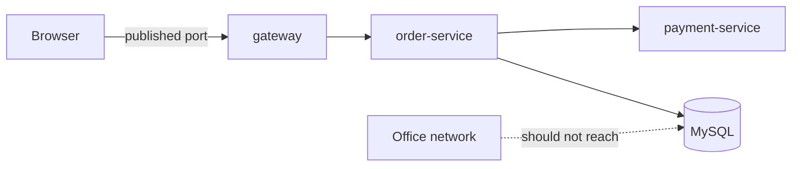

# Networking and Ports

**Cloud and containers · Docker · Step 9.2.5 · Intermediate** · Last updated 2026-10-22
**Prerequisites:** [Containers: isolated processes with limits](02-containers-isolated-processes.md) (9.2.2); helpful: [Load balancing](../../14-system-design/05-load-balancing.md) (14.5)

**Version note**

| Item | Version |
|---|---|
| Baseline | Bridge networks, embedded DNS on user-defined networks, and port publishing (long-standing Docker features) |
| Hands-on baseline | Docker Engine 28.4.0 on Docker Desktop for Mac, run on 2026-10-22 |
| Compatibility note | Docker's documentation notes that in releases older than 28.0.0, hosts on the same network segment could reach ports published to `127.0.0.1`. The name `host.docker.internal` is a Docker Desktop feature; on Linux engines it needs extra configuration |

## 1. What it is and why it matters

**What is it?** Every container gets its own network stack (its own network namespace, [9.2.2](02-containers-isolated-processes.md)): its own address, its own `localhost`, its own ports. Docker connects containers to virtual **networks**, and **publishes** chosen container ports on the host so that the outside world can reach them.

**Why do we need it?** Services must find and call each other (`order-service` calls `payment-service` and MySQL), while only a few of them should be reachable from outside. Without a clear picture of Docker networking, you meet the classic confusions: "connection refused" between containers that are running, a database exposed to the whole office network, a port that is "already allocated", and a service that works from your Mac but not from another container.

**When would I meet it?** Whenever two containers must talk, whenever a container must be reachable from a browser or a test, and every time you read a Compose file or a Kubernetes Service (the same ideas, one level up).

> [!TIP]
> **Memory hook:** *inside the network, use names; at the edge, publish only what must be public; remember that `localhost` is the container itself.*

## 2. Industry terms

| Term | Simple meaning | Why it matters | Example | Related terms |
|---|---|---|---|---|
| **Bridge network** | A virtual switch on the host that connects containers; the default network type | Gives containers addresses and lets them talk | `sf-learn-net` with subnet `172.21.0.0/16` | Overlay, host network |
| **Default bridge** | The network every container joins unless told otherwise | "Containers on the default bridge network can only access each other by IP addresses" (Docker docs) | `docker run` without `--network` | `--link` (legacy) |
| **User-defined bridge** | A network you create with `docker network create` | "Provide automatic DNS resolution between containers": they "can resolve each other by name or alias" | `--network sf-learn-net` | Embedded DNS |
| **Network alias** | An extra name for a container, valid on one network | Several containers can answer to one name | `--network-alias orders` | Service name |
| **Published port** | A host port mapped to a container port with `-p host:container` | The only way for the host and the outside to reach a container (apart from other containers on the network) | `-p 18090:8080` | `EXPOSE`, port mapping |
| **Bind address** | The host address a published port listens on | `0.0.0.0` means every interface, `127.0.0.1` only the host | `-p 127.0.0.1:18091:8080` | Loopback |
| **`localhost` inside a container** | The container's own loopback interface | It never means the host or another container | `localhost:18090` fails inside a container | Container IP |
| **`host.docker.internal`** | A name that "resolves to the internal IP address of your host gateway" on Docker Desktop | How a container reaches a service running on your laptop | A debugger or a local database | `gateway.docker.internal` |

## 3. In a real system (ShopFlow)

**The business problem.** On a developer laptop the ShopFlow stack runs as containers: `order-service`, `payment-service` and MySQL. `order-service` must call the others by name; the browser must reach only the gateway; and the database must never be reachable from the office network. A new developer's first attempts fail: `order-service` can't find `payment-service` ("bad address"), the database port was published to every interface "to make the SQL client work", and a second copy of the stack stops with "port is already allocated".



**How Docker networking helps.** Put the services on a user-defined network so they find each other by name; publish only the gateway (and bind it to the loopback address on a laptop); keep MySQL on a back network that only the services share; and let the client reach MySQL through a loopback-only published port if needed.

**What it costs.** Names and networks to design and keep consistent between Compose files and production; port numbers to coordinate on a shared machine; and extra care because default settings are convenient, not secure.

**Elsewhere:** a payment company puts card-handling services on a network that has no route to the internet and no published ports; a data team runs a notebook container that must reach a database on the laptop through the host name; a CI system gives each build its own network so parallel builds can't see each other.

## 4. How it works

Every container joins one or more networks. On a **bridge network** the engine acts as a switch, router and DNS server: each container gets an address from the network's subnet, and traffic to other containers on the **same** network flows directly. Traffic from outside (your Mac, other machines) reaches a container only through a **published port**. The examples below ran on Docker Engine 28.4.0 (2026-10-22); addresses and IDs differ on your machine. Containers named `sf-learn-...` and networks labelled `learning=notes` were removed afterwards.

### Worked example 1: names and addresses

**Concept.** On the default bridge, containers can only reach each other by address, and addresses change every time a container is recreated. On a user-defined network, Docker's built-in DNS resolves container names.

```text
$ IPB=$(docker inspect -f '{{.NetworkSettings.IPAddress}}' sf-learn-db); echo "db has the address $IPB"; docker exec sf-learn-da ping -c 1 -W 2 $IPB | sed -n '1,2p'; echo '--- by name:'; docker exec sf-learn-da ping -c 1 -W 2 sf-learn-db 2>&1 | head -2
db has the address 172.17.0.3
PING 172.17.0.3 (172.17.0.3): 56 data bytes
64 bytes from 172.17.0.3: seq=0 ttl=64 time=0.087 ms
--- by name:
ping: bad address 'sf-learn-db'
```

```text
$ docker network create --label learning=notes sf-learn-net >/dev/null; docker run -d --name sf-learn-a --network sf-learn-net --label learning=notes alpine:3.22 sleep 600 >/dev/null; docker run -d --name sf-learn-b --network sf-learn-net --label learning=notes alpine:3.22 sleep 600 >/dev/null; docker exec sf-learn-a ping -c 1 -W 2 sf-learn-b | sed -n '1,2p'; echo '--- the address the name resolves to:'; docker exec sf-learn-a nslookup sf-learn-b 2>&1 | tail -3; docker network inspect -f 'subnet {{(index .IPAM.Config 0).Subnet}}, gateway {{(index .IPAM.Config 0).Gateway}}' sf-learn-net
PING sf-learn-b (172.21.0.3): 56 data bytes
64 bytes from 172.21.0.3: seq=0 ttl=64 time=0.091 ms
--- the address the name resolves to:
Name:	sf-learn-b
Address: 172.21.0.3

subnet 172.21.0.0/16, gateway 172.21.0.1
```

**Walkthrough.** On the default bridge, pinging `172.17.0.3` works but the name `sf-learn-db` gives `bad address`. On the user-defined network `sf-learn-net` (subnet `172.21.0.0/16`, gateway `172.21.0.1`), the name resolves to `172.21.0.3`. A service should therefore always be configured with a **name** (`jdbc:mysql://mysql:3306/shop`), never an IP address.

### Worked example 2: publishing ports, and who can reach what

**Concept.** Containers on the same network reach each other on **any** port, with nothing published. Publishing maps a port on the host to a port in the container.

First, `orders1` on `sf-learn-net` with no published ports:

```text
$ echo -n 'from the Mac, port 8080: '; curl -s -m 2 localhost:8080/health || echo 'no answer (not published)'; echo -n 'from another container on the network: '; docker run --rm --network sf-learn-net --label learning=notes alpine:3.22 wget -qO- -T 3 http://sf-learn-orders1:8080/health; echo; docker port sf-learn-orders1 || true; echo '(docker port prints nothing: no published ports)'
from the Mac, port 8080: no answer (not published)
from another container on the network: OK
(docker port prints nothing: no published ports)
```

The Mac cannot reach it (nothing listens on the Mac's port 8080), while another container on the network can. Then two containers published in different ways: `-p 18090:8080` (all interfaces) and `-p 127.0.0.1:18091:8080` (loopback only):

```text
$ docker port sf-learn-pub1; docker port sf-learn-pub2; echo 'from the Mac: '$(curl -s localhost:18090/health) $(curl -s localhost:18091/health); echo '--- who listens on the Mac:'; lsof -nP -iTCP:18090 -iTCP:18091 -sTCP:LISTEN | awk 'NR>1 {print $1, $9}' | sort -u
8080/tcp -> 0.0.0.0:18090
8080/tcp -> [::]:18090
8080/tcp -> 127.0.0.1:18091
from the Mac: OK OK
--- who listens on the Mac:
com.docke *:18090
com.docke 127.0.0.1:18091
```

**Walkthrough.** Both answer on the Mac. The difference is who else could connect: port 18090 listens on `*` (every interface, so other machines on your network could reach it), port 18091 only on `127.0.0.1`. Docker's documentation is blunt: "Publishing container ports is insecure by default... when you publish a container's ports it becomes available not only to the Docker host, but to the outside world as well", and including the loopback address means "only the Docker host can access the published container port". `EXPOSE` in a Dockerfile does not change this: it "doesn't actually publish the port" ([9.2.4](04-dockerfile-java-service.md)).

**Two ports cannot be published at the same host port:**

```text
$ docker run -d --name sf-learn-pub3 --label learning=notes -p 18090:8080 sf-learn/order:multistage 2>&1 | grep -o 'Bind for.*'; docker rm -f sf-learn-pub3 >/dev/null 2>&1
Bind for 0.0.0.0:18090 failed: port is already allocated
```

**`localhost` is the container itself.** Inside another container, `localhost:18090` is that container's own loopback, where nothing listens. To reach a service on the Mac, use the Docker Desktop name `host.docker.internal`:

```text
$ echo -n 'on the Mac, localhost:18090 -> '; curl -s localhost:18090/health; echo; echo -n 'inside another container, localhost:18090 -> '; docker run --rm --label learning=notes alpine:3.22 wget -qO- -T 3 http://localhost:18090/health 2>&1 | head -1; echo -n 'inside another container, host.docker.internal:18090 -> '; docker run --rm --label learning=notes alpine:3.22 wget -qO- -T 3 http://host.docker.internal:18090/health
on the Mac, localhost:18090 -> OK
inside another container, localhost:18090 -> wget: can't connect to remote host: Connection refused
inside another container, host.docker.internal:18090 -> OK
```

**Experiment.** Predict first: publish MySQL's port as `-p 3306:3306` versus `-p 127.0.0.1:3306:3306`. Which one can a colleague on the same Wi-Fi reach? The answer follows from the bind addresses above; it is stated in Answers.

### Worked example 3: several containers behind one name

**Concept.** If several containers on a network share one **network alias**, the built-in DNS returns all their addresses, and clients spread across them. It is a basic form of load balancing.

```text
$ docker run --rm --network sf-learn-net --label learning=notes alpine:3.22 nslookup orders 2>&1 | grep -E '^(Name|Address)' | tail -4; docker inspect -f '{{.Name}} {{(index .NetworkSettings.Networks "sf-learn-net").IPAddress}}' sf-learn-orders1 sf-learn-orders2
Name:	orders
Address: 172.21.0.2
Name:	orders
Address: 172.21.0.3
/sf-learn-orders1 172.21.0.2
/sf-learn-orders2 172.21.0.3
```

Two containers, `orders1` and `orders2`, each reporting a different greeting (`one` and `two`), both with the alias `orders`. Eight requests to `http://orders:8080/info`:

```text
$ docker run --rm --network sf-learn-net --label learning=notes alpine:3.22 sh -c 'for i in 1 2 3 4 5 6 7 8; do wget -qO- -T 3 http://orders:8080/info | grep -o "greeting=.*"; done'
greeting=two
greeting=one
greeting=two
greeting=two
greeting=one
greeting=two
greeting=one
greeting=one
```

**Walkthrough.** The name `orders` resolves to both addresses (`172.21.0.2` and `172.21.0.3`), and the requests landed on either container in no fixed pattern (the order of addresses varies). This is **DNS-based** balancing, with the limits from [14.5](../../14-system-design/05-load-balancing.md): no health checks (a dead container's address may still be returned), clients may cache an address, and there is no awareness of load. Orchestrators add proper load balancing on top ([9.3.3](../03-kubernetes/03-services-dns-ingress.md)).

### Worked example 4: networks as walls

**Concept.** A container on one network cannot reach another network's containers, by name or by address. A container connected to **two** networks bridges them, which is how you build a front and a back.

The isolation, with no shared network:

```text
$ docker network create --label learning=notes sf-learn-net2 >/dev/null; echo 'from a container on another network, by name:'; docker run --rm --network sf-learn-net2 --label learning=notes alpine:3.22 wget -qO- -T 3 http://sf-learn-orders1:8080/health 2>&1 | head -1; echo 'by address:'; docker run --rm --network sf-learn-net2 --label learning=notes alpine:3.22 wget -qO- -T 3 http://172.21.0.2:8080/health 2>&1 | head -1
from a container on another network, by name:
wget: bad address 'sf-learn-orders1:8080'
by address:
wget: download timed out
```

Connecting `orders1` to the second network makes it reachable from there:

```text
$ docker network connect sf-learn-net2 sf-learn-orders1; echo 'from the other network, by name, after connecting orders1 to it:'; docker run --rm --network sf-learn-net2 --label learning=notes alpine:3.22 wget -qO- -T 3 http://sf-learn-orders1:8080/health; echo; docker inspect -f '{{range $n, $v := .NetworkSettings.Networks}}{{$n}} {{end}}' sf-learn-orders1
from the other network, by name, after connecting orders1 to it:
OK
sf-learn-net sf-learn-net2 
```

A front/back layout: `web` on both networks, `db` only on `back`, a client only on `front`:

```text
$ docker network create --label learning=notes sf-learn-front >/dev/null; docker network create --label learning=notes sf-learn-back >/dev/null; docker run -d --name sf-learn-web --network sf-learn-front --label learning=notes sf-learn/order:multistage >/dev/null; docker network connect sf-learn-back sf-learn-web; docker run -d --name sf-learn-db --network sf-learn-back --label learning=notes sf-learn/order:multistage >/dev/null; sleep 3; echo -n 'client on front -> web: '; docker run --rm --network sf-learn-front --label learning=notes alpine:3.22 wget -qO- -T 3 http://sf-learn-web:8080/health; echo; echo -n 'client on front -> db:  '; docker run --rm --network sf-learn-front --label learning=notes alpine:3.22 wget -qO- -T 3 http://sf-learn-db:8080/health 2>&1 | head -1; echo -n 'web (on both) -> db:    '; docker exec sf-learn-web wget -qO- -T 3 http://sf-learn-db:8080/health; echo
client on front -> web: OK
client on front -> db:  wget: bad address 'sf-learn-db:8080'
web (on both) -> db:    OK
```

**Walkthrough.** The client can talk to `web` but cannot even resolve `db` (`bad address`); `web`, which sits on both networks, can reach `db`. That is the shape of a typical deployment: only the gateway is on the public side, the database on a private network that only the services share. By address, the other network's container did not answer at all (`download timed out`): the isolation is enforced by the network, not only by DNS.

### Real-world (ShopFlow): service-to-service calls

`order-service` calls `payment-service` by name, and nothing is published:

```text
$ docker exec sf-learn-orders1 wget -qO- -T 3 http://sf-learn-payments:8080/orders/o-1001
{"id":"o-1001","status":"PAID"}
```

The call went from one container to another over the shared network using the name `sf-learn-payments`, and no port was published. On a laptop, publish just the gateway (`-p 127.0.0.1:8080:8080`).

### Common mistakes

1. Configuring services with container IP addresses.
2. `localhost` in a service's configuration meaning "the other container".
3. Publishing a database to every interface.
4. Relying on the default bridge's lack of names, or on `--link`, which Docker calls legacy.

## 5. Failure scenarios

### "Connection refused" between two running containers

1. **What happened?** `order-service` could not reach MySQL, though both containers were running.
2. **Why?** The configuration said `localhost:3306`, which inside the `order-service` container is the container itself (worked example 2). Or the two were on different networks.
3. **What did users see?** Failed requests and a startup error in the logs.
4. **Solutions:** use the container or service **name**, put both on the same user-defined network, and check with `docker exec` and a small client from inside the container.
5. **What they cost:** a configuration value per environment.

### The database that the whole office could reach

1. **What happened?** A security scan found MySQL answering on a developer's laptop from other machines on the network.
2. **Why?** `-p 3306:3306` binds every interface (worked example 2).
3. **What did the business see?** A finding in a security review, and possible exposure of test data that included real customer records.
4. **Solutions:** publish only what is needed, bound to `127.0.0.1`, or don't publish at all and use `docker exec` or a container on the same network as the client; keep databases on a back network.
5. **What they cost:** one flag, and an extra step to reach a database from a tool.

### Names that didn't resolve

1. **What happened?** A test container could not find `orders` although the service was running.
2. **Why?** The containers were on different networks, or on the default bridge, where names don't resolve.
3. **What did users see?** A test failing with `bad address` and no obvious reason.
4. **Solutions:** create and use a user-defined network; check `docker network inspect` for which containers are attached.
5. **What they cost:** nothing, once the networks are part of the setup.

### Port already allocated

1. **What happened?** Starting a second copy of the stack failed: `Bind for 0.0.0.0:18090 failed: port is already allocated`.
2. **Why?** Two containers (or a container and a process on the host) cannot listen on the same host port.
3. **What did users see?** A container left in the `Created` state, and a failing start-up script.
4. **Solutions:** choose different host ports per stack, let Docker pick one (`-p 8080` without a host port), or publish nothing and reach services over the network.
5. **What they cost:** port bookkeeping on a shared machine.

## 6. Architectural decisions

| Decision | Choose | Because |
|---|---|---|
| Network type | A user-defined bridge per application or stack | Names, isolation, and no surprises from other stacks |
| Addressing | Names (service names or aliases), never IPs | Addresses change |
| What to publish | Only the entry point; bind to `127.0.0.1` on laptops | Published ports are reachable by the outside by default |
| Databases and brokers | A private back network, not published | Least exposure |
| Several instances | A shared alias for simple DNS spreading; a real load balancer when health and load matter | See [14.5](../../14-system-design/05-load-balancing.md) |
| Reaching the host | `host.docker.internal` on Docker Desktop | The host's address changes |

**Common mistakes:** see worked examples and failures above.

## 7. Try it yourself

Try each exercise first; the real results are in the Answers section.

1. **Name it.** Start two containers on a user-defined network and call one from the other by name, without publishing any port.
2. **Wall it.** Build a front/back layout where a client on `front` can reach `web` but not `db`, and `web` can reach `db`.
3. **Bind it.** Publish a port so that only your own machine can reach it, and show on which address it listens.

## 8. Check your understanding

1. Why does `ping other-container` fail on the default bridge but work on a user-defined network?
2. What is the difference between `EXPOSE 8080` and `-p 8080:8080`?
3. A container on your Mac needs to call a service running directly on your Mac. Which address do you use, and why not `localhost`?
4. You want the database reachable only from the services. How would you arrange it?

Answers are at the end of this note.

## 9. Revision

**Remember**
- **User-defined networks** give DNS by name; the default bridge only addresses.
- Same network: **any port**, nothing published. Outside access: **published ports only**.
- **`-p 127.0.0.1:host:container`** limits a published port to your machine; plain `-p` binds **all interfaces**.
- **`localhost` in a container is the container.** Use names between containers, `host.docker.internal` for the Mac.
- A shared **alias** gives simple DNS spreading; a container on **two networks** bridges them.

**Explain in 15 seconds:** "Containers on the same user-defined network find each other by name and reach any port; only ports I publish are reachable from outside, and I bind those to localhost unless they must be public."

**Explain in 60 seconds:**
> "Each container has its own network stack, so its localhost is itself. Docker connects containers to bridge networks: on the default bridge they can only use addresses, on a user-defined network the engine's DNS resolves container names and aliases, so services are configured with names. Containers on the same network reach each other on any port without publishing anything; the host and the outside world reach a container only through published ports, which bind to all interfaces unless I give a loopback address. Networks also act as walls: a container on another network can't reach it by name or address, and a container attached to two networks bridges them, which is how I keep the database on a private back network. Several containers can share an alias for simple DNS-based spreading, without health checks. On Docker Desktop, host.docker.internal is how a container reaches something running on my laptop."

**Likely follow-up questions:**
- **What is `--network host`?** The container shares the host's network stack (on Docker Desktop, the VM's, not your Mac's), so there is no isolation and no port mapping; use it only when needed.
- **How is this different in Kubernetes?** Pods get cluster-wide addresses and Services give stable names and load balancing; see the Kubernetes series.
- **Do containers on the same network need `EXPOSE`?** No: it is documentation only.
- **How do I reach a container from another machine?** Publish a port bound to a reachable address, or put a reverse proxy container in front.

**Architect's takeaway:** treat network layout as part of the design: names for discovery, networks for trust boundaries, published ports as the only doors.

**Next topic:** [Data and configuration: volumes and environment](06-data-and-configuration.md) (9.2.6)

## 10. Verification and sources

> [!NOTE]
> Checked 2026-10-22. Every command was run on Docker Engine 28.4.0 (Docker Desktop for Mac, linux/arm64); output blocks are copied from those runs. Re-verify when you revisit this note.

- **Confirmed (Docker documentation, read 2026-10-22):** user-defined bridges "provide automatic DNS resolution between containers" and "containers can resolve each other by name or alias", while on the default bridge containers "can only access each other by IP addresses, unless you use the --link option, which is considered legacy" (Bridge network driver); "Publishing container ports is insecure by default ... it becomes available not only to the Docker host, but to the outside world as well", and with the loopback address "only the Docker host can access the published container port", with a warning that releases older than 28.0.0 let hosts on the same network segment reach ports published to localhost (Port publishing and mapping); `host.docker.internal` "resolves to the internal IP address of your host gateway" (Docker Desktop networking how-tos); `--network-alias` "add network-scoped alias for the container" (`docker run` reference); `EXPOSE` "doesn't actually publish the port" (Dockerfile reference).
- **Observed (this machine):** the DNS answers for a shared alias and the spread of requests (the documentation pages read do not describe this behaviour); the isolation results; the exact error messages.
- **Assumptions and illustrations:** the ShopFlow stack is illustrative. Addresses such as `172.21.0.3` are allocated by the engine and differ between machines and runs.
- **To verify:** your Docker version's default address pools (they can collide with a company VPN); whether `host.docker.internal` is available with your engine (Docker Desktop yes; Linux engines need `--add-host`); the rules of any firewall on your host.
- **Decision rule:** names inside, published ports at the edge, loopback binding on laptops, databases on private networks.

**Sources:** Docker documentation: "Bridge network driver", "Port publishing and mapping", "Networking how-tos" (Docker Desktop), `docker run` and Dockerfile references.

## Answers

**Experiment**

- **`-p 3306:3306` versus `-p 127.0.0.1:3306:3306`:** the first listens on every interface (`*`, as port 18090 did), so a colleague on the same network can connect to your MySQL (if no firewall blocks it); the second listens only on `127.0.0.1`, reachable from your own machine only.

**Check your understanding**

1. The default bridge has no name resolution (only addresses, plus the legacy `--link`), while a user-defined network runs an embedded DNS server that resolves container names and network aliases.
2. `EXPOSE` documents which port the container listens on and changes nothing at run time. `-p 8080:8080` actually publishes it on the host, so the host and outside machines can connect (to the interface you bind it to).
3. `host.docker.internal` on Docker Desktop. `localhost` inside a container is the container's own loopback interface, where nothing is listening on that port.
4. Put the database on a private network shared only with the services (a back network), do not publish its port, and attach only the services that need it to that network, as in the front/back layout in worked example 4.

**Practice exercises**

1. **Name it:** the call from `orders1` to `payments` by name, with nothing published (shown in the ShopFlow example above):

```text
$ docker exec sf-learn-orders1 wget -qO- -T 3 http://sf-learn-payments:8080/orders/o-1001
{"id":"o-1001","status":"PAID"}
```

2. **Wall it:** the results of the front/back layout, as in worked example 4:

```text
$ docker network create --label learning=notes sf-learn-front >/dev/null; docker network create --label learning=notes sf-learn-back >/dev/null; docker run -d --name sf-learn-web --network sf-learn-front --label learning=notes sf-learn/order:multistage >/dev/null; docker network connect sf-learn-back sf-learn-web; docker run -d --name sf-learn-db --network sf-learn-back --label learning=notes sf-learn/order:multistage >/dev/null; sleep 3; echo -n 'client on front -> web: '; docker run --rm --network sf-learn-front --label learning=notes alpine:3.22 wget -qO- -T 3 http://sf-learn-web:8080/health; echo; echo -n 'client on front -> db:  '; docker run --rm --network sf-learn-front --label learning=notes alpine:3.22 wget -qO- -T 3 http://sf-learn-db:8080/health 2>&1 | head -1; echo -n 'web (on both) -> db:    '; docker exec sf-learn-web wget -qO- -T 3 http://sf-learn-db:8080/health; echo
client on front -> web: OK
client on front -> db:  wget: bad address 'sf-learn-db:8080'
web (on both) -> db:    OK
```

3. **Bind it:** publish with `-p 127.0.0.1:18091:8080`. The listening address on the Mac shows `127.0.0.1:18091` (the other published port, without a bind address, shows `*:18090`):

```text
$ docker port sf-learn-pub1; docker port sf-learn-pub2; echo 'from the Mac: '$(curl -s localhost:18090/health) $(curl -s localhost:18091/health); echo '--- who listens on the Mac:'; lsof -nP -iTCP:18090 -iTCP:18091 -sTCP:LISTEN | awk 'NR>1 {print $1, $9}' | sort -u
8080/tcp -> 0.0.0.0:18090
8080/tcp -> [::]:18090
8080/tcp -> 127.0.0.1:18091
from the Mac: OK OK
--- who listens on the Mac:
com.docke *:18090
com.docke 127.0.0.1:18091
```

Back to [the series overview](01-docker-overview.md) · [the area overview](../01-cloud-and-containers-overview.md) · [the index](../../README.md) · [Roadmap](../../roadmap.md).
