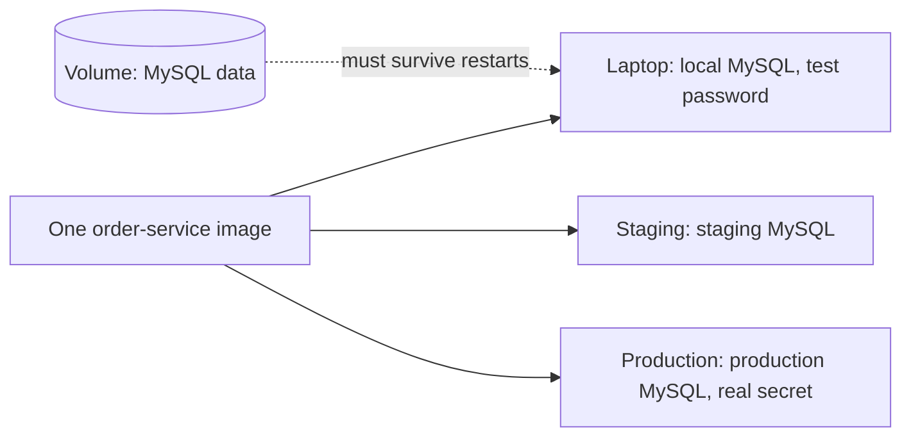

# Data and Configuration: Volumes and Environment

**Cloud and containers · Docker · Step 9.2.6 · Intermediate** · Last updated 2026-10-22
**Prerequisites:** [Images and layers](03-images-and-layers.md) (9.2.3); helpful: [Networking and ports](05-networking-and-ports.md) (9.2.5)

**Version note**

| Item | Version |
|---|---|
| Baseline | Volumes, bind mounts, tmpfs mounts and environment variables (long-standing Docker features) |
| Hands-on baseline | Docker Engine 28.4.0 on Docker Desktop for Mac, run on 2026-10-22 |
| Compatibility note | File ownership on bind mounts differs by platform: on Docker Desktop for Mac the files created by a container's root user appear on the Mac owned by your user; on a Linux engine they show the container user's numeric id. The Linux behaviour was not tested here |

## 1. What it is and why it matters

**What is it?** Containers are disposable, so anything that must survive a container, or be shared with the host or with other containers, lives **outside** its writable layer: in a **volume** (storage managed by Docker), a **bind mount** (a host folder) or a **tmpfs mount** (memory). **Configuration**, the settings that differ between environments, is supplied from outside the image too, usually as **environment variables**.

**Why do we need it?** Replacing a container is the normal way to deploy, scale and recover. If the data lives inside it, every replacement is data loss ([9.2.3](03-images-and-layers.md): the writable layer is deleted with the container). If the settings are built into the image, you need a different image per environment, which defeats "build once, run anywhere".

**When would I meet it?** Running MySQL or Kafka in a container, sharing source code with a container during development, passing database addresses and credentials to `order-service`, and every Kubernetes manifest (volumes, ConfigMaps, Secrets are the same ideas).

> [!TIP]
> **Memory hook:** *the image is the same everywhere; the data and the settings come from outside.*

## 2. Industry terms

| Term | Simple meaning | Why it matters | Example | Related terms |
|---|---|---|---|---|
| **Volume** | Storage created and managed by Docker, independent of any container; "the preferred mechanism for persisting data generated by and used by Docker containers" | Survives container removal; easy to back up and move | `-v sf-learn-data:/data` | Named volume, volume driver |
| **Anonymous volume** | A volume with a random name, created implicitly (for example by `-v /path` or a `VOLUME` instruction) | Easily forgotten and left behind | `-v /var/lib/app-data` | Dangling volume |
| **Bind mount** | A host file or folder mounted into the container | Live sharing with the host; "write access to files on the host by default" | Source code during development | `:ro` |
| **tmpfs mount** | Memory-backed storage that is removed when the container stops | Fast scratch space that leaves no trace; it counts against the memory limit | `--tmpfs /scratch` | RAM disk |
| **Pre-population (copy-up)** | When an empty volume is mounted over a directory that has files in the image, "these files or directories are propagated (copied) into the volume by default" | Convenient on first use; surprising afterwards | A database's initial files | `volume-nocopy` |
| **Environment variable** | A named setting passed to the process at start | The standard way to configure containers per environment | `-e GREETING=bonjour` | `--env-file` |
| **Twelve-factor config** | "Strict separation of config from code": settings that vary between deploys are stored in the environment | One build runs in every environment | Database URL, API keys | Config, secrets |
| **Secret** | A sensitive value (password, key, token) | Must not leak through images, logs or inspection | A database password | Secret store, mounted file |

## 3. In a real system (ShopFlow)

**The business problem.** On the developer laptop, `order-service` runs in a container with MySQL in another. After a restart of the laptop's containers, the developers' test orders are gone. In staging, the same image must connect to a different database than on the laptop, and in production to a third, with credentials nobody should be able to read from the image or from a screenshot of the container's details. And a developer who wants to edit templates without rebuilding the image mounts the source folder into the container.



**How volumes and environment help.** MySQL's data directory is a named volume, so the container can be replaced without losing data. `order-service` receives its database address and settings as environment variables (and its password as a mounted secret file) when the container starts; the image is identical in every environment. The source folder is bind-mounted read-only for template editing during development only.

**What it costs.** More moving parts at start-up (volumes to create, back up and clean, variables to manage per environment), and traps: a volume that keeps old data after an image upgrade, anonymous volumes piling up, and secrets that leak through environment variables.

**Elsewhere:** a CI system mounts a shared dependency cache volume into every build container; a data scientist bind-mounts a folder of notebooks into a container with the right libraries; a hosting provider passes each tenant's settings to identical containers as environment variables.

## 4. How it works

A container's filesystem is the image's read-only layers plus a thin writable layer. A **mount** attaches another source over a path in that filesystem: a Docker-managed directory (volume), a host path (bind mount) or memory (tmpfs). Writes under the mount path go to the mount, not to the writable layer, so they survive the container (volume, bind mount) or leave no trace (tmpfs). Environment variables are set by the engine in the process's environment when it starts.

The examples were run on Docker Engine 28.4.0 (2026-10-22); the containers, volumes and networks they created were labelled `learning=notes` and removed afterwards, by name.

### Worked example 1: data without a volume is lost

**Concept.** A file written in a container's own filesystem disappears with the container.

```text
$ docker run --name sf-learn-w1 --label learning=notes alpine:3.22 sh -c 'echo order-1001 > /data.txt && echo written: $(cat /data.txt)'; docker rm sf-learn-w1 >/dev/null; echo -n 'a new container from the same image: '; docker run --rm --label learning=notes alpine:3.22 cat /data.txt 2>&1
written: order-1001
a new container from the same image: cat: can't open '/data.txt': No such file or directory
```

The container wrote `/data.txt`; after `docker rm`, a new container from the same image had no such file.

### Worked example 2: a named volume survives containers

**Concept.** A volume is created once and mounted into any container that needs it.

```text
$ docker volume create --label learning=notes sf-learn-data >/dev/null; docker run --rm --label learning=notes -v sf-learn-data:/data alpine:3.22 sh -c 'echo order-1001 > /data/orders.txt && echo container 1 wrote: $(cat /data/orders.txt)'; echo '(container 1 is gone)'; docker run --rm --label learning=notes -v sf-learn-data:/data alpine:3.22 sh -c 'echo container 2 reads: $(cat /data/orders.txt)'; docker volume inspect -f 'volume {{.Name}} uses driver {{.Driver}}' sf-learn-data
container 1 wrote: order-1001
(container 1 is gone)
container 2 reads: order-1001
volume sf-learn-data uses driver local
```

**Walkthrough.** Container 1 wrote `/data/orders.txt` into the volume `sf-learn-data` and was removed; container 2, a completely new container, read the same file. The volume (`driver local`) lives in Docker's storage area (inside the Docker VM on a Mac), not in any container. Volumes are also easy to back up with a helper container:

```text
$ docker run --rm --label learning=notes -v sf-learn-data:/data:ro -v $PWD/shared:/backup alpine:3.22 tar czf /backup/data-backup.tar.gz -C /data . && ls -l shared/data-backup.tar.gz | awk '{print $5, "bytes:", $9}'; docker run --rm --label learning=notes -v $PWD/shared:/backup:ro alpine:3.22 tar tzf /backup/data-backup.tar.gz
142 bytes: shared/data-backup.tar.gz
./
./orders.txt
```

A throw-away container mounted the volume read-only (`:ro`) and the Mac folder at `/backup`, wrote a compressed archive, and a second container listed its content. Docker's documentation treats volumes as the preferred mechanism because they are managed by Docker, work on all platforms and are easier to back up or migrate than bind mounts.

**Experiment.** Predict first: what happens if you mount the same volume into two containers at once, and one of them writes? Think about what a database would do. The answer is in Answers.

### Worked example 3: the stale volume trap (pre-population)

**Concept.** If you mount an **empty** volume over a directory that the image already fills, Docker copies the image's files into the volume the first time. Afterwards the volume wins over the image, so upgrading the image does **not** update files that now live in the volume. Two image versions differ only in `settings.txt` (version 1 and version 2):

```text
$ docker volume create --label learning=notes sf-learn-cfg >/dev/null; echo -n 'image 1 with an empty volume at /data: '; docker run --rm --label learning=notes -v sf-learn-cfg:/data sf-learn/cfg:1; echo -n 'image 2, same volume:                  '; docker run --rm --label learning=notes -v sf-learn-cfg:/data sf-learn/cfg:2; echo -n 'image 2, no volume:                    '; docker run --rm --label learning=notes sf-learn/cfg:2
image 1 with an empty volume at /data: settings version 1
image 2, same volume:                  settings version 1
image 2, no volume:                    settings version 2
```

**Walkthrough.** The first run copied `settings version 1` from image 1 into the empty volume. Image 2 with the same volume still printed version 1, because the volume's content hides what the image contains at that path; image 2 without a volume printed version 2. Docker's documentation describes the copy and its switch: "To prevent Docker from copying a container's pre-existing files into an empty volume, use the `volume-nocopy` option":

```text
$ docker volume create --label learning=notes sf-learn-cfg2 >/dev/null; echo -n 'volume-nocopy, so the image data is not copied in: '; docker run --rm --label learning=notes --mount type=volume,source=sf-learn-cfg2,target=/data,volume-nocopy sf-learn/cfg:1 2>&1 | head -1
volume-nocopy, so the image data is not copied in: cat: can't open '/data/settings.txt': No such file or directory
```

**The rule:** put only **data** (what the running application creates) in volumes, never files that ship with the image (code, default settings); otherwise an upgrade will quietly leave the old version in place.

### Worked example 4: bind mounts share with the host

**Concept.** A bind mount makes a host folder visible inside the container, in both directions. Docker's documentation: bind mounts "have write access to files on the host by default", so a process in the container can change or delete host files, and `ro` prevents it.

```text
$ docker run --rm --label learning=notes -v $PWD/shared:/shared alpine:3.22 sh -c 'echo container reads: $(cat /shared/mac.txt); echo "written in the container" > /shared/container.txt; id -u'; echo 'on the Mac afterwards:'; ls shared; cat shared/container.txt
container reads: from the Mac
0
on the Mac afterwards:
container.txt
mac.txt
written in the container
```

**Walkthrough.** The container read `mac.txt` created on the Mac, and its own file appeared in the Mac folder. It ran as user 0 (root), and on this Mac the new files show as owned by the Mac user (`jubinjose`), which suggests Docker Desktop maps ownership; a Linux engine may show a different owner (not tested here). With `:ro`:

```text
$ docker run --rm --label learning=notes -v $PWD/shared:/shared:ro alpine:3.22 sh -c 'cat /shared/mac.txt; echo test > /shared/new.txt' 2>&1
sh: can't create /shared/new.txt: Read-only file system
from the Mac
```

the read worked and the write was refused: `Read-only file system`. A bind mount refers to the daemon's host path, so with a remote daemon it is the remote machine's folder, not yours. Use bind mounts for development convenience and for configuration files; use volumes for application data.

### Worked example 5: tmpfs is memory

**Concept.** A tmpfs mount holds data in memory only.

```text
$ docker run -d --name sf-learn-t --label learning=notes --tmpfs /scratch alpine:3.22 sleep 600 >/dev/null; docker exec sf-learn-t sh -c 'echo temporary > /scratch/f.txt; echo before restart: $(ls /scratch)'; docker restart sf-learn-t >/dev/null; echo "after restart: $(docker exec sf-learn-t ls /scratch | wc -l) files"; docker rm -f sf-learn-t >/dev/null
before restart: f.txt
after restart:        0 files
```

**Walkthrough.** The file existed while the container ran and was gone after a restart. Docker's documentation: "When the container stops, the tmpfs mount is removed", and since "tmpfs stores data in memory, that usage counts against the container's memory cgroup limit": filling a large tmpfs "can still OOM the container" ([9.2.2](02-containers-isolated-processes.md)). Use it for scratch data and for files that must never reach a disk.

### Worked example 6: configuration through the environment

**Concept.** The twelve-factor method requires "strict separation of config from code" and stores config in environment variables, because "env vars are easy to change between deploys without changing any code", and "there is little chance of them being checked into the code repo accidentally". The same `order-service` image, run twice with a different `GREETING`:

```text
$ for g in hello bonjour; do docker run -d --name sf-learn-e --label learning=notes -e GREETING=$g -p 18095:8080 sf-learn/order:multistage >/dev/null; sleep 3; echo "GREETING=$g -> $(curl -s localhost:18095/info | grep -o 'greeting=.*')"; docker rm -f sf-learn-e >/dev/null; done
GREETING=hello -> greeting=hello
GREETING=bonjour -> greeting=bonjour
```

A set of variables can come from a file:

```text
$ cat app.env; docker run --rm --label learning=notes --env-file app.env alpine:3.22 sh -c 'echo GREETING=$GREETING DB_USER=$DB_USER'
GREETING=from-env-file
DB_USER=shop
GREETING=from-env-file DB_USER=shop
```

**Walkthrough.** The image did not change; only the environment did. `--env-file` reads `NAME=value` lines, which keeps long lists out of the command line (and that file stays out of version control if it holds anything sensitive).

### Worked example 7: secrets are not ordinary configuration

**Concept.** Environment variables are visible to anyone who can inspect the container, and they are often copied into logs, crash dumps and monitoring. For a password, a mounted file is safer.

```text
$ docker run -d --name sf-learn-s --label learning=notes -e DB_PASSWORD=demo-password-not-real alpine:3.22 sleep 600 >/dev/null; echo 'anyone with access to the Docker API can read it:'; docker inspect -f '{{range .Config.Env}}{{println .}}{{end}}' sf-learn-s | grep DB_PASSWORD; docker rm -f sf-learn-s >/dev/null
anyone with access to the Docker API can read it:
DB_PASSWORD=demo-password-not-real
```

```text
$ docker run -d --name sf-learn-s --label learning=notes -v $PWD/secrets/db_password:/run/secrets/db_password:ro alpine:3.22 sleep 600 >/dev/null; echo -n 'the setting in docker inspect: '; docker inspect -f '{{.Config.Env}}' sf-learn-s; echo -n 'what the process reads: '; docker exec sf-learn-s cat /run/secrets/db_password; echo; docker rm -f sf-learn-s >/dev/null
the setting in docker inspect: [PATH=/usr/local/sbin:/usr/local/bin:/usr/sbin:/usr/bin:/sbin:/bin]
what the process reads: demo-password-not-real
```

**Walkthrough.** With `-e DB_PASSWORD=...`, `docker inspect` (available to anyone with access to the Docker API) prints the value. With a read-only file mounted at `/run/secrets/db_password`, `docker inspect` shows no trace of it in the environment, while the process reads the value from the file. (The value here is a made-up example.) In production, secrets come from a secret store and are injected at start-up (Kubernetes Secrets or a cloud secret manager, covered in [9.3.4](../03-kubernetes/04-configuration-and-secrets.md)), not from files kept next to the code.

### Worked example 8: anonymous volumes pile up

**Concept.** A `-v /path` (or a `VOLUME` line in an image) creates a volume with a random name. It outlives the container unless you ask for its removal.

```text
$ docker run -d --name sf-learn-av --label learning=notes -v /var/lib/app-data alpine:3.22 sleep 600 >/dev/null; V=$(docker inspect -f '{{range .Mounts}}{{.Name}}{{end}}' sf-learn-av); echo "volume created for the container: ${V:0:12}... (a random name)"; docker rm -f sf-learn-av >/dev/null; echo -n 'after docker rm, is the volume still there? '; docker volume ls -q | grep -c "^$V$"; docker volume rm $V >/dev/null; echo -n 'after docker volume rm: '; docker volume ls -q | grep -c "^$V$"; echo --- with docker rm -v; docker run -d --name sf-learn-av --label learning=notes -v /var/lib/app-data alpine:3.22 sleep 600 >/dev/null; V=$(docker inspect -f '{{range .Mounts}}{{.Name}}{{end}}' sf-learn-av); docker rm -fv sf-learn-av >/dev/null; echo -n 'after docker rm -v, is the volume still there? '; docker volume ls -q | grep -c "^$V$"
volume created for the container: 95dea621a159... (a random name)
after docker rm, is the volume still there? 1
after docker volume rm: 0
--- with docker rm -v
after docker rm -v, is the volume still there? 0
```

**Walkthrough.** After `docker rm`, the volume was still there (count 1) until removed by name; `docker rm -v` removed the container's anonymous volume together with it. Forgotten anonymous volumes accumulate silently and can hold large amounts of data.

### Real-world (ShopFlow): the checklist

For a MySQL container on a laptop: a **named volume** at the data directory; the root password and database name through variables or a mounted secret file; the volume's name in the project's documentation so developers know what to back up or delete; and no bind mount of the data directory (performance and ownership surprises on a Mac).

### Common mistakes

1. Data in the container's writable layer.
2. Files that ship with the image placed in a volume (the stale volume trap).
3. Passwords in environment variables, in `Dockerfile` `ENV` lines or in the image.
4. Anonymous volumes everywhere.
5. Bind-mounting a host folder read-write into an untrusted container.

## 5. Failure scenarios

### The test data that vanished

1. **What happened?** After a developer pruned old containers, the local MySQL was empty.
2. **Why?** The data directory was in the container's writable layer (or in an anonymous volume that was removed with it).
3. **What did users see?** Lost test data, hours of re-seeding.
4. **Solutions:** a named volume at the data directory; seed scripts so the database can be rebuilt; back up volumes that matter.
5. **What they cost:** a volume to manage and clean up deliberately.

### The upgrade that did not upgrade

1. **What happened?** A new `order-service` image fixed a configuration default, but the running service kept the old behaviour.
2. **Why?** The configuration folder was mounted from a volume that had been populated from the previous image (worked example 3).
3. **What did users see?** A fix that appeared to have no effect.
4. **Solutions:** keep shipped files in the image and only data in volumes; use `volume-nocopy` or an explicit configuration mount; recreate the volume when the image's files should win.
5. **What they cost:** attention to what is data and what is code.

### The password in the screenshot

1. **What happened?** A screenshot of `docker inspect` output in a support ticket exposed a production database password.
2. **Why?** The password was passed as an environment variable (worked example 7).
3. **What did the business see?** A credential leak, rotation of the password and an audit finding.
4. **Solutions:** pass secrets as mounted files or fetch them from a secret store; restrict access to the Docker API; rotate leaked credentials; keep secrets out of images and logs.
5. **What they cost:** a secret-handling mechanism and changes in how the service reads its credentials.

## 6. Architectural decisions

| Need | Use | Because |
|---|---|---|
| Application data that must survive (database files, uploads) | A named volume (or an external service such as object storage, [14.12](../../14-system-design/12-object-storage-cdn.md)) | Managed by Docker, portable, easy to back up |
| Live sharing with the host (development) | A bind mount, preferably read-only | Convenient, but tied to the host and writable by default |
| Scratch data, files that must not touch disk | tmpfs | Memory only; counts against the memory limit |
| Per-environment settings | Environment variables or `--env-file` | One image everywhere |
| Passwords, keys, tokens | Mounted files or a secret store | Not visible in `docker inspect`, logs or images |
| Shipped files (code, defaults) | The image, never a volume | Upgrades must replace them |

**Common mistakes:** see worked examples and failures above.

## 7. Try it yourself

Try each exercise first; the real results are in the Answers section.

1. **Keep it.** Create a named volume, write a file in a container, remove the container and read the file from another.
2. **Share it read-only.** Mount a host folder into a container so that the container can read but not write, and prove both.
3. **Configure it.** Run the same image with two different values of one environment variable and show the service's response changes.

## 8. Check your understanding

1. Where is a file stored when a container writes to its own filesystem, and what happens to it when the container is removed?
2. You upgrade the image, but the container keeps using old default settings. Which Docker behaviour most likely explains it?
3. Why is a mounted secret file safer than an environment variable?
4. Two containers write to the same bind-mounted folder. What does Docker guarantee about the consistency of the data?

Answers are at the end of this note.

## 9. Revision

**Remember**
- Data in the **writable layer** dies with the container. Use **volumes** for data, **bind mounts** for sharing with the host, **tmpfs** for memory-only scratch.
- An empty volume is **pre-populated** from the image once; afterwards the **volume wins**: keep only data in volumes.
- **Config in the environment** (twelve-factor); **secrets in files or a store**, not in `ENV`, images or `-e` on shared systems.
- Anonymous volumes **outlive** containers: name your volumes, use `rm -v`.
- Bind mounts are **writable by default**: use `:ro`.

**Explain in 15 seconds:** "Containers are disposable, so data goes in volumes and settings come from environment variables or mounted files at start-up; the image stays identical in every environment."

**Explain in 60 seconds:**
> "A container's own filesystem is a writable layer that is deleted with the container, so anything that must survive goes into a mount. Named volumes are the normal choice for application data: Docker manages them, they outlive containers and they're easy to back up. Bind mounts share a host folder, useful in development, but they're writable by default and tied to the host, so I mount them read-only. A tmpfs mount is memory-only scratch space and counts against the memory limit. One trap: an empty volume is pre-populated from the image the first time, so putting shipped files in a volume means image upgrades don't take effect. Configuration comes from outside the image, as environment variables following the twelve-factor method, so the same image runs in every environment. Secrets are different: environment variables show up in docker inspect and logs, so I pass passwords as mounted files or fetch them from a secret store. And I name volumes and remove anonymous ones with the container."

**Likely follow-up questions:**
- **How do I back up a volume?** Run a helper container that mounts the volume and a backup folder and creates an archive, as shown above; databases also need their own consistent-dump procedure.
- **Can two containers share a volume?** Yes, but the application must coordinate writes; a database must be the only writer to its data directory.
- **What is `VOLUME` in a Dockerfile?** It declares a mount point and makes Docker create an anonymous volume there at run time if none is given; prefer naming volumes explicitly at run time.
- **How does this map to Kubernetes?** Volumes, PersistentVolumeClaims, ConfigMaps and Secrets provide the same four needs (data, files, settings, secrets).

**Architect's takeaway:** classify everything a service needs into code (the image), data (volumes or external services), settings (environment) and secrets (files or a store). Mixing the categories is the cause of most "it worked until we redeployed" incidents.

**Next topic:** [Lifecycle: signals, graceful shutdown, health checks and restarts](07-lifecycle.md) (9.2.7)

## 10. Verification and sources

> [!NOTE]
> Checked 2026-10-22. Every command was run on Docker Engine 28.4.0 (Docker Desktop for Mac, linux/arm64); output blocks are copied from those runs. The passwords shown are made-up examples. Re-verify when you revisit this note.

- **Confirmed (documentation, read 2026-10-22):** volumes are "the preferred mechanism for persisting data generated by and used by Docker containers", managed by Docker and easier to back up or migrate than bind mounts; "If you mount an empty volume into a directory in the container in which files or directories exist, these files or directories are propagated (copied) into the volume by default" and `volume-nocopy` prevents it (Docker, "Volumes"); bind mounts "have write access to files on the host by default" and `readonly` or `ro` prevents it, and they are created on the daemon's host (Docker, "Bind mounts"); a tmpfs mount is "temporary, and only persisted in the host memory", is removed when the container stops, and counts against the memory limit (Docker, "tmpfs mounts"); "The twelve-factor app stores config in environment variables" and requires "strict separation of config from code" (The Twelve-Factor App, "III. Config").
- **Observed (this machine):** the file ownership on the Mac side of the bind mount; that `docker inspect` printed the environment variable and did not show the mounted secret; the behaviour of anonymous volumes with and without `-v`.
- **Assumptions and illustrations:** the database story is illustrative; all passwords are fake.
- **To verify:** bind mount ownership and performance on your platform (especially Linux and Windows); how your orchestrator injects secrets; the exact backup procedure your database requires.
- **Decision rule:** code in the image, data in named volumes or external services, settings in the environment, secrets in files or a store.

**Sources:** Docker documentation: "Volumes", "Bind mounts", "tmpfs mounts"; The Twelve-Factor App, "III. Config" (12factor.net/config).

## Answers

**Experiment**

- **Two containers writing to one volume:** Docker allows it and guarantees nothing about coordination: both processes write to the same files, so the result depends on the application. A file-based database must have exactly one writer (two MySQL servers on one data directory would corrupt it); for shared data, use applications designed for it, or a network service.

**Check your understanding**

1. In the container's writable layer on top of the image's read-only layers; it is deleted when the container is removed, so a new container from the same image starts without it (worked example 1).
2. A volume that was pre-populated from the old image: it now hides the image's files at that path, so the new image's defaults are never seen (worked example 3). Keep shipped files out of volumes.
3. An environment variable appears in `docker inspect`, in process listings of some tools, and is often logged; a file mounted read-only can be given restrictive permissions and doesn't appear in the container's configuration (worked example 7). Best of all is a secret store that injects the value at start-up.
4. Nothing beyond what the filesystem provides: Docker only attaches the same host folder to both containers. If both write the same files without coordination, data can be overwritten or corrupted; consistency is the applications' responsibility.

**Practice exercises**

1. **Keep it:** the named volume and the two containers (worked example 2):

```text
$ docker volume create --label learning=notes sf-learn-data >/dev/null; docker run --rm --label learning=notes -v sf-learn-data:/data alpine:3.22 sh -c 'echo order-1001 > /data/orders.txt && echo container 1 wrote: $(cat /data/orders.txt)'; echo '(container 1 is gone)'; docker run --rm --label learning=notes -v sf-learn-data:/data alpine:3.22 sh -c 'echo container 2 reads: $(cat /data/orders.txt)'; docker volume inspect -f 'volume {{.Name}} uses driver {{.Driver}}' sf-learn-data
container 1 wrote: order-1001
(container 1 is gone)
container 2 reads: order-1001
volume sf-learn-data uses driver local
```

2. **Share it read-only:** the read works and the write is refused:

```text
$ docker run --rm --label learning=notes -v $PWD/shared:/shared:ro alpine:3.22 sh -c 'cat /shared/mac.txt; echo test > /shared/new.txt' 2>&1
sh: can't create /shared/new.txt: Read-only file system
from the Mac
```

3. **Configure it:** the same image with two values of `GREETING`:

```text
$ for g in hello bonjour; do docker run -d --name sf-learn-e --label learning=notes -e GREETING=$g -p 18095:8080 sf-learn/order:multistage >/dev/null; sleep 3; echo "GREETING=$g -> $(curl -s localhost:18095/info | grep -o 'greeting=.*')"; docker rm -f sf-learn-e >/dev/null; done
GREETING=hello -> greeting=hello
GREETING=bonjour -> greeting=bonjour
```

Back to [the series overview](01-docker-overview.md) · [the area overview](../01-cloud-and-containers-overview.md) · [the index](../../README.md) · [Roadmap](../../roadmap.md).
