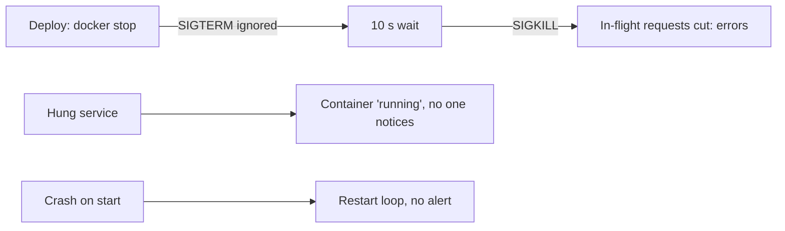

# Lifecycle: Signals, Graceful Shutdown, Health Checks and Restarts

**Cloud and containers · Docker · Step 9.2.7 · Intermediate** · Last updated 2026-10-22
**Prerequisites:** [A Dockerfile for a Java service](04-dockerfile-java-service.md) (9.2.4); helpful: [Load balancing](../../14-system-design/05-load-balancing.md) (14.5), which explains why deploys need a graceful stop

**Version note**

| Item | Version |
|---|---|
| Baseline | Unix signals, Docker's stop sequence, `HEALTHCHECK`, restart policies and logging drivers |
| Hands-on baseline | Docker Engine 28.4.0 on Docker Desktop, Eclipse Temurin 21 on Alpine, run on 2026-10-22 |
| Compatibility note | Health check defaults and restart-policy details are quoted from the current Docker documentation; verify them for your Docker version |

## 1. What it is and why it matters

**What is it?** The life of a container from its point of view: how it **starts**, how it is told to **stop** (a signal, then a deadline), how it reports whether it is **healthy**, and what happens when it **crashes** (restart policies). Plus where its **logs** go.

**Why do we need it?** Containers are started and stopped constantly: deploys, scaling, node maintenance, crashes. If a service ignores the stop signal, in-flight requests are cut and every deploy produces errors ([14.5](../../14-system-design/05-load-balancing.md)). If nothing checks health, a hung service looks fine. If crashes aren't handled, a service stays down. Kubernetes uses exactly these mechanisms (termination, probes, restart policy), so learning them here is learning them there.

**When would I meet it?** Every deploy of `order-service`; the first time a container "takes ten seconds to stop"; when a service is up but not answering; when a container restarts in a loop; and when disks fill up with logs.

> [!TIP]
> **Memory hook:** *stop politely (SIGTERM), wait a deadline, then force (SIGKILL); report health honestly; restart on failure, never silently; log to stdout.*

## 2. Industry terms

| Term | Simple meaning | Why it matters | Example | Related terms |
|---|---|---|---|---|
| **SIGTERM and SIGKILL** | SIGTERM asks a process to finish and exit, and can be handled; SIGKILL ends it immediately and cannot be caught | `docker stop` sends SIGTERM first, then SIGKILL after a timeout | A Java shutdown hook runs on SIGTERM | `STOPSIGNAL` |
| **Grace period** | The time between the stop signal and the kill: 10 seconds on Linux by default (Docker docs) | The deadline for finishing cleanly | `docker stop -t 30` | Termination grace period (Kubernetes) |
| **Graceful shutdown** | Stop accepting new work, finish what is in progress, then exit | No dropped requests during deploys | `HttpServer.stop(10)` | Draining |
| **PID 1 semantics** | The first process in a container is special: it only receives signals it has a handler for | A program without a handler ignores SIGTERM and gets killed after the timeout | `sleep` as PID 1 | Init process |
| **Init process (`--init`)** | A tiny supervisor as PID 1 that forwards signals and reaps child processes | Makes simple programs stop cleanly | `docker run --init` | tini |
| **Exit code** | 0 success; 143 = terminated by SIGTERM (128 + 15); 137 = killed by SIGKILL (128 + 9) | Tells you how it ended | `docker inspect` | `OOMKilled` |
| **Health check** | A command Docker runs inside the container to decide whether it is working | Finds hung services that are still running | `HEALTHCHECK CMD wget ...` | Readiness and liveness probes |
| **Restart policy** | Rules for restarting a container after it exits | Recovery from crashes | `--restart on-failure:3`, `unless-stopped` | Crash loop |
| **Logging driver** | Where `docker logs` data is stored; the default is `json-file` | "By default, no log-rotation is performed" | `--log-opt max-size=10m` | stdout and stderr |

## 3. In a real system (ShopFlow)

**The business problem.** Every `order-service` deploy produces a few seconds of failed checkouts. Occasionally a container is "up" but answers nothing, and nobody notices for an hour. One bad release crashes on start, and the container keeps restarting every few seconds. And a long-running laptop stack fills the disk because logs are never rotated.



**How the lifecycle features help.** The service handles SIGTERM by finishing in-flight requests; Java is started in exec form so it receives the signal ([9.2.4](04-dockerfile-java-service.md)); a health check turns "running but hung" into a visible `unhealthy` state; a restart policy restarts crashes with a growing delay while monitoring alerts on the restart count; and log rotation caps disk use.

**What it costs.** Code for shutdown, a health endpoint that tells the truth, thresholds to tune (intervals, retries, grace periods), and the discipline to monitor what Docker only records. Docker itself will mark a container unhealthy but not restart it (worked example 4); acting on health is the orchestrator's job.

**Elsewhere:** a payment gateway must complete or reject in-flight transactions before shutting down, so its grace period is long; a video-transcoding worker finishes its current segment on SIGTERM and pushes the rest back to the queue ([14.11](../../14-system-design/11-asynchronous-processing.md)); an IoT gateway restarts quickly after a crash because devices reconnect automatically.

## 4. How it works

**The stop sequence** (`docker stop`): Docker sends the container's main process (PID 1) a **stop signal** (SIGTERM by default; the image can change it with `STOPSIGNAL`), waits for the **grace period** (10 seconds by default on Linux; `-t` changes it), and if the process is still running, sends **SIGKILL**. The exit code records which happened.

**Why PID 1 is special.** The Linux manual for PID namespaces: "Only signals for which the 'init' process has established a signal handler can be sent to the 'init' process by other members of the PID namespace. This restriction applies even to privileged processes, and prevents other members of the PID namespace from accidentally killing the 'init' process." Signals sent from the host side (`docker stop`, `docker kill`) are delivered if a handler exists, and `SIGKILL` and `SIGSTOP` "are forcibly delivered when sent from an ancestor PID namespace". A program that never installed a SIGTERM handler therefore ignores SIGTERM when it is PID 1, which is why it needs the full timeout.

The examples were run on Docker Engine 28.4.0 (2026-10-22). They use a variant of the service from [9.2.4](04-dockerfile-java-service.md) that adds a graceful-shutdown switch, a `/slow` endpoint that takes a given time, a demo-only `/break` endpoint that makes it unhealthy, and a `HEALTHCHECK`:

```java
// File: OrderService.java (container, Java 21)
import com.sun.net.httpserver.HttpExchange;
import com.sun.net.httpserver.HttpServer;
import java.io.IOException;
import java.net.InetSocketAddress;
import java.nio.charset.StandardCharsets;
import java.util.concurrent.atomic.AtomicBoolean;

public class OrderService {

    static final AtomicBoolean healthy = new AtomicBoolean(true);   // /break flips it, for the health-check demo

    public static void main(String[] args) throws IOException {
        int port = Integer.parseInt(System.getenv().getOrDefault("PORT", "8080"));
        boolean graceful = !"false".equals(System.getenv("GRACEFUL"));

        HttpServer server = HttpServer.create(new InetSocketAddress(port), 0);
        server.createContext("/health", ex -> reply(ex, healthy.get() ? 200 : 500, healthy.get() ? "OK" : "BROKEN"));
        server.createContext("/break", ex -> {                       // demo only
            healthy.set(false);
            reply(ex, 200, "now unhealthy");
        });
        server.createContext("/slow", ex -> {                        // a request that takes a while
            int ms = Integer.parseInt(ex.getRequestURI().getQuery().replace("ms=", ""));
            System.out.println("slow request started (" + ms + " ms)");
            try {
                Thread.sleep(ms);
            } catch (InterruptedException e) {
                Thread.currentThread().interrupt();
            }
            reply(ex, 200, "slow request finished");
            System.out.println("slow request finished");
        });

        Runtime.getRuntime().addShutdownHook(new Thread(() -> {
            System.out.println("shutdown requested, graceful=" + graceful);
            if (graceful) {
                server.stop(10);                                      // wait up to 10 s for requests in progress
                System.out.println("in-flight requests finished, exiting");
            } else {
                System.out.println("not waiting for in-flight requests");
            }
        }));
        server.start();
        System.out.println("order-service listening on port " + port);
    }

    static void reply(HttpExchange ex, int status, String body) throws IOException {
        byte[] bytes = body.getBytes(StandardCharsets.UTF_8);
        ex.sendResponseHeaders(status, bytes.length);
        ex.getResponseBody().write(bytes);
        ex.close();
    }
}
```

```dockerfile
FROM eclipse-temurin:21-jdk-alpine AS build
WORKDIR /src
COPY OrderService.java .
RUN javac -d classes OrderService.java \
 && jar --create --file app.jar --main-class OrderService -C classes .

FROM eclipse-temurin:21-jre-alpine
RUN addgroup -S app && adduser -S -G app -u 10001 app
WORKDIR /app
COPY --from=build /src/app.jar app.jar
USER app
EXPOSE 8080
HEALTHCHECK --interval=2s --timeout=1s --start-period=3s --retries=2 \
  CMD wget -qO- http://localhost:8080/health || exit 1
ENTRYPOINT ["java", "-XX:MaxRAMPercentage=75", "-jar", "app.jar"]
```

> [!WARNING]
> `/break` and `/slow` exist only for these experiments. A real service doesn't offer a way to make itself unhealthy on request.

### Worked example 1: a clean stop

**Concept.** A Java service started in exec form is PID 1 and gets SIGTERM; its JVM runs the shutdown hook.

```text
$ docker run -d --name sf-learn-j --label learning=notes sf-learn/order:life >/dev/null; sleep 3; /usr/bin/time -p docker stop sf-learn-j 2>&1 | grep -v user | grep -v sys; docker logs sf-learn-j; docker inspect -f 'ExitCode={{.State.ExitCode}}' sf-learn-j; docker rm sf-learn-j >/dev/null
sf-learn-j
real 0.10
order-service listening on port 8080
shutdown requested, graceful=true
in-flight requests finished, exiting
ExitCode=143
```

**Walkthrough.** `docker stop` took 0.1 seconds, far below the grace period. The log shows the hook running (`shutdown requested, graceful=true`), and the exit code is **143** (128 + 15, killed by SIGTERM): the JVM runs its shutdown hooks and then ends with the status for SIGTERM. An exit code of 143 after a stop is normal, not an error.

### Worked example 2: requests in progress

**Concept.** Stopping the service while a 4-second request is running. With graceful shutdown the hook calls `HttpServer.stop(10)`, which, per the Javadoc, "will then block until all current exchange handlers have completed or else when approximately delay seconds have elapsed (whichever happens sooner)". Without it, the JVM exits straight after the hook.

Graceful:

```text
$ docker run -d --name sf-learn-j --label learning=notes -p 18097:8080 sf-learn/order:life >/dev/null; sleep 3; (curl -s -m 20 -o /dev/null -w 'client: HTTP %{http_code}' 'localhost:18097/slow?ms=4000'; echo ", curl exit status $?") & sleep 1; docker stop sf-learn-j >/dev/null; wait; docker logs sf-learn-j; docker rm sf-learn-j >/dev/null
client: HTTP 200, curl exit status 0
order-service listening on port 8080
slow request started (4000 ms)
shutdown requested, graceful=true
slow request finished
in-flight requests finished, exiting
```

Abrupt (`GRACEFUL=false`):

```text
$ docker run -d --name sf-learn-j --label learning=notes -e GRACEFUL=false -p 18097:8080 sf-learn/order:life >/dev/null; sleep 3; (curl -s -m 20 -o /dev/null -w 'client: HTTP %{http_code}' 'localhost:18097/slow?ms=4000'; echo ", curl exit status $?") & sleep 1; docker stop sf-learn-j >/dev/null; wait; docker logs sf-learn-j; docker rm sf-learn-j >/dev/null
client: HTTP 000, curl exit status 52
order-service listening on port 8080
slow request started (4000 ms)
shutdown requested, graceful=false
not waiting for in-flight requests
```

**Walkthrough.** In the graceful run, the client received `HTTP 200`: the server stopped accepting new connections, finished the slow request, and then exited. In the abrupt run, the client got **no reply** (`HTTP 000`, curl exit status 52, "empty reply from server"): the request was cut. This is the failed checkout during a deploy. In Spring Boot, this behaviour is built in: `server.shutdown=graceful` (the default since 3.4, see [14.5](../../14-system-design/05-load-balancing.md)) with a timeout per shutdown phase.

**Experiment.** Predict first: what do `docker stop -t 2` and the exit code look like for a container whose main process is a plain `sleep 600`? The result is in Answers.

### Worked example 3: PID 1 and signals

**Concept.** Four ways to run something that waits, stopped with the default 10-second grace period:

```text
$ t() { name=$1; shift; docker run -d --name sf-learn-sig --label learning=notes "$@" >/dev/null; sleep 1; s=$(date +%s); docker stop sf-learn-sig >/dev/null; e=$(date +%s); echo "$name: stop took $((e-s)) s, exit code $(docker inspect -f '{{.State.ExitCode}}' sf-learn-sig)"; docker rm sf-learn-sig >/dev/null; }; t 'sleep as PID 1                ' alpine:3.22 sleep 600; t 'sh -c "sleep 600; echo done"    ' alpine:3.22 sh -c 'sleep 600; echo done'; t 'sh -c with a trap on TERM      ' alpine:3.22 sh -c 'trap "echo got TERM; exit 0" TERM; sleep 600 & wait'; t 'sleep with --init (tini)       ' --init alpine:3.22 sleep 600
sleep as PID 1                : stop took 10 s, exit code 137
sh -c "sleep 600; echo done"    : stop took 10 s, exit code 137
sh -c with a trap on TERM      : stop took 0 s, exit code 0
sleep with --init (tini)       : stop took 0 s, exit code 143
```

**Walkthrough.**

| How it runs | Stop time | Exit code | Why |
|---|---|---|---|
| `sleep 600` as PID 1 | 10 s | 137 | No SIGTERM handler: the signal is ignored until SIGKILL |
| `sh -c "sleep 600; echo done"` | 10 s | 137 | The shell is PID 1 and doesn't forward the signal to `sleep` |
| `sh -c` with a `trap` on TERM | 0 s | 0 | The shell installed a handler and exits |
| `sleep` with `--init` | 0 s | 143 | The init process forwards SIGTERM to `sleep`, which dies from it |

The same effect hides in shell-form entry points ([9.2.4](04-dockerfile-java-service.md): Docker's reference says the shell form "will not receive Unix signals"). Fixes: the exec form; `exec` in a wrapper script (`exec java ...`); a signal handler in the program; or `--init` (Docker: "Run an init inside the container that forwards signals and reaps processes").

**A signal sent from inside the container to PID 1 is also ignored without a handler**, even `SIGKILL`:

```text
$ docker run -d --name sf-learn-k --label learning=notes alpine:3.22 sleep 600 >/dev/null; docker exec sf-learn-k sh -c 'kill -9 1; sleep 1; echo "sent kill -9 to PID 1 from inside"'; echo "container status now: $(docker inspect -f '{{.State.Status}}' sf-learn-k)"; docker rm -f sf-learn-k >/dev/null
sent kill -9 to PID 1 from inside
container status now: running
```

The container is still running: exactly the kernel rule quoted above. `docker kill` from outside is delivered, because `SIGKILL` from an ancestor namespace is forced.

### Worked example 4: health checks

**Concept.** A `HEALTHCHECK` is a command that Docker runs inside the container at an interval. The container gets a health status in addition to its normal status: initially `starting`; `healthy` when a check passes; `unhealthy` after the configured number of consecutive failures. Docker's defaults: `--interval=30s`, `--timeout=30s`, `--start-period=0s`, `--retries=3`; the example sets `--interval=2s --timeout=1s --start-period=3s --retries=2`.

```text
$ docker run -d --name sf-learn-h --label learning=notes -p 18098:8080 sf-learn/order:life >/dev/null; st() { echo "$1: $(docker inspect -f 'status={{.State.Status}} health={{.State.Health.Status}} failing_streak={{.State.Health.FailingStreak}} restarts={{.RestartCount}}' sf-learn-h)"; }; st 'right after start     '; sleep 6; st '6 s later            '; curl -s localhost:18098/break; echo; sleep 3; st 'after /break, 3 s    '; sleep 3; st 'after /break, 6 s    '; docker ps --filter name=sf-learn-h --format 'docker ps shows: {{.Status}}'
right after start     : status=running health=starting failing_streak=0 restarts=0
6 s later            : status=running health=healthy failing_streak=0 restarts=0
now unhealthy
after /break, 3 s    : status=running health=healthy failing_streak=1 restarts=0
after /break, 6 s    : status=running health=unhealthy failing_streak=3 restarts=0
docker ps shows: Up 12 seconds (unhealthy)
```

```text
$ docker inspect -f '{{range .State.Health.Log}}exit={{.ExitCode}} output={{printf "%q" .Output}}{{println}}{{end}}' sf-learn-h | tail -3; docker rm -f sf-learn-h >/dev/null
exit=1 output="wget: server returned error: HTTP/1.1 500 Internal Server Error\n"
exit=1 output="wget: server returned error: HTTP/1.1 500 Internal Server Error\n"
```

**Walkthrough.** The container went `starting`, then `healthy` once a check passed. After `/break`, the check began to fail (HTTP 500): the failing streak counted up and the status became `unhealthy`; `docker ps` shows `(unhealthy)`. **The container was not restarted** (`restarts=0`, status still `running`): Docker records health but takes no action. Orchestrators and tools use the status: Kubernetes has its own probes and restarts or removes pods ([9.3.5](../03-kubernetes/05-probes-rolling-updates-graceful-shutdown.md)), and Compose can wait for `healthy` before starting dependants ([9.2.8](08-docker-compose.md)).

**A health check should test the instance, not its dependencies** ([14.5](../../14-system-design/05-load-balancing.md)): if every instance fails because the shared database is slow, all are marked unhealthy at once.

### Worked example 5: restart policies

**Concept.** `--restart` tells the engine what to do when the container exits. `on-failure[:max]` restarts after a non-zero exit, up to a maximum; `unless-stopped` restarts except after a manual stop. Docker's documentation also says "a restart policy only takes effect after a container starts successfully... up for at least 10 seconds", and "if you manually stop a container, the restart policy is ignored".

A container that exits with an error immediately, under `on-failure:3`:

```text
$ docker run -d --name sf-learn-r --label learning=notes --restart on-failure:3 alpine:3.22 sh -c 'echo starting; exit 1' >/dev/null; for s in 2 5 10 20; do sleep $((s==2?2:s==5?3:s==10?5:10)); echo "after ~$s s: $(docker inspect -f 'status={{.State.Status}} restarts={{.RestartCount}} exit={{.State.ExitCode}}' sf-learn-r)"; done; docker logs sf-learn-r | sort | uniq -c; docker rm -f sf-learn-r >/dev/null
after ~2 s: status=exited restarts=3 exit=1
after ~5 s: status=exited restarts=3 exit=1
after ~10 s: status=exited restarts=3 exit=1
after ~20 s: status=exited restarts=3 exit=1
   4 starting
```

It ran four times in total (the original and three restarts: `starting` printed four times), then stayed `exited` with exit code 1. In this test the restarts happened within about two seconds, without the 10-second wait the documentation describes; the behaviour may depend on the policy and the Docker version, so don't rely on that wait.

A real crash loop, under `unless-stopped`: the container runs one second, then exits with code 2:

```text
$ docker run -d --name sf-learn-r --label learning=notes --restart unless-stopped alpine:3.22 sh -c 'echo started; sleep 1; echo crashing; exit 2' >/dev/null; sleep 14; echo "after 14 s: $(docker inspect -f 'status={{.State.Status}} restarts={{.RestartCount}}' sf-learn-r)"; docker logs -t sf-learn-r 2>&1 | grep started | awk '{print $1}' | cut -c12-23 | head -7 | paste -sd' ' -; docker stop sf-learn-r >/dev/null; sleep 6; echo "after docker stop, 6 s later: $(docker inspect -f 'status={{.State.Status}} restarts={{.RestartCount}}' sf-learn-r)"; docker rm -f sf-learn-r >/dev/null
after 14 s: status=restarting restarts=7
16:36:44.988 16:36:46.161 16:36:47.438 16:36:48.940 16:36:50.854 16:36:53.582 16:36:57.897
after docker stop, 6 s later: status=exited restarts=7
```

**Walkthrough.** After 14 seconds it was in `restarting` state with 7 restarts. The start times in the log are 1.2, 1.3, 1.5, 1.9, 2.7 and 4.3 seconds apart; with one second of run time each, the delays between exit and restart were about 0.2, 0.3, 0.5, 0.9, 1.7 and 3.3 seconds: **roughly doubling**, an exponential backoff observed here (the pages read do not state the exact delays). `docker stop` ended the loop for good: the status stayed `exited`, as the documentation says for manual stops. A restart policy thus gives automatic recovery, but a crash loop is **silent** unless something watches `RestartCount`.

Whether `docker kill` counts as a manual stop is shown here:

```text
$ docker run -d --name sf-learn-r --label learning=notes --restart unless-stopped alpine:3.22 sleep 600 >/dev/null; docker kill sf-learn-r >/dev/null; sleep 3; echo "after docker kill: $(docker inspect -f 'status={{.State.Status}} restarts={{.RestartCount}}' sf-learn-r)"; docker stop sf-learn-r >/dev/null; sleep 3; echo "after docker stop: $(docker inspect -f 'status={{.State.Status}} restarts={{.RestartCount}}' sf-learn-r)"; docker rm -f sf-learn-r >/dev/null
after docker kill: status=exited restarts=0
after docker stop: status=exited restarts=0
```

`docker kill` also ended the container for good: the policy treated it as a manual stop (`restarts=0`). To test crash recovery, make the program exit by itself, as above.

### Worked example 6: logs

**Concept.** A container's standard output and standard error are captured by the logging driver; `docker logs` reads them. The default driver is `json-file`, and Docker's documentation warns: "By default, no log-rotation is performed... which can lead to disk space exhaustion".

```text
$ docker run -d --name sf-learn-l --label learning=notes -p 18099:8080 --log-opt max-size=1m --log-opt max-file=2 sf-learn/order:life >/dev/null; sleep 3; curl -s 'localhost:18099/slow?ms=200' >/dev/null; docker logs --tail 2 -t sf-learn-l | sed -E 's/^[0-9T:.-]+Z/<time>/'; docker inspect -f 'log driver: {{.HostConfig.LogConfig.Type}}, options: {{.HostConfig.LogConfig.Config}}' sf-learn-l; docker rm -f sf-learn-l >/dev/null
<time> slow request started (200 ms)
<time> slow request finished
log driver: json-file, options: map[max-file:2 max-size:1m]
```

```text
$ docker run -d --name sf-learn-l --label learning=notes alpine:3.22 sleep 30 >/dev/null; docker inspect -f 'default log driver: {{.HostConfig.LogConfig.Type}}, options: {{.HostConfig.LogConfig.Config}}' sf-learn-l; docker rm -f sf-learn-l >/dev/null
default log driver: json-file, options: map[]
```

**Walkthrough.** The service wrote two lines to standard output and `docker logs --tail 2 -t` showed them with timestamps. The second block shows the defaults: driver `json-file`, no options, so no rotation. The first set `--log-opt max-size=1m --log-opt max-file=2`, which caps the log at two files of 1 MB each. Services should log to **standard output** (the twelve-factor approach) and let the platform collect the logs, not write log files inside the container.

### Real-world (ShopFlow): the lifecycle checklist

For `order-service`: the JVM is PID 1 (exec form); a shutdown hook (or Spring's graceful shutdown) finishes in-flight requests within a time shorter than the grace period; the grace period is longer than the slowest request; `HEALTHCHECK` tests only the instance; `--restart unless-stopped` for single-host setups, with alerts on restart counts; logs to standard output with rotation configured.

### Common mistakes

1. A shell-form entry point, or a wrapper script without `exec`.
2. A grace period shorter than the shutdown work, or no shutdown handling at all.
3. A health check that tests shared dependencies, or one that always passes.
4. Expecting Docker to restart an unhealthy container.
5. Restart policies without monitoring of restart counts.
6. Unrotated `json-file` logs.

## 5. Failure scenarios

### Errors on every deploy

1. **What happened?** Each rolling deploy produced seconds of failed requests.
2. **Why?** The service didn't handle SIGTERM (or wasn't PID 1), so Docker killed it after the grace period, cutting requests in progress (worked examples 2 and 3).
3. **What did users see?** Failed checkouts during deploys.
4. **Solutions:** exec form; a shutdown hook or framework graceful shutdown; a grace period longer than the slowest request; in front of the service, stop sending traffic first ([14.5](../../14-system-design/05-load-balancing.md)).
5. **What they cost:** shutdown code and slightly longer deploys.

### Up but not working

1. **What happened?** `order-service` stopped answering (a deadlock) but its process was still running; no alert fired for an hour.
2. **Why?** Docker saw a running process; there was no health check, and nothing monitored the endpoint.
3. **What did users see?** Timeouts on a share of requests.
4. **Solutions:** a health check on the instance; an orchestrator or a monitor that acts on `unhealthy`; a liveness probe in Kubernetes.
5. **What they cost:** a health endpoint and a policy for what to do when it fails.

### The restart loop nobody noticed

1. **What happened?** A bad release crashed seconds after start; the container restarted for a day, with growing delays, and the service was effectively down.
2. **Why?** `unless-stopped` hides crashes by restarting them, and no alert watched the restart count.
3. **What did the business see?** An outage that looked like "container is running" on a dashboard.
4. **Solutions:** alert on restart counts and on `restarting` status; roll back the release; use `on-failure` with a limit when a permanent failure should stop the loop.
5. **What they cost:** monitoring for something Docker records but doesn't report.

### The disk full of logs

1. **What happened?** A developer's machine ran out of disk; the cause was gigabytes of container logs.
2. **Why?** The default `json-file` driver does not rotate logs.
3. **What did users see?** Tools failing for lack of space.
4. **Solutions:** set `max-size` and `max-file` (per container or as the daemon default), or use the `local` driver, which Docker's documentation recommends to prevent disk exhaustion; log less.
5. **What they cost:** old log lines are discarded; central logging is needed for history.

## 6. Architectural decisions

| Decision | Choose | Because |
|---|---|---|
| Entry point | Exec form, JVM as PID 1 (or `--init` for programs that can't handle signals) | The stop signal must reach the program |
| Shutdown | Finish in-flight work within a deadline shorter than the grace period | No dropped requests; no forced kill |
| Grace period | Longer than the slowest request plus shutdown work | Otherwise the kill cuts it |
| Health check | Tests the instance only; cheap; honest | Shared-dependency checks cause mass failures |
| Restart policy | `unless-stopped` or `on-failure:N` on a single host; the orchestrator's policy otherwise | Automatic recovery |
| Monitoring | Alert on restarts, `unhealthy` and `OOMKilled` | Docker records but does not report them |
| Logs | stdout and stderr, with rotation | The platform collects them; disks stay safe |

**Common mistakes:** see the list above.

## 7. Try it yourself

Try each exercise first; the real results are in the Answers section.

1. **Stop it cleanly.** Run a container whose main process ignores SIGTERM, then make it stop immediately without changing the program.
2. **Break the health.** Start the example service, make it unhealthy, and show that Docker does not restart it.
3. **Count the restarts.** Run a container that exits with an error after one second under a restart policy, and read the restart count after ten seconds.

## 8. Check your understanding

1. `docker stop` on a container takes exactly ten seconds and the exit code is 137. What does that tell you?
2. Why does the same Java program stop in 0.1 seconds in exec form but might take ten in a wrapper script?
3. A container is `unhealthy` but still running. Who is supposed to act on that?
4. What is the difference between exit codes 143 and 137?

Answers are at the end of this note.

## 9. Revision

**Remember**
- `docker stop` = **SIGTERM, wait 10 s (default), then SIGKILL**; exit **143** = terminated by SIGTERM, **137** = killed.
- **PID 1 ignores signals it has no handler for**: use exec form, handle SIGTERM, or `--init`.
- **Graceful shutdown:** stop accepting, finish in-flight work, exit before the deadline.
- **Health** is recorded, not acted on, by plain Docker; orchestrators act.
- Restart policies **hide** crash loops: monitor restart counts. Logs go to **stdout**, with rotation.

**Explain in 15 seconds:** "Docker stops a container with SIGTERM, waits a grace period, then kills it, so the service must handle SIGTERM and finish in-flight work; health checks and restart policies detect and recover failures, but something must watch them."

**Explain in 60 seconds:**
> "A stop is a signal, a deadline and then a kill: SIGTERM to PID 1, ten seconds by default, then SIGKILL. The kernel only delivers signals to PID 1 if it has a handler, so a program without one, or a shell wrapper that doesn't forward signals, simply waits for the kill and exits with 137, cutting in-flight requests during every deploy. So the Java service runs in exec form, a shutdown hook or Spring's graceful shutdown stops accepting and finishes requests within the deadline, and the grace period is longer than the slowest request. A health check runs a command inside the container and records starting, healthy or unhealthy, but plain Docker doesn't restart an unhealthy container; the orchestrator does. Restart policies bring crashed containers back with a growing delay, which also hides crash loops, so I alert on restart counts. Logs go to standard output, with rotation configured, because the default driver never rotates."

**Likely follow-up questions:**
- **What does Kubernetes add?** Separate liveness, readiness and startup probes, a termination grace period (30 seconds by default), pre-stop hooks and rolling updates ([9.3.5](../03-kubernetes/05-probes-rolling-updates-graceful-shutdown.md)).
- **What is the difference between `docker stop` and `docker kill`?** `stop` sends SIGTERM then SIGKILL after the timeout; `kill` sends SIGKILL (or a chosen signal) immediately.
- **How do I run two processes in a container?** Avoid it; if unavoidable, use an init or a process manager that forwards signals, and accept that health and restarts are per container.
- **Does exit code 143 mean a problem?** After a stop, no: the JVM ended on SIGTERM as asked.

**Architect's takeaway:** a service is only as deployable as its shutdown is clean and its health is honest. Test `docker stop` with a request in flight before you trust a release process.

**Next topic:** [Docker Compose for local development](08-docker-compose.md) (9.2.8)

## 10. Verification and sources

> [!NOTE]
> Checked 2026-10-22. Every command was run on Docker Engine 28.4.0 (Docker Desktop, linux/arm64); output blocks are copied from those runs. Re-verify when you revisit this note.

- **Confirmed (documentation, read 2026-10-22):** `docker stop` sends SIGTERM (or the `STOPSIGNAL`) and waits 10 seconds on Linux by default before SIGKILL, with `-t` to change it (Docker, `docker container stop`); `HEALTHCHECK` statuses `starting`, `healthy`, `unhealthy` and the defaults interval 30s, timeout 30s, start-period 0s, retries 3 (Docker, Dockerfile reference); restart policies, "a restart policy only takes effect after a container starts successfully ... up for at least 10 seconds", and that a manual stop ignores the policy (Docker, "Start containers automatically"); the default `json-file` driver performs no rotation, and the `local` driver is recommended to prevent disk exhaustion (Docker, "Configure logging drivers"); `--init` "runs an init inside the container that forwards signals and reaps processes" (`docker run` reference); only signals the init process has a handler for can be sent to it from inside its PID namespace, and SIGKILL and SIGSTOP are forcibly delivered from an ancestor namespace (Linux man page `pid_namespaces(7)`); `HttpServer.stop(int delay)` blocks until current exchange handlers complete or about `delay` seconds elapse (Java SE 21 API).
- **Observed (this machine):** stop times and exit codes; the restart counts and the roughly doubling restart delay; that `on-failure:3` restarted an instantly failing container within about two seconds, which differs from the documentation's 10-second statement; that `docker kill` counted as a manual stop for `unless-stopped`.
- **Assumptions and illustrations:** the demo endpoints `/slow` and `/break` are for these experiments only; the incident stories are illustrative.
- **To verify:** the 10-second rule for restart policies in your Docker version; how your orchestrator maps these ideas (termination, probes, restart policy); whether your base image's shell forwards signals.
- **Decision rule:** exec form and a SIGTERM handler; a grace period longer than the slowest request; honest instance-level health checks; alerts on restarts, unhealthy and OOM kills.

**Sources:** Docker documentation: `docker container stop`, Dockerfile reference (`HEALTHCHECK`, `ENTRYPOINT`), "Start containers automatically", "Configure logging drivers", `docker run`; Linux man page `pid_namespaces(7)`; Java SE 21 API, `com.sun.net.httpserver.HttpServer`; The Twelve-Factor App, "XI. Logs".

## Answers

**Experiment**

- **`docker stop -t 2` on `sleep 600`:** it took 2 seconds and the exit code was 137:

```text
$ docker run -d --name sf-learn-sig --label learning=notes alpine:3.22 sleep 600 >/dev/null; sleep 1; s=$(date +%s); docker stop -t 2 sf-learn-sig >/dev/null; e=$(date +%s); echo "docker stop -t 2: took $((e-s)) s, exit code $(docker inspect -f '{{.State.ExitCode}}' sf-learn-sig)"; docker rm sf-learn-sig >/dev/null
docker stop -t 2: took 2 s, exit code 137
```

  The program has no SIGTERM handler, so the signal was ignored until the shortened grace period ended and SIGKILL followed.

**Check your understanding**

1. The program ignored SIGTERM for the whole grace period (ten seconds by default) and was then killed with SIGKILL (137 = 128 + 9). Typical causes: PID 1 without a signal handler, or a wrapper that doesn't forward the signal.
2. In exec form the JVM is PID 1 and has handlers (it runs shutdown hooks on SIGTERM). In a wrapper script without `exec`, the shell is PID 1 and doesn't pass the signal on, so the JVM never learns about the stop and waits for the kill.
3. Not plain Docker: it records the status and does nothing. An orchestrator (Kubernetes probes), a monitoring system with alerts, or a tool such as Compose waiting for `healthy` has to act.
4. 143 = 128 + 15: the process ended because of SIGTERM, the polite stop (normal after `docker stop`). 137 = 128 + 9: it was killed with SIGKILL, either after the grace period or by a memory kill ([9.2.2](02-containers-isolated-processes.md)).

**Practice exercises**

1. **Stop it cleanly:** `docker run --init` makes the init process forward the signal, so the stop is immediate (exit code 143), as in worked example 3:

```text
$ t() { name=$1; shift; docker run -d --name sf-learn-sig --label learning=notes "$@" >/dev/null; sleep 1; s=$(date +%s); docker stop sf-learn-sig >/dev/null; e=$(date +%s); echo "$name: stop took $((e-s)) s, exit code $(docker inspect -f '{{.State.ExitCode}}' sf-learn-sig)"; docker rm sf-learn-sig >/dev/null; }; t 'sleep as PID 1                ' alpine:3.22 sleep 600; t 'sh -c "sleep 600; echo done"    ' alpine:3.22 sh -c 'sleep 600; echo done'; t 'sh -c with a trap on TERM      ' alpine:3.22 sh -c 'trap "echo got TERM; exit 0" TERM; sleep 600 & wait'; t 'sleep with --init (tini)       ' --init alpine:3.22 sleep 600
sleep as PID 1                : stop took 10 s, exit code 137
sh -c "sleep 600; echo done"    : stop took 10 s, exit code 137
sh -c with a trap on TERM      : stop took 0 s, exit code 0
sleep with --init (tini)       : stop took 0 s, exit code 143
```

2. **Break the health:** after `/break`, the status became `unhealthy`, and the container kept running with `restarts=0`:

```text
$ docker run -d --name sf-learn-h --label learning=notes -p 18098:8080 sf-learn/order:life >/dev/null; st() { echo "$1: $(docker inspect -f 'status={{.State.Status}} health={{.State.Health.Status}} failing_streak={{.State.Health.FailingStreak}} restarts={{.RestartCount}}' sf-learn-h)"; }; st 'right after start     '; sleep 6; st '6 s later            '; curl -s localhost:18098/break; echo; sleep 3; st 'after /break, 3 s    '; sleep 3; st 'after /break, 6 s    '; docker ps --filter name=sf-learn-h --format 'docker ps shows: {{.Status}}'
right after start     : status=running health=starting failing_streak=0 restarts=0
6 s later            : status=running health=healthy failing_streak=0 restarts=0
now unhealthy
after /break, 3 s    : status=running health=healthy failing_streak=1 restarts=0
after /break, 6 s    : status=running health=unhealthy failing_streak=3 restarts=0
docker ps shows: Up 12 seconds (unhealthy)
```

3. **Count the restarts:** under a restart policy, the container that exits with code 2 after one second kept restarting; its restart count after 14 seconds was 7:

```text
$ docker run -d --name sf-learn-r --label learning=notes --restart unless-stopped alpine:3.22 sh -c 'echo started; sleep 1; echo crashing; exit 2' >/dev/null; sleep 14; echo "after 14 s: $(docker inspect -f 'status={{.State.Status}} restarts={{.RestartCount}}' sf-learn-r)"; docker logs -t sf-learn-r 2>&1 | grep started | awk '{print $1}' | cut -c12-23 | head -7 | paste -sd' ' -; docker stop sf-learn-r >/dev/null; sleep 6; echo "after docker stop, 6 s later: $(docker inspect -f 'status={{.State.Status}} restarts={{.RestartCount}}' sf-learn-r)"; docker rm -f sf-learn-r >/dev/null
after 14 s: status=restarting restarts=7
16:36:44.988 16:36:46.161 16:36:47.438 16:36:48.940 16:36:50.854 16:36:53.582 16:36:57.897
after docker stop, 6 s later: status=exited restarts=7
```

Back to [the series overview](01-docker-overview.md) · [the area overview](../01-cloud-and-containers-overview.md) · [the index](../../README.md) · [Roadmap](../../roadmap.md).
