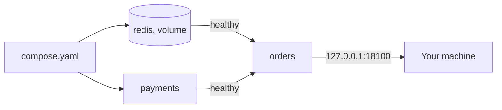

# Docker Compose for Local Development

**Cloud and containers · Docker · Step 9.2.8 · Intermediate** · Last updated 2026-10-22
**Prerequisites:** [Networking and ports](05-networking-and-ports.md) (9.2.5), [Data and configuration](06-data-and-configuration.md) (9.2.6) and [Lifecycle](07-lifecycle.md) (9.2.7)

**Version note**

| Item | Version |
|---|---|
| Baseline | The Compose Specification and `docker compose` (Compose v2, part of the Docker CLI) |
| Hands-on baseline | Docker Compose 2.39.2 (Docker Desktop) on Docker Engine 28.4.0, run on 2026-10-22 |
| Compatibility note | The preferred file name is `compose.yaml`; older projects use `docker-compose.yml` and the old `docker-compose` command (Compose v1). Options such as `depends_on` conditions and `profiles` need a Compose version that supports them |

## 1. What it is and why it matters

**What is it?** Docker Compose describes a multi-container application in one YAML file and runs all of it with one command. The file lists the **services** (which image or build, which ports, settings, volumes, health checks) and how they depend on each other. `docker compose up` creates the network, volumes and containers; `docker compose down` removes them.

**Why do we need it?** Running a realistic system by hand means a long list of `docker run` commands with networks, volumes, environment variables and the right start-up order, which nobody remembers and nobody keeps in sync. A Compose file is that list, written down, reviewed and versioned with the code. It is how a new developer gets the whole ShopFlow stack with one command.

**When would I meet it?** Local development and integration tests, demos, small single-server deployments, and as the way many projects document "how to run this". Kubernetes manifests express the same ideas for clusters.

> [!TIP]
> **Memory hook:** *the Compose file is the stack as code: services, networks, volumes, dependencies. One `up`, one `down`.*

## 2. Industry terms

| Term | Simple meaning | Why it matters | Example | Related terms |
|---|---|---|---|---|
| **Compose file** | A YAML file (`compose.yaml`) that follows the Compose Specification | The stack definition | Services `orders`, `payments`, `redis` | Compose Specification |
| **Service** | "An abstract concept implemented on platforms by running the same container image, and configuration, one or more times" (Docker docs) | The unit you scale and connect | `payments` | Container, replica |
| **Project** | One running instance of a Compose file, with its own name | Keeps containers, networks and volumes of different stacks apart | `sf-learn-shop` | `-p`, `name:` |
| **`depends_on` and conditions** | Start order, with conditions `service_started`, `service_healthy`, `service_completed_successfully` | "Compose does not wait until a container is 'ready', only until it's running", unless you use a health condition | `condition: service_healthy` | Health check |
| **Override file** | A second file, `compose.override.yaml`, merged on top automatically | Developer-specific changes without editing the base | A dev-only setting | `-f`, merge rules |
| **Interpolation** | `${VAR}` and `${VAR:-default}` in the file, taken from the environment or `.env` | One file, different values | `${ORDER_PORT:-18100}` | `.env` file |
| **Profile** | A label that makes a service optional: it starts only if the profile is enabled | Tools and debug services that shouldn't always run | `--profile debug` | Optional service |
| **Scale** | Running several containers of one service | Quick horizontal scaling on one host | `--scale payments=3` | Replicas |

## 3. In a real system (ShopFlow)

**The business problem.** A new engineer needs `order-service`, `payment-service`, Redis (and in reality MySQL and Kafka) running locally, configured like staging. Today there is a wiki page of twelve `docker run` commands, three of which are out of date. The services start in the wrong order and fail, ports clash with other projects, and test data disappears on the first cleanup.


**How Compose helps.** The repository contains a `compose.yaml`. `docker compose up -d` builds the images, creates a private network, starts Redis and `payment-service` first, waits until both are healthy, then starts `order-service`, and publishes only `order-service`'s port on the engineer's own machine. A named volume keeps Redis data across restarts. `docker compose down` removes the lot.



**What it costs.** One more definition to keep consistent with production (Compose files and Kubernetes manifests drift apart); a stack that uses laptop memory while it runs; and the temptation to treat a development tool as a production platform: Compose runs on **one** Docker host.

**Elsewhere:** open-source projects ship a Compose file so that anyone can try them in one command; test suites start their dependencies with Compose before running integration tests; a small internal tool runs on one server with Compose and a restart policy.

## 4. How it works

`docker compose up` reads the Compose file (and merges `compose.override.yaml` if present), resolves `${...}` variables from the environment and a `.env` file, builds images where a service has `build`, creates the project's network and volumes, then creates and starts containers in **dependency order**. Every container gets the project name and service name as labels; Compose finds "its" resources by those labels, which is why `down` only removes what `up` created.

The examples were run with Docker Compose 2.39.2 on Docker Engine 28.4.0 (2026-10-22). The project is named `sf-learn-shop`; every container, network and volume belongs to it and was removed at the end with `docker compose down -v`. The services reuse the lifecycle demo from [9.2.7](07-lifecycle.md) as stand-ins (real `orders` and `payments` services would be different programs); Redis is the official image.

### Worked example 1: the stack as a file

```yaml
name: sf-learn-shop

x-notes-label: &notes-label
  learning: notes

services:
  orders:
    build: ./orders
    image: sf-learn/shop-orders:dev
    ports:
      - "127.0.0.1:${ORDER_PORT:-18100}:8080"      # published to this machine only
    environment:
      GREETING: ${GREETING:-hello}
      PAYMENTS_URL: http://payments:8080              # services call each other by service name
      REDIS_HOST: redis
    depends_on:
      payments:
        condition: service_healthy
      redis:
        condition: service_healthy
    labels: *notes-label

  payments:
    build: ./orders
    image: sf-learn/shop-orders:dev
    labels: *notes-label

  redis:
    image: redis:7-alpine
    command: ["redis-server", "--appendonly", "yes"]
    volumes:
      - redis-data:/data
    healthcheck:
      test: ["CMD", "redis-cli", "ping"]
      interval: 2s
      timeout: 1s
      retries: 5
    labels: *notes-label

  tools:
    image: alpine:3.22
    command: ["sleep", "600"]
    profiles: ["debug"]                               # starts only with --profile debug
    labels: *notes-label

volumes:
  redis-data:
    labels: *notes-label
```

Variables come from `.env`:

```text
ORDER_PORT=18100
```

and a developer override, merged in automatically:

```yaml
# Picked up automatically next to compose.yaml: developer-only changes.
services:
  orders:
    environment:
      GREETING: hello from the override
```

**Walkthrough.**
- **Services and images.** `orders` and `payments` are built from the same folder (stand-ins); `redis` uses an official image.
- **`ports`** publishes only `orders`, bound to `127.0.0.1` ([9.2.5](05-networking-and-ports.md)). `payments` and `redis` are reachable only on the project network, by their service names.
- **`environment`** passes settings; `${GREETING:-hello}` means "the variable `GREETING` if set and non-empty, otherwise `hello`" (Compose's interpolation rules).
- **`healthcheck` and `depends_on`** make `orders` wait for `payments` and `redis` to be **healthy**, not just started.
- **`volumes`** keeps Redis data in a named volume ([9.2.6](06-data-and-configuration.md)).
- **`profiles`** makes `tools` optional.
- **Labels** mark everything as belonging to these notes, so it is easy to find and remove.

### Worked example 2: `up`, dependency order and health

```text
$ docker compose down >/dev/null 2>&1; docker compose up -d 2>&1 | grep -E '^ (Network|Volume|Container)' | sed -E 's/^ //'
Network sf-learn-shop_default  Creating
Network sf-learn-shop_default  Created
Container sf-learn-shop-payments-1  Creating
Container sf-learn-shop-redis-1  Creating
Container sf-learn-shop-payments-1  Created
Container sf-learn-shop-redis-1  Created
Container sf-learn-shop-orders-1  Creating
Container sf-learn-shop-orders-1  Created
Container sf-learn-shop-redis-1  Starting
Container sf-learn-shop-payments-1  Starting
Container sf-learn-shop-payments-1  Started
Container sf-learn-shop-redis-1  Started
Container sf-learn-shop-payments-1  Waiting
Container sf-learn-shop-redis-1  Waiting
Container sf-learn-shop-redis-1  Healthy
Container sf-learn-shop-payments-1  Healthy
Container sf-learn-shop-orders-1  Starting
Container sf-learn-shop-orders-1  Started
```

```text
$ docker compose ps --format 'table {{.Service}}\t{{.Name}}\t{{.Status}}\t{{.Ports}}'
SERVICE    NAME                       STATUS                                     PORTS
orders     sf-learn-shop-orders-1     Up Less than a second (health: starting)   127.0.0.1:18100->8080/tcp
payments   sf-learn-shop-payments-1   Up 5 seconds (healthy)                     8080/tcp
redis      sf-learn-shop-redis-1      Up 5 seconds (healthy)                     6379/tcp
```

**Walkthrough.** Compose created the network, then the containers. `redis` and `payments` started first. Then the lines `Waiting` and `Healthy`: `orders` was started only **after** both reported healthy ([9.2.7](07-lifecycle.md)). The `ps` output a moment later shows `orders` still `health: starting` while its dependencies are `healthy`; only `orders` publishes a port, and only on `127.0.0.1`. (The volume already existed from earlier runs, so there is no `Volume ... Created` line here.) Without `condition: service_healthy`, the documentation notes, "on startup, Compose does not wait until a container is 'ready', only until it's running", and an application starting before its database fails.

### Worked example 3: using the stack

```text
$ echo -n 'from the Mac, GET /health: '; curl -s localhost:18100/health; echo; echo -n 'orders -> payments by service name: '; docker compose exec -T orders wget -qO- http://payments:8080/health; echo; echo 'name redis resolves inside the network to:'; docker compose exec -T orders nslookup redis 2>&1 | tail -2
from the Mac, GET /health: OK
orders -> payments by service name: OK
name redis resolves inside the network to:
Address: 172.21.0.3
```

**Walkthrough.** From the Mac, the published port answers. Inside the network, `orders` calls `payments` by its **service name** (and `redis` resolves to the container's address), exactly as in [9.2.5](05-networking-and-ports.md). The logs of all services are available together:

```text
$ docker compose logs --no-color --tail 2 orders payments redis 2>&1 | cut -c1-90
payments-1  | order-service listening on port 8080
orders-1    | order-service listening on port 8080
redis-1     | 1:M 22 Oct 2026 16:41:26.897 * Opening AOF incr file appendonly.aof.1.incr.a
redis-1     | 1:M 22 Oct 2026 16:41:26.897 * Ready to accept connections tcp
```

`docker compose logs` merges the standard output of every container, prefixed by service name: the same twelve-factor idea as in [9.2.7](07-lifecycle.md).

### Worked example 4: overrides and variables

**Concept.** By default Compose reads `compose.yaml` and `compose.override.yaml`; "by convention, the compose.yaml contains your base configuration", and the override changes or adds to it. `docker compose config` prints the **merged** result with variables resolved, which is the way to check what will really run.

```text
$ docker compose config | sed -n '/^  orders:/,/^  payments:/p' | sed '$d' | grep -v -E 'context:|dockerfile:|labels:|learning:|build:'
  orders:
    depends_on:
      payments:
        condition: service_healthy
        required: true
      redis:
        condition: service_healthy
        required: true
    environment:
      GREETING: hello from the override
      PAYMENTS_URL: http://payments:8080
      REDIS_HOST: redis
    image: sf-learn/shop-orders:dev
    networks:
      default: null
    ports:
      - mode: ingress
        host_ip: 127.0.0.1
        target: 8080
        published: "18100"
        protocol: tcp
```

With only the base file:

```text
$ docker compose -f compose.yaml config | grep GREETING
      GREETING: hello
```

The merged configuration shows the override's `GREETING`, the port from `.env`, the loopback binding and the health conditions; the base file alone has `hello`. A variable in the shell wins over `.env`; a different published port, without editing any file:

```text
$ ORDER_PORT=18101 docker compose up -d 2>&1 | grep -E 'orders-1' | sed -E 's/^ //' | tail -1; docker compose ps orders --format '{{.Ports}}'; docker compose down -v >/dev/null 2>&1; docker compose --profile debug down -v >/dev/null 2>&1; echo "left over: $(docker ps -aq --filter label=com.docker.compose.project=sf-learn-shop | wc -l | tr -d ' ') containers"
Container sf-learn-shop-orders-1  Started
127.0.0.1:18101->8080/tcp
left over: 0 containers
```

**Walkthrough.** `ORDER_PORT=18101 docker compose up -d` recreated `orders` with the port `127.0.0.1:18101->8080/tcp`. The last command removed the whole project: no containers were left.

### Worked example 5: scaling a service

**Concept.** `--scale` runs several containers of one service. With only a service name as the address, Docker's DNS returns all of them ([9.2.5](05-networking-and-ports.md)).

```text
$ docker compose up -d --scale payments=3 --no-recreate 2>&1 | grep -E 'payments-[0-9] +(Creating|Started|Running)' | sed -E 's/^ //' | sort -u; docker compose ps payments --format 'table {{.Name}}\t{{.Status}}'; echo 'payments resolves to:'; docker compose exec -T orders nslookup payments 2>&1 | grep -E '^Address' | tail -3
Container sf-learn-shop-payments-1  Running
Container sf-learn-shop-payments-2  Creating
Container sf-learn-shop-payments-2  Started
Container sf-learn-shop-payments-3  Creating
Container sf-learn-shop-payments-3  Started
NAME                       STATUS
sf-learn-shop-payments-1   Up 20 seconds (healthy)
sf-learn-shop-payments-2   Up 5 seconds (healthy)
sf-learn-shop-payments-3   Up 5 seconds (healthy)
payments resolves to:
Address: 172.21.0.2
Address: 172.21.0.6
Address: 172.21.0.5
```

**Walkthrough.** Three `payments` containers, and the name `payments` resolves to three addresses. `payments` publishes no port, so there is nothing to clash. (A service with a fixed host port cannot be scaled: every copy would try to bind the same port.) This is DNS-level spreading only, with the limits from [14.5](../../14-system-design/05-load-balancing.md).

### Worked example 6: data survives `down`, not `down -v`

```text
$ docker compose exec -T redis redis-cli set order:1001 PAID; docker compose down 2>&1 | grep -E 'Container|Network|Volume' | sed -E 's/^ //' | grep -E 'Removed' | head -6; docker volume ls -q --filter label=learning=notes; docker compose up -d >/dev/null 2>&1; sleep 4; echo -n 'after down and up, order:1001 = '; docker compose exec -T redis redis-cli get order:1001
OK
Container sf-learn-shop-orders-1  Removed
Container sf-learn-shop-payments-1  Removed
Container sf-learn-shop-payments-3  Removed
Container sf-learn-shop-payments-2  Removed
Container sf-learn-shop-redis-1  Removed
Network sf-learn-shop_default  Removed
sf-learn-shop_redis-data
after down and up, order:1001 = PAID
```

**Walkthrough.** `docker compose down` removed the containers and the network, but not the named volume `sf-learn-shop_redis-data`; after the next `up`, the key was still there. Docker's documentation: by default `down` removes containers and networks, and only with `-v/--volumes` the named volumes declared in the file. Then:

```text
$ docker compose -f compose.yaml -f broken.yaml down -v 2>&1 | grep -E 'Volume' | sed -E 's/^ //'; docker compose up -d >/dev/null 2>&1; sleep 5; echo -n 'after down -v and up, order:1001 = '; docker compose exec -T redis redis-cli get order:1001 | sed 's/^$/(nil, the volume was deleted)/'
Volume sf-learn-shop_redis-data  Removing
Volume sf-learn-shop_redis-data  Removed
after down -v and up, order:1001 = (nil, the volume was deleted)
```

With `-v`, the volume was removed and the data was gone. Use `down -v` to reset a stack, and never as a habit.

### Worked example 7: a dependency that never becomes healthy

**Concept.** What happens when a service your service waits for is broken? A second file replaces `payments`' entry point with a command that never serves `/health`:

```yaml
services:
  payments:
    entrypoint: ["sleep", "600"]    # starts, but never serves /health
```

```text
$ docker compose down >/dev/null 2>&1; docker compose -f compose.yaml -f broken.yaml up -d 2>&1 | grep -E 'unhealthy|dependency|Error|orders-1' | sed -E 's/^ //' | head -6; echo "orders container: $(docker compose -f compose.yaml -f broken.yaml ps -a orders --format '{{.Status}}')"
Container sf-learn-shop-orders-1  Creating
Container sf-learn-shop-orders-1  Created
Container sf-learn-shop-payments-1  Error
dependency failed to start: container sf-learn-shop-payments-1 is unhealthy
orders container: Created
```

**Walkthrough.** `payments` started but its health check failed; Compose reported `dependency failed to start: container sf-learn-shop-payments-1 is unhealthy` and **did not start** `orders` (it stays `Created`). That is the desired behaviour: a clear error at start-up instead of a half-working stack.

### Worked example 8: optional services with profiles

```text
$ docker compose --profile debug up -d tools 2>&1 | grep -E 'tools-1' | sed -E 's/^ //' | tail -1; docker compose --profile debug ps --format 'table {{.Service}}\t{{.Status}}'; echo -n 'from the tools container: orders says '; docker compose exec -T tools wget -qO- http://orders:8080/health; echo
Container sf-learn-shop-tools-1  Started
SERVICE    STATUS
orders     Up 5 seconds (healthy)
payments   Up 11 seconds (healthy)
redis      Up 11 seconds (healthy)
tools      Up Less than a second
from the tools container: orders says OK
```

**Walkthrough.** Without the flag, `tools` doesn't exist in the project. With `--profile debug` it starts as a throw-away toolbox on the same network, from which `orders` is reachable by name. Use profiles for database admin UIs, load generators and debugging tools.

### Real-world (ShopFlow): the repository's `compose.yaml`

Keep the Compose file next to the code; pin image versions; give every service a health check that tests the instance; use `service_healthy` for databases and brokers; publish only the entry point, on `127.0.0.1`; keep passwords out of the file (use `.env` files that are not committed, or secret files); put developer-only changes in `compose.override.yaml`; and write one sentence in the README: "run `docker compose up -d`".

### Common mistakes

1. Using Compose's start order as readiness (no health condition).
2. Publishing every service's port, on all interfaces.
3. Hard-coded host ports that clash between projects.
4. Treating `down -v` as the normal way to stop.
5. Secrets and passwords in the Compose file, or `.env` files committed to version control.
6. Assuming Compose scales across machines: the documentation positions it for a single server (or Swarm).

## 5. Failure scenarios

### The stack that only works on the second try

1. **What happened?** `docker compose up` sometimes left `orders` crashing with "connection refused" to the database, and a second `up` worked.
2. **Why?** `depends_on` without a health condition only waits for the database container to be running, not ready.
3. **What did users see?** Flaky onboarding and flaky integration tests.
4. **Solutions:** `healthcheck` on the dependency and `condition: service_healthy`; retries with backoff in the application's start-up ([1.3](../../01-resilience/03-retries-backoff-jitter.md)).
5. **What they cost:** a health check per dependency and a slightly slower start.

### The data that vanished on cleanup

1. **What happened?** After "cleaning up", a developer's test data was gone.
2. **Why?** `docker compose down -v` removes the named volumes declared in the file (worked example 6).
3. **What did users see?** Lost work, hours to recreate.
4. **Solutions:** use `down` by default; keep seed scripts so a reset is cheap; name volumes clearly.
5. **What they cost:** a reset procedure to maintain.

### The override nobody remembered

1. **What happened?** A service behaved differently on one machine because of a `compose.override.yaml` that nobody had reviewed.
2. **Why?** Compose merges the override automatically, silently.
3. **What did users see?** "Works on my machine" again, inside a tool meant to prevent it.
4. **Solutions:** run `docker compose config` to see the merged result; keep overrides small and in version control, or use explicit `-f` files; name environment-specific files clearly.
5. **What they cost:** a habit of checking the merged configuration.

### Compose in production, outgrown

1. **What happened?** A service ran on one server under Compose; when traffic grew, it could not scale across machines, and an outage of the server took everything down.
2. **Why?** Compose manages containers on one Docker host; it does not schedule across machines or replace failed hosts.
3. **What did the business see?** A single point of failure.
4. **Solutions:** accept it for small systems (with backups and a restart policy), or move to an orchestrator ([9.3.1](../03-kubernetes/01-kubernetes-overview.md)).
5. **What they cost:** the work of moving to Kubernetes, which this series prepares for.

## 6. Architectural decisions

| Decision | Choose | Because |
|---|---|---|
| Local stack | A `compose.yaml` in the repository | The stack as reviewed, versioned code |
| Start order | `depends_on` with `condition: service_healthy` | Start-up means ready, not just running |
| Exposure | Publish only the entry point, on `127.0.0.1` | Least exposure ([9.2.5](05-networking-and-ports.md)) |
| Differences between environments | Variables with defaults plus small override files | One base file |
| Data | Named volumes; `down` by default, `down -v` to reset | Data survives restarts |
| Production | Compose only for small, single-server systems; Kubernetes (or a managed service) for more | Compose runs on one host |

**Common mistakes:** see the list above.

### Alternatives in the industry

A map of the landscape, not a comparison. These were not run in this series; check each project's current documentation before adopting one.

| Tool | What it is | When you meet it |
|---|---|---|
| **Docker Compose** (used here) | One YAML file describing a multi-container application on one host | Local development, demos and small single-host systems |
| **Testcontainers** | A library that starts throwaway containers (databases, brokers) from inside integration tests in Java and other languages | Almost every modern Java project that tests against a real database or Kafka |
| **Podman Compose** and **`podman kube play`** | Run Compose files or Kubernetes YAML with Podman | Environments that use Podman instead of Docker |
| **Tilt**, **Skaffold** | Rebuild and redeploy on every code change, mostly to a Kubernetes cluster | Teams that develop against Kubernetes locally |
| **Docker Swarm stacks** | Compose-format files deployed across several hosts | Older and small clustered setups |
| **Local Kubernetes** (kind, minikube, Rancher Desktop) | The production orchestrator on a laptop | Teams that want local and production to match (series 9.3) |

## 7. Try it yourself

Try each exercise first; the real results are in the Answers section.

1. **One command.** Write a Compose file with two services, `a` and `b`, where `b` can call `a` by name, and only `b` publishes a port to your machine. Bring it up and check both facts.
2. **Make it wait.** Add a health check to `a` and make `b` wait for it. Break `a` on purpose and read the error.
3. **Reset safely.** Show the difference between `down` and `down -v` for a named volume.

## 8. Check your understanding

1. What does `docker compose up` create besides containers?
2. Why does `depends_on` alone not guarantee that a database is ready?
3. How can you see the final configuration after the override file and variables have been applied?
4. What is the limit of Compose compared with Kubernetes?

Answers are at the end of this note.

## 9. Revision

**Remember**
- `compose.yaml` = **services, networks, volumes**; `up` creates, `down` removes (named volumes only with `-v`).
- **Services find each other by name**; publish only what is needed, on `127.0.0.1`.
- `depends_on` + **`service_healthy`** = wait for readiness.
- `compose.override.yaml` is **merged automatically**; check with `docker compose config`.
- **Profiles** for optional services; `${VAR:-default}` for variables.
- Compose runs on **one host**.

**Explain in 15 seconds:** "Compose describes a multi-container application as services, networks and volumes in one YAML file; `up` starts it in dependency order and `down` removes it."

**Explain in 60 seconds:**
> "A Compose file lists the services of an application: the image or build, environment, published ports, volumes, health checks and dependencies. docker compose up builds what needs building, creates a project network and volumes, and starts the containers in dependency order. With depends_on conditions of service_healthy, a service starts only once its database or broker reports healthy, which avoids start-up races. Services reach each other by service name on the project network, and I publish only the entry point, bound to localhost. Variables with defaults and a compose.override.yaml let developers adapt it, and docker compose config shows what will really run. down removes containers and the network but keeps named volumes unless I add -v. Profiles make tools optional, and scale runs several containers of a service. It's excellent for local development and tests and fine for a small single-server deployment, but it doesn't schedule across machines, which is the step to Kubernetes."

**Likely follow-up questions:**
- **Compose or Kubernetes for production?** Compose for one server and modest availability needs; Kubernetes when you need multiple nodes, rolling updates and self-healing across machines ([9.1](../01-cloud-and-containers-overview.md)).
- **How do I use my own code during development?** Bind-mount the source or use Compose's file-watching features, and rebuild when dependencies change; keep production images free of bind mounts.
- **How do I run integration tests against the stack?** Start the stack with `up -d --wait` or health conditions, run the tests against the published port, then `down -v`.
- **Where do secrets go?** In files or a secret mechanism, not in the Compose file or an `.env` that is committed.

**Architect's takeaway:** a Compose file is documentation that runs. Keep it accurate and small, and use it to make "works on my machine" mean "works the same way on every machine".

**Next topic:** [Container security and supply chain basics](09-container-security.md) (9.2.9)

## 10. Verification and sources

> [!NOTE]
> Checked 2026-10-22. Every command was run with Docker Compose 2.39.2 on Docker Engine 28.4.0 (Docker Desktop, linux/arm64); output blocks are copied from those runs. Re-verify when you revisit this note.

- **Confirmed (documentation, read 2026-10-22):** the Compose application model: services, networks and volumes, a service as "the same container image, and configuration, one or more times" (Docker, "How Compose works"); "Compose always starts and stops containers in dependency order", "on startup, Compose does not wait until a container is 'ready', only until it's running", and the conditions `service_started`, `service_healthy` and `service_completed_successfully` (Docker, "Control startup and shutdown order in Compose"); Compose reads `compose.yaml` and an optional `compose.override.yaml` and merges them (Docker, "Merge Compose files"); interpolation `${VAR:-default}` is the value if set and non-empty, otherwise the default (Docker, "Interpolation"); `docker compose down` removes containers and networks by default and named volumes only with `-v` (Docker, `docker compose down`); applications can be deployed on a single server, or a Swarm cluster to scale (Docker, "Use Compose in production").
- **Observed (this machine):** the order of the lifecycle messages in `up`, the DNS results of the scale test, and the error message for the unhealthy dependency.
- **Assumptions and illustrations:** the services are stand-ins built from the lifecycle demo; the ShopFlow onboarding story is illustrative. The first start printed a warning that the image could not be pulled before it was built, because the file gives the services both `image` and `build`; Compose then built them.
- **To verify:** the behaviour of `profiles` and `depends_on` conditions in the Compose version you use; the options of `docker compose up --wait` in your version.
- **Decision rule:** Compose for local stacks and tests, health-based dependencies, loopback publishing, small overrides, `config` to check, and a move to an orchestrator when one host is not enough.

**Sources:** Docker documentation: "How Compose works", "Control startup and shutdown order in Compose", "Merge Compose files", "Interpolation", `docker compose down`, "Use Compose in production"; Compose Specification.

## Answers

**Check your understanding**

1. A project **network** (default `sf-learn-shop_default`) and, if the file declares them, **named volumes**; containers get names such as `sf-learn-shop-orders-1`, and Compose labels everything with the project and service name so `down` can find it.
2. Because `depends_on` by itself only orders the start of the containers: Compose waits until the dependency's container is running, not until its software is ready to serve. A health check plus `condition: service_healthy` makes Compose wait for readiness.
3. `docker compose config`: it prints the merged configuration with variables replaced (worked example 4). Use `-f` to choose files explicitly.
4. Compose manages containers on **one** Docker host: no scheduling across machines, no automatic replacement of a failed host, no rolling updates across a cluster. Kubernetes provides those.

**Practice exercises**

1. **One command:** in the example, only `orders` publishes a port, bound to localhost, and it reaches `payments` by name:

```text
$ echo -n 'from the Mac, GET /health: '; curl -s localhost:18100/health; echo; echo -n 'orders -> payments by service name: '; docker compose exec -T orders wget -qO- http://payments:8080/health; echo; echo 'name redis resolves inside the network to:'; docker compose exec -T orders nslookup redis 2>&1 | tail -2
from the Mac, GET /health: OK
orders -> payments by service name: OK
name redis resolves inside the network to:
Address: 172.21.0.3
```

2. **Make it wait:** the stack waits for health (worked example 2); with `payments` broken, the start fails with a clear message:

```text
$ docker compose down >/dev/null 2>&1; docker compose -f compose.yaml -f broken.yaml up -d 2>&1 | grep -E 'unhealthy|dependency|Error|orders-1' | sed -E 's/^ //' | head -6; echo "orders container: $(docker compose -f compose.yaml -f broken.yaml ps -a orders --format '{{.Status}}')"
Container sf-learn-shop-orders-1  Creating
Container sf-learn-shop-orders-1  Created
Container sf-learn-shop-payments-1  Error
dependency failed to start: container sf-learn-shop-payments-1 is unhealthy
orders container: Created
```

3. **Reset safely:** `down` keeps the named volume (the key survived), `down -v` removes it (the key was gone):

```text
$ docker compose exec -T redis redis-cli set order:1001 PAID; docker compose down 2>&1 | grep -E 'Container|Network|Volume' | sed -E 's/^ //' | grep -E 'Removed' | head -6; docker volume ls -q --filter label=learning=notes; docker compose up -d >/dev/null 2>&1; sleep 4; echo -n 'after down and up, order:1001 = '; docker compose exec -T redis redis-cli get order:1001
OK
Container sf-learn-shop-orders-1  Removed
Container sf-learn-shop-payments-1  Removed
Container sf-learn-shop-payments-3  Removed
Container sf-learn-shop-payments-2  Removed
Container sf-learn-shop-redis-1  Removed
Network sf-learn-shop_default  Removed
sf-learn-shop_redis-data
after down and up, order:1001 = PAID
```

```text
$ docker compose -f compose.yaml -f broken.yaml down -v 2>&1 | grep -E 'Volume' | sed -E 's/^ //'; docker compose up -d >/dev/null 2>&1; sleep 5; echo -n 'after down -v and up, order:1001 = '; docker compose exec -T redis redis-cli get order:1001 | sed 's/^$/(nil, the volume was deleted)/'
Volume sf-learn-shop_redis-data  Removing
Volume sf-learn-shop_redis-data  Removed
after down -v and up, order:1001 = (nil, the volume was deleted)
```

Back to [the series overview](01-docker-overview.md) · [the area overview](../01-cloud-and-containers-overview.md) · [the index](../../README.md) · [Roadmap](../../roadmap.md).
