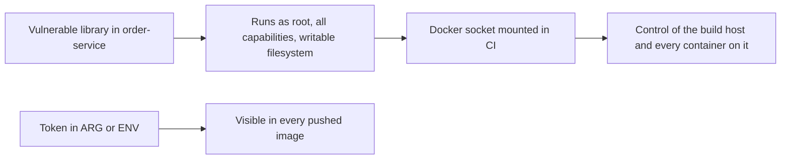

# Container Security and Supply Chain Basics

**Cloud and containers · Docker · Step 9.2.9 · Advanced** · Last updated 2026-10-22
**Prerequisites:** [Containers: isolated processes with limits](02-containers-isolated-processes.md) (9.2.2), [Images and layers](03-images-and-layers.md) (9.2.3) and [A Dockerfile for a Java service](04-dockerfile-java-service.md) (9.2.4)

**Version note**

| Item | Version |
|---|---|
| Baseline | Linux namespaces, cgroups, capabilities and seccomp; BuildKit build secrets |
| Hands-on baseline | Docker Engine 28.4.0 (Docker Desktop, seccomp default profile and private cgroup namespaces reported by the engine), Trivy 0.76.1 for scanning, run on 2026-10-22 |
| Compatibility note | Scanner results change daily as vulnerability databases are updated; the findings shown are a snapshot. Rootless mode and user-namespace remapping depend on the host and are not tested here |

## 1. What it is and why it matters

**What is it?** Container security is the set of practices that limit what a compromised or faulty container can do, and that keep what you run trustworthy. It has two halves. **Runtime hardening** limits a running container: unprivileged user, fewer capabilities, a read-only filesystem, resource limits, no dangerous mounts. **Supply chain security** concerns what goes *into* an image: the base image, dependencies, secrets, and whether you know what you are running.

**Why do we need it?** A container is not a sandbox; it is a process on a shared kernel ([9.2.2](02-containers-isolated-processes.md)). Defaults are chosen for convenience: root user, many capabilities, a writable filesystem, no limits. If an attacker takes over the application inside, those defaults decide how far they get. And images are assembled from other people's software: one outdated base image or one leaked token in a layer is enough.

**When would I meet it?** In every security review, when a scanner reports findings on the image, when a pipeline needs to push or pull images, and when someone asks to "just mount the Docker socket" into a container.

> [!TIP]
> **Memory hook:** *least privilege at run time, least trust at build time.* Run as nobody with nothing extra; ship only what you have scanned and can name.

## 2. Industry terms

| Term | Simple meaning | Why it matters | Example | Related terms |
|---|---|---|---|---|
| **Attack surface** | Everything an attacker could reach or abuse | Smaller is safer | A JRE-only image without a compiler | Least privilege |
| **Least privilege** | Give a process only what it needs | Limits the damage of a compromise | `USER app`, `--cap-drop ALL` | Defence in depth |
| **Linux capabilities** | The root user's powers split into separate rights (change file owners, bind low ports, use raw sockets, and so on) | A container with all of them is closer to root on the host | `CAP_CHOWN` | `--cap-drop`, `--cap-add` |
| **seccomp** | A filter on which system calls a process may make; Docker applies a default profile | Blocks risky calls | `seccomp,profile=builtin` | AppArmor, SELinux |
| **Privileged container** | Started with `--privileged`: nearly all restrictions removed | Effectively host-level access | Almost never justified | Docker socket |
| **Docker socket** | The API endpoint of the Docker daemon (`/var/run/docker.sock`) | Whoever can use it controls every container and can start new privileged ones | CI tools that "need Docker" | Daemon attack surface |
| **Rootless mode** | Running the Docker daemon and containers without host root | Limits the impact of a daemon or runtime compromise; "does not guarantee protection ... through kernel vulnerabilities" (OWASP) | Rootless Docker | User namespaces |
| **CVE and vulnerability scanner** | A public identifier for a known flaw; a tool that matches an image's packages against a database of them | Finds known issues, not unknown ones | Trivy, Docker Scout, Grype | SBOM |
| **SBOM** | Software bill of materials: a list of the components inside an image | You can answer "are we affected?" quickly | A generated component list | Provenance |
| **Provenance and signing** | Records and signatures that say who built an image, from what, and where | Lets you verify, not just trust, an image | Build attestations; image signatures | Supply chain levels |
| **Build secret** | A secret made available to one build step without being stored in a layer | The only safe way to use a credential during a build | `RUN --mount=type=secret` | `ARG`, `ENV` (unsafe) |

## 3. In a real system (ShopFlow)

**The business problem.** A security review of the `order-service` pipeline produces a list. The image runs as root; it contains a compiler and a shell; the CI job that builds images mounts the Docker socket "because it needs Docker"; a private-repository token is passed as a build argument; the base image is two years old; nobody can say which components are in production. Any one of these is a finding; together they mean that a bug in an order-handling library could become control of the build machine, a leaked token, and every image the pipeline can push.



**How the practices help.** Each step shrinks what the previous attacker position gives: a non-root user with no capabilities and a read-only filesystem turns a library exploit into little more than the application's own rights; no socket mount removes the path to the host; build secrets keep tokens out of images; scanning and rebuilds keep the base and libraries current; digests and an SBOM let you know exactly what runs.

**What it costs.** Some applications need adapting (a writable temporary directory, a high port instead of 80); a scanner produces findings that must be triaged; images need regular rebuilds; and every control needs an owner and an exception process.

**Elsewhere:** payment processors require hardened, scanned images as part of compliance audits; cloud providers run untrusted customer code in microVMs or sandboxed runtimes precisely because a shared kernel is not a strong enough boundary for multi-tenant isolation; open-source projects publish build provenance so users can verify what they download.

## 4. How it works

Think in layers; a failure of one should not decide the outcome:

| Layer | Question | Controls |
|---|---|---|
| **Image** | What is inside? | Small base, no tools you don't need, scanned and current, secrets absent, pinned by digest |
| **Container configuration** | What may the process do? | Non-root user, dropped capabilities, no new privileges, read-only filesystem, resource limits, default seccomp profile kept |
| **Host and daemon** | Who can control the engine? | Keep the socket private; consider rootless mode; patch the host and kernel |
| **Network and data** | What can it reach? | Private networks, published ports on loopback ([9.2.5](05-networking-and-ports.md)), read-only mounts ([9.2.6](06-data-and-configuration.md)) |
| **Pipeline and registry** | Where do images come from? | Trusted base images, build secrets, provenance, signing, access control on registries |

The OWASP Docker Security Cheat Sheet lists the same concerns as numbered rules, among them: do not expose the Docker daemon socket (even to containers), set a user, limit capabilities, prevent in-container privilege escalation (`--security-opt=no-new-privileges`), limit resources, set the filesystem and volumes to read-only, integrate scanning into CI/CD, run Docker in rootless mode, and use secrets for sensitive data.

The examples were run on Docker Engine 28.4.0 (2026-10-22). Containers, networks and volumes were labelled `learning=notes` and removed afterwards; the scanner image and the test images were removed too.

### Worked example 1: a hardened run

**Concept.** The multi-stage image from [9.2.4](04-dockerfile-java-service.md) already runs as the unprivileged user `app`. At run time, more restrictions can be added without changing the image:

```text
$ docker run -d --name sf-learn-hard --label learning=notes --read-only --tmpfs /tmp --cap-drop ALL --security-opt no-new-privileges --pids-limit 100 --memory 256m --cpus 1 -p 127.0.0.1:18110:8080 sf-learn/order:multistage >/dev/null; sleep 4; echo -n 'service answers: '; curl -s localhost:18110/health; echo; echo -n 'write to the image filesystem: '; docker exec sf-learn-hard sh -c 'echo x > /app/x.txt' 2>&1; echo -n 'write to /tmp (tmpfs): '; docker exec sf-learn-hard sh -c 'echo x > /tmp/x.txt && echo allowed'; docker inspect -f 'ReadonlyRootfs={{.HostConfig.ReadonlyRootfs}} CapDrop={{.HostConfig.CapDrop}} SecurityOpt={{.HostConfig.SecurityOpt}} PidsLimit={{.HostConfig.PidsLimit}}' sf-learn-hard; docker rm -f sf-learn-hard >/dev/null
service answers: OK
write to the image filesystem: sh: can't create /app/x.txt: Read-only file system
write to /tmp (tmpfs): allowed
ReadonlyRootfs=true CapDrop=[ALL] SecurityOpt=[no-new-privileges] PidsLimit=100
```

**Walkthrough.** The flags: `--read-only` makes the container's root filesystem read-only (`--tmpfs /tmp` gives it one writable scratch area in memory, [9.2.6](06-data-and-configuration.md)); `--cap-drop ALL` removes every Linux capability; `--security-opt no-new-privileges` stops the process gaining privileges through set-user-id programs (OWASP: "to prevent privilege escalation"); `--pids-limit`, `--memory` and `--cpus` bound its resources ([9.2.2](02-containers-isolated-processes.md)). The service still answers; a write to the image's filesystem is refused (`Read-only file system`) while `/tmp` is allowed. This tiny service happens to also run with a read-only filesystem and **no** writable `/tmp`:

```text
$ docker run -d --name sf-learn-ro --label learning=notes --read-only -p 127.0.0.1:18111:8080 sf-learn/order:multistage >/dev/null; sleep 4; echo -n 'service answers: '; curl -s -m 3 localhost:18111/health || echo '(no answer)'; echo; docker logs sf-learn-ro 2>&1 | head -3 | cut -c1-120; docker inspect -f 'status={{.State.Status}} exit={{.State.ExitCode}}' sf-learn-ro; docker rm -f sf-learn-ro >/dev/null
service answers: OK
order-service listening on port 8080
status=running exit=0
```

Real frameworks usually need a writable temporary directory (uploads, caches), so add `--tmpfs /tmp` and test.

**Experiment.** Predict first: with `--cap-drop ALL`, which of these still works as a normal user or root: changing a file's owner, listing files, opening a TCP connection to another container? Only some need capabilities; the answer, with the evidence for the first, is in Answers.

### Worked example 2: capabilities

**Concept.** Root's powers are split into capabilities; Docker gives a container a default subset. Dropping all of them removes the rights that an attacker with root inside would want. Here, `CapEff` (the effective capabilities of the process, as a bit mask) with defaults and with all dropped, and one action that needs a capability (`chown` needs `CAP_CHOWN`):

```text
$ for flags in '' '--cap-drop ALL'; do echo "== docker run $flags"; docker run --rm --label learning=notes $flags alpine:3.22 sh -c 'echo -n "effective capabilities: "; grep CapEff /proc/self/status | cut -f2; touch /tmp/f; echo -n "chown (needs CAP_CHOWN): "; chown 1000 /tmp/f 2>&1 && echo allowed'; done
== docker run 
effective capabilities: 00000000a80425fb
chown (needs CAP_CHOWN): allowed
== docker run --cap-drop ALL
effective capabilities: 0000000000000000
chown (needs CAP_CHOWN): chown: /tmp/f: Operation not permitted
```

**Walkthrough.** By default the mask is `a80425fb` (a set of 14 capabilities, including the right to change file owners); with `--cap-drop ALL` it is `0` and `chown` fails with `Operation not permitted`. Add back only what the service needs (`--cap-add NET_BIND_SERVICE` to listen on a port below 1024, for example), or better, listen on a high port such as 8080 and add nothing. Running as a non-root user already removes most capabilities in practice; dropping them explicitly makes the intent visible and testable.

### Worked example 3: the Docker socket is root on the host

**Concept.** The Docker socket is the daemon's control interface. Docker's security documentation: "only trusted users should be allowed to control your Docker daemon", because Docker "allows you to share a directory between the Docker host and a guest container... without limiting the access rights of the container". A container that can talk to the socket can start another container with the host's root directory mounted, or list and stop other people's containers. Here, a small container with the socket mounted counts the containers it can see through it (a read-only request; the names were not printed):

```text
$ for u in curl_user root; do echo -n "running as $u: "; docker run --rm --label learning=notes --user $u -v /var/run/docker.sock:/var/run/docker.sock curlimages/curl:latest sh -c 'curl -s --unix-socket /var/run/docker.sock http://localhost/containers/json | grep -o "\"Id\"" | wc -l | sed "s/$/ containers visible/"; true'; done
running as curl_user: 0 containers visible
running as root: 9 containers visible
```

**Walkthrough.** As an unprivileged user inside the container, the socket's permissions blocked access (0 visible). As root, the same container saw **all 9 containers on this engine**, none of which belong to this lesson: the engine is shared, and the socket exposes everything. This is why OWASP's first rule is "Do not expose the Docker daemon socket (even to the containers)". CI tools that build images should use a build service (BuildKit in its own container, or a remote builder) with narrow credentials, not the host's socket.

### Worked example 4: process limits and runaway code

**Concept.** `--pids-limit` caps the number of processes a container may create, which blunts a fork bomb or a runaway spawner:

```text
$ for limit in 20 -1; do echo "--pids-limit $limit:"; docker run --rm --label learning=notes --pids-limit $limit alpine:3.22 sh -c 'for i in $(seq 1 60); do sleep 3 & done; echo started all 60 processes' 2>&1; done
--pids-limit 20:
sh: can't fork: Resource temporarily unavailable
--pids-limit -1:
started all 60 processes
```

**Walkthrough.** With a limit of 20, the shell could not create the 21st process and reported `can't fork: Resource temporarily unavailable`; without a limit, it started all 60. Together with memory and CPU limits ([9.2.2](02-containers-isolated-processes.md)), this stops one container from exhausting the host.

### Worked example 5: secrets that stay in the image

**Concept.** Everything that enters a layer, or the image's metadata, stays. A secret passed with `ARG` or `ENV`, or copied in and deleted later, can be recovered by anyone who can pull the image. Docker's documentation: "Build arguments and environment variables are inappropriate for passing secrets to your build, because they persist in the final image."

An `ARG` and an `ENV` carrying a (made-up) token:

```text
$ docker build -q --label learning=notes --build-arg TOKEN=demo-token-not-real-12345 -f ctx-sec/Dockerfile.arg -t sf-learn/arg:1 ctx-sec >/dev/null; echo 'docker history shows:'; docker history --no-trunc --format '{{.CreatedBy}}' sf-learn/arg:1 | grep -i -E 'token' | cut -c1-110; echo 'docker inspect shows:'; docker inspect -f '{{range .Config.Env}}{{println .}}{{end}}' sf-learn/arg:1 | grep TOKEN
docker history shows:
ENV BUILD_TOKEN=demo-token-not-real-12345
RUN |1 TOKEN=demo-token-not-real-12345 /bin/sh -c echo "downloading with the token" > /dev/null # buildkit
ARG TOKEN=demo-token-not-real-12345
docker inspect shows:
BUILD_TOKEN=demo-token-not-real-12345
```

The token appears in the history three times and in the image's environment. A file copied in one step and deleted in the next (as in [9.2.3](03-images-and-layers.md)) is also still there; this script searches every layer of a saved image for a string:

```python
"""Search every layer of a saved image (docker save) for a string. Usage: python3 findsecret.py image.tar needle"""
import io, sys, tarfile
image, needle = sys.argv[1], sys.argv[2].encode()
found = 0
outer = tarfile.open(image)
for member in outer.getmembers():
    if not member.isfile() or not member.name.startswith('blobs/'):
        continue
    data = outer.extractfile(member).read()
    try:
        layer = tarfile.open(fileobj=io.BytesIO(data))      # tar or tar.gz; manifests and configs are not tars
        for item in layer.getmembers():
            if item.isfile() and needle in (layer.extractfile(item).read() or b''):
                print(f'FOUND in layer {member.name.split('/')[-1][:12]}... file /{item.name}')
                found += 1
    except tarfile.TarError:
        if needle in data:
            print(f'FOUND in {member.name.split('/')[-1][:12]}... (image metadata)')
            found += 1
print(f'{found} place(s) contain the secret')
```

```text
$ echo 'the file was copied in one step and deleted in the next:'; python3 findsecret.py scan/leaky.tar demo-token-not-real
the file was copied in one step and deleted in the next:
FOUND in layer f1a3190ac789... file /tmp/token.txt
1 place(s) contain the secret
```

The safe way is a **build secret**: it is mounted for a single build step and never written to a layer. The Dockerfile:

```dockerfile
FROM alpine:3.22
RUN --mount=type=secret,id=token wc -c /run/secrets/token
```

built with `docker build --secret id=token,src=token.txt ...`:

```text
$ echo 'the secret was supplied with RUN --mount=type=secret:'; python3 findsecret.py scan/safe.tar demo-token-not-real
the secret was supplied with RUN --mount=type=secret:
0 place(s) contain the secret
```

**Walkthrough.** The leaky image contained the secret in a layer (`/tmp/token.txt`), even though a later step deleted the file; the build-secret image contained it nowhere. If a token was ever in an image, **revoke it**: deleting the image does not undo copies that others pulled.

### Worked example 6: scanning for known vulnerabilities

**Concept.** A scanner reads the packages and libraries inside an image and matches them against a database of known vulnerabilities (CVEs). The images were saved to files and scanned with Trivy, running as a container (no account needed; the first run downloaded the vulnerability database). The `order-service` image:

```text
$ docker run --rm --label learning=notes -v sf-learn-trivy-cache:/root/.cache -v $PWD/scan:/work:ro aquasec/trivy:latest image --scanners vuln --severity HIGH,CRITICAL --quiet --format template --template @/work/findings.tpl --input /work/order-multistage.tar
/work/order-multistage.tar (alpine 3.24.3): 0 HIGH or CRITICAL findings
```

and, for comparison, an old Alpine 3.16 base image:

```text
$ docker run --rm --label learning=notes -v sf-learn-trivy-cache:/root/.cache -v $PWD/scan:/work:ro aquasec/trivy:latest image --scanners vuln --severity HIGH,CRITICAL --quiet --format template --template @/work/findings.tpl --input /work/alpine-3.16.tar
/work/alpine-3.16.tar (alpine 3.16.9): 2 HIGH or CRITICAL findings
  musl 1.2.3-r3 (fixed in 1.2.3-r4) CVE-2025-26519 HIGH
  musl-utils 1.2.3-r3 (fixed in 1.2.3-r4) CVE-2025-26519 HIGH
```

**Walkthrough.** The current image has no HIGH or CRITICAL findings in its operating-system packages at this moment; the old base has two (the same musl C library flaw reported for two packages), each with a fixed version available. A clean result means "nothing the database knows today": it does **not** cover flaws in your own code, in dependencies the scanner cannot see, or flaws not yet published, and tomorrow's database will find new ones. The practice is therefore a loop: scan in CI on every build, **rebuild regularly** to pick up fixed base images, and alert on new findings in images that are already deployed.

### Worked example 7: supply chain, in practice

The controls you have already seen are the supply-chain controls:
1. **Know your base:** an official, maintained image from a source you trust; the smallest that works ([9.2.4](04-dockerfile-java-service.md)).
2. **Pin and record:** version tags in the Dockerfile, and the **digest** of what you shipped ([9.2.3](03-images-and-layers.md)): the tag can move, the digest cannot.
3. **Keep current:** scheduled rebuilds with `--pull`, and scans.
4. **Keep secrets out:** build secrets, never `ARG` or `ENV`.
5. **Produce evidence:** a software bill of materials and build provenance for each image, and signatures that a cluster can verify before running an image. BuildKit can generate SBOM and provenance attestations (`--sbom`, `--provenance`), and tools such as Sigstore's cosign can sign images; these were **not run** for this lesson, so check your tools' documentation before relying on them.

### Common mistakes

1. Running as root with default capabilities "because it works".
2. Mounting the Docker socket into build or monitoring containers.
3. `--privileged` to fix a permission problem.
4. Secrets in `ARG`, `ENV`, copied files or the Compose file.
5. Scanning once and never rebuilding.
6. `latest` base images and unpinned dependencies.
7. Treating a clean scan as proof of safety.

## 5. Failure scenarios

### The compromised service that owned the host

1. **What happened?** An attacker exploited a deserialisation flaw in a library used by `order-service` and obtained a shell in the container. From there, they reached the Docker socket that a monitoring sidecar had mounted, started a privileged container, and read the host.
2. **Why?** Root user, default capabilities, a writable filesystem and a socket mount removed every barrier (worked example 3).
3. **What did the business see?** A breach of the host and the other services on it, and a full incident response.
4. **Solutions:** non-root; `--cap-drop ALL`; read-only filesystem; no socket mounts (use a purpose-built agent with narrow permissions); network segmentation; patch the library.
5. **What they cost:** application changes (writable temp dirs, ports), and agent redesign.

### The token that shipped to everyone

1. **What happened?** A private-repository token passed as a build argument was found in the public image on a registry.
2. **Why?** Build arguments persist in the image (worked example 5).
3. **What did the business see?** A leaked credential for the company's source repositories, a forced rotation and an audit finding.
4. **Solutions:** revoke the token; use build secrets; scan images and repositories for secrets; keep internal images private.
5. **What they cost:** rotation work and a changed build process.

### Known flaws in production for a year

1. **What happened?** A scanner at an auditor's request listed dozens of HIGH findings in images that had run unchanged for a year.
2. **Why?** Images were built once and never rebuilt; base images gain fixes continuously.
3. **What did the business see?** An audit failure and a rushed rebuild of everything at once.
4. **Solutions:** scheduled rebuilds, scanning in CI and of deployed images, an SLA for fixing findings by severity, small images with fewer packages to patch.
5. **What they cost:** regular rebuild and test cycles.

### The tag that changed

1. **What happened?** A build began failing a security check without a code change.
2. **Why?** The `FROM` line used a moving tag (`latest`), and the base image changed ([9.2.3](03-images-and-layers.md)).
3. **What did users see?** Nothing, until the check failed; in the worst case, a changed base got into production unreviewed.
4. **Solutions:** pin versions and digests; update them in reviewed changes that rebuild and scan.
5. **What they cost:** a routine for updating pins.

## 6. Architectural decisions

| Decision | Choose | Because |
|---|---|---|
| User | A fixed non-root uid in the image | Least privilege by default |
| Capabilities | Drop all; add back only what is proven necessary | A privileged-looking process is a bigger target |
| Filesystem | Read-only root, `tmpfs` for scratch, volumes only where data lives | Attackers can't modify the application |
| Docker socket | Never mount it into application or tooling containers | It is root on the host |
| Privileged mode | Don't, except for dedicated, isolated tooling | Removes the main protections |
| Secrets | Build secrets for builds; files or a secret store at run time | Layers and environments are visible |
| Scanning | In CI on every build, plus scheduled scans of what is deployed | New CVEs appear daily |
| Isolation strength | Containers for trusted workloads; stronger isolation (VMs, sandboxed runtimes, rootless) for untrusted or multi-tenant code | The kernel is shared |

**Common mistakes:** see the list above.

### Alternatives in the industry

A map of the landscape, not a comparison. Only Trivy was run in this series; check each project's current documentation before adopting one.

| Area | Tool or product | What it is | When you meet it |
|---|---|---|---|
| Vulnerability scanning | **Trivy** (used here) | Open-source scanner for images, file systems and repositories | CI pipelines; the default in many open-source projects |
| | **Grype**, **Clair**, **Docker Scout**, **Snyk Container** | Other scanners; Docker Scout is built into Docker's tooling, Snyk is a commercial platform | Registries and platforms that include scanning, and enterprises with a standard vendor |
| SBOM and signing | **Syft** (SBOM), **Sigstore cosign** (signing and verification), **Notary** | Produce the component list of an image and sign or verify images | Supply-chain requirements and admission policies in clusters |
| Stronger isolation | **gVisor**, **Kata Containers**, **Firecracker** | Sandboxed runtimes or micro-VMs that put a stronger boundary than a shared kernel between workloads | Multi-tenant platforms and serverless offerings |
| Rootless engines | **Rootless Docker**, **Podman** | Run the engine and containers without host root | Hardened hosts and shared machines |
| Benchmarks and checks | **CIS Docker Benchmark**, **Docker Bench for Security** | A checklist and script for host and daemon configuration | Audits and compliance reviews |
| Secrets | **HashiCorp Vault**, **AWS Secrets Manager**, **Kubernetes Secrets with an external store** | Central stores that hand secrets to workloads at run time | Anything beyond a single host ([9.3.4](../03-kubernetes/04-configuration-and-secrets.md)) |

## 7. Try it yourself

Try each exercise first; the real results are in the Answers section.

1. **Harden it.** Run an image of yours with a read-only filesystem, all capabilities dropped, no new privileges and a process limit, and show that it still works and that writing to its filesystem fails.
2. **Find the secret.** Build an image that copies in a secret file and deletes it in a later step, and use the search script to prove the secret is still in a layer. Then rebuild it with a build secret.
3. **Scan and decide.** Scan the base image you use, and write down: how many HIGH or CRITICAL findings, whether fixes exist, and what you would do.

## 8. Check your understanding

1. Why is mounting the Docker socket into a container dangerous even if the container "only reads"?
2. A secret was copied into an image and deleted in a later step. Is it safe?
3. A scanner reports zero HIGH findings. What can you conclude, and what not?
4. Why do you drop capabilities when the container already runs as a non-root user?

Answers are at the end of this note.

## 9. Revision

**Remember**
- A container is a **process on a shared kernel**: harden it with **non-root, dropped capabilities, no-new-privileges, read-only filesystem, limits**.
- The **Docker socket is root** on the host; **`--privileged`** removes the protections.
- **Anything in a layer, `ARG` or `ENV` persists in the image.** Use **build secrets**; revoke leaked tokens.
- **Scan** in CI, **rebuild** regularly; a clean scan means "nothing known today".
- **Pin** by digest; keep an **SBOM** and provenance; sign what you ship.

**Explain in 15 seconds:** "Run containers as unprivileged users with no extra capabilities, a read-only filesystem and limits; never mount the Docker socket; keep secrets out of images with build secrets; and scan, rebuild and pin what you ship."

**Explain in 60 seconds:**
> "Containers share the host kernel, so I treat the container configuration as the security boundary and layer controls. In the image: a small maintained base, a non-root user, no compiler or shell I don't need, and no secrets, because anything in a layer, ARG or ENV is recoverable; builds use secret mounts. At run time: drop all capabilities and add back only what's proven necessary, no-new-privileges, a read-only root filesystem with a tmpfs for scratch, and memory, CPU and process limits. I never mount the Docker socket into a container, since that is root on the host, and I avoid privileged mode. For the supply chain, I pin base images by digest, scan every build and the deployed images with a scanner and rebuild regularly because new CVEs appear daily, and I produce an SBOM and provenance and sign images so clusters can verify what they run. For untrusted or multi-tenant workloads I'd use stronger isolation than plain containers."

**Likely follow-up questions:**
- **How does Kubernetes express this?** Security contexts (`runAsNonRoot`, `readOnlyRootFilesystem`, `allowPrivilegeEscalation`, dropped capabilities), pod security standards, RBAC and network policies ([9.3.9](../03-kubernetes/09-kubernetes-security.md)).
- **Is rootless Docker enough?** It reduces the impact of daemon or runtime compromise, but the kernel is still shared, so kernel flaws remain a risk.
- **What is distroless?** Base images without a shell or package manager, so there is less to attack; they trade away easy debugging.
- **How often should I rebuild?** On a schedule (weekly is common) and whenever a serious CVE affects your base; automate it.

**Architect's takeaway:** assume the application will eventually be compromised, and decide in advance how far that can go. Most of the answer is configuration you can review in a pull request.

**Next topic:** Kubernetes: the big picture and learning order ([9.3.1](../03-kubernetes/01-kubernetes-overview.md)). The Docker series ends here; revise with the [series overview](01-docker-overview.md).

## 10. Verification and sources

> [!NOTE]
> Checked 2026-10-22. Every command was run on Docker Engine 28.4.0 (Docker Desktop, linux/arm64) with Trivy 0.76.1 as a container; output blocks are copied from those runs (the scan database was the one current on that day). The tokens shown are made up. Re-verify when you revisit this note.

- **Confirmed (documentation, read 2026-10-22):** "only trusted users should be allowed to control your Docker daemon", with the ability to share a host directory with a container without limiting its access (Docker, "Docker security"); "Build arguments and environment variables are inappropriate for passing secrets to your build, because they persist in the final image", and secret mounts expose a secret "for the duration of the build instruction" (Docker, "Build secrets"); the OWASP Docker Security Cheat Sheet's rules: do not expose the Docker daemon socket (even to the containers), set a user, limit capabilities, prevent in-container privilege escalation (`--security-opt=no-new-privileges`), limit resources, set filesystem and volumes to read-only, integrate scanning tools into CI/CD, run Docker in rootless mode ("does not guarantee protection against host privilege escalation through kernel vulnerabilities"), and use secrets for sensitive data; `--cap-drop`, `--privileged`, `--read-only`, `--security-opt` exist on `docker run` (Docker, `docker run` reference).
- **Observed (this machine):** the capability masks, the socket visibility as non-root versus root, the pids limit behaviour, the history and inspect output for `ARG` and `ENV`, the layer search results, and the scan results, which will differ on other days.
- **Not run:** SBOM and provenance generation, image signing and verification, rootless Docker, user-namespace remapping and custom seccomp profiles are described, not demonstrated.
- **Assumptions and illustrations:** the review findings and incident stories are illustrative; the 14-capability count for the default mask was read from the mask and Docker's default set, not measured here.
- **To verify:** the default capability set and seccomp profile of your Docker version; your organisation's scanner and its policies; how your registry and cluster enforce signatures.
- **Decision rule:** non-root, no capabilities, read-only filesystem, limits; no socket mounts; build secrets; scan, rebuild, pin; stronger isolation for untrusted code.

**Sources:** Docker documentation: "Docker security", "Build secrets", `docker run` reference; OWASP Docker Security Cheat Sheet (cheatsheetseries.owasp.org); Aqua Security Trivy (the scanner used); Linux man pages `capabilities(7)` and `namespaces(7)`.

## Answers

**Experiment**

- **With `--cap-drop ALL`:** changing a file's owner **fails** (`chown: Operation not permitted`, shown in worked example 2); listing files and opening a TCP connection to another container (a normal, unprivileged socket operation) **still work**, because they need no special capability. Dropping capabilities removes only the special rights that ordinary services don't need.

**Check your understanding**

1. The socket is the daemon's complete control interface, not a read-only feed. Access to it lets a process start containers with any settings (for example one with the host's root directory mounted), stop or inspect every container, and read their environments. In the example, a root process inside a container saw all 9 containers on the engine. Treat the socket as root on the host.
2. No. The deleted file remains in the earlier layer, and anyone who can pull the image can extract it (worked example 5). Revoke the secret, rebuild with a build secret, and replace the published image.
3. That the packages the scanner understands have no known HIGH or CRITICAL flaws in its database today. You cannot conclude that the image is secure: custom code, unscanned components, configuration errors and not-yet-published flaws are outside it, and the result changes as the database grows. Scan regularly and rebuild.
4. Defence in depth and visibility: a non-root user already lacks most capabilities in practice, but dropping them explicitly guards against a setting that grants them back (a set-user-id binary, a mistaken `USER root` later), makes the intent testable, and removes capabilities that root-owned child processes could use. It costs nothing if the service doesn't need them.

**Practice exercises**

1. **Harden it:** the hardened run keeps the service working while the filesystem is read-only and capabilities are dropped:

```text
$ docker run -d --name sf-learn-hard --label learning=notes --read-only --tmpfs /tmp --cap-drop ALL --security-opt no-new-privileges --pids-limit 100 --memory 256m --cpus 1 -p 127.0.0.1:18110:8080 sf-learn/order:multistage >/dev/null; sleep 4; echo -n 'service answers: '; curl -s localhost:18110/health; echo; echo -n 'write to the image filesystem: '; docker exec sf-learn-hard sh -c 'echo x > /app/x.txt' 2>&1; echo -n 'write to /tmp (tmpfs): '; docker exec sf-learn-hard sh -c 'echo x > /tmp/x.txt && echo allowed'; docker inspect -f 'ReadonlyRootfs={{.HostConfig.ReadonlyRootfs}} CapDrop={{.HostConfig.CapDrop}} SecurityOpt={{.HostConfig.SecurityOpt}} PidsLimit={{.HostConfig.PidsLimit}}' sf-learn-hard; docker rm -f sf-learn-hard >/dev/null
service answers: OK
write to the image filesystem: sh: can't create /app/x.txt: Read-only file system
write to /tmp (tmpfs): allowed
ReadonlyRootfs=true CapDrop=[ALL] SecurityOpt=[no-new-privileges] PidsLimit=100
```

2. **Find the secret:** the script finds the secret in the leaky image's layer, and in none of the build-secret image:

```text
$ echo 'the file was copied in one step and deleted in the next:'; python3 findsecret.py scan/leaky.tar demo-token-not-real
the file was copied in one step and deleted in the next:
FOUND in layer f1a3190ac789... file /tmp/token.txt
1 place(s) contain the secret
```

```text
$ echo 'the secret was supplied with RUN --mount=type=secret:'; python3 findsecret.py scan/safe.tar demo-token-not-real
the secret was supplied with RUN --mount=type=secret:
0 place(s) contain the secret
```

3. **Scan and decide:** for the old base image, two HIGH findings with a fixed version available, so the decision is to move to a current base and rebuild; for the current one, none, so schedule the next rebuild and scan:

```text
$ docker run --rm --label learning=notes -v sf-learn-trivy-cache:/root/.cache -v $PWD/scan:/work:ro aquasec/trivy:latest image --scanners vuln --severity HIGH,CRITICAL --quiet --format template --template @/work/findings.tpl --input /work/alpine-3.16.tar
/work/alpine-3.16.tar (alpine 3.16.9): 2 HIGH or CRITICAL findings
  musl 1.2.3-r3 (fixed in 1.2.3-r4) CVE-2025-26519 HIGH
  musl-utils 1.2.3-r3 (fixed in 1.2.3-r4) CVE-2025-26519 HIGH
```

Back to [the series overview](01-docker-overview.md) · [the area overview](../01-cloud-and-containers-overview.md) · [the index](../../README.md) · [Roadmap](../../roadmap.md).
