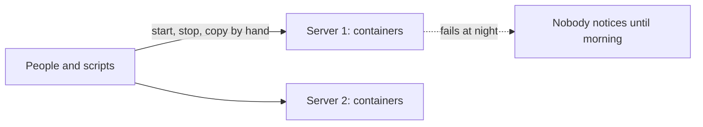
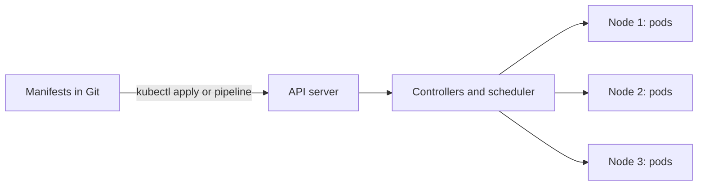
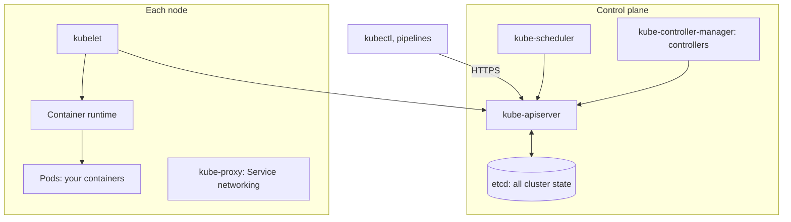

# Kubernetes: The Big Picture and Learning Order

**Cloud and containers · Kubernetes · Step 9.3.1 · Overview** · Last updated 2026-10-22
**Prerequisites:** [Docker: the big picture and learning order](../02-docker/01-docker-overview.md) (9.2.1), and ideally the whole Docker series; [Docker Compose for local development](../02-docker/08-docker-compose.md) (9.2.8) for the contrast

Read this first. It is the map of the Kubernetes series: what Kubernetes is for, the parts it is made of, the objects you work with, the order of the lessons, and how to run the examples on your own machine without disturbing anything else.

**Version note**

| Item | Version |
|---|---|
| Baseline | Kubernetes core APIs (`v1`, `apps/v1`); the lessons avoid alpha and beta features |
| Hands-on baseline | Rancher Desktop with k3s, Kubernetes server v1.36.5, `kubectl` client v1.37.1, single node on Linux arm64, run on 2026-10-22 |
| Compatibility note | `kubectl` is supported within one minor version, older or newer, of the API server (Kubernetes version-skew policy), so these two versions work together. Managed cloud clusters may be on different versions: check the version of yours |

## 1. What it is and why it matters

**What is it?** Kubernetes (often written K8s) is a system that runs containers across a group of machines and keeps them running the way you described. You do not start containers yourself. You tell Kubernetes what you want ("three copies of `order-service`, version 1.4.2, reachable on this name"), and it places the containers on machines, restarts them when they fail, replaces machines' lost work, and rolls out new versions.

**Why do we need it?** Docker ([9.2.1](../02-docker/01-docker-overview.md)) and Compose ([9.2.8](../02-docker/08-docker-compose.md)) run containers well on **one** machine. Real systems need more: several machines so that one failing does not take everything down, traffic spread across copies, new versions without downtime, capacity that grows and shrinks with load, and many teams sharing the same hardware safely. Doing that by hand, or with scripts per team, is slow and error-prone. Kubernetes turns it into one consistent, declarative interface.

**When would I meet it?** Almost every company that runs many services in the cloud uses it, directly or through a managed service (Amazon EKS, Google GKE, Azure AKS). You meet it when you deploy a service, read a manifest, debug a pod that will not start, size a cluster, or design how a system is released and scaled.

> [!TIP]
> **Memory hook:** *declare the desired state; controllers make it true, and keep it true.* You write what you want. Loops that never stop compare it with reality and fix the difference.

## 2. Mental model: a thermostat for your whole system

A thermostat does not heat the room when you press a button; you set a **target temperature**, and it keeps comparing the room with that target and switching the heating on or off to close the gap. If someone opens a window, it reacts without being asked. The Kubernetes documentation uses the same picture: a **control loop** regulates a system by comparing the **desired state** with the **current state** and acting on the difference.

Kubernetes is thousands of these small thermostats running together. One keeps "the number of `order-service` pods" at three, another keeps pods on healthy machines, another keeps a service's address pointing at pods that are ready. You set the targets; they do the work.

## 3. Industry terms

| Term | Simple meaning | Why it matters | Example | Related terms |
|---|---|---|---|---|
| **Cluster** | A set of machines (nodes) managed together, plus the control plane that manages them | The unit you deploy to | The Rancher Desktop cluster here has one node | Node, control plane |
| **Node** | One machine (physical or virtual) that runs containers | Where your workload actually runs | A cloud VM | kubelet, container runtime |
| **Control plane** | The components that decide and record what should run: API server, etcd (the store), scheduler, controller manager | The "brain"; managed for you in cloud services | In EKS, AWS runs it | API server |
| **API server (`kube-apiserver`)** | The HTTP API that everything, including `kubectl`, talks to | The one front door; all state changes go through it | `kubectl apply` calls it | etcd |
| **etcd** | The consistent, highly available key-value store holding all API data | The cluster's memory; lose it and you lose the cluster's state | Backed up in self-managed clusters | Backup |
| **Scheduler (`kube-scheduler`)** | Looks for pods not yet bound to a node and assigns each to a suitable one | Decides *where* pods run | Picks a node with enough memory | Requests, taints |
| **Controller** | A loop that watches objects and acts to move reality toward the desired state | How Kubernetes self-heals | The ReplicaSet controller | Reconciliation |
| **kubelet** | The agent on every node that makes sure the pods assigned to it are running | Starts, stops and reports on containers | Runs your container | Container runtime |
| **Container runtime** | The software that actually runs containers | Kubernetes talks to it through a standard interface | containerd | CRI |
| **Pod** | The smallest deployable unit: one or more containers that share network and storage | What gets scheduled, started and replaced | One `order-service` container | Deployment |
| **Manifest** | A YAML (or JSON) file describing objects you want | Your desired state, kept in Git | `deployment.yaml` | `kubectl apply` |
| **Desired state and status** | The `spec` is what you want; the `status` is what exists, written by the system | The gap between them is what controllers close | `replicas: 3` versus 2 ready | Reconciliation |
| **Namespace** | A named partition inside a cluster for grouping and separating objects | Separates teams, environments and these lessons from everything else | `sf-learn` | Labels |
| **Label and selector** | Key-value tags on objects, and queries that choose objects by them | How a Service finds its pods and a Deployment finds its ReplicaSets | `app: order-service` | Annotations |
| **`kubectl` and context** | The command-line client, and the named cluster-and-user it currently talks to | The wrong context means the wrong cluster | `--context rancher-desktop` | kubeconfig |

## 4. In a real system (ShopFlow)

**The business problem.** ShopFlow runs ten services with Compose on a few servers. The Black Friday sale doubles traffic; someone adds `order-service` copies by hand on a second server and edits the load balancer. A server fails at night and its containers stay down until a person notices. Each deploy is a script that stops containers and starts new ones, so customers see errors for a few seconds. Two teams have written different deploy scripts, and nobody can say which version is running where.



**How Kubernetes helps.** Every service is described once in manifests kept in Git. The cluster has several nodes. `order-service` is declared with three replicas and a health check; when a node dies, the controllers see fewer pods than wanted and the scheduler places new ones on the surviving nodes. A new version is a changed image tag; the Deployment replaces pods gradually and only sends traffic to ones that are ready. Scaling for the sale is one number, or a rule that scales by load. Every team uses the same interface.



**What it costs.** Real complexity: many concepts, YAML to maintain, a cluster to operate and upgrade (or pay a cloud provider to), new failure modes (pods stuck pending, crash loops, probes that kill healthy pods), and skills the team must build. For a handful of services on one server, Compose or a managed container service is often the better choice. Section 6 gives the decision rule.

**Elsewhere:** a media company runs thousands of short batch jobs as pods that disappear when finished; a bank runs the same platform in two data centres and moves workloads between them; a start-up uses a managed cluster so that one person can run twenty services without managing servers.

## 5. How it works: the parts, the objects and the lessons

### The parts



Everything talks to the **API server**; components never call each other directly. A change is stored in **etcd**; controllers and the scheduler **watch** the API for objects they care about and write their decisions back; each node's **kubelet** watches for pods assigned to its node and uses the **container runtime** to start them. This design is why Kubernetes recovers from partial failures: every component can restart and pick up from the stored state.

### Worked example 1: the cluster used in this series

**Concept.** The examples run on Rancher Desktop's built-in Kubernetes (k3s, a lightweight distribution) on your Mac, as one node in a small Linux virtual machine. It is a real cluster with the same API as a cloud one, just small.

```text
$ kubectl --context rancher-desktop version; echo; kubectl --context rancher-desktop get nodes -o wide
Client Version: v1.37.1
Kustomize Version: v5.8.1
Server Version: v1.36.5+k3s1

NAME                   STATUS   ROLES           AGE   VERSION        INTERNAL-IP    EXTERNAL-IP    OS-IMAGE             KERNEL-VERSION           CONTAINER-RUNTIME
lima-rancher-desktop   Ready    control-plane   13d   v1.36.5+k3s1   192.168.5.15   192.168.64.2   Alpine Linux v3.24   6.18.37-0-virt (arm64)   docker://29.5.3
```

```text
$ kubectl --context rancher-desktop describe node | sed -n '/^System Info:/,/^PodCIDR/p' | grep -E 'Kernel|OS Image|Architecture|Runtime|Kubelet'
  Kernel Version:             6.18.37-0-virt
  OS Image:                   Alpine Linux v3.24
  Architecture:               arm64
  Container Runtime Version:  docker://29.5.3
  Kubelet Version:            v1.36.5+k3s1
```

The node's capacity, which later lessons use to explain scheduling and limits:

```text
$ kubectl --context rancher-desktop describe node | sed -n '/^Capacity:/,/^System Info:/p' | head -22
Capacity:
  cpu:                2
  ephemeral-storage:  102625208Ki
  hugepages-1Gi:      0
  hugepages-2Mi:      0
  hugepages-32Mi:     0
  hugepages-64Ki:     0
  memory:             6065056Ki
  pods:               110
Allocatable:
  cpu:                2
  ephemeral-storage:  99833802265
  hugepages-1Gi:      0
  hugepages-2Mi:      0
  hugepages-32Mi:     0
  hugepages-64Ki:     0
  memory:             6065056Ki
  pods:               110
System Info:
```

**Walkthrough.** One node (`control-plane`) is both the control plane and the worker. The node is a Linux (Alpine) VM with 2 CPUs and about 6 GB of memory, and the container runtime is Docker (`docker://29.5.3`), which is a choice of this Rancher Desktop setup; many clusters use containerd. The cluster's own services run as pods in the `kube-system` namespace:

```text
$ kubectl --context rancher-desktop -n kube-system get pods
NAME                                      READY   STATUS      RESTARTS      AGE
coredns-7cfb7bc9c7-w28xd                  1/1     Running     2 (14m ago)   13d
helm-install-traefik-crd-28w8r            0/1     Completed   0             13d
helm-install-traefik-sqvn4                0/1     Completed   2 (13d ago)   13d
local-path-provisioner-77b9867795-7xr4m   1/1     Running     2 (14m ago)   13d
metrics-server-6dc596dfb8-dzzgr           1/1     Running     2 (14m ago)   13d
svclb-traefik-747992dc-hjs8w              2/2     Running     4 (14m ago)   13d
traefik-7c8544f77-88b2f                   1/1     Running     2 (14m ago)   13d
```

CoreDNS (names inside the cluster), the local-path provisioner (storage), metrics-server (CPU and memory figures), and Traefik (an ingress controller) are the cluster's add-ons. **There are no pods for the API server, scheduler or controller manager**: k3s runs the control plane inside one process on the node, which a look inside the VM confirms:

```text
$ rdctl shell ps -o pid,args 2>&1 | grep -E 'k3s|kube-apiserver|kube-scheduler|etcd' | grep -v grep | cut -c1-110 | head -6
 5639 supervise-daemon k3s --start --stdout ~/Library/Logs/rancher-desktop/k3s.log --stderr /Us
 5640 {k3s-server} /usr/local/bin/k3s server
```

and the API server reports its own health (the checks here are a selection):

```text
$ kubectl --context rancher-desktop get --raw '/readyz?verbose' | grep -E 'etcd|ping|informer|readyz check' | head -12
[+]ping ok
[+]etcd ok
[+]etcd-readiness ok
[+]informer-sync ok
[+]poststarthook/generic-apiserver-start-informers ok
[+]poststarthook/start-apiextensions-informers ok
[+]poststarthook/crd-informer-synced ok
[+]poststarthook/start-kube-aggregator-informers ok
readyz check passed
```

The k3s documentation states that a single-server cluster uses an embedded SQLite database by default; the check is still labelled `etcd` in the API server's output. In a cloud cluster the control plane is also hidden from you, run by the provider.

> [!WARNING]
> **Always name the cluster.** Every command in these lessons passes `--context rancher-desktop`, and every object lives in the `sf-learn` namespace with the label `learning=notes`. If you have several clusters configured (work, cloud, local), a command run in the wrong context changes the wrong cluster. Check with `kubectl config current-context` before you apply or delete anything.

### Worked example 2: desired state, and what happens when you apply it

**Concept.** A manifest describes an object. This Deployment says: "keep two pods running from this image".

```yaml
apiVersion: apps/v1
kind: Deployment
metadata:
  name: order-service
  labels:
    app: order-service
    learning: notes
spec:
  replicas: 2
  selector:
    matchLabels:
      app: order-service
  template:
    metadata:
      labels:
        app: order-service
        learning: notes
    spec:
      containers:
        - name: order-service
          image: sf-learn/shop-api:v1
          ports:
            - containerPort: 8080
```

`apiVersion` and `kind` say which type of object; `metadata` names and labels it; `spec` is the desired state. The `selector` and the pod template's `labels` must match, because that is how the Deployment finds its pods.

```text
$ kubectl --context rancher-desktop -n sf-learn apply -f order-deployment.yaml && kubectl --context rancher-desktop -n sf-learn rollout status deployment/order-service --timeout=120s && kubectl --context rancher-desktop -n sf-learn get deployment,replicaset,pod -o wide
deployment.apps/order-service created
Waiting for deployment "order-service" rollout to finish: 0 of 2 updated replicas are available...
Waiting for deployment "order-service" rollout to finish: 1 of 2 updated replicas are available...
deployment "order-service" successfully rolled out
NAME                            READY   UP-TO-DATE   AVAILABLE   AGE   CONTAINERS      IMAGES                 SELECTOR
deployment.apps/order-service   2/2     2            2           1s    order-service   sf-learn/shop-api:v1   app=order-service

NAME                                       DESIRED   CURRENT   READY   AGE   CONTAINERS      IMAGES                 SELECTOR
replicaset.apps/order-service-7698947479   2         2         2       1s    order-service   sf-learn/shop-api:v1   app=order-service,pod-template-hash=7698947479

NAME                                 READY   STATUS    RESTARTS   AGE   IP           NODE                   NOMINATED NODE   READINESS GATES
pod/order-service-7698947479-775rq   1/1     Running   0          1s    10.42.0.32   lima-rancher-desktop   <none>           <none>
pod/order-service-7698947479-9ljdj   1/1     Running   0          1s    10.42.0.31   lima-rancher-desktop   <none>           <none>
```

**Walkthrough.** Within about a second the cluster created one Deployment, one ReplicaSet and two pods, and started the containers. The events show who did what, in order. Each component did one small job, and none called another directly:

```text
$ kubectl --context rancher-desktop -n sf-learn get events --sort-by=.metadata.creationTimestamp -o custom-columns=REASON:.reason,FROM:.reportingComponent,OBJECT:.involvedObject.name,MESSAGE:.message | cut -c1-120
REASON              FROM                    OBJECT                           MESSAGE
Scheduled           default-scheduler       order-service-7698947479-775rq   Successfully assigned sf-learn/order-servic
Scheduled           default-scheduler       order-service-7698947479-9ljdj   Successfully assigned sf-learn/order-servic
SuccessfulCreate    replicaset-controller   order-service-7698947479         Created pod: order-service-7698947479-775rq
SuccessfulCreate    replicaset-controller   order-service-7698947479         Created pod: order-service-7698947479-9ljdj
ScalingReplicaSet   deployment-controller   order-service                    Scaled up replica set order-service-7698947
Pulled              kubelet                 order-service-7698947479-775rq   Container image "sf-learn/shop-api:v1" alre
Created             kubelet                 order-service-7698947479-775rq   Container created
Started             kubelet                 order-service-7698947479-775rq   Container started
Pulled              kubelet                 order-service-7698947479-9ljdj   Container image "sf-learn/shop-api:v1" alre
Created             kubelet                 order-service-7698947479-9ljdj   Container created
Started             kubelet                 order-service-7698947479-9ljdj   Container started
```

| Event | Component | What it did |
|---|---|---|
| `ScalingReplicaSet` | deployment-controller | Saw the new Deployment and created a ReplicaSet with 2 replicas |
| `SuccessfulCreate` | replicaset-controller | Saw 0 pods where 2 were wanted and created two pod objects |
| `Scheduled` | default-scheduler | Chose a node for each pod that had none |
| `Pulled`, `Created`, `Started` | kubelet | Saw pods assigned to its node and told the runtime to run them |

The image was "already present on machine": the examples build `sf-learn/shop-api` directly into the cluster node's engine, so no registry is needed. In a real cluster the kubelet pulls the image from a registry.

### Worked example 3: the loop that never stops

**Concept.** Deleting a pod changes reality away from the desired state. The ReplicaSet controller notices and closes the gap. Scaling is just editing the desired number.

```text
$ kubectl --context rancher-desktop -n sf-learn get pods --no-headers -o custom-columns=NAME:.metadata.name,STATUS:.status.phase; VICTIM=$(kubectl --context rancher-desktop -n sf-learn get pods -o name | head -1); echo "deleting $VICTIM"; kubectl --context rancher-desktop -n sf-learn delete $VICTIM --wait=false; sleep 3; kubectl --context rancher-desktop -n sf-learn get pods -o custom-columns=NAME:.metadata.name,STATUS:.status.phase,AGE:.metadata.creationTimestamp
order-service-7698947479-775rq   Running
order-service-7698947479-9ljdj   Running
deleting pod/order-service-7698947479-775rq
pod "order-service-7698947479-775rq" deleted from sf-learn namespace
NAME                             STATUS    AGE
order-service-7698947479-2dvdm   Running   2026-10-22T17:19:41Z
order-service-7698947479-9ljdj   Running   2026-10-22T17:19:30Z
```

```text
$ kubectl --context rancher-desktop -n sf-learn scale deployment/order-service --replicas=4 && sleep 3 && kubectl --context rancher-desktop -n sf-learn get deployment order-service && kubectl --context rancher-desktop -n sf-learn scale deployment/order-service --replicas=2 && sleep 3 && kubectl --context rancher-desktop -n sf-learn get deployment order-service
deployment.apps/order-service scaled
NAME            READY   UP-TO-DATE   AVAILABLE   AGE
order-service   4/4     4            4           17s
deployment.apps/order-service scaled
NAME            READY   UP-TO-DATE   AVAILABLE   AGE
order-service   2/2     2            2           20s
```

**Walkthrough.** After the delete, the pod `...775rq` was gone and a new one, `...2dvdm`, was already running, created seconds earlier. Nobody restarted anything: the ReplicaSet wanted two and saw one. Scaling from 2 to 4 and back is the same mechanism with a different target. Note that the replacement pod has a **new name and a new IP address**: pods are replaced, not repaired, which is why you never connect to a pod directly in a real system (a Service gives a stable address, [9.3.3](03-services-dns-ingress.md)).

### Worked example 4: pods are containers on the node

**Concept.** Kubernetes does not replace containers; it manages them. Looking at the engine on the node shows what a pod really is:

```text
$ docker --context rancher-desktop ps --filter name=order-service --format 'table {{.Names}}\t{{.Image}}' | cut -c1-110
NAMES                                                                                              IMAGE
k8s_order-service_order-service-7698947479-775rq_sf-learn_6cb8b1b9-7494-4231-a33a-1fae32b46953_0   98e51fe01b1
k8s_order-service_order-service-7698947479-9ljdj_sf-learn_4593f253-5795-4b28-b88f-c40550c9e6c6_0   98e51fe01b1
k8s_POD_order-service-7698947479-9ljdj_sf-learn_4593f253-5795-4b28-b88f-c40550c9e6c6_0             rancher/mir
k8s_POD_order-service-7698947479-775rq_sf-learn_6cb8b1b9-7494-4231-a33a-1fae32b46953_0             rancher/mir
```

**Walkthrough.** Each pod is two containers on this node: the application container (`k8s_order-service_...`) and a small `k8s_POD_...` container that holds the pod's network and namespaces so that the containers inside the pod share them. All the isolation, limits and images from the Docker series are still what runs your code; Kubernetes adds placement, healing, scaling and networking on top. The exact container names are a detail of this runtime setup and may differ with containerd.

### Worked example 5: the API is the product

**Concept.** Everything is an object in the API, with a type, a name and a spec. You can list the types and ask the cluster to explain any field:

```text
$ kubectl --context rancher-desktop api-resources | grep -E '^(NAME|pods|services|deployments|replicasets|configmaps|secrets|ingresses|persistentvolumeclaims|statefulsets) ' | grep -v metrics | cut -c1-110
NAME                                SHORTNAMES   APIVERSION                        NAMESPACED   KIND
configmaps                          cm           v1                                true         ConfigMap
persistentvolumeclaims              pvc          v1                                true         PersistentVolu
pods                                po           v1                                true         Pod
secrets                                          v1                                true         Secret
services                            svc          v1                                true         Service
deployments                         deploy       apps/v1                           true         Deployment
replicasets                         rs           apps/v1                           true         ReplicaSet
statefulsets                        sts          apps/v1                           true         StatefulSet
ingresses                           ing          networking.k8s.io/v1              true         Ingress
```

```text
$ kubectl --context rancher-desktop explain deployment.spec.replicas
GROUP:      apps
KIND:       Deployment
VERSION:    v1

FIELD: replicas <integer>


DESCRIPTION:
    Number of desired pods. This is a pointer to distinguish between explicit
    zero and not specified. Defaults to 1.
    
```

**Walkthrough.** The cluster has 108 resource types in this installation (some are extensions added by add-ons such as Traefik and metrics-server). The short names (`deploy`, `rs`, `po`, `svc`, `cm`, `pvc`) save typing. `kubectl explain` documents every field from the cluster's own schema, so it matches the version you are running; use it before searching the web. Finally, reaching one of the pods from your Mac (a temporary tunnel, used for exploration only; real traffic uses a Service):

```text
$ kubectl --context rancher-desktop -n sf-learn port-forward deployment/order-service 18200:8080 >/dev/null 2>&1 & PF=$!; sleep 3; curl -s localhost:18200/; curl -s localhost:18200/; kill $PF
order-service v1 on order-service-7698947479-9ljdj
order-service v1 on order-service-7698947479-9ljdj
```

### The commands that matter

| Goal | Command |
|---|---|
| Create or update from files | `kubectl apply -f file.yaml` |
| List things | `kubectl get pods` (add `-o wide`, `-o yaml`, `-w` to watch, `-A` for all namespaces) |
| Details and events | `kubectl describe pod NAME` |
| Logs | `kubectl logs NAME` (add `-f`, `--previous`) |
| Run a command inside | `kubectl exec -it NAME -- sh` |
| Change replica count | `kubectl scale deployment NAME --replicas=3` |
| Delete | `kubectl delete -f file.yaml` or `kubectl delete pod NAME` |
| Explain a field | `kubectl explain deployment.spec.strategy` |
| Which cluster am I on | `kubectl config current-context` |

Each lesson introduces the ones it needs and shows real output.

### Where Docker ideas return

| Docker (series 9.2) | Kubernetes (series 9.3) |
|---|---|
| `docker run` with limits | Pod with resource requests and limits ([9.3.6](06-resources-scheduling-autoscaling.md)) |
| Published ports and networks | Services, DNS and Ingress ([9.3.3](03-services-dns-ingress.md)) |
| Volumes, environment, secrets | ConfigMaps and Secrets ([9.3.4](04-configuration-and-secrets.md)), PersistentVolumeClaims ([9.3.7](07-storage-statefulsets.md)) |
| `HEALTHCHECK`, restart policy, `docker stop` | Probes, rolling updates and graceful termination ([9.3.5](05-probes-rolling-updates-graceful-shutdown.md)) |
| Compose file | Manifests, Kustomize and Helm ([9.3.8](08-kustomize-and-helm.md)) |
| Hardening flags | Security contexts, RBAC, Pod security ([9.3.9](09-kubernetes-security.md)) |

## 6. Architectural decisions

| Decision | Choose | Because |
|---|---|---|
| Use Kubernetes at all? | Yes for many services, several teams, a need for self-healing, rolling updates and autoscaling across machines. No for a few services on one host | The platform has a real running cost in skills and operations |
| Managed or self-run control plane | Managed (EKS, GKE, AKS) unless you have a strong reason | Control-plane operations, upgrades and etcd backups are undifferentiated work |
| Declarative manifests in Git | Always; avoid editing live objects by hand | Reviewable, repeatable, and a record of what should be running |
| Pods directly or a controller | A controller (usually a Deployment) | Bare pods are not recreated when their node fails |
| Namespaces | One per team, environment or system, with the access rules per namespace | Separation and quotas |
| Local learning cluster | Rancher Desktop, kind, minikube or Docker Desktop's Kubernetes | A real API on your machine; pick one that does not disturb your other containers |

### Alternatives in the industry

A map of the landscape, not a comparison. None of these were run in this series except where noted; descriptions are taken from each project's own site.

**Running Kubernetes on your own computer** (the choice made here was Rancher Desktop):

| Tool | What it is | When you meet it |
|---|---|---|
| **Rancher Desktop** (used here) | Open-source desktop app by SUSE: containers and a single-node Kubernetes (k3s) in a Linux VM | A free all-in-one desktop setup next to, or instead of, Docker Desktop |
| **Docker Desktop with Kubernetes** | Docker's desktop app with a built-in, one-click Kubernetes | Teams that already standardise on Docker Desktop |
| **minikube** | Sets up a local cluster on macOS, Linux and Windows; aimed at application developers and newcomers | Most beginner tutorials and the official docs |
| **kind** ("Kubernetes in Docker") | Runs cluster "nodes" as Docker containers; designed for testing Kubernetes itself | CI pipelines that need a throwaway cluster per build |
| **k3d** | Runs k3s clusters inside Docker containers, including several nodes | Fast multi-node local clusters, same k3s as Rancher Desktop |
| **Colima**, **OrbStack**, **Podman Desktop** | Alternative macOS container runtimes that can also start Kubernetes (Colima and OrbStack as lightweight Docker Desktop replacements; Podman Desktop for the daemonless Podman engine) | Developers moving away from Docker Desktop for licence, speed or resource reasons |
| **MicroK8s** | Lightweight Kubernetes from Canonical, installed as a package | Small Linux servers and edge devices |

**Running Kubernetes for real:**

| Option | What it is | When you meet it |
|---|---|---|
| **Managed services**: Amazon EKS, Google GKE, Azure AKS | The cloud provider runs the control plane; you manage workloads (and usually nodes) | The default in most companies on a public cloud |
| **Red Hat OpenShift** | An enterprise Kubernetes distribution with extra tooling and support | Banks, telecoms and other regulated enterprises |
| **Rancher** (the server product) | Management platform for many clusters; a different thing from Rancher Desktop | Organisations running many clusters on several clouds or on premises |
| **k3s, RKE2, kubeadm, Talos Linux** | Distributions and installers for clusters you operate yourself | On-premises, edge and cost-sensitive setups |

**Alternatives to Kubernetes itself:**

| Option | What it is | When you meet it |
|---|---|---|
| **Amazon ECS** (with Fargate) | AWS's own container orchestrator, no Kubernetes involved | AWS-only teams who want less to learn and operate |
| **Cloud Run, AWS App Runner, Azure Container Apps** | Serverless containers: you bring an image, the platform runs and scales it | Stateless web services and APIs where cluster control is not needed |
| **HashiCorp Nomad** | A simpler scheduler for containers and other workloads | Teams already using the HashiCorp stack |
| **Docker Swarm** | Docker's built-in clustering mode | Legacy and small setups |
| **Compose or systemd on a few servers** | No orchestrator at all | Small systems ([9.2.8](../02-docker/08-docker-compose.md)) |

**Tools around `kubectl`:** k9s (terminal dashboard), Lens and Headlamp (graphical clients) are common ways to look at a cluster; they use the same API.

**Container runtimes under Kubernetes:** containerd and CRI-O are the usual ones in production. This Rancher Desktop setup uses Docker (`docker://` in the node listing), which is why the pod's helper container is visible in the Docker engine.

**Common mistakes:** running on the wrong cluster; treating pods as pets (fixing them by hand instead of replacing them); skipping resource requests and probes; and adopting Kubernetes for a system that needs two servers.

## 7. Notes in this series, in learning order

| Step | Topic | Level | Status |
|---|---|---|---|
| 9.3.1 | This overview | Fundamentals | Done |
| 9.3.2 | [Pods, ReplicaSets and Deployments](02-pods-replicasets-deployments.md) | Fundamentals | Done |
| 9.3.3 | [Services, DNS and Ingress](03-services-dns-ingress.md) | Fundamentals | Done |
| 9.3.4 | [Configuration and secrets](04-configuration-and-secrets.md) | Intermediate | Done |
| 9.3.5 | [Probes, rolling updates and graceful shutdown](05-probes-rolling-updates-graceful-shutdown.md) | Intermediate | Done |
| 9.3.6 | [Resources, scheduling and autoscaling](06-resources-scheduling-autoscaling.md) | Intermediate | Done |
| 9.3.7 | [Storage and StatefulSets](07-storage-statefulsets.md) | Advanced | Done |
| 9.3.8 | [Packaging and delivery: Kustomize and Helm](08-kustomize-and-helm.md) | Advanced | Done |
| 9.3.9 | [Security: RBAC, service accounts and Pod security](09-kubernetes-security.md) | Advanced | Done |
| 9.3.10 | [Troubleshooting and day-two operations](10-troubleshooting-day-two.md) | Advanced | Done |

**The learning order** follows what you need to run a service: the workload objects first (step 9.3.2), then how to reach it (step 9.3.3) and configure it (step 9.3.4), then how it is updated and kept healthy (step 9.3.5), sized and scheduled (step 9.3.6), given storage (step 9.3.7), packaged (step 9.3.8) and secured (step 9.3.9), and finally how to find out what is wrong (step 9.3.10).

Revision: the [Kubernetes cheat sheet](99-kubernetes-cheat-sheet.md).

**Running the examples.** Every example was run on 2026-10-22 on Rancher Desktop (Kubernetes server v1.36.5, k3s) with `kubectl` v1.37.1 and a demo service written for these lessons. The service is a small Java 21 program built into an image; you do not need its source to follow the lessons, because each lesson describes what it does. Output blocks are copied from those runs; pod names, IP addresses, ages and timings differ between runs, so treat them as **example output**. All objects were created in the namespace `sf-learn` with the label `learning=notes`, and removed afterwards. To see and remove what these lessons created, and nothing else:

```bash
kubectl --context rancher-desktop get all -n sf-learn          # list
kubectl --context rancher-desktop delete namespace sf-learn    # remove everything in it
```

> [!WARNING]
> Deleting a namespace deletes **everything inside it**, including volumes claimed there. Check the name, and the context, before you run it.

## 8. Check your understanding

1. In one sentence each: what do the API server, the scheduler, a controller and the kubelet do?
2. You delete one pod of a Deployment with three replicas. What happens, and which component notices?
3. Why does Kubernetes need a control plane that stores state, instead of each node just running containers?
4. A teammate says "we have two servers and five services; we should move to Kubernetes". What would you ask before agreeing?

Answers are at the end of this note.

## 9. Revision

**Remember**
- Kubernetes runs containers across **nodes** and keeps them in the **desired state** you declare, using **controllers** (control loops).
- **Control plane:** API server (front door), etcd (state), scheduler (where), controller manager (loops). **Node:** kubelet (runs pods), container runtime, kube-proxy.
- Components talk **only through the API server**; they **watch** and write back.
- **Pod** = smallest unit; **Deployment** → **ReplicaSet** → **Pods**. Pods are replaced, never repaired.
- Always know your **context** and **namespace**.

**Explain in 15 seconds:** "Kubernetes keeps a group of machines running the containers you declare: you describe the desired state, and controllers continually compare it with reality, placing, restarting, scaling and updating pods to match."

**Explain in 60 seconds:**
> "A Kubernetes cluster has a control plane and nodes. The control plane's API server is the only entry point; it stores every object in etcd. You apply a manifest, say a Deployment with three replicas, and controllers watching the API do the work: the deployment controller creates a ReplicaSet, the ReplicaSet controller creates the pods, the scheduler assigns each pod to a node, and the kubelet on that node starts the containers through the container runtime. Because the desired state is stored and controllers never stop comparing it with reality, a deleted pod or a dead node is repaired automatically, scaling is changing a number, and a release is changing an image tag. The price is complexity and operations, so I'd use it when there are many services, several teams, or a need for self-healing and autoscaling, and use a managed control plane when I can."

**Likely follow-up questions:**
- **Do you need Docker to run Kubernetes?** No. The kubelet uses any runtime that implements the container runtime interface, such as containerd; images built with Docker are standard OCI images and run on any of them.
- **Why is the "pause" container there?** In this setup it holds the pod's network and namespaces for the containers inside; the details depend on the runtime.
- **What happens if the control plane is down?** Pods already running on nodes keep running, but nothing new can be scheduled, scaled or changed until it returns; this is one reason managed or highly available control planes matter.
- **Kubernetes versus Docker Swarm or Nomad?** Kubernetes has the largest ecosystem and is the default on every major cloud; the others are simpler but less widely supported.

**Architect's takeaway:** Kubernetes is a platform for running many services the same way, not a way to make one service faster. Adopt it for the consistency and automation, plan for the operations it needs, and let the cloud run the control plane if you can.

**Next topic:** [Pods, ReplicaSets and Deployments](02-pods-replicasets-deployments.md) (9.3.2)

## 10. Verification and sources

> [!NOTE]
> Checked 2026-10-22 against the Kubernetes and k3s documentation and by running every command shown on Rancher Desktop (Kubernetes server v1.36.5+k3s1). Re-verify when you revisit this note.

- **Confirmed (documentation, read 2026-10-22):** the components and their roles: kube-apiserver "exposes the Kubernetes HTTP API", etcd is a "consistent and highly-available key value store for all API server data", kube-scheduler "looks for Pods not yet bound to a node, and assigns each Pod to a suitable node", kube-controller-manager "runs controllers to implement Kubernetes API behavior", the kubelet "ensures that Pods are running, including their containers", kube-proxy "maintains network rules on nodes to implement Services" (Kubernetes, "Cluster Architecture: Components"); "controllers are control loops that watch the state of your cluster, then make or request changes where needed", each moving the current state closer to the desired state (Kubernetes, "Controllers"); an object is "a record of intent", and `spec` is the desired state while `status` is the current state supplied by the system (Kubernetes, "Objects in Kubernetes"); Pods are "the smallest deployable units of computing" (Kubernetes, "Pods"); `kubectl` is supported within one minor version, older or newer, of the API server (Kubernetes, "Version Skew Policy"); a single-server k3s cluster uses an embedded SQLite database by default (K3s, "Architecture").
- **Observed (this machine):** the versions, node capacity, the pods in `kube-system`, the single `k3s server` process, the event sequence and who reported each event, the self-healing and scaling behaviour, the `k8s_POD_` containers, and the count of 108 resource types.
- **Not run:** the alternatives table. The descriptions of kind, minikube, Rancher Desktop, Podman Desktop, Colima and OrbStack were checked against each project's own site on 2026-10-22; the rest (k3d, MicroK8s, the managed services, OpenShift, Nomad, ECS and the serverless container services) are general industry knowledge and should be checked before you choose one.
- **Assumptions and illustrations:** the ShopFlow Black Friday story is illustrative. The `sf-learn/shop-api` image is a demo service written for these lessons.
- **To verify:** the Kubernetes version and container runtime of your own cluster (`kubectl version`, `kubectl get nodes -o wide`); which features your managed service enables by default; how k3s presents its datastore through the `etcd` health check (the output label is as observed, the mechanism was not investigated).
- **Decision rule:** declarative manifests in Git, a controller for every workload, a managed control plane, and always the explicit context and namespace.

**Sources:** Kubernetes documentation: "Cluster Architecture", "Components", "Controllers", "Objects in Kubernetes", "Pods", "Deployments", "Version Skew Policy"; K3s documentation, "Architecture".

## Answers

1. **API server:** the single HTTP front door that validates and stores every object; **scheduler:** assigns pods that have no node to a suitable node; **controller:** a loop that watches objects and acts to move the current state to the desired state; **kubelet:** the agent on a node that ensures the pods assigned to it are running.
2. The pod disappears, so the ReplicaSet's controller sees two pods where three are wanted and creates a new pod object; the scheduler then assigns it to a node and that node's kubelet starts the container. The example above shows it: a replacement appeared within seconds, with a new name and IP address.
3. Because decisions need a single, consistent record of what should exist. If each node decided alone, nobody could place new work on the least loaded node, replace the work of a node that died, or tell whether three copies exist. The API server and etcd are that record; the other components are replaceable workers that read and update it.
4. Ask what problem it solves: do you need more than two machines, self-healing across machines, automated rolling updates, or autoscaling? Who will operate it (managed service or a team)? What would Compose or a managed container service lack? With two servers and five services, the operations cost of a cluster probably exceeds the benefit unless growth is expected.

Back to [the area overview](../01-cloud-and-containers-overview.md) · [the index](../../README.md) · [Roadmap](../../roadmap.md).
