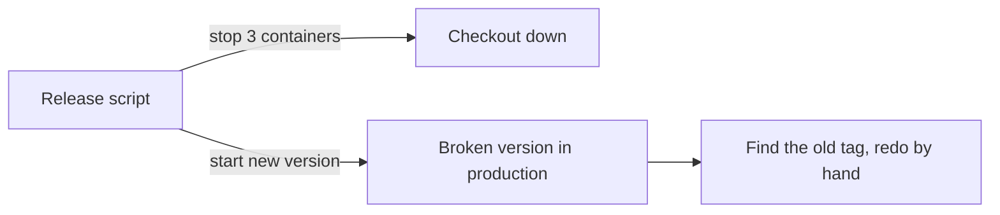
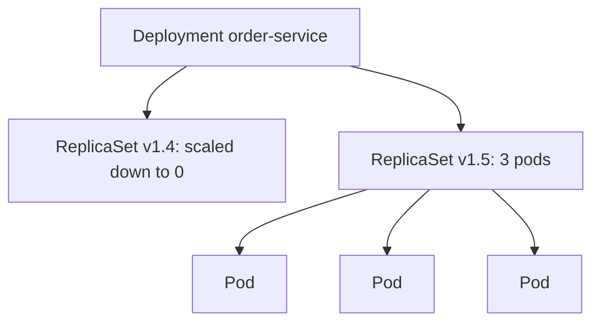
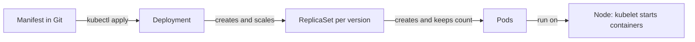

# Pods, ReplicaSets and Deployments

**Cloud and containers · Kubernetes · Step 9.3.2 · Fundamentals** · Last updated 2026-10-22
**Prerequisites:** [Kubernetes: the big picture and learning order](01-kubernetes-overview.md) (9.3.1); helpful: [Lifecycle: signals, graceful shutdown, health checks and restarts](../02-docker/07-lifecycle.md) (9.2.7)

**Version note**

| Item | Version |
|---|---|
| Baseline | Core `v1` Pod and `apps/v1` ReplicaSet and Deployment, stable for many releases |
| Hands-on baseline | Rancher Desktop with k3s, Kubernetes server v1.36.5, `kubectl` v1.37.1, container runtime Docker 29.5.3, run on 2026-10-22 |
| Compatibility note | The `STATUS` column of `kubectl get pods` is a display field, not part of the API; the text for a crash loop differs between runtimes and `kubectl` versions (see "When it goes wrong"). In `apps/v1`, a Deployment's `selector` must be set explicitly and cannot be changed after creation |

## 1. What it is and why it matters

**What is it?** Three objects, stacked:
- A **Pod** is the smallest thing Kubernetes runs: one or more containers that share a network address and storage, and start and stop together.
- A **ReplicaSet** keeps a stated number of identical pods running.
- A **Deployment** manages ReplicaSets so that you can **change** the pods (a new image, new settings) gradually, watch it succeed, and go back if it fails.

You almost always create a Deployment and let it create the rest.

**Why do we need it?** A pod on its own is not repaired: if it is deleted or its machine fails, it is gone. A ReplicaSet fixes that by keeping the count. But replacing every pod at once for a new version would cause downtime, so a Deployment replaces them a few at a time and records each version. These three give you the behaviour that the Docker series had to build by hand: restarts, several copies, rolling releases and rollbacks.

**When would I meet it?** Every deployment of a service: the manifest you write is nearly always a Deployment, and every incident starts with "what do the pods look like?".

> [!TIP]
> **Memory hook:** *Pod runs it, ReplicaSet keeps the count, Deployment manages change.*

## 2. Mental model: a shift team and its manager

Think of a service desk that must always have three people on shift.

| Real life | Kubernetes |
|---|---|
| One person at a desk | A **Pod** (one container, or a few that work side by side and share a phone line) |
| The agency that makes sure three people are on shift and sends a replacement when someone leaves | The **ReplicaSet** |
| The manager who plans the shift change to a new, retrained team, hands over one person at a time, and can recall the old team if the new one fails | The **Deployment** |
| A name badge colour saying which team someone belongs to | A **label**; the agency counts everyone wearing its colour (the **selector**) |

**Where the analogy breaks:** people are repaired and keep their identity; pods are **replaced** with new ones that have new names and addresses, and nothing of the old pod's contents is kept.

## 3. Industry terms

| Term | Simple meaning | Why it matters | Example | Related terms |
|---|---|---|---|---|
| **Pod** | Group of containers sharing network (one IP, `localhost`) and storage, scheduled together on one node | The unit that is created, scheduled and replaced | `order-service` pod | Container, node |
| **Label** | Key-value tag on an object | How objects find each other | `app=order-service` | Annotation |
| **Selector** | A query that chooses objects by label | How a ReplicaSet counts its pods | `matchLabels: {app: order-service}` | Label |
| **ReplicaSet** | Keeps N pods matching a selector running | Self-healing and scale | `order-service-7698947479` | Replicas |
| **Deployment** | Manages ReplicaSets for rollouts and rollbacks | The object you normally write | `order-service` | Rollout |
| **Pod template** | The pod blueprint inside a Deployment or ReplicaSet | Changing it creates a new version | `spec.template` | Revision |
| **`pod-template-hash`** | A label the Deployment adds to tell its ReplicaSets apart | Explains the number in pod names | `7698947479` | ReplicaSet name |
| **Owner reference** | A link from an object to the one that manages it | Deleting the owner deletes what it owns | Pod owned by a ReplicaSet | Garbage collection |
| **Rollout and revision** | One gradual replacement of pods, and the numbered version it produces | The history you can go back to | `rollout history` | Rollback |
| **`maxSurge` and `maxUnavailable`** | How many extra pods may exist, and how many may be missing, during a rollout | The safety dial of a release | `maxUnavailable: 0` | Rolling update |
| **Pod phase** | Pending, Running, Succeeded, Failed, Unknown: a simple summary of the pod's life | Quick state; not the same as `kubectl`'s STATUS text | `Pending` | Container state |
| **Declarative and imperative** | Describing the end state in a file, versus issuing one-off commands | Files in Git are reviewable and repeatable | `kubectl apply -f` | GitOps |

## 4. In a real system (ShopFlow)

**The business problem.** `order-service` version 1.5 has to reach production at 17:00 on a Friday. Today it runs as three separate containers started by a script. To release, an engineer stops each in turn, starts the new one, and checks by hand. One night the script stops all three too quickly and checkout is down for forty seconds. Another time version 1.6 starts but is broken, and the old containers are already gone; going back means finding the old image tag in someone's notes.



**How the three objects help.** The team keeps one Deployment manifest in Git. A release is a change to the image tag in that file. The Deployment starts one new pod, waits until it is ready, stops one old pod, and repeats, so three pods are always available. If the new pods never become ready, the rollout stops and the old pods keep serving. The Deployment keeps the previous ReplicaSets, so going back is one command.



**What it costs.** YAML to write and keep correct, new failure states to recognise (a pod that cannot pull its image, a crash loop, a pod that cannot be scheduled), and the discipline to treat pods as disposable. A Deployment also only checks that a container *started* unless you add health checks probes ([9.3.5](05-probes-rolling-updates-graceful-shutdown.md)), so "rolled out successfully" can still mean "not yet working".

**Elsewhere:** a data pipeline runs a Deployment of workers that all read from the same queue; a team runs a pod with a main container and a log-shipping helper side by side; a platform team lets product teams edit only the image tag and the replica count of a standard Deployment.

## 5. How it works: the chain of objects



A **Deployment** holds the desired state: how many replicas, the pod template, and the update strategy. When the pod template changes, the Deployment creates a **new ReplicaSet** for the new template and moves replicas from the old one to the new one within the limits `maxSurge` and `maxUnavailable`. Each **ReplicaSet** counts pods whose labels match its selector and creates or deletes pods to reach its number. Each **Pod** is scheduled onto a node, where the kubelet starts its containers. All the lookups between them are done with **labels and selectors**, and the cleanup with **owner references**.

> [!NOTE]
> A Deployment's rollout is triggered only by a change to its pod template (`.spec.template`), such as the image or the template's labels. Scaling does not create a new revision (Kubernetes documentation).

### Worked example 1: a pod on its own

**Concept.** A bare Pod is created directly from a manifest. Nothing owns it.

```yaml
apiVersion: v1
kind: Pod
metadata:
  name: order-pod
  labels:
    app: order-pod
    learning: notes
spec:
  containers:
    - name: order-service
      image: sf-learn/shop-api:v1
      ports:
        - containerPort: 8080
```

```text
$ kubectl --context rancher-desktop -n sf-learn apply -f bare-pod.yaml && sleep 4 && kubectl --context rancher-desktop -n sf-learn get pod order-pod -o wide && kubectl --context rancher-desktop -n sf-learn delete pod order-pod && sleep 2 && kubectl --context rancher-desktop -n sf-learn get pods
pod/order-pod created
NAME        READY   STATUS    RESTARTS   AGE   IP           NODE                   NOMINATED NODE   READINESS GATES
order-pod   1/1     Running   0          4s    10.42.0.36   lima-rancher-desktop   <none>           <none>
pod "order-pod" deleted from sf-learn namespace
No resources found in sf-learn namespace.
```

**Walkthrough.** The pod started in a few seconds and received its own IP address. When it was deleted, nothing replaced it: there is no controller watching. That is the whole reason you do not run bare pods for a service; they are for experiments and one-off debugging.

### Worked example 2: what a Deployment's pod looks like

**Concept.** The Deployment below keeps three pods of `order-service` and sets the update rules explicitly.

```yaml
apiVersion: apps/v1
kind: Deployment
metadata:
  name: order-service
  labels:
    app: order-service
    learning: notes
spec:
  replicas: 3
  selector:
    matchLabels:
      app: order-service
  strategy:
    type: RollingUpdate
    rollingUpdate:
      maxSurge: 1
      maxUnavailable: 0
  template:
    metadata:
      labels:
        app: order-service
        learning: notes
    spec:
      containers:
        - name: order-service
          image: sf-learn/shop-api:v1
          ports:
            - containerPort: 8080
```

| Field | Meaning |
|---|---|
| `replicas: 3` | Desired number of pods |
| `selector.matchLabels` | Which pods belong to this Deployment: must match the template's labels, and cannot be changed later |
| `strategy.rollingUpdate` | `maxSurge: 1` allows one extra pod during a release; `maxUnavailable: 0` allows none to be missing, so capacity never drops |
| `template` | The pod blueprint: labels, then the container list (name, image, port) |

`kubectl describe` on one of its pods shows everything the cluster knows about it:

```text
$ kubectl --context rancher-desktop -n sf-learn apply -f deployment.yaml >/dev/null && kubectl --context rancher-desktop -n sf-learn rollout status deployment/order-service >/dev/null && POD=$(kubectl --context rancher-desktop -n sf-learn get pods -o name | head -1) && kubectl --context rancher-desktop -n sf-learn describe $POD | grep -v -E '^\s+(Mounts|/var/run|kube-api-access)|Volumes:|Projected|TokenExpiration|ConfigMap|DownwardAPI|SecretName|Optional' | cut -c1-120
Name:             order-service-7698947479-7gzqk
Namespace:        sf-learn
Priority:         0
Service Account:  default
Node:             lima-rancher-desktop/192.168.5.15
Start Time:       Thu, 22 Oct 2026 22:54:22 +0530
Labels:           app=order-service
                  learning=notes
                  pod-template-hash=7698947479
Annotations:      <none>
Status:           Running
IP:               10.42.0.39
IPs:
  IP:           10.42.0.39
Controlled By:  ReplicaSet/order-service-7698947479
Containers:
  order-service:
    Container ID:   docker://3aea1e7268e5ee57a13901c115ad348031b3da7e09e7fdfe54bed8a796f23b00
    Image:          sf-learn/shop-api:v1
    Image ID:       docker-pullable://sf-learn/shop-api@sha256:98e51fe01b1acb764a6419f3d34c25ae2b8e385414b6fa5e162a24d6f
    Port:           8080/TCP
    Host Port:      0/TCP
    State:          Running
      Started:      Thu, 22 Oct 2026 22:54:23 +0530
    Ready:          True
    Restart Count:  0
    Environment:    <none>
Conditions:
  Type                        Status
  PodReadyToStartContainers   True 
  Initialized                 True 
  Ready                       True 
  ContainersReady             True 
  PodScheduled                True 
QoS Class:                   BestEffort
Node-Selectors:              <none>
Tolerations:                 node.kubernetes.io/not-ready:NoExecute op=Exists for 300s
                             node.kubernetes.io/unreachable:NoExecute op=Exists for 300s
Events:
  Type    Reason     Age   From               Message
  ----    ------     ----  ----               -------
  Normal  Scheduled  1s    default-scheduler  Successfully assigned sf-learn/order-service-7698947479-7gzqk to lima-ranc
  Normal  Pulled     1s    kubelet            spec.containers{order-service}: Container image "sf-learn/shop-api:v1" alr
  Normal  Created    1s    kubelet            spec.containers{order-service}: Container created
  Normal  Started    1s    kubelet            spec.containers{order-service}: Container started
```

**Walkthrough.** Read it top to bottom. `Controlled By` names the owner (a ReplicaSet). `Node` and `IP` say where the pod runs and its pod address. `State: Running` and `Ready: True` describe the container. `QoS Class: BestEffort` appears because no resource requests or limits were set ([9.3.6](06-resources-scheduling-autoscaling.md)). The **Tolerations** were added automatically: they say the pod tolerates a node being "not ready" or "unreachable" for 300 seconds before it is evicted. The **Events** at the bottom are the first place to look when a pod misbehaves. The label `pod-template-hash` was added by the Deployment; the same number appears in the pod's name.

### Worked example 3: several containers in one pod

**Concept.** Containers in the same pod share one network namespace, so they reach each other on `localhost`. The second container here, `checker`, calls the first on `localhost:8080`:

```yaml
apiVersion: v1
kind: Pod
metadata:
  name: order-with-checker
  labels:
    app: order-with-checker
    learning: notes
spec:
  containers:
    - name: order-service
      image: sf-learn/shop-api:v1
      ports:
        - containerPort: 8080
    - name: checker
      image: busybox:1.37
      command: ["sh", "-c", "sleep 3; while true; do echo -n \"checker sees: \"; wget -qO- http://localhost:8080/; sleep 5; done"]
```

```text
$ kubectl --context rancher-desktop -n sf-learn apply -f sidecar-pod.yaml >/dev/null && sleep 12 && kubectl --context rancher-desktop -n sf-learn get pod order-with-checker && kubectl --context rancher-desktop -n sf-learn logs order-with-checker -c checker | tail -2 && kubectl --context rancher-desktop -n sf-learn delete pod order-with-checker --wait=false >/dev/null
NAME                 READY   STATUS    RESTARTS   AGE
order-with-checker   2/2     Running   0          13s
checker sees: order-service v1 on order-with-checker
```

**Walkthrough.** `READY 2/2` counts both containers. The helper reached the service on `localhost` without any Service or DNS name: they live in one pod. Use this only for containers that must run together and scale together (a log shipper, a proxy, a certificate refresher, called **sidecars**); putting a database in the same pod as its client would tie their lives together. Your own service and its database belong in separate pods.

### Worked example 4: labels, selectors and ownership

**Concept.** Nobody tells a ReplicaSet which pods are its own: it counts the pods that match its selector. The ownership chain is recorded in `ownerReferences`:

```text
$ kubectl --context rancher-desktop -n sf-learn get pod -l app=order-service -o custom-columns=NAME:.metadata.name,OWNER-KIND:.metadata.ownerReferences[0].kind,OWNER:.metadata.ownerReferences[0].name; kubectl --context rancher-desktop -n sf-learn get replicaset -o wide | cut -c1-110; kubectl --context rancher-desktop -n sf-learn get deployment order-service -o jsonpath='{.metadata.ownerReferences}' | head -c 200; echo '(no owner: the Deployment is at the top)'
NAME                             OWNER-KIND   OWNER
order-service-7698947479-7gzqk   ReplicaSet   order-service-7698947479
order-service-7698947479-njcbv   ReplicaSet   order-service-7698947479
order-service-7698947479-v69xh   ReplicaSet   order-service-7698947479
NAME                       DESIRED   CURRENT   READY   AGE   CONTAINERS      IMAGES                 SELECTOR
order-service-7698947479   3         3         3       21s   order-service   sf-learn/shop-api:v1   app=order-
(no owner: the Deployment is at the top)
```

```text
$ kubectl --context rancher-desktop -n sf-learn get pods --show-labels; echo; echo -n 'pods selected by app=order-service: '; kubectl --context rancher-desktop -n sf-learn get pods -l app=order-service --no-headers | wc -l
NAME                             READY   STATUS    RESTARTS   AGE   LABELS
order-service-7698947479-njcbv   1/1     Running   0          72s   app=order-service,learning=notes,pod-template-hash=7698947479
order-service-7698947479-v69xh   1/1     Running   0          72s   app=order-service,learning=notes,pod-template-hash=7698947479
order-service-7698947479-z6wsk   1/1     Running   0          51s   app=order-service,learning=notes,pod-template-hash=7698947479

pods selected by app=order-service:        3
```

**Walkthrough.** The pods are owned by a ReplicaSet, which the Deployment owns. Because membership is decided by labels, you can change membership by changing a label. Take one pod out of the Deployment to examine it without it serving traffic or being killed by a rollout:

```text
$ POD=$(kubectl --context rancher-desktop -n sf-learn get pods -o name | head -1); echo "relabelling $POD out of the Deployment"; kubectl --context rancher-desktop -n sf-learn label $POD app=debug --overwrite >/dev/null; sleep 4; kubectl --context rancher-desktop -n sf-learn get pods -L app; echo; kubectl --context rancher-desktop -n sf-learn get replicaset -o wide | cut -c1-100
relabelling pod/order-service-7698947479-njcbv out of the Deployment
NAME                             READY   STATUS    RESTARTS   AGE   APP
order-service-7698947479-bzswt   1/1     Running   0          4s    order-service
order-service-7698947479-njcbv   1/1     Running   0          76s   debug
order-service-7698947479-v69xh   1/1     Running   0          76s   order-service
order-service-7698947479-z6wsk   1/1     Running   0          55s   order-service

NAME                       DESIRED   CURRENT   READY   AGE   CONTAINERS      IMAGES                 
order-service-7698947479   3         3         3       77s   order-service   sf-learn/shop-api:v1   
```

The relabelled pod kept running but no longer matched `app=order-service`, so the ReplicaSet saw only two matching pods and created a replacement at once; the Deployment still shows `3/3`. The detached pod can be inspected at leisure, and later deleted:

```text
$ kubectl --context rancher-desktop -n sf-learn logs -l app=debug --tail=3; kubectl --context rancher-desktop -n sf-learn delete pod -l app=debug --wait=true; sleep 2; kubectl --context rancher-desktop -n sf-learn get pods
order-service v1 listening on port 8080 as order-service-7698947479-njcbv
pod "order-service-7698947479-njcbv" deleted from sf-learn namespace
NAME                             READY   STATUS    RESTARTS   AGE
order-service-7698947479-bzswt   1/1     Running   0          7s
order-service-7698947479-v69xh   1/1     Running   0          79s
order-service-7698947479-z6wsk   1/1     Running   0          58s
```

This trick is a practical debugging tool, and also a warning: a wrong label on a pod, or two Deployments with overlapping selectors, silently changes what each controller manages.

### Worked example 5: a rolling update

**Concept.** Changing the image in the pod template starts a rollout. First, what would change (`kubectl diff` compares your file with the live object):

```text
$ kubectl --context rancher-desktop -n sf-learn diff -f deployment-v2.yaml | grep -E '^[-+] ' | grep -v -E 'generation|creationTimestamp'
-      - image: sf-learn/shop-api:v1
+      - image: sf-learn/shop-api:v2
```

Then apply it and watch the two ReplicaSets once a second:

```text
$ kubectl --context rancher-desktop -n sf-learn apply -f deployment-v2.yaml && kubectl --context rancher-desktop -n sf-learn annotate deployment/order-service kubernetes.io/change-cause='release v2' --overwrite >/dev/null; for i in 1 2 3 4 5; do echo -n "after $i s:  "; kubectl --context rancher-desktop -n sf-learn get rs -o custom-columns=IMAGE:.spec.template.spec.containers[0].image,DESIRED:.spec.replicas,READY:.status.readyReplicas --no-headers | sed 's#sf-learn/shop-api:##' | awk '{r=($3=="<none>")?0:$3; printf "%s: desired %s, ready %s    ", $1, $2, r}'; echo; sleep 1; done; kubectl --context rancher-desktop -n sf-learn rollout status deployment/order-service
deployment.apps/order-service configured
after 1 s:  v2: desired 1, ready 0    v1: desired 3, ready 3    
after 2 s:  v2: desired 2, ready 1    v1: desired 2, ready 2    
after 3 s:  v2: desired 3, ready 2    v1: desired 1, ready 1    
after 4 s:  v2: desired 3, ready 3    v1: desired 0, ready 0    
after 5 s:  v2: desired 3, ready 3    v1: desired 0, ready 0    
deployment "order-service" successfully rolled out
```

**Walkthrough.** The Deployment created a new ReplicaSet (v2) and moved replicas over one at a time. Check the rule `maxUnavailable: 0`: at every line the ready pods add up to at least three (`0+3`, `1+2`, `2+1`, `3+0`). With `maxSurge: 1` there were never more than four pods. The events are the controller's own log of its decisions:

```text
$ kubectl --context rancher-desktop -n sf-learn get events --sort-by=.metadata.creationTimestamp -o custom-columns=REASON:.reason,OBJECT:.involvedObject.name,MESSAGE:.message | grep -E 'ScalingReplicaSet' | cut -c1-130
ScalingReplicaSet   order-service                    Scaled up replica set order-service-7698947479 from 0 to 3
ScalingReplicaSet   order-service                    Scaled up replica set order-service-5dbf86bc8d from 0 to 1
ScalingReplicaSet   order-service                    Scaled up replica set order-service-5dbf86bc8d from 1 to 2
ScalingReplicaSet   order-service                    Scaled down replica set order-service-7698947479 from 3 to 2
ScalingReplicaSet   order-service                    Scaled down replica set order-service-7698947479 from 2 to 1
ScalingReplicaSet   order-service                    Scaled up replica set order-service-5dbf86bc8d from 2 to 3
ScalingReplicaSet   order-service                    Scaled down replica set order-service-7698947479 from 1 to 0
```

and the end state keeps the old ReplicaSet (scaled to 0) so that you can go back:

```text
$ kubectl --context rancher-desktop -n sf-learn get rs -o wide | cut -c1-105; echo; kubectl --context rancher-desktop -n sf-learn rollout history deployment/order-service; echo; kubectl --context rancher-desktop -n sf-learn get pods -o custom-columns=NAME:.metadata.name,IMAGE:.spec.containers[0].image
NAME                       DESIRED   CURRENT   READY   AGE   CONTAINERS      IMAGES                 SELEC
order-service-5dbf86bc8d   3         3         3       6s    order-service   sf-learn/shop-api:v2   app=o
order-service-7698947479   0         0         0       7s    order-service   sf-learn/shop-api:v1   app=o

deployment.apps/order-service 
REVISION  CHANGE-CAUSE
1         release v1
2         release v2


NAME                             IMAGE
order-service-5dbf86bc8d-gsplc   sf-learn/shop-api:v2
order-service-5dbf86bc8d-jrgm5   sf-learn/shop-api:v2
order-service-5dbf86bc8d-kvvdm   sf-learn/shop-api:v2
```

| What you did | What the Deployment did |
|---|---|
| Changed the image tag | Created ReplicaSet `5dbf86bc8d` for the new template |
| Waited | Added one v2 pod, waited for it to be ready, removed one v1 pod, repeated |
| Nothing | Kept the v1 ReplicaSet, scaled to 0, as revision 1 |

The `CHANGE-CAUSE` column comes from the annotation `kubernetes.io/change-cause`, which was set by hand here; without it the column shows `<none>`.

### Worked example 6: rolling back, and the trap in it

**Concept.** `kubectl rollout undo` re-activates the previous ReplicaSet:

```text
$ kubectl --context rancher-desktop -n sf-learn rollout undo deployment/order-service 2>&1 | grep -v '^Warning'; kubectl --context rancher-desktop -n sf-learn rollout status deployment/order-service | tail -1; sleep 3; kubectl --context rancher-desktop -n sf-learn get pods -o custom-columns=NAME:.metadata.name,IMAGE:.spec.containers[0].image; echo; kubectl --context rancher-desktop -n sf-learn rollout history deployment/order-service
deployment.apps/order-service rolled back
deployment "order-service" successfully rolled out
NAME                             IMAGE
order-service-7698947479-7p7vl   sf-learn/shop-api:v1
order-service-7698947479-8krf7   sf-learn/shop-api:v1
order-service-7698947479-pht54   sf-learn/shop-api:v1

deployment.apps/order-service 
REVISION  CHANGE-CAUSE
2         release v2
3         release v1
```

**Walkthrough.** The old ReplicaSet was scaled up and the new one down, using the same rules. Note that the history now reads revisions 2 and 3: the old revision 1 became revision 3, the current one. The trap is that **the manifest in Git still says v2**. Anyone who applies it again silently undoes the rollback:

```text
$ echo 'the manifest in Git still says v2; applying it again:'; kubectl --context rancher-desktop -n sf-learn apply -f deployment-v2.yaml; kubectl --context rancher-desktop -n sf-learn rollout status deployment/order-service | tail -1; kubectl --context rancher-desktop -n sf-learn get pods -o custom-columns=NAME:.metadata.name,IMAGE:.spec.containers[0].image
the manifest in Git still says v2; applying it again:
deployment.apps/order-service configured
deployment "order-service" successfully rolled out
NAME                             IMAGE
order-service-5dbf86bc8d-bglsd   sf-learn/shop-api:v2
order-service-5dbf86bc8d-dq2dw   sf-learn/shop-api:v2
order-service-5dbf86bc8d-ltqbr   sf-learn/shop-api:v2
order-service-7698947479-7p7vl   sf-learn/shop-api:v1
```

The documentation of `kubectl` warns about the related issue, and the real fix is organisational: after a rollback, change the file in Git too, so that Git says what the cluster is running. Rolling back by hand is an emergency measure; rolling forward through Git is the normal way.

### Worked example 7: declarative changes and cascading delete

**Concept.** `kubectl apply` compares your file with the live object and changes only the difference, so applying the same file twice is safe:

```text
$ kubectl --context rancher-desktop -n sf-learn apply -f deployment.yaml; kubectl --context rancher-desktop -n sf-learn apply -f deployment.yaml; kubectl --context rancher-desktop -n sf-learn rollout status deployment/order-service >/dev/null
deployment.apps/order-service created
deployment.apps/order-service unchanged
```

**Walkthrough.** The first run created the Deployment; the second said `unchanged`. This idempotence is what lets pipelines apply the same files repeatedly. Deleting the Deployment deletes everything it owns, by following the owner references:

```text
$ kubectl --context rancher-desktop -n sf-learn get deployment,replicaset,pod -o name; echo; kubectl --context rancher-desktop -n sf-learn delete deployment order-service; sleep 3; kubectl --context rancher-desktop -n sf-learn get deployment,replicaset,pod -o name 2>&1; echo '(nothing left)'
deployment.apps/order-service
replicaset.apps/order-service-7698947479
pod/order-service-7698947479-6mkq8
pod/order-service-7698947479-g6nx8
pod/order-service-7698947479-tlwkq

deployment.apps "order-service" deleted from sf-learn namespace
(nothing left)
```

The ReplicaSet and the pods disappeared with it. (A flag, `--cascade=orphan`, leaves the pods behind; it exists for migrations, not for everyday use.)

### Pod phases and container states

A pod has a **phase** (a coarse summary) and each container a **state**:

| Phase | Meaning |
|---|---|
| `Pending` | Accepted by the cluster, but not all containers are running yet: waiting to be scheduled or for images to be pulled |
| `Running` | Bound to a node, all containers created, at least one running or restarting |
| `Succeeded` | All containers ended successfully and will not restart (batch jobs) |
| `Failed` | All containers ended and at least one failed, and will not restart |
| `Unknown` | The node cannot be reached |

A container is `Waiting` (not started: pulling an image, backing off after a crash), `Running`, or `Terminated` (with an exit code and reason). The pod's `restartPolicy` (default `Always`) tells the kubelet to restart containers that exit. The `STATUS` column of `kubectl get pods` is derived from these and from events, which is why it can say things like `ImagePullBackOff` that are not phases:

```text
$ kubectl --context rancher-desktop -n sf-learn apply -f bare-pod.yaml >/dev/null; sleep 4; kubectl --context rancher-desktop -n sf-learn get pod order-pod -o jsonpath='phase={.status.phase} podIP={.status.podIP} qos={.status.qosClass}{"\n"}containerState={.status.containerStatuses[0].state}{"\n"}restartPolicy={.spec.restartPolicy}{"\n"}'; kubectl --context rancher-desktop -n sf-learn delete pod order-pod --wait=false >/dev/null
phase=Running podIP=10.42.0.51 qos=BestEffort
containerState={"running":{"startedAt":"2026-10-22T17:29:35Z"}}
restartPolicy=Always
```

### When it goes wrong: four failures you will see weekly

**1. The image cannot be pulled.** A release points at a tag that does not exist (a typo, or a pipeline that did not push):

```text
$ kubectl --context rancher-desktop -n sf-learn apply -f deployment-v9.yaml && sleep 20; kubectl --context rancher-desktop -n sf-learn rollout status deployment/order-service --timeout=5s; kubectl --context rancher-desktop -n sf-learn get pods; echo; kubectl --context rancher-desktop -n sf-learn get pods -l app=order-service --field-selector=status.phase=Pending -o name | head -1
deployment.apps/order-service configured
Waiting for deployment "order-service" rollout to finish: 1 out of 3 new replicas have been updated...
NAME                             READY   STATUS             RESTARTS   AGE
order-service-67f779c9dc-s8njp   0/1     ImagePullBackOff   0          26s
order-service-7698947479-6swht   1/1     Running            0          36s
order-service-7698947479-c9qdn   1/1     Running            0          35s
order-service-7698947479-pz9sg   1/1     Running            0          37s

pod/order-service-67f779c9dc-s8njp
error: timed out waiting for the condition
```

The new pod is stuck, but the three old pods are still running and serving, because `maxUnavailable: 0` never let them go until the new one is ready. The pod's phase is `Pending` even though `kubectl` shows `ImagePullBackOff`, which is the "display field" the documentation warns about. The pod's events give the reason:

```text
$ POD=$(kubectl --context rancher-desktop -n sf-learn get pods | grep -E 'ImagePull|ErrImage' | head -1 | cut -d' ' -f1); kubectl --context rancher-desktop -n sf-learn describe pod $POD | sed -n '/^Events:/,$p' | cut -c1-175
Events:
  Type     Reason     Age               From               Message
  ----     ------     ----              ----               -------
  Normal   Scheduled  25s               default-scheduler  Successfully assigned sf-learn/order-service-67f779c9dc-s8njp to lima-rancher-desktop
  Normal   BackOff    23s               kubelet            spec.containers{order-service}: Back-off pulling image "sf-learn/shop-api:v9"
  Warning  Failed     23s               kubelet            spec.containers{order-service}: Error: ImagePullBackOff
  Normal   Pulling    7s (x2 over 25s)  kubelet            spec.containers{order-service}: Pulling image "sf-learn/shop-api:v9"
  Warning  Failed     6s (x2 over 24s)  kubelet            spec.containers{order-service}: Failed to pull image "sf-learn/shop-api:v9": Error response from daemon: pull access
  Warning  Failed     6s (x2 over 24s)  kubelet            spec.containers{order-service}: Error: ErrImagePull
```

```text
$ kubectl --context rancher-desktop -n sf-learn get events --field-selector reason=Failed -o custom-columns=MESSAGE:.message | grep 'Failed to pull' | head -1 | cut -c1-330
Failed to pull image "sf-learn/shop-api:v9": Error response from daemon: pull access denied for sf-learn/shop-api, repository does not exist or may require 'docker login'
```

Recovery is one command, and the old pods never stopped:

```text
$ kubectl --context rancher-desktop -n sf-learn rollout undo deployment/order-service 2>&1 | grep -v Warning; kubectl --context rancher-desktop -n sf-learn rollout status deployment/order-service; kubectl --context rancher-desktop -n sf-learn get pods
deployment.apps/order-service rolled back
deployment "order-service" successfully rolled out
NAME                             READY   STATUS        RESTARTS   AGE
order-service-67f779c9dc-s8njp   0/1     Terminating   0          26s
order-service-7698947479-6swht   1/1     Running       0          36s
order-service-7698947479-c9qdn   1/1     Running       0          35s
order-service-7698947479-pz9sg   1/1     Running       0          37s
```

**2. The container starts and immediately exits.** A wrong start command makes the JVM exit with code 1 (the manifest differs from the good one only by a `command` line):

```yaml
apiVersion: apps/v1
kind: Deployment
metadata:
  name: order-crash
  labels:
    app: order-crash
    learning: notes
spec:
  replicas: 1
  selector:
    matchLabels:
      app: order-crash
  template:
    metadata:
      labels:
        app: order-crash
        learning: notes
    spec:
      containers:
        - name: order-service
          image: sf-learn/shop-api:v1
          command: ["java", "-cp", "app.jar", "NoSuchMain"]
```

```text
$ for i in 1 2 3 4 5 6 7 8; do kubectl --context rancher-desktop -n sf-learn get pods -l app=order-crash --no-headers; sleep 10; done; echo; POD=$(kubectl --context rancher-desktop -n sf-learn get pods -l app=order-crash -o name | head -1); echo "logs of the failing container:"; kubectl --context rancher-desktop -n sf-learn logs $POD 2>&1 | head -3; echo; kubectl --context rancher-desktop -n sf-learn describe $POD | grep -E '^    State:|Reason:|Exit Code|Restart Count' | cut -c1-100
order-crash-6794964ccd-w2gt8   0/1   Error   3 (42s ago)   56s
order-crash-6794964ccd-w2gt8   0/1   Error   3 (52s ago)   66s
order-crash-6794964ccd-w2gt8   0/1   Error   3 (63s ago)   77s
order-crash-6794964ccd-w2gt8   0/1   Error   4 (50s ago)   87s
order-crash-6794964ccd-w2gt8   0/1   Error   4 (60s ago)   97s
order-crash-6794964ccd-w2gt8   0/1   Error   4 (70s ago)   107s
order-crash-6794964ccd-w2gt8   0/1   Error   4 (80s ago)   117s
order-crash-6794964ccd-w2gt8   0/1   Error   4 (90s ago)   2m7s

logs of the failing container:
Error: Could not find or load main class NoSuchMain
Caused by: java.lang.ClassNotFoundException: NoSuchMain

    State:          Terminated
      Reason:       Error
      Exit Code:    1
      Reason:       Error
      Exit Code:    1
    Restart Count:  4
```

**Walkthrough.** Each time the container fails, the kubelet restarts it after a growing delay: the Kubernetes documentation gives 10 s, 20 s, 40 s and so on, capped at 300 s. The restart count went from 3 to 4 about 40 seconds apart, matching that pattern. In this setup the `STATUS` column showed `Error` between attempts; on many clusters the same situation shows `CrashLoopBackOff`, which the documentation describes as "may appear in the Status field of some kubectl commands". Whatever it is called, the diagnosis is the same: read the container's logs for the reason (`Could not find or load main class`), then the pod's events and exit code. On this runtime, `kubectl logs --previous` reported that it could not retrieve the log of the earlier container at the moment it was tried, while plain `kubectl logs` worked; on other runtimes `--previous` is the usual way to see why the last attempt died.

**3. The pod cannot be scheduled.** A pod that asks for more than any node has stays `Pending` forever:

```yaml
apiVersion: apps/v1
kind: Deployment
metadata:
  name: order-big
  labels:
    app: order-big
    learning: notes
spec:
  replicas: 1
  selector:
    matchLabels:
      app: order-big
  template:
    metadata:
      labels:
        app: order-big
        learning: notes
    spec:
      containers:
        - name: order-service
          image: sf-learn/shop-api:v1
          resources:
            requests:
              cpu: "8"
              memory: 64Gi
```

```text
$ kubectl --context rancher-desktop -n sf-learn apply -f pending.yaml >/dev/null; sleep 5; kubectl --context rancher-desktop -n sf-learn get pods -l app=order-big; kubectl --context rancher-desktop -n sf-learn describe pod -l app=order-big | sed -n '/^Events:/,$p' | cut -c1-170
NAME                         READY   STATUS    RESTARTS   AGE
order-big-6b479b596f-thx8v   0/1     Pending   0          5s
Events:
  Type     Reason            Age   From               Message
  ----     ------            ----  ----               -------
  Warning  FailedScheduling  5s    default-scheduler  0/1 nodes are available: 1 Insufficient cpu, 1 Insufficient memory. no new claims to deallocate, preemption: 0/1 nod
```

**Walkthrough.** The scheduler found no node with 8 CPUs and 64 GiB free (the node has 2 CPUs and about 6 GB). The reason is in the events: `Insufficient cpu`, `Insufficient memory`. The fix is a smaller request, a bigger node, or a different placement rule ([9.3.6](06-resources-scheduling-autoscaling.md)).

**4. A selector that does not match the template.** The API refuses the manifest before anything is created:

```yaml
apiVersion: apps/v1
kind: Deployment
metadata:
  name: order-mismatch
spec:
  replicas: 1
  selector:
    matchLabels:
      app: order-mismatch
  template:
    metadata:
      labels:
        app: orders
    spec:
      containers:
        - name: order-service
          image: sf-learn/shop-api:v1
```

```text
$ kubectl --context rancher-desktop -n sf-learn apply -f mismatch.yaml 2>&1 | cut -c1-260
The Deployment "order-mismatch" is invalid: spec.template.metadata.labels: Invalid value: {"app":"orders"}: `selector` does not match template `labels`
```

**Walkthrough.** If the Deployment's selector and its template's labels disagreed, the ReplicaSet would create pods it could never count and keep creating more. The API rejects this at once. The related rule: a Deployment's selector cannot be changed after creation (`apps/v1`), so choose labels such as `app` carefully on day one.

### Real-world (ShopFlow): "rolled out successfully" is not "working"

The Deployment considers a pod ready as soon as its container is running, unless the pod has a readiness probe. A service that takes 15 seconds to open its port is counted as ready after one:

```text
$ kubectl --context rancher-desktop -n sf-learn apply -f slow-start.yaml >/dev/null; sleep 4; kubectl --context rancher-desktop -n sf-learn get pods -l app=order-slow; POD=$(kubectl --context rancher-desktop -n sf-learn get pods -l app=order-slow -o name | head -1); echo -n 'request from inside the pod at about 5 s:  '; kubectl --context rancher-desktop -n sf-learn exec $POD -- wget -qO- -T 2 http://localhost:8080/ 2>&1 | head -1; sleep 14; echo -n 'request from inside the pod at about 20 s: '; kubectl --context rancher-desktop -n sf-learn exec $POD -- wget -qO- -T 2 http://localhost:8080/ 2>&1 | head -1
NAME                         READY   STATUS    RESTARTS   AGE
order-slow-ccdd4f55d-6d6hf   1/1     Running   0          4s
request from inside the pod at about 5 s:  wget: can't connect to remote host: Connection refused
request from inside the pod at about 20 s: order-service v1 on order-slow-ccdd4f55d-6d6hf
```

The pod showed `1/1 Ready` while nothing was listening; a request at that moment was refused. With a rolling update, the Deployment would have moved on to replace the next old pod and sent live traffic to a pod that could not answer. Closing this gap is the job of readiness probes and graceful termination, the next lessons ([9.3.5](05-probes-rolling-updates-graceful-shutdown.md)). Services ([9.3.3](03-services-dns-ingress.md)) add the question of who sends traffic to which pod.

### Common mistakes

1. Running bare pods for services.
2. Using `latest` or a reused tag for images, which makes "what is running?" unanswerable and breaks rollbacks.
3. A single replica for something that must stay up during releases.
4. Editing live objects with `kubectl edit` and never updating Git.
5. Overlapping selectors between Deployments.
6. Treating `Running` or `successfully rolled out` as proof that the service answers.

### Alternatives in the industry

A map of the landscape, not a comparison. These were not run in this series; check each project's documentation before adopting one.

| Area | Tool or product | What it is | When you meet it |
|---|---|---|---|
| Release strategy | **Deployment `RollingUpdate`** (used here) and **`Recreate`** | The two built-in strategies: gradual replacement, or stop everything and start new | The default; `Recreate` for apps that cannot run two versions at once |
| | **Argo Rollouts**, **Flagger** | Add blue/green and canary releases (send a small share of traffic to the new version, then promote or roll back automatically) | Teams that want automated, metrics-driven releases |
| Applying manifests | **`kubectl apply`** (used here) | Direct application from a laptop or a pipeline | Learning, small teams, simple pipelines |
| | **Argo CD**, **Flux** (GitOps) | A controller in the cluster that continuously makes the cluster match a Git repository | Mature platforms: Git is the only way to change production |
| Other workload kinds | **StatefulSet, DaemonSet, Job, CronJob** | Built-in controllers for stable identity and storage, one pod per node, run-to-completion, and scheduled work | Databases, node agents, batch work ([9.3.7](07-storage-statefulsets.md)) and later |
| Non-Kubernetes | **Amazon ECS services**, **Nomad jobs** | Their own equivalents of "keep N copies running and roll out a new version" | Teams outside Kubernetes ([9.3.1](01-kubernetes-overview.md)) |

## 6. Architectural decisions

| Decision | Choose | Because |
|---|---|---|
| Workload object | A **Deployment** for stateless services; StatefulSet for stable identity and storage; DaemonSet for one pod per node; Job and CronJob for batch | Match the controller to the behaviour you need |
| Bare pods | Only for debugging and experiments | Nothing recreates them |
| Replica count | At least two for anything that must survive a release or a node loss | One pod means every release or failure is an outage |
| Update strategy | `RollingUpdate` with `maxUnavailable: 0` when capacity matters (and spare capacity for `maxSurge`); `Recreate` only if two versions cannot coexist | Releases without capacity loss |
| Image tags | A specific version (or digest), never `latest` | Reproducible releases and meaningful rollbacks |
| Labels | A small, stable set (`app`, plus version, team, environment as needed); never reuse a selector across Deployments | Selectors are immutable and drive everything |
| Release source of truth | Manifests in Git, applied by a pipeline or GitOps; hand rollbacks are followed by a Git change | Cluster and Git must agree |
| Revision history | Keep the default (10) or a number that fits your rollback needs | Old ReplicaSets are what a rollback uses; 0 disables rollback |

## 7. Try it yourself

Try each exercise first; the real results are in the Answers section.

1. **Take a pod out.** Remove one pod of the three from the Deployment without deleting it, and show that the Deployment still has three pods serving. How do you get rid of the detached pod afterwards?
2. **Recover from a bad release.** A release uses a tag that does not exist. Show that the old pods keep serving, find the reason from the pod's events, and go back.
3. **Find out why it is Pending.** A pod stays `Pending`. Which command shows the reason, and what is the reason here?

## 8. Check your understanding

1. Why does a Deployment create a ReplicaSet instead of managing pods itself?
2. During a rollout with `replicas: 3`, `maxSurge: 1` and `maxUnavailable: 0`, what is the least and the most pods that exist at once?
3. After `kubectl rollout undo`, a colleague applies the manifest from Git. What happens, and how do you prevent it?
4. A pod shows `1/1 Running` but requests to it fail. Name two reasons that are specific to what you learned here.

Answers are at the end of this note.

## 9. Revision

**Remember**
- **Pod** = containers sharing one IP and storage; replaced, never repaired. **ReplicaSet** keeps N pods matching a selector. **Deployment** manages ReplicaSets for rollouts and rollbacks.
- Membership is by **labels and selectors**; cleanup by **owner references**; the Deployment `selector` is **immutable**.
- A rollout happens only when the **pod template** changes. `maxSurge` and `maxUnavailable` set how it proceeds.
- Failures: `ImagePullBackOff` (image), crash loop (container exits; read logs), `Pending` (read the scheduler's events), `Running` is not `Ready` for traffic.
- After a rollback, **change Git too**.

**Explain in 15 seconds:** "A Pod runs the containers, a ReplicaSet keeps the right number of identical pods, and a Deployment changes them gradually and keeps the history so a release can be rolled back."

**Explain in 60 seconds:**
> "I write a Deployment: a replica count, a selector, and a pod template with the image. The Deployment creates a ReplicaSet for that template; the ReplicaSet creates and counts the pods that match its selector, so if one dies it makes another. When I change the image, the Deployment creates a new ReplicaSet and shifts replicas across within maxSurge and maxUnavailable, so with zero unavailable I never lose capacity; the old ReplicaSet stays at zero for rollbacks. If the new pods can't pull their image or never become ready, the rollout stalls and the old pods keep serving, and I roll back. I keep the manifest in Git, because a hand rollback that Git doesn't know about is undone by the next apply, and I add probes, because 'running' only means the container started."

**Likely follow-up questions:**
- **Why not just run bare pods?** Nothing recreates them when they die or their node fails.
- **Is the order of pod names meaningful?** No: the name is the Deployment name, the template hash, and a random suffix; for stable names use a StatefulSet ([9.3.7](07-storage-statefulsets.md)).
- **How do I restart all pods without changing anything?** `kubectl rollout restart deployment NAME`, which changes an annotation in the template and triggers a normal rollout (not run here).
- **What does `kubectl scale` change?** Only the desired replica count; it does not create a revision.

**Architect's takeaway:** a Deployment is a release mechanism. The settings that matter are the ones that decide what a bad release costs: replicas, `maxUnavailable`, probes, and how fast you can go back.

**Next topic:** [Services, DNS and Ingress](03-services-dns-ingress.md) (9.3.3)

## 10. Verification and sources

> [!NOTE]
> Checked 2026-10-22 against the Kubernetes documentation and by running every command shown on Rancher Desktop (Kubernetes server v1.36.5+k3s1). Names, addresses, ages and timings differ on every run. Re-verify when you revisit this note.

- **Confirmed (documentation, read 2026-10-22):** Pods are "the smallest deployable units of computing", a group of one or more containers with shared storage and network resources (Kubernetes, "Pods"); a Deployment's rollout "is triggered if and only if the Deployment's Pod template (that is, `.spec.template`) is changed", while scaling does not trigger a rollout or create a revision; ReplicaSet names are `[DEPLOYMENT-NAME]-[HASH]` and the hash equals the `pod-template-hash` label; `.spec.revisionHistoryLimit` defaults to 10 and 0 prevents rollback; in `apps/v1` the selector must be set explicitly and "is immutable after creation"; "Do not manage ReplicaSets owned by a Deployment" (Kubernetes, "Deployments"); pod phases Pending, Running, Succeeded, Failed and Unknown, the note that `CrashLoopBackOff` "may appear in the Status field of some kubectl commands" and that Status is "a kubectl display field", and that the kubelet restarts containers "with an exponential backoff delay (10s, 20s, 40s, …), that is capped at 300 seconds (5 minutes)" (Kubernetes, "Pod Lifecycle"); an image pull policy that is not specified defaults to `IfNotPresent` (Kubernetes, "Images").
- **Observed (this machine):** the rollout steps and events; that `STATUS` read `Error` rather than `CrashLoopBackOff` between restarts on this runtime; that `kubectl logs --previous` could not retrieve the earlier container's log at the moment tried; the restart counts over time; the scheduler's message; the selector error; the container readiness behaviour for a 15-second start.
- **Not run:** `rollout restart`, `--cascade=orphan`, Argo Rollouts, Flagger, Argo CD, Flux and the other alternatives (general industry knowledge).
- **Assumptions and illustrations:** the Friday release story is illustrative; `START_DELAY_MS`, `/crash` and the version tags belong to the demo service written for these lessons.
- **To verify:** the exact `STATUS` text and `--previous` behaviour on your runtime; whether your platform requires a particular label scheme; the default `revisionHistoryLimit` set by your platform tooling.
- **Decision rule:** a Deployment per stateless service with at least two replicas, `maxUnavailable: 0` where capacity matters, specific image tags, probes, and Git as the source of truth.

**Sources:** Kubernetes documentation: "Pods", "Deployments", "ReplicaSet", "Pod Lifecycle", "Images", "Labels and Selectors", "Garbage Collection".

## Answers

**Experiment (exercises)**

1. **Take a pod out:** relabel the pod so that it no longer matches the selector. The ReplicaSet creates a replacement, so three pods still serve, and the detached one stays for inspection. When you are done with it, delete it (the ReplicaSet does not own it any more, so it will not return):

```text
$ POD=$(kubectl --context rancher-desktop -n sf-learn get pods -o name | head -1); echo "relabelling $POD out of the Deployment"; kubectl --context rancher-desktop -n sf-learn label $POD app=debug --overwrite >/dev/null; sleep 4; kubectl --context rancher-desktop -n sf-learn get pods -L app; echo; kubectl --context rancher-desktop -n sf-learn get replicaset -o wide | cut -c1-100
relabelling pod/order-service-7698947479-njcbv out of the Deployment
NAME                             READY   STATUS    RESTARTS   AGE   APP
order-service-7698947479-bzswt   1/1     Running   0          4s    order-service
order-service-7698947479-njcbv   1/1     Running   0          76s   debug
order-service-7698947479-v69xh   1/1     Running   0          76s   order-service
order-service-7698947479-z6wsk   1/1     Running   0          55s   order-service

NAME                       DESIRED   CURRENT   READY   AGE   CONTAINERS      IMAGES                 
order-service-7698947479   3         3         3       77s   order-service   sf-learn/shop-api:v1   
```

```text
$ kubectl --context rancher-desktop -n sf-learn logs -l app=debug --tail=3; kubectl --context rancher-desktop -n sf-learn delete pod -l app=debug --wait=true; sleep 2; kubectl --context rancher-desktop -n sf-learn get pods
order-service v1 listening on port 8080 as order-service-7698947479-njcbv
pod "order-service-7698947479-njcbv" deleted from sf-learn namespace
NAME                             READY   STATUS    RESTARTS   AGE
order-service-7698947479-bzswt   1/1     Running   0          7s
order-service-7698947479-v69xh   1/1     Running   0          79s
order-service-7698947479-z6wsk   1/1     Running   0          58s
```

2. **Recover from a bad release:** the new pod is `ImagePullBackOff`, the three old pods keep running, the events say the repository does not exist, and `kubectl rollout undo` returns to the previous revision:

```text
$ kubectl --context rancher-desktop -n sf-learn apply -f deployment-v9.yaml && sleep 20; kubectl --context rancher-desktop -n sf-learn rollout status deployment/order-service --timeout=5s; kubectl --context rancher-desktop -n sf-learn get pods; echo; kubectl --context rancher-desktop -n sf-learn get pods -l app=order-service --field-selector=status.phase=Pending -o name | head -1
deployment.apps/order-service configured
Waiting for deployment "order-service" rollout to finish: 1 out of 3 new replicas have been updated...
NAME                             READY   STATUS             RESTARTS   AGE
order-service-67f779c9dc-s8njp   0/1     ImagePullBackOff   0          26s
order-service-7698947479-6swht   1/1     Running            0          36s
order-service-7698947479-c9qdn   1/1     Running            0          35s
order-service-7698947479-pz9sg   1/1     Running            0          37s

pod/order-service-67f779c9dc-s8njp
error: timed out waiting for the condition
```

```text
$ kubectl --context rancher-desktop -n sf-learn get events --field-selector reason=Failed -o custom-columns=MESSAGE:.message | grep 'Failed to pull' | head -1 | cut -c1-330
Failed to pull image "sf-learn/shop-api:v9": Error response from daemon: pull access denied for sf-learn/shop-api, repository does not exist or may require 'docker login'
```

```text
$ kubectl --context rancher-desktop -n sf-learn rollout undo deployment/order-service 2>&1 | grep -v Warning; kubectl --context rancher-desktop -n sf-learn rollout status deployment/order-service; kubectl --context rancher-desktop -n sf-learn get pods
deployment.apps/order-service rolled back
deployment "order-service" successfully rolled out
NAME                             READY   STATUS        RESTARTS   AGE
order-service-67f779c9dc-s8njp   0/1     Terminating   0          26s
order-service-7698947479-6swht   1/1     Running       0          36s
order-service-7698947479-c9qdn   1/1     Running       0          35s
order-service-7698947479-pz9sg   1/1     Running       0          37s
```

3. **Find out why it is Pending:** `kubectl describe pod NAME`, section Events. The scheduler reported `Insufficient cpu` and `Insufficient memory`:

```text
$ kubectl --context rancher-desktop -n sf-learn apply -f pending.yaml >/dev/null; sleep 5; kubectl --context rancher-desktop -n sf-learn get pods -l app=order-big; kubectl --context rancher-desktop -n sf-learn describe pod -l app=order-big | sed -n '/^Events:/,$p' | cut -c1-170
NAME                         READY   STATUS    RESTARTS   AGE
order-big-6b479b596f-thx8v   0/1     Pending   0          5s
Events:
  Type     Reason            Age   From               Message
  ----     ------            ----  ----               -------
  Warning  FailedScheduling  5s    default-scheduler  0/1 nodes are available: 1 Insufficient cpu, 1 Insufficient memory. no new claims to deallocate, preemption: 0/1 nod
```

**Check your understanding**

1. A new version is a new pod template, and each template needs its own set of pods that can be scaled up and down independently. The ReplicaSet is the simple "keep N identical pods" machine; the Deployment orchestrates several of them over time. That separation also gives rollback for free: the old ReplicaSet is still there.
2. At least three ready pods exist at any moment (`maxUnavailable: 0`) and at most four pods (`replicas + maxSurge`). The rollout output above shows ready counts adding to three or four at each second.
3. The apply makes the cluster follow Git again, so the faulty version returns, as the "undo-gotcha" output shows. Prevent it by making the rollback in Git (revert the commit that changed the image) and applying that, or by having a pipeline or GitOps tool be the only thing that changes production.
4. (a) No readiness probe: the container is running, so the pod counts as ready even though the application is still starting (the 15-second example), so it can receive traffic too early. (b) The pod's labels do not match the Service's selector, or the application listens on a different port than the one expected ([9.3.3](03-services-dns-ingress.md)). Other correct answers include a wrong configuration value ([9.3.4](04-configuration-and-secrets.md)) or a hung application that only a liveness probe would restart.

Back to [the series overview](01-kubernetes-overview.md) · [the area overview](../01-cloud-and-containers-overview.md) · [the index](../../README.md) · [Roadmap](../../roadmap.md).
