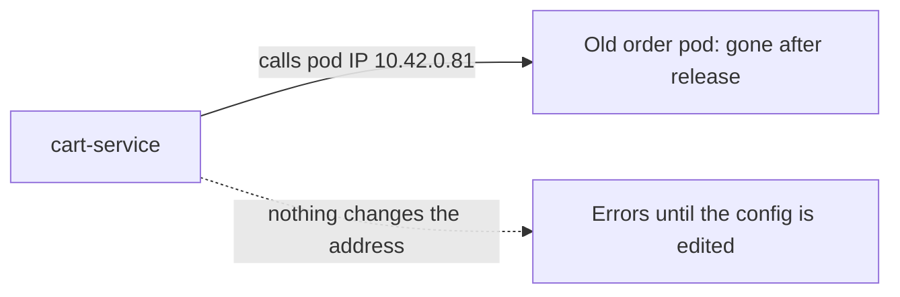
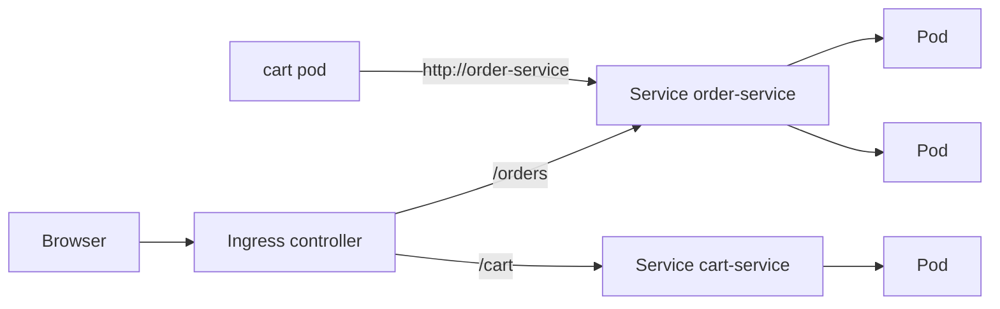
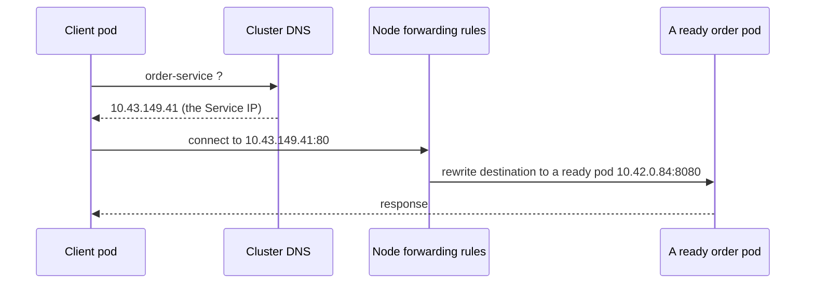

# Services, DNS and Ingress

**Cloud and containers · Kubernetes · Step 9.3.3 · Fundamentals** · Last updated 2026-10-22
**Prerequisites:** [Pods, ReplicaSets and Deployments](02-pods-replicasets-deployments.md) (9.3.2); helpful: [Networking and ports](../02-docker/05-networking-and-ports.md) (9.2.5) and [Load balancing](../../14-system-design/05-load-balancing.md) (14.5)

**Version note**

| Item | Version |
|---|---|
| Baseline | Core `v1` Service and `networking.k8s.io/v1` Ingress; EndpointSlices (the current way Services track their pods) |
| Hands-on baseline | Rancher Desktop with k3s, Kubernetes server v1.36.5, Traefik as the ingress controller, `kubectl` v1.37.1, run on 2026-10-22 |
| Compatibility note | The Kubernetes project now recommends the Gateway API instead of Ingress; the Ingress API is frozen (generally available, no further development, no plans to remove it). The older `Endpoints` object is deprecated in favour of EndpointSlices. How `NodePort` and `LoadBalancer` Services are reachable from your laptop depends on the local cluster tool |

## 1. What it is and why it matters

**What is it?** Pods come and go, and each new pod has a new IP address. A **Service** gives a group of pods one **stable name and virtual IP address**, and spreads requests across the pods that are **ready**. **Cluster DNS** turns the Service name into that address. An **Ingress** is the front door from outside the cluster: rules that send requests for a host name and URL path to the right Service.

**Why do we need it?** Without a Service, the cart service would have to know the address of every `order-service` pod, and update that list on every deploy, crash and scale-out. With a Service it just calls `http://order-service`, and the cluster keeps the list of live pods up to date. Without an Ingress, every service that outsiders must reach would need its own externally exposed port or load balancer.

**When would I meet it?** In every manifest set (each service has a Service), when one service calls another, when a request from outside reaches nowhere, and when you choose how traffic enters the cluster.

> [!TIP]
> **Memory hook:** *a Service is a stable name in front of changing pods; an Ingress is the front door that reads the host and path.*

## 2. Mental model: the switchboard and the reception desk

A company has a **department extension** ("dial 4010 for Orders"). Whoever answers is whoever is on duty; staff change every day, the extension stays. The switchboard forwards each call to someone available. Visitors from outside enter through **reception**, which reads a directory ("Orders: second floor; Cart: third floor") and sends them to the right department.

| Real life | Kubernetes |
|---|---|
| The extension number | The Service's name and cluster IP |
| People on duty and available | Pods that match the selector **and** are ready |
| The switchboard forwarding the call | Rules on every node that rewrite the destination to a chosen pod |
| The internal phone directory | Cluster DNS (`order-service` → the Service's IP) |
| Reception and the directory sign | The Ingress controller and the Ingress rules |

**Where the analogy breaks:** a switchboard operator sees who is busy; the Service picks among ready pods without knowing how busy each one is, so a slow pod still gets its share of requests.

## 3. Industry terms

| Term | Simple meaning | Why it matters | Example | Related terms |
|---|---|---|---|---|
| **Service** | A stable virtual IP and name that forwards to a set of pods chosen by a selector | The unit of service discovery and load balancing | `order-service` | Selector |
| **ClusterIP** | The default Service type: an address reachable only inside the cluster | Internal calls between services | `10.43.149.41` | Virtual IP |
| **`port` and `targetPort`** | The port the Service listens on, and the port on the pods it forwards to | A mismatch gives "connection refused" | `80` → `8080` | Container port |
| **EndpointSlice** | The list of pod addresses (and whether each is ready) behind a Service | What the Service actually forwards to | Three pod IPs | Endpoints (older) |
| **NodePort** | Also opens one port on every node and forwards it to the Service | A basic way in from outside | `30380` | LoadBalancer |
| **LoadBalancer** | Asks the environment (a cloud, or k3s here) for an external address for the Service | The standard way in on a cloud | A cloud load balancer | Cloud controller |
| **Headless Service** | A Service with `clusterIP: None`: no virtual IP, DNS returns the pod addresses | Clients that need to reach each pod (databases, StatefulSets) | `order-headless` | StatefulSet |
| **Cluster DNS** | DNS inside the cluster (CoreDNS) that gives every Service a name | Use names, not IP addresses | `order-service.sf-learn.svc.cluster.local` | Search domain |
| **`kube-proxy`** (or equivalent) | The node component that programs the forwarding rules for Services | Makes the virtual IP real | NAT rules | iptables |
| **Ingress** | Rules routing outside HTTP(S) requests by host and path to Services | One front door for many services | `shop.localhost/orders` | Ingress controller |
| **Ingress controller** | The program (such as Traefik or NGINX) that reads Ingress objects and does the routing | An Ingress does nothing without one | Traefik | IngressClass |
| **Gateway API** | The newer, more expressive successor to Ingress | The direction of the project | `Gateway`, `HTTPRoute` | Ingress |

## 4. In a real system (ShopFlow)

**The business problem.** `cart-service` calls `order-service` to place an order. Its configuration holds the IP addresses of three `order-service` pods. After a release those pods are replaced, the old addresses lead nowhere, and checkout fails until someone updates the configuration and restarts the cart. Meanwhile the web shop needs one public address, `shop.example.com`, with `/orders` going to one service and `/cart` to another.



**How the three pieces help.** `order-service` gets a Service named `order-service`. The cart calls `http://order-service`; DNS gives the Service's address; the node's rules forward each request to one of the ready pods. During a release, new pods join the list when they become ready, and old ones leave. An Ingress for `shop.example.com` sends `/orders` and `/cart` to the right Services.



**What it costs.** Another layer to understand and debug (DNS, selectors, ports, rules); the cluster spreads requests without knowing how loaded a pod is; and an ingress controller to choose, run and keep updated.

**Elsewhere:** a company routes a hundred hostnames through one cloud load balancer and ingress controller; a database client connects to individual replicas using a headless Service; a batch job calls an internal API by Service name from a different namespace.

## 5. How it works: from a name to a pod



The **Service** object stores a selector and ports. A controller turns the selector into an **EndpointSlice**: the addresses of matching pods, each marked ready or not. On every node the forwarding rules are programmed from those slices. The Service IP is never assigned to any interface; it exists only as rules. All examples below ran in `sf-learn`, with two Deployments and a small client pod:

```yaml
apiVersion: apps/v1
kind: Deployment
metadata:
  name: order-service
  labels:
    app: order-service
    learning: notes
spec:
  replicas: 3
  selector:
    matchLabels:
      app: order-service
  template:
    metadata:
      labels:
        app: order-service
        learning: notes
    spec:
      containers:
        - name: order-service
          image: sf-learn/shop-api:v1
          ports:
            - containerPort: 8080
          readinessProbe:
            httpGet:
              path: /ready
              port: 8080
            periodSeconds: 2
---
apiVersion: v1
kind: Service
metadata:
  name: order-service
  labels:
    learning: notes
spec:
  selector:
    app: order-service
  ports:
    - port: 80
      targetPort: 8080
```

The `cart-service` Deployment and Service are the same, with `cart-service` names, two replicas and the v2 image. The `client` pod is `busybox` with `sleep`, used only to make requests from inside the cluster.

### Worked example 1: a Service in front of three pods

```text
$ kubectl --context rancher-desktop -n sf-learn get service,deployment,pods -o wide | cut -c1-130; echo; kubectl --context rancher-desktop -n sf-learn describe service order-service | grep -E 'Name:|Selector|Type:|IP:|Port:|TargetPort|Endpoints|Session'
NAME                    TYPE        CLUSTER-IP      EXTERNAL-IP   PORT(S)   AGE   SELECTOR
service/cart-service    ClusterIP   10.43.188.227   <none>        80/TCP    5s    app=cart-service
service/order-service   ClusterIP   10.43.149.41    <none>        80/TCP    5s    app=order-service

NAME                            READY   UP-TO-DATE   AVAILABLE   AGE   CONTAINERS      IMAGES                 SELECTOR
deployment.apps/cart-service    2/2     2            2           5s    cart-service    sf-learn/shop-api:v2   app=cart-service
deployment.apps/order-service   3/3     3            3           5s    order-service   sf-learn/shop-api:v1   app=order-service

NAME                                 READY   STATUS    RESTARTS   AGE   IP           NODE                   NOMINATED NODE   READI
pod/cart-service-8549b6d454-b8kgg    1/1     Running   0          5s    10.42.0.83   lima-rancher-desktop   <none>           <none
pod/cart-service-8549b6d454-xdtjf    1/1     Running   0          5s    10.42.0.85   lima-rancher-desktop   <none>           <none
pod/client                           1/1     Running   0          5s    10.42.0.86   lima-rancher-desktop   <none>           <none
pod/order-service-55b565ff47-fwmt9   1/1     Running   0          5s    10.42.0.82   lima-rancher-desktop   <none>           <none
pod/order-service-55b565ff47-m8x92   1/1     Running   0          5s    10.42.0.84   lima-rancher-desktop   <none>           <none
pod/order-service-55b565ff47-qxpqq   1/1     Running   0          5s    10.42.0.81   lima-rancher-desktop   <none>           <none

Name:                     order-service
Selector:                 app=order-service
Type:                     ClusterIP
IP:                       10.43.149.41
Port:                     <unset>  80/TCP
TargetPort:               8080/TCP
Endpoints:                10.42.0.81:8080,10.42.0.82:8080,10.42.0.84:8080
Session Affinity:         None
```

```text
$ kubectl --context rancher-desktop -n sf-learn get endpointslices -l kubernetes.io/service-name=order-service -o custom-columns=NAME:.metadata.name,ADDRESSES:.endpoints[*].addresses[0],READY:.endpoints[*].conditions.ready; echo; kubectl --context rancher-desktop -n sf-learn get pods -l app=order-service -o custom-columns=POD:.metadata.name,IP:.status.podIP
NAME                  ADDRESSES                          READY
order-service-fmrr6   10.42.0.81,10.42.0.82,10.42.0.84   true,true,true

POD                              IP
order-service-55b565ff47-fwmt9   10.42.0.82
order-service-55b565ff47-m8x92   10.42.0.84
order-service-55b565ff47-qxpqq   10.42.0.81
```

**Walkthrough.** The Service `order-service` got the virtual address `10.43.149.41`; it forwards port 80 to port 8080 of pods labelled `app=order-service`. The EndpointSlice lists exactly the three pod addresses, each `ready`. A release or a scale-out changes that list within moments; the Service address does not change.

### Worked example 2: how requests are spread

```text
$ kubectl --context rancher-desktop -n sf-learn exec client -- sh -c 'for i in $(seq 1 30); do wget -qO- http://order-service/; done | sort | uniq -c'
      8 order-service v1 on order-service-55b565ff47-fwmt9
     12 order-service v1 on order-service-55b565ff47-m8x92
     10 order-service v1 on order-service-55b565ff47-qxpqq
```

**Walkthrough.** Thirty requests from the client pod to `http://order-service` landed on all three pods: 8, 12 and 10. The spread is roughly even but random, not strict round-robin, and each connection is balanced separately, so one client that holds a single long-lived connection (HTTP keep-alive, gRPC) stays on one pod. The mechanism is visible in the node's rules. These come from the virtual machine's NAT table (read-only listing):

```text
$ rdctl shell sudo iptables-save -t nat 2>&1 | grep -E 'sf-learn/order-service' | cut -c1-150 | head -8
-A KUBE-SEP-34YHIDKV2MNXT6XJ -s 10.42.0.81/32 -m comment --comment "sf-learn/order-service" -j KUBE-MARK-MASQ
-A KUBE-SEP-34YHIDKV2MNXT6XJ -p tcp -m comment --comment "sf-learn/order-service" -m tcp -j DNAT --to-destination 10.42.0.81:8080
-A KUBE-SEP-R2YZ45YZA7GQHEJO -s 10.42.0.84/32 -m comment --comment "sf-learn/order-service" -j KUBE-MARK-MASQ
-A KUBE-SEP-R2YZ45YZA7GQHEJO -p tcp -m comment --comment "sf-learn/order-service" -m tcp -j DNAT --to-destination 10.42.0.84:8080
-A KUBE-SEP-YGTGOE32DGIBVWY7 -s 10.42.0.82/32 -m comment --comment "sf-learn/order-service" -j KUBE-MARK-MASQ
-A KUBE-SEP-YGTGOE32DGIBVWY7 -p tcp -m comment --comment "sf-learn/order-service" -m tcp -j DNAT --to-destination 10.42.0.82:8080
-A KUBE-SERVICES -d 10.43.149.41/32 -p tcp -m comment --comment "sf-learn/order-service cluster IP" -m tcp --dport 80 -j KUBE-SVC-NKUSAUYAVXL6QRNT
-A KUBE-SVC-NKUSAUYAVXL6QRNT ! -s 10.42.0.0/16 -d 10.43.149.41/32 -p tcp -m comment --comment "sf-learn/order-service cluster IP" -m tcp --dport 80 -j
```

A rule matches traffic to the Service IP `10.43.149.41` on port 80 and jumps to a chain that rewrites the destination (`DNAT`) to one of three pod addresses. No network interface holds that address:

```text
$ echo -n 'network interfaces on the node that hold 10.43.149.41: '; rdctl shell ip -o addr 2>/dev/null | grep -c '10.43.149.41' || true
network interfaces on the node that hold 10.43.149.41: 0
```

The Service IP exists only as these rules. (`kube-proxy` programs such rules; other setups use IPVS or eBPF instead.) For comparison, `kubectl port-forward` to a Service, a tool for exploration only, picks one pod and keeps it:

```text
$ kubectl --context rancher-desktop -n sf-learn port-forward service/order-service 18301:80 >/dev/null 2>&1 & PF=$!; sleep 3; curl -s localhost:18301/; curl -s localhost:18301/; kill $PF
order-service v1 on order-service-55b565ff47-qxpqq
order-service v1 on order-service-55b565ff47-qxpqq
```

### Worked example 3: names

```text
$ kubectl --context rancher-desktop -n sf-learn exec client -- sh -c 'nslookup order-service.sf-learn.svc.cluster.local | tail -2; echo; cat /etc/resolv.conf; echo; echo -n "short name works: "; wget -qO- -T 2 http://order-service/ | head -1'
Address: 10.43.149.41


nameserver 10.43.0.10
search sf-learn.svc.cluster.local svc.cluster.local cluster.local
options ndots:5

short name works: order-service v1 on order-service-55b565ff47-qxpqq
```

**Walkthrough.** Every Service gets a DNS name `SERVICE.NAMESPACE.svc.cluster.local`. The pod's `resolv.conf` points at the cluster DNS (CoreDNS at `10.43.0.10`) and lists search domains, so inside the namespace the short name `order-service` works. From another namespace use `order-service.sf-learn`. The line `options ndots:5` means that any name with fewer than five dots is first tried with each search domain added, which is why a lookup of an external name such as `api.example.com` produces several failed lookups first (the same effect is visible in the `NXDOMAIN` lines a simple `nslookup` prints for a short name). Services also appear as environment variables in pods that start after them:

```text
$ kubectl --context rancher-desktop -n sf-learn exec client -- sh -c 'env | grep -E "^(ORDER_SERVICE|CART_SERVICE)" | sort'
CART_SERVICE_PORT=tcp://10.43.188.227:80
CART_SERVICE_PORT_80_TCP=tcp://10.43.188.227:80
CART_SERVICE_PORT_80_TCP_ADDR=10.43.188.227
CART_SERVICE_PORT_80_TCP_PORT=80
CART_SERVICE_PORT_80_TCP_PROTO=tcp
CART_SERVICE_SERVICE_HOST=10.43.188.227
CART_SERVICE_SERVICE_PORT=80
ORDER_SERVICE_PORT=tcp://10.43.149.41:80
ORDER_SERVICE_PORT_80_TCP=tcp://10.43.149.41:80
ORDER_SERVICE_PORT_80_TCP_ADDR=10.43.149.41
ORDER_SERVICE_PORT_80_TCP_PORT=80
ORDER_SERVICE_PORT_80_TCP_PROTO=tcp
ORDER_SERVICE_SERVICE_HOST=10.43.149.41
ORDER_SERVICE_SERVICE_PORT=80
```

Prefer DNS: environment variables are fixed when the pod starts, DNS is looked up at call time.

### Worked example 4: only ready pods get traffic

The Deployment above has a readiness check (it calls `/ready` every two seconds; the full story is in [9.3.5](05-probes-rolling-updates-graceful-shutdown.md)). One pod was made to fail it:

```text
$ POD=$(kubectl --context rancher-desktop -n sf-learn get pods -l app=order-service -o name | head -1); echo "making $POD fail its readiness check"; kubectl --context rancher-desktop -n sf-learn exec $POD -- wget -qO- -T 2 http://localhost:8080/admin/unready; sleep 9; kubectl --context rancher-desktop -n sf-learn get pods -l app=order-service; echo; kubectl --context rancher-desktop -n sf-learn get endpointslices -l kubernetes.io/service-name=order-service -o custom-columns=ADDRESSES:.endpoints[*].addresses[0],READY:.endpoints[*].conditions.ready; echo; kubectl --context rancher-desktop -n sf-learn exec client -- sh -c 'for i in $(seq 1 30); do wget -qO- http://order-service/; done | sort | uniq -c'
making pod/order-service-55b565ff47-fwmt9 fail its readiness check
now not ready
NAME                             READY   STATUS    RESTARTS   AGE
order-service-55b565ff47-fwmt9   0/1     Running   0          56s
order-service-55b565ff47-m8x92   1/1     Running   0          56s
order-service-55b565ff47-qxpqq   1/1     Running   0          56s

ADDRESSES                          READY
10.42.0.81,10.42.0.82,10.42.0.84   true,false,true

     17 order-service v1 on order-service-55b565ff47-m8x92
     13 order-service v1 on order-service-55b565ff47-qxpqq
```

```text
$ kubectl --context rancher-desktop -n sf-learn get events --field-selector reason=Unhealthy -o custom-columns=REASON:.reason,MESSAGE:.message | head -3 | cut -c1-140
REASON      MESSAGE
Unhealthy   Readiness probe failed: HTTP probe failed with statuscode: 503
```

**Walkthrough.** The pod kept running (restarts stayed 0), but showed `0/1`, the EndpointSlice marked its address `ready=false`, and all 30 requests went to the other two pods. When the check passed again, the pod rejoined:

```text
$ POD=$(kubectl --context rancher-desktop -n sf-learn get pods -l app=order-service -o name | head -1); kubectl --context rancher-desktop -n sf-learn exec $POD -- wget -qO- -T 2 http://localhost:8080/admin/ready >/dev/null; sleep 6; kubectl --context rancher-desktop -n sf-learn get pods -l app=order-service
NAME                             READY   STATUS    RESTARTS   AGE
order-service-55b565ff47-fwmt9   1/1     Running   0          63s
order-service-55b565ff47-m8x92   1/1     Running   0          63s
order-service-55b565ff47-qxpqq   1/1     Running   0          63s
```

This is how a rolling update avoids sending traffic to a pod that is not yet working, and how an overloaded or broken pod is taken out of rotation without being killed.

### Worked example 5: a headless Service

```yaml
apiVersion: v1
kind: Service
metadata:
  name: order-headless
  labels:
    learning: notes
spec:
  clusterIP: None
  selector:
    app: order-service
  ports:
    - port: 8080
```

```text
$ kubectl --context rancher-desktop -n sf-learn get service order-headless; kubectl --context rancher-desktop -n sf-learn exec client -- sh -c 'nslookup order-headless.sf-learn.svc.cluster.local 2>/dev/null | grep "^Address" | grep -v ":53"'; echo; kubectl --context rancher-desktop -n sf-learn get pods -l app=order-service -o custom-columns=POD:.metadata.name,IP:.status.podIP
NAME             TYPE        CLUSTER-IP   EXTERNAL-IP   PORT(S)    AGE
order-headless   ClusterIP   None         <none>        8080/TCP   13s
Address: 10.42.0.81
Address: 10.42.0.82
Address: 10.42.0.84

POD                              IP
order-service-55b565ff47-fwmt9   10.42.0.82
order-service-55b565ff47-m8x92   10.42.0.84
order-service-55b565ff47-qxpqq   10.42.0.81
```

**Walkthrough.** With `clusterIP: None` there is no virtual IP. A DNS lookup of the Service name returns **all three pod addresses**, and the client chooses. This is used when a client must reach specific pods, such as database replicas behind a StatefulSet ([9.3.7](07-storage-statefulsets.md)), or when it does its own load balancing.

### Worked example 6: getting in from outside

A ClusterIP Service is reachable only inside the cluster. For outside access there are three common routes. On this setup:

```yaml
apiVersion: v1
kind: Service
metadata:
  name: order-nodeport
  labels:
    learning: notes
spec:
  type: NodePort
  selector:
    app: order-service
  ports:
    - port: 80
      targetPort: 8080
      nodePort: 30380
```

```text
$ kubectl --context rancher-desktop -n sf-learn apply -f nodeport.yaml >/dev/null; kubectl --context rancher-desktop -n sf-learn get service order-nodeport; echo -n 'from the Mac, localhost:30380 -> '; curl -s -m 3 localhost:30380/ || echo '(no answer)'; echo -n 'from the Mac, node address 192.168.5.15:30380 -> '; curl -s -m 3 192.168.5.15:30380/ || echo '(no answer)'; echo -n 'from a pod, node address 192.168.5.15:30380 -> '; kubectl --context rancher-desktop -n sf-learn exec client -- wget -qO- -T 3 http://192.168.5.15:30380/
NAME             TYPE       CLUSTER-IP     EXTERNAL-IP   PORT(S)        AGE
order-nodeport   NodePort   10.43.198.36   <none>        80:30380/TCP   0s
from the Mac, localhost:30380 -> (no answer)
from the Mac, node address 192.168.5.15:30380 -> (no answer)
from a pod, node address 192.168.5.15:30380 -> order-service v1 on order-service-55b565ff47-qxpqq
```

```yaml
apiVersion: v1
kind: Service
metadata:
  name: order-lb
  labels:
    learning: notes
spec:
  type: LoadBalancer
  selector:
    app: order-service
  ports:
    - port: 18380
      targetPort: 8080
```

```text
$ kubectl --context rancher-desktop -n sf-learn apply -f loadbalancer.yaml >/dev/null; sleep 8; kubectl --context rancher-desktop -n sf-learn get service order-lb; echo -n 'from the Mac, localhost:18380 -> '; curl -s -m 3 localhost:18380/ || echo '(no answer)'; kubectl --context rancher-desktop -n sf-learn get pods -n kube-system -l svccontroller.k3s.cattle.io/svcname=order-lb --no-headers | cut -c1-80
NAME       TYPE           CLUSTER-IP     EXTERNAL-IP    PORT(S)           AGE
order-lb   LoadBalancer   10.43.45.177   192.168.64.2   18380:32762/TCP   8s
from the Mac, localhost:18380 -> order-service v1 on order-service-55b565ff47-m8x92
svclb-order-lb-a43176db-vnl8p   1/1   Running   0     8s
```

**Walkthrough.** A **NodePort** opens a port (30000-32767 by default) on every node. On this laptop cluster the node is a virtual machine and the port was reachable from a pod through the node's address but **not from the Mac**; that is a property of Rancher Desktop's networking, not of NodePort in general. A **LoadBalancer** Service asked for an external address: k3s's built-in service load balancer assigned the VM's address and Rancher Desktop made the port available on `localhost`, so `localhost:18380` answered. In a cloud, the same manifest creates a cloud load balancer with its own address and cost. One load balancer per service gets expensive, which is why HTTP traffic usually enters through a single Ingress.

### Worked example 7: an Ingress

An Ingress sends requests by host and path. The cluster has an ingress controller, Traefik, registered as the default `IngressClass`:

```text
$ kubectl --context rancher-desktop get ingressclass; kubectl --context rancher-desktop -n kube-system get svc traefik
NAME                CONTROLLER                      PARAMETERS   AGE
traefik (default)   traefik.io/ingress-controller   <none>       13d
NAME      TYPE           CLUSTER-IP     EXTERNAL-IP    PORT(S)                      AGE
traefik   LoadBalancer   10.43.12.163   192.168.64.2   80:31488/TCP,443:31136/TCP   13d
```

```yaml
apiVersion: networking.k8s.io/v1
kind: Ingress
metadata:
  name: shop
  labels:
    learning: notes
spec:
  rules:
    - host: shop.localhost
      http:
        paths:
          - path: /orders
            pathType: Prefix
            backend:
              service:
                name: order-service
                port:
                  number: 80
          - path: /cart
            pathType: Prefix
            backend:
              service:
                name: cart-service
                port:
                  number: 80
```

```text
$ kubectl --context rancher-desktop -n sf-learn apply -f ingress.yaml; sleep 4; kubectl --context rancher-desktop -n sf-learn get ingress; echo; echo '--- requests to the Mac, port 80:'; for p in /orders /cart /orders/42 /other; do echo -n "GET http://shop.localhost$p -> "; curl -s -m 3 -w ' [HTTP %{http_code}]\n' http://shop.localhost$p; done; echo -n 'GET http://localhost/orders with no host name -> '; curl -s -m 3 -w ' [HTTP %{http_code}]\n' http://localhost/orders
ingress.networking.k8s.io/shop created
NAME   CLASS     HOSTS            ADDRESS        PORTS   AGE
shop   traefik   shop.localhost   192.168.64.2   80      5s

--- requests to the Mac, port 80:
GET http://shop.localhost/orders -> order-service v1 on order-service-55b565ff47-m8x92
 [HTTP 200]
GET http://shop.localhost/cart -> order-service v2 on cart-service-8549b6d454-b8kgg
 [HTTP 200]
GET http://shop.localhost/orders/42 -> order-service v1 on order-service-55b565ff47-qxpqq
 [HTTP 200]
GET http://shop.localhost/other -> 404 page not found
 [HTTP 404]
GET http://localhost/orders with no host name -> 404 page not found
 [HTTP 404]
```

```text
$ kubectl --context rancher-desktop -n sf-learn describe ingress shop | sed -n '/^Rules:/,/^Events:/p'
Rules:
  Host            Path  Backends
  ----            ----  --------
  shop.localhost  
                  /orders   order-service:80 (10.42.0.81:8080,10.42.0.82:8080,10.42.0.84:8080)
                  /cart     cart-service:80 (10.42.0.83:8080,10.42.0.85:8080)
Annotations:      <none>
Events:           <none>
```

**Walkthrough.** Requests to `shop.localhost` on port 80 reach Traefik (the Mac forwards `localhost:80` to the cluster). `/orders` and anything below it went to `order-service`; `/cart` went to `cart-service` (the `v2` pods); an unknown path or a request without the host name got Traefik's `404`, because no rule matched. The Ingress object only describes the rules; the controller carries them out, and without a controller nothing happens. Note that the path is passed to the application unchanged: the demo service answers every path. In a real service, either it serves under `/orders` or the controller must rewrite the path (a controller-specific feature).

The Kubernetes documentation states: "The Kubernetes project recommends using Gateway instead of Ingress. The Ingress API has been frozen." Ingress is still everywhere in existing clusters and well supported, and is what this series teaches; Gateway API uses separate objects for the infrastructure (`Gateway`) and the routes (`HTTPRoute`) and supports more than HTTP host and path matching.

### When it goes wrong

**1. A Service that points at nothing.** A typo in the selector (`order-servic`):

```yaml
apiVersion: v1
kind: Service
metadata:
  name: order-typo
  labels:
    learning: notes
spec:
  selector:
    app: order-servic
  ports:
    - port: 80
      targetPort: 8080
```

```text
$ kubectl --context rancher-desktop -n sf-learn apply -f wrong-selector.yaml >/dev/null; kubectl --context rancher-desktop -n sf-learn get service order-typo; kubectl --context rancher-desktop -n sf-learn get endpointslices -l kubernetes.io/service-name=order-typo -o custom-columns=NAME:.metadata.name,ENDPOINTS:.endpoints; kubectl --context rancher-desktop -n sf-learn exec client -- sh -c 'wget -qO- -T 3 http://order-typo/ 2>&1 | head -2'
NAME         TYPE        CLUSTER-IP    EXTERNAL-IP   PORT(S)   AGE
order-typo   ClusterIP   10.43.6.139   <none>        80/TCP    0s
NAME               ENDPOINTS
order-typo-tq6rz   <nil>
wget: can't connect to remote host (10.43.6.139): Connection refused
```

The Service exists and has an address, but its EndpointSlice is empty, so connections are refused. The first check for any "service unreachable" report is the endpoints list: `kubectl get endpointslices -l kubernetes.io/service-name=NAME`.

**2. The right pods on the wrong port.** The selector is correct but `targetPort` is `9090` while the application listens on `8080`:

```text
$ kubectl --context rancher-desktop -n sf-learn apply -f wrong-port.yaml >/dev/null; kubectl --context rancher-desktop -n sf-learn get endpointslices -l kubernetes.io/service-name=order-port -o custom-columns=ADDRESSES:.endpoints[*].addresses[0],PORT:.ports[0].port; kubectl --context rancher-desktop -n sf-learn exec client -- sh -c 'wget -qO- -T 3 http://order-port/ 2>&1 | head -2'
ADDRESSES                          PORT
10.42.0.82,10.42.0.84,10.42.0.81   9090
wget: can't connect to remote host (10.43.151.231): Connection refused
```

The endpoints are listed (with port 9090), the pods are ready, and still the connection is refused: the Service forwards to a port nobody listens on. The pods' readiness check does not catch it because it calls the pod directly on 8080.

**3. A client that remembered an address.** A Service's virtual IP changes if the Service is recreated:

```text
$ kubectl --context rancher-desktop -n sf-learn get service order-typo -o jsonpath='before: {.spec.clusterIP}{"\n"}'; kubectl --context rancher-desktop -n sf-learn delete service order-typo >/dev/null; kubectl --context rancher-desktop -n sf-learn apply -f wrong-selector.yaml >/dev/null; kubectl --context rancher-desktop -n sf-learn get service order-typo -o jsonpath='after delete and create: {.spec.clusterIP}{"\n"}'; echo 'the DNS name still resolves to whatever the current address is:'; kubectl --context rancher-desktop -n sf-learn exec client -- sh -c 'nslookup order-typo.sf-learn.svc.cluster.local 2>/dev/null | grep "^Address" | grep -v ":53"'
before: 10.43.6.139
after delete and create: 10.43.181.204
the DNS name still resolves to whatever the current address is:
Address: 10.43.181.204
```

Anything that stored `10.43.6.139` is now wrong; anything that used the name still works. Never copy a ClusterIP or a pod IP into configuration.

### Common mistakes

1. Hard-coding pod or Service IP addresses.
2. A selector that does not match the pod labels, or a `targetPort` that does not match the application's port.
3. Assuming a Service balances by load, or that a long-lived connection is spread across pods.
4. Creating an Ingress with no controller, or with the wrong `ingressClassName`.
5. Exposing every service with its own LoadBalancer.
6. Using environment variables for discovery, or short names across namespaces.

### Alternatives in the industry

A map of the landscape, not a comparison. Only Traefik was run in this series; check each project's documentation before adopting one.

| Area | Tool or product | What it is | When you meet it |
|---|---|---|---|
| Ingress controller | **Traefik** (used here, bundled with k3s) | A cloud-native proxy that reads Ingress objects and its own resources | k3s and Rancher Desktop, many small clusters |
| | **NGINX-based controllers** (the community *ingress-nginx*, F5's *NGINX Ingress Controller*) | Ingress controllers built on the NGINX proxy. The Kubernetes project announced that the community **ingress-nginx** project would be retired in March 2026, with no further releases or security fixes after that | A very large number of existing clusters, many of which are migrating |
| | **HAProxy Ingress**, **Contour**, **Emissary**, **Kong**, **Envoy Gateway** | Controllers built on HAProxy or Envoy; Kong adds API-gateway features | Teams that need specific features or an Envoy-based stack |
| | **Cloud controllers**: AWS Load Balancer Controller, GKE Ingress, Azure Application Gateway | Create the cloud provider's own load balancer from Ingress objects | Clusters on that cloud who want a managed edge |
| Successor API | **Gateway API** | The newer routing API implemented by many of the above and by service meshes | New designs and migrations from Ingress |
| Service mesh | **Istio**, **Linkerd**, **Cilium** | Add mutual TLS, retries, timeouts and traffic splitting between services, using sidecars or kernel-level networking | Larger platforms with many services and security requirements |
| API gateways | **Kong**, **Apigee**, **AWS API Gateway** | Add authentication, quotas and developer portals in front of APIs | Public or partner APIs, alongside or instead of an ingress controller |
| Discovery outside Kubernetes | **Consul**, **Netflix Eureka** (Spring Cloud) | Registries that services register with and look up, plus client-side load balancing | Older Spring Cloud systems and mixed environments; in Kubernetes, Services and DNS usually replace them |

## 6. Architectural decisions

| Decision | Choose | Because |
|---|---|---|
| Service-to-service calls | The Service name (`http://order-service`), same namespace short, otherwise `NAME.NAMESPACE` | Stable under releases, scaling and recreation |
| Service type for internal use | `ClusterIP` | No exposure outside the cluster |
| Reaching HTTP(S) from outside | One Ingress (or Gateway) with host and path rules, TLS terminated there | One entry point to secure, observe and pay for |
| `LoadBalancer` per service | Only for non-HTTP traffic that needs its own address | Each one is a separate cloud resource and cost |
| `NodePort` | Rarely: demos, or as the plumbing under a load balancer | Fixed high ports on every node |
| Headless Services | For clients that must see each pod (StatefulSets, client-side balancing) | DNS returns the pod addresses |
| Readiness | Always define it for pods behind a Service | Otherwise traffic reaches pods that cannot answer ([9.3.2](02-pods-replicasets-deployments.md)) |
| Which ingress API and controller | Pick a maintained controller; prefer Gateway API for new designs; avoid depending on the retired community ingress-nginx for new work | The project's direction and supportability |

## 7. Try it yourself

Try each exercise first; the real results are in the Answers section.

1. **No traffic.** A Service exists but every request is refused. List the checks you would run, in order, and show the one that finds a selector typo.
2. **A new route.** Add the path `/checkout` to the shop Ingress so that it goes to `cart-service`, and prove it works.
3. **Who gets traffic?** Make one of the three `order-service` pods fail its readiness check, and show which pods receive 30 requests.

## 8. Check your understanding

1. Why does a pod call `http://order-service` instead of a pod IP address, and what keeps that name working through a release?
2. A Service's endpoints list shows all pods as ready, but connections are refused. What is the most likely mistake?
3. What is the difference between a Service of type `LoadBalancer` and an Ingress, and when would you use each?
4. Why can a single gRPC client keep hitting the same pod although the Service has three?

Answers are at the end of this note.

## 9. Revision

**Remember**
- A **Service** = stable name and virtual IP + selector → **EndpointSlice** of **ready** pod IPs; forwarding is done by rules on each node.
- **DNS:** `SERVICE.NAMESPACE.svc.cluster.local`; the short name works inside the namespace; `ndots:5`.
- Only **ready** pods receive traffic; `port` is the Service's, `targetPort` is the pod's.
- Types: `ClusterIP` (inside), `NodePort`, `LoadBalancer` (outside), headless (`None`: pod IPs in DNS).
- **Ingress** = host and path rules, carried out by an **ingress controller**; the project recommends the **Gateway API** for the future.
- Debug order: DNS name → Service → endpoints → pod readiness → port.

**Explain in 15 seconds:** "A Service gives changing pods a stable name and address and forwards to the ready ones; DNS resolves the name, and an Ingress routes outside requests by host and path to Services."

**Explain in 60 seconds:**
> "Pods get new IPs whenever they are replaced, so clients call a Service. The Service has a selector, and a controller turns it into an EndpointSlice of the addresses of matching pods that are ready. Cluster DNS gives the Service a name, `order-service` inside the namespace or `order-service.sf-learn.svc.cluster.local` anywhere, and rules on every node rewrite the Service's virtual IP to one of the ready pod addresses, roughly evenly per connection. Because only ready pods are listed, a rolling update or a failing pod never receives traffic it cannot handle. Inside the cluster I use ClusterIP; from outside, HTTP goes through an Ingress, which a controller such as Traefik turns into routing by host and path, usually with TLS ending there; a LoadBalancer Service is for non-HTTP traffic. When something is unreachable I check the selector and endpoints first, then ports and readiness."

**Likely follow-up questions:**
- **Does a Service load-balance by load?** No: it spreads connections across ready pods without knowing their load; for smarter balancing use a service mesh or client-side balancing.
- **How do I reach a pod directly?** Through a headless Service's DNS, or `kubectl port-forward` for debugging.
- **Ingress or Gateway API?** Existing clusters run Ingress, which is frozen but supported; for new platforms prefer Gateway API where your controller supports it.
- **How is traffic between namespaces controlled?** By network policies ([9.3.9](09-kubernetes-security.md)); by default, any pod can reach any Service.

**Architect's takeaway:** address things by name and by label, never by IP. The Service and its readiness rules are where "zero-downtime deploys" and "a sick pod is isolated" are decided.

**Next topic:** [Configuration and secrets](04-configuration-and-secrets.md) (9.3.4)

## 10. Verification and sources

> [!NOTE]
> Checked 2026-10-22 against the Kubernetes documentation and by running every command shown on Rancher Desktop (Kubernetes server v1.36.5+k3s1, Traefik). Addresses, names and counts differ on every run. Re-verify when you revisit this note.

- **Confirmed (documentation, read 2026-10-22):** NodePort allocates a port from a range given by `--service-node-port-range` (default 30000-32767) and each node proxies that port into the Service; a Service with `.spec.clusterIP` set to `None` gets no virtual IP (headless); the kubelet adds `{SVCNAME}_SERVICE_HOST` and `{SVCNAME}_SERVICE_PORT` variables for each active Service (Kubernetes, "Service"); a pod's `resolv.conf` contains `search <namespace>.svc.cluster.local svc.cluster.local cluster.local` and `options ndots:5`, and a short name expands through the search list (Kubernetes, "DNS for Services and Pods"); "The Kubernetes project recommends using Gateway instead of Ingress. The Ingress API has been frozen" (Kubernetes, "Ingress"); "Best-effort maintenance will continue until March 2026. Afterward, there will be no further releases, no bugfixes, and no updates" for Ingress NGINX (Kubernetes blog, "Ingress NGINX Retirement: What You Need to Know").
- **Observed (this machine):** the Service, EndpointSlice and DNS output; the 8/12/10 request spread and the NAT rules for the Service IP; that a pod failing readiness stayed running but was marked `ready=false` and received no requests; that the Service IP changed when the Service was recreated; that NodePort `30380` answered from a pod but not from the Mac, and that LoadBalancer `18380` and the Traefik Ingress answered on `localhost`; the `404` for unknown paths and hosts.
- **Not run:** Gateway API, other ingress controllers, service meshes, ExternalName Services, and all alternatives in the table (general industry knowledge, except the ingress-nginx retirement, which is quoted from the Kubernetes blog).
- **Assumptions and illustrations:** the ShopFlow incident is illustrative; `shop.localhost` relies on `.localhost` names resolving to the local machine, which they did here; the `cart-service` is the same demo program as `order-service`, built as version v2.
- **To verify:** which proxy mode your cluster's `kube-proxy` uses (iptables, IPVS or an eBPF replacement); which ingress controller and which `IngressClass` your platform provides; how NodePort and LoadBalancer Services are exposed by your cluster or cloud.
- **Decision rule:** call Services by name; ClusterIP inside, one Ingress or Gateway outside; always readiness; check endpoints first when a Service fails.

**Sources:** Kubernetes documentation: "Service", "Ingress", "EndpointSlices", "DNS for Services and Pods", "Gateway API"; Kubernetes blog, "Ingress NGINX Retirement: What You Need to Know"; Traefik documentation (the ingress controller used).

## Answers

**Experiment (exercises)**

1. **No traffic:** check in this order: (1) can the client resolve the name (`nslookup`)? (2) does the Service have endpoints (`kubectl get endpointslices -l kubernetes.io/service-name=NAME`)? If the list is empty, compare the Service's selector with the pods' labels; (3) are the pods ready? (4) does `targetPort` match the port the application listens on? The empty endpoints list found the typo:

```text
$ kubectl --context rancher-desktop -n sf-learn apply -f wrong-selector.yaml >/dev/null; kubectl --context rancher-desktop -n sf-learn get service order-typo; kubectl --context rancher-desktop -n sf-learn get endpointslices -l kubernetes.io/service-name=order-typo -o custom-columns=NAME:.metadata.name,ENDPOINTS:.endpoints; kubectl --context rancher-desktop -n sf-learn exec client -- sh -c 'wget -qO- -T 3 http://order-typo/ 2>&1 | head -2'
NAME         TYPE        CLUSTER-IP    EXTERNAL-IP   PORT(S)   AGE
order-typo   ClusterIP   10.43.6.139   <none>        80/TCP    0s
NAME               ENDPOINTS
order-typo-tq6rz   <nil>
wget: can't connect to remote host (10.43.6.139): Connection refused
```

2. **A new route:** add a path under the host that points at the Service. The updated Ingress, and the proof that all three paths work:

```yaml
apiVersion: networking.k8s.io/v1
kind: Ingress
metadata:
  name: shop
  labels:
    learning: notes
spec:
  rules:
    - host: shop.localhost
      http:
        paths:
          - path: /orders
            pathType: Prefix
            backend:
              service:
                name: order-service
                port:
                  number: 80
          - path: /checkout
            pathType: Prefix
            backend:
              service:
                name: cart-service
                port:
                  number: 80
          - path: /cart
            pathType: Prefix
            backend:
              service:
                name: cart-service
                port:
                  number: 80
```

```text
$ kubectl --context rancher-desktop -n sf-learn apply -f ingress-checkout.yaml; sleep 3; for p in /checkout /cart /orders; do echo -n "GET http://shop.localhost$p -> "; curl -s -m 3 http://shop.localhost$p; done
ingress.networking.k8s.io/shop configured
GET http://shop.localhost/checkout -> order-service v2 on cart-service-8549b6d454-b8kgg
GET http://shop.localhost/cart -> order-service v2 on cart-service-8549b6d454-xdtjf
GET http://shop.localhost/orders -> order-service v1 on order-service-55b565ff47-qxpqq
```

3. **Who gets traffic:** the unready pod was removed from the Service's ready endpoints, and 30 requests went to the other two pods:

```text
$ POD=$(kubectl --context rancher-desktop -n sf-learn get pods -l app=order-service -o name | head -1); echo "making $POD fail its readiness check"; kubectl --context rancher-desktop -n sf-learn exec $POD -- wget -qO- -T 2 http://localhost:8080/admin/unready; sleep 9; kubectl --context rancher-desktop -n sf-learn get pods -l app=order-service; echo; kubectl --context rancher-desktop -n sf-learn get endpointslices -l kubernetes.io/service-name=order-service -o custom-columns=ADDRESSES:.endpoints[*].addresses[0],READY:.endpoints[*].conditions.ready; echo; kubectl --context rancher-desktop -n sf-learn exec client -- sh -c 'for i in $(seq 1 30); do wget -qO- http://order-service/; done | sort | uniq -c'
making pod/order-service-55b565ff47-fwmt9 fail its readiness check
now not ready
NAME                             READY   STATUS    RESTARTS   AGE
order-service-55b565ff47-fwmt9   0/1     Running   0          56s
order-service-55b565ff47-m8x92   1/1     Running   0          56s
order-service-55b565ff47-qxpqq   1/1     Running   0          56s

ADDRESSES                          READY
10.42.0.81,10.42.0.82,10.42.0.84   true,false,true

     17 order-service v1 on order-service-55b565ff47-m8x92
     13 order-service v1 on order-service-55b565ff47-qxpqq
```

**Check your understanding**

1. Pod IPs change on every replacement, while the Service's name and address stay the same. The EndpointSlice is updated automatically as pods become ready and leave, and DNS always returns the Service address. During a release, new pods are added once ready and old ones removed, so the name keeps working.
2. A wrong `targetPort` (the Service forwards to a port the application does not listen on), as in the `order-port` example. The pods are ready because their check calls the right port directly. Check the port with `kubectl get endpointslices` and the application's configuration.
3. A `LoadBalancer` Service gives one Service its own external address, for any protocol, at the cost of one cloud load balancer per Service. An Ingress is one entry point (usually one load balancer in front of the ingress controller) that routes many hostnames and paths to many Services, and handles HTTP(S) concerns such as TLS. Use an Ingress (or Gateway) for web and API traffic, and a LoadBalancer for TCP or UDP services that need their own address.
4. The Service balances per connection, and gRPC (HTTP/2) keeps one long-lived connection and sends all requests over it. The connection was established to one pod and stays there. Fixes: client-side load balancing with a headless Service, a proxy or mesh that balances per request, or periodically closing connections.

Back to [the series overview](01-kubernetes-overview.md) · [the area overview](../01-cloud-and-containers-overview.md) · [the index](../../README.md) · [Roadmap](../../roadmap.md).
