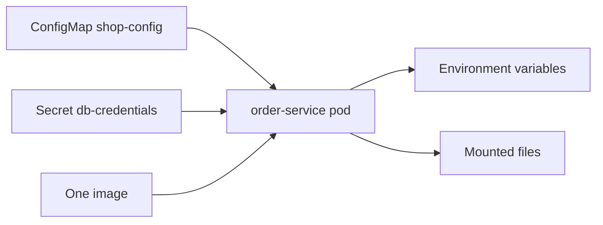

# Configuration and Secrets

**Cloud and containers · Kubernetes · Step 9.3.4 · Intermediate** · Last updated 2026-10-22
**Prerequisites:** [Pods, ReplicaSets and Deployments](02-pods-replicasets-deployments.md) (9.3.2); helpful: [Data and configuration: volumes and environment](../02-docker/06-data-and-configuration.md) (9.2.6) and [Container security and supply chain basics](../02-docker/09-container-security.md) (9.2.9)

**Version note**

| Item | Version |
|---|---|
| Baseline | Core `v1` ConfigMap and Secret; the `immutable` field exists from Kubernetes v1.19 |
| Hands-on baseline | Rancher Desktop with k3s, Kubernetes server v1.36.5, `kubectl` v1.37.1, run on 2026-10-22 |
| Compatibility note | Secrets are only base64-encoded by default and stored unencrypted in etcd unless encryption at rest is configured. How quickly a changed ConfigMap reaches a mounted file depends on the kubelet's settings |

## 1. What it is and why it matters

**What is it?** A **ConfigMap** holds non-confidential settings (log level, feature flags, a properties file). A **Secret** holds confidential values (passwords, tokens, keys). Both are objects in the cluster, kept separate from the image, and given to pods as **environment variables** or as **files**.

**Why do we need it?** The same image must run in test and in production with different settings (12-factor configuration, [9.2.6](../02-docker/06-data-and-configuration.md)). Putting settings in the image means rebuilding for every change, and putting passwords in the image or in the Deployment manifest leaks them to everyone who can pull or read either ([9.2.9](../02-docker/09-container-security.md)). ConfigMaps and Secrets move settings out of the image and let you control who may read them.

**When would I meet it?** Every service: database URLs, feature flags, credentials, API keys, TLS certificates, Spring `application.yml` overrides.

> [!TIP]
> **Memory hook:** *one image, many environments; settings in ConfigMaps, secrets in Secrets, and remember a Secret is protected by access control, not by encoding.*

## 2. Mental model: the settings card and the safe

A restaurant kitchen follows the same recipes (the image) in every branch. Each branch has a **settings card** pinned to the wall ("oven at 220, menu: summer") that the manager can change, and a **safe** for the key to the till. The card is readable by everyone in the kitchen; the safe opens only for people the owner has authorised. If the card changes, cooks who read it each time see the change; cooks who memorised it at the start of the shift do not.

| Real life | Kubernetes |
|---|---|
| The settings card | A ConfigMap |
| The safe | A Secret (with access control around it) |
| Memorising the card at the start of the shift | Environment variables, read once when the container starts |
| Looking at the card each time | A mounted file, which the kubelet refreshes |

**Where the analogy breaks:** the safe is a lock, but a Secret is only a note in a folder with a "restricted" stamp: by default it is stored unencrypted in the cluster's database, and anyone who is allowed to create a pod in the namespace can read the Secret through it.

## 3. Industry terms

| Term | Simple meaning | Why it matters | Example | Related terms |
|---|---|---|---|---|
| **ConfigMap** | Key-value pairs (or whole files) of non-confidential configuration | Keeps settings out of the image | `LOG_LEVEL=info` | Environment variable |
| **Secret** | Like a ConfigMap, for confidential data, with tighter handling | Credentials need access control | A database password | Encryption at rest |
| **`env` and `envFrom`** | Put selected keys, or all keys, into environment variables | Simple, but fixed at container start | `envFrom: configMapRef` | Twelve-factor |
| **Volume mount** | Present keys as files in a directory | Updates reach running pods | `/etc/shop/shop.properties` | `subPath` |
| **base64** | An encoding for binary data; not encryption | `Secret.data` values are base64; anyone can decode them | `ZGVtby1w...` | `stringData` |
| **Encryption at rest** | The API server encrypts Secrets before storing them in etcd | Not on by default | EncryptionConfiguration | KMS provider |
| **`immutable`** | A flag after which the ConfigMap or Secret cannot be changed | Protects from accidents and reduces load | `immutable: true` | Versioned names |
| **RBAC** | Rules for who may read or change which objects | The real protection for Secrets | `get secrets` permission | 9.3.9 |
| **External secret store** | A system outside the cluster (Vault, a cloud service) that holds the real secrets | Central rotation and audit | AWS Secrets Manager | Operators, CSI drivers |

## 4. In a real system (ShopFlow)

**The business problem.** `order-service` runs in test, staging and production. Today each environment has its own image build because the database URL and password are baked in. A password rotation means rebuilding and redeploying every service. A developer once pasted the production password into a Deployment manifest, which is stored in Git and readable by the whole team. Changing the log level to debug an incident means a new release.


**How ConfigMaps and Secrets help.** There is one image. Per environment, a ConfigMap carries the settings and a Secret the credentials. The Deployment refers to them by name. Changing the log level is a ConfigMap change followed by a restart (or a refresh if the app reads a mounted file). Access to Secrets is limited by RBAC to the service account that needs them, and the real secrets come from a store outside Git.



**What it costs.** Another thing to version and keep in step with the application; a delay or a restart before a change is seen; and the temptation to treat a Secret as safe when it is not. Handling real secrets properly (an external store, encryption at rest, RBAC, rotation) is a project on its own.

**Elsewhere:** a feature-flag ConfigMap is flipped to enable a new checkout for one environment; TLS certificates are stored as Secrets and refreshed by an operator; a platform team generates a Secret per tenant from a central vault.

## 5. How it works: from object to container

A ConfigMap or Secret is an ordinary API object in a namespace. A pod can use it in four ways: as **environment variables** for single keys (`env.valueFrom`), as environment variables for **all keys** (`envFrom`), as **files** in a mounted volume, or as **command-line arguments** through variables. The kubelet prepares them **before the container starts**: if the object or key is missing, the container is not created at all. The objects must be in the **same namespace** as the pod. Secrets are only sent to a node if a pod on that node needs them, and mounted Secrets are held in memory-backed `tmpfs` so they are not written to the node's disk (Kubernetes documentation).

The examples use this configuration:

```yaml
apiVersion: v1
kind: ConfigMap
metadata:
  name: shop-config
  labels:
    learning: notes
data:
  LOG_LEVEL: info
  FEATURE_NEW_CHECKOUT: "false"
  shop.properties: |
    currency=EUR
    order.max-items=50
```

```yaml
apiVersion: v1
kind: Secret
metadata:
  name: db-credentials
  labels:
    learning: notes
type: Opaque
stringData:
  username: orders_app
  password: demo-password-not-real-12345
```

`stringData` lets you write plain text in the manifest; the API server stores it in `data` as base64. The Deployment uses all four routes for one pod:

```yaml
apiVersion: apps/v1
kind: Deployment
metadata:
  name: order-service
  labels:
    app: order-service
    learning: notes
spec:
  replicas: 1
  selector:
    matchLabels:
      app: order-service
  template:
    metadata:
      labels:
        app: order-service
        learning: notes
    spec:
      containers:
        - name: order-service
          image: sf-learn/shop-api:v1
          envFrom:
            - configMapRef:
                name: shop-config
          env:
            - name: DB_USER
              valueFrom:
                secretKeyRef:
                  name: db-credentials
                  key: username
            - name: DB_PASSWORD
              valueFrom:
                secretKeyRef:
                  name: db-credentials
                  key: password
          volumeMounts:
            - name: shop-config-files
              mountPath: /etc/shop
              readOnly: true
            - name: db-credentials-files
              mountPath: /etc/secrets
              readOnly: true
      volumes:
        - name: shop-config-files
          configMap:
            name: shop-config
            items:
              - key: shop.properties
                path: shop.properties
        - name: db-credentials-files
          secret:
            secretName: db-credentials
```

| Part | What it does |
|---|---|
| `envFrom: configMapRef` | Every key of `shop-config` becomes an environment variable |
| `env ... secretKeyRef` | Two single Secret keys become `DB_USER` and `DB_PASSWORD` |
| `volumes: configMap` with `items` | Only the key `shop.properties` is presented as a file |
| `volumes: secret` | Both Secret keys are presented as files in `/etc/secrets` |
| `readOnly: true` | The container cannot change the mounted files |

### Worked example 1: environment variables and files

The demo service can print an environment variable on request. First the values the pod sees as variables, then as a file:

```text
$ POD=$(kubectl --context rancher-desktop -n sf-learn get pods -l app=order-service -o name | head -1); for v in LOG_LEVEL FEATURE_NEW_CHECKOUT shop.properties; do echo -n "$v -> "; kubectl --context rancher-desktop -n sf-learn exec $POD -- wget -qO- -T 2 "http://localhost:8080/env?name=$v"; done
LOG_LEVEL -> LOG_LEVEL=info
FEATURE_NEW_CHECKOUT -> FEATURE_NEW_CHECKOUT=false
shop.properties -> shop.properties=currency=EUR
order.max-items=50
```

```text
$ POD=$(kubectl --context rancher-desktop -n sf-learn get pods -l app=order-service -o name | head -1); kubectl --context rancher-desktop -n sf-learn exec $POD -- ls -l /etc/shop/; kubectl --context rancher-desktop -n sf-learn exec $POD -- cat /etc/shop/shop.properties
total 0
lrwxrwxrwx 1 root root 22 Oct 22 17:45 shop.properties -> ..data/shop.properties
currency=EUR
order.max-items=50
```

**Walkthrough.** `LOG_LEVEL` and `FEATURE_NEW_CHECKOUT` arrived as variables. Note that `envFrom` took **every** key of the ConfigMap: the key `shop.properties`, which holds a whole file, became an environment variable too, with a two-line value. That works, but it is a sign that one ConfigMap is serving two purposes; keep variables and files in separate ConfigMaps, or list the keys you want. The mounted file `/etc/shop/shop.properties` is a symbolic link into a directory (`..data`) that the kubelet swaps atomically when the content changes.

### Worked example 2: what changes after an update, and when

The ConfigMap was changed (`LOG_LEVEL` to `debug`, `currency` to `USD`) while the pod kept running:

```text
$ POD=$(kubectl --context rancher-desktop -n sf-learn get pods -l app=order-service -o name | head -1); kubectl --context rancher-desktop -n sf-learn apply -f config-v2.yaml >/dev/null; START=$(date +%s); echo 'ConfigMap changed: LOG_LEVEL info -> debug, currency EUR -> USD'; for i in $(seq 1 30); do T=$(($(date +%s)-START)); F=$(kubectl --context rancher-desktop -n sf-learn exec $POD -- cat /etc/shop/shop.properties | head -1); if [ "$F" = 'currency=USD' ]; then echo "mounted file shows currency=USD after about $T s"; break; fi; sleep 5; done; echo -n 'environment variable LOG_LEVEL in the same pod: '; kubectl --context rancher-desktop -n sf-learn exec $POD -- wget -qO- -T 2 'http://localhost:8080/env?name=LOG_LEVEL'
ConfigMap changed: LOG_LEVEL info -> debug, currency EUR -> USD
mounted file shows currency=USD after about 77 s
environment variable LOG_LEVEL in the same pod: LOG_LEVEL=info
```

and a restart made the pod pick up the variable:

```text
$ kubectl --context rancher-desktop -n sf-learn get pods -l app=order-service --no-headers; POD=$(kubectl --context rancher-desktop -n sf-learn get pods -l app=order-service --sort-by=.metadata.creationTimestamp -o name | tail -1); echo -n 'in the new pod, LOG_LEVEL: '; kubectl --context rancher-desktop -n sf-learn exec $POD -- wget -qO- -T 2 'http://localhost:8080/env?name=LOG_LEVEL'; echo -n 'in the new pod, the file: '; kubectl --context rancher-desktop -n sf-learn exec $POD -- head -1 /etc/shop/shop.properties
order-service-df6f7c95b-shqsp   1/1   Running   0     17s
in the new pod, LOG_LEVEL: LOG_LEVEL=debug
in the new pod, the file: currency=USD
```

**Walkthrough.** The mounted file changed by itself, but it took about **77 seconds** in this run, because the kubelet checks for changes on a periodic sync and uses a cache: not instantly, and not exactly predictable. The environment variable did **not** change in the running container, as the documentation says: "ConfigMaps consumed as environment variables are not updated automatically and require a pod restart." The rolled pod saw both new values. Two more rules from the documentation: a container that mounts a ConfigMap or Secret with `subPath` never receives updates, and the application must itself notice that a file changed (many do not).

So a configuration change is one of two things: an environment change that **needs a rollout** (the practical default, which also gives you a rollback), or a file change that the application **re-reads** (needs code support, and applies to different pods at slightly different times).

### Worked example 3: a Secret is encoded, not protected

```text
$ kubectl --context rancher-desktop -n sf-learn get secret db-credentials; echo; kubectl --context rancher-desktop -n sf-learn get secret db-credentials -o jsonpath='{.data}'; echo; echo -n 'decoded password: '; kubectl --context rancher-desktop -n sf-learn get secret db-credentials -o jsonpath='{.data.password}' | base64 -d; echo; echo; kubectl --context rancher-desktop -n sf-learn describe secret db-credentials | sed -n '/^Type/,$p'
NAME             TYPE     DATA   AGE
db-credentials   Opaque   2      3s

{"password":"ZGVtby1wYXNzd29yZC1ub3QtcmVhbC0xMjM0NQ==","username":"b3JkZXJzX2FwcA=="}
decoded password: demo-password-not-real-12345

Type:  Opaque

Data
====
password:  28 bytes
username:  10 bytes
```

**Walkthrough.** `kubectl get secret -o jsonpath` shows the values, and `base64 -d` turns them back into the original within a second: base64 is an encoding for binary data, not a lock. `kubectl describe` shows only the sizes, which prevents shoulder-surfing, not access. The Kubernetes documentation puts it plainly: Secrets are "by default, stored unencrypted in the API server's underlying data store (etcd). Anyone with API access can retrieve or modify a Secret, and so can anyone with access to etcd. Additionally, anyone who is authorized to create a Pod in a namespace can use that access to read any Secret in that namespace". The real protections are therefore (a) RBAC that limits who may read Secrets ([9.3.9](09-kubernetes-security.md)), (b) encryption at rest, (c) not storing secrets in Git, and (d) an external store.

A Secret can also be created without any file, which keeps the value out of Git (but a command with the value typed in may still end up in shell history or CI logs):

```text
$ echo 'creating a secret without writing it to a file:'; kubectl --context rancher-desktop -n sf-learn create secret generic api-token --from-literal=token=demo-token-not-real-67890; kubectl --context rancher-desktop -n sf-learn get secret api-token -o yaml | grep -v -E 'creationTimestamp|resourceVersion|uid|namespace'
creating a secret without writing it to a file:
secret/api-token created
apiVersion: v1
data:
  token: ZGVtby10b2tlbi1ub3QtcmVhbC02Nzg5MA==
kind: Secret
metadata:
  name: api-token
type: Opaque
```

### Worked example 4: a Secret in a pod, as a file and as a variable

```text
$ POD=$(kubectl --context rancher-desktop -n sf-learn get pods -l app=order-service --sort-by=.metadata.creationTimestamp -o name | tail -1); kubectl --context rancher-desktop -n sf-learn exec $POD -- ls -l /etc/secrets/; echo -n 'password file: '; kubectl --context rancher-desktop -n sf-learn exec $POD -- cat /etc/secrets/password; echo; echo -n 'what kind of file system holds it: '; kubectl --context rancher-desktop -n sf-learn exec $POD -- sh -c 'mount | grep /etc/secrets | cut -d" " -f1,5'; echo -n 'password as an environment variable: '; kubectl --context rancher-desktop -n sf-learn exec $POD -- wget -qO- -T 2 'http://localhost:8080/env?name=DB_PASSWORD'
total 0
lrwxrwxrwx 1 root root 15 Oct 22 17:46 password -> ..data/password
lrwxrwxrwx 1 root root 15 Oct 22 17:46 username -> ..data/username
password file: demo-password-not-real-12345
what kind of file system holds it: password as an environment variable: DB_PASSWORD=demo-password-not-real-12345
```

```text
$ POD=$(kubectl --context rancher-desktop -n sf-learn get pods -l app=order-service --sort-by=.metadata.creationTimestamp -o name | tail -1); kubectl --context rancher-desktop -n sf-learn exec $POD -- sh -c 'grep -E "/etc/(secrets|shop)" /proc/mounts | cut -d" " -f1-4'
/dev/vda1 /etc/shop ext4 ro,relatime
tmpfs /etc/secrets tmpfs ro,relatime,size=6065056k,inode64,noswap
```

**Walkthrough.** The Secret appears as files in `/etc/secrets`, and the mount is a `tmpfs` (memory), as the documentation promises. The same value is also available as the environment variable `DB_PASSWORD`. Prefer files over variables for secrets: environment variables are inherited by child processes, appear in crash dumps and diagnostic endpoints, and are visible to anyone with access to the node's container runtime, as here:

```text
$ CID=$(docker --context rancher-desktop ps --filter label=io.kubernetes.container.name=order-service --filter label=io.kubernetes.pod.namespace=sf-learn -q | head -1); echo 'what the container runtime on the node holds for that container:'; docker --context rancher-desktop inspect -f '{{range .Config.Env}}{{println .}}{{end}}' $CID | grep DB_
what the container runtime on the node holds for that container:
DB_USER=orders_app
DB_PASSWORD=demo-password-not-real-12345
```

The container runtime on the node holds the password in the container's configuration. Anyone who can run `docker inspect` (or the equivalent on other runtimes) on the node can read every secret passed as a variable to containers there, so access to nodes must be restricted. A Spring Boot service can read mounted secret files directly: the Spring Boot documentation describes `spring.config.import=optional:configtree:/etc/secrets/`, which exposes each file as a property named after the file (not run here).

### Worked example 5: protecting a ConfigMap from change

```text
$ kubectl --context rancher-desktop -n sf-learn apply -f immutable.yaml; sed 's/"50"/"100"/' immutable.yaml > immutable-v2.yaml; kubectl --context rancher-desktop -n sf-learn apply -f immutable-v2.yaml 2>&1 | cut -c1-230
configmap/shop-limits created
The ConfigMap "shop-limits" is invalid: data: Forbidden: field is immutable when `immutable` is set
```

**Walkthrough.** With `immutable: true` the API refuses any change to the data. This guards against an accidental edit that would flow into every pod that mounts the object. The price: to change a value you create a **new object** with a new name (`shop-limits-v2`) and point the Deployment at it, which also triggers a rollout and gives you a clean rollback. Tools like Kustomize and Helm automate this naming (step 9.3.8).

### When it goes wrong

**1. The referenced object does not exist.** A Deployment asks for a Secret that has not been created:

```yaml
apiVersion: apps/v1
kind: Deployment
metadata:
  name: order-missing
  labels:
    app: order-missing
    learning: notes
spec:
  replicas: 1
  selector:
    matchLabels:
      app: order-missing
  template:
    metadata:
      labels:
        app: order-missing
        learning: notes
    spec:
      containers:
        - name: order-service
          image: sf-learn/shop-api:v1
          env:
            - name: PAYMENT_API_KEY
              valueFrom:
                secretKeyRef:
                  name: payment-credentials
                  key: api-key
```

```text
$ kubectl --context rancher-desktop -n sf-learn apply -f missing.yaml >/dev/null; sleep 8; kubectl --context rancher-desktop -n sf-learn get pods -l app=order-missing; kubectl --context rancher-desktop -n sf-learn describe pod -l app=order-missing | sed -n '/^Events:/,$p' | cut -c1-170
NAME                             READY   STATUS                       RESTARTS   AGE
order-missing-5d78cc8b6c-pbjvp   0/1     CreateContainerConfigError   0          8s
Events:
  Type     Reason     Age              From               Message
  ----     ------     ----             ----               -------
  Normal   Scheduled  8s               default-scheduler  Successfully assigned sf-learn/order-missing-5d78cc8b6c-pbjvp to lima-rancher-desktop
  Normal   Pulled     8s (x2 over 8s)  kubelet            spec.containers{order-service}: Container image "sf-learn/shop-api:v1" already present on machine and can be acc
  Warning  Failed     8s (x2 over 8s)  kubelet            spec.containers{order-service}: Error: secret "payment-credentials" not found
```

The pod never starts: its status is `CreateContainerConfigError` and the event names the missing Secret. This commonly happens when a pipeline applies the Deployment before the Secret exists, or in the wrong namespace. A missing key gives the same state.

**2. The value changed but the pod did not.** A password is rotated in the Secret, but pods that use it as a variable keep the old one until restarted; they fail when the old password is revoked. Use a rollout after changing, or mount as a file and make the application re-read it.

**3. A secret in Git.** `stringData` or base64 in a manifest in a repository is a plaintext secret to everyone who can read the repository, forever (history). Keep real secrets out of Git, or encrypt them in Git (Sealed Secrets, SOPS) or fetch them from an external store.

**4. Too wide access.** A service account that may read all Secrets in a namespace turns one compromised pod into a leak of every credential there ([9.3.9](09-kubernetes-security.md)).

### Common mistakes

1. Treating base64 as protection.
2. Putting secrets in `ConfigMap` or in the image.
3. Expecting running pods to notice a changed environment variable.
4. `envFrom` with a ConfigMap that mixes variables and files.
5. Real secrets committed to Git as manifests.
6. `subPath` mounts for config that is expected to refresh.

### Alternatives in the industry

A map of the landscape, not a comparison. These were not run in this series; check each project's documentation before adopting one.

| Area | Tool or product | What it is | When you meet it |
|---|---|---|---|
| Built in | **ConfigMap and Secret** (used here) | The Kubernetes-native objects | Everywhere; the base that other tools write into |
| External secret stores | **HashiCorp Vault** (agent injector, CSI provider, or the Vault Secrets Operator) | A central secret manager that hands secrets to pods with short-lived access | Larger organisations with rotation and audit requirements |
| | **AWS Secrets Manager**, **Google Secret Manager**, **Azure Key Vault** | Cloud-native secret stores | Clusters on that cloud |
| Syncing from a store | **External Secrets Operator**, **Secrets Store CSI Driver** | Create Kubernetes Secrets, or mount files, from an external store | Teams that want the store as the source of truth |
| Secrets in Git | **Sealed Secrets**, **SOPS** (often with Flux or Argo CD) | Encrypt secrets so the encrypted form can be committed to Git | GitOps teams without a central vault |
| Application-level config | **Spring Cloud Config**, **Spring Cloud Kubernetes**, **Consul KV** | Config servers or libraries that fetch configuration at run time | Existing Spring Cloud estates |
| Reloading on change | **Stakater Reloader** | Restarts workloads when a ConfigMap or Secret they use changes | Teams that rely on environment variables |
| Naming for rollouts | **Kustomize generators, Helm** | Add a content hash to the object name so that any change triggers a rollout | Most mature setups ([9.3.8](08-kustomize-and-helm.md)) |

## 6. Architectural decisions

| Decision | Choose | Because |
|---|---|---|
| Where configuration lives | Outside the image, one image for all environments | Build once, promote unchanged |
| Environment variable or file | Variables for simple settings; files for structured configuration and for secrets | Variables leak into process environments and runtime inspection |
| How a change is applied | Roll out new pods (new object name or a restart) rather than relying on in-place refresh | Predictable, with rollback; in-place refresh is slow and uneven |
| Immutable objects | Yes for important configuration, with versioned names | Prevents silent changes across all pods |
| Real secrets | An external store synced into the cluster, or encrypted in Git; encryption at rest on; RBAC limiting `get secrets` | A Secret object alone is not a vault |
| Secrets in manifests | Never plaintext in Git | History keeps them |
| Granularity | A ConfigMap per purpose, a Secret per credential set | Smaller blast radius, clearer ownership |
| `envFrom` | Avoid, or use only with a focused ConfigMap | Surprising extra variables |

## 7. Try it yourself

Try each exercise first; the real results are in the Answers section.

1. **Change it live.** Change a setting that the service reads from a mounted file, and show how long the running pod takes to see it. Then change a setting that it reads from an environment variable, and show what it takes for the pod to see it.
2. **Read your own secret.** Show how a colleague with read access to Secrets in the namespace can recover the password, using only `kubectl`.
3. **Diagnose the pod.** A new pod stays at `0/1` with the status `CreateContainerConfigError`. Which command shows why, and what is the reason here?

## 8. Check your understanding

1. Why does a pod with an environment variable from a ConfigMap not see a change, and what is the least risky way to apply it?
2. Is a Secret encrypted? Name two things you must do besides creating it.
3. Why is a mounted Secret held on `tmpfs`, and why might you still prefer it to an environment variable?
4. You use `subPath` to mount one key as a file, and the key never updates after a ConfigMap change. Why?

Answers are at the end of this note.

## 9. Revision

**Remember**
- **ConfigMap** = non-confidential settings; **Secret** = confidential values; both live in a namespace and are used by pods in the **same** namespace.
- Consumed as **env vars** (fixed at start; need a restart) or **files** (refreshed eventually, about a minute here; **not** with `subPath`).
- **base64 is encoding, not encryption.** Secrets are unencrypted in etcd by default; protect with **RBAC**, **encryption at rest**, an **external store**, and not putting them in Git.
- A missing object or key → `CreateContainerConfigError`.
- `immutable: true` + versioned names = safe, rollback-friendly changes.

**Explain in 15 seconds:** "ConfigMaps hold settings and Secrets hold credentials, given to pods as variables or files so one image works everywhere; variables need a restart to change, and a Secret is protected by access control, not by its base64 encoding."

**Explain in 60 seconds:**
> "I keep one image and put per-environment settings in a ConfigMap and credentials in a Secret, referenced by name in the Deployment. A ConfigMap can be injected as environment variables, which are read at container start, so a change needs a rollout, or mounted as files, which the kubelet refreshes after a delay but only if the app re-reads them and not with subPath. I prefer to apply changes by rolling pods, ideally with versioned immutable objects, so there's a rollback. A Secret is only base64 and by default stored unencrypted in etcd, and anyone who can create pods in the namespace can read it, so I limit access with RBAC, turn on encryption at rest, avoid committing secrets to Git, and for anything serious sync them from an external store such as Vault or a cloud secret manager. I mount secrets as files rather than variables because variables leak to child processes and to anyone who can inspect the node's containers."

**Likely follow-up questions:**
- **How do I reload config without restarting?** Mount as a file and have the app watch it; or use a reloader that triggers a rollout; Spring Cloud Kubernetes can refresh beans (not run here).
- **Can I store a whole `application.yml` in a ConfigMap?** Yes: a key with the file content, mounted into the directory Spring reads (`spring.config.import`).
- **What is a projected volume?** One volume combining several ConfigMaps, Secrets and the service-account token into a single directory (not run here).
- **How do TLS certificates get renewed?** A controller such as cert-manager writes a TLS Secret and renews it; apps must re-read it.

**Architect's takeaway:** a Secret object is a delivery mechanism, not a vault. Decide where the secret really lives and who can read it, and design your configuration changes as rollouts.

**Next topic:** [Probes, rolling updates and graceful shutdown](05-probes-rolling-updates-graceful-shutdown.md) (9.3.5)

## 10. Verification and sources

> [!NOTE]
> Checked 2026-10-22 against the Kubernetes and Spring Boot documentation and by running every command shown on Rancher Desktop (Kubernetes server v1.36.5+k3s1). The credentials shown are made up. Re-verify when you revisit this note.

- **Confirmed (documentation, read 2026-10-22):** "Kubernetes Secrets are, by default, stored unencrypted in the API server's underlying data store (etcd). Anyone with API access can retrieve or modify a Secret, and so can anyone with access to etcd"; anyone authorised to create a pod in a namespace can read its Secrets; "A Secret is only sent to a node if a Pod on that node requires it"; for mounted Secrets "the kubelet stores a copy of the data into a tmpfs so that the confidential data is not written to durable storage"; a Secret used as a `subPath` mount "does not receive automated Secret updates" (Kubernetes, "Secrets"); "ConfigMaps consumed as environment variables are not updated automatically and require a pod restart", mounted ConfigMaps are "eventually updated" through the kubelet's periodic sync and cache, a ConfigMap used as a `subPath` mount "will not receive ConfigMap updates", the `immutable` field exists "from v1.19", and the pod and ConfigMap must be in the same namespace (Kubernetes, "ConfigMaps"); Spring Boot's `configtree:` import exposes files in a directory as properties (Spring Boot reference, "Externalized Configuration").
- **Observed (this machine):** the values seen as variables and files; the roughly 77-second delay before the mounted file changed in one run (it varies); that the environment variable stayed `info` until the pod was replaced; the `tmpfs` mount for the Secret; that the node's container runtime listed the password as an environment variable; the immutable error; the `CreateContainerConfigError` event.
- **Not run:** encryption at rest, RBAC around Secrets, Spring `configtree`, Vault, External Secrets, Sealed Secrets, SOPS, Reloader and the other alternatives (general industry knowledge).
- **Assumptions and illustrations:** the ShopFlow story is illustrative; the credentials are fake.
- **To verify:** whether encryption at rest and a KMS provider are enabled on your cluster; how your platform delivers secrets (external store, CSI driver); the kubelet's ConfigMap change-detection settings, which determine the refresh delay.
- **Decision rule:** one image; ConfigMaps for settings and Secrets for credentials; apply changes by rollout; files over variables for secrets; real secrets in an external store with RBAC and encryption at rest.

**Sources:** Kubernetes documentation: "ConfigMaps", "Secrets", "Configure a Pod to Use a ConfigMap", "Encrypting Confidential Data at Rest"; Spring Boot reference documentation, "Externalized Configuration"; The Twelve-Factor App, "III. Config".

## Answers

**Experiment (exercises)**

1. **Change it live:** the mounted file changed by itself after about 77 seconds; the environment variable only changed after the pod was replaced by a rollout:

```text
$ POD=$(kubectl --context rancher-desktop -n sf-learn get pods -l app=order-service -o name | head -1); kubectl --context rancher-desktop -n sf-learn apply -f config-v2.yaml >/dev/null; START=$(date +%s); echo 'ConfigMap changed: LOG_LEVEL info -> debug, currency EUR -> USD'; for i in $(seq 1 30); do T=$(($(date +%s)-START)); F=$(kubectl --context rancher-desktop -n sf-learn exec $POD -- cat /etc/shop/shop.properties | head -1); if [ "$F" = 'currency=USD' ]; then echo "mounted file shows currency=USD after about $T s"; break; fi; sleep 5; done; echo -n 'environment variable LOG_LEVEL in the same pod: '; kubectl --context rancher-desktop -n sf-learn exec $POD -- wget -qO- -T 2 'http://localhost:8080/env?name=LOG_LEVEL'
ConfigMap changed: LOG_LEVEL info -> debug, currency EUR -> USD
mounted file shows currency=USD after about 77 s
environment variable LOG_LEVEL in the same pod: LOG_LEVEL=info
```

```text
$ kubectl --context rancher-desktop -n sf-learn get pods -l app=order-service --no-headers; POD=$(kubectl --context rancher-desktop -n sf-learn get pods -l app=order-service --sort-by=.metadata.creationTimestamp -o name | tail -1); echo -n 'in the new pod, LOG_LEVEL: '; kubectl --context rancher-desktop -n sf-learn exec $POD -- wget -qO- -T 2 'http://localhost:8080/env?name=LOG_LEVEL'; echo -n 'in the new pod, the file: '; kubectl --context rancher-desktop -n sf-learn exec $POD -- head -1 /etc/shop/shop.properties
order-service-df6f7c95b-shqsp   1/1   Running   0     17s
in the new pod, LOG_LEVEL: LOG_LEVEL=debug
in the new pod, the file: currency=USD
```

2. **Read your own secret:** `kubectl get secret NAME -o jsonpath='{.data.password}' | base64 -d`. Anyone allowed to `get` Secrets in the namespace can do the same:

```text
$ kubectl --context rancher-desktop -n sf-learn get secret db-credentials; echo; kubectl --context rancher-desktop -n sf-learn get secret db-credentials -o jsonpath='{.data}'; echo; echo -n 'decoded password: '; kubectl --context rancher-desktop -n sf-learn get secret db-credentials -o jsonpath='{.data.password}' | base64 -d; echo; echo; kubectl --context rancher-desktop -n sf-learn describe secret db-credentials | sed -n '/^Type/,$p'
NAME             TYPE     DATA   AGE
db-credentials   Opaque   2      3s

{"password":"ZGVtby1wYXNzd29yZC1ub3QtcmVhbC0xMjM0NQ==","username":"b3JkZXJzX2FwcA=="}
decoded password: demo-password-not-real-12345

Type:  Opaque

Data
====
password:  28 bytes
username:  10 bytes
```

3. **Diagnose the pod:** `kubectl describe pod NAME`, the Events section. The reason is a missing Secret:

```text
$ kubectl --context rancher-desktop -n sf-learn apply -f missing.yaml >/dev/null; sleep 8; kubectl --context rancher-desktop -n sf-learn get pods -l app=order-missing; kubectl --context rancher-desktop -n sf-learn describe pod -l app=order-missing | sed -n '/^Events:/,$p' | cut -c1-170
NAME                             READY   STATUS                       RESTARTS   AGE
order-missing-5d78cc8b6c-pbjvp   0/1     CreateContainerConfigError   0          8s
Events:
  Type     Reason     Age              From               Message
  ----     ------     ----             ----               -------
  Normal   Scheduled  8s               default-scheduler  Successfully assigned sf-learn/order-missing-5d78cc8b6c-pbjvp to lima-rancher-desktop
  Normal   Pulled     8s (x2 over 8s)  kubelet            spec.containers{order-service}: Container image "sf-learn/shop-api:v1" already present on machine and can be acc
  Warning  Failed     8s (x2 over 8s)  kubelet            spec.containers{order-service}: Error: secret "payment-credentials" not found
```

**Check your understanding**

1. Environment variables are set once, when the container starts; Kubernetes does not change a running process's environment. The least risky way to apply a change is a rollout: change the ConfigMap (preferably under a new name), update the Deployment, and let the rolling update replace the pods, which also gives you a rollback.
2. No: it is base64-encoded, and by default stored unencrypted in etcd. Besides creating it: restrict who can read Secrets with RBAC, enable encryption at rest, avoid putting the manifest with the secret in Git (use an external store or encrypt it), and limit node access.
3. `tmpfs` keeps the secret in memory so it is never written to the node's disk, and it is removed when the pod is deleted. Compared with an environment variable, a file is not inherited by child processes, does not appear in process listings or most crash dumps, is not shown in the container runtime's configuration, and can be refreshed without a restart.
4. Because the kubelet updates a projected volume by swapping a directory link, and a `subPath` mount bypasses that link: the documentation says a container using a ConfigMap as a `subPath` volume mount will not receive updates. Mount the directory instead, or roll the pods.

Back to [the series overview](01-kubernetes-overview.md) · [the area overview](../01-cloud-and-containers-overview.md) · [the index](../../README.md) · [Roadmap](../../roadmap.md).
