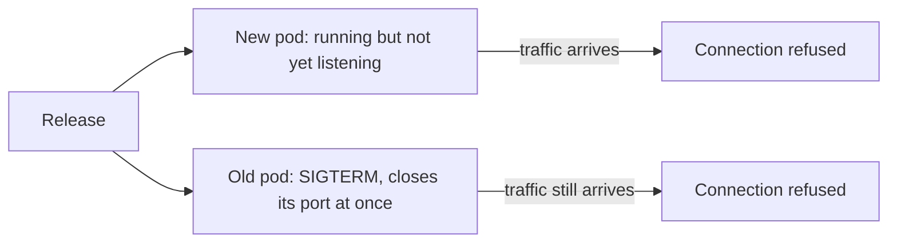
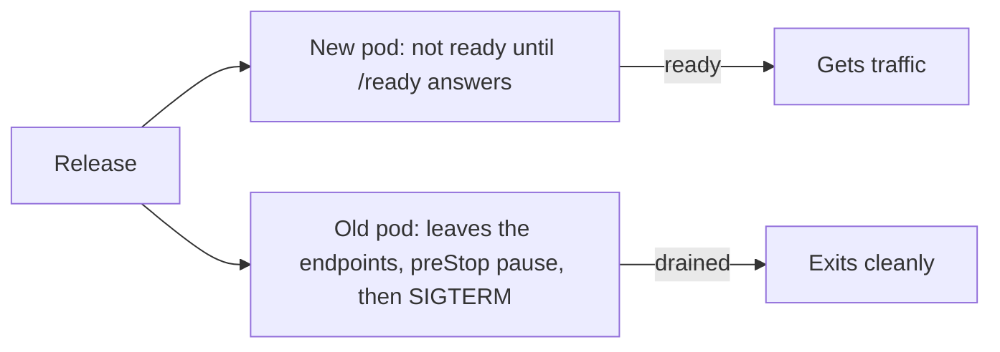
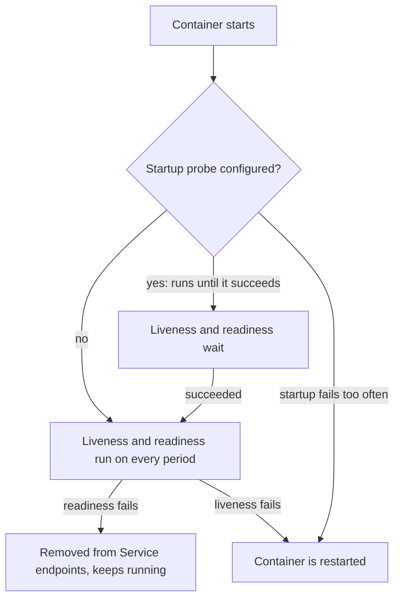
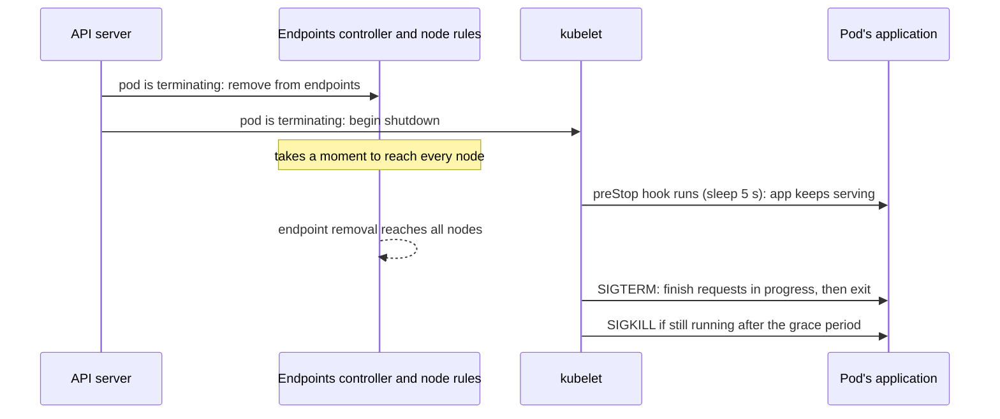

# Probes, Rolling Updates and Graceful Shutdown

**Cloud and containers · Kubernetes · Step 9.3.5 · Intermediate** · Last updated 2026-10-22
**Prerequisites:** [Pods, ReplicaSets and Deployments](02-pods-replicasets-deployments.md) (9.3.2) and [Services, DNS and Ingress](03-services-dns-ingress.md) (9.3.3); helpful: [Lifecycle: signals, graceful shutdown, health checks and restarts](../02-docker/07-lifecycle.md) (9.2.7) and [Load balancing](../../14-system-design/05-load-balancing.md) (14.5)

**Version note**

| Item | Version |
|---|---|
| Baseline | Container probes (liveness, readiness, startup) and `RollingUpdate`; the `sleep` action for `preStop` hooks is recent, so check your cluster version |
| Hands-on baseline | Rancher Desktop with k3s, Kubernetes server v1.36.5, `kubectl` v1.37.1, run on 2026-10-22 |
| Compatibility note | Probe defaults are those of the API (`periodSeconds` 10, `timeoutSeconds` 1, `failureThreshold` 3, `successThreshold` 1, `initialDelaySeconds` 0); managed platforms and Helm charts often set their own |

## 1. What it is and why it matters

**What is it?** Three tools that decide how a release behaves:
- **Probes** are checks the kubelet runs on a container: **startup** ("has it finished starting?"), **readiness** ("may it receive traffic now?") and **liveness** ("is it stuck and in need of a restart?").
- A **rolling update** replaces pods gradually, using readiness to decide when to move on.
- **Graceful termination** is how a pod is told to stop (a signal and a deadline) so that requests in progress finish.

**Why do we need it?** A container being *started* does not mean the application is *ready*, and a pod being *deleted* does not mean traffic has stopped arriving at it. Without these three tools a release drops requests even though "the rollout succeeded". With them, a release has no visible effect on users, a stuck process is restarted, and a bad release stops itself.

**When would I meet it?** At every deploy; the first time a "zero-downtime" rollout shows errors; when a pod restarts every few minutes; when an application needs a long time to start; and in every platform readiness review.

> [!TIP]
> **Memory hook:** *startup says "I'm up", readiness says "send me traffic", liveness says "I'm not stuck"; and on the way out, stop being ready first, then stop.*

## 2. Mental model: the restaurant opening and closing

A restaurant opens a new branch and retires an old one on the same street.
- **Opening:** the staff arrive (container started) but the kitchen is still being set up. A **sign on the door** ("open") should go up only when the kitchen can cook: that is **readiness**. A **manager checking if the kitchen is stuck** (the gas has failed) and calling maintenance: **liveness**. A longer **set-up allowance** on the first morning before the manager starts checking: **startup**.
- **Closing:** to retire the old branch without losing customers, first take the **"open" sign down** so that no new customers come, wait for those at tables to finish, then lock up. If you lock the door at the same moment you take the sign down, customers who were already walking in are turned away.

| Real life | Kubernetes |
|---|---|
| The "open" sign | Membership of the Service's ready endpoints, controlled by the readiness probe |
| The manager checking the kitchen | The liveness probe; failure means the container is restarted |
| First-morning set-up allowance | The startup probe, which holds off the other two |
| Taking the sign down, then locking up | The `preStop` hook and SIGTERM, within the grace period |
| Customers walking in while the sign still shows | Requests that arrive while the pod is being removed from the endpoints |

**Where the analogy breaks:** in the cluster, taking the sign down and telling the restaurant to close happen at the same moment, in two different places (the endpoint controller and the kubelet), with no guaranteed order. That is the whole problem this lesson solves.

## 3. Industry terms

| Term | Simple meaning | Why it matters | Example | Related terms |
|---|---|---|---|---|
| **Liveness probe** | A check; if it keeps failing, the kubelet restarts the container | Recovers a stuck process | `GET /health` | Restart policy |
| **Readiness probe** | A check; if it fails, the pod stays running but receives no traffic | Keeps traffic away from pods that cannot answer | `GET /ready` | Endpoints |
| **Startup probe** | A check run first; until it succeeds, liveness and readiness are not run | Protects slow-starting applications from being killed | 20 failures of 2 s | `initialDelaySeconds` |
| **Probe types** | HTTP GET, TCP connect, gRPC, or a command run inside the container | Choose the cheapest honest check | `httpGet` | Exec |
| **Thresholds** | `periodSeconds`, `timeoutSeconds`, `failureThreshold`, `successThreshold`, `initialDelaySeconds` | Trade fast detection against false alarms | 3 failures at 2 s = about 6 s | Flapping |
| **Rolling update** | Replace pods a few at a time | Deploys without downtime | `maxSurge: 1`, `maxUnavailable: 0` | Deployment |
| **`terminationGracePeriodSeconds`** | How long a pod gets between the stop request and a forced kill (default 30 s) | The deadline for finishing in-flight work | 30 | SIGKILL |
| **`preStop` hook** | An action run in a container just before it receives SIGTERM | A pause that lets the endpoints catch up | `sleep: {seconds: 5}` | Graceful shutdown |
| **Graceful shutdown** | Stop accepting new work, finish what is in progress, exit | No dropped requests | `server.shutdown=graceful` (Spring Boot) | Draining |
| **`progressDeadlineSeconds`** | How long a rollout may make no progress before it is reported as failed (default 600 s) | Stuck releases get noticed | 20 | `rollout status` |
| **Connection draining** | Letting existing connections finish while refusing new ones | Long-lived connections are not cut | HTTP keep-alive | Load balancer |

## 4. In a real system (ShopFlow)

**The business problem.** Every `order-service` release produces a burst of 502 errors on checkout for about ten seconds, although the deployment logs say "successfully rolled out". The service takes six seconds to open its port, because it loads configuration and warms a cache. Twice a month a pod hangs on a database lock and nobody notices until its customers complain.



**How the three tools help.** A readiness probe on `/ready` keeps traffic away from a new pod until it can answer. A short `preStop` pause, and a service that keeps serving while it drains, give the endpoint removal time to reach everyone before the old pod closes its port. A liveness probe restarts the hung pod, and a startup probe stops that same probe from killing a slow starter. The Deployment's progress deadline marks a release that never becomes ready as failed instead of waiting forever.



**What it costs.** Probe endpoints to write and to keep honest; slower rollouts (each old pod now waits a few seconds); more settings to tune; and new failure modes (a liveness probe that is too strict restarts healthy pods).

**Elsewhere:** a payment service uses a long grace period so that card authorisations finish; a streaming service drains WebSocket connections for minutes; a machine-learning service uses a startup probe for a model that takes three minutes to load.

## 5. How it works

### The three probes



| Probe | Question | On failure | Typical check |
|---|---|---|---|
| **Startup** | Has the application finished starting? | The container is restarted | The same endpoint as liveness, with a generous total time |
| **Readiness** | Should this pod get requests right now? | The pod is removed from the Service's endpoints; **no restart** | A light endpoint that is true when the app can serve |
| **Liveness** | Is the process stuck beyond recovery? | The container is restarted | A very light endpoint that answers if the process is alive |

Defaults (read from the cluster's own API description): `initialDelaySeconds` is 0 unless set (the `describe` output in example 1 shows `delay=0s`), `periodSeconds` defaults to 10, `timeoutSeconds` to 1, `failureThreshold` to 3 and `successThreshold` to 1 (which must be 1 for liveness and startup):

```text
$ for f in initialDelaySeconds periodSeconds timeoutSeconds successThreshold failureThreshold; do echo -n "$f: "; kubectl --context rancher-desktop explain pod.spec.containers.livenessProbe.$f | sed -n '/DESCRIPTION/,$p' | tail -n +2 | tr -s ' \n' ' ' | cut -c1-150; echo; done
initialDelaySeconds:  Number of seconds after the container has started before liveness probes are initiated. More info: https://kubernetes.io/docs/concepts/workloads/pods

periodSeconds:  How often (in seconds) to perform the probe. Default to 10 seconds. Minimum value is 1. 
timeoutSeconds:  Number of seconds after which the probe times out. Defaults to 1 second. Minimum value is 1. More info: https://kubernetes.io/docs/concepts/workloads

successThreshold:  Minimum consecutive successes for the probe to be considered successful after having failed. Defaults to 1. Must be 1 for liveness and startup. Minim

failureThreshold:  Minimum consecutive failures for the probe to be considered failed after having succeeded. Defaults to 3. Minimum value is 1. 
```

All examples ran in `sf-learn` with the demo service. It has `/health` (liveness), `/ready` (readiness), `/admin/break` and `/admin/unready` (to make them fail), and a `START_DELAY_MS` setting that delays opening its port.

### Worked example 1: readiness and liveness failing

A Deployment with both probes, two replicas, checking every two seconds and failing after two misses:

```yaml
apiVersion: apps/v1
kind: Deployment
metadata:
  name: order-probes
  labels:
    app: order-probes
    learning: notes
spec:
  replicas: 2
  selector:
    matchLabels:
      app: order-probes
  template:
    metadata:
      labels:
        app: order-probes
        learning: notes
    spec:
      containers:
        - name: order-service
          image: sf-learn/shop-api:v1
          ports:
            - containerPort: 8080
          readinessProbe:
            httpGet:
              path: /ready
              port: 8080
            periodSeconds: 2
            failureThreshold: 2
          livenessProbe:
            httpGet:
              path: /health
              port: 8080
            periodSeconds: 2
            failureThreshold: 2
```

First readiness is made to fail on one pod, then liveness on the other:

```text
$ POD=$(kubectl --context rancher-desktop -n sf-learn get pods -l app=order-probes -o name | head -1); echo "$POD: readiness fails (/ready returns 503)"; kubectl --context rancher-desktop -n sf-learn exec $POD -- wget -qO- -T 2 http://localhost:8080/admin/unready; sleep 8; kubectl --context rancher-desktop -n sf-learn get pods -l app=order-probes; echo '-> not ready, not restarted, and removed from the Service endpoints'
pod/order-probes-689bb89f5d-4wtfs: readiness fails (/ready returns 503)
now not ready
NAME                            READY   STATUS    RESTARTS   AGE
order-probes-689bb89f5d-4wtfs   0/1     Running   0          12s
order-probes-689bb89f5d-vgdd2   1/1     Running   0          12s
-> not ready, not restarted, and removed from the Service endpoints
```

```text
$ POD=$(kubectl --context rancher-desktop -n sf-learn get pods -l app=order-probes -o name | tail -1); echo "$POD: liveness fails (/health returns 500)"; kubectl --context rancher-desktop -n sf-learn exec $POD -- wget -qO- -T 2 http://localhost:8080/admin/break; sleep 12; kubectl --context rancher-desktop -n sf-learn get pods -l app=order-probes; echo; kubectl --context rancher-desktop -n sf-learn describe $POD | grep -E 'Liveness|Restart Count|Last State|Reason|Exit Code' | cut -c1-140; kubectl --context rancher-desktop -n sf-learn get events --field-selector involvedObject.name=${POD#pod/} -o custom-columns=REASON:.reason,MESSAGE:.message | grep -E 'Unhealthy|Killing' | cut -c1-140
pod/order-probes-689bb89f5d-vgdd2: liveness fails (/health returns 500)
now unhealthy
NAME                            READY   STATUS    RESTARTS     AGE
order-probes-689bb89f5d-4wtfs   0/1     Running   0            25s
order-probes-689bb89f5d-vgdd2   1/1     Running   1 (9s ago)   25s

    Last State:     Terminated
      Reason:       Error
      Exit Code:    143
    Restart Count:  1
    Liveness:       http-get http://:8080/health delay=0s timeout=1s period=2s successThreshold=1 failureThreshold=2
  Type     Reason     Age               From               Message
  Warning  Unhealthy  9s (x2 over 11s)  kubelet            spec.containers{order-service}: Liveness probe failed: HTTP probe failed with sta
Unhealthy   Liveness probe failed: HTTP probe failed with statuscode: 500
Killing     Container order-service failed liveness probe, will be restarted
```

**Walkthrough.** A failing readiness probe leaves the pod running (`0/1`, 0 restarts) and removes it from the Service, so no traffic reaches it. It will be put back as soon as the probe passes again, which is what you want for a temporary condition such as a busy pod or a lost database connection. A failing liveness probe made the kubelet **kill and restart** the container: `Restart Count: 1`, the event `Liveness probe failed: HTTP probe failed with statuscode: 500`, and `Killing ... will be restarted`. The previous container ended with exit code 143: it was stopped with SIGTERM and exited as asked.

### Worked example 2: the slow starter, and the startup probe

The service here takes 20 seconds to open its port. With only a liveness probe (every 2 seconds, two failures allowed, which gives the app about 4 seconds):

```yaml
apiVersion: apps/v1
kind: Deployment
metadata:
  name: order-slow
  labels:
    app: order-slow
    learning: notes
spec:
  replicas: 1
  selector:
    matchLabels:
      app: order-slow
  template:
    metadata:
      labels:
        app: order-slow
        learning: notes
    spec:
      containers:
        - name: order-service
          image: sf-learn/shop-api:v1
          env:
            - name: START_DELAY_MS
              value: "20000"
          ports:
            - containerPort: 8080
          livenessProbe:
            httpGet:
              path: /health
              port: 8080
            periodSeconds: 2
            failureThreshold: 2
```

```text
$ kubectl --context rancher-desktop -n sf-learn apply -f startup-no.yaml >/dev/null; for i in 1 2 3 4 5 6 7 8 9 10; do sleep 6; kubectl --context rancher-desktop -n sf-learn get pods -l app=order-slow --no-headers; done; kubectl --context rancher-desktop -n sf-learn get events --field-selector involvedObject.kind=Pod --sort-by=.metadata.creationTimestamp -o custom-columns=REASON:.reason,MESSAGE:.message | grep -E 'Unhealthy|Killing' | head -3 | cut -c1-150
order-slow-75455d9bcd-g8bjw   1/1   Running   1 (2s ago)   6s
order-slow-75455d9bcd-g8bjw   1/1   Running   2 (4s ago)   12s
order-slow-75455d9bcd-g8bjw   0/1   CrashLoopBackOff   2 (6s ago)   18s
order-slow-75455d9bcd-g8bjw   0/1   CrashLoopBackOff   2 (12s ago)   24s
order-slow-75455d9bcd-g8bjw   0/1   CrashLoopBackOff   3 (2s ago)   30s
order-slow-75455d9bcd-g8bjw   0/1   CrashLoopBackOff   3 (8s ago)   36s
order-slow-75455d9bcd-g8bjw   0/1   CrashLoopBackOff   3 (14s ago)   42s
order-slow-75455d9bcd-g8bjw   0/1   CrashLoopBackOff   3 (20s ago)   48s
order-slow-75455d9bcd-g8bjw   0/1   CrashLoopBackOff   3 (26s ago)   54s
order-slow-75455d9bcd-g8bjw   1/1   Running   4 (32s ago)   60s
Unhealthy   Liveness probe failed: Get "http://10.42.0.92:8080/health": dial tcp 10.42.0.92:8080: connect: connection refused
Killing     Container order-service failed liveness probe, will be restarted
```

**Walkthrough.** The kubelet gave up after the first few probes, killed the container, and restarted it, over and over: the restart count climbed, the status moved to `CrashLoopBackOff` (the back-off delays grow, [9.3.2](02-pods-replicasets-deployments.md)), and in this run it finally settled (`1/1` after four restarts, a minute in). I did not investigate why that attempt survived, and a configuration that depends on such luck is not safe. The fix is not a longer liveness delay (that would slow down detection of real hangs later) but a **startup probe** with enough total time (here up to 20 failures at 2 seconds, about 40 seconds):

```text
$ kubectl --context rancher-desktop -n sf-learn apply -f startup-yes.yaml >/dev/null; for i in 1 2 3 4 5 6; do sleep 6; kubectl --context rancher-desktop -n sf-learn get pods -l app=order-slow-sp --no-headers; done
order-slow-sp-5c45c57498-ttjbc   0/1   Running   0     6s
order-slow-sp-5c45c57498-ttjbc   0/1   Running   0     12s
order-slow-sp-5c45c57498-ttjbc   0/1   Running   0     18s
order-slow-sp-5c45c57498-ttjbc   1/1   Running   0     24s
order-slow-sp-5c45c57498-ttjbc   1/1   Running   0     30s
order-slow-sp-5c45c57498-ttjbc   1/1   Running   0     36s
```

```text
$ kubectl --context rancher-desktop -n sf-learn get deployment order-slow-sp -o jsonpath='{.spec.template.spec.containers[0].startupProbe}{"\n"}{.spec.template.spec.containers[0].livenessProbe}{"\n"}'
{"failureThreshold":20,"httpGet":{"path":"/health","port":8080,"scheme":"HTTP"},"periodSeconds":2,"successThreshold":1,"timeoutSeconds":1}
{"failureThreshold":2,"httpGet":{"path":"/health","port":8080,"scheme":"HTTP"},"periodSeconds":2,"successThreshold":1,"timeoutSeconds":1}
```

With the startup probe, the pod stayed `0/1` while starting, became `1/1` after about 22 seconds, and had **0 restarts**. The Kubernetes documentation describes the rule: the startup probe must be given `failureThreshold * periodSeconds` long enough to cover the worst-case startup, and once it has succeeded, the liveness probe takes over with its quick detection.

### Worked example 3: a release while requests flow

This is the experiment that matters. Three `order-service` pods sit behind a Service. A client pod sends about ten requests a second for 45 seconds, and counts successes and failures. Five seconds in, a new version is rolled out (`maxSurge: 1`, `maxUnavailable: 0`, so there is always capacity). The service takes 6 seconds to open its port after the container starts, and on SIGTERM it closes its listener straight away and finishes requests in progress. Three versions of the Deployment were tested, each twice. The load generator:

```sh
#!/bin/sh
# Sends about 10 requests per second to the Service for 45 seconds and counts the outcomes.
ok=0; fail=0; end=$(( $(date +%s) + 45 ))
while [ "$(date +%s)" -lt "$end" ]; do
  if wget -qO- -T 1 http://order-service/ >/dev/null 2>&1; then ok=$((ok+1)); else fail=$((fail+1)); fi
  sleep 0.1
done
echo "requests ok=$ok failed=$fail"
```

**Version A: no probes.**

```yaml
apiVersion: apps/v1
kind: Deployment
metadata:
  name: order-service
  labels:
    app: order-service
    learning: notes
spec:
  replicas: 3
  selector:
    matchLabels:
      app: order-service
  strategy:
    type: RollingUpdate
    rollingUpdate:
      maxSurge: 1
      maxUnavailable: 0
  template:
    metadata:
      labels:
        app: order-service
        learning: notes
    spec:
      containers:
        - name: order-service
          image: sf-learn/shop-api:v1
          env:
            - name: START_DELAY_MS
              value: "6000"
            - name: RELEASE
              value: "1"
          ports:
            - containerPort: 8080
---
apiVersion: v1
kind: Service
metadata:
  name: order-service
  labels:
    learning: notes
spec:
  selector:
    app: order-service
  ports:
    - port: 80
      targetPort: 8080
```

```text
$ bash /private/tmp/claude-501/-Users-jubinjose-projects-learning/2c05463c-b11b-42e4-a908-9d6aae9989f1/scratchpad/runrelease.sh release-naive.yaml
rolling out a new version while requests are flowing
deployment "order-service" successfully rolled out
requests ok=354 failed=50
$ echo '--- second run'; bash /private/tmp/claude-501/-Users-jubinjose-projects-learning/2c05463c-b11b-42e4-a908-9d6aae9989f1/scratchpad/runrelease.sh release-naive.yaml
--- second run
rolling out a new version while requests are flowing
deployment "order-service" successfully rolled out
requests ok=357 failed=46
```

**Version B: add a readiness probe.** (The change is the `readinessProbe` block, checking `/ready` every second.)

```text
$ bash /private/tmp/claude-501/-Users-jubinjose-projects-learning/2c05463c-b11b-42e4-a908-9d6aae9989f1/scratchpad/runrelease.sh release-readiness.yaml
rolling out a new version while requests are flowing
deployment "order-service" successfully rolled out
requests ok=375 failed=6
$ echo '--- second run'; bash /private/tmp/claude-501/-Users-jubinjose-projects-learning/2c05463c-b11b-42e4-a908-9d6aae9989f1/scratchpad/runrelease.sh release-readiness.yaml
--- second run
rolling out a new version while requests are flowing
deployment "order-service" successfully rolled out
requests ok=387 failed=3
```

**Version C: also add a `preStop` pause.** The full manifest:

```yaml
apiVersion: apps/v1
kind: Deployment
metadata:
  name: order-service
  labels:
    app: order-service
    learning: notes
spec:
  replicas: 3
  selector:
    matchLabels:
      app: order-service
  strategy:
    type: RollingUpdate
    rollingUpdate:
      maxSurge: 1
      maxUnavailable: 0
  template:
    metadata:
      labels:
        app: order-service
        learning: notes
    spec:
      containers:
        - name: order-service
          image: sf-learn/shop-api:v1
          env:
            - name: START_DELAY_MS
              value: "6000"
            - name: RELEASE
              value: "1"
          ports:
            - containerPort: 8080
          readinessProbe:
            httpGet:
              path: /ready
              port: 8080
            periodSeconds: 1
          lifecycle:
            preStop:
              sleep:
                seconds: 5
---
apiVersion: v1
kind: Service
metadata:
  name: order-service
  labels:
    learning: notes
spec:
  selector:
    app: order-service
  ports:
    - port: 80
      targetPort: 8080
```

```text
$ bash /private/tmp/claude-501/-Users-jubinjose-projects-learning/2c05463c-b11b-42e4-a908-9d6aae9989f1/scratchpad/runrelease.sh release-prestop.yaml
rolling out a new version while requests are flowing
deployment "order-service" successfully rolled out
requests ok=414 failed=0
$ echo '--- second run'; bash /private/tmp/claude-501/-Users-jubinjose-projects-learning/2c05463c-b11b-42e4-a908-9d6aae9989f1/scratchpad/runrelease.sh release-prestop.yaml
--- second run
rolling out a new version while requests are flowing
deployment "order-service" successfully rolled out
requests ok=414 failed=0
```

| Version | What it has | Failed requests (two runs, out of about 400) |
|---|---|---|
| A | Nothing | 50 and 46 |
| B | Readiness probe | 6 and 3 |
| C | Readiness probe and `preStop` sleep of 5 seconds | 0 and 0 |

**Walkthrough.** The "successfully rolled out" message appeared in all three runs. In A, a new pod counted as ready the moment its container started, so it received requests for six seconds before it could answer, and old pods closed their port on SIGTERM while requests were still being sent to them. In B the new pods only got traffic once they answered, which removed the first cause, and a few errors remained. In C a five-second pause before SIGTERM removed the rest. These are measurements of one demo service on one laptop cluster and the exact numbers will differ, but the order (many, a few, none) is the point. The remaining failures in B are consistent with the second cause, which the Kubernetes documentation describes: when the kubelet starts shutting a pod down, at the same time the control plane evaluates removing it from the EndpointSlices. Both happen in parallel, the removal has to reach every node's forwarding rules, and a pod that closes its port immediately refuses the requests that are still on their way.



The `preStop` pause is a simple, widely used way to cover the gap; the other is for the application itself to keep serving for a few seconds after SIGTERM before it closes its port (the demo service supports this with a setting; Spring Boot offers graceful shutdown that stops accepting requests and finishes the ones in progress). Pick the pause longer than the time your platform needs to withdraw an endpoint (a few seconds is common) and shorter than the grace period.

### Worked example 4: the grace period

When a pod is deleted, it has `terminationGracePeriodSeconds` (default 30) from the start of termination to finish, including the `preStop` hook; after that the runtime sends SIGKILL. A pod that handles SIGTERM exits at once; one that ignores it is killed at the deadline. Here the deadline of the second pod was shortened to 5 seconds to keep the experiment quick:

```yaml
apiVersion: v1
kind: Pod
metadata:
  name: stubborn
  labels:
    app: stubborn
    learning: notes
spec:
  terminationGracePeriodSeconds: 5
  containers:
    - name: stubborn
      image: busybox:1.37
      command: ["sleep", "3600"]
```

```text
$ echo -n 'default terminationGracePeriodSeconds on a pod that does not set it: '; kubectl --context rancher-desktop -n sf-learn get pod polite -o jsonpath='{.spec.terminationGracePeriodSeconds}'; echo; for p in polite stubborn; do echo -n "delete pod $p: "; S=$(date +%s); kubectl --context rancher-desktop -n sf-learn delete pod $p >/dev/null; echo "took $(($(date +%s)-S)) s"; done
default terminationGracePeriodSeconds on a pod that does not set it: 30
delete pod polite: took 2 s
delete pod stubborn: took 6 s
```

**Walkthrough.** Deleting the pod that handles SIGTERM took about two seconds (a shell loop only reacts between sleeps). Deleting the one that ignores it took six, the grace period plus a moment: it was killed. For a Java service the lesson is the same as in the Docker series ([9.2.7](../02-docker/07-lifecycle.md)): run the JVM as the main process in exec form so it receives SIGTERM, handle it, and set the grace period longer than your slowest request plus the `preStop` pause.

### Worked example 5: a release that cannot finish

A release points at an image that cannot be pulled, and the Deployment has `progressDeadlineSeconds: 20`:

```text
$ kubectl --context rancher-desktop -n sf-learn apply -f release-deadline-bad.yaml >/dev/null; kubectl --context rancher-desktop -n sf-learn rollout status deployment/order-service --timeout=60s; echo "exit code of rollout status: $?"; echo; kubectl --context rancher-desktop -n sf-learn get deployment order-service -o jsonpath='{range .status.conditions[*]}{.type}={.status} reason={.reason}{"\n"}{end}'; echo; kubectl --context rancher-desktop -n sf-learn get pods; echo; echo 'users are still served by the old pods:'; kubectl --context rancher-desktop -n sf-learn exec client -- sh -c 'for i in 1 2 3 4 5 6; do wget -qO- -T 2 http://order-service/; done | sort | uniq -c'
Waiting for deployment "order-service" rollout to finish: 1 out of 3 new replicas have been updated...
exit code of rollout status: 1

Available=True reason=MinimumReplicasAvailable
Progressing=False reason=ProgressDeadlineExceeded

NAME                             READY   STATUS             RESTARTS   AGE
client                           1/1     Running            0          10m
order-service-6d47b56b97-m4xjl   0/1     ImagePullBackOff   0          21s
order-service-7f877f7f9c-7k2cx   1/1     Running            0          29s
order-service-7f877f7f9c-j2l6v   1/1     Running            0          29s
order-service-7f877f7f9c-kx82x   1/1     Running            0          29s

users are still served by the old pods:
      3 order-service v1 on order-service-7f877f7f9c-7k2cx
      3 order-service v1 on order-service-7f877f7f9c-j2l6v
error: deployment "order-service" exceeded its progress deadline
```

**Walkthrough.** The new pod never became ready, so the rolling update could not remove any old pod (`maxUnavailable: 0`). The three old pods kept serving all requests. After the deadline the Deployment's `Progressing` condition became `False` with the reason `ProgressDeadlineExceeded`, and `kubectl rollout status` exited with code 1 and the message `exceeded its progress deadline`, which is what lets a CI/CD pipeline fail the release and trigger a rollback. The Deployment controller only reports the condition (in these runs it did not roll back by itself); a pipeline or a person decides to roll back. The default deadline is 600 seconds (`kubectl explain` states "Defaults to 600s"). The rollback restored the condition:

```text
$ kubectl --context rancher-desktop -n sf-learn rollout undo deployment/order-service 2>&1 | grep -v Warning; kubectl --context rancher-desktop -n sf-learn rollout status deployment/order-service | tail -1; kubectl --context rancher-desktop -n sf-learn get deployment order-service -o jsonpath='{range .status.conditions[*]}{.type}={.status} reason={.reason}{"\n"}{end}'
deployment.apps/order-service rolled back
deployment "order-service" successfully rolled out
Available=True reason=MinimumReplicasAvailable
Progressing=True reason=NewReplicaSetAvailable
```

### When it goes wrong

**1. Liveness that checks too much.** A liveness probe that calls the database turns a database outage into a restart of every pod, at the worst moment, and the restarts add load (reconnections, cache warm-ups). Liveness should answer only "is this process stuck?", and not depend on other services. Dependencies belong in readiness, if anywhere, and even there, think about whether removing every pod from the Service helps anyone.

**2. Readiness that is too strict.** A readiness probe that fails when an optional dependency is down can take every pod out of the Service at once, and a healthy-looking cluster serves nothing. The Service's endpoints list is empty ([9.3.3](03-services-dns-ingress.md)).

**3. A slow start with no startup probe.** Example 2: the container is killed again and again before it can ever pass.

**4. No readiness probe at all.** The pod counts as ready as soon as the container starts (the 15-second example in [9.3.2](02-pods-replicasets-deployments.md)), and every rollout sends traffic to pods that cannot answer (example 3, version A).

**5. SIGTERM never reaches the application.** A shell script that launches the app without `exec` swallows the signal, and the pod is killed at the end of the grace period after every release: slow rollouts and cut requests ([9.2.7](../02-docker/07-lifecycle.md)).

**6. A grace period that is too short for the work.** In-flight jobs or requests longer than `terminationGracePeriodSeconds` are killed, and long-lived connections (WebSockets, gRPC streams) are cut. Raise it, and make clients reconnect.

### Common mistakes

1. Using the same endpoint for liveness and readiness.
2. Probes that run heavy checks or call other services.
3. No startup probe for slow starters; an `initialDelaySeconds` guess instead.
4. Relying on "rollout succeeded" as proof of no errors.
5. Not testing a release under load.
6. `terminationGracePeriodSeconds` shorter than the slowest request.

### Alternatives in the industry

A map of the landscape, not a comparison. Only the Kubernetes mechanisms above were run; check each project's documentation before adopting one.

| Area | Tool or product | What it is | When you meet it |
|---|---|---|---|
| Probe endpoints | **Spring Boot Actuator** | Provides "liveness" and "readiness" health groups for Kubernetes probes, and graceful shutdown (`server.shutdown=graceful`, `spring.lifecycle.timeout-per-shutdown-phase`) | Any Spring Boot service on Kubernetes |
| | **MicroProfile Health** (Quarkus, Helidon), **Micronaut health**, **Node/Go health libraries** | The equivalents in other frameworks | Non-Spring stacks |
| Smarter releases | **Argo Rollouts**, **Flagger** | Canary and blue/green with automatic analysis and rollback based on metrics | Teams that want releases judged by error rate and latency, not only readiness |
| Traffic control | **Service mesh** (Istio, Linkerd), **Envoy-based gateways** | Retries, timeouts, outlier ejection and traffic shifting between versions | Platforms where individual clients cannot be trusted to retry |
| Disruption control | **PodDisruptionBudget** (built in) | Limits how many pods may be down during voluntary events such as node drains | Any production Deployment ([9.3.10](10-troubleshooting-day-two.md)) |
| Load tools | **k6**, **Gatling**, **JMeter**, **Locust**, **wrk** | Generate realistic load to test a release | Performance and release testing |
| Other platforms | **ECS**, **Nomad**, **Cloud Run** | Their own health-check and draining settings | Teams outside Kubernetes ([9.3.1](01-kubernetes-overview.md)) |

## 6. Architectural decisions

| Decision | Choose | Because |
|---|---|---|
| Readiness | Always, on a light endpoint that says "I can serve now" | Traffic only to pods that can answer; the basis of safe rollouts |
| Liveness | Only if the process can get stuck; on a cheap endpoint that ignores dependencies | A wrong liveness probe causes outages |
| Startup probe | For anything that takes more than a few seconds to start | Slow start must not be mistaken for a hang |
| Probe timing | Detection time (`period` × `failureThreshold`) comfortably longer than normal hiccups | Avoid flapping |
| Rolling update | `maxUnavailable: 0` and a `maxSurge` of at least 1 when capacity matters | Releases never reduce capacity |
| Shutdown | Exec-form start, SIGTERM handler, `preStop` pause (a few seconds), grace period longer than the slowest request plus the pause | No dropped requests |
| Rollout failure | A `progressDeadlineSeconds` that fits startup time; the pipeline fails on `rollout status` | Stuck releases get noticed |
| Proof | A load test during a rollout in a staging environment | "Rolled out" is not "no errors" |
| Long-lived connections | Plan reconnection and a longer grace period | They are the ones cut during a release |

## 7. Try it yourself

Try each exercise first; the real results are in the Answers section.

1. **Slow starter.** A service takes 20 seconds to start and its pod restarts repeatedly. Fix it with a startup probe and show that there are no restarts.
2. **Which probe?** One pod of two is made to fail readiness and the other liveness. What happens to each, and why does it matter for users?
3. **Prove the release.** Show with numbers what happens to requests during a rollout with no probes, with a readiness probe, and with a readiness probe and a `preStop` pause.

## 8. Check your understanding

1. Why can a rollout be "successfully rolled out" while users see errors?
2. Why does Kubernetes run endpoint removal and the SIGTERM at the same time, and what do you do about it?
3. What is the difference between failing liveness and failing readiness for the pod?
4. A service takes 90 seconds to start. How do you configure the probes so that it is neither killed during startup nor undetected later when it hangs?

Answers are at the end of this note.

## 9. Revision

**Remember**
- **Startup** (finished starting?) holds off the others; **readiness** (send traffic?) controls Service endpoints and never restarts; **liveness** (stuck?) restarts the container.
- Defaults: period 10 s, timeout 1 s, failure threshold 3, success 1; detection ≈ period × failure threshold.
- A rolling update is only as safe as readiness; a pod is "ready" at container start unless you define the probe.
- Termination: endpoint removal and `preStop`+SIGTERM start **together**; add a **`preStop` pause** and a SIGTERM handler; grace period default **30 s**, then SIGKILL.
- Measured here (roughly 400 requests per run): no probes 11 to 12 percent failed during a rollout, readiness 1 to 2 percent, readiness plus pause none.
- A stuck rollout stops at `progressDeadlineSeconds` (default 600 s) and `rollout status` fails; the old pods keep serving.

**Explain in 15 seconds:** "Readiness decides who gets traffic, liveness restarts stuck containers, startup protects slow starters; a safe release also needs a pause and a SIGTERM handler so a pod is removed from traffic before it closes."

**Explain in 60 seconds:**
> "A rolling update replaces pods one at a time, but 'ready' means whatever the readiness probe says; with no probe, a pod is ready the moment its container starts, so traffic arrives before the app can answer. So every service gets a light readiness endpoint, a liveness endpoint that checks only the process, and a startup probe if it starts slowly, so liveness doesn't kill it. On the way out, Kubernetes removes the pod from the endpoints and starts its shutdown at the same time, and the removal takes a moment to reach every node, so I add a preStop sleep of a few seconds and handle SIGTERM by finishing in-flight requests; the grace period, 30 seconds by default, must cover that and the slowest request. In a test the same release dropped 11 to 12 percent of requests with no probes, 1 to 2 percent with a readiness probe, and none with readiness and the pause. A progress deadline makes a release that never becomes ready fail the pipeline while the old pods keep serving."

**Likely follow-up questions:**
- **TCP, HTTP or exec probe?** HTTP for web services, TCP when there is no HTTP endpoint, gRPC probes for gRPC services, exec as a last resort (it runs inside the container and costs a process per check).
- **Can a readiness probe hurt?** Yes: if it depends on something shared, one outage removes every pod and the whole service goes dark.
- **What about `initialDelaySeconds`?** It delays the first check by a fixed time; a startup probe is better because it adapts to the real start time.
- **How do I avoid disruption during node maintenance?** PodDisruptionBudgets limit how many pods may be evicted together ([9.3.10](10-troubleshooting-day-two.md)).

**Architect's takeaway:** zero-downtime releases are an engineered property, not a default. They are made of three small things (an honest readiness endpoint, a pause before the process closes, and a signal handler), and you prove them with a load test during a release.

**Next topic:** [Resources, scheduling and autoscaling](06-resources-scheduling-autoscaling.md) (9.3.6)

## 10. Verification and sources

> [!NOTE]
> Checked 2026-10-22 against the Kubernetes and Spring Boot documentation and by running every experiment on Rancher Desktop (Kubernetes server v1.36.5+k3s1). The load-test numbers are from a demo service on a laptop cluster, run twice per version; they differ on every run. Re-verify when you revisit this note.

- **Confirmed (documentation, read 2026-10-22):** the default `terminationGracePeriodSeconds` is 30 seconds; the kubelet runs the `preStop` hook before the stop signal and the grace period countdown begins before the hook runs; "At the same time as the kubelet is starting graceful shutdown of the Pod, the control plane evaluates whether to remove that shutting-down Pod from EndpointSlice objects"; when the grace period expires "the container runtime sends SIGKILL" (Kubernetes, "Pod Lifecycle"); `preStop` and `sleep` are lifecycle hook actions (Kubernetes, "Container Lifecycle Hooks"); the startup-probe rule, "a failureThreshold * periodSeconds long enough to cover the worst case startup time", and that the liveness probe takes over once the startup probe has succeeded (Kubernetes, "Configure Liveness, Readiness and Startup Probes"); probe field defaults (the cluster's own API descriptions, shown above); Spring Boot's "liveness" and "readiness" health groups for Kubernetes probes, enabled by `management.endpoint.health.probes.enabled`, and graceful shutdown with `server.shutdown` and `spring.lifecycle.timeout-per-shutdown-phase` (Spring Boot reference).
- **Observed (this machine):** all probe behaviours, restart counts and events; the 3-version load experiment (A: 50 and 46 failed, B: 6 and 3, C: 0 and 0 of roughly 400 to 414 requests); the grace-period timings (2 s and 6 s); the progress-deadline condition and exit code.
- **Interpretation, not proven:** that the failures in version A come from two causes (traffic to pods that are not yet listening, and old pods closing at once), and that the remaining failures in B come from the termination race. The sequence of results is consistent with this and with the documentation, but the experiment did not isolate each cause.
- **Not run:** gRPC, TCP and exec probes; Argo Rollouts, Flagger, service meshes, PodDisruptionBudgets, and the other alternatives (general industry knowledge).
- **Assumptions and illustrations:** the ShopFlow story is illustrative; `START_DELAY_MS` and the `/admin` endpoints belong to the demo service.
- **To verify:** the version in which the `sleep` action for `preStop` became available on your cluster (older clusters use an `exec` command such as `sleep 5`, which needs a `sleep` binary in the image); how long your platform needs to withdraw an endpoint; your ingress controller's behaviour for connections already open to a terminating pod.
- **Decision rule:** readiness always, honest and light; startup for slow starters; liveness only if needed and independent of dependencies; a `preStop` pause, a SIGTERM handler and a sufficient grace period; prove it with a load test during a release.

**Sources:** Kubernetes documentation: "Pod Lifecycle", "Container Lifecycle Hooks", "Configure Liveness, Readiness and Startup Probes", "Deployments"; Spring Boot reference documentation: "Production-ready Features (Actuator)", "Graceful Shutdown".

## Answers

**Experiment (exercises)**

1. **Slow starter:** add a `startupProbe` on the same endpoint with enough total time (`failureThreshold` × `periodSeconds` of at least the worst-case start). The pod stays `0/1` during start and then becomes ready with no restarts:

```text
$ kubectl --context rancher-desktop -n sf-learn apply -f startup-yes.yaml >/dev/null; for i in 1 2 3 4 5 6; do sleep 6; kubectl --context rancher-desktop -n sf-learn get pods -l app=order-slow-sp --no-headers; done
order-slow-sp-5c45c57498-ttjbc   0/1   Running   0     6s
order-slow-sp-5c45c57498-ttjbc   0/1   Running   0     12s
order-slow-sp-5c45c57498-ttjbc   0/1   Running   0     18s
order-slow-sp-5c45c57498-ttjbc   1/1   Running   0     24s
order-slow-sp-5c45c57498-ttjbc   1/1   Running   0     30s
order-slow-sp-5c45c57498-ttjbc   1/1   Running   0     36s
```

2. **Which probe:** the pod that fails readiness stays running (0 restarts) but receives no traffic; the pod that fails liveness is killed and restarted. For users: failing readiness is invisible as long as other pods are ready; failing liveness costs a restart, and while it restarts that pod is also unavailable:

```text
$ POD=$(kubectl --context rancher-desktop -n sf-learn get pods -l app=order-probes -o name | head -1); echo "$POD: readiness fails (/ready returns 503)"; kubectl --context rancher-desktop -n sf-learn exec $POD -- wget -qO- -T 2 http://localhost:8080/admin/unready; sleep 8; kubectl --context rancher-desktop -n sf-learn get pods -l app=order-probes; echo '-> not ready, not restarted, and removed from the Service endpoints'
pod/order-probes-689bb89f5d-4wtfs: readiness fails (/ready returns 503)
now not ready
NAME                            READY   STATUS    RESTARTS   AGE
order-probes-689bb89f5d-4wtfs   0/1     Running   0          12s
order-probes-689bb89f5d-vgdd2   1/1     Running   0          12s
-> not ready, not restarted, and removed from the Service endpoints
```

```text
$ POD=$(kubectl --context rancher-desktop -n sf-learn get pods -l app=order-probes -o name | tail -1); echo "$POD: liveness fails (/health returns 500)"; kubectl --context rancher-desktop -n sf-learn exec $POD -- wget -qO- -T 2 http://localhost:8080/admin/break; sleep 12; kubectl --context rancher-desktop -n sf-learn get pods -l app=order-probes; echo; kubectl --context rancher-desktop -n sf-learn describe $POD | grep -E 'Liveness|Restart Count|Last State|Reason|Exit Code' | cut -c1-140; kubectl --context rancher-desktop -n sf-learn get events --field-selector involvedObject.name=${POD#pod/} -o custom-columns=REASON:.reason,MESSAGE:.message | grep -E 'Unhealthy|Killing' | cut -c1-140
pod/order-probes-689bb89f5d-vgdd2: liveness fails (/health returns 500)
now unhealthy
NAME                            READY   STATUS    RESTARTS     AGE
order-probes-689bb89f5d-4wtfs   0/1     Running   0            25s
order-probes-689bb89f5d-vgdd2   1/1     Running   1 (9s ago)   25s

    Last State:     Terminated
      Reason:       Error
      Exit Code:    143
    Restart Count:  1
    Liveness:       http-get http://:8080/health delay=0s timeout=1s period=2s successThreshold=1 failureThreshold=2
  Type     Reason     Age               From               Message
  Warning  Unhealthy  9s (x2 over 11s)  kubelet            spec.containers{order-service}: Liveness probe failed: HTTP probe failed with sta
Unhealthy   Liveness probe failed: HTTP probe failed with statuscode: 500
Killing     Container order-service failed liveness probe, will be restarted
```

3. **Prove the release:** no probes dropped 50 and 46 requests of about 400; with a readiness probe, 6 and 3; with readiness and a 5-second `preStop` sleep, 0 and 0 (the output above shows both runs per version):

```text
$ bash /private/tmp/claude-501/-Users-jubinjose-projects-learning/2c05463c-b11b-42e4-a908-9d6aae9989f1/scratchpad/runrelease.sh release-naive.yaml
rolling out a new version while requests are flowing
deployment "order-service" successfully rolled out
requests ok=354 failed=50
$ echo '--- second run'; bash /private/tmp/claude-501/-Users-jubinjose-projects-learning/2c05463c-b11b-42e4-a908-9d6aae9989f1/scratchpad/runrelease.sh release-naive.yaml
--- second run
rolling out a new version while requests are flowing
deployment "order-service" successfully rolled out
requests ok=357 failed=46
```

```text
$ bash /private/tmp/claude-501/-Users-jubinjose-projects-learning/2c05463c-b11b-42e4-a908-9d6aae9989f1/scratchpad/runrelease.sh release-readiness.yaml
rolling out a new version while requests are flowing
deployment "order-service" successfully rolled out
requests ok=375 failed=6
$ echo '--- second run'; bash /private/tmp/claude-501/-Users-jubinjose-projects-learning/2c05463c-b11b-42e4-a908-9d6aae9989f1/scratchpad/runrelease.sh release-readiness.yaml
--- second run
rolling out a new version while requests are flowing
deployment "order-service" successfully rolled out
requests ok=387 failed=3
```

```text
$ bash /private/tmp/claude-501/-Users-jubinjose-projects-learning/2c05463c-b11b-42e4-a908-9d6aae9989f1/scratchpad/runrelease.sh release-prestop.yaml
rolling out a new version while requests are flowing
deployment "order-service" successfully rolled out
requests ok=414 failed=0
$ echo '--- second run'; bash /private/tmp/claude-501/-Users-jubinjose-projects-learning/2c05463c-b11b-42e4-a908-9d6aae9989f1/scratchpad/runrelease.sh release-prestop.yaml
--- second run
rolling out a new version while requests are flowing
deployment "order-service" successfully rolled out
requests ok=414 failed=0
```

**Check your understanding**

1. "Rolled out" only means the new pods became *ready* and the old ones were removed, and ready means whatever the readiness probe says, or "the container started" when there is none. Requests can also still reach old pods that are closing, because endpoint removal and shutdown happen in parallel. Both lose requests that the rollout status does not see.
2. They are handled by different components: the control plane updates the endpoints, the kubelet shuts the container down, and Kubernetes does not coordinate the two. So a pod can receive requests after SIGTERM. You cover the gap with a `preStop` pause (and/or an application that keeps serving briefly after SIGTERM), then handle SIGTERM by finishing in-flight requests, with a grace period that covers both.
3. Failing readiness: the pod keeps running but is removed from the Service's endpoints until the probe passes again. Failing liveness: the kubelet kills the container and restarts it, subject to the back-off delay. So readiness is for temporary inability to serve, liveness is for being stuck.
4. A startup probe on the health endpoint with total time above 90 seconds (for example `periodSeconds: 5`, `failureThreshold: 30` allows 150 seconds), plus a liveness probe with fast thresholds (for example period 5, failure threshold 3), which only starts once the startup probe has succeeded. Readiness probes mark the pod ready when it can serve. Do not use a large `initialDelaySeconds` on the liveness probe, which would also delay detection of a real hang after start.

Back to [the series overview](01-kubernetes-overview.md) · [the area overview](../01-cloud-and-containers-overview.md) · [the index](../../README.md) · [Roadmap](../../roadmap.md).
