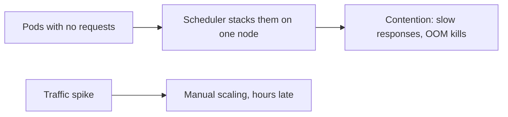
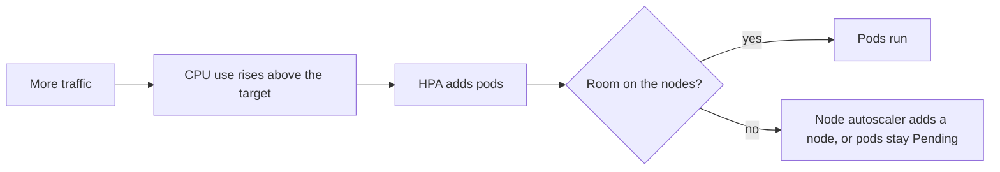

# Resources, Scheduling and Autoscaling

**Cloud and containers · Kubernetes · Step 9.3.6 · Intermediate** · Last updated 2026-10-22
**Prerequisites:** [Pods, ReplicaSets and Deployments](02-pods-replicasets-deployments.md) (9.3.2) and [Probes, rolling updates and graceful shutdown](05-probes-rolling-updates-graceful-shutdown.md) (9.3.5); helpful: [Containers: isolated processes with limits](../02-docker/02-containers-isolated-processes.md) (9.2.2) and [Scaling out stateless services](../../14-system-design/04-scaling-out-stateless-services.md) (14.4)

**Version note**

| Item | Version |
|---|---|
| Baseline | Resource `requests` and `limits` on containers; QoS classes; `autoscaling/v2` HorizontalPodAutoscaler |
| Hands-on baseline | Rancher Desktop with k3s, Kubernetes server v1.36.5, metrics-server (bundled with k3s), a single node with 2 CPUs and about 5.8 GiB memory, `kubectl` v1.37.1, run on 2026-10-22 |
| Compatibility note | The HPA default behaviours quoted here are those of the Kubernetes documentation; the scale-down window was shortened to 30 seconds in the experiment to save time (the default is 300 seconds). Memory and CPU enforcement assume Linux cgroups |

## 1. What it is and why it matters

**What is it?** Three connected ideas:
- **Resource requests and limits** say how much CPU and memory a container *needs* (the request) and how much it may *use at most* (the limit).
- **Scheduling** is the choice of which node runs a pod. The scheduler places pods using their **requests** and a set of placement rules.
- **Autoscaling** changes the number of pods (Horizontal Pod Autoscaler) when load changes.

**Why do we need it?** A cluster shares machines between many pods. If pods do not say what they need, the scheduler cannot place them sensibly, one greedy pod can starve its neighbours, and a pod can be killed for using too much memory or slowed down for using too much CPU. And fixed replica counts waste money at night and fail on Black Friday. Requests, limits and autoscaling are how you trade cost, reliability and speed deliberately.

**When would I meet it?** In every Deployment you write, in "OOMKilled" and "Pending" incidents, in cost reviews, and in every capacity discussion ("how many nodes do we need?").

> [!TIP]
> **Memory hook:** *the request is a reservation, the limit is a ceiling; the scheduler counts reservations, not usage; the autoscaler counts usage as a percentage of the reservation.*

## 2. Mental model: booking hotel rooms

A hotel (the node) has 100 rooms. Each group (pod) **books** rooms in advance (requests). The reception only checks the bookings: when all 100 are booked, new groups are sent elsewhere, even if half the rooms are actually empty. Guests who stay in rooms they did not book **while the hotel is empty** are tolerated up to a house rule (limit); when the hotel is full, the rule is enforced.

| Real life | Kubernetes |
|---|---|
| A room booking | A resource request: reserved for scheduling |
| The house rule on how much a group may use | A limit: a CPU cap or a memory kill threshold |
| Empty rooms, though all are booked | A node that is "full" for the scheduler while its usage is low |
| Reception sending a group to another hotel | The scheduler picking another node, or leaving the pod `Pending` |
| Opening more floors when demand is high | Autoscaling: more pods, and (with a node autoscaler) more nodes |

**Where the analogy breaks:** CPU is shared fairly and can be slowed down (a group is told to move slower), but memory cannot be slowed: the only enforcement is to remove the group that exceeded its limit (an out-of-memory kill).

## 3. Industry terms

| Term | Simple meaning | Why it matters | Example | Related terms |
|---|---|---|---|---|
| **Request** | The amount of CPU or memory reserved for a container; used for scheduling | The basis of placement and of autoscaling percentages | `cpu: 100m`, `memory: 128Mi` | Allocatable |
| **Limit** | The most the container may use | CPU: slowed down; memory: killed | `memory: 256Mi` | Throttling, OOM |
| **Millicore (`m`)** | One thousandth of a CPU core | The unit for CPU | `100m` = 0.1 core | CPU |
| **Allocatable** | What a node offers to pods after system reservations | The budget the scheduler works against | 2 CPUs here | Capacity |
| **QoS class** | Guaranteed, Burstable or BestEffort, derived from requests and limits | Decides who is evicted first under pressure | Pod with no settings = BestEffort | Eviction |
| **OOMKilled** | The container was killed for exceeding its memory limit; exit code 137 | A top cause of restarts | `Reason: OOMKilled` | Memory limit |
| **CPU throttling** | The kernel pauses a container that has used its CPU quota | Slow responses with no error | `nr_throttled` | cgroups |
| **Scheduler** | Chooses a node for each pod: filters out unfit nodes, scores the rest | Where things run | `0/1 nodes are available` | Placement |
| **Node selector, affinity, taints and tolerations** | Rules that attract pods to nodes, or repel them | Special hardware, isolation, spreading | `disktype: ssd` | Topology spread |
| **LimitRange and ResourceQuota** | Namespace defaults and caps | Guardrails for teams | Quota of 200m CPU | Namespace |
| **Horizontal Pod Autoscaler (HPA)** | Changes the replica count based on metrics | Capacity follows load | Target 50% CPU | metrics-server |
| **Vertical Pod Autoscaler, Cluster Autoscaler** | Adjusts the size of pods, or the number of nodes | The other two dimensions of scaling | Add a node when pods are pending | Karpenter |
| **metrics-server** | Provides current CPU and memory use to `kubectl top` and the HPA | No metrics, no autoscaling | `kubectl top pod` | Prometheus |

## 4. In a real system (ShopFlow)

**The business problem.** `order-service` pods have no resource settings. On a busy afternoon the scheduler puts six of them on the same node, because it thinks they need nothing. They compete for memory; the kernel kills a pod that grows; CPU-hungry neighbours slow everyone. A week later the Black Friday sale doubles traffic, and the operations team adds replicas by hand, two hours late. At night the same replicas sit idle and cost money.



**How requests, limits and autoscaling help.** Each pod declares what it needs (measured from real use), so the scheduler spreads pods according to capacity, and nodes are not overbooked. A memory limit protects neighbours from a leak. An HPA watches CPU use as a share of the request and adds pods within seconds of a spike, and removes them afterwards. A node autoscaler (in a cloud) adds machines when pods cannot be placed.



**What it costs.** Time to measure and tune; requests set too high waste money (reserved but idle) and too low cause contention and wrong autoscaling; limits can cause kills and throttling; autoscaling adds moving parts (metrics, delays, flapping).

**Elsewhere:** a batch platform reserves whole CPUs for guaranteed throughput and lets best-effort jobs use leftovers; a cost team reports the gap between requested and used resources per namespace; an e-commerce site scales on queue length rather than CPU.

## 5. How it works

### The scheduler

For each pod without a node, the scheduler **filters** the nodes that cannot run it (not enough unreserved CPU or memory, a selector or taint that does not match, a volume in another zone) and **scores** the rest (for example spreading pods out), then binds the pod to the best one. The key rule: **the sum of the requests of the pods on a node cannot exceed what the node offers (allocatable)**. Actual usage is not considered. If no node passes the filters, the pod stays `Pending` with an event explaining why.

### Worked example 1: requests, limits and QoS classes

The node's budget and what the cluster's own pods already reserved:

```text
$ kubectl --context rancher-desktop describe node | sed -n '/^Allocated resources:/,/^Events:/p' | head -12; echo; kubectl --context rancher-desktop top node
Allocated resources:
  (Total limits may be over 100 percent, i.e., overcommitted.)
  Resource           Requests    Limits
  --------           --------    ------
  cpu                200m (10%)  0 (0%)
  memory             140Mi (2%)  170Mi (2%)
  ephemeral-storage  0 (0%)      0 (0%)
  hugepages-1Gi      0 (0%)      0 (0%)
  hugepages-2Mi      0 (0%)      0 (0%)
  hugepages-32Mi     0 (0%)      0 (0%)
  hugepages-64Ki     0 (0%)      0 (0%)
Events:

NAME                   CPU(cores)   CPU(%)   MEMORY(bytes)   MEMORY(%)   
lima-rancher-desktop   182m         9%       2057Mi          34%         
```

```text
$ kubectl --context rancher-desktop get pods -A -o custom-columns=NS:.metadata.namespace,NAME:.metadata.name,CPU-REQ:.spec.containers[*].resources.requests.cpu,MEM-REQ:.spec.containers[*].resources.requests.memory | head -12
NS            NAME                                      CPU-REQ   MEM-REQ
kube-system   coredns-7cfb7bc9c7-w28xd                  100m      70Mi
kube-system   helm-install-traefik-crd-28w8r            100m      10M
kube-system   helm-install-traefik-sqvn4                100m      10M
kube-system   local-path-provisioner-77b9867795-7xr4m   <none>    <none>
kube-system   metrics-server-6dc596dfb8-dzzgr           100m      70Mi
kube-system   svclb-traefik-747992dc-hjs8w              <none>    <none>
kube-system   traefik-7c8544f77-88b2f                   <none>    <none>
```

The node offers 2 CPUs and about 5.8 GiB; the cluster's own pods (CoreDNS and metrics-server) reserve 200m of CPU. Three pods with different settings:

```yaml
apiVersion: v1
kind: Pod
metadata:
  name: qos-besteffort
  labels:
    learning: notes
spec:
  containers:
    - name: app
      image: busybox:1.37
      command: ["sleep", "3600"]
---
apiVersion: v1
kind: Pod
metadata:
  name: qos-burstable
  labels:
    learning: notes
spec:
  containers:
    - name: app
      image: busybox:1.37
      command: ["sleep", "3600"]
      resources:
        requests:
          cpu: 100m
          memory: 64Mi
        limits:
          memory: 128Mi
---
apiVersion: v1
kind: Pod
metadata:
  name: qos-guaranteed
  labels:
    learning: notes
spec:
  containers:
    - name: app
      image: busybox:1.37
      command: ["sleep", "3600"]
      resources:
        requests:
          cpu: 100m
          memory: 64Mi
        limits:
          cpu: 100m
          memory: 64Mi
```

```text
$ kubectl --context rancher-desktop -n sf-learn get pods -o custom-columns=NAME:.metadata.name,QOS:.status.qosClass,CPU-REQ:.spec.containers[0].resources.requests.cpu,CPU-LIM:.spec.containers[0].resources.limits.cpu,MEM-REQ:.spec.containers[0].resources.requests.memory,MEM-LIM:.spec.containers[0].resources.limits.memory
NAME             QOS          CPU-REQ   CPU-LIM   MEM-REQ   MEM-LIM
qos-besteffort   BestEffort   <none>    <none>    <none>    <none>
qos-burstable    Burstable    100m      <none>    64Mi      128Mi
qos-guaranteed   Guaranteed   100m      100m      64Mi      64Mi
```

**Walkthrough.** The class follows from the settings: no requests or limits means `BestEffort` (first to be evicted when a node is under pressure); some requests, with limits not equal to requests, means `Burstable`; for every container, requests equal to limits for both CPU and memory means `Guaranteed` (last to be evicted). The Kubernetes documentation puts the eviction order the same way: BestEffort first, then Burstable, and finally Guaranteed.

### Worked example 2: exceeding a memory limit

A container that tries to use 200 MB with a 64 MiB limit:

```yaml
apiVersion: v1
kind: Pod
metadata:
  name: memory-hog
  labels:
    learning: notes
spec:
  restartPolicy: Never
  containers:
    - name: app
      image: busybox:1.37
      command: ["sh", "-c", "echo allocating 200 MB; x=$(head -c 200000000 /dev/zero | tr '\\0' 'a'); echo allocated; sleep 5"]
      resources:
        requests:
          memory: 64Mi
        limits:
          memory: 64Mi
```

```text
$ kubectl --context rancher-desktop -n sf-learn apply -f oom.yaml >/dev/null; sleep 12; kubectl --context rancher-desktop -n sf-learn get pod memory-hog; echo; kubectl --context rancher-desktop -n sf-learn describe pod memory-hog | grep -E 'State:|Reason:|Exit Code|Limits|memory' | head -8; echo; kubectl --context rancher-desktop -n sf-learn logs memory-hog
NAME         READY   STATUS      RESTARTS   AGE
memory-hog   0/1     OOMKilled   0          12s

Name:             memory-hog
    State:          Terminated
      Reason:       OOMKilled
      Exit Code:    137
    Limits:
      memory:  64Mi
      memory:     64Mi
  Normal  Scheduled  12s   default-scheduler  Successfully assigned sf-learn/memory-hog to lima-rancher-desktop

allocating 200 MB
```

**Walkthrough.** The kernel killed the process: `Reason: OOMKilled`, `Exit Code: 137` (128 + 9, SIGKILL), and the log stopped after "allocating". This is the same behaviour as in the Docker series ([9.2.2](../02-docker/02-containers-isolated-processes.md)). For a Java service the limit must cover more than the heap: the heap, metaspace, thread stacks and native memory all count. The demo image starts the JVM with `-XX:MaxRAMPercentage=60`, so it sizes its heap as 60% of the container limit and leaves headroom ([9.2.4](../02-docker/04-dockerfile-java-service.md)); without a container-aware setting the JVM could size its heap from the node's memory instead and be killed at the limit. A Kubernetes restart policy then restarts the container, and a pod that is OOM-killed again and again looks like a crash loop with exit code 137.

### Worked example 3: exceeding a CPU limit

Two pods run a loop that uses as much CPU as it can. One has a CPU limit of 100m; the other only a request:

```yaml
apiVersion: v1
kind: Pod
metadata:
  name: cpu-limited
  labels:
    learning: notes
spec:
  containers:
    - name: burn
      image: busybox:1.37
      command: ["sh", "-c", "while :; do :; done"]
      resources:
        requests:
          cpu: 100m
        limits:
          cpu: 100m
---
apiVersion: v1
kind: Pod
metadata:
  name: cpu-unlimited
  labels:
    learning: notes
spec:
  containers:
    - name: burn
      image: busybox:1.37
      command: ["sh", "-c", "while :; do :; done"]
      resources:
        requests:
          cpu: 100m
```

```text
$ kubectl --context rancher-desktop -n sf-learn apply -f throttle.yaml >/dev/null; sleep 75; kubectl --context rancher-desktop -n sf-learn top pod; echo; for p in cpu-limited cpu-unlimited; do echo -n "$p: cpu.max inside the container = "; kubectl --context rancher-desktop -n sf-learn exec $p -- cat /sys/fs/cgroup/cpu.max; done; echo; kubectl --context rancher-desktop -n sf-learn exec cpu-limited -- grep -E 'nr_throttled|throttled_usec' /sys/fs/cgroup/cpu.stat
NAME            CPU(cores)   MEMORY(bytes)   
cpu-limited     101m         0Mi             
cpu-unlimited   1000m        0Mi             

cpu-limited: cpu.max inside the container = 10000 100000
cpu-unlimited: cpu.max inside the container = max 100000

nr_throttled 742
throttled_usec 16162078
```

**Walkthrough.** After about 75 seconds, `kubectl top` shows the limited pod at **101m** and the unlimited one at **1000m**, a whole core, which is all a single-threaded loop can use. Inside the container the cgroup file `cpu.max` shows `10000 100000` (10 ms of CPU time in every 100 ms period) for the limited pod and `max` for the other. The limited pod was throttled 742 times in this period, losing 16 seconds of runnable time in total. Unlike memory, the process is not killed; it is made to wait, which shows up as **latency without errors**, the hardest kind of problem to notice. The documentation: "cpu limits are enforced by CPU throttling ... Containers may not use more CPU than is specified in their cpu limit", while "memory limits are enforced by the kernel with out of memory (OOM) kills".

### Worked example 4: the scheduler counts requests, not usage

Three replicas that each *request* 700m CPU on a node that offers 2000m, with 200m already reserved:

```yaml
apiVersion: apps/v1
kind: Deployment
metadata:
  name: order-service
  labels:
    app: order-service
    learning: notes
spec:
  replicas: 3
  selector:
    matchLabels:
      app: order-service
  template:
    metadata:
      labels:
        app: order-service
        learning: notes
    spec:
      containers:
        - name: order-service
          image: sf-learn/shop-api:v1
          ports:
            - containerPort: 8080
          resources:
            requests:
              cpu: 700m
              memory: 128Mi
            limits:
              memory: 256Mi
```

```text
$ kubectl --context rancher-desktop -n sf-learn get pods -l app=order-service; echo; echo 'what the running pods actually use:'; kubectl --context rancher-desktop -n sf-learn top pods -l app=order-service 2>&1 | head -4; echo; echo 'why the third pod is Pending:'; kubectl --context rancher-desktop -n sf-learn get events --field-selector reason=FailedScheduling -o custom-columns=MESSAGE:.message | tail -1 | cut -c1-210
NAME                             READY   STATUS    RESTARTS   AGE
order-service-5fd85676dc-595kc   1/1     Running   0          48s
order-service-5fd85676dc-sct4j   1/1     Running   0          48s
order-service-5fd85676dc-xw76f   0/1     Pending   0          48s

what the running pods actually use:
NAME                             CPU(cores)   MEMORY(bytes)   
order-service-5fd85676dc-595kc   2m           25Mi            
order-service-5fd85676dc-sct4j   2m           25Mi            

why the third pod is Pending:
0/1 nodes are available: 1 Insufficient cpu. no new claims to deallocate, preemption: 0/1 nodes are available: 1 No preemption victims found for incoming pod.
```

```text
$ kubectl --context rancher-desktop describe node | sed -n '/^Allocated resources:/,/memory/p'
Allocated resources:
  (Total limits may be over 100 percent, i.e., overcommitted.)
  Resource           Requests     Limits
  --------           --------     ------
  cpu                1600m (80%)  0 (0%)
  memory             396Mi (6%)   682Mi (11%)
```

**Walkthrough.** Two pods fit (200 + 700 + 700 = 1600m), the third needs 700m more and does not (2300m > 2000m), so it stays `Pending` with `Insufficient cpu`. Meanwhile the two running pods use 2m of CPU each: the node is almost idle, yet "full". Requests that are too high waste capacity; requests that are too low let the scheduler pile pods up and cause contention. The right value comes from measuring real usage (for example with `kubectl top` or a monitoring system) over a representative period.

### Worked example 5: other placement rules

A pod can restrict where it runs. Here, a node selector asks for a label no node has:

```yaml
apiVersion: v1
kind: Pod
metadata:
  name: needs-ssd
  labels:
    learning: notes
spec:
  nodeSelector:
    disktype: ssd
  containers:
    - name: app
      image: busybox:1.37
      command: ["sleep", "3600"]
```

```text
$ kubectl --context rancher-desktop -n sf-learn apply -f nodeselector.yaml >/dev/null; sleep 5; kubectl --context rancher-desktop -n sf-learn get pod needs-ssd; kubectl --context rancher-desktop -n sf-learn describe pod needs-ssd | sed -n '/^Events:/,$p' | cut -c1-210; echo; echo 'the node has no such label:'; kubectl --context rancher-desktop get nodes --show-labels | tr ',' '\n' | grep -c disktype; kubectl --context rancher-desktop -n sf-learn delete -f nodeselector.yaml >/dev/null
NAME        READY   STATUS    RESTARTS   AGE
needs-ssd   0/1     Pending   0          5s
Events:
  Type     Reason            Age   From               Message
  ----     ------            ----  ----               -------
  Warning  FailedScheduling  5s    default-scheduler  0/1 nodes are available: 1 node(s) didn't match Pod's node affinity/selector. no new claims to deallocate, preemption: 0/1 nodes are available: 1 Preemption

the node has no such label:
0
```

**Walkthrough.** The scheduler found no node matching `disktype: ssd` and left the pod `Pending`. The same mechanism, with more flexibility, powers these rules (described, not run on this single-node cluster): **node affinity** (prefer or require node labels), **pod anti-affinity** and **topology spread constraints** (keep replicas of a service on different nodes or zones, so one failure doesn't take them all), **taints and tolerations** (a node refuses all pods except those that tolerate its taint: for dedicated or special nodes), and **priority classes** (let important pods push out less important ones). With one node, spreading cannot be demonstrated; in a real multi-node cluster, spreading replicas across zones is one of the most valuable settings for availability.

### Worked example 6: guardrails per namespace

A **LimitRange** supplies defaults for pods that set nothing, and a **ResourceQuota** caps the total a namespace may reserve:

```yaml
apiVersion: v1
kind: LimitRange
metadata:
  name: shop-defaults
  labels:
    learning: notes
spec:
  limits:
    - type: Container
      defaultRequest:
        cpu: 50m
        memory: 64Mi
      default:
        cpu: 200m
        memory: 128Mi
---
apiVersion: v1
kind: ResourceQuota
metadata:
  name: shop-quota
  labels:
    learning: notes
spec:
  hard:
    requests.cpu: 200m
    requests.memory: 256Mi
    pods: "5"
```

A Deployment of six pods, with no resource settings of its own, was applied in that namespace:

```text
$ kubectl --context rancher-desktop -n sf-learn apply -f limits.yaml >/dev/null; kubectl --context rancher-desktop -n sf-learn apply -f quota-pods.yaml >/dev/null; sleep 8; kubectl --context rancher-desktop -n sf-learn get pods -l app=quota-test; echo; echo 'defaults added by the LimitRange to a pod that set nothing:'; kubectl --context rancher-desktop -n sf-learn get pod -l app=quota-test -o jsonpath='{.items[0].spec.containers[0].resources}'; echo; echo; kubectl --context rancher-desktop -n sf-learn describe resourcequota shop-quota | sed -n '/Resource/,$p'; echo; kubectl --context rancher-desktop -n sf-learn get events --field-selector reason=FailedCreate -o custom-columns=MESSAGE:.message | tail -1 | cut -c1-260
NAME                         READY   STATUS    RESTARTS   AGE
quota-test-f457cfb7c-2ct45   1/1     Running   0          8s
quota-test-f457cfb7c-9nlqc   1/1     Running   0          8s
quota-test-f457cfb7c-frl5g   1/1     Running   0          8s
quota-test-f457cfb7c-z48gw   1/1     Running   0          8s

defaults added by the LimitRange to a pod that set nothing:
{"limits":{"cpu":"200m","memory":"128Mi"},"requests":{"cpu":"50m","memory":"64Mi"}}

Resource         Used   Hard
--------         ----   ----
pods             4      5
requests.cpu     200m   200m
requests.memory  256Mi  256Mi

(combined from similar events): Error creating: pods "quota-test-f457cfb7c-8mvll" is forbidden: exceeded quota: shop-quota, requested: requests.cpu=50m,requests.memory=64Mi, used: requests.cpu=200m,requests.memory=256Mi, limited: requests.cpu=200m,requests.mem
```

**Walkthrough.** Pods that set nothing received the LimitRange defaults (request 50m CPU and 64Mi, limit 200m and 128Mi) and so became `Burstable` rather than BestEffort. The quota allows 200m of CPU requests in total, so after four pods (4 × 50m) the next one was **refused at creation**: the ReplicaSet reports `exceeded quota`, and no Pending pod exists. This is how platform teams stop one team from reserving the whole cluster.

### Worked example 7: autoscaling with the HPA

The Horizontal Pod Autoscaler compares the measured use with its target and sets the replica count:

> desiredReplicas = ceil[ currentReplicas × (currentMetricValue / desiredMetricValue) ]

It runs every 15 seconds by default (kube-controller-manager setting) and ignores changes smaller than a 10% tolerance (Kubernetes documentation). It needs metrics (here, metrics-server) and works with **utilization**, which is usage as a percentage of the pod's **request**. The manifest sets a CPU request of 50m, a target of 50% (about 25m per pod), 1 to 4 pods, and a 30-second scale-down window:

```yaml
apiVersion: apps/v1
kind: Deployment
metadata:
  name: order-service
  labels:
    app: order-service
    learning: notes
spec:
  replicas: 1
  selector:
    matchLabels:
      app: order-service
  template:
    metadata:
      labels:
        app: order-service
        learning: notes
    spec:
      containers:
        - name: order-service
          image: sf-learn/shop-api:v1
          ports:
            - containerPort: 8080
          readinessProbe:
            httpGet:
              path: /ready
              port: 8080
            periodSeconds: 2
          resources:
            requests:
              cpu: 50m
              memory: 128Mi
            limits:
              memory: 256Mi
---
apiVersion: v1
kind: Service
metadata:
  name: order-service
  labels:
    learning: notes
spec:
  selector:
    app: order-service
  ports:
    - port: 80
      targetPort: 8080
---
apiVersion: autoscaling/v2
kind: HorizontalPodAutoscaler
metadata:
  name: order-service
  labels:
    learning: notes
spec:
  scaleTargetRef:
    apiVersion: apps/v1
    kind: Deployment
    name: order-service
  minReplicas: 1
  maxReplicas: 4
  metrics:
    - type: Resource
      resource:
        name: cpu
        target:
          type: Utilization
          averageUtilization: 50
  behavior:
    scaleDown:
      stabilizationWindowSeconds: 30
```

Eight loops requested the Service as fast as they could for 100 seconds. The HPA's state every 15 seconds:

```text
$ echo 'load starts at 0 s and stops at 100 s'; bash /private/tmp/claude-501/-Users-jubinjose-projects-learning/2c05463c-b11b-42e4-a908-9d6aae9989f1/scratchpad/watchhpa.sh
load starts at 0 s and stops at 100 s
   0s  cpu=  4% of request  desired=1  current=1  ready pods=1
  15s  cpu=146% of request  desired=3  current=1  ready pods=3
  30s  cpu=190% of request  desired=4  current=3  ready pods=4
  45s  cpu=132% of request  desired=4  current=4  ready pods=4
  60s  cpu=119% of request  desired=4  current=4  ready pods=4
  76s  cpu= 94% of request  desired=4  current=4  ready pods=4
  91s  cpu= 89% of request  desired=4  current=4  ready pods=4
 106s  cpu= 90% of request  desired=4  current=4  ready pods=4
 121s  cpu= 16% of request  desired=4  current=4  ready pods=4
 137s  cpu=  4% of request  desired=2  current=4  ready pods=2
 152s  cpu=  4% of request  desired=1  current=2  ready pods=1
 167s  cpu=  4% of request  desired=1  current=1  ready pods=1
 182s  cpu=  4% of request  desired=1  current=1  ready pods=1
 197s  cpu=  4% of request  desired=1  current=1  ready pods=1
 213s  cpu=  4% of request  desired=1  current=1  ready pods=1
 228s  cpu=  4% of request  desired=1  current=1  ready pods=1
 243s  cpu=  4% of request  desired=1  current=1  ready pods=1
```

and the autoscaler's own record of its decisions:

```text
$ kubectl --context rancher-desktop -n sf-learn get events --field-selector involvedObject.kind=HorizontalPodAutoscaler --sort-by=.metadata.creationTimestamp -o custom-columns=REASON:.reason,MESSAGE:.message | cut -c1-150
REASON              MESSAGE
SuccessfulRescale   New size: 3; reason: cpu resource utilization (percentage of request) above target
SuccessfulRescale   New size: 4; reason: cpu resource utilization (percentage of request) above target
SuccessfulRescale   New size: 2; reason: All metrics below target
SuccessfulRescale   New size: 1; reason: All metrics below target
```

**Walkthrough.** At rest, CPU was 4% of the request. Under load the first reading was 146%: with one pod, `ceil(1 × 146/50) = ceil(2.92) = 3` replicas, as shown (`desired=3`). Fifteen seconds later, with three pods, the average was 190%: `ceil(3 × 190/50) = ceil(11.4) = 12`, capped by `maxReplicas` at 4. The load per pod then fell to about 90% (still above the 50% target, so the HPA wanted 4, the maximum). When the load stopped (at 100 s), the reading dropped to 4% and the scale-down followed: first to 2, then to 1, after the 30-second stabilization window. With the default window of 300 seconds the pods would have stayed about five minutes longer: scale-down is deliberately slow to avoid flapping, scale-up is fast (the defaults allow adding 4 pods or 100% every 15 seconds, whichever is larger). The `describe` output shows these default behaviours:

```text
$ kubectl --context rancher-desktop -n sf-learn describe hpa order-service | sed -n '/^Metrics:/,$p' | cut -c1-170
Metrics:                                               ( current / target )
  resource cpu on pods  (as a percentage of request):  4% (2m) / 50%
Min replicas:                                          1
Max replicas:                                          4
Behavior:
  Scale Up:
    Stabilization Window: 0 seconds
    Select Policy: Max
    Policies:
      - Type: Pods     Value: 4    Period: 15 seconds
      - Type: Percent  Value: 100  Period: 15 seconds
  Scale Down:
    Stabilization Window: 30 seconds
    Select Policy: Max
    Policies:
      - Type: Percent  Value: 100  Period: 15 seconds
Deployment pods:       1 current / 1 desired
Conditions:
  Type            Status  Reason              Message
  ----            ------  ------              -------
  AbleToScale     True    ReadyForNewScale    recommended size matches current size
  ScalingActive   True    ValidMetricFound    the HPA was able to successfully calculate a replica count from cpu resource utilization (percentage of request)
  ScalingLimited  False   DesiredWithinRange  the desired count is within the acceptable range
Events:
  Type     Reason                        Age    From                       Message
  ----     ------                        ----   ----                       -------
  Warning  FailedGetResourceMetric       4m40s  horizontal-pod-autoscaler  failed to get cpu utilization: unable to get metrics for resource cpu: no metrics returned from
  Warning  FailedComputeMetricsReplicas  4m40s  horizontal-pod-autoscaler  invalid metrics (1 invalid out of 1), first error is: failed to get cpu resource metric value: 
  Normal   SuccessfulRescale             3m55s  horizontal-pod-autoscaler  New size: 4; reason: cpu resource utilization (percentage of request) above target
  Normal   SuccessfulRescale             115s   horizontal-pod-autoscaler  New size: 3; reason: All metrics below target
  Normal   SuccessfulRescale             100s   horizontal-pod-autoscaler  New size: 1; reason: All metrics below target
```

Notice that the very first events in that record were failures to get metrics: right after creation there are no figures yet, which is normal. Two limits are visible: the maximum was reached (4 pods) while usage was still above target, so the HPA could not help more; and scaling reacted within about 15 to 30 seconds, but new Java pods also need time to start and become ready ([9.3.5](05-probes-rolling-updates-graceful-shutdown.md)). A sudden spike needs spare capacity, a higher minimum, or earlier scaling, because pods will not be ready the moment they are created.

### When it goes wrong

**1. Pods OOM-killed in a loop.** The memory limit is below what the application needs (heap plus the rest). The container restarts, the status says `OOMKilled`, the count grows. Raise the limit, cap the heap relative to the limit, find the leak.

**2. Pods stuck `Pending`.** Requests exceed what is available, or placement rules cannot be met (examples 4 and 5). Read the scheduler's event.

**3. Latency spikes from throttling.** A CPU limit below the real need slows requests without any error. Compare `throttled` counters with latency; consider removing CPU limits (keeping requests) or raising them.

**4. An HPA that cannot see its metric.** A Deployment without a CPU request:

```text
$ kubectl --context rancher-desktop -n sf-learn apply -f hpa-norequest.yaml >/dev/null; sleep 50; kubectl --context rancher-desktop -n sf-learn get hpa order-norequest; kubectl --context rancher-desktop -n sf-learn describe hpa order-norequest | sed -n '/^Conditions:/,/^Events:/p' | cut -c1-200; kubectl --context rancher-desktop -n sf-learn delete -f hpa-norequest.yaml >/dev/null
NAME              REFERENCE                    TARGETS              MINPODS   MAXPODS   REPLICAS   AGE
order-norequest   Deployment/order-norequest   cpu: <unknown>/50%   1         3         1          50s
Conditions:
  Type           Status  Reason                   Message
  ----           ------  ------                   -------
  AbleToScale    True    SucceededGetScale        the HPA controller was able to get the target's current scale
  ScalingActive  False   FailedGetResourceMetric  the HPA was unable to compute the replica count: failed to get cpu utilization: missing request for cpu in container order-service of Pod order-norequ
Events:
```

The target shows `<unknown>` and the HPA does nothing, because a utilization percentage needs a request to be a percentage of. Without metrics-server the same symptom appears.

**5. Autoscaling that runs out of room.** The HPA asks for more pods than the nodes can hold; they stay `Pending` until a node autoscaler (or an operator) adds capacity. In a cloud, check the node pool's maximum size and quota.

**6. Flapping.** A short stabilization window and a spiky metric add and remove pods repeatedly. Keep the default scale-down window unless you know why not.

### Common mistakes

1. No requests at all (BestEffort pods).
2. Requests copied between services, or set to "100m" everywhere.
3. A memory limit equal to the JVM heap size.
4. HPA on CPU for a service whose bottleneck is a database or a queue.
5. Autoscaling with a `minReplicas` of 1 for a service that must survive a node loss.
6. Expecting the HPA to react before pods can start.

### Alternatives in the industry

A map of the landscape, not a comparison. Only the Kubernetes features above were run; check each project's documentation before adopting one.

| Area | Tool or product | What it is | When you meet it |
|---|---|---|---|
| Pod autoscaling | **HPA** (used here) | Built-in scaling by CPU, memory or custom metrics | The default for stateless services |
| | **KEDA** | Scales on events such as queue length, Kafka lag or schedules, including down to zero | Event-driven and queue-based workers |
| | **Vertical Pod Autoscaler (VPA)** | Recommends or sets request sizes from observed use | Right-sizing; not on the same metric as an HPA |
| Node autoscaling | **Cluster Autoscaler**, **Karpenter** | Add or remove nodes so that pending pods can be placed | Cloud clusters; Karpenter on AWS (and others) picks instance types dynamically |
| | **Managed autopilot modes** (GKE Autopilot, EKS Fargate) | The provider runs the nodes; you pay per pod request | Teams that want no node management |
| Scheduling extras | **Descheduler**, **Kueue**, **Volcano** | Rebalance running pods; queueing and fair sharing for batch and AI workloads | Batch, data and machine-learning platforms |
| Observing use | **metrics-server** (used here), **Prometheus** with **Grafana** | Current figures; long-term metrics and dashboards | Every production cluster |
| Cost and sizing | **OpenCost**, **Kubecost**, **Goldilocks** | Show the cost of requests and suggest better sizes | FinOps reviews (9.6, planned) |
| Other platforms | **ECS service auto scaling**, **Nomad autoscaler**, **Cloud Run concurrency scaling** | Their own equivalents | Teams outside Kubernetes ([9.3.1](01-kubernetes-overview.md)) |

## 6. Architectural decisions

| Decision | Choose | Because |
|---|---|---|
| Requests | Always set, from measured usage (a typical percentile of real use), reviewed regularly | Placement and autoscaling both depend on them |
| Memory limit | Set, close to the request, with headroom above the JVM heap (and `MaxRAMPercentage` below 100) | Predictable; protects neighbours; avoids kills |
| CPU limit | A deliberate choice: many teams set CPU requests but no CPU limit to avoid throttling; others keep limits for fairness or cost control | Throttling hurts latency; unlimited bursting can hurt neighbours |
| QoS class | Guaranteed (requests = limits) for the most critical pods; Burstable for most; avoid BestEffort | Eviction order under pressure |
| Replicas and spread | At least two, spread across nodes and zones with topology spread constraints | One node or zone failing is not an outage |
| HPA metric and target | CPU for CPU-bound services (a target near 60–70% leaves headroom); queue length or request rate for workers and I/O-bound services | Scale on the real bottleneck |
| Scale-down | Keep the default stabilization (300 s) unless you can justify less | Avoids flapping |
| Guardrails | LimitRange defaults and ResourceQuota per team namespace | No unbounded reservations |
| Node capacity | A node autoscaler in the cloud; headroom for spikes | Pods need nodes to run on |
| Verification | Load test the scaling path, including startup time | Autoscaling that is slower than the spike does not help |

## 7. Try it yourself

Try each exercise first; the real results are in the Answers section.

1. **Which class?** Create three pods that are BestEffort, Burstable and Guaranteed, and show the class Kubernetes assigned to each.
2. **Why Pending?** A Deployment's third pod stays `Pending` on a node that is almost idle. Find the reason and say what to change.
3. **Scale it.** Put an HPA on a service with a CPU request, create load, and show the replica count rising and falling. Use the formula to explain the first step.

## 8. Check your understanding

1. A node shows 5% CPU use, yet new pods are `Pending` with `Insufficient cpu`. Why?
2. What is the difference between a container being OOM-killed and CPU-throttled, as seen by the user?
3. The HPA target says `<unknown>/50%`. Give two reasons.
4. Your HPA uses a 50% CPU target with requests of 50m. The service is slow even though the HPA reports 30%. What might be going on?

Answers are at the end of this note.

## 9. Revision

**Remember**
- **Request** = reservation used by the scheduler (and the base of HPA percentages); **limit** = ceiling. CPU over the limit is **throttled**; memory over the limit is **OOM-killed** (exit 137).
- **QoS:** none = BestEffort; requests ≠ limits = Burstable; requests = limits = Guaranteed. Eviction order: BestEffort, Burstable, Guaranteed.
- The scheduler counts **requests, not usage**; no fit = `Pending` with a reason in the events.
- **LimitRange** (defaults) and **ResourceQuota** (caps) guard namespaces.
- **HPA:** `desired = ceil(current × measured / target)`, every 15 s, 10% tolerance, fast up, 300 s default down; needs metrics-server and CPU requests.
- Autoscaling is limited by start-up time, `maxReplicas`, and node capacity.

**Explain in 15 seconds:** "Requests reserve resources and drive placement, limits cap them (CPU is throttled, memory is killed), and the HPA adds or removes pods to keep usage at a target percentage of the request."

**Explain in 60 seconds:**
> "Every container declares a request, which the scheduler uses to place the pod on a node with enough unreserved capacity, and a limit, which the kernel enforces: CPU is throttled, so you get latency, and memory is killed with an OOM, exit code 137. From those, pods fall into QoS classes that decide who is evicted first. The scheduler counts reservations, not usage, so over-sized requests leave idle nodes unable to take more pods, and under-sized ones cause contention. I set requests from measured usage, a memory limit with headroom above the JVM heap, spread replicas over nodes and zones, and put LimitRanges and quotas on team namespaces. For load I use a HorizontalPodAutoscaler: every 15 seconds it computes desired replicas as current times measured over target, where the measurement is a percentage of the request, so requests must be right; it scales up fast and down slowly. It needs metrics-server, and it can only use the nodes there are, so in a cloud I pair it with a node autoscaler, and I load test because new Java pods take time to start."

**Likely follow-up questions:**
- **Should I set CPU limits?** It depends: limits cause throttling and extra latency, so many teams set requests only; others keep limits to bound noisy neighbours. Decide with data, not by default.
- **Can the HPA scale on custom metrics?** Yes, through the custom and external metrics APIs, or via KEDA (not run here).
- **HPA and VPA together?** Not on the same metric; use VPA for recommendations and HPA for scaling.
- **What does a node autoscaler add?** Nodes for pods that cannot be scheduled; it reacts to `Pending` pods, not to CPU directly.

**Architect's takeaway:** requests are a contract with the scheduler, and every autoscaling and cost conversation starts from them. Measure real usage, set honest requests, and prove the scaling path under load.

**Next topic:** [Storage and StatefulSets](07-storage-statefulsets.md) (9.3.7)

## 10. Verification and sources

> [!NOTE]
> Checked 2026-10-22 against the Kubernetes documentation and by running every experiment on Rancher Desktop (Kubernetes server v1.36.5+k3s1). Usage figures and timings vary on every run. The scale-down window was shortened to 30 seconds for the experiment. Re-verify when you revisit this note.

- **Confirmed (documentation, read 2026-10-22):** "cpu limits are enforced by CPU throttling ... memory limits are enforced by the kernel with out of memory (OOM) kills" (Kubernetes, "Resource Management for Pods and Containers"); QoS classes Guaranteed, Burstable and BestEffort, and that under node pressure BestEffort Pods are evicted first, then Burstable, and finally Guaranteed (Kubernetes, "Pod Quality of Service Classes"); the HPA formula `desiredReplicas = ceil[currentReplicas × (currentMetricValue / desiredMetricValue)]`, the 15-second default sync period, the 0.1 default tolerance, the default scale-down stabilization window of 300 seconds, and the default scale-up policies of 4 pods or 100% every 15 seconds with `selectPolicy: Max` (Kubernetes, "Horizontal Pod Autoscaling"); the CPU and memory limit enforcement is also confirmed by the cgroup values and kill reason observed here.
- **Observed (this machine):** the node's allocatable resources and what the system pods reserve; the QoS classes; `OOMKilled` with exit code 137 at a 64 MiB limit; the CPU figures of 101m and 1000m, the `cpu.max` values and the throttle counters; the Pending reason `Insufficient cpu` with idle nodes; the LimitRange defaults and the quota refusal; the `nodeSelector` event; the HPA timeline and events, including the first scale-up of 1 to 3 at 146%; the `<unknown>` target without requests.
- **General knowledge, matched by the experiments but not quoted from the documentation:** the scheduler's filter-and-score description, the semantics of LimitRange and ResourceQuota, and the role of node and pod placement rules.
- **Not run:** topology spread constraints, affinity, taints and tolerations, priority classes, VPA, KEDA, Cluster Autoscaler, Karpenter and the other alternatives (general industry knowledge); multi-node scheduling.
- **Assumptions and illustrations:** the ShopFlow story is illustrative; the numbers (700m requests, the 50m request for the HPA test) were chosen to make the effects visible on a 2-CPU node, not as recommendations.
- **To verify:** your cluster's allocatable resources and system reservations; whether your platform sets default LimitRanges; the HPA behaviour settings of your cluster; the policy on CPU limits in your organisation.
- **Decision rule:** honest requests from measurement; memory limits with headroom; a deliberate CPU-limit policy; replicas spread across failure domains; HPA on the real bottleneck; a load test of the scaling path.

**Sources:** Kubernetes documentation: "Resource Management for Pods and Containers", "Pod Quality of Service Classes", "Horizontal Pod Autoscaling"; for further reading: "Kubernetes Scheduler", "Assigning Pods to Nodes", "Limit Ranges", "Resource Quotas".

## Answers

**Experiment (exercises)**

1. **Which class?** Pods with no settings, with requests below limits, and with equal requests and limits become BestEffort, Burstable and Guaranteed:

```text
$ kubectl --context rancher-desktop -n sf-learn get pods -o custom-columns=NAME:.metadata.name,QOS:.status.qosClass,CPU-REQ:.spec.containers[0].resources.requests.cpu,CPU-LIM:.spec.containers[0].resources.limits.cpu,MEM-REQ:.spec.containers[0].resources.requests.memory,MEM-LIM:.spec.containers[0].resources.limits.memory
NAME             QOS          CPU-REQ   CPU-LIM   MEM-REQ   MEM-LIM
qos-besteffort   BestEffort   <none>    <none>    <none>    <none>
qos-burstable    Burstable    100m      <none>    64Mi      128Mi
qos-guaranteed   Guaranteed   100m      100m      64Mi      64Mi
```

2. **Why Pending?** `kubectl describe pod` (or the events): the scheduler reports `Insufficient cpu`, because the pods' CPU **requests** add up to more than the node offers, although the actual use is tiny. Lower the requests to the measured need, add nodes, or reduce replicas:

```text
$ kubectl --context rancher-desktop -n sf-learn get pods -l app=order-service; echo; echo 'what the running pods actually use:'; kubectl --context rancher-desktop -n sf-learn top pods -l app=order-service 2>&1 | head -4; echo; echo 'why the third pod is Pending:'; kubectl --context rancher-desktop -n sf-learn get events --field-selector reason=FailedScheduling -o custom-columns=MESSAGE:.message | tail -1 | cut -c1-210
NAME                             READY   STATUS    RESTARTS   AGE
order-service-5fd85676dc-595kc   1/1     Running   0          48s
order-service-5fd85676dc-sct4j   1/1     Running   0          48s
order-service-5fd85676dc-xw76f   0/1     Pending   0          48s

what the running pods actually use:
NAME                             CPU(cores)   MEMORY(bytes)   
order-service-5fd85676dc-595kc   2m           25Mi            
order-service-5fd85676dc-sct4j   2m           25Mi            

why the third pod is Pending:
0/1 nodes are available: 1 Insufficient cpu. no new claims to deallocate, preemption: 0/1 nodes are available: 1 No preemption victims found for incoming pod.
```

3. **Scale it.** With a request of 50m and a 50% target, the first reading under load was 146%, so `ceil(1 × 146/50) = 3`; later readings of 190% on three pods gave `ceil(3 × 190/50) = 12`, capped at the maximum of 4. After the load stopped, the count came down after the stabilization window:

```text
$ echo 'load starts at 0 s and stops at 100 s'; bash /private/tmp/claude-501/-Users-jubinjose-projects-learning/2c05463c-b11b-42e4-a908-9d6aae9989f1/scratchpad/watchhpa.sh
load starts at 0 s and stops at 100 s
   0s  cpu=  4% of request  desired=1  current=1  ready pods=1
  15s  cpu=146% of request  desired=3  current=1  ready pods=3
  30s  cpu=190% of request  desired=4  current=3  ready pods=4
  45s  cpu=132% of request  desired=4  current=4  ready pods=4
  60s  cpu=119% of request  desired=4  current=4  ready pods=4
  76s  cpu= 94% of request  desired=4  current=4  ready pods=4
  91s  cpu= 89% of request  desired=4  current=4  ready pods=4
 106s  cpu= 90% of request  desired=4  current=4  ready pods=4
 121s  cpu= 16% of request  desired=4  current=4  ready pods=4
 137s  cpu=  4% of request  desired=2  current=4  ready pods=2
 152s  cpu=  4% of request  desired=1  current=2  ready pods=1
 167s  cpu=  4% of request  desired=1  current=1  ready pods=1
 182s  cpu=  4% of request  desired=1  current=1  ready pods=1
 197s  cpu=  4% of request  desired=1  current=1  ready pods=1
 213s  cpu=  4% of request  desired=1  current=1  ready pods=1
 228s  cpu=  4% of request  desired=1  current=1  ready pods=1
 243s  cpu=  4% of request  desired=1  current=1  ready pods=1
```

**Check your understanding**

1. The scheduler adds up **requests**, not usage. Pods that have reserved 90% or more of the CPU leave no unreserved CPU, so a new pod cannot be placed even though the processors are idle. Check `kubectl describe node` (Allocated resources) and lower over-sized requests.
2. An OOM kill ends the process: the user sees errors for requests in progress and a restart (status `OOMKilled`, exit 137). Throttling keeps the process alive but makes it wait for CPU: no errors, just slower responses, which are easy to miss. Both are enforced by the kernel, through cgroups.
3. (a) The pods have no CPU request, so a percentage cannot be computed (shown in the `hpa-norequest` output), or (b) the metrics are not available: metrics-server is missing, unhealthy or has not yet scraped the new pods. Other causes: the target Deployment name is wrong, or the pods are not yet ready.
4. The CPU percentage is not the bottleneck: the service may be waiting on a database, a lock, a downstream call or a connection pool, or its CPU limit is throttling it (CPU use measured against the request can look low while the kernel throttles at the limit), or the pods are still starting. Use latency, queue length or request rate as the metric, and check the throttle counters.

Back to [the series overview](01-kubernetes-overview.md) · [the area overview](../01-cloud-and-containers-overview.md) · [the index](../../README.md) · [Roadmap](../../roadmap.md).
