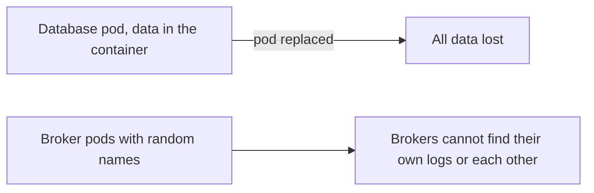
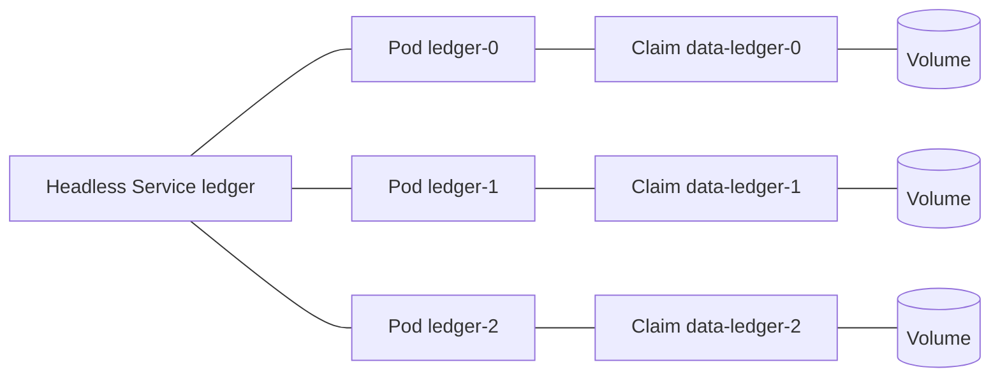
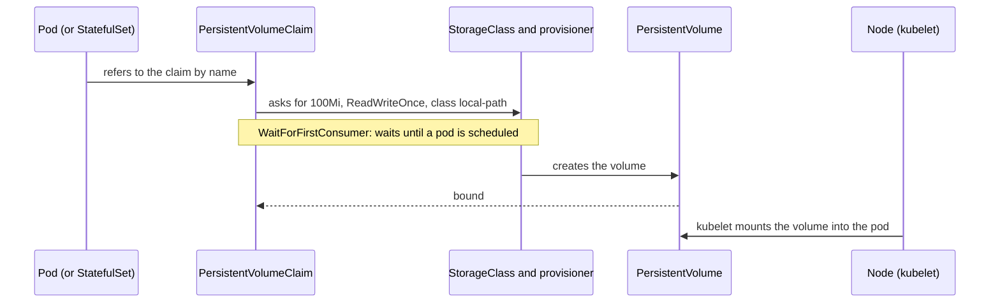

# Storage and StatefulSets

**Cloud and containers · Kubernetes · Step 9.3.7 · Advanced** · Last updated 2026-10-23
**Prerequisites:** [Pods, ReplicaSets and Deployments](02-pods-replicasets-deployments.md) (9.3.2), [Services, DNS and Ingress](03-services-dns-ingress.md) (9.3.3) and [Configuration and secrets](04-configuration-and-secrets.md) (9.3.4); helpful: [Data and configuration: volumes and environment](../02-docker/06-data-and-configuration.md) (9.2.6) and [Choosing a database](../../14-system-design/07-choosing-a-database.md) (14.7)

**Version note**

| Item | Version |
|---|---|
| Baseline | Core `v1` PersistentVolume, PersistentVolumeClaim and `storage.k8s.io/v1` StorageClass; `apps/v1` StatefulSet |
| Hands-on baseline | Rancher Desktop with k3s, Kubernetes server v1.36.5, the bundled `local-path` provisioner (storage on the single node's disk), PostgreSQL 16 (Alpine image), `kubectl` v1.37.1, run on 2026-10-22 |
| Compatibility note | The StatefulSet claim-retention policy (`persistentVolumeClaimRetentionPolicy`) is stable since v1.32; the default behaviour is to keep claims. The `local-path` storage used here is node-local and not replicated: it is a learning setup, and cloud clusters use block-storage drivers (CSI) instead |

## 1. What it is and why it matters

**What is it?** Containers are disposable and their filesystem disappears with them ([9.2.6](../02-docker/06-data-and-configuration.md)). Kubernetes separates *using* storage from *providing* it:
- A **PersistentVolumeClaim (PVC)** is a pod's request for storage ("100 MiB, read-write by one node").
- A **PersistentVolume (PV)** is the actual piece of storage that satisfies it.
- A **StorageClass** describes a kind of storage (fast disk, cheap disk) and lets the cluster create PVs on demand ("dynamic provisioning").
- A **StatefulSet** is a controller for applications that need a **stable identity** and **their own storage per replica**: pods named `ledger-0`, `ledger-1`, ..., each with its own claim, started and stopped in order.

**Why do we need it?** A database, a message broker or a search index must keep its data when its pod is replaced, and often needs to know *who it is* (primary or replica, broker 0 or broker 1). A Deployment gives neither: its pods are interchangeable and have random names.

**When would I meet it?** When anything with state runs in the cluster (a database, Kafka, Elasticsearch, an upload folder), when a pod is stuck waiting for a volume, and when someone asks "can we run the database in Kubernetes?"

> [!TIP]
> **Memory hook:** *the claim is the ticket, the volume is the locker; a StatefulSet gives every replica its own name and its own locker, and keeps the locker when the replica goes away.*

## 2. Mental model: lockers and named seats

A gym has lockers. A member does not pick a specific locker: they ask the front desk for "a small locker" (the **claim**, with a size and a type), and the desk assigns a real locker (the **volume**) of the right kind (the **storage class**: standard or heated). When the member leaves the gym, the locker stays reserved until the claim is released, then it is cleared or kept, depending on the gym's rule (**reclaim policy**).

A **StatefulSet** is a table of named seats: seat 0, seat 1, seat 2. Each seat has its own locker. If the person in seat 1 leaves and a new one arrives, they get seat 1, with seat 1's name tag and seat 1's locker.

| Real life | Kubernetes |
|---|---|
| The member's request for a locker | PersistentVolumeClaim |
| The real locker | PersistentVolume |
| Standard or heated lockers | StorageClass |
| What happens to the locker when the claim ends | Reclaim policy (`Delete` or `Retain`) |
| Named seats with their own lockers | StatefulSet pods with `volumeClaimTemplates` |

**Where the analogy breaks:** a gym locker is where the member is; many storage types are tied to one machine or one availability zone, so a replacement pod may only be able to start where its data is, and a lost machine can mean lost data unless the storage is replicated elsewhere.

## 3. Industry terms

| Term | Simple meaning | Why it matters | Example | Related terms |
|---|---|---|---|---|
| **Volume** | A directory made available to the containers of a pod | Several kinds: temporary, config, persistent | `emptyDir`, `configMap`, `persistentVolumeClaim` | Mount |
| **`emptyDir`** | Scratch space that lives as long as the pod (not the container) | Survives a container restart, not a pod replacement | `/scratch` | tmpfs |
| **PersistentVolume (PV)** | A cluster-level piece of storage | The real storage | A cloud disk | CSI driver |
| **PersistentVolumeClaim (PVC)** | A namespaced request for storage | How pods ask for it | `order-data` | Binding |
| **StorageClass** | A named recipe for creating volumes on demand | Fast versus cheap; the provisioner | `local-path`, `gp3`, `standard-rwo` | Provisioner |
| **Dynamic provisioning** | The volume is created when the claim appears | No manual volume setup | The `local-path` provisioner | CSI |
| **Access mode** | Who may mount it: `ReadWriteOnce` (one node), `ReadOnlyMany`, `ReadWriteMany`, `ReadWriteOncePod` | Limits how many pods can share it | `RWO` | Shared filesystem |
| **Reclaim policy** | What happens to the volume when its claim is deleted: `Delete` or `Retain` | Decides whether data survives | `Delete` | Finalizer |
| **Volume binding mode** | When a claim is bound: `Immediate`, or `WaitForFirstConsumer` (after a pod is scheduled) | Lets the volume be created where the pod runs | `WaitForFirstConsumer` | Zones |
| **CSI** | Container Storage Interface: the standard way storage systems plug into Kubernetes | Cloud disks, Ceph and others are CSI drivers | EBS CSI driver | Provisioner |
| **StatefulSet** | A controller for pods with stable names, stable DNS and per-pod volumes | Databases, brokers, clustered systems | `ledger-0` | Headless Service |
| **`volumeClaimTemplates`** | A claim blueprint; the StatefulSet makes one claim per pod | Per-replica storage | `data-ledger-0` | PVC |
| **Volume snapshot** | A point-in-time copy of a volume, via the storage driver | Fast copies; not a substitute for tested backups | `VolumeSnapshot` | Backup |

## 4. In a real system (ShopFlow)

**The business problem.** `order-service` stores orders in PostgreSQL. In the first Kubernetes test, the database ran as a Deployment with its data directory inside the container. During a node maintenance the pod was rescheduled and **every order disappeared**. The team also needs a three-broker message cluster where each broker must keep its own log and know its own number.



**How storage objects and StatefulSets help.** The database pod mounts a **PersistentVolumeClaim**. The data lives on a **PersistentVolume** outside the pod; when the pod is replaced, the new pod mounts the same claim and finds the data. A **StatefulSet** gives each broker a fixed name (`broker-0`, `broker-1`, `broker-2`), a stable DNS name, and its own claim, so a replaced `broker-1` comes back as `broker-1` with `broker-1`'s data.



**What it costs.** State is the hard part of any platform: storage that is slower or less reliable than expected, volumes tied to a zone or a node, backups and restores to design and test, ordered and careful updates, and operations skills for the database itself. For many teams a managed database is the right answer ([14.7](../../14-system-design/07-choosing-a-database.md)); running one in Kubernetes is a decision with a real operating cost.

**Elsewhere:** a search platform runs a StatefulSet of index nodes with fast local disks; a company runs Kafka through an operator that manages broker identity and storage; a CI system gives each runner a cache volume.

## 5. How it works

### The path from a pod to the disk



All examples ran in `sf-learn`. The cluster has one storage class:

```text
$ kubectl --context rancher-desktop get storageclass
NAME                   PROVISIONER             RECLAIMPOLICY   VOLUMEBINDINGMODE      ALLOWVOLUMEEXPANSION   AGE
local-path (default)   rancher.io/local-path   Delete          WaitForFirstConsumer   false                  13d
```

`local-path` creates directories on the node's own disk, `Delete` removes them when the claim is deleted, and `WaitForFirstConsumer` waits for a pod. Volume expansion is not allowed (`ALLOWVOLUMEEXPANSION false`).

### Worked example 1: a claim, and when it binds

```yaml
apiVersion: v1
kind: PersistentVolumeClaim
metadata:
  name: order-data
  labels:
    learning: notes
spec:
  accessModes:
    - ReadWriteOnce
  resources:
    requests:
      storage: 100Mi
```

```text
$ kubectl --context rancher-desktop -n sf-learn apply -f pvc.yaml; sleep 3; kubectl --context rancher-desktop -n sf-learn get pvc order-data; kubectl --context rancher-desktop -n sf-learn describe pvc order-data | grep -E 'Status|Events|WaitForFirstConsumer|waiting' | cut -c1-170; kubectl --context rancher-desktop -n sf-learn get pv 2>&1 | head -3
persistentvolumeclaim/order-data created
NAME         STATUS    VOLUME   CAPACITY   ACCESS MODES   STORAGECLASS   VOLUMEATTRIBUTESCLASS   AGE
order-data   Pending                                      local-path     <unset>                 3s
Status:        Pending
Events:
  Normal  WaitForFirstConsumer  1s (x2 over 3s)  persistentvolume-controller  waiting for first consumer to be created before binding
No resources found
```

**Walkthrough.** The claim stayed `Pending` with the event "waiting for first consumer to be created before binding", and no volume existed yet: with `WaitForFirstConsumer` the cluster waits to see where the pod is scheduled so that it can create the volume in the right place (in a cloud: the right availability zone). A pod that uses the claim:

```yaml
apiVersion: v1
kind: Pod
metadata:
  name: writer
  labels:
    app: writer
    learning: notes
spec:
  containers:
    - name: writer
      image: busybox:1.37
      command: ["sh", "-c", "echo \"written by $(hostname) at $(date +%T)\" >> /data/notes.txt; echo \"scratch from $(hostname) at $(date +%T)\" >> /scratch/notes.txt; echo done; sleep 3600"]
      volumeMounts:
        - name: data
          mountPath: /data
        - name: scratch
          mountPath: /scratch
  volumes:
    - name: data
      persistentVolumeClaim:
        claimName: order-data
    - name: scratch
      emptyDir: {}
```

```text
$ kubectl --context rancher-desktop -n sf-learn apply -f writer.yaml >/dev/null; kubectl --context rancher-desktop -n sf-learn wait --for=condition=Ready pod/writer --timeout=60s >/dev/null; sleep 2; kubectl --context rancher-desktop -n sf-learn get pvc order-data; echo; kubectl --context rancher-desktop get pv -o custom-columns=NAME:.metadata.name,CAPACITY:.spec.capacity.storage,ACCESS:.spec.accessModes[0],RECLAIM:.spec.persistentVolumeReclaimPolicy,CLAIM:.spec.claimRef.name,CLASS:.spec.storageClassName,NODE:.spec.nodeAffinity.required.nodeSelectorTerms[0].matchExpressions[0].values[0]; echo; kubectl --context rancher-desktop get pv -o jsonpath='{.items[0].spec.local.path}{.items[0].spec.hostPath.path}'; echo
NAME         STATUS   VOLUME                                     CAPACITY   ACCESS MODES   STORAGECLASS   VOLUMEATTRIBUTESCLASS   AGE
order-data   Bound    pvc-1ac17987-36d0-4a9c-a4a7-5c6cf690773f   100Mi      RWO            local-path     <unset>                 9s

NAME                                       CAPACITY   ACCESS          RECLAIM   CLAIM        CLASS        NODE
pvc-1ac17987-36d0-4a9c-a4a7-5c6cf690773f   100Mi      ReadWriteOnce   Delete    order-data   local-path   lima-rancher-desktop

/var/lib/rancher/k3s/storage/pvc-1ac17987-36d0-4a9c-a4a7-5c6cf690773f_sf-learn_order-data
```

The claim became `Bound` to a new volume of 100Mi, `ReadWriteOnce` (`RWO`), with reclaim policy `Delete`. The volume carries a node affinity for the single node, and its data sits in a directory under `/var/lib/rancher/k3s/storage/` on that node. The volume is **bound to that node**: any pod that uses it must run there.

### Worked example 2: data survives the pod, not the scratch space

The pod writes a line to the claim (`/data`) and a line to an `emptyDir` (`/scratch`). It was deleted and a new pod with the same claim started:

```text
$ echo 'first pod:'; kubectl --context rancher-desktop -n sf-learn exec writer -- sh -c 'echo "/data:"; cat /data/notes.txt; echo "/scratch (emptyDir):"; cat /scratch/notes.txt'; kubectl --context rancher-desktop -n sf-learn delete pod writer >/dev/null; sleep 20; kubectl --context rancher-desktop -n sf-learn apply -f writer.yaml >/dev/null; kubectl --context rancher-desktop -n sf-learn wait --for=condition=Ready pod/writer --timeout=60s >/dev/null; sleep 1; echo; echo 'after deleting the pod and creating a new one with the same claim:'; kubectl --context rancher-desktop -n sf-learn exec writer -- sh -c 'echo "/data:"; cat /data/notes.txt; echo "/scratch (emptyDir):"; cat /scratch/notes.txt'
first pod:
/data:
written by writer at 18:26:22
/scratch (emptyDir):
scratch from writer at 18:26:22

after deleting the pod and creating a new one with the same claim:
/data:
written by writer at 18:26:22
written by writer at 18:27:16
/scratch (emptyDir):
scratch from writer at 18:27:16
```

**Walkthrough.** After the replacement, `/data` held both lines (the old one from the first pod and a new one), while `/scratch` held only the new pod's line: an `emptyDir` lives and dies with the pod, a claim's volume does not. (An `emptyDir` would survive a container *restart* inside the same pod.) The data is a real file on the node:

```text
$ rdctl shell sudo ls -l /var/lib/rancher/k3s/storage/ 2>&1 | cut -c1-150; rdctl shell sudo sh -c 'cat /var/lib/rancher/k3s/storage/pvc-*_sf-learn_order-data/notes.txt'
total 4
drwxrwxrwx    2 root     root          4096 Oct 22 23:54 pvc-1ac17987-36d0-4a9c-a4a7-5c6cf690773f_sf-learn_order-data
written by writer at 18:24:44
written by writer at 18:25:30
```

(That listing was taken during an earlier run of the same experiment, so the volume name differs.) Finally, the claim controls the data's lifetime. Deleting the claim, with the reclaim policy `Delete`, deleted the volume and its files:

```text
$ kubectl --context rancher-desktop -n sf-learn delete pod writer >/dev/null; kubectl --context rancher-desktop -n sf-learn get pvc,pv --no-headers | cut -c1-90; kubectl --context rancher-desktop -n sf-learn delete pvc order-data; sleep 5; echo 'after deleting the claim:'; kubectl --context rancher-desktop get pv 2>&1 | head -2; echo -n 'directories left on the node: '; rdctl shell sudo ls /var/lib/rancher/k3s/storage/ 2>&1 | wc -l
persistentvolumeclaim/order-data   Bound   pvc-96d7a7df-02e0-4cb8-829e-dff1f1544cf7   100M
persistentvolume/pvc-96d7a7df-02e0-4cb8-829e-dff1f1544cf7   100Mi   RWO   Delete   Bound  
persistentvolumeclaim "order-data" deleted from sf-learn namespace
after deleting the claim:
No resources found
directories left on the node:        0
```

> [!WARNING]
> With reclaim policy `Delete`, `kubectl delete pvc`, or deleting a **namespace** that contains the claim, **destroys the data**. For data that matters, use a storage class with `Retain`, or take backups you have tested restoring.

### Worked example 3: a StatefulSet

The service `ledger` below is a StatefulSet with three replicas. Each pod counts how many times it has started, in its own volume. The Service is headless (`clusterIP: None`, [9.3.3](03-services-dns-ingress.md)) so that each pod gets its own DNS name.

```yaml
apiVersion: v1
kind: Service
metadata:
  name: ledger
  labels:
    learning: notes
spec:
  clusterIP: None
  selector:
    app: ledger
  ports:
    - port: 8080
      name: http
---
apiVersion: apps/v1
kind: StatefulSet
metadata:
  name: ledger
  labels:
    app: ledger
    learning: notes
spec:
  serviceName: ledger
  replicas: 3
  selector:
    matchLabels:
      app: ledger
  template:
    metadata:
      labels:
        app: ledger
        learning: notes
    spec:
      containers:
        - name: ledger
          image: busybox:1.37
          command:
            - sh
            - -c
            - |
              sleep 5
              n=$(cat /data/boots 2>/dev/null || echo 0)
              echo $((n+1)) > /data/boots
              echo "$(hostname) has started $((n+1)) time(s)"
              trap 'exit 0' TERM
              sleep 3600 &
              wait
          readinessProbe:
            exec:
              command: ["test", "-f", "/data/boots"]
            periodSeconds: 1
          volumeMounts:
            - name: data
              mountPath: /data
  volumeClaimTemplates:
    - metadata:
        name: data
        labels:
          learning: notes
      spec:
        accessModes: ["ReadWriteOnce"]
        resources:
          requests:
            storage: 50Mi
```

Created with `kubectl apply`, and watched every two seconds:

```text
$ kubectl --context rancher-desktop -n sf-learn apply -f ledger.yaml >/dev/null; for i in 1 2 3 4 5 6 7 8 9 10 11 12 13 14 15 16 17 18; do sleep 2; echo -n "$(( i*2 )) s: "; kubectl --context rancher-desktop -n sf-learn get pods -l app=ledger --no-headers | awk '{printf "%s %s %s | ", $1, $2, $3}'; echo; done
2 s: ledger-0 0/1 Pending | 
4 s: ledger-0 0/1 Running | 
6 s: ledger-0 0/1 Running | 
8 s: ledger-0 0/1 Running | 
10 s: ledger-0 1/1 Running | ledger-1 0/1 Pending | 
12 s: ledger-0 1/1 Running | ledger-1 0/1 ContainerCreating | 
14 s: ledger-0 1/1 Running | ledger-1 0/1 Running | 
16 s: ledger-0 1/1 Running | ledger-1 0/1 Running | 
18 s: ledger-0 1/1 Running | ledger-1 1/1 Running | ledger-2 0/1 Pending | 
20 s: ledger-0 1/1 Running | ledger-1 1/1 Running | ledger-2 0/1 Pending | 
22 s: ledger-0 1/1 Running | ledger-1 1/1 Running | ledger-2 0/1 Running | 
24 s: ledger-0 1/1 Running | ledger-1 1/1 Running | ledger-2 0/1 Running | 
26 s: ledger-0 1/1 Running | ledger-1 1/1 Running | ledger-2 0/1 Running | 
28 s: ledger-0 1/1 Running | ledger-1 1/1 Running | ledger-2 1/1 Running | 
30 s: ledger-0 1/1 Running | ledger-1 1/1 Running | ledger-2 1/1 Running | 
32 s: ledger-0 1/1 Running | ledger-1 1/1 Running | ledger-2 1/1 Running | 
34 s: ledger-0 1/1 Running | ledger-1 1/1 Running | ledger-2 1/1 Running | 
36 s: ledger-0 1/1 Running | ledger-1 1/1 Running | ledger-2 1/1 Running | 
```

```text
$ kubectl --context rancher-desktop -n sf-learn get statefulset,pods,pvc -o wide | cut -c1-120
NAME                      READY   AGE   CONTAINERS   IMAGES
statefulset.apps/ledger   3/3     38s   ledger       busybox:1.37

NAME           READY   STATUS    RESTARTS   AGE     IP            NODE                   NOMINATED NODE   READINESS GATE
pod/client     1/1     Running   0          3m51s   10.42.0.167   lima-rancher-desktop   <none>           <none>
pod/ledger-0   1/1     Running   0          38s     10.42.0.180   lima-rancher-desktop   <none>           <none>
pod/ledger-1   1/1     Running   0          28s     10.42.0.182   lima-rancher-desktop   <none>           <none>
pod/ledger-2   1/1     Running   0          19s     10.42.0.184   lima-rancher-desktop   <none>           <none>

NAME                                  STATUS   VOLUME                                     CAPACITY   ACCESS MODES   STOR
persistentvolumeclaim/data-ledger-0   Bound    pvc-c739d3bb-8c01-47e5-845c-a1e68fa49687   50Mi       RWO            loca
persistentvolumeclaim/data-ledger-1   Bound    pvc-00f51685-bb39-45dd-b74e-9ebcab0c315b   50Mi       RWO            loca
persistentvolumeclaim/data-ledger-2   Bound    pvc-8d345574-aaa4-4632-9dcf-de46b3fc3327   50Mi       RWO            loca
```

**Walkthrough.** The pods were created **one at a time, in order**: `ledger-1` only started after `ledger-0` was Running **and Ready**, and `ledger-2` after `ledger-1`. This is the default `podManagementPolicy: OrderedReady`; `Parallel` starts them all at once, for systems that do not need the ordering. Names are fixed: `ledger-0`, `-1`, `-2`, not random suffixes. And `volumeClaimTemplates` produced one claim per pod: `data-ledger-0`, `data-ledger-1`, `data-ledger-2`, each bound to its own volume.

### Worked example 4: identity survives a replacement

Each pod has a DNS name `POD.SERVICE` through the headless Service:

```text
$ kubectl --context rancher-desktop -n sf-learn exec client -- sh -c 'for p in ledger-0 ledger-1 ledger-2; do echo -n "$p.ledger -> "; nslookup $p.ledger.sf-learn.svc.cluster.local 2>/dev/null | grep "^Address" | grep -v ":53"; done'; kubectl --context rancher-desktop -n sf-learn get pods -l app=ledger -o custom-columns=POD:.metadata.name,IP:.status.podIP --no-headers
ledger-0.ledger -> Address: 10.42.0.180
ledger-1.ledger -> Address: 10.42.0.182
ledger-2.ledger -> Address: 10.42.0.184
ledger-0   10.42.0.180
ledger-1   10.42.0.182
ledger-2   10.42.0.184
```

Now `ledger-1` is deleted, as in a node drain or a crash:

```text
$ echo 'before:'; kubectl --context rancher-desktop -n sf-learn get pod ledger-1 -o custom-columns=NAME:.metadata.name,IP:.status.podIP,UID:.metadata.uid --no-headers; echo -n 'boot count in its volume: '; kubectl --context rancher-desktop -n sf-learn exec ledger-1 -- cat /data/boots; kubectl --context rancher-desktop -n sf-learn delete pod ledger-1 >/dev/null; sleep 12; kubectl --context rancher-desktop -n sf-learn wait --for=condition=Ready pod/ledger-1 --timeout=60s >/dev/null; echo; echo 'after deleting ledger-1:'; kubectl --context rancher-desktop -n sf-learn get pod ledger-1 -o custom-columns=NAME:.metadata.name,IP:.status.podIP,UID:.metadata.uid --no-headers; echo -n 'boot count in its volume: '; kubectl --context rancher-desktop -n sf-learn exec ledger-1 -- cat /data/boots; kubectl --context rancher-desktop -n sf-learn logs ledger-1
before:
ledger-1   10.42.0.182   6bb81eef-c895-46bf-9d39-09b34df5bc40
boot count in its volume: 1

after deleting ledger-1:
ledger-1   10.42.0.185   9aa57186-22c1-4dc4-89ce-842a372ac585
boot count in its volume: 2
ledger-1 has started 2 time(s)
```

**Walkthrough.** The new pod has the same **name** and the same DNS name (`ledger-1.ledger`) but a new object (new UID) and a new IP address, and it found its own volume: the boot counter went from 1 to 2. Other pods and clients can keep using the name; nobody must track IP addresses. This stable identity and storage is exactly what a clustered database or a broker needs to rejoin the cluster after a restart.

### Worked example 5: scaling and deleting never discard the data

```text
$ kubectl --context rancher-desktop -n sf-learn scale statefulset ledger --replicas=1 >/dev/null; sleep 12; echo 'scaled down to 1:'; kubectl --context rancher-desktop -n sf-learn get pods -l app=ledger --no-headers | awk '{print $1, $2}'; kubectl --context rancher-desktop -n sf-learn get pvc --no-headers | awk '{print $1, $2}'; kubectl --context rancher-desktop -n sf-learn scale statefulset ledger --replicas=3 >/dev/null; sleep 25; echo; echo 'scaled back to 3:'; kubectl --context rancher-desktop -n sf-learn get pods -l app=ledger --no-headers | awk '{print $1, $2}'; for p in ledger-0 ledger-1 ledger-2; do echo -n "$p boot count: "; kubectl --context rancher-desktop -n sf-learn exec $p -- cat /data/boots; done
scaled down to 1:
ledger-0 1/1
data-ledger-0 Bound
data-ledger-1 Bound
data-ledger-2 Bound

scaled back to 3:
ledger-0 1/1
ledger-1 1/1
ledger-2 1/1
ledger-0 boot count: 1
ledger-1 boot count: 3
ledger-2 boot count: 2
```

```text
$ kubectl --context rancher-desktop -n sf-learn delete statefulset ledger --wait=true; sleep 3; echo 'pods:'; kubectl --context rancher-desktop -n sf-learn get pods -l app=ledger 2>&1; echo; echo 'claims after deleting the StatefulSet:'; kubectl --context rancher-desktop -n sf-learn get pvc --no-headers | awk '{print $1, $2}'; kubectl --context rancher-desktop get pv --no-headers | wc -l | xargs echo 'volumes still present:'
statefulset.apps "ledger" deleted from sf-learn namespace
pods:
No resources found in sf-learn namespace.

claims after deleting the StatefulSet:
data-ledger-0 Bound
data-ledger-1 Bound
data-ledger-2 Bound
volumes still present: 3
```

**Walkthrough.** Scaling from 3 down to 1 removed the pods `ledger-1` and `ledger-2` but **kept their claims and volumes**. Scaling back up to 3 recreated the pods, which re-attached to the same claims: `ledger-1` and `ledger-2` continued counting (boot counts 3 and 2). Deleting the whole StatefulSet also left the three claims and volumes in place. The Kubernetes documentation says so: "Deleting and/or scaling a StatefulSet down will not delete the volumes associated with the StatefulSet. This is done to ensure data safety". An optional `persistentVolumeClaimRetentionPolicy` (`whenDeleted`, `whenScaled`, each `Retain` or `Delete`, default `Retain`, stable since Kubernetes 1.32) can change this. The consequence to remember: abandoned claims cost money and keep data around, so clean up deliberately.

### Worked example 6: a real database

PostgreSQL as a StatefulSet with one replica, its password from a Secret ([9.3.4](04-configuration-and-secrets.md)), 200Mi of storage, and requests and limits ([9.3.6](06-resources-scheduling-autoscaling.md)):

```yaml
apiVersion: v1
kind: Secret
metadata:
  name: orders-db-credentials
  labels:
    learning: notes
type: Opaque
stringData:
  password: demo-password-not-real-12345
---
apiVersion: v1
kind: Service
metadata:
  name: orders-db
  labels:
    learning: notes
spec:
  clusterIP: None
  selector:
    app: orders-db
  ports:
    - port: 5432
      name: postgres
---
apiVersion: apps/v1
kind: StatefulSet
metadata:
  name: orders-db
  labels:
    app: orders-db
    learning: notes
spec:
  serviceName: orders-db
  replicas: 1
  selector:
    matchLabels:
      app: orders-db
  template:
    metadata:
      labels:
        app: orders-db
        learning: notes
    spec:
      containers:
        - name: postgres
          image: postgres:16-alpine
          ports:
            - containerPort: 5432
          env:
            - name: POSTGRES_PASSWORD
              valueFrom:
                secretKeyRef:
                  name: orders-db-credentials
                  key: password
            - name: PGDATA
              value: /var/lib/postgresql/data/pgdata
          readinessProbe:
            exec:
              command: ["pg_isready", "-U", "postgres"]
            periodSeconds: 2
          resources:
            requests:
              cpu: 100m
              memory: 256Mi
            limits:
              memory: 512Mi
          volumeMounts:
            - name: data
              mountPath: /var/lib/postgresql/data
  volumeClaimTemplates:
    - metadata:
        name: data
        labels:
          learning: notes
      spec:
        accessModes: ["ReadWriteOnce"]
        resources:
          requests:
            storage: 200Mi
```

```text
$ kubectl --context rancher-desktop -n sf-learn apply -f postgres.yaml >/dev/null; kubectl --context rancher-desktop -n sf-learn wait --for=condition=Ready pod/orders-db-0 --timeout=180s; kubectl --context rancher-desktop -n sf-learn get pods,pvc
pod/orders-db-0 condition met
NAME              READY   STATUS    RESTARTS   AGE
pod/client        1/1     Running   0          5m41s
pod/orders-db-0   1/1     Running   0          39s

NAME                                     STATUS   VOLUME                                     CAPACITY   ACCESS MODES   STORAGECLASS   VOLUMEATTRIBUTESCLASS   AGE
persistentvolumeclaim/data-orders-db-0   Bound    pvc-a8de6246-cb8f-4772-b49a-3501496aca00   200Mi      RWO            local-path     <unset>                 39s
```

```text
$ kubectl --context rancher-desktop -n sf-learn exec orders-db-0 -- psql -U postgres -c "CREATE TABLE orders (id serial PRIMARY KEY, product text, qty int); INSERT INTO orders (product, qty) VALUES ('keyboard', 2), ('monitor', 1); SELECT * FROM orders;"
CREATE TABLE
INSERT 0 2
 id | product  | qty 
----+----------+-----
  1 | keyboard |   2
  2 | monitor  |   1
(2 rows)
```

Then the pod was deleted:

```text
$ kubectl --context rancher-desktop -n sf-learn delete pod orders-db-0 >/dev/null; sleep 5; kubectl --context rancher-desktop -n sf-learn wait --for=condition=Ready pod/orders-db-0 --timeout=180s; echo 'after deleting the pod, the new pod finds the data:'; kubectl --context rancher-desktop -n sf-learn exec orders-db-0 -- psql -U postgres -c 'SELECT * FROM orders;'; kubectl --context rancher-desktop -n sf-learn get pod orders-db-0 -o custom-columns=NAME:.metadata.name,RESTARTS:.status.containerStatuses[0].restartCount,STARTED:.status.startTime --no-headers
pod/orders-db-0 condition met
after deleting the pod, the new pod finds the data:
 id | product  | qty 
----+----------+-----
  1 | keyboard |   2
  2 | monitor  |   1
(2 rows)

orders-db-0   0     2026-10-22T18:33:47Z
```

```text
$ kubectl --context rancher-desktop -n sf-learn get pod orders-db-0 -o jsonpath='{range .spec.volumes[*]}{.name}: {.persistentVolumeClaim.claimName}{"\n"}{end}'; echo; kubectl --context rancher-desktop get pv -o custom-columns=CLAIM:.spec.claimRef.name,SIZE:.spec.capacity.storage,RECLAIM:.spec.persistentVolumeReclaimPolicy,NODE:.spec.nodeAffinity.required.nodeSelectorTerms[0].matchExpressions[0].values[0]
data: data-orders-db-0
kube-api-access-95vnv: 

CLAIM              SIZE    RECLAIM   NODE
data-orders-db-0   200Mi   Delete    lima-rancher-desktop
```

**Walkthrough.** The new pod `orders-db-0` started on the same volume, the database came up, and both orders were still there. The pod's `volumes` list shows the claim `data-orders-db-0`. Notice what this does **not** give you: the volume is on this one node, so if the node were lost the data would go with it; there is one replica, so a pod restart means downtime while PostgreSQL starts; and nothing here has been backed up. A logical backup is one command (an example of the kind of backup you would schedule and test restoring, not a complete strategy):

```text
$ kubectl --context rancher-desktop -n sf-learn exec orders-db-0 -- pg_dump -U postgres --data-only --inserts -t orders postgres | grep -E '^INSERT'
INSERT INTO public.orders VALUES (1, 'keyboard', 2);
INSERT INTO public.orders VALUES (2, 'monitor', 1);
```

### Worked example 7: when storage goes wrong

**A claim for a class that does not exist.**

```yaml
apiVersion: v1
kind: PersistentVolumeClaim
metadata:
  name: fast-data
  labels:
    learning: notes
spec:
  storageClassName: fast-ssd
  accessModes:
    - ReadWriteOnce
  resources:
    requests:
      storage: 1Gi
---
apiVersion: v1
kind: Pod
metadata:
  name: needs-fast-disk
  labels:
    learning: notes
spec:
  containers:
    - name: app
      image: busybox:1.37
      command: ["sleep", "3600"]
      volumeMounts:
        - name: data
          mountPath: /data
  volumes:
    - name: data
      persistentVolumeClaim:
        claimName: fast-data
```

```text
$ kubectl --context rancher-desktop -n sf-learn apply -f bad-class.yaml >/dev/null; sleep 6; kubectl --context rancher-desktop -n sf-learn get pvc fast-data; kubectl --context rancher-desktop -n sf-learn get pod needs-fast-disk; kubectl --context rancher-desktop -n sf-learn describe pvc fast-data | sed -n '/^Events:/,$p' | cut -c1-170; kubectl --context rancher-desktop -n sf-learn describe pod needs-fast-disk | sed -n '/^Events:/,$p' | cut -c1-170; kubectl --context rancher-desktop -n sf-learn delete -f bad-class.yaml >/dev/null
NAME        STATUS    VOLUME   CAPACITY   ACCESS MODES   STORAGECLASS   VOLUMEATTRIBUTESCLASS   AGE
fast-data   Pending                                      fast-ssd       <unset>                 6s
NAME              READY   STATUS    RESTARTS   AGE
needs-fast-disk   0/1     Pending   0          6s
Events:
  Type     Reason              Age   From                         Message
  ----     ------              ----  ----                         -------
  Warning  ProvisioningFailed  6s    persistentvolume-controller  storageclass.storage.k8s.io "fast-ssd" not found
Events:
  Type     Reason            Age   From               Message
  ----     ------            ----  ----               -------
  Warning  FailedScheduling  6s    default-scheduler  0/1 nodes are available: pod has unbound immediate PersistentVolumeClaims. not found
```

The claim stays `Pending` because there is no StorageClass `fast-ssd`; the pod stays `Pending` too, with the scheduler saying the pod has unbound claims. Read the claim's events first.

**Making a volume bigger.**

```text
$ echo -n 'can the default class grow volumes? allowVolumeExpansion = '; kubectl --context rancher-desktop get storageclass local-path -o jsonpath='{.allowVolumeExpansion}'; echo; kubectl --context rancher-desktop -n sf-learn patch pvc data-orders-db-0 -p '{"spec":{"resources":{"requests":{"storage":"400Mi"}}}}' 2>&1 | cut -c1-220
can the default class grow volumes? allowVolumeExpansion = 
Error from server (Forbidden): persistentvolumeclaims "data-orders-db-0" is forbidden: only dynamically provisioned pvc can be resized and the storageclass that provisions the pvc must support resize
```

Growing a volume needs a storage class that allows expansion. This one does not, so the request is refused. In a cloud, most block-storage classes allow it (check yours), and shrinking is generally not possible.

### Other failure modes

**1. Data deleted with its claim or namespace.** The reclaim policy `Delete` did exactly what it says (example 2). Protect important data with `Retain` classes, restricted RBAC on claims, and backups.

**2. The pod cannot start because its volume is elsewhere.** A volume created in one zone (or on one node) can only be attached there. If that zone is full or down, the replacement pod stays `Pending` although other nodes have room. Plan capacity per zone, use `WaitForFirstConsumer`, and spread replicas of replicated systems across zones, each with its own volume.

**3. Node-local storage and node loss.** With `local-path` or other local disks, losing the node loses the data unless the application replicates it elsewhere. Cloud block storage survives the node but not necessarily the zone.

**4. A StatefulSet update that stalls.** With the default policy, pods are updated one at a time and each must become Ready; if a new version never becomes ready, the update stops, and the documentation warns that with `OrderedReady` it is possible to reach a broken state that needs manual repair. Test updates on a copy, and keep readiness honest ([9.3.5](05-probes-rolling-updates-graceful-shutdown.md)).

**5. A snapshot treated as a backup.** A volume snapshot lives next to the volume, usually in the same storage system and often the same failure domain. Back up to somewhere else, and prove you can restore.

**6. Multi-pod access.** `ReadWriteOnce` allows mounting by pods on one node at a time; two replicas of a Deployment on different nodes cannot share a `RWO` claim, and a shared filesystem needs `ReadWriteMany` storage (for example NFS or a managed file service), which is slower and has different semantics.

### Common mistakes

1. Running a database as a Deployment with its data in the container.
2. Using the default `local-path` or a hostPath for important data outside a learning cluster.
3. Deleting a namespace or claim without checking the reclaim policy.
4. No tested backups; relying on snapshots or replicas alone.
5. One replica of a "highly available" StatefulSet.
6. Forgetting that deleted StatefulSets leave claims behind (and cost).

### Alternatives in the industry

A map of the landscape, not a comparison. Only the Kubernetes features above and PostgreSQL were run; check each project's documentation before adopting one.

| Area | Tool or product | What it is | When you meet it |
|---|---|---|---|
| Where the database runs | **Managed databases**: Amazon RDS and Aurora, Google Cloud SQL, Azure Database | The provider runs, patches, replicates and backs up the database | The default choice for most teams on a public cloud |
| | **Database operators**: CloudNativePG, Zalando Postgres Operator, Crunchy Postgres Operator, Percona operators, Strimzi (Kafka) | Controllers that run clustered databases and brokers on Kubernetes, handling failover, backups and upgrades | Teams that run data services on Kubernetes on purpose |
| Storage backends | **Cloud block storage via CSI**: Amazon EBS, Google Persistent Disk, Azure Disk | Replicated disks attached to one node or zone at a time | Cloud clusters |
| | **Longhorn**, **Rook with Ceph**, **OpenEBS**, **Portworx** | Software-defined storage that replicates volumes across nodes | On-premises and edge clusters |
| | **NFS**, **Amazon EFS**, **Azure Files**, **Google Filestore** | Shared file systems (`ReadWriteMany`) | Shared content, legacy applications |
| | **`local-path`** (used here), **local PV** | Node-local disks | Learning clusters; special high-speed cases |
| Backup and snapshots | **Velero**, CSI **VolumeSnapshots**, **pgBackRest**, **Barman** | Cluster-level backup tools, storage snapshots, and database-aware backup with point-in-time recovery | Anyone with data worth keeping |
| Not a volume at all | **Object storage (S3 and equivalents)** | Store files outside the cluster ([14.12](../../14-system-design/12-object-storage-cdn.md)) | Uploads, reports, artefacts, backups |
| Other platforms | **Amazon ECS with EFS or EBS**, **Nomad host volumes and CSI** | Their own volume models | Teams outside Kubernetes ([9.3.1](01-kubernetes-overview.md)) |

## 6. Architectural decisions

| Decision | Choose | Because |
|---|---|---|
| Where the primary database runs | A managed service when you can; an operator-managed cluster with replicated storage and tested backups when you must run it yourself | State is the costliest part to operate |
| Workload type | Deployment for stateless pods; StatefulSet for stable identity and per-pod storage; avoid sharing one `RWO` claim | Match the controller to the need |
| Storage class | A class backed by replicated, zone-aware storage for production; `WaitForFirstConsumer` binding | Data survives node loss; volumes are created where pods run |
| Reclaim policy | `Retain` (or a protected process) for important data | A mistaken delete is not a data loss |
| Replicas and spread | Replicated systems across zones, each replica with its own volume | A zone failure does not stop the service or lose all copies |
| Backups | Regular, off-site, point-in-time where needed, with restores tested on a schedule | Snapshots and replicas are not backups |
| Sizing | Requests and limits on database pods, volumes with growth headroom, a storage class that allows expansion | OOM kills and full disks are the common outages |
| Shutdown | A termination grace period long enough for the database to flush and stop cleanly | Avoids crash recovery on every restart |
| Cleanup | Know that deleting a StatefulSet keeps its claims; delete them on purpose | Cost and data hygiene |
| Files for users | Object storage instead of volumes ([14.12](../../14-system-design/12-object-storage-cdn.md)) | Scales without volume constraints |

## 7. Try it yourself

Try each exercise first; the real results are in the Answers section.

1. **Keep the data.** Run a pod that writes to a claim, delete the pod, run a new one, and show that the data is still there while a scratch `emptyDir` is empty.
2. **Same name, same disk.** Create a three-replica StatefulSet, delete the middle pod, and show that the replacement has the same name and finds its own data.
3. **What stays behind?** Scale the StatefulSet to one replica, then delete it. List what is left in the namespace.

## 8. Check your understanding

1. Why does the claim stay `Pending` until a pod uses it, and why is that useful in a cloud?
2. A StatefulSet pod is deleted. What stays the same for the replacement, and what changes?
3. You delete a namespace that contains a database StatefulSet and its claims, and the storage class has reclaim policy `Delete`. What happens to the data? How could you have prevented the loss?
4. A team says "we have three replicas on StatefulSet with their own volumes, so we do not need backups". What is wrong with that?

Answers are at the end of this note.

## 9. Revision

**Remember**
- **PVC** (request) → **PV** (storage), made by a **StorageClass** provisioner; **`WaitForFirstConsumer`** creates it where the pod is scheduled.
- Claim lifetime, not pod lifetime, decides data lifetime; reclaim `Delete` removes data with the claim or namespace.
- **`emptyDir`** survives a container restart, not a pod replacement.
- **StatefulSet:** stable names (`ledger-0`), stable DNS through a headless Service, a claim per pod from `volumeClaimTemplates`, ordered start (default `OrderedReady`).
- Scaling down or deleting a StatefulSet **keeps** its claims.
- Replicas, snapshots and node-local disks are **not backups**.

**Explain in 15 seconds:** "A pod asks for storage with a claim, the cluster binds it to a volume made by a storage class, and a StatefulSet gives each replica a stable name and its own claim, so a replaced pod comes back with the same identity and data."

**Explain in 60 seconds:**
> "Containers lose their filesystem when replaced, so state goes in a PersistentVolume that a pod requests through a PersistentVolumeClaim. A StorageClass says how to create volumes on demand, and with WaitForFirstConsumer the volume is created in the zone of the pod that uses it. The claim's lifetime decides the data's lifetime, and with reclaim policy Delete deleting the claim or its namespace deletes the data. For replicated systems such as databases or brokers I use a StatefulSet: pods get stable names and DNS names through a headless Service, each gets its own claim from volumeClaimTemplates, they start in order, and a replaced pod returns with the same name and the same volume. Scaling down or deleting the StatefulSet keeps the claims, which protects data but leaves things to clean up. Storage is often tied to a zone or even a node, so I plan capacity per zone, replicate at the application level, and take tested backups to somewhere else; for most teams a managed database or an operator beats a hand-rolled StatefulSet."

**Likely follow-up questions:**
- **Can I run a production database on Kubernetes?** Yes, many do, usually with an operator, replicated storage and tested backups; others choose a managed database to avoid the operational load.
- **What is the difference between a PV and a PVC?** The PV is the storage; the PVC is a namespaced request that gets bound to one.
- **How do I share files between pods?** `ReadWriteMany` storage such as NFS or a managed file service, or better, object storage.
- **How do I move a volume to another zone?** You cannot move the disk; restore a snapshot or backup into the new zone.

**Architect's takeaway:** Kubernetes makes stateless things easy and stateful things possible. Decide deliberately which data lives in the cluster, what its failure domains are, and how you will restore it, before the first claim is created.

**Next topic:** [Packaging and delivery: Kustomize and Helm](08-kustomize-and-helm.md) (9.3.8)

## 10. Verification and sources

> [!NOTE]
> Checked 2026-10-23 against the Kubernetes documentation and by running every command shown on Rancher Desktop (Kubernetes server v1.36.5+k3s1, `local-path` storage, PostgreSQL 16). The password is made up. Re-verify when you revisit this note.

- **Confirmed (documentation, read 2026-10-23):** "Deleting and/or scaling a StatefulSet down will not delete the volumes associated with the StatefulSet. This is done to ensure data safety"; the optional `persistentVolumeClaimRetentionPolicy` has `whenDeleted` and `whenScaled`, defaults to `Retain`, and is stable since v1.32; `OrderedReady` is the default pod management policy and `Parallel` launches or terminates all pods in parallel; with `OrderedReady` rolling updates it is possible to get into a broken state that requires manual intervention; the storage for a Pod must be provisioned by a PersistentVolume provisioner based on its storage class or pre-provisioned by an administrator (Kubernetes, "StatefulSets"); claims can request access modes `ReadWriteOnce`, `ReadOnlyMany`, `ReadWriteMany` and `ReadWriteOncePod`, and a PV's reclaim policy tells the cluster what to do with the volume after its claim is released, `Retain` or `Delete` (Kubernetes, "Persistent Volumes").
- **Observed (this machine):** the storage class settings; the claim staying `Pending` with `WaitForFirstConsumer` and then binding; the volume's node affinity and path; the persistence of `/data` and loss of `/scratch`; the removal of the volume with the claim; the ordered pod creation times; the stable names, DNS names and changed IPs and UIDs; the boot counters across scaling; the claims left after deleting the StatefulSet; the PostgreSQL data surviving a pod deletion; the missing-class and expansion errors.
- **Not run:** CSI cloud drivers, zone-aware scheduling, `Retain` classes, volume snapshots, `ReadWriteMany` storage, StatefulSet rolling updates, database operators, replication and backup tools (general industry knowledge).
- **Assumptions and illustrations:** the ShopFlow story is illustrative; the 50 to 200 MiB sizes are demo sizes; the `ledger` counter is a toy to show identity and storage.
- **To verify:** your cluster's StorageClasses (provisioner, reclaim policy, binding mode, expansion); how your provider replicates block storage and across which failure domains; backup and restore procedures and their last tested date; whether your platform restricts who may delete claims.
- **Decision rule:** claims for state; StatefulSets only for identity and per-replica storage; replicated storage plus tested off-site backups; `Retain` for important data; a managed database when you can.

**Sources:** Kubernetes documentation: "StatefulSets", "Persistent Volumes", "Storage Classes", "Volumes", "Dynamic Volume Provisioning"; PostgreSQL documentation: `pg_dump`.

## Answers

**Experiment (exercises)**

1. **Keep the data:** the claim's file was still there after the pod was replaced, and the `emptyDir` contained only the new pod's line:

```text
$ echo 'first pod:'; kubectl --context rancher-desktop -n sf-learn exec writer -- sh -c 'echo "/data:"; cat /data/notes.txt; echo "/scratch (emptyDir):"; cat /scratch/notes.txt'; kubectl --context rancher-desktop -n sf-learn delete pod writer >/dev/null; sleep 20; kubectl --context rancher-desktop -n sf-learn apply -f writer.yaml >/dev/null; kubectl --context rancher-desktop -n sf-learn wait --for=condition=Ready pod/writer --timeout=60s >/dev/null; sleep 1; echo; echo 'after deleting the pod and creating a new one with the same claim:'; kubectl --context rancher-desktop -n sf-learn exec writer -- sh -c 'echo "/data:"; cat /data/notes.txt; echo "/scratch (emptyDir):"; cat /scratch/notes.txt'
first pod:
/data:
written by writer at 18:26:22
/scratch (emptyDir):
scratch from writer at 18:26:22

after deleting the pod and creating a new one with the same claim:
/data:
written by writer at 18:26:22
written by writer at 18:27:16
/scratch (emptyDir):
scratch from writer at 18:27:16
```

2. **Same name, same disk:** the replacement `ledger-1` has the same name and DNS name, a new IP and UID, and its volume's counter continued from 1 to 2:

```text
$ echo 'before:'; kubectl --context rancher-desktop -n sf-learn get pod ledger-1 -o custom-columns=NAME:.metadata.name,IP:.status.podIP,UID:.metadata.uid --no-headers; echo -n 'boot count in its volume: '; kubectl --context rancher-desktop -n sf-learn exec ledger-1 -- cat /data/boots; kubectl --context rancher-desktop -n sf-learn delete pod ledger-1 >/dev/null; sleep 12; kubectl --context rancher-desktop -n sf-learn wait --for=condition=Ready pod/ledger-1 --timeout=60s >/dev/null; echo; echo 'after deleting ledger-1:'; kubectl --context rancher-desktop -n sf-learn get pod ledger-1 -o custom-columns=NAME:.metadata.name,IP:.status.podIP,UID:.metadata.uid --no-headers; echo -n 'boot count in its volume: '; kubectl --context rancher-desktop -n sf-learn exec ledger-1 -- cat /data/boots; kubectl --context rancher-desktop -n sf-learn logs ledger-1
before:
ledger-1   10.42.0.182   6bb81eef-c895-46bf-9d39-09b34df5bc40
boot count in its volume: 1

after deleting ledger-1:
ledger-1   10.42.0.185   9aa57186-22c1-4dc4-89ce-842a372ac585
boot count in its volume: 2
ledger-1 has started 2 time(s)
```

3. **What stays behind?** After scaling to one replica, the claims of the removed pods remained; after deleting the StatefulSet, all three claims (and volumes) were still present. Delete them on purpose:

```text
$ kubectl --context rancher-desktop -n sf-learn scale statefulset ledger --replicas=1 >/dev/null; sleep 12; echo 'scaled down to 1:'; kubectl --context rancher-desktop -n sf-learn get pods -l app=ledger --no-headers | awk '{print $1, $2}'; kubectl --context rancher-desktop -n sf-learn get pvc --no-headers | awk '{print $1, $2}'; kubectl --context rancher-desktop -n sf-learn scale statefulset ledger --replicas=3 >/dev/null; sleep 25; echo; echo 'scaled back to 3:'; kubectl --context rancher-desktop -n sf-learn get pods -l app=ledger --no-headers | awk '{print $1, $2}'; for p in ledger-0 ledger-1 ledger-2; do echo -n "$p boot count: "; kubectl --context rancher-desktop -n sf-learn exec $p -- cat /data/boots; done
scaled down to 1:
ledger-0 1/1
data-ledger-0 Bound
data-ledger-1 Bound
data-ledger-2 Bound

scaled back to 3:
ledger-0 1/1
ledger-1 1/1
ledger-2 1/1
ledger-0 boot count: 1
ledger-1 boot count: 3
ledger-2 boot count: 2
```

```text
$ kubectl --context rancher-desktop -n sf-learn delete statefulset ledger --wait=true; sleep 3; echo 'pods:'; kubectl --context rancher-desktop -n sf-learn get pods -l app=ledger 2>&1; echo; echo 'claims after deleting the StatefulSet:'; kubectl --context rancher-desktop -n sf-learn get pvc --no-headers | awk '{print $1, $2}'; kubectl --context rancher-desktop get pv --no-headers | wc -l | xargs echo 'volumes still present:'
statefulset.apps "ledger" deleted from sf-learn namespace
pods:
No resources found in sf-learn namespace.

claims after deleting the StatefulSet:
data-ledger-0 Bound
data-ledger-1 Bound
data-ledger-2 Bound
volumes still present: 3
```

**Check your understanding**

1. With `WaitForFirstConsumer` the cluster waits until the scheduler has chosen a node for a pod that uses the claim, then creates the volume where that pod can use it. In a cloud, block disks live in one zone; creating the disk first could put it in a zone where the pod cannot run, leaving the pod unschedulable.
2. The same: pod name, DNS name (`POD.SERVICE`), claim and therefore data. Changed: the pod object (new UID), its IP address, and its start time; containers start fresh and must read their state from the volume.
3. The namespace deletion removes the claims, and with reclaim policy `Delete` the volumes and their data are deleted with them. Prevent it with a `Retain` class or by changing the reclaim policy of important volumes to `Retain`, RBAC limits on deleting namespaces and claims, deletion protection or approvals in the pipeline, and backups stored outside the cluster and tested.
4. Replicas protect against losing one copy to a failure, but not against a mistaken delete, corruption or a bad migration, which replicas copy faithfully; a failure that takes out all volumes (a zone, the storage system, the whole cluster) loses every copy at once. Backups kept elsewhere, with a tested restore and a point-in-time option, are the protection against those.

Back to [the series overview](01-kubernetes-overview.md) · [the area overview](../01-cloud-and-containers-overview.md) · [the index](../../README.md) · [Roadmap](../../roadmap.md).
