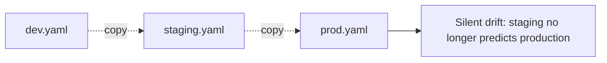
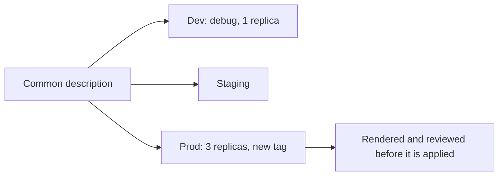

# Packaging and Delivery: Kustomize and Helm

**Cloud and containers · Kubernetes · Step 9.3.8 · Advanced** · Last updated 2026-10-23
**Prerequisites:** [Pods, ReplicaSets and Deployments](02-pods-replicasets-deployments.md) (9.3.2) and [Configuration and secrets](04-configuration-and-secrets.md) (9.3.4); helpful: [Docker Compose for local development](../02-docker/08-docker-compose.md) (9.2.8), which has the same "one file, several environments" problem

**Version note**

| Item | Version |
|---|---|
| Baseline | Kustomize (built into `kubectl`) and Helm charts (`apiVersion: v2`), which work with all supported Kubernetes versions |
| Hands-on baseline | Kustomize v5.8.1 (inside `kubectl` v1.37.1), Helm v4.2.3 (the version bundled with Rancher Desktop), Kubernetes server v1.36.5, run on 2026-10-23 |
| Compatibility note | Helm 4 differs from Helm 3 in places: it applies manifests with server-side apply by default, and `--atomic` is deprecated in favour of `--rollback-on-failure` (both seen in the output below). Check which major version your pipeline and your cluster tooling use |

## 1. What it is and why it matters

**What is it?** Two common ways to produce the Kubernetes YAML for **several environments or several teams** from one description, and to deliver it to a cluster:
- **Kustomize** keeps ordinary YAML as a **base** and adds **overlays** that change it (replicas, image tags, names, config) without templates.
- **Helm** is a **package manager**: a **chart** is a bundle of templated YAML with a `values.yaml` of settings; installing a chart creates a numbered **release** that Helm can upgrade, roll back and uninstall.

**Why do we need it?** `order-service` needs one Deployment for dev (one pod, debug logging), one for staging, one for production (three pods, a different image, feature flags on). Copying the file three times drifts apart within a month. Editing live objects by hand leaves no record. Packaging tools make the differences explicit and reviewable, and give a repeatable way to deliver and undo a release.

**When would I meet it?** In every repository that deploys to Kubernetes, in CI/CD pipelines, when installing third-party software (almost all of it ships as a Helm chart), and in GitOps tools that render one or both.

> [!TIP]
> **Memory hook:** *Kustomize patches plain YAML; Helm fills in a template; both turn "what I want in this environment" into a small, reviewable difference.*

## 2. Mental model: tracing paper and a form letter

**Kustomize** is tracing paper laid over a drawing: the base drawing stays untouched, and each overlay is a transparent sheet that changes a few lines (a different colour, an extra label). You can see the result by stacking the sheets.

**Helm** is a form letter with blanks ("Dear {{name}}") and a fill-in sheet (`values.yaml`), together with a **register** of every letter sent (releases), so a letter can be re-sent with changes or withdrawn.

| Real life | Kustomize | Helm |
|---|---|---|
| The drawing | `base/` plain YAML | The chart's `templates/` |
| The change sheet | An overlay with patches and transformers | A `values` file or `--set` |
| Seeing the result | `kubectl kustomize overlays/prod` | `helm template` |
| Sending it | `kubectl apply -k` | `helm install` / `helm upgrade` |
| The register of what was sent | None (state is the cluster and Git) | Release records in the cluster |

**Where the analogy breaks:** a form letter can contain any logic you put in it (loops, conditions), and templates can become hard to read; tracing paper can only change what exists in the base.

## 3. Industry terms

| Term | Simple meaning | Why it matters | Example | Related terms |
|---|---|---|---|---|
| **Base and overlay** | Common YAML, and an environment-specific layer on top | The Kustomize model | `base/`, `overlays/prod/` | Kustomization |
| **Kustomization** | A `kustomization.yaml` file listing resources and changes | The entry point | `resources: [...]` | Transformer |
| **Transformer** | A built-in change applied to all resources | Common changes without patches | `namePrefix`, `labels`, `images`, `replicas` | Patch |
| **Patch** | A targeted change to one resource (strategic merge or JSON 6902) | Anything the transformers do not cover | Raise a CPU request | Overlay |
| **Generator** | Creates ConfigMaps or Secrets from literals or files, with a content-hash suffix in the name | A config change creates a new object, hence a rollout | `order-config-f9866mg586` | Immutable config |
| **Chart** | A Helm package: `Chart.yaml`, `values.yaml`, `templates/` | Distributable, versioned | `order-service-0.1.0` | Repository, OCI registry |
| **Values** | The settings a chart exposes | The only thing an environment should change | `replicaCount: 3` | `--set`, `-f` |
| **Template** | YAML with Go-template placeholders and functions | Reuse and parameters | `{{ .Values.image.tag }}` | Helpers |
| **Release and revision** | One installation of a chart, and its numbered versions | History, rollback | `shop`, revisions 1 to 5 | `helm history` |
| **Hook and test** | Jobs run at set points of a release (before upgrade, after install) | Migrations, smoke tests | `pre-upgrade` | Job |
| **Subchart / dependency** | A chart used by another chart | Reusing databases, caches | A PostgreSQL chart | `Chart.yaml dependencies` |
| **Rendering** | Producing final YAML without touching the cluster | The best way to review and test | `kubectl kustomize`, `helm template` | Diff |
| **GitOps** | A controller in the cluster applies what is in Git | Git is the single source of truth | Argo CD, Flux | Pull-based delivery |

## 4. In a real system (ShopFlow)

**The business problem.** ShopFlow has dev, staging and production. The `order-service` manifests live in three copies. Production got `replicas: 3` and a memory limit; dev did not. A hot fix to the readiness probe was applied to production and forgotten in staging, so the next release behaved differently there. Nobody can say what exactly is different between environments, and a rollback means finding the previous YAML in someone's folder.



**How packaging helps.** The common description lives once. Each environment states only what differs: three replicas and a new image tag in production, debug logging in dev. A pipeline renders the result, the team reviews the diff in a pull request, and the same description is delivered to every environment. Helm adds a history of releases with one-command rollback; Kustomize keeps the YAML plain and lets Git be the history.



**What it costs.** Another layer to learn, and a place for bugs (an overlay that silently changes nothing, a template with a wrong indent). Helm templates can become a programming language in YAML; Kustomize patches can become opaque if there are many of them. Secrets and generated names need care.

**Elsewhere:** a vendor ships its product as a Helm chart with hundreds of values; a platform team gives product teams a single "web service" chart so every service gets the same probes, limits and labels; a company uses Kustomize overlays per region.

## 5. How it works

### Kustomize

A directory with a `kustomization.yaml` is a unit. The base:

```yaml
apiVersion: kustomize.config.k8s.io/v1beta1
kind: Kustomization
resources:
  - deployment.yaml
  - service.yaml
configMapGenerator:
  - name: order-config
    literals:
      - LOG_LEVEL=info
      - FEATURE_NEW_CHECKOUT=false
labels:
  - pairs:
      learning: notes
    includeSelectors: false
```

```yaml
apiVersion: apps/v1
kind: Deployment
metadata:
  name: order-service
spec:
  replicas: 1
  selector:
    matchLabels:
      app: order-service
  template:
    metadata:
      labels:
        app: order-service
    spec:
      containers:
        - name: order-service
          image: sf-learn/shop-api:v1
          ports:
            - containerPort: 8080
          envFrom:
            - configMapRef:
                name: order-config
          readinessProbe:
            httpGet:
              path: /ready
              port: 8080
            periodSeconds: 2
          resources:
            requests:
              cpu: 50m
              memory: 128Mi
            limits:
              memory: 256Mi
```

(The base also contains a `service.yaml` that selects `app: order-service`.) Rendering it, without applying anything:

```text
$ kubectl kustomize base
apiVersion: v1
data:
  FEATURE_NEW_CHECKOUT: "false"
  LOG_LEVEL: info
kind: ConfigMap
metadata:
  labels:
    learning: notes
  name: order-config-f9866mg586
---
apiVersion: v1
kind: Service
metadata:
  labels:
    learning: notes
  name: order-service
spec:
  ports:
  - port: 80
    targetPort: 8080
  selector:
    app: order-service
---
apiVersion: apps/v1
kind: Deployment
metadata:
  labels:
    learning: notes
  name: order-service
spec:
  replicas: 1
  selector:
    matchLabels:
      app: order-service
  template:
    metadata:
      labels:
        app: order-service
    spec:
      containers:
      - envFrom:
        - configMapRef:
            name: order-config-f9866mg586
        image: sf-learn/shop-api:v1
        name: order-service
        ports:
        - containerPort: 8080
        readinessProbe:
          httpGet:
            path: /ready
            port: 8080
          periodSeconds: 2
        resources:
          limits:
            memory: 256Mi
          requests:
            cpu: 50m
            memory: 128Mi
```

**Walkthrough.** Kustomize added the label `learning: notes` to every resource, created a ConfigMap from the literals, and **appended a hash of its content to its name** (`order-config-f9866mg586`), and it rewrote the Deployment's reference to use the new name. That hash is the key idea for configuration: a changed value means a new name, which means the Deployment's pod template changes, which means a rolling update ([9.3.4](04-configuration-and-secrets.md)).

### Worked example 1: overlays for two environments

The production overlay changes the name prefix, adds an `env` label (also to the selectors, so that two environments in one namespace do not select each other's pods), sets 3 replicas, a new image tag, a feature flag, and raises the CPU request with a JSON patch:

```yaml
apiVersion: kustomize.config.k8s.io/v1beta1
kind: Kustomization
namePrefix: prod-
labels:
  - pairs:
      env: prod
    includeSelectors: true
    includeTemplates: true
resources:
  - ../../base
replicas:
  - name: order-service
    count: 3
images:
  - name: sf-learn/shop-api
    newTag: v2
configMapGenerator:
  - name: order-config
    behavior: merge
    literals:
      - FEATURE_NEW_CHECKOUT=true
patches:
  - target:
      kind: Deployment
      name: order-service
    patch: |-
      - op: replace
        path: /spec/template/spec/containers/0/resources/requests/cpu
        value: 200m
```

The dev overlay is shorter (a prefix, the `env: dev` label and `LOG_LEVEL=debug`). The difference between the two rendered results is exactly what the environments are:

```text
$ diff <(kubectl kustomize overlays/dev) <(kubectl kustomize overlays/prod) | grep -E '^[<>]' | head -40
<   FEATURE_NEW_CHECKOUT: "false"
<   LOG_LEVEL: debug
>   FEATURE_NEW_CHECKOUT: "true"
>   LOG_LEVEL: info
<     env: dev
>     env: prod
<   name: dev-order-config-d6g9k4b2gd
>   name: prod-order-config-kchh77cm62
<     env: dev
>     env: prod
<   name: dev-order-service
>   name: prod-order-service
<     env: dev
>     env: prod
<     env: dev
>     env: prod
<   name: dev-order-service
>   name: prod-order-service
<   replicas: 1
>   replicas: 3
<       env: dev
>       env: prod
<         env: dev
>         env: prod
<             name: dev-order-config-d6g9k4b2gd
<         image: sf-learn/shop-api:v1
>             name: prod-order-config-kchh77cm62
>         image: sf-learn/shop-api:v2
<             cpu: 50m
>             cpu: 200m
```

**Walkthrough.** Lines starting with `<` are dev, `>` are prod. The names differ (`dev-` and `prod-`), the labels, `replicas` 1 versus 3, the image `v1` versus `v2`, the CPU request 50m versus 200m, and the config values. Everything else is shared from the base. If the base changes (say, a new probe), both environments receive it. Both overlays were then applied to the cluster:

```text
$ kubectl --context rancher-desktop -n sf-learn apply -k overlays/dev; kubectl --context rancher-desktop -n sf-learn apply -k overlays/prod; kubectl --context rancher-desktop -n sf-learn rollout status deployment/dev-order-service >/dev/null; kubectl --context rancher-desktop -n sf-learn rollout status deployment/prod-order-service >/dev/null; echo; kubectl --context rancher-desktop -n sf-learn get deployment,service,configmap -L env | cut -c1-120
configmap/dev-order-config-d6g9k4b2gd created
service/dev-order-service created
deployment.apps/dev-order-service created
configmap/prod-order-config-kchh77cm62 created
service/prod-order-service created
deployment.apps/prod-order-service created

NAME                                 READY   UP-TO-DATE   AVAILABLE   AGE   ENV
deployment.apps/dev-order-service    1/1     1            1           4s    dev
deployment.apps/prod-order-service   3/3     3            3           4s    prod

NAME                         TYPE        CLUSTER-IP      EXTERNAL-IP   PORT(S)   AGE   ENV
service/dev-order-service    ClusterIP   10.43.213.121   <none>        80/TCP    4s    dev
service/prod-order-service   ClusterIP   10.43.13.189    <none>        80/TCP    4s    prod

NAME                                     DATA   AGE   ENV
configmap/dev-order-config-d6g9k4b2gd    2      4s    dev
configmap/kube-root-ca.crt               1      12s   
configmap/prod-order-config-kchh77cm62   2      4s    prod
```

### Worked example 2: a config change rolls the pods

Changing one literal in the prod overlay (`LOG_LEVEL=warn`) and applying it again:

```text
$ echo 'before:'; kubectl --context rancher-desktop -n sf-learn get configmap -l env=prod --no-headers | awk '{print $1}'; kubectl --context rancher-desktop -n sf-learn get replicaset -l env=prod --no-headers | awk '{print $1, $2}'; echo; echo 'change LOG_LEVEL in the prod overlay and apply:'; kubectl --context rancher-desktop -n sf-learn apply -k overlays/prod | grep -v unchanged; kubectl --context rancher-desktop -n sf-learn rollout status deployment/prod-order-service | tail -1; echo; echo 'after:'; kubectl --context rancher-desktop -n sf-learn get configmap -l env=prod --no-headers | awk '{print $1}'; kubectl --context rancher-desktop -n sf-learn get replicaset -l env=prod --no-headers | awk '{print $1, $2}'; echo -n 'LOG_LEVEL seen by a prod pod: '; POD=$(kubectl --context rancher-desktop -n sf-learn get pods -l env=prod -o name | head -1); kubectl --context rancher-desktop -n sf-learn exec $POD -- wget -qO- -T 2 'http://localhost:8080/env?name=LOG_LEVEL'
before:
prod-order-config-kchh77cm62
prod-order-service-5cd96f5d84 3

change LOG_LEVEL in the prod overlay and apply:
configmap/prod-order-config-m2cf48mm94 created
deployment.apps/prod-order-service configured
deployment "prod-order-service" successfully rolled out

after:
prod-order-config-kchh77cm62
prod-order-config-m2cf48mm94
prod-order-service-5765bb469c 3
prod-order-service-5cd96f5d84 0
LOG_LEVEL seen by a prod pod: LOG_LEVEL=warn
```

**Walkthrough.** The generator made a new ConfigMap with a new name, the Deployment now referred to it, so the pod template changed and the pods were replaced by a rolling update: a pod then reported `LOG_LEVEL=warn`. No manual restart was needed. The old ConfigMap is **not** removed by `kubectl apply -k`:

```text
$ echo 'left behind after deleting what the (restored) overlay describes:'; kubectl --context rancher-desktop -n sf-learn get configmap -l env=prod --no-headers | awk '{print $1}'
left behind after deleting what the (restored) overlay describes:
prod-order-config-m2cf48mm94
```

(The old hash was deleted by the later `delete -k`, which used the earlier overlay; the newer one stayed behind.) Clean-up of superseded objects is done with pruning options of `kubectl apply` or by a GitOps tool; if you ignore it, old ConfigMaps pile up.

### Helm

A chart is a directory. The ones used here:

```yaml
apiVersion: v2
name: order-service
description: A Helm chart for the ShopFlow order-service demo
type: application
version: 0.1.0
appVersion: "v1"
```

```yaml
replicaCount: 1

image:
  repository: sf-learn/shop-api
  tag: v1

config:
  logLevel: info
  featureNewCheckout: "false"

resources:
  requests:
    cpu: 50m
    memory: 128Mi
  limits:
    memory: 256Mi
```

```yaml
apiVersion: apps/v1
kind: Deployment
metadata:
  name: {{ include "order-service.name" . }}
  labels:
    learning: notes
spec:
  replicas: {{ .Values.replicaCount }}
  selector:
    matchLabels:
      app: {{ include "order-service.name" . }}
  template:
    metadata:
      labels:
        app: {{ include "order-service.name" . }}
        learning: notes
      annotations:
        checksum/config: {{ include (print $.Template.BasePath "/configmap.yaml") . | sha256sum }}
    spec:
      containers:
        - name: order-service
          image: "{{ .Values.image.repository }}:{{ .Values.image.tag }}"
          ports:
            - containerPort: 8080
          envFrom:
            - configMapRef:
                name: {{ include "order-service.name" . }}
          readinessProbe:
            httpGet:
              path: /ready
              port: 8080
            periodSeconds: 2
          resources:
            {{- toYaml .Values.resources | nindent 12 }}
```

**Walkthrough.** `{{ .Values.replicaCount }}` is replaced with a value; `{{ include "order-service.name" . }}` calls a helper that builds `RELEASE-order-service` from the release name, so two releases of the same chart do not collide; `toYaml ... | nindent 12` inserts a block of YAML at the right indentation; and the `checksum/config` annotation contains a hash of the ConfigMap template, so a config change changes the pod template and rolls the pods (the Helm equivalent of Kustomize's hash suffix). The environment-specific values:

```yaml
replicaCount: 3
image:
  tag: v2
config:
  featureNewCheckout: "true"
```

### Worked example 3: lint and render

```text
$ helm lint order-chart
==> Linting order-chart
[INFO] Chart.yaml: icon is recommended

1 chart(s) linted, 0 chart(s) failed
```

```text
$ helm template shop order-chart -f values-prod.yaml | grep -v '^#' | head -70
---
apiVersion: v1
kind: ConfigMap
metadata:
  name: shop-order-service
  labels:
    learning: notes
data:
  LOG_LEVEL: "info"
  FEATURE_NEW_CHECKOUT: "true"

---
apiVersion: v1
kind: Service
metadata:
  name: shop-order-service
  labels:
    learning: notes
spec:
  selector:
    app: shop-order-service
  ports:
    - port: 80
      targetPort: 8080

---
apiVersion: apps/v1
kind: Deployment
metadata:
  name: shop-order-service
  labels:
    learning: notes
spec:
  replicas: 3
  selector:
    matchLabels:
      app: shop-order-service
  template:
    metadata:
      labels:
        app: shop-order-service
        learning: notes
      annotations:
        checksum/config: 288bb0c91cb7fb38d85557243b4181fa5c2a9cb8645327bf1d603bc36d05bd7f
    spec:
      containers:
        - name: order-service
          image: "sf-learn/shop-api:v2"
          ports:
            - containerPort: 8080
          envFrom:
            - configMapRef:
                name: shop-order-service
          readinessProbe:
            httpGet:
              path: /ready
              port: 8080
            periodSeconds: 2
          resources:
            limits:
              memory: 256Mi
            requests:
              cpu: 50m
              memory: 128Mi
```

**Walkthrough.** `helm lint` checks the chart (it recommends an icon but passes). `helm template shop ...` **renders** the final YAML without touching the cluster, with the release name `shop` and the production values: 3 replicas, tag `v2`, the feature flag `"true"`, and the config checksum. Rendering is the safest way to review a change, and the output can be piped to `kubectl diff` or a policy checker. Do this in CI for every change to a chart or a values file.

### Worked example 4: install, upgrade, history

```text
$ helm --kube-context rancher-desktop -n sf-learn install shop order-chart --wait --timeout 90s | head -8; echo; helm --kube-context rancher-desktop -n sf-learn list; echo; kubectl --context rancher-desktop -n sf-learn get deployment,service,configmap -l learning=notes | cut -c1-100; echo; kubectl --context rancher-desktop -n sf-learn get secret | grep helm
NAME: shop
LAST DEPLOYED: Fri Oct 23 00:08:38 2026
NAMESPACE: sf-learn
STATUS: deployed
REVISION: 1
DESCRIPTION: Install complete
TEST SUITE: None

NAME	NAMESPACE	REVISION	UPDATED                             	STATUS  	CHART              	APP VERSION
shop	sf-learn 	1       	2026-10-23 00:08:38.218336 +0530 IST	deployed	order-service-0.1.0	v1         

NAME                                 READY   UP-TO-DATE   AVAILABLE   AGE
deployment.apps/shop-order-service   1/1     1            1           1s

NAME                         TYPE        CLUSTER-IP     EXTERNAL-IP   PORT(S)   AGE
service/shop-order-service   ClusterIP   10.43.63.176   <none>        80/TCP    1s

NAME                           DATA   AGE
configmap/shop-order-service   2      1s

sh.helm.release.v1.shop.v1   helm.sh/release.v1   1      1s
```

**Walkthrough.** `helm install shop order-chart` created the objects and a **release** named `shop` at revision 1. Helm keeps its records in the cluster as Secrets: `sh.helm.release.v1.shop.v1`. Then an upgrade with the production values:

```text
$ helm --kube-context rancher-desktop -n sf-learn upgrade shop order-chart -f values-prod.yaml --wait --timeout 90s | head -4; echo; helm --kube-context rancher-desktop -n sf-learn history shop; echo; echo 'values used by the release (only what was overridden):'; helm --kube-context rancher-desktop -n sf-learn get values shop; echo; kubectl --context rancher-desktop -n sf-learn get deployment shop-order-service
Release "shop" has been upgraded. Happy Helming!
NAME: shop
LAST DEPLOYED: Fri Oct 23 00:08:39 2026
NAMESPACE: sf-learn

REVISION	UPDATED                 	STATUS    	CHART              	APP VERSION	DESCRIPTION     
1       	Fri Oct 23 00:08:38 2026	superseded	order-service-0.1.0	v1         	Install complete
2       	Fri Oct 23 00:08:39 2026	deployed  	order-service-0.1.0	v1         	Upgrade complete

values used by the release (only what was overridden):
USER-SUPPLIED VALUES:
config:
  featureNewCheckout: "true"
image:
  tag: v2
replicaCount: 3

NAME                 READY   UP-TO-DATE   AVAILABLE   AGE
shop-order-service   3/3     3            3           4s
```

The history shows revision 1 `superseded` and revision 2 `deployed`; `helm get values` shows only the values that were overridden; and the Deployment now has three pods. Each upgrade is a new revision with its own record.

### Worked example 5: a failing upgrade, rollback and the history

An upgrade to an image tag that does not exist, with automatic rollback on failure and a 40-second timeout (Helm 4 prints that `--atomic` is deprecated and `--rollback-on-failure` replaces it):

```text
$ helm --kube-context rancher-desktop -n sf-learn upgrade shop order-chart -f values-prod.yaml --set image.tag=v9 --atomic --timeout 40s 2>&1 | tail -4; echo; helm --kube-context rancher-desktop -n sf-learn history shop; echo; kubectl --context rancher-desktop -n sf-learn get pods -l app=shop-order-service
Flag --atomic has been deprecated, use --rollback-on-failure instead
level=WARN msg="upgrade failed" name=shop error="resource Deployment/sf-learn/shop-order-service not ready. status: InProgress, message: Updated: 1/3\ncontext deadline exceeded"
Error: UPGRADE FAILED: release shop failed, and has been rolled back due to rollback-on-failure being set: resource Deployment/sf-learn/shop-order-service not ready. status: InProgress, message: Updated: 1/3
context deadline exceeded

REVISION	UPDATED                 	STATUS    	CHART              	APP VERSION	DESCRIPTION                                                                                                                
1       	Fri Oct 23 00:08:38 2026	superseded	order-service-0.1.0	v1         	Install complete                                                                                                           
2       	Fri Oct 23 00:08:39 2026	superseded	order-service-0.1.0	v1         	Upgrade complete                                                                                                           
3       	Fri Oct 23 00:08:42 2026	failed    	order-service-0.1.0	v1         	Upgrade "shop" failed: resource Deployment/sf-learn/shop-order-service not ready. status: InProgress, message: Updated: ...
4       	Fri Oct 23 00:09:22 2026	deployed  	order-service-0.1.0	v1         	Rollback to 2                                                                                                              

NAME                                  READY   STATUS    RESTARTS   AGE
shop-order-service-6fb656dd78-jn9ts   1/1     Running   0          42s
shop-order-service-6fb656dd78-mgqhj   1/1     Running   0          44s
shop-order-service-6fb656dd78-plp4z   1/1     Running   0          43s
```

**Walkthrough.** Revision 3 was recorded as `failed`; Helm waited, saw that the Deployment was not ready, and rolled back by creating revision 4 (`Rollback to 2`), a copy of revision 2. The three production pods kept running throughout, because the Deployment's rolling update never removed them until the new ones were ready. A manual rollback to the first revision:

```text
$ helm --kube-context rancher-desktop -n sf-learn rollback shop 1 --wait --timeout 90s; helm --kube-context rancher-desktop -n sf-learn history shop; echo; kubectl --context rancher-desktop -n sf-learn get deployment shop-order-service -o jsonpath='replicas={.spec.replicas} image={.spec.template.spec.containers[0].image}{"\n"}'
Rollback was a success! Happy Helming!
REVISION	UPDATED                 	STATUS    	CHART              	APP VERSION	DESCRIPTION                                                                                                                
1       	Fri Oct 23 00:08:38 2026	superseded	order-service-0.1.0	v1         	Install complete                                                                                                           
2       	Fri Oct 23 00:08:39 2026	superseded	order-service-0.1.0	v1         	Upgrade complete                                                                                                           
3       	Fri Oct 23 00:08:42 2026	failed    	order-service-0.1.0	v1         	Upgrade "shop" failed: resource Deployment/sf-learn/shop-order-service not ready. status: InProgress, message: Updated: ...
4       	Fri Oct 23 00:09:22 2026	superseded	order-service-0.1.0	v1         	Rollback to 2                                                                                                              
5       	Fri Oct 23 00:09:23 2026	deployed  	order-service-0.1.0	v1         	Rollback to 1                                                                                                              

replicas=1 image=sf-learn/shop-api:v1
```

Revision 5 is `Rollback to 1`: replicas back to 1 and the image back to `v1`. A rollback is a **new revision** with the old content. Note that Helm only knows about what is in its release records; a Deployment changed by hand with `kubectl` would be overwritten or merged at the next upgrade.

### Worked example 6: what Helm does not check

```text
$ helm --kube-context rancher-desktop -n sf-learn upgrade shop order-chart --set replicaCount=three 2>&1 | cut -c1-250
level=WARN msg="upgrade failed" name=shop error="server-side apply failed for object sf-learn/shop-order-service apps/v1, Kind=Deployment: failed to create typed patch object (sf-learn/shop-order-service; apps/v1, Kind=Deployment): .spec.replicas: ex
Error: UPGRADE FAILED: server-side apply failed for object sf-learn/shop-order-service apps/v1, Kind=Deployment: failed to create typed patch object (sf-learn/shop-order-service; apps/v1, Kind=Deployment): .spec.replicas: expected numeric (int or flo
```

**Walkthrough.** A value of the wrong type (`replicaCount=three`) is accepted by the template engine and rejected only when the API server sees the Deployment. A chart can include a `values.schema.json` that checks values early:

```json
{
  "$schema": "https://json-schema.org/draft-07/schema#",
  "type": "object",
  "properties": {
    "replicaCount": { "type": "integer", "minimum": 1 },
    "image": {
      "type": "object",
      "properties": {
        "tag": { "type": "string", "minLength": 1 }
      },
      "required": ["tag"]
    }
  }
}
```

With that file in the chart, mistakes are caught before anything is sent to the cluster:

```text
$ helm --kube-context rancher-desktop -n sf-learn lint order-chart --set replicaCount=three 2>&1 | head -6; helm --kube-context rancher-desktop -n sf-learn template shop order-chart --set replicaCount=0 2>&1 | head -4 | cut -c1-200
==> Linting order-chart
[INFO] Chart.yaml: icon is recommended
[ERROR] values.yaml: - at '/replicaCount': got string, want integer

[ERROR] templates/: values don't meet the specifications of the schema(s) in the following chart(s):
order-service:
Error: values don't meet the specifications of the schema(s) in the following chart(s):
order-service:
- at '/replicaCount': minimum: got 0, want 1
```

### Worked example 7: the release record contains the values

Helm's release Secret holds the chart, the rendered manifest and the user-supplied values:

```text
$ helm --kube-context rancher-desktop -n sf-learn install shop order-chart --set config.logLevel=debug --wait --timeout 90s >/dev/null; kubectl --context rancher-desktop -n sf-learn get secret sh.helm.release.v1.shop.v1 -o jsonpath='{.data.release}' | base64 -d | base64 -d | gunzip | python3 -c 'import json,sys; r=json.load(sys.stdin); print("keys in the stored release:", sorted(r.keys())); print("user-supplied values:", r["config"]); print("chart name and version:", r["chart"]["metadata"]["name"], r["chart"]["metadata"]["version"])'
keys in the stored release: ['apply_method', 'chart', 'config', 'info', 'manifest', 'name', 'namespace', 'version']
user-supplied values: {'config': {'logLevel': 'debug'}}
chart name and version: order-service 0.1.0
```

**Walkthrough.** The record is base64 and compressed, but anyone allowed to read Secrets in the namespace can open it and see the values, which may contain passwords if they were passed to Helm. Keep real secrets out of values files (use an external secret store, [9.3.4](04-configuration-and-secrets.md)), and restrict who can read release Secrets. Uninstalling a release removes its records:

```text
$ helm --kube-context rancher-desktop -n sf-learn uninstall shop >/dev/null; sleep 3; kubectl --context rancher-desktop -n sf-learn get all,configmap,secret 2>&1 | head -3
NAME                         DATA   AGE
configmap/kube-root-ca.crt   1      2m23s
```

### Which one when

| Question | Kustomize | Helm |
|---|---|---|
| What you write | Plain YAML plus small patches | Templates plus values |
| Reuse by many teams or the public | Possible, but awkward | Strong: charts are versioned packages in repositories |
| Third-party software | Sometimes wraps a rendered chart | The normal way it is distributed |
| Complex conditional logic | Limited on purpose | Yes (loops, conditions, helpers): easy to overdo |
| Release history and rollback | Through Git | Built in (`helm history`, `helm rollback`) |
| Learning curve | Low | Medium (Go templates, whitespace) |
| In `kubectl` already | Yes | No (a separate tool) |
| Reviewing a change | `kubectl kustomize` diff | `helm template` diff |

Many organisations use both: Helm for third-party charts and for a shared internal chart, Kustomize for last-mile differences per environment (a common pattern renders a chart and patches the result).

### When it goes wrong

**1. An overlay that changes nothing.** A target name that does not match, a patch path with a typo, or a transformer applied in the wrong place changes nothing, and nobody notices until production differs. Always render and diff.

**2. Overlapping selectors across environments.** Two overlays in one namespace that share the same selector labels share pods and Services (the first version of this example nearly did). The `env` label with `includeSelectors` prevents it.

**3. Template indentation and quoting mistakes.** YAML is whitespace-sensitive, and templates produce text. A missing `nindent`, or a value like `true` or `0123` that YAML reads as a boolean or number, gives subtly wrong objects. Quote values (`| quote`), lint, render.

**4. Secrets in values or in rendered output.** Values files in Git, `--set` on a command line (shell history, CI logs) and release records all hold them ([9.3.4](04-configuration-and-secrets.md)).

**5. Drift from manual edits.** Someone fixes production with `kubectl edit`; the next Helm upgrade or `apply -k` overwrites or conflicts. Treat the cluster as read-only for humans, and make changes through Git.

**6. Upgrades that need more than YAML.** A database migration, a CRD update or a rename of a StatefulSet's volume claim template needs planning that a chart cannot automate. Hooks help, but test the upgrade path.

### Common mistakes

1. Copying whole manifests per environment instead of overlaying or parameterising.
2. A chart with a value for everything (a second, worse Kubernetes API).
3. Deploying without rendering and reviewing the diff.
4. Putting secrets in values files.
5. Mixing manual `kubectl` edits with Helm or GitOps.
6. Ignoring that `apply -k` leaves old generated ConfigMaps behind.

### Alternatives in the industry

A map of the landscape, not a comparison. Only Kustomize and Helm were run in this series; check each project's documentation before adopting one.

| Area | Tool or product | What it is | When you meet it |
|---|---|---|---|
| Packaging | **Kustomize** and **Helm** (used here) | Overlay patching; templated charts with releases | The two most common approaches |
| | **Jsonnet / Tanka**, **CUE**, **cdk8s**, **Pulumi**, **Timoni** | Generate manifests from a real programming or configuration language | Teams that find YAML templating too weak |
| | **Carvel (ytt, kapp)**, **Skaffold**, **Tilt** | Templating and deployment tools; Skaffold and Tilt for the development loop | Specific platform stacks |
| Delivery | **kubectl apply** from a pipeline | Push-based delivery | Simple setups |
| | **Argo CD**, **Flux** (GitOps) | In-cluster controllers that keep the cluster equal to a Git repository and can render Helm and Kustomize | Mature platforms; audit and drift correction |
| | **Spinnaker**, **Octopus Deploy**, **Harness** | Delivery platforms with pipelines and approvals | Larger enterprises |
| Chart distribution | **OCI registries** (Helm charts stored like images), **Artifact Hub** | Where charts live and are found | Any use of third-party charts |
| Checks | **kubeconform**, **kube-linter**, **Conftest/OPA**, **Kyverno** | Validate rendered manifests against schemas and policies | CI pipelines and admission control |
| Other platforms | **Docker Compose files**, **Terraform** (9.5, planned), **ECS task definitions** | Their own description formats and tools | Teams outside Kubernetes ([9.3.1](01-kubernetes-overview.md)) |

## 6. Architectural decisions

| Decision | Choose | Because |
|---|---|---|
| Tool | Helm for third-party software and shared charts; Kustomize or values files for per-environment differences; fewer tools if the team is small | Fit the tool to the job and to the team's skills |
| Source of truth | Git, delivered by a pipeline or a GitOps controller; no manual edits in clusters | Auditable, repeatable, recoverable |
| What differs between environments | Replicas, image tag, resource sizes, config values, host names: nothing structural | Staging must predict production |
| Config changes | Hash-suffixed or checksummed config that triggers a rollout | Predictable, with rollback |
| Releases | Version charts and image tags; one revision per change; test the upgrade path | Known good versions to return to |
| Review | Render and diff in CI; lint; validate against schemas and policies | Mistakes are found before the cluster |
| Secrets | Not in values or overlays; external store or encrypted secrets | Release records and Git keep everything |
| Chart design | Few, meaningful values; sensible defaults; a `values.schema.json` | Keeps the chart usable and safe |
| Failed upgrades | Wait for readiness with a timeout and roll back automatically (`--rollback-on-failure` in Helm 4) | A bad release does not stay in the middle |
| Cleanup | Prune superseded objects (generated ConfigMaps) | Avoid clutter and stale config |

## 7. Try it yourself

Try each exercise first; the real results are in the Answers section.

1. **What differs?** Render the dev and prod overlays and list, from the diff only, five differences between the environments.
2. **Roll it with config.** Change one config literal in an overlay and apply it. Which objects are new, and what happens to the pods?
3. **Undo a release.** Upgrade a Helm release to a bad image tag with automatic rollback, and show the history.

## 8. Check your understanding

1. Why does Kustomize add a hash to generated ConfigMap names, and what does that give you?
2. What is the difference between a Helm chart, a release and a revision?
3. A teammate fixes production with `kubectl edit` and the next Helm upgrade changes it back. What went wrong in the process, and how do you prevent it?
4. You pass a database password with `--set` to `helm install`. Name two places where it can still be read afterwards.

Answers are at the end of this note.

## 9. Revision

**Remember**
- **Kustomize:** `base` + `overlays`; transformers (`namePrefix`, `labels`, `images`, `replicas`), patches, generators with a **hash suffix** (config change → rollout); built into `kubectl`; `kubectl kustomize` renders, `apply -k` applies.
- **Helm:** chart (`Chart.yaml`, `values.yaml`, `templates/`) → **release** → numbered **revisions**; `helm template` renders, `install`, `upgrade`, `history`, `rollback`, `uninstall`; records are Secrets in the cluster.
- A Helm rollback creates a **new revision**; release records contain **values**.
- Render and diff in CI; keep secrets out of values; Git is the source of truth; avoid manual edits.
- Helm 4: server-side apply by default; `--atomic` deprecated for `--rollback-on-failure`.

**Explain in 15 seconds:** "Kustomize overlays patch plain YAML per environment and Helm fills in templated charts with values and tracks releases; both let one description serve many environments with a small, reviewable difference."

**Explain in 60 seconds:**
> "I keep one description of the service and express each environment as a small difference. With Kustomize that's a base of plain YAML plus overlays that set the name, replicas, image tag and config; generated ConfigMaps get a content hash in their name, so a config change rolls the pods. With Helm it's a chart of templates and a values file, and each install or upgrade is a numbered release revision that can be rolled back, with the records stored as Secrets in the cluster. I render the result in CI, diff it and run schema and policy checks before anything reaches a cluster, I never pass real secrets through values or overlays, and I make changes through Git, delivered by a pipeline or a GitOps controller such as Argo CD or Flux, because manual edits get overwritten or cause drift. For third-party software I use its Helm chart; for last-mile differences I patch with Kustomize or values."

**Likely follow-up questions:**
- **Helm 3 or 4?** Helm 4 is the current major version; check your tools. It defaults to server-side apply and deprecates `--atomic`.
- **Can I use Helm and Kustomize together?** Yes: render a chart (`helm template`) and patch it with Kustomize, which several GitOps tools do.
- **What are Helm hooks?** Jobs or other resources that run at points in a release, such as a database migration before an upgrade (not run here).
- **How do I avoid copy-paste across 50 services?** One shared chart or base with a small values file per service, owned by a platform team.

**Architect's takeaway:** packaging decides how fast and how safely you can change production. The goal is not clever templates; it is a small, reviewed difference per environment, a clear history, and a delivery path that nobody bypasses.

**Next topic:** [Kubernetes security: RBAC, service accounts and Pod security](09-kubernetes-security.md) (9.3.9)

## 10. Verification and sources

> [!NOTE]
> Checked 2026-10-23 against the Kubernetes, Helm and Kustomize documentation and by running every command shown (Kustomize v5.8.1 in `kubectl` v1.37.1, Helm v4.2.3, Kubernetes server v1.36.5+k3s1). Hashes, timestamps and names differ on every run. Re-verify when you revisit this note.

- **Confirmed (documentation, read 2026-10-23):** generated ConfigMaps and Secrets "have a content hash suffix appended. This ensures that a new ConfigMap or Secret is generated when the contents are changed", and the suffix can be disabled with `generatorOptions` (Kubernetes, "Declarative Management of Kubernetes Objects Using Kustomize"); `helm upgrade --rollback-on-failure` rolls the upgrade back to the previous successful release on failure and sets `--wait` to its "watcher" mode, and `--server-side` controls whether object updates run on the server (Helm, `helm upgrade` reference); Helm 4 "will default to server-side apply" (Helm, "Helm 4 Overview"); a chart can contain `values.schema.json`, "a JSON Schema for imposing a structure on the values.yaml file" (Helm, "Charts").
- **Observed (this machine):** the rendered base, dev and prod output and their diff; the hash-suffixed names; the rolling update caused by a changed generated ConfigMap and the ConfigMap left behind; `helm lint`, `template`, `install`, `upgrade`, `history`, the failed upgrade with automatic rollback (revisions 3 and 4), `rollback` (revision 5), the wrong-type error and the schema errors; the release Secret `sh.helm.release.v1.shop.v1` and its contents; that `--atomic` prints a deprecation warning in Helm 4.2.3.
- **Not run:** hooks and tests, subcharts, chart repositories and OCI registries, pruning, Argo CD, Flux, and all alternatives (general industry knowledge).
- **Assumptions and illustrations:** the ShopFlow story is illustrative; the chart is a small teaching chart, not a production template.
- **To verify:** your Helm major version and its defaults; whether your GitOps tool renders Helm or Kustomize itself; the policy for secrets in values and release records; how superseded generated ConfigMaps are pruned in your pipeline.
- **Decision rule:** one description, small per-environment differences, rendered and reviewed in CI, delivered from Git, no manual edits, no secrets in values.

**Sources:** Kubernetes documentation: "Declarative Management of Kubernetes Objects Using Kustomize"; Kustomize reference (kubectl.docs.kubernetes.io); Helm documentation: "Charts", "helm upgrade", "Helm 4 Overview".

## Answers

**Experiment (exercises)**

1. **What differs?** From the diff: the name prefix (`dev-` and `prod-`), the `env` label, replicas (1 versus 3), the image tag (`v1` versus `v2`), the CPU request (50m versus 200m), and the config values (debug versus info logging; the feature flag false versus true):

```text
$ diff <(kubectl kustomize overlays/dev) <(kubectl kustomize overlays/prod) | grep -E '^[<>]' | head -40
<   FEATURE_NEW_CHECKOUT: "false"
<   LOG_LEVEL: debug
>   FEATURE_NEW_CHECKOUT: "true"
>   LOG_LEVEL: info
<     env: dev
>     env: prod
<   name: dev-order-config-d6g9k4b2gd
>   name: prod-order-config-kchh77cm62
<     env: dev
>     env: prod
<   name: dev-order-service
>   name: prod-order-service
<     env: dev
>     env: prod
<     env: dev
>     env: prod
<   name: dev-order-service
>   name: prod-order-service
<   replicas: 1
>   replicas: 3
<       env: dev
>       env: prod
<         env: dev
>         env: prod
<             name: dev-order-config-d6g9k4b2gd
<         image: sf-learn/shop-api:v1
>             name: prod-order-config-kchh77cm62
>         image: sf-learn/shop-api:v2
<             cpu: 50m
>             cpu: 200m
```

2. **Roll it with config.** A new ConfigMap with a new hash name was created, the Deployment's template changed to reference it, and the pods were replaced by a rolling update, so the new value took effect; the old ConfigMap remained:

```text
$ echo 'before:'; kubectl --context rancher-desktop -n sf-learn get configmap -l env=prod --no-headers | awk '{print $1}'; kubectl --context rancher-desktop -n sf-learn get replicaset -l env=prod --no-headers | awk '{print $1, $2}'; echo; echo 'change LOG_LEVEL in the prod overlay and apply:'; kubectl --context rancher-desktop -n sf-learn apply -k overlays/prod | grep -v unchanged; kubectl --context rancher-desktop -n sf-learn rollout status deployment/prod-order-service | tail -1; echo; echo 'after:'; kubectl --context rancher-desktop -n sf-learn get configmap -l env=prod --no-headers | awk '{print $1}'; kubectl --context rancher-desktop -n sf-learn get replicaset -l env=prod --no-headers | awk '{print $1, $2}'; echo -n 'LOG_LEVEL seen by a prod pod: '; POD=$(kubectl --context rancher-desktop -n sf-learn get pods -l env=prod -o name | head -1); kubectl --context rancher-desktop -n sf-learn exec $POD -- wget -qO- -T 2 'http://localhost:8080/env?name=LOG_LEVEL'
before:
prod-order-config-kchh77cm62
prod-order-service-5cd96f5d84 3

change LOG_LEVEL in the prod overlay and apply:
configmap/prod-order-config-m2cf48mm94 created
deployment.apps/prod-order-service configured
deployment "prod-order-service" successfully rolled out

after:
prod-order-config-kchh77cm62
prod-order-config-m2cf48mm94
prod-order-service-5765bb469c 3
prod-order-service-5cd96f5d84 0
LOG_LEVEL seen by a prod pod: LOG_LEVEL=warn
```

3. **Undo a release.** The upgrade to the missing tag failed, Helm rolled back to the previous good revision (revision 4 is a copy of revision 2), and the history keeps the failed attempt:

```text
$ helm --kube-context rancher-desktop -n sf-learn upgrade shop order-chart -f values-prod.yaml --set image.tag=v9 --atomic --timeout 40s 2>&1 | tail -4; echo; helm --kube-context rancher-desktop -n sf-learn history shop; echo; kubectl --context rancher-desktop -n sf-learn get pods -l app=shop-order-service
Flag --atomic has been deprecated, use --rollback-on-failure instead
level=WARN msg="upgrade failed" name=shop error="resource Deployment/sf-learn/shop-order-service not ready. status: InProgress, message: Updated: 1/3\ncontext deadline exceeded"
Error: UPGRADE FAILED: release shop failed, and has been rolled back due to rollback-on-failure being set: resource Deployment/sf-learn/shop-order-service not ready. status: InProgress, message: Updated: 1/3
context deadline exceeded

REVISION	UPDATED                 	STATUS    	CHART              	APP VERSION	DESCRIPTION                                                                                                                
1       	Fri Oct 23 00:08:38 2026	superseded	order-service-0.1.0	v1         	Install complete                                                                                                           
2       	Fri Oct 23 00:08:39 2026	superseded	order-service-0.1.0	v1         	Upgrade complete                                                                                                           
3       	Fri Oct 23 00:08:42 2026	failed    	order-service-0.1.0	v1         	Upgrade "shop" failed: resource Deployment/sf-learn/shop-order-service not ready. status: InProgress, message: Updated: ...
4       	Fri Oct 23 00:09:22 2026	deployed  	order-service-0.1.0	v1         	Rollback to 2                                                                                                              

NAME                                  READY   STATUS    RESTARTS   AGE
shop-order-service-6fb656dd78-jn9ts   1/1     Running   0          42s
shop-order-service-6fb656dd78-mgqhj   1/1     Running   0          44s
shop-order-service-6fb656dd78-plp4z   1/1     Running   0          43s
```

**Check your understanding**

1. Because a changed hash means a changed name, a changed Deployment pod template and so a rolling update, with the old ConfigMap still available for a rollback. It makes configuration changes behave like image changes: gradual, observable and reversible, instead of "edit in place and hope pods notice".
2. A **chart** is the package (templates, defaults, metadata). A **release** is one installation of a chart in a cluster with a name (`shop`). A **revision** is one numbered version of a release, created by each install, upgrade or rollback, with its own record.
3. The cluster was changed outside the source of truth, and Helm (or `apply -k`) reapplied what Git describes. Prevent it by making all changes through Git and the pipeline, removing routine write access to production, and, if emergency edits are needed, making the same change in Git immediately; GitOps controllers can also detect and revert such drift.
4. (a) The shell history and the CI job log (the command line), and (b) the Helm release record, a Secret in the cluster that contains the user-supplied values. The rendered object (a ConfigMap, or a Secret if the chart makes one) is a third place. Use an external secret store or encrypted secrets instead.

Back to [the series overview](01-kubernetes-overview.md) · [the area overview](../01-cloud-and-containers-overview.md) · [the index](../../README.md) · [Roadmap](../../roadmap.md).
