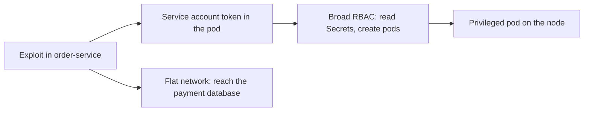
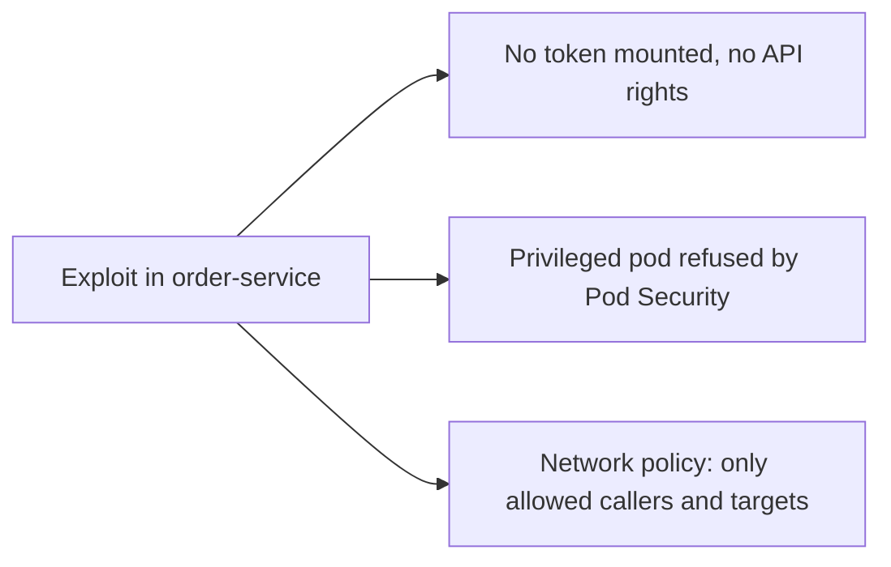
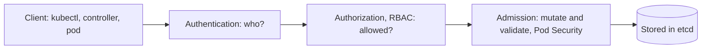

# Kubernetes Security: RBAC, Service Accounts and Pod Security

**Cloud and containers · Kubernetes · Step 9.3.9 · Advanced** · Last updated 2026-10-23
**Prerequisites:** [Configuration and secrets](04-configuration-and-secrets.md) (9.3.4), [Services, DNS and Ingress](03-services-dns-ingress.md) (9.3.3) and [Container security and supply chain basics](../02-docker/09-container-security.md) (9.2.9)

**Version note**

| Item | Version |
|---|---|
| Baseline | RBAC (`rbac.authorization.k8s.io/v1`), ServiceAccounts with bound tokens, the built-in Pod Security Admission, `NetworkPolicy` (`networking.k8s.io/v1`) |
| Hands-on baseline | Rancher Desktop with k3s, Kubernetes server v1.36.5 (Pod Security Admission built in; k3s's embedded network policy controller), `kubectl` v1.37.1, run on 2026-10-23 |
| Compatibility note | PodSecurityPolicy was removed in Kubernetes 1.25 and replaced by Pod Security Admission. NetworkPolicy objects have no effect unless the cluster's network plugin enforces them; managed clusters need a network add-on that does |

## 1. What it is and why it matters

**What is it?** Four layers of defence **inside** the cluster:
- **RBAC** (role-based access control) decides **who may do what** through the Kubernetes API.
- **Service accounts** are the identities that **pods** use when they call that API.
- **Pod security** (security contexts and the Pod Security Admission) decides **what a pod may be**: root or not, privileged or not, which capabilities, what it may mount.
- **Network policies** decide **which pods may talk to which**.

**Why do we need it?** The Docker series showed how a single container is hardened ([9.2.9](../02-docker/09-container-security.md)). A cluster adds a shared control plane and a flat network: any pod can reach any other pod, and anything that can talk to the API with enough rights can read every Secret and run anything on every node. Compromise of one pod, one pipeline credential or one developer laptop must not become compromise of the cluster.

**When would I meet it?** In every platform security review, when an admission error says a pod "violates PodSecurity", when a controller log says `forbidden`, when a pipeline needs deploy rights, and whenever someone asks "which services can reach the payment database?"

> [!TIP]
> **Memory hook:** *who may call the API (RBAC), as what identity (service accounts), what may a pod be (Pod Security), and who may reach whom (network policies); each denies by default only when you make it.*

## 2. Mental model: the office building

An office building has **badges** (identities), **door rules** (which badge opens which door), a **building code** (no one may bring dangerous equipment in, whatever their badge says), and **corridors with locked doors** between departments.

| Real life | Kubernetes |
|---|---|
| A badge | A ServiceAccount (for software) or a user identity (for people) |
| The door rule "badge A may open the post room" | A Role with rules, and a RoleBinding that gives it to a subject |
| The building code | Pod Security Standards, enforced when a pod is created |
| Locked doors between departments | NetworkPolicies between pods |
| Everyone gets a default badge that opens nothing | The `default` ServiceAccount, with no permissions |

**Where the analogy breaks:** in the building, the default is that most corridors are closed; in a cluster, the network is open until you add policies, and the default service account token is mounted into every pod unless you turn that off.

## 3. Industry terms

| Term | Simple meaning | Why it matters | Example | Related terms |
|---|---|---|---|---|
| **Authentication and authorization** | Who are you; what may you do | The two steps before an API call is allowed | Token, then RBAC | Admission |
| **RBAC** | Permissions given through roles and bindings; purely additive, no deny rules | Least privilege for people and software | `get pods` in `sf-learn` | Role, ClusterRole |
| **Role / ClusterRole** | A set of rules (verbs on resources) in one namespace, or cluster-wide | What is allowed | `pod-reader` | Verbs |
| **RoleBinding / ClusterRoleBinding** | Gives a role to users, groups or service accounts | Who gets it, and where | `pod-reporter-reads-pods` | Subject |
| **ServiceAccount** | The identity of a workload | Pods authenticate to the API with it | `pod-reporter` | Token |
| **Bound token** | A signed, time-limited token tied to a pod | Limits damage if stolen | Projected into `/var/run/secrets/...` | `automountServiceAccountToken` |
| **Security context** | Per-pod and per-container security settings | Runs the pod with least privilege | `runAsNonRoot`, `capabilities.drop` | Capabilities |
| **Pod Security Standards** | Three profiles: privileged, baseline, restricted | A shared vocabulary for "how safe is this pod" | `restricted` | Hardening |
| **Pod Security Admission** | The built-in check that applies a profile to a namespace through labels (enforce, audit, warn) | Stops unsafe pods at creation | `pod-security.kubernetes.io/enforce=restricted` | PodSecurityPolicy (removed) |
| **Admission controller / policy** | Code that accepts, changes or rejects objects at creation | Where organisation policy is enforced | Kyverno, Gatekeeper, ValidatingAdmissionPolicy | Webhook |
| **NetworkPolicy** | Allow-lists for traffic between pods and other endpoints | Limits lateral movement | Only the frontend may call `order-service` | CNI |
| **Least privilege** | Give only what is needed | The principle behind all of the above | A read-only role | Blast radius |

## 4. In a real system (ShopFlow)

**The business problem.** A dependency of `order-service` has a remote-code-execution flaw, and an attacker gets a shell in one pod. From there they find the pod's service-account token, and the platform's habit of giving every account broad rights means the token can read Secrets and create pods. They start a privileged pod on the node and read the credentials of the payment service. The network is flat, so they can also reach the payment database directly.



**How the layers help.** The service account has no rights at all (or none to Secrets); its token is not even mounted if the service never calls the API. Pod Security Admission refuses privileged pods in application namespaces. A network policy allows only the services that should call `order-service`, and only `order-service` may reach its database. A compromised pod is then a compromised pod, not a compromised cluster.



**What it costs.** Time to define roles per workload and to keep them current; failed deployments when a pod does not meet a profile (applications need fixing: non-root user, writable temp directory); network policies that need maintenance and good tests, and which can silently break traffic; and a platform team to own the rules.

**Elsewhere:** a bank runs every namespace at the `restricted` profile and exempts only infrastructure; a SaaS platform gives each customer a namespace with a quota, a network policy and a role; a CI system deploys with a service account that can only touch one namespace.

## 5. How it works: a request to the API, and a pod being created



Every request to the API server passes **authentication** (a certificate, a token, an OIDC login), then **authorization** (is this identity allowed this verb on this resource, in this namespace?), then **admission** (do the contents meet policy?), and only then it is stored. RBAC is the authorization step; Pod Security Admission is one admission step.

All the examples ran in `sf-learn`. First, who the pods are.

### Worked example 1: service accounts and their tokens

```text
$ kubectl --context rancher-desktop -n sf-learn get serviceaccount; echo; kubectl --context rancher-desktop -n sf-learn get pod api-client -o jsonpath='serviceAccount={.spec.serviceAccountName}{"\n"}'; kubectl --context rancher-desktop -n sf-learn exec api-client -- ls /var/run/secrets/kubernetes.io/serviceaccount/
NAME      AGE
default   7s

serviceAccount=default
ca.crt
namespace
token
```

```text
$ kubectl --context rancher-desktop -n sf-learn exec api-client -- cat /var/run/secrets/kubernetes.io/serviceaccount/token | python3 -c 'import sys,json,base64; t=sys.stdin.read().split(".")[1]; t+="="*(-len(t)%4); c=json.loads(base64.urlsafe_b64decode(t)); import datetime; print("subject:   ", c["sub"]); print("audience: ", c["aud"]); print("lifetime: ", (c["exp"]-c["iat"])//60, "minutes"); print("bound to: ", c.get("kubernetes.io",{}).get("pod",{}).get("name"))'
subject:    system:serviceaccount:sf-learn:default
audience:  ['https://kubernetes.default.svc.cluster.local', 'k3s']
lifetime:  525600 minutes
bound to:  api-client
```

**Walkthrough.** Every namespace has a `default` service account, and a pod that names no other account uses it. The kubelet mounts three files into the pod: the cluster's certificate (`ca.crt`), the namespace, and a **token**, a signed JWT that proves "I am `system:serviceaccount:sf-learn:default`, running in pod `api-client`". It is a *bound* token: tied to that pod's lifetime and to an audience. Its stated lifetime here is a full year: the API server flag `--service-account-extend-token-expiration` (default true) extends injected tokens "up to 1 year" for compatibility with older workloads; the kubelet still refreshes the token, and a stricter platform can turn the extension off.

Anyone who can run commands in a pod can read its token, so the token is only as safe as the pod. What can this identity do?

```text
$ kubectl --context rancher-desktop -n sf-learn exec api-client -- sh -c 'TOKEN=$(cat /var/run/secrets/kubernetes.io/serviceaccount/token); curl -s -o /dev/null -w "list pods as the default service account: HTTP %{http_code}\n" --cacert /var/run/secrets/kubernetes.io/serviceaccount/ca.crt -H "Authorization: Bearer $TOKEN" https://kubernetes.default.svc/api/v1/namespaces/sf-learn/pods; curl -s --cacert /var/run/secrets/kubernetes.io/serviceaccount/ca.crt -H "Authorization: Bearer $TOKEN" https://kubernetes.default.svc/api/v1/namespaces/sf-learn/pods | grep -E "message" | cut -c1-200'
list pods as the default service account: HTTP 403
  "message": "pods is forbidden: User \"system:serviceaccount:sf-learn:default\" cannot list resource \"pods\" in API group \"\" in the namespace \"sf-learn\"",
```

**Walkthrough.** The default service account may do **nothing**: the API answered `403` with the reason in plain words. That is the right default. The risk is not the default account but accounts that were given too much.

### Worked example 2: RBAC, a role and a binding

A service account that may read pods in one namespace:

```yaml
apiVersion: v1
kind: ServiceAccount
metadata:
  name: pod-reporter
  labels:
    learning: notes
---
apiVersion: rbac.authorization.k8s.io/v1
kind: Role
metadata:
  name: pod-reader
  labels:
    learning: notes
rules:
  - apiGroups: [""]
    resources: ["pods"]
    verbs: ["get", "list", "watch"]
---
apiVersion: rbac.authorization.k8s.io/v1
kind: RoleBinding
metadata:
  name: pod-reporter-reads-pods
  labels:
    learning: notes
subjects:
  - kind: ServiceAccount
    name: pod-reporter
    namespace: sf-learn
roleRef:
  kind: Role
  name: pod-reader
  apiGroup: rbac.authorization.k8s.io
```

| Object | What it says |
|---|---|
| `ServiceAccount pod-reporter` | An identity for a workload |
| `Role pod-reader` | Rules: the verbs `get`, `list`, `watch` on `pods`, in `sf-learn` only |
| `RoleBinding` | `pod-reporter` has the role `pod-reader`, in `sf-learn` |

```text
$ kubectl --context rancher-desktop -n sf-learn get serviceaccount,role,rolebinding
NAME                          AGE
serviceaccount/default        46s
serviceaccount/pod-reporter   16s

NAME                                        CREATED AT
role.rbac.authorization.k8s.io/pod-reader   2026-10-22T18:43:17Z

NAME                                                            ROLE              AGE
rolebinding.rbac.authorization.k8s.io/pod-reporter-reads-pods   Role/pod-reader   16s
```

`kubectl auth can-i` asks the API what an identity may do (here by impersonating each service account):

```text
$ for who in default pod-reporter; do echo "== service account $who"; for q in 'list pods' 'delete pods' 'get secrets' 'list pods -n kube-system'; do echo -n "  can $q? "; kubectl --context rancher-desktop -n sf-learn auth can-i $q --as=system:serviceaccount:sf-learn:$who; done; done
== service account default
  can list pods? no
  can delete pods? no
  can get secrets? no
  can list pods -n kube-system? no
== service account pod-reporter
  can list pods? yes
  can delete pods? no
  can get secrets? no
  can list pods -n kube-system? no
```

and the real thing, from inside two pods, one using the default account and one using `pod-reporter`:

```sh
#!/bin/sh
# Calls the Kubernetes API from inside a pod with that pod's service account token.
# usage: call-api.sh PATH
TOKEN=$(cat /var/run/secrets/kubernetes.io/serviceaccount/token)
CA=/var/run/secrets/kubernetes.io/serviceaccount/ca.crt
curl -s -o /tmp/body -w "GET $1 -> HTTP %{http_code}\n" --cacert "$CA" -H "Authorization: Bearer $TOKEN" "https://kubernetes.default.svc$1"
```

```text
$ echo '--- from the pod that uses the default service account'; kubectl --context rancher-desktop -n sf-learn exec api-client -- sh /tmp/call-api.sh /api/v1/namespaces/sf-learn/pods; echo '--- from the pod that uses pod-reporter'; kubectl --context rancher-desktop -n sf-learn exec reporter -- sh /tmp/call-api.sh /api/v1/namespaces/sf-learn/pods; kubectl --context rancher-desktop -n sf-learn exec reporter -- sh -c 'grep -o "\"name\": \"[a-z-]*\"" /tmp/body | head -3'; echo '--- the same pod, asking for a secret'; kubectl --context rancher-desktop -n sf-learn exec reporter -- sh /tmp/call-api.sh /api/v1/namespaces/sf-learn/secrets/db-credentials; echo '--- the same pod, a pod in another namespace'; kubectl --context rancher-desktop -n sf-learn exec reporter -- sh /tmp/call-api.sh /api/v1/namespaces/kube-system/pods
--- from the pod that uses the default service account
GET /api/v1/namespaces/sf-learn/pods -> HTTP 403
--- from the pod that uses pod-reporter
GET /api/v1/namespaces/sf-learn/pods -> HTTP 200
"name": "api-client"
"name": "curl"
"name": "curl"
--- the same pod, asking for a secret
GET /api/v1/namespaces/sf-learn/secrets/db-credentials -> HTTP 403
--- the same pod, a pod in another namespace
GET /api/v1/namespaces/kube-system/pods -> HTTP 403
```

**Walkthrough.** The reporter could list pods in its own namespace (`200`) and nothing else: no Secrets, and no pods in another namespace. RBAC permissions are **purely additive** ("there are no 'deny' rules", Kubernetes documentation), so security is a matter of granting as little as possible: namespaced `Role`s over `ClusterRole`s, specific verbs over `*`, specific resources over wildcards. A `ClusterRole` and `ClusterRoleBinding` apply across all namespaces, which should be rare for workloads. On this laptop cluster your own `kubectl` is a cluster administrator:

```text
$ echo -n 'can my own kubectl do anything in the cluster? '; kubectl --context rancher-desktop auth can-i '*' '*'; kubectl --context rancher-desktop -n sf-learn auth can-i --list --as=system:serviceaccount:sf-learn:pod-reporter | head -6
can my own kubectl do anything in the cluster? yes
Resources                                       Non-Resource URLs                      Resource Names   Verbs
selfsubjectreviews.authentication.k8s.io        []                                     []               [create]
selfsubjectaccessreviews.authorization.k8s.io   []                                     []               [create]
selfsubjectrulesreviews.authorization.k8s.io    []                                     []               [create]
pods                                            []                                     []               [get list watch]
                                                [/.well-known/openid-configuration/]   []               [get]
```

which is why a local cluster is a poor model for production access rules.

### Worked example 3: the rights that are really something else

A "deployer" account was given what looks like a modest permission set: create, get, list and delete pods, and read their logs. It has **no** permission to read Secrets:

```yaml
apiVersion: v1
kind: ServiceAccount
metadata:
  name: deployer
  labels:
    learning: notes
---
apiVersion: rbac.authorization.k8s.io/v1
kind: Role
metadata:
  name: pod-deployer
  labels:
    learning: notes
rules:
  - apiGroups: [""]
    resources: ["pods"]
    verbs: ["create", "get", "list", "delete"]
  - apiGroups: [""]
    resources: ["pods/log"]
    verbs: ["get"]
---
apiVersion: rbac.authorization.k8s.io/v1
kind: RoleBinding
metadata:
  name: deployer-manages-pods
  labels:
    learning: notes
subjects:
  - kind: ServiceAccount
    name: deployer
    namespace: sf-learn
roleRef:
  kind: Role
  name: pod-deployer
  apiGroup: rbac.authorization.k8s.io
```

```yaml
apiVersion: v1
kind: Pod
metadata:
  name: sneaky
  labels:
    learning: notes
spec:
  restartPolicy: Never
  containers:
    - name: reader
      image: busybox:1.37
      command: ["sh", "-c", "cat /etc/stolen/password"]
      volumeMounts:
        - name: stolen
          mountPath: /etc/stolen
  volumes:
    - name: stolen
      secret:
        secretName: db-credentials
```

```text
$ echo -n 'can the deployer read secrets directly? '; kubectl --context rancher-desktop -n sf-learn auth can-i get secrets --as=system:serviceaccount:sf-learn:deployer; echo -n 'can the deployer create pods? '; kubectl --context rancher-desktop -n sf-learn auth can-i create pods --as=system:serviceaccount:sf-learn:deployer; echo; echo 'trying to read the secret directly:'; kubectl --context rancher-desktop -n sf-learn get secret db-credentials --as=system:serviceaccount:sf-learn:deployer 2>&1 | cut -c1-200; echo; echo 'creating a pod that mounts the secret, as the deployer:'; kubectl --context rancher-desktop -n sf-learn apply -f sneaky-pod.yaml --as=system:serviceaccount:sf-learn:deployer; sleep 8; echo 'the pod log, read as the deployer:'; kubectl --context rancher-desktop -n sf-learn logs sneaky --as=system:serviceaccount:sf-learn:deployer; kubectl --context rancher-desktop -n sf-learn delete pod sneaky --as=system:serviceaccount:sf-learn:deployer >/dev/null
can the deployer read secrets directly? no
can the deployer create pods? yes

trying to read the secret directly:
Error from server (Forbidden): secrets "db-credentials" is forbidden: User "system:serviceaccount:sf-learn:deployer" cannot get resource "secrets" in API group "" in the namespace "sf-learn"

creating a pod that mounts the secret, as the deployer:
pod/sneaky created
the pod log, read as the deployer:
demo-password-not-real-12345
```

**Walkthrough.** The deployer was refused when it asked for the Secret directly, but it created a pod that mounts the Secret and prints it, and read the value from the pod's log. The Kubernetes documentation warns of exactly this: "anyone who is authorized to create a Pod in a namespace can use that access to read any Secret in that namespace; this includes indirect access such as the ability to create a Deployment". Permission to create workloads is permission to use everything the namespace's pods can use. That is why namespaces are a security boundary only together with Pod Security, quotas and careful role design, and why pipelines that deploy should be limited to the namespaces they own.

### Worked example 4: what a pod may be (Pod Security)

The **Pod Security Standards** define three profiles: **privileged** (unrestricted), **baseline** (blocks known privilege escalations, such as privileged containers and host namespaces) and **restricted** (current hardening best practice). **Pod Security Admission** applies a profile to a namespace through labels, in three modes: `enforce` (reject), `warn` (accept with a warning) and `audit` (record). Before turning enforcement on, a dry run lists existing pods that would violate it:

```text
$ kubectl --context rancher-desktop -n sf-learn label namespace sf-learn pod-security.kubernetes.io/enforce=restricted --overwrite --dry-run=server 2>&1 | cut -c1-230
Warning: existing pods in namespace "sf-learn" violate the new PodSecurity enforce level "restricted:latest"
Warning: api-client (and 1 other pod): allowPrivilegeEscalation != false, unrestricted capabilities, runAsNonRoot != true, seccompProfile
namespace/sf-learn labeled (server dry run)
```

Then enforcing `restricted` and applying a pod with no security settings, as the Docker series' examples would have:

```yaml
apiVersion: v1
kind: Pod
metadata:
  name: root-pod
  labels:
    learning: notes
spec:
  containers:
    - name: app
      image: busybox:1.37
      command: ["sleep", "3600"]
```

```text
$ kubectl --context rancher-desktop label namespace sf-learn pod-security.kubernetes.io/enforce=restricted pod-security.kubernetes.io/warn=restricted --overwrite; echo; echo '--- a pod with no security settings:'; kubectl --context rancher-desktop -n sf-learn apply -f root-pod.yaml 2>&1 | cut -c1-600
namespace/sf-learn labeled

--- a pod with no security settings:
Error from server (Forbidden): error when creating "root-pod.yaml": pods "root-pod" is forbidden: violates PodSecurity "restricted:latest": allowPrivilegeEscalation != false (container "app" must set securityContext.allowPrivilegeEscalation=false), unrestricted capabilities (container "app" must set securityContext.capabilities.drop=["ALL"]), runAsNonRoot != true (pod or container "app" must set securityContext.runAsNonRoot=true), seccompProfile (pod or container "app" must set securityContext.seccompProfile.type to "RuntimeDefault" or "Localhost")
Warning: existing pods in namespace "sf-learn" violate the new PodSecurity enforce level "restricted:latest"
Warning: api-client (and 1 other pod): allowPrivilegeEscalation != false, unrestricted capabilities, runAsNonRoot != true, seccompProfile
```

**Walkthrough.** The pod was refused with the exact list of what to fix: `allowPrivilegeEscalation`, capabilities, `runAsNonRoot`, and a seccomp profile. The hardened Deployment sets those, mirroring the flags of the Docker series (`--cap-drop ALL`, `--read-only`, `no-new-privileges`, a non-root user):

```yaml
apiVersion: apps/v1
kind: Deployment
metadata:
  name: order-service
  labels:
    app: order-service
    learning: notes
spec:
  replicas: 1
  selector:
    matchLabels:
      app: order-service
  template:
    metadata:
      labels:
        app: order-service
        learning: notes
    spec:
      automountServiceAccountToken: false
      securityContext:
        runAsNonRoot: true
        seccompProfile:
          type: RuntimeDefault
      containers:
        - name: order-service
          image: sf-learn/shop-api:v1
          ports:
            - containerPort: 8080
          securityContext:
            allowPrivilegeEscalation: false
            readOnlyRootFilesystem: true
            capabilities:
              drop: ["ALL"]
          volumeMounts:
            - name: tmp
              mountPath: /tmp
      volumes:
        - name: tmp
          emptyDir:
            medium: Memory
            sizeLimit: 16Mi
```

| Kubernetes setting | Docker equivalent ([9.2.9](../02-docker/09-container-security.md)) |
|---|---|
| `runAsNonRoot: true` | `USER app` in the image |
| `allowPrivilegeEscalation: false` | `--security-opt no-new-privileges` |
| `capabilities.drop: ["ALL"]` | `--cap-drop ALL` |
| `readOnlyRootFilesystem: true` with an `emptyDir` on `/tmp` | `--read-only --tmpfs /tmp` |
| `seccompProfile: RuntimeDefault` | the default seccomp profile |
| `automountServiceAccountToken: false` | (no equivalent: Kubernetes-specific) |

```text
$ echo '--- the hardened Deployment:'; kubectl --context rancher-desktop -n sf-learn apply -f hardened.yaml; kubectl --context rancher-desktop -n sf-learn rollout status deployment/order-service --timeout=90s; kubectl --context rancher-desktop -n sf-learn get pods -l app=order-service; echo; POD=$(kubectl --context rancher-desktop -n sf-learn get pods -l app=order-service -o name | head -1); kubectl --context rancher-desktop -n sf-learn exec $POD -- sh -c 'id; grep -E "CapEff|NoNewPrivs|Seccomp:" /proc/self/status; echo -n "write to /app: "; (echo x > /app/x.txt) 2>&1 | head -1; echo -n "write to /tmp: "; echo x > /tmp/x.txt && echo allowed; ls /var/run/secrets 2>&1 | head -1'; kubectl --context rancher-desktop -n sf-learn exec $POD -- wget -qO- -T 2 http://localhost:8080/
--- the hardened Deployment:
deployment.apps/order-service created
Waiting for deployment "order-service" rollout to finish: 0 of 1 updated replicas are available...
deployment "order-service" successfully rolled out
NAME                             READY   STATUS    RESTARTS   AGE
order-service-69d68b5f57-zjmpp   1/1     Running   0          1s

uid=10001(app) gid=101(app) groups=101(app)
CapEff:	0000000000000000
NoNewPrivs:	1
Seccomp:	2
write to /app: sh: can't create /app/x.txt: Read-only file system
write to /tmp: allowed
ls: cannot access '/var/run/secrets': No such file or directory
order-service v1 on order-service-69d68b5f57-zjmpp
```

**Walkthrough.** The hardened pod was admitted and runs as `uid=10001`, with no capabilities (`CapEff` all zero), `NoNewPrivs` set, a seccomp filter active (`Seccomp: 2`), a read-only root filesystem (writing to `/app` fails, `/tmp` works), and **no service-account token mounted** (`/var/run/secrets` does not exist), because this service never calls the API. The image has `USER 10001` (numeric), which is what `runAsNonRoot` needs to verify. Relaxing the namespace to `baseline`:

```text
$ kubectl --context rancher-desktop label namespace sf-learn pod-security.kubernetes.io/enforce=baseline pod-security.kubernetes.io/warn=baseline --overwrite 2>&1 | grep -v Warning; echo; echo '--- a root pod with no settings under baseline:'; kubectl --context rancher-desktop -n sf-learn apply -f root-pod.yaml 2>&1 | cut -c1-300; echo; echo '--- a privileged pod under baseline:'; kubectl --context rancher-desktop -n sf-learn apply -f privileged-pod.yaml 2>&1 | cut -c1-300; kubectl --context rancher-desktop -n sf-learn delete pod root-pod --wait=false >/dev/null
namespace/sf-learn labeled

--- a root pod with no settings under baseline:
pod/root-pod created

--- a privileged pod under baseline:
Error from server (Forbidden): error when creating "privileged-pod.yaml": pods "privileged-pod" is forbidden: violates PodSecurity "baseline:latest": privileged (container "app" must not set securityContext.privileged=true)
```

```text
$ kubectl --context rancher-desktop get namespace sf-learn --show-labels | cut -c1-250; kubectl --context rancher-desktop get namespace kube-system --show-labels | cut -c1-200
NAME       STATUS   AGE   LABELS
sf-learn   Active   82s   kubernetes.io/metadata.name=sf-learn,learning=notes,pod-security.kubernetes.io/enforce=baseline,pod-security.kubernetes.io/warn=baseline
NAME          STATUS   AGE   LABELS
kube-system   Active   13d   kubernetes.io/metadata.name=kube-system
```

Under `baseline` the root pod with no settings was accepted (root alone is allowed), but the privileged pod was refused. The labels on the namespace are the whole mechanism; the cluster's own `kube-system` namespace carries none, so pods there are not restricted by this check (as in this k3s cluster: platform components often need more rights and are exempted deliberately). In production, the labels themselves are protected by RBAC: whoever can edit namespace labels can switch the checks off.

### Worked example 5: who may talk to whom (NetworkPolicy)

By default every pod can reach every pod. A `NetworkPolicy` selects pods and lists the traffic allowed to them; once a pod is selected by a policy for ingress, everything else is denied. Here: `order-service` accepts connections only from pods labelled `role: frontend`, on port 8080.

```yaml
apiVersion: networking.k8s.io/v1
kind: NetworkPolicy
metadata:
  name: order-service-only-from-frontend
  labels:
    learning: notes
spec:
  podSelector:
    matchLabels:
      app: order-service
  policyTypes:
    - Ingress
  ingress:
    - from:
        - podSelector:
            matchLabels:
              role: frontend
      ports:
        - port: 8080
```

Two client pods: `shopfront` (label `role=frontend`) and `intruder` (`role=other`). Before the policy:

```text
$ for p in shopfront intruder; do echo -n "from $p: "; kubectl --context rancher-desktop -n sf-learn exec $p -- wget -qO- -T 3 http://order-service/ 2>&1 | head -1; done
from shopfront: order-service v1 on order-service-69d68b5f57-zjmpp
from intruder: order-service v1 on order-service-69d68b5f57-zjmpp
```

and after:

```text
$ kubectl --context rancher-desktop -n sf-learn apply -f netpol.yaml; sleep 5; for p in shopfront intruder; do echo -n "from $p: "; kubectl --context rancher-desktop -n sf-learn exec $p -- wget -qO- -T 3 http://order-service/ 2>&1 | head -1; done
networkpolicy.networking.k8s.io/order-service-only-from-frontend created
from shopfront: order-service v1 on order-service-69d68b5f57-zjmpp
from intruder: wget: can't connect to remote host (10.43.103.203): Connection refused
```

```text
$ kubectl --context rancher-desktop -n sf-learn describe networkpolicy order-service-only-from-frontend | sed -n '/^Spec:/,$p'; echo; echo 'is a network policy controller running? (k3s ships one inside the k3s process)'; rdctl shell ps -o args 2>/dev/null | grep -c 'k3s server' | xargs echo 'k3s server processes:'
Spec:
  PodSelector:     app=order-service
  Allowing ingress traffic:
    To Port: 8080/TCP
    From:
      PodSelector: role=frontend
  Not affecting egress traffic
  Policy Types: Ingress

is a network policy controller running? (k3s ships one inside the k3s process)
k3s server processes: 1
```

**Walkthrough.** Before the policy both clients got through. After it, `shopfront` still reached the service, and `intruder` was refused. The Kubernetes documentation states the condition: "Your cluster must use a network plugin that supports NetworkPolicy enforcement ... Creating a NetworkPolicy resource without a controller that implements it will have no effect." k3s includes an embedded network policy controller (kube-router's library, per the k3s documentation), so it is enforced here; on another cluster, test it. The blocked connection was reported as `Connection refused` (the controller rejects rather than silently dropping, which makes failures fast; other implementations may time out). Real designs usually start with a **default-deny** policy per namespace (select all pods, allow nothing) and add allow rules for each needed flow, including egress and DNS (not run here). Network policies work at the IP and port level, not at the level of HTTP paths or identities; for that, a service mesh or an L7-capable network plugin is used.

### When it goes wrong

**1. Over-broad roles.** `cluster-admin` for a pipeline, wildcards (`*`) on resources or verbs, or `get secrets` cluster-wide. One leaked token, and the cluster is gone. Review bindings regularly (`kubectl auth can-i --list`, and tools that list "who can").

**2. Rights that imply other rights.** Create pods, create Deployments, `exec` into pods, read `pods/log`, edit RoleBindings, or impersonate: each of these can lead to reading Secrets or to administrator rights (example 3).

**3. The default token everywhere.** Pods that never call the API still carry a token. Set `automountServiceAccountToken: false` on the pod or service account, and give each workload its own service account.

**4. Pod Security enforced after the fact.** Turning on `restricted` for a namespace full of root containers breaks nothing at first (existing pods keep running), but the next restart or scale-up is refused. Use `warn` and `audit` first, fix the workloads, then enforce.

**5. Network policy gives a false sense of safety.** Without a plugin that enforces them, policies do nothing; and a policy that selects the wrong labels allows or blocks the wrong things. Test with real connections, and watch for blocked DNS or health checks after a default deny.

**6. Secrets and images.** Everything in [9.3.4](04-configuration-and-secrets.md) and [9.2.9](../02-docker/09-container-security.md) still applies: unencrypted Secrets, tokens in images, unscanned and unsigned images, and untrusted registries.

### Common mistakes

1. Giving workloads `cluster-admin` "to make it work".
2. Using the `default` service account for everything.
3. Leaving the service-account token mounted in pods that do not need it.
4. Allowing privileged or root pods in application namespaces.
5. NetworkPolicies written and never tested, or on a cluster that does not enforce them.
6. Treating a namespace as a security boundary without Pod Security, quotas and network policies.

### Alternatives in the industry

A map of the landscape, not a comparison. Only the built-in Kubernetes features were run; check each project's documentation before adopting one.

| Area | Tool or product | What it is | When you meet it |
|---|---|---|---|
| Admission policy | **Pod Security Admission** (used here) | Built-in profiles per namespace | The simplest baseline for pod hardening |
| | **Kyverno**, **OPA Gatekeeper**, **ValidatingAdmissionPolicy** (built in, CEL-based) | Write your own rules: required labels, allowed registries, signed images, resource limits | Platform teams that need organisation-specific policy |
| Identity for people | **OIDC** with **Keycloak**, **Dex**, Okta, Entra ID, Google | Single sign-on for `kubectl` instead of shared certificates | Every managed and production cluster |
| Identity for workloads | **AWS IAM Roles for Service Accounts / EKS Pod Identity**, **GKE Workload Identity**, **Azure Workload Identity**, **SPIFFE/SPIRE** | Map a service account to a cloud identity or a cryptographic workload identity, with no stored cloud keys | Pods that call cloud APIs ([9.4](../01-cloud-and-containers-overview.md), planned) |
| Network | **Calico**, **Cilium**, **Canal**, **Antrea** | Network plugins that enforce NetworkPolicy (and extended, identity- and L7-aware policies) | Most managed and on-premises clusters |
| | **Istio**, **Linkerd** (service mesh) | Mutual TLS and request-level policy between services | Zero-trust requirements |
| Runtime and posture | **Falco**, **Tetragon** | Detect suspicious behaviour at run time | Security operations |
| | **kube-bench**, **Kubescape**, **Trivy Operator**, **Polaris** | Check configuration against the CIS benchmark and best practice; scan workloads | Audits and CI |
| Isolation | **gVisor**, **Kata Containers** via `RuntimeClass` | Stronger sandbox for untrusted workloads | Multi-tenant platforms |
| Supply chain | **Sigstore (cosign) with policy controllers**, **Kyverno verifyImages** | Admit only signed images | Regulated environments |
| Secrets | **Vault**, cloud secret managers, **External Secrets** | See [9.3.4](04-configuration-and-secrets.md) | Anything serious |

## 6. Architectural decisions

| Decision | Choose | Because |
|---|---|---|
| Identity per workload | One ServiceAccount per application, with `automountServiceAccountToken: false` unless it calls the API | Least privilege and a smaller blast radius |
| RBAC style | Namespaced Roles, specific verbs and resources, no wildcards; reviews and automated checks | Permissions only add up |
| Human access | Single sign-on (OIDC), groups bound to roles, time-limited elevation | No shared admin credentials |
| Pipeline access | A service account per target namespace with only the rights deployment needs | A leaked CI token does not own the cluster |
| Pod hardening | `restricted` Pod Security Admission by default; documented exceptions by namespace | Same posture as the Docker series, enforced |
| Rollout of policy | `audit` and `warn` first, then `enforce` | Do not break running systems |
| Custom policy | Kyverno, Gatekeeper or ValidatingAdmissionPolicy for registries, labels, limits, signatures | Rules beyond the built-in profiles |
| Network | Default-deny per namespace and explicit allow rules, on a plugin that enforces them, tested | Limits lateral movement |
| Secrets | External store and RBAC around `get secrets`; encryption at rest ([9.3.4](04-configuration-and-secrets.md)) | Secrets are the usual prize |
| Namespaces | One per team or environment, plus quotas, Pod Security and network policy | A namespace alone is not a boundary |
| Isolation for untrusted code | Separate clusters or sandboxed runtimes | A shared kernel is not a strong boundary |

## 7. Try it yourself

Try each exercise first; the real results are in the Answers section.

1. **Least privilege.** Give a service account the right to list pods in one namespace and nothing else, and prove with `kubectl auth can-i` and with a call from inside a pod.
2. **A pod the cluster refuses.** Turn on the `restricted` profile for a namespace and apply a pod with no security settings. What does the error ask you to change?
3. **Close a door.** Write a NetworkPolicy so that only pods labelled `role=frontend` can reach `order-service`, and show an allowed and a refused client.

## 8. Check your understanding

1. Why can a "deployer" that may create pods but not read Secrets still read a Secret?
2. What does `automountServiceAccountToken: false` protect against, and when must you not use it?
3. You apply a NetworkPolicy and nothing changes. Give two possible reasons.
4. Why should Pod Security be introduced with `warn` and `audit` before `enforce`?

Answers are at the end of this note.

## 9. Revision

**Remember**
- API request path: **authentication → authorization (RBAC) → admission (Pod Security, policies) → stored**.
- **RBAC** is additive (no deny): Role/ClusterRole + RoleBinding/ClusterRoleBinding; check with `kubectl auth can-i`; avoid wildcards and `cluster-admin`.
- **Service account** = a pod's identity; the token is **mounted by default** (turn it off if unused); the default account has no rights.
- **Create pods = read Secrets** in that namespace; exec, logs and Deployments are similar.
- **Pod Security Admission:** `privileged`/`baseline`/`restricted`, modes `enforce`/`audit`/`warn`, set by namespace labels; PodSecurityPolicy is gone (1.25).
- **NetworkPolicy** works only with a plugin that enforces it; default-deny plus allow-lists; IP/port level only.

**Explain in 15 seconds:** "RBAC limits what each identity may do through the API, service accounts are the identities of pods, Pod Security refuses unsafe pods, and network policies allow only the traffic that is needed."

**Explain in 60 seconds:**
> "I assume a pod will eventually be compromised, so I limit what that gives. Each workload gets its own service account with only the Role it needs in its own namespace, no wildcards, and I don't mount the token if the app never calls the API. I remember that permission to create pods or Deployments is effectively permission to read the Secrets in that namespace, so deployment rights are scoped per namespace. Application namespaces enforce the restricted Pod Security profile, rolled out with warn and audit first, so pods must run as non-root with dropped capabilities, no privilege escalation, a seccomp profile and ideally a read-only root filesystem, the same settings as hardened Docker containers. Network traffic is default-deny with explicit allow rules, on a network plugin that really enforces them, and I test it with real connections. Custom rules such as allowed registries or signed images go in Kyverno, Gatekeeper or ValidatingAdmissionPolicy, people sign in through OIDC, and secrets come from an external store."

**Likely follow-up questions:**
- **What replaced PodSecurityPolicy?** Pod Security Admission for the standard profiles, and policy engines (Kyverno, Gatekeeper, ValidatingAdmissionPolicy) for custom rules.
- **Is a namespace a security boundary?** Only together with RBAC, Pod Security, quotas and network policy; for untrusted tenants use separate clusters or sandboxes.
- **How do pods call cloud APIs without stored keys?** Workload identity: the cluster's service-account token is exchanged for short-lived cloud credentials (IRSA, GKE and Azure Workload Identity).
- **How do I audit who can do what?** `kubectl auth can-i --list`, tools that list subjects with a permission, API audit logs and CIS-benchmark scanners (not run here).

**Architect's takeaway:** most Kubernetes breaches are over-permissioned identities and unhardened pods, not exotic exploits. Define identity, permission, pod profile and network path for each workload as part of its design, and make the platform enforce the defaults.

**Next topic:** [Troubleshooting and day-two operations](10-troubleshooting-day-two.md) (9.3.10)

## 10. Verification and sources

> [!NOTE]
> Checked 2026-10-23 against the Kubernetes and k3s documentation and by running every command shown on Rancher Desktop (Kubernetes server v1.36.5+k3s1). The password is made up. Re-verify when you revisit this note.

- **Confirmed (documentation, read 2026-10-23):** RBAC permissions "are purely additive (there are no 'deny' rules)" and a Role is namespaced while a ClusterRole is not (Kubernetes, "Using RBAC Authorization"); the `--service-account-extend-token-expiration` flag defaults to true and extends admission-injected tokens up to one year (Kubernetes, `kube-apiserver` reference); setting `automountServiceAccountToken` to false prevents automatic injection of credentials, and the `TokenRequest` API produces bound tokens linked to the lifetime of the pod (Kubernetes, "Service Accounts"); "Kubernetes Secrets are, by default, stored unencrypted ... anyone who is authorized to create a Pod in a namespace can use that access to read any Secret in that namespace" (Kubernetes, "Secrets"); the three Pod Security Standard levels privileged, baseline and restricted applied through namespace labels (Kubernetes, "Pod Security Admission"); PodSecurityPolicy was removed in v1.25 (Kubernetes blog, "PodSecurityPolicy Deprecation: Past, Present, and Future", update note); "Your cluster must use a network plugin that supports NetworkPolicy enforcement" and a NetworkPolicy "without a controller that implements it will have no effect", and a pod is non-isolated for egress by default (Kubernetes, "Network Policies"); "K3s includes an embedded network policy controller. The underlying implementation is kube-router's netpol controller library" (K3s, "Networking Services").
- **Observed (this machine):** the default service account's files and token claims (subject, audience, one-year lifetime, pod binding); the `403` responses and messages; `can-i` results; the `200` for the reporter and `403` for Secrets and other namespaces; the deployer reading a Secret through a pod; the dry-run warning, the `restricted` rejection message, the hardened pod's `uid`, `CapEff`, `NoNewPrivs`, `Seccomp` values and write tests; baseline accepting a root pod and refusing a privileged one; the NetworkPolicy allowing the frontend and refusing the intruder with `Connection refused`.
- **Not run:** default-deny and egress policies, `ClusterRole`s and bindings, OIDC login, workload identity, Kyverno, Gatekeeper, ValidatingAdmissionPolicy, Falco, service meshes, sandboxed runtimes and the other alternatives (general industry knowledge).
- **Assumptions and illustrations:** the ShopFlow attack story is illustrative; the demo roles and accounts exist only for these lessons.
- **To verify:** the Pod Security labels and exemptions in your cluster; which network plugin you run and whether it enforces NetworkPolicy (and egress policy); the token lifetime and extension settings of your API server; how your platform grants human access.
- **Decision rule:** a service account per workload with minimal namespaced roles; no token unless needed; `restricted` pods, introduced with warn and audit; default-deny network policies on an enforcing plugin; scoped deployment rights; external secrets.

**Sources:** Kubernetes documentation: "Using RBAC Authorization", "Service Accounts", "Pod Security Standards", "Pod Security Admission", "Network Policies", "Secrets", `kube-apiserver` reference; Kubernetes blog, "PodSecurityPolicy Deprecation: Past, Present, and Future"; K3s documentation, "Networking Services".

## Answers

**Experiment (exercises)**

1. **Least privilege:** a ServiceAccount, a Role with `get`, `list`, `watch` on `pods` in the namespace, and a RoleBinding. `can-i` shows what is allowed, and the call from inside a pod succeeds for pods and fails for Secrets and other namespaces:

```text
$ for who in default pod-reporter; do echo "== service account $who"; for q in 'list pods' 'delete pods' 'get secrets' 'list pods -n kube-system'; do echo -n "  can $q? "; kubectl --context rancher-desktop -n sf-learn auth can-i $q --as=system:serviceaccount:sf-learn:$who; done; done
== service account default
  can list pods? no
  can delete pods? no
  can get secrets? no
  can list pods -n kube-system? no
== service account pod-reporter
  can list pods? yes
  can delete pods? no
  can get secrets? no
  can list pods -n kube-system? no
```

```text
$ echo '--- from the pod that uses the default service account'; kubectl --context rancher-desktop -n sf-learn exec api-client -- sh /tmp/call-api.sh /api/v1/namespaces/sf-learn/pods; echo '--- from the pod that uses pod-reporter'; kubectl --context rancher-desktop -n sf-learn exec reporter -- sh /tmp/call-api.sh /api/v1/namespaces/sf-learn/pods; kubectl --context rancher-desktop -n sf-learn exec reporter -- sh -c 'grep -o "\"name\": \"[a-z-]*\"" /tmp/body | head -3'; echo '--- the same pod, asking for a secret'; kubectl --context rancher-desktop -n sf-learn exec reporter -- sh /tmp/call-api.sh /api/v1/namespaces/sf-learn/secrets/db-credentials; echo '--- the same pod, a pod in another namespace'; kubectl --context rancher-desktop -n sf-learn exec reporter -- sh /tmp/call-api.sh /api/v1/namespaces/kube-system/pods
--- from the pod that uses the default service account
GET /api/v1/namespaces/sf-learn/pods -> HTTP 403
--- from the pod that uses pod-reporter
GET /api/v1/namespaces/sf-learn/pods -> HTTP 200
"name": "api-client"
"name": "curl"
"name": "curl"
--- the same pod, asking for a secret
GET /api/v1/namespaces/sf-learn/secrets/db-credentials -> HTTP 403
--- the same pod, a pod in another namespace
GET /api/v1/namespaces/kube-system/pods -> HTTP 403
```

2. **A pod the cluster refuses:** the error lists exactly what the pod must set: `allowPrivilegeEscalation=false`, `capabilities.drop=["ALL"]`, `runAsNonRoot=true`, and a `seccompProfile` of `RuntimeDefault` or `Localhost`:

```text
$ kubectl --context rancher-desktop label namespace sf-learn pod-security.kubernetes.io/enforce=restricted pod-security.kubernetes.io/warn=restricted --overwrite; echo; echo '--- a pod with no security settings:'; kubectl --context rancher-desktop -n sf-learn apply -f root-pod.yaml 2>&1 | cut -c1-600
namespace/sf-learn labeled

--- a pod with no security settings:
Error from server (Forbidden): error when creating "root-pod.yaml": pods "root-pod" is forbidden: violates PodSecurity "restricted:latest": allowPrivilegeEscalation != false (container "app" must set securityContext.allowPrivilegeEscalation=false), unrestricted capabilities (container "app" must set securityContext.capabilities.drop=["ALL"]), runAsNonRoot != true (pod or container "app" must set securityContext.runAsNonRoot=true), seccompProfile (pod or container "app" must set securityContext.seccompProfile.type to "RuntimeDefault" or "Localhost")
Warning: existing pods in namespace "sf-learn" violate the new PodSecurity enforce level "restricted:latest"
Warning: api-client (and 1 other pod): allowPrivilegeEscalation != false, unrestricted capabilities, runAsNonRoot != true, seccompProfile
```

3. **Close a door:** a NetworkPolicy selecting `app: order-service` with an ingress rule from `role: frontend` on port 8080. The frontend client gets an answer, the other is refused:

```text
$ kubectl --context rancher-desktop -n sf-learn apply -f netpol.yaml; sleep 5; for p in shopfront intruder; do echo -n "from $p: "; kubectl --context rancher-desktop -n sf-learn exec $p -- wget -qO- -T 3 http://order-service/ 2>&1 | head -1; done
networkpolicy.networking.k8s.io/order-service-only-from-frontend created
from shopfront: order-service v1 on order-service-69d68b5f57-zjmpp
from intruder: wget: can't connect to remote host (10.43.103.203): Connection refused
```

**Check your understanding**

1. Because creating a pod lets it mount any Secret in the namespace and print or send it, and reading the pod's log (or exec-ing into it) returns the value. The role never needed `get secrets`: the pod runs with the namespace's Secrets available. The same holds for creating a Deployment or a Job.
2. It stops the kubelet from mounting a service-account token into the pod, so a compromised container has no credentials to call the API with. Do not use it for pods that call the Kubernetes API (operators, controllers, tools that list pods), which need the token.
3. (a) The cluster's network plugin does not enforce NetworkPolicy, so the object has no effect; (b) the policy's selectors do not match the pods you intended (wrong labels or namespace), or the pods were already allowed by another policy (policies add up); also check you are testing the right direction (ingress versus egress).
4. `enforce` rejects new pods that violate the profile, so a namespace full of root containers would break the next restart, scale-up or deployment. `warn` and `audit` show what would be refused without refusing it, so you can fix the workloads first (as the dry run in example 4 shows) and then switch to `enforce`.

Back to [the series overview](01-kubernetes-overview.md) · [the area overview](../01-cloud-and-containers-overview.md) · [the index](../../README.md) · [Roadmap](../../roadmap.md).
