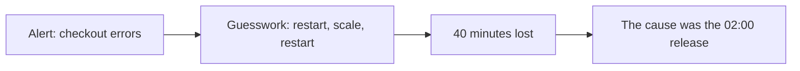
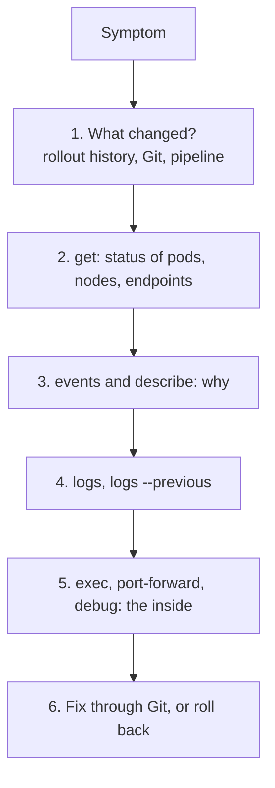

# Troubleshooting and Day-Two Operations

**Cloud and containers · Kubernetes · Step 9.3.10 · Advanced** · Last updated 2026-10-23
**Prerequisites:** the Kubernetes series so far, especially [Pods, ReplicaSets and Deployments](02-pods-replicasets-deployments.md) (9.3.2), [Services, DNS and Ingress](03-services-dns-ingress.md) (9.3.3) and [Probes, rolling updates and graceful shutdown](05-probes-rolling-updates-graceful-shutdown.md) (9.3.5)

**Version note**

| Item | Version |
|---|---|
| Baseline | `kubectl` diagnostic commands, ephemeral containers, PodDisruptionBudgets (`policy/v1`), the Eviction API |
| Hands-on baseline | Rancher Desktop with k3s, Kubernetes server v1.36.5, `kubectl` v1.37.1, container runtime Docker 29.5.3, run on 2026-10-23 |
| Compatibility note | Output wording and the `STATUS` column differ between runtimes and versions (this runtime showed both `Error` and `CrashLoopBackOff` for the same kind of failure). Upgrade rules (version skew) are quoted from the Kubernetes documentation for the 1.36 and 1.37 releases |

## 1. What it is and why it matters

**What is it?** Two skills that start where deployment ends:
- **Troubleshooting:** a repeatable way to go from "checkout is broken" to "this exact object is wrong", using the cluster's own evidence: object status, events, logs, and a way into a running pod.
- **Day-two operations:** everything after the first deployment: node maintenance, upgrades, backups, capacity, clean-up and the habits of running a system other people depend on.

**Why do we need it?** Kubernetes reports a great deal about what it is doing, but only if you know where to look. Without a method, teams guess, restart things at random, and lose hours. And a cluster is not a one-off install: nodes need patching, versions fall out of support, disks fill up, and certificates expire.

**When would I meet it?** At 02:00 when an alert fires, in every post-incident review, when a node must be patched without an outage, and in every discussion of what a platform team promises to run.

> [!TIP]
> **Memory hook:** *look wide, then narrow: `get` shows the state, `describe` and events show why, `logs` show what the program said, `exec` and `debug` show the inside; and when a release is the cause, roll back first and diagnose afterwards.*

## 2. Mental model: the triage nurse

A triage nurse does not operate first. They check the **vital signs** (is the patient alive and where does it hurt), read the **chart** (what happened and when), ask what the patient **said** (symptoms), and only then examine **inside**. And if the patient just took a wrong medicine, the first step is to stop the medicine.

| Real life | Kubernetes |
|---|---|
| Vital signs | `kubectl get pods` (status, ready, restarts, age) |
| The chart | Events, rollout history, Git log: what changed and when |
| What the patient said | `kubectl logs`, including the previous container's |
| Examination | `describe`, `exec`, `port-forward`, ephemeral debug containers |
| Stop the wrong medicine | `kubectl rollout undo`, or revert the commit |

**Where the analogy breaks:** a patient is one body; a service is many pods, a Service, config, volumes, policies and a network, any of which can be the cause. The method has to cover the whole chain.

## 3. Industry terms

| Term | Simple meaning | Why it matters | Example | Related terms |
|---|---|---|---|---|
| **Event** | A short-lived record the cluster writes about what happened to an object | The first place to look for "why" | `FailedScheduling`, `Unhealthy` | Warning vs Normal |
| **Condition** | A named true/false state on an object | Machine-readable health | Node `Ready`, `MemoryPressure` | Status |
| **`describe`** | A human-readable summary of an object and its recent events | Usually enough to find the cause | `kubectl describe pod` | `get -o yaml` |
| **`logs --previous`** | The log of the previous (crashed) container instance | What the program said before dying | The last error line | CrashLoopBackOff |
| **Ephemeral container** | A temporary extra container added to a running pod for debugging | Tools without changing the image or restarting the app | `kubectl debug --target` | `exec` |
| **Cordon / drain / uncordon** | Mark a node unschedulable; evict its pods; make it schedulable again | Safe node maintenance | Patching a node | Eviction |
| **PodDisruptionBudget (PDB)** | A limit on how many pods of a workload may be down during voluntary disruptions | Keeps drains from taking a service down | `minAvailable: 3` | Eviction API |
| **Eviction** | A request to remove a pod gracefully, respecting PDBs | What drains and autoscalers use | `Cannot evict pod ...` | Delete |
| **Version skew** | The allowed difference between component versions | Dictates upgrade order | kubelet up to 3 minor versions older | Upgrade path |
| **Runbook** | Written steps for a known problem | Faster, calmer incidents | "Pod pending" runbook | Playbook |
| **SLO and alert** | A target for user-visible behaviour and a signal when it is at risk | Alert on symptoms, not on every cause | 99.9% checkout success | Error budget |
| **Observability** | Metrics, logs and traces that let you ask new questions of a running system | The data troubleshooting needs | Prometheus, logs, traces | Monitoring |

## 4. In a real system (ShopFlow)

**The business problem.** At 02:10 an alert says checkout error rate is above 5%. The on-call engineer sees "something with `order-service`". They restart the pods; the problem returns. They scale the deployment up; it gets worse. Forty minutes later someone notices that a release at 02:00 changed the readiness probe, so pods flap in and out of the Service. Nobody checked what had changed.



**How a method helps.** The runbook starts with "what changed?" (rollout history, the pipeline), then looks at the pods and events, then logs. In five minutes the engineer sees the stuck rollout and the failing probe events, rolls back, and diagnoses afterwards in daylight. Node maintenance is a documented procedure with a PodDisruptionBudget, upgrades follow a calendar, and backups are tested.


**What it costs.** Time to build runbooks, dashboards and alerts, to practise, and to keep the platform patched; and the discipline to avoid heroic one-off fixes that never reach Git.

**Elsewhere:** a platform team runs game days where they break a cluster on purpose; a bank rehearses restoring a cluster from backup every quarter; an e-commerce site pages on checkout success rate rather than on CPU.

## 5. How it works: the ladder



Use the same order every time. The statuses you will meet map to the earlier lessons:

| What you see | Usually means | Look at | Lesson |
|---|---|---|---|
| `ImagePullBackOff` / `ErrImagePull` | Wrong image name or tag, no pull rights | Events of the pod | [9.3.2](02-pods-replicasets-deployments.md) |
| `CrashLoopBackOff` / `Error`, restarts rising | The process exits at start | `logs`, `logs --previous`, exit code | [9.3.2](02-pods-replicasets-deployments.md) |
| `OOMKilled`, exit 137 | Memory limit too low or a leak | `describe` (Last State), memory limit | [9.3.6](06-resources-scheduling-autoscaling.md) |
| `Pending` | Not schedulable: resources, selector, taints, volume | Events (`FailedScheduling`) | [9.3.6](06-resources-scheduling-autoscaling.md), [9.3.7](07-storage-statefulsets.md) |
| `CreateContainerConfigError` | A missing ConfigMap, Secret or key | Events | [9.3.4](04-configuration-and-secrets.md) |
| `Running` but `0/1` | Readiness probe failing | Events (`Unhealthy`), the probe's path and port | [9.3.5](05-probes-rolling-updates-graceful-shutdown.md) |
| Rollout stuck | New pods never become ready | `rollout status`, new pod events | [9.3.5](05-probes-rolling-updates-graceful-shutdown.md) |
| "Connection refused" to a Service | No ready endpoints, wrong selector or `targetPort` | `get endpointslices` | [9.3.3](03-services-dns-ingress.md) |
| "Bad address" / `NXDOMAIN` | A wrong name, or DNS trouble | `nslookup`, CoreDNS pods | [9.3.3](03-services-dns-ingress.md) |
| `403 Forbidden` from the API | Missing RBAC | `kubectl auth can-i --as=...` | [9.3.9](09-kubernetes-security.md) |
| Pod refused at creation | Pod Security, quota, admission policy | The error text | [9.3.9](09-kubernetes-security.md), [9.3.6](06-resources-scheduling-autoscaling.md) |
| `Terminating` for a long time | Process ignores SIGTERM (grace period), or a finalizer | Grace period, finalizers | [9.3.5](05-probes-rolling-updates-graceful-shutdown.md) |

The experiments below ran in `sf-learn` with a three-replica `order-service`, its Service, and a `client` pod.

### Worked example 1: a release that does not become ready

A new version whose readiness check never succeeds (the demo has a switch for a "bad release"), rolled out with `maxUnavailable: 0`. The ladder:

```text
$ kubectl --context rancher-desktop -n sf-learn apply -f bad-readiness.yaml >/dev/null; sleep 25; echo '1) the symptom:'; kubectl --context rancher-desktop -n sf-learn rollout status deployment/order-service --timeout=5s; echo; echo '2) what the pods look like:'; kubectl --context rancher-desktop -n sf-learn get pods -l app=order-service; echo; echo '3) the events of the stuck pod:'; POD=$(kubectl --context rancher-desktop -n sf-learn get pods -l app=order-service --no-headers | grep ' 0/1' | head -1 | cut -d' ' -f1); kubectl --context rancher-desktop -n sf-learn describe pod $POD | sed -n '/^Events:/,$p' | tail -3 | cut -c1-170; echo; echo '4) users are still served by the old pods:'; kubectl --context rancher-desktop -n sf-learn exec client -- sh -c 'for i in 1 2 3 4 5 6; do wget -qO- -T 2 http://order-service/; done | sort | uniq -c'
1) the symptom:
Waiting for deployment "order-service" rollout to finish: 1 out of 3 new replicas have been updated...

2) what the pods look like:
NAME                             READY   STATUS    RESTARTS   AGE
order-service-59b59dd96f-6t2sm   1/1     Running   0          32s
order-service-59b59dd96f-sfx48   1/1     Running   0          34s
order-service-59b59dd96f-xzsf6   1/1     Running   0          33s
order-service-5d469984f-qzddw    0/1     Running   0          30s

3) the events of the stuck pod:
  Normal   Started    30s                kubelet            spec.containers{order-service}: Container started
  Warning  Unhealthy  30s                kubelet            spec.containers{order-service}: Readiness probe failed: Get "http://10.42.0.227:8080/ready": dial tcp 10.42.0.
  Warning  Unhealthy  1s (x15 over 29s)  kubelet            spec.containers{order-service}: Readiness probe failed: HTTP probe failed with statuscode: 503

4) users are still served by the old pods:
      2 order-service v1 on order-service-59b59dd96f-6t2sm
      1 order-service v1 on order-service-59b59dd96f-sfx48
      3 order-service v1 on order-service-59b59dd96f-xzsf6
error: timed out waiting for the condition
```

**Walkthrough.** (1) The symptom: the rollout is waiting, `1 out of 3 new replicas have been updated`. (2) The pods: three old ones `1/1` and one new one `Running` but `0/1`. (3) The pod's events say `Readiness probe failed: HTTP probe failed with statuscode: 503`, so the container runs but reports that it cannot serve (the first two events are the normal start-up probe failures before the port opens, then 503). (4) Users are still being served, all by version v1 pods, because the rolling update never removed an old pod. **Nothing is down; a release is stuck.** The fix is to go back, then investigate the new version:

```text
$ kubectl --context rancher-desktop -n sf-learn rollout undo deployment/order-service 2>&1 | grep -v '^Warning'; kubectl --context rancher-desktop -n sf-learn rollout status deployment/order-service | tail -1; kubectl --context rancher-desktop -n sf-learn get pods -l app=order-service
deployment.apps/order-service rolled back
deployment "order-service" successfully rolled out
NAME                             READY   STATUS        RESTARTS   AGE
order-service-59b59dd96f-6t2sm   1/1     Running       0          41s
order-service-59b59dd96f-sfx48   1/1     Running       0          43s
order-service-59b59dd96f-xzsf6   1/1     Running       0          42s
order-service-5d469984f-qzddw    0/1     Terminating   0          39s
```

This is why the `rollout undo` comes before the diagnosis: restore service, then find the cause in calm conditions.

### Worked example 2: a container that keeps crashing

A container that exits with an error after printing a message:

```yaml
apiVersion: v1
kind: Pod
metadata:
  name: crasher
  labels:
    learning: notes
spec:
  containers:
    - name: app
      image: busybox:1.37
      command: ["sh", "-c", "echo starting; echo 'FATAL: cannot connect to database orders-db:5432' >&2; exit 3"]
```

```text
$ kubectl --context rancher-desktop -n sf-learn apply -f crasher.yaml >/dev/null; sleep 25; kubectl --context rancher-desktop -n sf-learn get pod crasher; echo; echo '--- kubectl logs:'; kubectl --context rancher-desktop -n sf-learn logs crasher; echo '--- kubectl logs --previous:'; kubectl --context rancher-desktop -n sf-learn logs crasher --previous 2>&1 | head -3; echo '--- exit code and reason:'; kubectl --context rancher-desktop -n sf-learn get pod crasher -o jsonpath='{.status.containerStatuses[0].lastState.terminated.exitCode} {.status.containerStatuses[0].lastState.terminated.reason}{"\n"}'; kubectl --context rancher-desktop -n sf-learn delete pod crasher --wait=false >/dev/null
NAME      READY   STATUS             RESTARTS      AGE
crasher   0/1     CrashLoopBackOff   2 (10s ago)   25s

--- kubectl logs:
FATAL: cannot connect to database orders-db:5432
starting
--- kubectl logs --previous:
FATAL: cannot connect to database orders-db:5432
starting
--- exit code and reason:
3 Error
```

**Walkthrough.** The pod shows `CrashLoopBackOff` with a rising restart count. `kubectl logs` shows the output of the current (or last) container, and `--previous` shows the previous instance, which is the one that actually failed; here both hold the message that matters: `cannot connect to database orders-db:5432`. The exit code (3) and reason come from the pod's status. The two-line order in the output is the order the runtime returned the streams, not the order they were written. Always read the logs before the manifest: the program usually says what is wrong.

### Worked example 3: getting inside without changing anything

Many production images have no shell and no tools. An **ephemeral container** adds a temporary container to a running pod, sharing the pod's network and, with `--target`, the process namespace of the named container:

```text
$ POD=$(kubectl --context rancher-desktop -n sf-learn get pods -l app=order-service -o name | head -1); echo "adding an ephemeral container to $POD (the app container is not restarted)"; kubectl --context rancher-desktop -n sf-learn debug $POD --image=busybox:1.37 --target=order-service --container=debugger -- sh -c 'echo "inside the debug container:"; ps | head -6; echo; echo -n "the app, seen from here: "; wget -qO- -T 2 http://localhost:8080/' >/dev/null; sleep 6; kubectl --context rancher-desktop -n sf-learn logs $POD -c debugger; echo; kubectl --context rancher-desktop -n sf-learn get $POD -o jsonpath='restarts of the app container: {.status.containerStatuses[0].restartCount}{"\n"}'
adding an ephemeral container to pod/order-service-59b59dd96f-6t2sm (the app container is not restarted)
inside the debug container:
PID   USER     TIME  COMMAND
    1 10001     0:00 java -XX:MaxRAMPercentage=60 -jar app.jar
   45 root      0:00 sh -c echo "inside the debug container:"; ps | head -6; echo; echo -n "the app, seen from here: "; wget -qO- -T 2 http://localhost:8080/
   52 root      0:00 ps
   53 root      0:00 sh -c echo "inside the debug container:"; ps | head -6; echo; echo -n "the app, seen from here: "; wget -qO- -T 2 http://localhost:8080/

the app, seen from here: order-service v1 on order-service-59b59dd96f-6t2sm

restarts of the app container: 0
```

**Walkthrough.** The debug container saw the application as process 1 (`java -XX:MaxRAMPercentage=60 -jar app.jar`, running as user 10001), and reached the application on `localhost:8080`, because it shares the pod's network. The application container was not restarted (0 restarts), and the pod now lists an ephemeral container. Ephemeral containers cannot be removed from a pod; they go away when the pod does. With `-it` the same command opens an interactive shell. Related commands: `kubectl exec` (runs a command in an existing container, if it has the tool), `kubectl port-forward` (reach a pod or Service from your laptop), and `kubectl debug --copy-to` (debug a copy of the pod; not run here).

### Worked example 4: read the events

Events are the cluster's running commentary, kept only for a short time (about an hour by default). Warnings first:

```text
$ kubectl --context rancher-desktop -n sf-learn get events --field-selector involvedObject.kind=Pod,type=Warning --sort-by=.metadata.creationTimestamp -o custom-columns=REASON:.reason,OBJECT:.involvedObject.name,MESSAGE:.message | tail -5 | cut -c1-150
REASON      OBJECT                           MESSAGE
Unhealthy   order-service-59b59dd96f-6t2sm   Readiness probe failed: Get "http://10.42.0.226:8080/ready": dial tcp 10.42.0.226:8080: connect: connecti
Unhealthy   order-service-5d469984f-qzddw    Readiness probe failed: Get "http://10.42.0.227:8080/ready": dial tcp 10.42.0.227:8080: connect: connecti
Unhealthy   order-service-5d469984f-qzddw    Readiness probe failed: HTTP probe failed with statuscode: 503
BackOff     crasher                          Back-off restarting failed container app in pod crasher_sf-learn(e8223f61-7eb1-416b-acba-92ec22e1b821)
```

**Walkthrough.** The warnings of the last minutes are exactly the story: the failed readiness probes of the bad release, and the back-off of the crashing pod. Filter with `--field-selector` (by type, reason or object) and sort by time. Because events expire, copy anything you need into the incident notes, and send events to your log system if you want history.

### Worked example 5: a name that does not resolve

```text
$ kubectl --context rancher-desktop -n sf-learn exec client -- sh -c 'echo -n "order-service: "; wget -qO- -T 2 http://order-service/ | head -1; echo -n "order-servce (typo): "; wget -qO- -T 2 http://order-servce/ 2>&1 | head -1; nslookup order-servce.sf-learn.svc.cluster.local 2>&1 | grep -E "NXDOMAIN|can.t find" | head -1'; echo; echo 'the cluster DNS service and its pods:'; kubectl --context rancher-desktop -n kube-system get svc kube-dns; kubectl --context rancher-desktop -n kube-system get pods -l k8s-app=kube-dns
order-service: order-service v1 on order-service-59b59dd96f-xzsf6
order-servce (typo): wget: bad address 'order-servce'
** server can't find order-servce.sf-learn.svc.cluster.local: NXDOMAIN

the cluster DNS service and its pods:
NAME       TYPE        CLUSTER-IP   EXTERNAL-IP   PORT(S)                  AGE
kube-dns   ClusterIP   10.43.0.10   <none>        53/UDP,53/TCP,9153/TCP   14d
NAME                       READY   STATUS    RESTARTS      AGE
coredns-7cfb7bc9c7-w28xd   1/1     Running   2 (10h ago)   14d
```

**Walkthrough.** The correct name worked; the one with a typo failed with `bad address` and the DNS server answered `NXDOMAIN` (the name does not exist). DNS is the cause far less often than a wrong name, a wrong namespace or an empty endpoint list, but when many names fail at once, check that the DNS pods are running (here the single CoreDNS pod is `Running` with the `kube-dns` Service in front of it).

### Worked example 6: planned maintenance and the disruption budget

To patch a node you **cordon** it (no new pods), **drain** it (evict its pods one by one through the Eviction API, which respects PodDisruptionBudgets), do the work, and **uncordon**. A PodDisruptionBudget states how much disruption a workload accepts. Here a budget demands that all three pods stay available:

```yaml
apiVersion: policy/v1
kind: PodDisruptionBudget
metadata:
  name: order-service
  labels:
    learning: notes
spec:
  minAvailable: 3
  selector:
    matchLabels:
      app: order-service
```

```text
$ kubectl --context rancher-desktop -n sf-learn get pdb; echo; POD=$(kubectl --context rancher-desktop -n sf-learn get pods -l app=order-service --no-headers | grep ' 1/1' | head -1 | cut -d' ' -f1); sed "s/POD/$POD/" evict.json > /tmp/sf-evict.json 2>/dev/null || true; echo 'asking the API to evict one pod (what kubectl drain does):'; kubectl --context rancher-desktop create --raw /api/v1/namespaces/sf-learn/pods/$POD/eviction -f - <<< "$(sed "s/POD/$POD/" evict.json)" 2>&1 | cut -c1-300; echo; echo 'a plain delete is not subject to the budget:'; kubectl --context rancher-desktop -n sf-learn delete pod $POD --wait=false
NAME            MIN AVAILABLE   MAX UNAVAILABLE   ALLOWED DISRUPTIONS   AGE
order-service   3               N/A               0                     1s

asking the API to evict one pod (what kubectl drain does):
Error from server (TooManyRequests): Cannot evict pod as it would violate the pod's disruption budget.

a plain delete is not subject to the budget:
pod "order-service-59b59dd96f-6t2sm" deleted from sf-learn namespace
```

**Walkthrough.** `ALLOWED DISRUPTIONS` is 0 because three of three must be available. Asking for an eviction (what `kubectl drain` does for every pod) was refused: `Cannot evict pod as it would violate the pod's disruption budget`, and the API answered with a `TooManyRequests` status, so a drain would wait and retry. A plain `kubectl delete pod` is **not** subject to the budget (the pod was deleted, and the Deployment replaced it), which shows that a budget protects against voluntary, orchestrated disruptions, not against someone deleting pods by hand, and not against crashes or node failures. A budget that demands everything (`minAvailable` equal to the replica count) blocks maintenance forever; use `maxUnavailable: 1` or a number below the replica count. The cluster used here has one node, so a real drain was not run (it would evict the cluster's own services too). The node's own health is read from its conditions:

```text
$ kubectl --context rancher-desktop describe node | sed -n '/^Conditions:/,/^Addresses:/p' | head -9 | cut -c1-140; kubectl --context rancher-desktop top node
Conditions:
  Type             Status  LastHeartbeatTime                 LastTransitionTime                Reason                       Message
  ----             ------  -----------------                 ------------------                ------                       -------
  MemoryPressure   False   Fri, 23 Oct 2026 09:11:52 +0530   Fri, 09 Oct 2026 08:58:29 +0530   KubeletHasSufficientMemory   kubelet has suff
  DiskPressure     False   Fri, 23 Oct 2026 09:11:52 +0530   Fri, 09 Oct 2026 08:58:29 +0530   KubeletHasNoDiskPressure     kubelet has no d
  PIDPressure      False   Fri, 23 Oct 2026 09:11:52 +0530   Fri, 09 Oct 2026 08:58:29 +0530   KubeletHasSufficientPID      kubelet has suff
  Ready            True    Fri, 23 Oct 2026 09:11:52 +0530   Fri, 09 Oct 2026 08:58:32 +0530   KubeletReady                 kubelet is posti
Addresses:
NAME                   CPU(cores)   CPU(%)   MEMORY(bytes)   MEMORY(%)   
lima-rancher-desktop   248m         12%      2193Mi          37%         
```

Four conditions (`MemoryPressure`, `DiskPressure`, `PIDPressure`, `Ready`) tell you whether the kubelet considers the node healthy; a node that becomes `NotReady` has its pods rescheduled elsewhere after a delay (the 300-second tolerations seen in [9.3.2](02-pods-replicasets-deployments.md)).

### Worked example 7: right-sizing and hygiene

Requests against real use:

```text
$ kubectl --context rancher-desktop -n sf-learn top pods; echo; kubectl --context rancher-desktop -n sf-learn get pods -o custom-columns=NAME:.metadata.name,CPU-REQ:.spec.containers[0].resources.requests.cpu,MEM-REQ:.spec.containers[0].resources.requests.memory --no-headers
NAME                             CPU(cores)   MEMORY(bytes)   
client                           0m           0Mi             
order-service-59b59dd96f-sfx48   4m           30Mi            
order-service-59b59dd96f-xzsf6   4m           30Mi            

client                           <none>   <none>
order-service-59b59dd96f-9mz4c   50m      128Mi
order-service-59b59dd96f-sfx48   50m      128Mi
order-service-59b59dd96f-xzsf6   50m      128Mi
```

**Walkthrough.** Each `order-service` pod reserves 50m of CPU and 128Mi but uses about 4m and 30Mi: a sign that requests could be smaller (leave headroom for spikes, and look over a representative period, not one minute) and that money is being reserved for nothing ([9.3.6](06-resources-scheduling-autoscaling.md)). The Deployment also keeps old ReplicaSets for rollback:

```text
$ kubectl --context rancher-desktop -n sf-learn rollout history deployment/order-service; echo; kubectl --context rancher-desktop -n sf-learn get replicaset; echo; echo -n 'revisionHistoryLimit (unset means the default 10): '; kubectl --context rancher-desktop -n sf-learn get deployment order-service -o jsonpath='{.spec.revisionHistoryLimit}'; echo
deployment.apps/order-service 
REVISION  CHANGE-CAUSE
2         <none>
4         <none>
5         <none>


NAME                       DESIRED   CURRENT   READY   AGE
order-service-59b59dd96f   3         3         3       8h
order-service-5d469984f    0         0         0       102s
order-service-6d547f849d   0         0         0       8h

revisionHistoryLimit (unset means the default 10): 10
```

The history shows revisions kept and old ReplicaSets scaled to zero; the default limit is 10. (The ages in this output are what the cluster reported; the machine had been asleep.) Other things to clean regularly: finished Jobs and their pods, unused ConfigMaps and Secrets, claims left behind by deleted StatefulSets ([9.3.7](07-storage-statefulsets.md)), and unused namespaces. Before an upgrade, look for deprecated APIs in use; the API server counts requests to them:

```text
$ kubectl --context rancher-desktop get --raw /metrics 2>/dev/null | grep '^apiserver_requested_deprecated_apis' | head -3 | cut -c1-200; echo '(an empty result means no deprecated API has been requested since the API server started)'
apiserver_requested_deprecated_apis{group="",removed_release="",resource="componentstatuses",subresource="",version="v1"} 1
apiserver_requested_deprecated_apis{group="",removed_release="",resource="endpoints",subresource="",version="v1"} 1
(an empty result means no deprecated API has been requested since the API server started)
```

**Walkthrough.** Each line is an API that is marked deprecated and was requested at least once; `removed_release` names the release that will remove it (empty here means no removal is announced). Old manifests and tools that call a removed API break when the cluster is upgraded; find them first, in your repositories with a linter and in the cluster with this metric.

### Upgrades, backups and capacity: the habits

Not run here, because they would change the cluster:

- **Upgrade rules.** Kubernetes only supports upgrading one minor version at a time (the kubeadm documentation: "Skipping MINOR versions when upgrading is unsupported"). The control plane goes first; `kubectl` may be one minor version older or newer than the API server; and the kubelet "must not be newer than kube-apiserver" but "may be up to three minor versions older" (Version Skew Policy). Each minor version gets roughly a year of patch releases followed by a short maintenance period (patch release policy), so plan an upgrade cycle of a few times a year. Managed services (EKS, GKE, AKS) do the control-plane step for you and give you a deadline; node pools are upgraded by replacing nodes, which is why PodDisruptionBudgets, readiness probes and graceful shutdown ([9.3.5](05-probes-rolling-updates-graceful-shutdown.md)) matter so much.
- **Upgrade routine.** Read the release notes and the deprecation guide; fix deprecated API use; upgrade a non-production cluster first and run the tests; upgrade the control plane, then the nodes one pool at a time; watch the platform dashboards.
- **Backups.** In a self-managed cluster, back up etcd (or the datastore) on a schedule and test the restore; in all clusters, keep manifests in Git so that the cluster can be rebuilt from them, and back up what Git cannot hold: persistent volumes ([9.3.7](07-storage-statefulsets.md)), secrets (in their external store) and databases. A backup you have never restored is a hope.
- **Capacity.** Watch the gap between requests and usage, pending pods, node pressure conditions, the number of pods per node (110 by default on this node), and the cost (9.6, planned).
- **Access.** Humans through single sign-on and least-privilege roles ([9.3.9](09-kubernetes-security.md)), with production changes through Git and a pipeline.

### When it goes wrong (day-two edition)

1. **A node goes `NotReady`.** Pods on it are rescheduled after the toleration period; stateful pods with node-local storage cannot move ([9.3.7](07-storage-statefulsets.md)). Check the node's conditions, the kubelet and the machine itself.
2. **Disk pressure evicts pods.** The kubelet evicts pods when the node runs low on disk or memory, BestEffort and over-using pods first ([9.3.6](06-resources-scheduling-autoscaling.md)). Unbounded logs and image caches are common causes.
3. **A drain hangs.** A PodDisruptionBudget that allows no disruption, a pod with no controller, or a pod that ignores SIGTERM. Read the drain output: it names the pod and the reason.
4. **A namespace stuck in `Terminating`.** Something in it has a finalizer that is never completed (often a deleted controller or a volume). Find the remaining objects; removing finalizers by hand is a last resort and can leave orphaned resources.
5. **Certificates expire.** Cluster certificates and webhooks have lifetimes; managed services and k3s rotate the cluster's own, but your ingress and webhook certificates are yours to monitor.
6. **A restart "fixes" it.** It hid the cause; the problem returns. Capture logs, events and metrics before restarting, and record the cause.
7. **Alert fatigue.** Dozens of alerts on CPU and restarts, none on user impact. Alert on symptoms tied to an objective (checkout success rate, latency), and use the dashboards and logs to find causes.

### Common mistakes

1. Restarting or scaling before asking what changed.
2. Reading the manifest instead of the logs and events.
3. Fixing production with `kubectl edit` and not updating Git.
4. Deleting pods by hand during a drain and ignoring PodDisruptionBudgets.
5. No restore test for backups.
6. Letting versions drift out of support, then upgrading several minors in a panic.
7. Debugging in production by adding tools to the image.

### Alternatives in the industry

A map of the landscape, not a comparison. Only `kubectl` and the Kubernetes features above were run; check each project's documentation before adopting one.

| Area | Tool or product | What it is | When you meet it |
|---|---|---|---|
| Metrics and alerts | **Prometheus** with **Alertmanager** and **Grafana** | The de-facto open-source metrics stack | Most self-managed and many managed clusters |
| | **Datadog**, **New Relic**, **Dynatrace**, **Grafana Cloud**, **AWS CloudWatch Container Insights**, **Google Cloud Operations**, **Azure Monitor** | Hosted observability platforms | Teams that prefer to buy than to run |
| Logs | **Loki**, **Elastic / OpenSearch** with a collector (Fluent Bit, Vector, Fluentd) | Collect and search logs from all pods | Anywhere pods are replaced often |
| Traces | **OpenTelemetry** with **Jaeger** or **Tempo** | Follow a request across services | Microservices debugging |
| Kubernetes-aware helpers | **k9s** (terminal UI), **Lens** and **Headlamp** (graphical), **stern** (tail logs of many pods), **kubectx / kubens** (switch cluster and namespace) | Faster navigation and safer context handling | Daily work |
| Diagnosis aids | **Robusta**, **k8sgpt**, **Popeye**, **Kubescape** | Explain common problems, scan cluster hygiene | Platform teams |
| Backup and restore | **Velero**, **Kasten K10**, **etcd snapshots**, managed-service backups | Back up cluster objects and volumes | Disaster-recovery plans ([14.14](../../14-system-design/14-multi-region-disaster-recovery.md)) |
| Node lifecycle | **Cluster API**, managed node pools, **Karpenter**, **kured** | Create, replace and reboot nodes in a controlled way | Upgrades and patching at scale |
| Incident response | **PagerDuty**, **Opsgenie**, **Grafana OnCall**, runbooks in a wiki | Paging, escalation and procedures | On-call rotations |
| Other platforms | **ECS and CloudWatch**, **Nomad UI** | Their own consoles and tools | Teams outside Kubernetes ([9.3.1](01-kubernetes-overview.md)) |

## 6. Architectural decisions

| Decision | Choose | Because |
|---|---|---|
| Method | A written ladder: what changed, get, events and describe, logs, inside; roll back first when a release is the cause | Faster and calmer than guessing |
| Observability | Metrics, logs and traces collected centrally, with a retention longer than the one-hour event history | Pods and events disappear |
| Alerting | On user-visible symptoms and objectives (SLOs), with cause-level dashboards for diagnosis | Fewer, more useful pages |
| Debugging access | Ephemeral containers and read-only roles for on-call; no tools baked into production images | Least privilege and small images |
| Disruption control | A PodDisruptionBudget for every production workload with two or more replicas, allowing one disruption | Maintenance without outages |
| Node maintenance | Cordon, drain, patch or replace, uncordon, as a documented routine; prefer replacing nodes | Predictable and repeatable |
| Upgrade policy | Stay within the support window; one minor at a time; control plane first; staging first; deprecations fixed beforehand | Avoids forced and risky catch-up upgrades |
| Backups | Git for manifests, scheduled backups for data, regular restore tests | Recoverable from a bad day |
| Change process | All changes through Git and a pipeline; emergency edits followed by a Git change | The cluster stays explainable |
| Practice | Runbooks, game days and post-incident reviews | Skills are built before the incident |

## 7. Try it yourself

Try each exercise first; the real results are in the Answers section.

1. **Stuck rollout.** A new version never gets ready. Show with commands that users are still served, find the reason, and restore the previous version.
2. **Why does it crash?** A pod is in `CrashLoopBackOff`. Which two commands show the reason, and what did the program say?
3. **Look inside.** Run a command in a pod whose image you cannot change, without restarting it, and show the application's process and its port from inside.
4. **A blocked drain.** Show with a PodDisruptionBudget why evicting a pod is refused, and what budget would allow one pod to be taken at a time.

## 8. Check your understanding

1. Why is "what changed?" the first question, and where do you find the answer?
2. A pod shows `Running` and `0/1`. Where is the reason, and what does the Service do with that pod?
3. What does a PodDisruptionBudget protect against, and what does it not protect against?
4. Your cluster runs 1.34 and you want 1.36. How do you get there, and what do you check first?

Answers are at the end of this note.

## 9. Revision

**Remember**
- **The ladder:** what changed → `get` → events and `describe` → `logs` (`--previous`) → `exec` / `port-forward` / `debug` → fix through Git or **roll back first**.
- Statuses map to causes: `ImagePullBackOff` (image), crash loop (logs), `OOMKilled` (memory), `Pending` (scheduler events), `0/1 Running` (readiness), no endpoints (selector/port), `CreateContainerConfigError` (missing config).
- **Ephemeral containers** debug a running pod without restarting it; **events** last about an hour.
- **Drain** = cordon + evict (respecting **PodDisruptionBudgets**) + uncordon; deleting a pod bypasses a budget.
- **Upgrades:** one minor at a time, control plane first, fix deprecated APIs, kubelet up to three minors older than the API server.
- Back up data; **test restores**; alert on symptoms; keep Git true.

**Explain in 15 seconds:** "I troubleshoot in a fixed order: what changed, pod and event status, logs, then inside the pod; I roll back a bad release before diagnosing, and I run maintenance with drains, disruption budgets, tested backups and planned upgrades."

**Explain in 60 seconds:**
> "When something breaks, I first ask what changed, from the rollout history and the pipeline, because most incidents follow a change, and if a release is the cause I roll back before diagnosing. Then I go from wide to narrow: `get` for the state of pods and endpoints, `describe` and events for why, `logs` including `--previous` for what the program said, and `exec` or an ephemeral debug container to look inside without touching the image. The status tells me where to look: image pull problems, crash loops, OOM kills, pending pods and failing readiness each point at a different object. For operations, I patch nodes by cordoning and draining them, with PodDisruptionBudgets so a service keeps enough pods, I upgrade one minor version at a time, control plane first, after fixing deprecated APIs, I keep manifests in Git and back up data and test the restore, and I alert on user-visible symptoms with logs, metrics and traces to find the cause."

**Likely follow-up questions:**
- **What if the pod has no shell?** Use `kubectl debug` with an ephemeral container, or debug a copy of the pod.
- **How do I find out who changed something?** Git history and the pipeline; the API audit log (if enabled) records who called the API.
- **How often should we upgrade?** Within the support window of each minor version, one minor at a time, usually a few times a year; managed services enforce deadlines.
- **Do PDBs apply to node failures?** No, only to voluntary evictions such as drains; use replicas, spread constraints and zones for failures.

**Architect's takeaway:** reliability is mostly a habit of method: the same order of questions every time, changes that can be explained and undone, and maintenance that is rehearsed. Design for the 02:00 engineer who has never seen this service.

**Next topic:** the Kubernetes cheat sheet ([99](99-kubernetes-cheat-sheet.md)) summarises the whole series for revision.

## 10. Verification and sources

> [!NOTE]
> Checked 2026-10-23 against the Kubernetes documentation and by running every command shown on Rancher Desktop (Kubernetes server v1.36.5+k3s1). Ages, names and timestamps vary and the machine's clock jumped during the session, so do not read anything into the ages shown. Re-verify when you revisit this note.

- **Confirmed (documentation, read 2026-10-23):** "kubelet must not be newer than kube-apiserver", the kubelet "may be up to three minor versions older than kube-apiserver", and `kubectl` is supported within one minor version, older or newer, of the API server (Kubernetes, "Version Skew Policy"); "Skipping MINOR versions when upgrading is unsupported" (Kubernetes, "Upgrading kubeadm clusters"); each patch release series has a standard period of about twelve months followed by a two-month maintenance mode (Kubernetes, "Patch Releases"); the Pod lifecycle, grace period and probe behaviour used in the examples (see [9.3.5](05-probes-rolling-updates-graceful-shutdown.md)).
- **Observed (this machine):** the stuck rollout and its events, the rollback, the crash loop with `logs` and `logs --previous`, the ephemeral debug container sharing the process namespace, the warning events, the `NXDOMAIN` for a misspelled name, the PodDisruptionBudget refusing an eviction with `TooManyRequests` while a plain delete succeeded, node conditions, usage versus requests, the revision history and the deprecated-API metric.
- **Not run:** a real cordon and drain, upgrades, etcd backup and restore, Velero, `kubectl debug --copy-to`, finalizer removal, Prometheus and the other alternatives (general industry knowledge, or described from the documentation).
- **Assumptions and illustrations:** the 02:00 incident is illustrative; the "bad release" and the crashing pod are staged with the demo service and a shell script.
- **To verify:** your platform's upgrade and support calendar; whether the API audit log is enabled and where events and logs are kept; the exact `STATUS` words your runtime shows; your backup and restore procedure and when it was last tested.
- **Decision rule:** a fixed diagnostic order, rollback before diagnosis, PDBs and drains for maintenance, one-minor upgrades after deprecation checks, tested backups, symptom-based alerts.

**Sources:** Kubernetes documentation: "Debug Running Pods", "Ephemeral Containers", "Safely Drain a Node", "Specifying a Disruption Budget for your Application", "Version Skew Policy", "Upgrading kubeadm clusters", "Patch Releases", "Troubleshooting Applications"; the earlier lessons of this series.

## Answers

**Experiment (exercises)**

1. **Stuck rollout:** `kubectl rollout status` shows it waiting, `kubectl get pods` shows old pods `1/1` and the new one `0/1`, the events show `Readiness probe failed ... 503`, requests are still answered by the old pods, and `kubectl rollout undo` restores service:

```text
$ kubectl --context rancher-desktop -n sf-learn apply -f bad-readiness.yaml >/dev/null; sleep 25; echo '1) the symptom:'; kubectl --context rancher-desktop -n sf-learn rollout status deployment/order-service --timeout=5s; echo; echo '2) what the pods look like:'; kubectl --context rancher-desktop -n sf-learn get pods -l app=order-service; echo; echo '3) the events of the stuck pod:'; POD=$(kubectl --context rancher-desktop -n sf-learn get pods -l app=order-service --no-headers | grep ' 0/1' | head -1 | cut -d' ' -f1); kubectl --context rancher-desktop -n sf-learn describe pod $POD | sed -n '/^Events:/,$p' | tail -3 | cut -c1-170; echo; echo '4) users are still served by the old pods:'; kubectl --context rancher-desktop -n sf-learn exec client -- sh -c 'for i in 1 2 3 4 5 6; do wget -qO- -T 2 http://order-service/; done | sort | uniq -c'
1) the symptom:
Waiting for deployment "order-service" rollout to finish: 1 out of 3 new replicas have been updated...

2) what the pods look like:
NAME                             READY   STATUS    RESTARTS   AGE
order-service-59b59dd96f-6t2sm   1/1     Running   0          32s
order-service-59b59dd96f-sfx48   1/1     Running   0          34s
order-service-59b59dd96f-xzsf6   1/1     Running   0          33s
order-service-5d469984f-qzddw    0/1     Running   0          30s

3) the events of the stuck pod:
  Normal   Started    30s                kubelet            spec.containers{order-service}: Container started
  Warning  Unhealthy  30s                kubelet            spec.containers{order-service}: Readiness probe failed: Get "http://10.42.0.227:8080/ready": dial tcp 10.42.0.
  Warning  Unhealthy  1s (x15 over 29s)  kubelet            spec.containers{order-service}: Readiness probe failed: HTTP probe failed with statuscode: 503

4) users are still served by the old pods:
      2 order-service v1 on order-service-59b59dd96f-6t2sm
      1 order-service v1 on order-service-59b59dd96f-sfx48
      3 order-service v1 on order-service-59b59dd96f-xzsf6
error: timed out waiting for the condition
```

```text
$ kubectl --context rancher-desktop -n sf-learn rollout undo deployment/order-service 2>&1 | grep -v '^Warning'; kubectl --context rancher-desktop -n sf-learn rollout status deployment/order-service | tail -1; kubectl --context rancher-desktop -n sf-learn get pods -l app=order-service
deployment.apps/order-service rolled back
deployment "order-service" successfully rolled out
NAME                             READY   STATUS        RESTARTS   AGE
order-service-59b59dd96f-6t2sm   1/1     Running       0          41s
order-service-59b59dd96f-sfx48   1/1     Running       0          43s
order-service-59b59dd96f-xzsf6   1/1     Running       0          42s
order-service-5d469984f-qzddw    0/1     Terminating   0          39s
```

2. **Why does it crash?** `kubectl logs POD` (and `--previous` for the earlier instance) shows the message, and the pod's status gives the exit code. The program said it could not connect to the database `orders-db:5432`; exit code 3:

```text
$ kubectl --context rancher-desktop -n sf-learn apply -f crasher.yaml >/dev/null; sleep 25; kubectl --context rancher-desktop -n sf-learn get pod crasher; echo; echo '--- kubectl logs:'; kubectl --context rancher-desktop -n sf-learn logs crasher; echo '--- kubectl logs --previous:'; kubectl --context rancher-desktop -n sf-learn logs crasher --previous 2>&1 | head -3; echo '--- exit code and reason:'; kubectl --context rancher-desktop -n sf-learn get pod crasher -o jsonpath='{.status.containerStatuses[0].lastState.terminated.exitCode} {.status.containerStatuses[0].lastState.terminated.reason}{"\n"}'; kubectl --context rancher-desktop -n sf-learn delete pod crasher --wait=false >/dev/null
NAME      READY   STATUS             RESTARTS      AGE
crasher   0/1     CrashLoopBackOff   2 (10s ago)   25s

--- kubectl logs:
FATAL: cannot connect to database orders-db:5432
starting
--- kubectl logs --previous:
FATAL: cannot connect to database orders-db:5432
starting
--- exit code and reason:
3 Error
```

3. **Look inside:** `kubectl debug POD --image=busybox --target=CONTAINER` adds an ephemeral container that shares the network and process namespace; its logs (or an interactive session with `-it`) show the process list and the application on `localhost`:

```text
$ POD=$(kubectl --context rancher-desktop -n sf-learn get pods -l app=order-service -o name | head -1); echo "adding an ephemeral container to $POD (the app container is not restarted)"; kubectl --context rancher-desktop -n sf-learn debug $POD --image=busybox:1.37 --target=order-service --container=debugger -- sh -c 'echo "inside the debug container:"; ps | head -6; echo; echo -n "the app, seen from here: "; wget -qO- -T 2 http://localhost:8080/' >/dev/null; sleep 6; kubectl --context rancher-desktop -n sf-learn logs $POD -c debugger; echo; kubectl --context rancher-desktop -n sf-learn get $POD -o jsonpath='restarts of the app container: {.status.containerStatuses[0].restartCount}{"\n"}'
adding an ephemeral container to pod/order-service-59b59dd96f-6t2sm (the app container is not restarted)
inside the debug container:
PID   USER     TIME  COMMAND
    1 10001     0:00 java -XX:MaxRAMPercentage=60 -jar app.jar
   45 root      0:00 sh -c echo "inside the debug container:"; ps | head -6; echo; echo -n "the app, seen from here: "; wget -qO- -T 2 http://localhost:8080/
   52 root      0:00 ps
   53 root      0:00 sh -c echo "inside the debug container:"; ps | head -6; echo; echo -n "the app, seen from here: "; wget -qO- -T 2 http://localhost:8080/

the app, seen from here: order-service v1 on order-service-59b59dd96f-6t2sm

restarts of the app container: 0
```

4. **A blocked drain:** with `minAvailable: 3` and three pods, no disruption is allowed and the eviction is refused. A budget of `maxUnavailable: 1` (or `minAvailable: 2`) allows one pod to be taken at a time:

```text
$ kubectl --context rancher-desktop -n sf-learn get pdb; echo; POD=$(kubectl --context rancher-desktop -n sf-learn get pods -l app=order-service --no-headers | grep ' 1/1' | head -1 | cut -d' ' -f1); sed "s/POD/$POD/" evict.json > /tmp/sf-evict.json 2>/dev/null || true; echo 'asking the API to evict one pod (what kubectl drain does):'; kubectl --context rancher-desktop create --raw /api/v1/namespaces/sf-learn/pods/$POD/eviction -f - <<< "$(sed "s/POD/$POD/" evict.json)" 2>&1 | cut -c1-300; echo; echo 'a plain delete is not subject to the budget:'; kubectl --context rancher-desktop -n sf-learn delete pod $POD --wait=false
NAME            MIN AVAILABLE   MAX UNAVAILABLE   ALLOWED DISRUPTIONS   AGE
order-service   3               N/A               0                     1s

asking the API to evict one pod (what kubectl drain does):
Error from server (TooManyRequests): Cannot evict pod as it would violate the pod's disruption budget.

a plain delete is not subject to the budget:
pod "order-service-59b59dd96f-6t2sm" deleted from sf-learn namespace
```

**Check your understanding**

1. Most incidents follow a change (a release, a config edit, a scaling or policy change), so finding the change usually finds the cause and, if it is a release, the fastest fix is to undo it. The answer is in `kubectl rollout history`, the Git log and pipeline runs, the event list, and (if enabled) the API audit log.
2. In the pod's events (`kubectl describe pod`): `Readiness probe failed ...` with the path, port and status code. The Service takes that pod out of its ready endpoints, so it receives no traffic, but the pod is not restarted ([9.3.5](05-probes-rolling-updates-graceful-shutdown.md)).
3. It protects against too many pods of a workload being removed at once by *voluntary* disruptions that use the Eviction API: node drains, cluster upgrades, autoscaler scale-downs. It does not protect against crashes, node failures, or someone deleting pods directly (delete bypasses the budget).
4. Upgrade one minor version at a time: 1.34 to 1.35, then 1.35 to 1.36 (skipping minors is unsupported). Before each step read the release notes and the deprecation guide, find and fix deprecated API use, upgrade a non-production cluster first, upgrade the control plane before the nodes, and check that your kubelets and `kubectl` stay within the version skew rules. Make sure a backup exists and a restore has been tested.

Back to [the series overview](01-kubernetes-overview.md) · [the area overview](../01-cloud-and-containers-overview.md) · [the index](../../README.md) · [Roadmap](../../roadmap.md).
