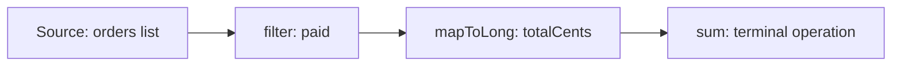

# Java Stream API: The Big Picture

**Java · Streams · Step 13.2.1 · Series overview** · Last updated 2026-10-21
**Prerequisites:** [Java language and platform: the big picture](../01-java-overview.md) (13.1)

Read this first. It is the map of the Streams series: what a stream is, why it exists, when to prefer a plain loop, and the order to learn the topics in. The examples are complete programs; how to run them on your Mac is in [the Java overview](../01-java-overview.md), section 5.

**Version note** (for the whole series)

| Item | Version |
|---|---|
| Baseline | **Java 8**: the Stream API (`java.util.stream`), lambda expressions, method references and `Optional` |
| Newer features covered | **Java 9**: `takeWhile`, `dropWhile`, `Stream.ofNullable`, `iterate` with a condition. **Java 10**: `Collectors.toUnmodifiableList()`. **Java 16**: `Stream.toList()`, `mapMulti`. **Java 24**: Stream Gatherers (13.2.10, planned) |
| Hands-on baseline | **Java 21**, tested with OpenJDK 21.0.8 (Temurin). The examples also use records, a Java 16 language feature |
| On Java 8 to 15 | Replace each record with a small final class, `toList()` with `collect(Collectors.toList())` (no mutability guarantee) or, from Java 10, `collect(Collectors.toUnmodifiableList())`, and `List.of(...)` (Java 9) with `Arrays.asList(...)`, which returns a fixed-size list |

## 1. What it is and why it matters

**What is it?** A **stream** is a way to describe a computation over a sequence of elements as a **pipeline** of steps, such as "keep the paid orders, take their amounts, add them up". The steps run only when you ask for a final result.

**Why do we need it?** A loop mixes *what* you want with *how* to get it (an accumulator variable, an `if`, a `+=`). A pipeline states the *what* step by step, so it is easier to read and to change, and, when it is safe, it can run in parallel.

**When would I meet it?** Processing collections, reading lines of a file, turning entities into DTOs, grouping and summarising data, and any code review that says "why not a stream?".

> [!TIP]
> **Memory hook:** a conveyor belt with a start button. Nothing moves until you press start, the belt can run only once, and (on a sequential stream) items pass through the stations one at a time.

## 2. Mental model: a conveyor belt

| In the analogy | In the Stream API |
|---|---|
| The crate of items | The **source** (a list, an array, a file) |
| A station that sorts or relabels items | An **intermediate operation** (`filter`, `map`) |
| The packing station at the end | The **terminal operation** (`toList`, `sum`) |
| Pressing the start button | Calling the terminal operation |

**Where the analogy breaks:** a real belt carries physical items you could put back. A stream stores nothing and can't be rewound: the documentation says a stream "is not a data structure that stores elements" and that elements are visited only once.

## 3. Industry terms

| Term | Simple meaning | Why it matters | Example | Related terms |
|---|---|---|---|---|
| **Stream** | A one-time flow of elements through a pipeline | The object you build the pipeline on | `orders.stream()` | Collection |
| **Pipeline** | Source, zero or more intermediate operations, one terminal operation | The unit of reasoning | `filter → mapToLong → sum` | Lazy |
| **Intermediate operation** | A step that returns another stream | Describes work, doesn't do it | `filter`, `map` | Terminal operation |
| **Terminal operation** | The step that produces a result or effect and starts the run | Without it, nothing runs | `toList`, `sum`, `forEach` | Short-circuiting |
| **Lazy** | Work happens only when the terminal operation runs | Explains surprising behaviour | A `peek` that prints nothing | Eager |
| **Lambda / method reference** | A function passed to a step | What each station does | `o -> o.status() == Status.PAID`, `Order::totalCents` | Functional interface |
| **Collector** | A recipe for gathering results | Used with `collect` | `groupingBy` | Reduction |
| **Parallel stream** | A stream that may split work across threads | Powerful and easy to misuse | `parallelStream()` | Fork/join |

## 4. In a real system (ShopFlow)

**The business problem.** Finance asks the Order Service for the revenue from paid orders and the list of customers who paid.

### Loop versus stream: `filter → mapToLong → sum`

The program below answers the request twice, once with a loop and once with a stream, using the shared ShopFlow sample orders (described in [the Java overview](../01-java-overview.md), section 5).

```java
// File: PaidTotal.java (runnable, Java 21)
import java.util.List;

public class PaidTotal {

    enum Status { PAID, PENDING, CANCELLED }

    record Order(String id, String customer, Status status, long totalCents) {}

    static List<Order> sampleOrders() {               // the same five ShopFlow orders in every example
        return List.of(
            new Order("o-1001", "ana", Status.PAID,      8_000),
            new Order("o-1002", "ben", Status.CANCELLED, 3_000),
            new Order("o-1003", "ana", Status.PAID,      2_500),
            new Order("o-1004", "cy",  Status.PENDING,   4_500),
            new Order("o-1005", "cy",  Status.PAID,     12_000));
    }

    public static void main(String[] args) {
        List<Order> orders = sampleOrders();

        // A loop: says HOW (accumulator, if, +=)
        long loopTotal = 0;
        for (Order o : orders) {
            if (o.status() == Status.PAID) {
                loopTotal += o.totalCents();
            }
        }

        // A stream: says WHAT, one step at a time
        long streamTotal = orders.stream()
                .filter(o -> o.status() == Status.PAID)   // keep paid orders
                .mapToLong(Order::totalCents)             // take each amount
                .sum();                                   // add them up: starts the run

        List<String> payingCustomers = orders.stream()
                .filter(o -> o.status() == Status.PAID)
                .map(Order::customer)
                .distinct()
                .sorted()
                .toList();

        System.out.println("loop total   = " + loopTotal + " cents");
        System.out.println("stream total = " + streamTotal + " cents");
        System.out.printf("paid revenue = EUR %d.%02d%n", streamTotal / 100, streamTotal % 100);
        System.out.println("paying customers = " + payingCustomers);
    }
}
```

**Expected output** (run on OpenJDK 21.0.8, 2026-10-21):

```text
loop total   = 22500 cents
stream total = 22500 cents
paid revenue = EUR 225.00
paying customers = [ana, cy]
```

**Walkthrough.** Nothing happens while the pipeline is being described. When `sum()` runs, each order of this sequential stream travels through the steps in turn:

| Order | `filter`: is it `PAID`? | `mapToLong`: amount passed on | Running sum |
|---|---|---|---|
| o-1001, ana, 8,000 | yes | 8,000 | 8,000 |
| o-1002, ben, 3,000 | no, `CANCELLED`: dropped | (none) | 8,000 |
| o-1003, ana, 2,500 | yes | 2,500 | 10,500 |
| o-1004, cy, 4,500 | no, `PENDING`: dropped | (none) | 10,500 |
| o-1005, cy, 12,000 | yes | 12,000 | **22,500** |

`mapToLong` turns the stream of `Order` objects into a stream of plain `long` values, so `sum()` can add them without boxing each number into a `Long`. The second pipeline keeps the same paid orders, takes their `customer`, removes the repeated `ana` with `distinct()`, and sorts the names: `[ana, cy]`.

**Experiment.** In the stream version only, change `Status.PAID` to `Status.PENDING`. Predict the two total lines before you run it. (Answer at the end.)

**What it costs.** Pipelines are harder to step through in a debugger, wrong use of side effects or parallelism creates subtle bugs, and for simple work a loop can be shorter and clearer.

## 5. How it works



1. You create a stream from a source.
2. You chain intermediate operations; each returns a new stream and does no work yet.
3. You call a terminal operation; only now does the source start producing elements.
4. In a sequential stream, elements flow through the stations one at a time and the result comes out of the terminal operation. A parallel stream may process several elements at once and in any order, although results such as `toList()` keep the source's order ([13.2.2](02-pipeline-laziness.md) shows which guarantees hold).
5. The stream is now used up; start again from the source for another run.

The next note, [13.2.2](02-pipeline-laziness.md), proves each of these steps with programs that print what happens.

## 6. Architectural decisions

| Use a stream when | Prefer a loop when |
|---|---|
| The work is "filter, transform, gather" over a sequence | You need several outputs from one pass with shared mutable state |
| Each step is a small, pure function | The logic has complex early exits, or checked exceptions in every step |
| You may later gather results with a collector | A plain loop is shorter and equally clear |

**Versions.** The concepts in this series are Java 8; the version note at the top lists the newer APIs and what to use on older versions. A production service on Java 8 or 11 can use every idea here, but not every method. **Common mistakes:** forgetting the terminal operation; reusing a stream; putting side effects in `map`; using parallel streams by reflex. Each is demonstrated in [13.2.2](02-pipeline-laziness.md).

## 7. Notes in this series, in learning order

### Fundamentals

| Step | Topic | Prerequisites | Status |
|---|---|---|---|
| 13.2.1 | This overview | 13.1 | Done |
| 13.2.2 | [The pipeline: source, operations and laziness](02-pipeline-laziness.md) | 13.2.1 | Done |
| 13.2.3 | [Transforming and filtering: `map`, `filter`, `flatMap`, `sorted`, `limit`](03-transforming-filtering.md) | 13.2.2 | Done |
| 13.2.4 | [Terminal operations and `Optional`](04-terminal-operations-optional.md) | 13.2.2 | Done |

### Intermediate

| Step | Topic | Prerequisites | Status |
|---|---|---|---|
| 13.2.5 | Collectors: `groupingBy`, `toMap`, `partitioningBy`, `teeing` | 13.2.4 | Planned |
| 13.2.6 | Primitive streams and boxing | 13.2.3 | Planned |
| 13.2.7 | Lambdas in pipelines: statelessness, side effects, exceptions | 13.2.2 | Planned |

### Advanced

| Step | Topic | Prerequisites | Status |
|---|---|---|---|
| 13.2.8 | Parallel streams: when they help and when they hurt | 13.2.7 | Planned |
| 13.2.9 | Streams versus loops in production code | 13.2.7 | Planned |
| 13.2.10 | Custom stages: Stream Gatherers | 13.2.7 | Planned |

## 8. Check your understanding

1. You build `orders.stream().filter(...).map(...)` and never call a terminal operation. What happens?
2. Why can't you call two terminal operations on the same stream?
3. Why does the example use `mapToLong(...).sum()` rather than `map(...)` followed by something that adds `Long` objects?
4. When would you keep a loop instead of rewriting it as a stream?

Answers are at the end of this note.

## 9. Revision

**Remember**
- **Source → intermediate operations → one terminal operation.**
- **Nothing runs until the terminal operation.**
- **A stream stores nothing and is used once.**
- **A stream is not automatically better than a loop.**

**Explain in 15 seconds:** "A stream describes a computation over a sequence as a lazy pipeline that runs when you call a terminal operation."

**Explain in 60 seconds:**
> "A stream is a pipeline over a source: intermediate operations like filter and map describe the work, and nothing happens until a terminal operation such as toList or sum starts it. In a sequential stream, elements flow through the steps one at a time; the stream stores nothing and can be used once. That makes pipelines readable for filter-transform-gather work, but they need stateless lambdas, side effects and parallelism need care, and a simple loop is sometimes clearer."

**Architect's takeaway:** use streams to state intent when the steps are small and pure, and judge each use by its guarantees, not by how modern it looks.

**Next topic:** [The pipeline: source, operations and laziness](02-pipeline-laziness.md) (13.2.2)

## 10. Verification and sources

> [!NOTE]
> Checked 2026-10-21 against the Java SE 21 documentation. The program in section 4 is run automatically on OpenJDK 21.0.8 and its output compared with this note (`tools/check-java-examples.py`).

- **Confirmed (Java SE 21, `java.util.stream` package summary):** a pipeline consists of a source, zero or more intermediate operations and a terminal operation; intermediate operations are lazy and traversal begins when the terminal operation runs; a stream "is not a data structure that stores elements"; the elements of a stream are visited only once. JEP 485 finalises Stream Gatherers in Java 24 (previewed in JDK 22 and 23). `Stream.toList()` is since Java 16; `takeWhile` and `dropWhile` since Java 9.
- **Observed (OpenJDK 21.0.8):** the output shown in section 4, and the experiment result in Answers.
- **Assumptions and illustrations:** the ShopFlow scenario; the planned topic list is a proposal.
- **To verify:** behaviour on Java versions other than 21.
- **Decision rule:** a stream for filter-transform-gather over a sequence with small pure steps; a loop otherwise.

**Sources:** Java SE 21 API documentation, `java.util.stream` and `Stream`; OpenJDK JEP 485.

## Answers

1. Nothing runs: intermediate operations only describe the work, so no element is read from the source and no lambda is called ([13.2.2](02-pipeline-laziness.md) shows it with output).
2. The first terminal operation uses the stream up; a second one throws `IllegalStateException`. Get a new stream from the source instead.
3. `mapToLong` produces a stream of primitive `long` values with a built-in `sum()`, so no `Long` objects are created for each amount; a `Stream<Long>` would box every value.
4. When the logic needs shared mutable state across several outputs, complex early exits, or checked exceptions in each step, or when the loop is simply shorter and clearer.

**Experiment result** (the stream filter changed to `Status.PENDING`, run on OpenJDK 21.0.8): the loop still prints `loop total   = 22500 cents`, because you changed only the stream; the stream prints `stream total = 4500 cents` and `paid revenue = EUR 45.00`, because only o-1004 is pending. The customer list is unchanged, since that pipeline still filters on `PAID`.

Back to [the Java overview](../01-java-overview.md) · [Index](../../README.md) · [Roadmap](../../roadmap.md).
